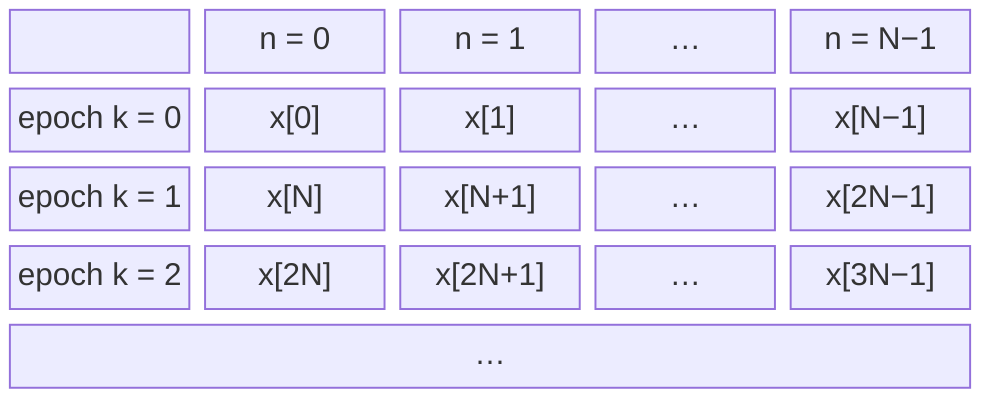
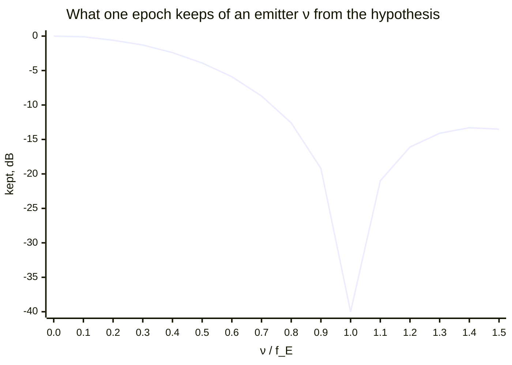
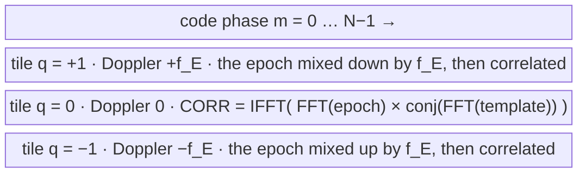

# The acquisition surface: the DSSS search engine

The design of the DSSS search engine (`dp_acq_*`,
`native/src/acq/acq_core.c`), the one C engine behind both
`dp_acq_create_continuous()` (`Acquisition`) and `dp_acq_create_burst()`
(`BurstAcquisition`). §1–§8 write what the continuous engine computes, from
the input samples to a hand-off, as equations, each step naming the
function that performs it; §9 is the two front doors and what the burst
door does differently; §10–§16 are the architecture, the trade space, the
false-alarm accounting, the fan-out and the cost; §17 is what is open. The
receiver that drives the continuous engine is
[async-dsss-receiver.md](async-dsss-receiver.md); how to use both classes
is the [DSSS acquisition guide](../guide/dsss-acquisition.md). This page is
the one home of the engine's design.

## 1. Notation

| symbol                                            | meaning                                                                                                                                               | in the code               |
| ------------------------------------------------- | ----------------------------------------------------------------------------------------------------------------------------------------------------- | ------------------------- |
| $x[n]$                                            | complex input samples, $n = 0, 1, \ldots$ counted from the engine's create or last reset                                                              | `x` of `dp_acq_push()`    |
| $b[\ell] \in \{0, 1\}$                            | the code's chips, $\ell = 0 \ldots L-1$                                                                                                               | `code`                    |
| $L$                                               | chips per code period (the spreading factor)                                                                                                          | `sf`                      |
| $S$                                               | samples per chip                                                                                                                                      | `spc`                     |
| $N = L S$                                         | samples per code period: one **epoch**                                                                                                                | `code_bins`               |
| $c[n]$                                            | the code template, one epoch long                                                                                                                     | `replica`                 |
| $f_S$, $\omega_S = 2\pi f_S$                      | sample rate, $f_S = S R_C$ for chip rate $R_C$; sample $n$ is at time $t_n = n / f_S$                                                                 | `fs`                      |
| $f_E = f_S / N = R_C / L$, $\omega_E = 2\pi f_E$  | epoch rate; one epoch lasts $T_E = 1/f_E$                                                                                                             | `2 * doppler_span_hz`     |
| $W$                                               | Doppler tiles, $r = 0 \ldots W-1$                                                                                                                     | `window_bins`             |
| $\hat f_q = q f_E$, $\hat\omega_q = q\, \omega_E$ | a coarse Doppler hypothesis, $q \in \{0, \pm 1, \pm 2, \ldots\}$; tile $r$'s is $q_r = f_{\text{FFT}}(r, W)$                                          | `dp_fftfreq_index(r, W)`  |
| $D$                                               | the slow-time depth: epochs per coherent block                                                                                                        | `coherent_bins`           |
| $I$                                               | slow-time interpolation, $I = 2$ when $D > 1$, else 1                                                                                                 | `interp`                  |
| $K$                                               | non-coherent looks per dwell                                                                                                                          | `n_noncoh`                |
| $\mathrm{FFT}\{y\}$                               | the unnormalized $P$-point transform of $y[n]$: $\mathrm{FFT}\{y\}[j] = \sum_{n=0}^{P-1} y[n]\, e^{-j 2\pi j n / P}$, with $P = N$ unless subscripted | `dp_fft_create(P, -1, 1)` |
| $\mathrm{IFFT}\{Y\}$                              | its unnormalized inverse: $\mathrm{IFFT}\{Y\}[n] = \sum_{j=0}^{P-1} Y[j]\, e^{+j 2\pi j n / P}$, so $\mathrm{IFFT}\{\mathrm{FFT}\{y\}\} = P\, y$      | `dp_fft_create(P, +1, 1)` |

The signed index of bin $u$ of an $M$-point grid is numpy's `fftfreq` fold,
the one convention every axis below uses (`dp_fftfreq_index()`):

$$f_{\text{FFT}}(u, M) = \begin{cases} u & u \le \lfloor (M-1)/2 \rfloor \\ u - M & \text{otherwise} \end{cases}$$

## 2. The template and the epoch matrix

The template holds each chip for $S$ samples, mapped to $\pm 1$
(`acq_create_from_chips()`):

$$c[n] = 1 - 2\, b\big[\lfloor n / S \rfloor\big], \qquad n = 0 \ldots N-1$$

Its spectrum is taken once, conjugated, and kept (`acq_regrid()`):

$$C_T = \mathrm{FFT}\{c\}^{*}$$

The input is cut into epochs on the engine's own sample count and stacked as
the rows of a matrix: **fast time** $n$ runs along an epoch, **slow time**
$k$ across epochs,

$$x_k[n] = x[kN + n], \qquad n = 0 \ldots N-1$$

A row is one code period: fast time, which the correlation (§3) uses. A
column is the stream decimated by $N$, one sample per epoch at the epoch
rate $f_E$: slow time, which the Doppler transform (§4) uses. The epoch grid starts at the engine's create or reset, wherever the
code is in the stream; a receiver that wants several engines on one grid
aligns their resets ([async-dsss-receiver.md](async-dsss-receiver.md) §2.3).

## 3. Fast time: each epoch against the template

Each epoch is correlated circularly with the template at every lag $m$,
after a mix by a **coarse Doppler hypothesis**

$$\hat f_q = q f_E, \qquad q \in \{0, \pm 1, \pm 2, \ldots\}$$

so that, with the mixed epoch $\tilde x_{k,q}[n] = x_k[n]\, e^{-j \hat\omega_q t_n}$,

$$z_{k,q}[m] = N \sum_{n=0}^{N-1} \tilde x_{k,q}[n]\, c\big[(n - m) \bmod N\big] = \mathrm{IFFT}\big\{\mathrm{FFT}\{\tilde x_{k,q}\}\; C_T\big\}[m]$$

A circular correlation is a multiply of spectra: the mixed epoch's spectrum
times the template's conjugate spectrum, inverted. The factor $N$ is the
unnormalized inverse's.

**Why the mix.** The fast-time sum runs over $N$ samples, and an emitter
whose Doppler sits $\nu$ from the hypothesis turns $\nu / f_E$ cycles across
them. The sum keeps (§8)

$$|\chi(0, \nu)| = \left| \frac{\sin(\pi \nu T_E)}{\sin(\pi \nu T_E / N)} \right|$$

of its $N$: all of it at $\nu = 0$, $2N/\pi$ ($-3.9$ dB) at $\nu = f_E/2$,
and **nothing** at $\nu = f_E$. An emitter one epoch rate away from the
hypothesis forms no correlation peak at all. So each hypothesis holds the
emitters within $\pm f_E/2$ of $\hat f_q$, and covering a wider Doppler
uncertainty takes several. Because $q$ is an integer,
$\hat\omega_q T_E = 2\pi q$, so $e^{-j \hat\omega_q (t_n + k T_E)} = e^{-j \hat\omega_q t_n}$: the mix is continuous from
epoch to epoch, so what is left in the slow-time columns is the residual
$f - \hat f_q$.

At a tile's center the epoch keeps everything; at its edge, $f_E/2$ away,
3.9 dB is gone; one epoch rate away nothing is left (drawn at $-40$ dB), and
beyond it only the sinc's sidelobes. The tiles are spaced so that every
Doppler is within $f_E/2$ of one of them.

**How the code computes it.** Each epoch is transformed once (`wide_fwd`),

$$X_k = \mathrm{FFT}\{x_k\}$$

and a mix by $-\hat f_q$ is a circular shift of that spectrum by $q$ bins,
$\mathrm{FFT}\{\tilde x_{k,q}\}[j] = X_k[(j + q) \bmod N]$, so every
hypothesis costs one multiply and one inverse transform
(`acq_tile_epoch()`):

$$z_{k,q} = \mathrm{IFFT}\Big\{X_k\big[(j + q) \bmod N\big]\, C_T[j]\Big\}$$

This is the engine's **wideband window tiling** (the file doc of
`acq_core.h`), which the continuous engine runs whenever $W > 1$, with the
slow-time depth of §4 inside each tile. At $W = 1$ the only hypothesis is
$q = 0$, and the engine frames its $D$ epochs untiled (`acq_regrid()`'s
`frame_n`): the same $q = 0$ surface, with no shift to apply. The hypotheses are $q_r = f_{\text{FFT}}(r, W)$
for $r = 0 \ldots W-1$: the centers $0, \pm f_E, \pm 2 f_E, \ldots$, stored
in FFT order. With a
one-sided Doppler uncertainty $\Delta$ (`doppler_uncertainty`), there are
(`acq_cover_window_bins()`)

$$W = 2 \left\lceil \frac{\Delta - f_E/2}{f_E} \right\rceil + 1, \qquad W = 1 \text{ when } \Delta \le f_E / 2$$

For $W = 3$, one epoch becomes three correlations, one per tile, each over
every code phase:

### 3.1 The lag grid: a padded inverse for an awkward period

The forward transform must be the period's own length, $N$ samples: the
correlation is circular, and padding the epoch or the template in time would
change what it computes. The inverse need not be. Zero-padding the product
spectrum from $N$ bins to $L \ge N$ before inverting (the low half at the
front, the high half at the end, an even $N$'s Nyquist bin split between
the two: `dp_fft_pad_spectrum()`) gives the same circular correlation at
every $L/N$-th output and its band-limited interpolation between: the lag
grid becomes $N/L$ of a sample a column.

The continuous engine uses that to keep its inverses fast. When $N$ is not
7-smooth, $L$ is the next power of two (`lag_bins`; $N$ itself otherwise,
and always on a burst engine). At two samples a chip of a 1,023-chip code,
$N = 2046 = 2 \cdot 3 \cdot 11 \cdot 31$ and $L = 2048$: an inverse of 1.65
us against 9.32 us at 2,046, measured on the engine's own FFT, and there
are $W$ of them an epoch against one forward. The surface is `surface_rows`
by `lag_bins`; a hit's `code_phase` is a column, a lag of
`code_phase * code_bins / lag_bins` samples, and the hand-off maps it to
chips on that grid. On a narrow engine corr2d's decoupled inverse
(`nx_out`) pads the same way.

What it changes downstream is the grid, not the correlation. An emitter
whose delay lands between two columns reads up to a triangle's straddle
low ($1 - s/(2\,\text{zone})$ at a column of $s$ samples), as it already
could between two samples; the hit carries the statistic with that put
back (`test_stat_peak`), which rule 2 of the receiver's pick needs (§8).
The false-alarm budget counts `lag_bins` columns a row; measured noise-only,
the padded engine's Pfa sits on its target at D = 1 and D = 150.

## 4. Slow time: the Doppler inside each hypothesis, and the tiles

Column $m$ of $z_{k,q}$ is a series at the epoch rate. When $D > 1$ the
engine takes $D$ consecutive epochs, a **block** $k = bD + i'$ for
$i' = 0 \ldots D-1$, and transforms each column over it, zero-padded to $DI$
points (`acq_tile_block()`):

$$Z_{b,q}[\,\cdot\,, m] = \mathrm{FFT}_{DI}\big\{z_{bD + i',\, q}[m]\big\}, \qquad i' = 0 \ldots D-1$$

Row $i = 0 \ldots DI-1$ of the result is $Z_{b,q}[i, m]$, at the residual
$f_{\text{FFT}}(i, DI)\, f_E / (DI)$. A series at the epoch rate resolves
Doppler only within $\pm f_E/2$, and folds anything outside back into it:
emitters at $f$ and $f + f_E$ read the same in slow time. The fast-time mix
of §3 is what chooses which of those zones a block is looking at.

The zero padding is exact band-limited interpolation of the Doppler axis,
which halves the worst scalloping of a slow-time bin
(`ACQ_DOPPLER_INTERP`). Two optional factors multiply the series before the
transform: with a carrier set (`dp_acq_set_carrier_freq_hz()`), a linear
phase in the epoch's spectrum that shifts each epoch's lag to the block's
middle by the hypothesis' code-rate dilation; and with rate hypotheses
(burst engines), the de-chirp $e^{-j \pi a_h t_{i'}^2}$
(`acq_rate_table()`). The continuous engine runs one rate hypothesis, so it
has no de-chirp. With $D = 1$ there is no slow-time transform:
$Z_{k,q}[0, m] = z_{k,q}[m]$.

**One tile is a 2-D transform.** Per hypothesis, §3 and §4 together are one
separable $N \times DI$ transform of the block's product grid, inverse
along fast time and then forward along slow time:

$$Z_{b,q} = \mathrm{FFT}_{DI}\Big\{\mathrm{IFFT}\big\{X_k[(j + q) \bmod N]\, C_T[j]\big\}\Big\}, \qquad k = bD \ldots bD + D - 1$$

Done naively, each hypothesis would mix the epochs in time and transform
them forward itself: $WD$ forward transforms a block. Tiling computes
$X_k$ once per epoch for every tile, and the mix becomes a free index
shift, so a block costs $D$ forward, $WD$ inverse and $WN$ slow-time
transforms:

$$\underbrace{D \cdot N \log N}_{\text{forward, shared}} + \underbrace{W D \cdot N \log N}_{\text{inverse, per tile}} + \underbrace{W N \cdot D I \log (D I)}_{\text{slow time, per tile}}$$

against $2WD \cdot N \log N + WN \cdot DI \log(DI)$ naively. The tiles are
independent after the shared forward transform, which is why they fan
across threads (`dp_acq_set_threads()`) with bit-identical results.

**The depth.** From the code-only window $E$ in whole epochs
(`code_only_epochs`) and the Doppler rate $\dot f$ (`doppler_rate`)
(`acq_block_depth()`):

$$D = \mathrm{smooth}_7\!\left(\max\!\left(1,\ \min\!\left(\left\lfloor \frac{E+1}{2} \right\rfloor,\ \left\lfloor \frac{f_E}{\sqrt{2 \dot f}} \right\rfloor\right)\right)\right)$$

The first bound keeps a whole block inside the window at any window phase;
the second keeps the drift over a block inside half a slow-time row.
$\mathrm{smooth}_7$ rounds down to a length whose prime factors are at most
7 (`dp_fft_smooth_floor()`). $\dot f = 0$ drops the second bound; $E = 1$
gives $D = 1$.

**A tile** is the two-dimensional grid of one coarse hypothesis $\hat f_q$:
$DI$ Doppler rows, $f_E/(DI)$ apart over $\hat f_q \pm f_E/2$, by $N$ lag
columns, each cell one $Z_{b,q}[i, m]$. At $D = 1$ a tile is one row. The
**surface** is the $W$ tiles stacked along Doppler. Here for $W = 3$,
$D = 2$ and $I = 2$, so each tile is $DI = 4$ rows, $f_E/4$ apart.
$Z_q[i, m]$ is the block's $Z_{b,q}[i, m]$: row $i$ of tile $q$, with
$f_{\text{FFT}}(i, DI) = +1, 0, -1, -2$ reading top to bottom inside each tile, at
lag $m$ along each row:

$$
\begin{array}{ll|cccc}
 & \text{Doppler} & m = 0 & m = 1 & \cdots & m = N-1 \\ \hline
\text{tile } q = +1 & +1.25\, f_E & Z_{+1}[1, 0] & Z_{+1}[1, 1] & \cdots & Z_{+1}[1, N-1] \\
 & +1.00\, f_E & Z_{+1}[0, 0] & Z_{+1}[0, 1] & \cdots & Z_{+1}[0, N-1] \\
 & +0.75\, f_E & Z_{+1}[3, 0] & Z_{+1}[3, 1] & \cdots & Z_{+1}[3, N-1] \\
 & +0.50\, f_E & Z_{+1}[2, 0] & Z_{+1}[2, 1] & \cdots & Z_{+1}[2, N-1] \\ \hline
\text{tile } q = 0 & +0.25\, f_E & Z_{0}[1, 0] & Z_{0}[1, 1] & \cdots & Z_{0}[1, N-1] \\
 & +0.00\, f_E & Z_{0}[0, 0] & Z_{0}[0, 1] & \cdots & Z_{0}[0, N-1] \\
 & -0.25\, f_E & Z_{0}[3, 0] & Z_{0}[3, 1] & \cdots & Z_{0}[3, N-1] \\
 & -0.50\, f_E & Z_{0}[2, 0] & Z_{0}[2, 1] & \cdots & Z_{0}[2, N-1] \\ \hline
\text{tile } q = -1 & -0.75\, f_E & Z_{-1}[1, 0] & Z_{-1}[1, 1] & \cdots & Z_{-1}[1, N-1] \\
 & -1.00\, f_E & Z_{-1}[0, 0] & Z_{-1}[0, 1] & \cdots & Z_{-1}[0, N-1] \\
 & -1.25\, f_E & Z_{-1}[3, 0] & Z_{-1}[3, 1] & \cdots & Z_{-1}[3, N-1] \\
 & -1.50\, f_E & Z_{-1}[2, 0] & Z_{-1}[2, 1] & \cdots & Z_{-1}[2, N-1]
\end{array}
$$

Together the rows make one uniform Doppler grid, here $+1.25 f_E$ down to
$-1.5 f_E$ in steps of $f_E/4$. Lag $m$ reports the chip phase
$(L - m/S) \bmod L$. At $D = 1$ each tile is one row.

Row $i$ of tile $r$ is stored at surface row (`acq_block_row()`)

$$u = \big(q_r \cdot DI + f_{\text{FFT}}(i, DI)\big) \bmod (W D I)$$

so the tiles' rows make one uniform grid of $WDI$ rows at spacing
$f_E/(DI)$, in FFT order. The native resolution, the spacing a hit's
`doppler_bin` counts in, is

$$\delta f = \frac{f_E}{D} = \frac{R_C}{L D}$$

($\delta f = f_E$ at $D = 1$, where row $u = r$). The surface has
$M = WDI \times N$ cells, and the engine decides it once per block (once
per epoch at $D = 1$).

## 5. The dwell's statistic and gate

**False-alarm split.** The system false-alarm probability $P_{fa}$ is split
over the $M$ cells the peak search ranges over (Šidák, `dp_det_pfa_cell()`,
`acq_band_cells()`):

$$p_c = 1 - (1 - P_{fa})^{1/M}$$

**One look ($K = 1$)** (`acq_compute_stat()`). The cell amplitude is
$A[u, m] = |Z[u, m]|$. The reference is the surface's mean amplitude (the
default `noise_mode`, mean), and for Rayleigh noise
$\mathbb{E}|Z| = \sigma \sqrt{\pi/2}$, so

$$\mu = \frac{1}{M} \sum_{u, m} A[u, m], \qquad \hat\sigma = \mu \sqrt{2/\pi}$$

A cell passes when

$$A[u, m] > \eta\, \hat\sigma, \qquad \eta = \sqrt{-2 \ln p_c}$$

(`dp_det_threshold()`); the dwell's `test_stat` is $\max A / \mu$, compared
with $\eta \sqrt{2/\pi}$ (`threshold`).

**$K$ looks** (`acq_tile_nc_acc()`, `acq_compute_stat_nc()`). $K$
consecutive surfaces are summed in power,

$$P[u, m] = \sum_{\ell = 1}^{K} \big|Z_\ell[u, m]\big|^2, \qquad \bar P = \frac{1}{M} \sum_{u,m} P[u, m]$$

and a cell passes when its normalized statistic clears the order-$K$ gate:

$$R[u, m] = \sqrt{\frac{2K\, P[u, m]}{\bar P}} > \eta_K, \qquad Q_K(0, \eta_K) = p_c$$

where $Q_K$ is the generalized Marcum Q-function
(`dp_det_threshold_noncoherent()`). $K$ is the smallest count, at most
`ACQ_N_NONCOH_SAFETY_CEILING` (256), whose averaged $P_d$ meets the target
at the design C/N0 (`acq_ascend_n_noncoh()`).

One dwell is therefore $K$ blocks, $KDN$ samples.

## 6. The peak list

Up to `max_peaks` peaks are taken from the decided surface, strongest
first (`acq_list_peaks()`):

1. Take the largest cell not yet masked. Stop if it does not pass the gate,
    or if the list is full.
1. Mask its **zone**: the $I$ fine rows either side (one native Doppler
    row) by the code's mainlobe, `shape.zone` lags either side, circularly
    ($S$ lags, one chip, for a code).
1. Repeat.

Each listed cell is then reported (`acq_report_peaks()`):

- **Its native row**: the stronger native neighbor of an interpolated row
    (`acq_native_row()`).
- **Its tile**: near a tile edge both neighboring tiles read an emitter at
    the same row, so the block's raw epochs are correlated at the row's
    frequency and one epoch rate either side, and the strongest of the three
    names the tile (`acq_resolve_tile_alias()`).
- **The twin rule**: a pick within the zone of an already-listed pick's lag,
    at any row, is held for one dwell and listed only if, on the previous
    dwell, a pick stood at the same native row and within the zone of its
    lag. A data transition inside an epoch
    splits one emitter's correlation into partial correlations at its own lag
    on other tiles, and those move with the transition; a second emitter at
    the same lag stays.

The zone and the twin rule reach one chip from a listed lag. Nothing in the
list removes a peak further away: §8 is what can stand there.

## 7. From a cell to a hand-off

A reported cell, at native row $u'$ (of $WD$) and lag $m$, becomes physical
values (`dp_acq_build_handoff()`, `acq_handoff_chip_phase()`):

$$\hat f_{\text{hit}} = f_{\text{FFT}}(u', WD)\; \delta f, \qquad \hat\phi = \big(L - m\,L/L_m\big) \bmod L \ \text{chips}$$

with $L_m$ the lag grid's columns (`lag_bins`, §3.1; $L_m = SL$, one a
sample, unless the period is padded).

The chip phase inverts the lag into the code-tracking convention. With a
carrier $f_C$ set, it also advances by the dilation over half the dwell,
$\tfrac{1}{2} K D L\, \hat f_{\text{hit}} / f_C$ chips, since the peak is the dwell's
middle and the seed is wanted at its end.

The C/N0 estimate inverts the statistic per sample
(`acq_report_peaks()`, `dp_det_snr_to_cn0()`), with $N_c = DN$ samples per
coherent look:

$$\hat a = \begin{cases} \dfrac{\max A / \mu}{\sqrt{2/\pi}\,\sqrt{2 N_c}} & K = 1 \\[2ex] \dfrac{\max R}{\sqrt{2 N_c K}} & K > 1 \end{cases}, \qquad \widehat{C/N_0} = 20 \log_{10} \hat a + 10 \log_{10} f_S$$

`samples_consumed` is the engine's position at the end of the decided dwell.

## 8. What the surface holds for one emitter: the code's ambiguity

Let one emitter arrive at lag $\tau$ samples, Doppler $f$ and phase
$\theta$, in noise $w[n]$, with no data transition inside the epoch:

$$x[n] = a\, c\big[(n - \tau) \bmod N\big]\, e^{j (\omega t_n + \theta)} + w[n]$$

Substituting into §3, hypothesis $q$ reads, at lag $m$,

$$z_{k,q}[m] = N a\, e^{j \theta_k}\; \chi\big(m - \tau,\ f - \hat f_q\big) + \text{noise}$$

with the code's periodic **ambiguity function**

$$\chi(\Delta, \nu) = \sum_{n=0}^{N-1} c[n]\, c\big[(n - \Delta) \bmod N\big]\, e^{j \omega_\nu t_n}, \qquad \omega_\nu = 2\pi \nu$$

and $\theta_k$ a phase that advances by $\omega T_E$ per epoch, $\omega = 2\pi f$, which is
what the slow-time transform of §4 resolves. Over a block every epoch
carries the same $|\chi|$, so the slow-time sum scales the emitter's peak
and every one of its sidelobes by the same factor: **ratios read on one
epoch hold on a code-only block, at any $D$.** A block over data does not
hold them: a data transition inside an epoch is outside $\chi$.

**The emitter's own peak**, $\Delta = 0$, is the Dirichlet kernel in the
residual $\nu = f - \hat f_q$:

$$|\chi(0, \nu)| = \left| \frac{\sin(\pi \nu T_E)}{\sin(\pi \nu T_E / N)} \right|$$

It is $N$ at a tile's center and falls to $\approx 2N/\pi$
($-3.9$ dB) at the tile's edge, $\nu = f_E/2$, where the emitter reads in
two tiles at once.

**Sidelobes at zero residual**, $\nu = 0$, are the code's periodic
autocorrelation. Their largest outside the zone, relative to the peak, is
the preamble's peak sidelobe, which the constructor already computes
(`acq_shape_t::psl`, `dp_acq_psl_db()`). For a Gold code of 1023 chips the
three autocorrelation values give $65/1023$: $-23.9$ dB.

**Sidelobes at a tile offset**, $\nu = f - \hat f_q$ for the tiles the
emitter is not in, are much larger. The engine computes their worst case
on first read (`acq_shape_t::dsl`, `dp_acq_dsl_db()`). Computed from $\chi$
for the Gold code the receiver validators use
(`dp_dsss_gold_1023()`, $S = 2$, $f_E = 3$ kHz, five tiles), the largest
$|\chi(\Delta, f - \hat f_q)|$ with $\Delta$ more than a chip from 0,
circularly, over every tile, relative to the emitter's own peak:

<!-- acq-surface:ambiguity:start -->

| emitter Doppler $f$ | from its tile's center  | largest off-lag sidelobe | where                                    |
| ------------------- | ----------------------- | ------------------------ | ---------------------------------------- |
| 200 Hz              | 200 Hz                  | $-22.02$ dB              | tile $-1$, 345 chips off                 |
| 1500 Hz             | $\pm 1500$ Hz, the edge | $-17.73$ dB              | tiles $-1$ and $+2$, tied, 277 chips off |
| $-2600$ Hz          | 400 Hz                  | $-21.29$ dB              | tile $+2$, 341 chips off                 |

<!-- acq-surface:ambiguity:end -->

They are fixed by the emitter: the engine's own peak lists show the same
cells dwell after dwell. An emitter at chip 873 and 1500 Hz lists a peak at
chip 127, 277 chips away circularly, dwell after dwell. At a tile edge the
emitter sits halfway between two tiles, so the next tiles out, $-1$ and
$+2$, both lie $1.5 f_E$ from it and read the same sidelobe. The
tile edge is the worst of the three because the emitter's own peak has lost
its 3.9 dB there and the sidelobe has not. Three emitters do not find the
band's worst, though: swept over the whole uncertainty, the code comes closer
still (the near-far limits, below).

**What the engine lists.** The shipped engine over the same code, sized at
47 dB-Hz over $\pm 5$ kHz with `max_peaks` 16, at a depth of one epoch and at
the depth [the specification](async-dsss-receiver.md#1-the-specification) window allows: 600-symbol streams framed 450 code-only
symbols in 500, at 200, 750, 1500 and $-2600$ Hz with 6 noise draws each.
Each cell is the largest off-lag peak in a list, relative to the list's
first, in power, and how many lists hold one. The last column is the deep
engine on a stream that is data throughout:

<!-- acq-surface:lists:start -->

| C/N0     | $D = 1$                           | $D = 90$                        | $D = 90$, data throughout |
| -------- | --------------------------------- | ------------------------------- | ------------------------- |
| 47 dB-Hz | $-2.1$ dB, in 7 of 4008 lists     | $-13.8$ dB, in 149 of 168 lists | —                         |
| 50 dB-Hz | $-5.0$ dB, in 9 of 4008 lists     | $-14.7$ dB, in 148 of 168 lists | —                         |
| 53 dB-Hz | $-8.0$ dB, in 15 of 4008 lists    | $-15.3$ dB, in 146 of 168 lists | —                         |
| 56 dB-Hz | $-10.8$ dB, in 72 of 4008 lists   | $-15.7$ dB, in 146 of 168 lists | —                         |
| 60 dB-Hz | $-13.0$ dB, in 771 of 4008 lists  | $-16.0$ dB, in 146 of 168 lists | none in 168 lists         |
| 70 dB-Hz | $-15.5$ dB, in 3985 of 4008 lists | $-16.4$ dB, in 147 of 168 lists | none in 168 lists         |

<!-- acq-surface:lists:end -->

At $D = 90$ the lists approach the code's ambiguity: a block inside the
code-only window is the code alone, and what is left above $\chi$ comes
from blocks that straddle the window's edge into data. At $D = 1$ they do
not, even at high C/N0, where an epoch's SNR leaves noise no room: a
one-epoch search over data sees partial-period correlations at bit
transitions, which $\chi$ excludes (this section's premise), so its
off-lag peaks stand several dB above $\chi$. Near the threshold the
emitter's own peak barely clears the gate, and an off-lag peak comes within
a few dB of it, rarely. On data throughout, $D = 90$ lists no off-lag peak:
a block over data spreads the emitter over its rows first.

**Why neither axis is windowed.** Sidelobes invite a taper, but neither
transform's window reaches these. They are computed for the same code and
geometry. Each window is the symmetric one whose zeros fall outside the block, so no
sample or epoch is weighted zero: Hann and Blackman are two points longer
with their zeros dropped, and Hamming has none. Every loss includes the
window's noise bandwidth, the SNR kept at a residual being
$|\sum_n w_n e^{j \omega_\nu t_n}|^2 / \big(N \sum_n w_n^2\big)$.

*Fast time*, a window on the epoch before the correlation. In the emitter's
own column $c[n]^2 = 1$, so the Doppler slice of §3 becomes the window's own
spectrum: the tile edge loses less, but every Doppler pays the noise
bandwidth, the next tile is no longer a null, and the off-lag sidelobes rise
relative to the peak, because they come from the code product
$c[n]\, c[n - \Delta]$, which is noise-like, and not from the window. The
edge is $\nu = f_E/2$, the average is the mean power over a tile, and the
next tile is read against the window's own center:

<!-- acq-surface:fast:start -->

| fast-time window | edge loss  | average loss | next tile, $\nu = f_E$ | worst off-lag sidelobe (200 / 1500 / $-2600$ Hz) |
| ---------------- | ---------- | ------------ | ---------------------- | ------------------------------------------------ |
| none (shipped)   | $-3.92$ dB | $-1.11$ dB   | null                   | $-22.02$ / $-17.73$ / $-21.29$ dB                |
| Hann             | $-3.18$    | $-2.21$      | $-6.03$                | $-18.38$ / $-17.26$ / $-18.32$                   |
| Hamming          | $-3.10$    | $-1.90$      | $-7.41$                | $-19.02$ / $-17.53$ / $-18.94$                   |
| Blackman         | $-3.47$    | $-2.72$      | $-4.51$                | $-17.28$ / $-16.45$ / $-17.23$                   |

<!-- acq-surface:fast:end -->

*Slow time*, a window on the block's $D$ epochs before $\mathrm{FFT}_{DI}$. It
runs down one lag column, so it cannot touch the off-lag sidelobes above: an
emitter and its sidelobe in another tile turn at the same $\omega T_E$ per
epoch and the window scales both alike. What it lowers is the emitter's own
leakage across its column's Doppler rows, which matters only for two
emitters within a chip of one code phase. The zero padding has already
brought the scalloping under a dB, so the window's noise bandwidth is a loss
at every Doppler, and its wider main lobe needs a wider zone, or its
shoulder is listed as a second peak. The worst loss is an emitter half a
fine row from its nearest row, the average is over that half row, and the
leakage is the largest row past the zone, relative to the picked row, over
every emitter offset:

<!-- acq-surface:slow:start -->

| slow-time window | worst loss | average loss | own-column leakage past the zone | zone               |
| ---------------- | ---------- | ------------ | -------------------------------- | ------------------ |
| none (shipped)   | $-0.91$ dB | $-0.29$ dB   | $-13.15$ dB                      | $\pm 1$ native bin |
| Hann             | $-2.07$    | $-1.83$      | $-31.29$                         | $\pm 2$            |
| Hamming          | $-1.81$    | $-1.52$      | $-42.56$                         | $\pm 2$            |
| Blackman         | $-2.60$    | $-2.42$      | $-58.11$                         | $\pm 3$            |

<!-- acq-surface:slow:end -->

Both trade detection for a sidelobe the search is not limited by. The
limit is the code's own ambiguity, below.

**What it means for a search that does not take the strongest peak.** The
strongest peak is the emitter, so a search that takes the first of the list
is unaffected. A search that skips peaks (a rank above 0, or exclusions:
[async-dsss-receiver.md](async-dsss-receiver.md) §7.2) can reach one of the
emitter's own sidelobes and take it as a second emitter. The zone and the
twin rule do not reach it, being one chip wide. So no list rule that keys on
the lag alone separates a second emitter from the first one's sidelobe when
the second sits further below the first than that sidelobe can come. That is
the **near-far limit** of a ranked or excluded search on this code, and it
has two sides. On a code-only block the code's ambiguity sets it. Over
data, which is what a one-epoch search always sees, the partial-period
correlations at bit transitions set it, and that side is set by the data,
not the noise. The ambiguity's own worst is in neither table above; it
takes sweeping the emitter over the band:

<!-- acq-surface:limits:start -->

| what sets it                                                           | closest an off-lag peak comes to the emitter's peak | where                                                    |
| ---------------------------------------------------------------------- | --------------------------------------------------- | -------------------------------------------------------- |
| the code's ambiguity, the emitter swept every 25 Hz over $\pm 5000$ Hz | $-16.95$ dB                                         | at $-4500$ Hz                                            |
| the engine's lists at $D = 90$                                         | $-13.8$ dB                                          | at 47 dB-Hz, in 149 of 168 lists; $-16.4$ dB at 70 dB-Hz |
| the engine's lists at $D = 1$                                          | $-2.1$ dB                                           | at 47 dB-Hz, in 7 of 4008 lists; $-15.5$ dB at 70 dB-Hz  |

<!-- acq-surface:limits:end -->

Any rule that admits a weaker second emitter has to know $\chi$, and over
data a floor at the ambiguity's level alone does not hold the sidelobes
off: the last row is far above it.

**Decided (2026-10-21).** The owner ruled that the ranked search's floor is
derived from the code's Doppler-offset sidelobe level, as `psl` is from its
zero-offset one; the level is defined on the grid the engine was built with
and computed on its first read, `dp_acq_dsl_db()`. A peak is a second emitter only
if its statistic stands higher than the stronger emitters' sidelobes can
reach, their statistic times that level, and it still clears the detector's
gate. The mechanism and its numbers are #2525's, in its design text.

**Where the numbers come from.** Every table in this section is the output
of one run of the validator `native/validation/acq_surface.c`
(`validate_acq_surface --emit`), kept beside this page in
`acq-surface-measurements/` and rendered there by `record.py`.
`make docs-check` fails when a table is not what the run's data renders,
and the validator's own `--check`, a CTest, pins the claims this section
draws from them. `make acq-surface-record` re-runs it and rewrites the tables:

<!-- acq-surface:stamp:start -->

| run                           | when                       | machine                                                          | commit             | toolchain                                                             | operating point                                           | command                   |
| ----------------------------- | -------------------------- | ---------------------------------------------------------------- | ------------------ | --------------------------------------------------------------------- | --------------------------------------------------------- | ------------------------- |
| `validate_acq_surface --emit` | 2026-10-21 21:17 UTC, 87 s | `swiftgo-ai9465`: AMD Ryzen AI 9 465 w/ Radeon 880M (20 threads) | `59cd886b2`, clean | GNU 14.2.0; glibc 2.41; build Release, flags -O3 -DNDEBUG, native OFF | $N = 2046$, $W = 5$ at $f_E = 3000$ Hz, $D = 90$, $I = 2$ | `make acq-surface-record` |

<!-- acq-surface:stamp:end -->

## 9. Two front doors, one engine

The engine has two public constructors, and each fixes a mode at
construction rather than offering a per-call knob. The reason is the one
fact about slow time that §4 states: a coherent slow-time transform
resolves Doppler only *within* one native span $\pm f_E/2$. More depth
subdivides that span; it never widens it. And on a continuous,
data-modulated signal a coherent axis across epochs that carry data
aliases the data's own transitions across the whole Doppler axis: the data
spectrum, sampled at close to one sample per symbol, lands broadband energy
in every row, and the wrong row wins outright. That is a structural
mislock, not a graceful loss of gain, and the engine closes it at the
constructor instead of pricing it as a tunable trade
([the guide's worked proof](../guide/dsss-acquisition.md#continuous-data-modulated-signals-the-asynchronous-symbol-clock-case)).

|               | `dp_acq_create_continuous()` (`Acquisition`)                            | `dp_acq_create_burst()` (`BurstAcquisition`)                                 |
| ------------- | ----------------------------------------------------------------------- | ---------------------------------------------------------------------------- |
| signal        | a continuous, data-modulated code                                       | a burst opening with a repeated, data-free preamble                          |
| reference     | the code's chips, held `spc` samples each (§2)                          | one period of the preamble, as samples (§9.1)                                |
| Doppler       | always window-tiled (§3), $W = 1$ when $\Delta \le f_E/2$               | one native span; tiled the same way when $\Delta$ exceeds it                 |
| depth $D$     | from `code_only_epochs` and `doppler_rate` (§4), 1 by default           | the smallest in $[1, \text{reps}]$ whose burst $P_d$ (`pd_burst`) meets `pd` |
| looks $K$     | auto-selected to meet `pd`, at most `ACQ_N_NONCOH_SAFETY_CEILING` (256) | always 1                                                                     |
| Doppler rate  | caps $D$; one rate hypothesis                                           | caps $D$; `rate_hypotheses` de-chirps the block at $n$ rates (§4)            |
| short of `pd` | best effort, `underpowered` set                                         | the depth with the most `pd_burst`, `underpowered` set                       |

**Continuous.** Coherent gain comes only from epochs the caller declares
code-only (`code_only_epochs`), inside a tile, in blocks that a data
transition cannot enter (§4's first bound). Everything else is
non-coherent looks, which square away the data's sign. `symbol_rate`
survives as a diagnostic only. The ceiling of 256 looks is a safety valve:
the semi-analytical $P_d$ model the engine sizes against turns unreliable
past a few hundred looks. It is not a physical sensitivity limit and not a
public knob.

**Burst.** A burst has one preamble, so a second look adds noise and
arrives a frame late (#1181, #1503): the burst engine never adds one. Its
burst $P_d$ is the preamble landing at any offset against stream-aligned
dwells, detected when any one of them is. Untiled, it frames $D$ epochs
$D \times N$, transforms down the columns for Doppler, correlates each row
against the reference through `corr2d`, and CFAR-gates the surface (the
file doc of `acq_core.h`). With a stated design C/N0 and an uncertainty
wider than one span, it tiles as the continuous door does and chooses the
depth inside every tile.

**`doppler_rate` caps, never floors.** On both doors it bounds the depth at
$f_E / \sqrt{2 \dot f}$ (§4), so it can only lower $D$. A depth past it
smears the carrier across slow-time rows, which the $P_d$ model does not
carry. On 16 repetitions of Zadoff-Chu 127 under a 1.5 MHz/s ramp
(`native/validation/acq_template_pd.c`, 3000 trials), an engine told
nothing is sized at $D = 10$, predicts 0.91 and delivers 0.85; told the
rate, it caps at $D = 4$, reports `underpowered`, predicts 0.42 and
delivers 0.45 (#1482). With `rate_hypotheses` $n > 1$ the burst engine
applies the bound to the residual rate, $R/(n-1)$, so $D$ can grow by up to
$\sqrt{n-1}$, and a dwell costs about $n$ slow-time passes
([burst-capture.md §11.5](burst-capture.md)).

### 9.1 Any repeated preamble, not only a code

Nothing in the burst engine's surface is specific to a PN code. It frames
the stream by one period of the reference, correlates each repetition
circularly, transforms slow time, and tiles a wide uncertainty by whole-bin
spectral shifts. All of that holds for **any periodic complex reference**.
`dp_acq_create_burst()` takes the samples themselves (#1470, #1478): a PN
code is passed as its chips by `bin_to_nrz()`, held `spc` samples each, and
one chip is one sample (`sf = n`, `spc = 1`, `chip_rate = fs`), so
`code_phase` is the delay into the repetition in samples.

**What the engine asks of the waveform** is two numbers about its
autocorrelation $R$. A code has both analytically, from the triangle one
chip wide. A template gets both from one FFT at construction
(`acq_shape_t`):

| quantity       | used for                                            | a code      | a template                                                                       |
| -------------- | --------------------------------------------------- | ----------- | -------------------------------------------------------------------------------- |
| `zone`         | the peak list's exclusion and the twin rule's reach | `spc`       | the first null: the first lag where `\|R\|` stops falling by more than 1e-6·R(0) |
| delay straddle | the Pd model's half-sample prior                    | `1 − δ/spc` | band-limited `\|R(δ)\|/R(0)`; an even length's Nyquist bin contributes `cos(πδ)` |

**A burst engine uses the right-hand column for everything, codes
included.** The "a code" column is an ideal rectangular pulse's: continuous
chips correlated against each other. A sampled, band-limited chain never
sees that, and against a rectangular-chip Monte-Carlo the triangle's delay
straddle under-predicted $P_d$ by 0.03–0.10 at 4 samples a chip and up to
0.40 at 1; the samples model sits at +0.00 to +0.08, never optimistic.
Only the continuous engine, which takes chips, keeps the analytic column
(#1495). The two agree where they should: a 31-chip code handed over as
samples gets zone 4 = `spc`, and a 7-chip code honestly gets 3, because its
sidelobe floor (1/7) reaches the sampled triangle a lag early. The 1e-6
tolerance exists because a perfect sequence's off-peak lags are rounding
(≈3e-9 of R(0) for a float Zadoff-Chu); without it the minimum lands
wherever the FFT's last digit fell.

**The rotation loss keeps its `sinc`, and for a chirp that is
pessimistic.** The $P_d$ model derates the peak for rotation within one
repetition by `sinc(u)`, the ambiguity function's zero-delay cut (§8). For a
constant envelope that cut is exactly the Dirichlet; for a shaped template
it is within 0.007 dB of `sinc(u)` over $u \in [0, \tfrac12]$, even for RRC
QPSK at 4.7 dB PAPR, so no rotation table is kept. The detector takes the
maximum over delay, though, and a chirp's peak slides along its ridge
instead of shrinking, so the zero-delay cut overstates its loss.

**Scale.** The template is scaled to unit RMS, the scale a code's ±1
reference has, so `peak_mag` and `noise_est` are in the signal's units.
`cn0_dbhz` is the preamble's mean power over `fs`; at `fs = 1` it is the
per-sample SNR in dB and Doppler is in cycles/sample. Any finite `cn0_dbhz`
is a design point, negative included, and NaN (`ACQ_CN0_NONE`) means none
(#1484).

**`pd_predicted` is measured, not only modelled**
(`native/validation/acq_template_pd.c`: Doppler uniform over the span,
continuous delay, AWGN, $D = 8$, one look, 3000 trials a row, measured −
predicted at the C/N0 where the model predicts 0.3 / 0.6 / 0.9):

| preamble                     | Δ Pd                  | mean \|delay error\| | reads as                             |
| ---------------------------- | --------------------- | -------------------- | ------------------------------------ |
| code, 31 chips × 4 (control) | +0.08                 | 0.4 samples          | the harness reproduces the code case |
| random-phase QPSK, 96        | +0.04 / +0.05 / +0.04 | 0.2–0.3              | conservative                         |
| Zadoff-Chu, 127              | +0.04 / +0.05 / +0.05 | 0.7–2.5              | conservative                         |
| chirp, 128                   | +0.08 / +0.12 / +0.08 | 0.3                  | conservative: the ridge slide above  |
| QPSK 96, 5-tap low-passed    | +0.06 / +0.10 / +0.05 | 0.3–0.4              | conservative                         |

Every class keeps the "never optimistic" contract. The shaped template broke
it (#1483) until the model priced the CFAR reference the gate divides by
(#1501): that
reference is the mean magnitude of the whole surface, peak included, and a
template's correlation energy off its peak lands in it.

Delay–Doppler coupling is measured, not corrected: a hit's delay is off by
0.3 samples on average for a chirp and up to 2.6 for Zadoff-Chu, whose
Doppler sensitivity moves the peak by whole samples. The exact start, and
which repetition the burst starts in, are the capture's to resolve, not the
detector's ([burst-capture.md](burst-capture.md)).

## 10. One surface, several decompositions

Every method here computes, or approximates, one object: the
**cross-ambiguity function (CAF)**, the correlation surface over delay
(code phase) and Doppler that §8 writes as $\chi$, extended by a
Doppler-rate axis when there are dynamics. The methods differ only in how
they sweep Doppler and how they handle a phase that is not linear. They are
decompositions of one surface, each efficient in a different regime:

| method                         | wins when                                             | Doppler step       | in the engine                                                 |
| ------------------------------ | ----------------------------------------------------- | ------------------ | ------------------------------------------------------------- |
| reframe + slow-time FFT        | Doppler within one span, a data-free coherent window  | $f_E/D$            | the burst door's core (§9)                                    |
| spectral shift (the tiling)    | one epoch, wide uncertainty, no coherent combining    | $f_E$              | the continuous door at $D = 1$ (§3)                           |
| spectral shift + slow-time FFT | a code-only window of $\ge 2D - 1$ epochs inside data | $f_E/D$            | the continuous door at $D > 1$, and a tiled burst engine (§4) |
| Doppler-rate de-chirp          | acceleration, or a long coherent block                | adds rate rows     | the burst door's `rate_hypotheses` (§4)                       |
| sub-block chop                 | wide Doppler with coherent integration intact         | $f_E/D$, span $K$× | not built (§17)                                               |
| direct mix-and-correlate       | reference truth                                       | any                | test ground truth only                                        |

**The spectral shift is the mixer bank's integer-bin case.** Shifting the
epoch spectrum by $q$ bins is exactly mixing by $q f_E$ (§3), so one shared
forward transform serves every hypothesis. Where coherent integration over
more than one epoch is available, a slow-time transform does everything the
shift does plus a finer step plus the coherent gain, which is why the burst
door keeps reframing as its core and tiles only when the uncertainty
outgrows one span. On a continuous data-modulated signal that integration
is not available to any method (§9), so the coherent advantage disappears
and the shift's one forward transform per epoch is the cheaper
realization: about 1.2–1.55× faster than an equivalent tuned-mixer bank in
a frequency-bank benchmark (the file doc of `acq_core.h`). On that door the
shift is the whole $D = 1$ search, not a front end to a richer kernel.

**Sub-block chopping** would cut each epoch into $K$ pieces: the slow-time
rate rises to $K f_E$, so the native span widens to $\pm K f_E/2$ (one
long FFT of length $DK$) at the same resolution, and the within-segment
rotation limit loosens $K$×. The price is partial-correlation loss, each
sub-block seeing $1/K$ of the code (weaker autocorrelation, worse
cross-correlation sidelobes), a few dB for $K \le 8$. It is the principled
alternative to a very wide mixer bank, and it is not built.

**The de-chirp** multiplies the slow-time series by $e^{-j \pi a_h t^2}$
per rate hypothesis before the transform (§4, `acq_rate_table()`), an
independent outer axis around the coherent kernel. Its grid falls out of
the coherent-time budget (§15).

## 11. The trade space

Coherent time $T_{coh} = D T_E$ is the master knob. It adds gain
$10 \log_{10}(DN)$, and four ceilings bound it, whichever bites first:
(a) the Doppler residual, the within-segment `sinc` of §3; (b) the data-bit
period; (c) oscillator coherence; (d) the Doppler rate,
$\dot f\, T_{coh}^2 = O(1)$. Past (a), (c) or (d) gain degrades smoothly.
Past (b) it does not: the data's spectrum aliases across the whole Doppler
axis and a specific wrong row wins (§9). That is why (b) is enforced by the
constructor and not left to a sizing rule.

**Non-coherent looks** pick up where coherent time runs out: robust to the
phase between looks (Doppler walk, bit flips, oscillator drift), gaining
about $5 \log_{10} K$ in the weak limit against coherent's $10 \log_{10}$.
The shortfall is the squaring loss, the price of phase robustness.

| axis               | raises                            | costs                              | coupled to                           | parallel       |
| ------------------ | --------------------------------- | ---------------------------------- | ------------------------------------ | -------------- |
| depth $D$          | gain $10 \log_{10}(DN)$           | latency; ceilings (a)–(d)          | rate grid ($\propto T_{coh}^2$), $K$ | within a tile  |
| looks $K$          | weak-signal reach                 | squaring loss ($\sim 5 \log_{10}$) | the $T_{coh}$ ceiling                | sums           |
| tiles $W$          | Doppler span                      | linear compute                     | edge loss (§3)                       | **tile axis**  |
| rate hypotheses    | dynamics tolerance                | linear compute                     | $1/T_{coh}^2$                        | per hypothesis |
| `spc`              | code-phase resolution, anti-alias | compute $\propto N$                | $N$, $f_S$                           | —              |
| $P_{fa}$↓ / $P_d$↑ | confidence                        | larger $DK$                        | the gate $\eta$                      | —              |

**The coherent / non-coherent split** is the central choice: take $D$ as
large as the binding ceiling allows, then $K$ to close the remaining $P_d$
gap. On the continuous door that is literally the sizing: $D$ from §4,
then the smallest $K$ that meets `pd` (`acq_ascend_n_noncoh()`). The
detection module supplies the primitives: `det_threshold()` for $K = 1$,
`det_threshold_noncoherent()` and `det_pd_noncoherent()` for the order-$K$
statistic, `det_n_noncoh()` for the look count, all over the generalized
`marcum_q()` and validated against Monte-Carlo to under 1%
([detection.md](detection.md)). `cn0_dbhz` becomes the per-sample amplitude
$\sqrt{10^{\text{cn0}/10} / f_S}$ at construction.

## 12. What `pfa` means for a peak detector

**Sum along one axis, maximum along the other.** A cell's value is a *sum*
of $K$ independent looks at the same hypothesis (§5), and the detector's
decision is a *maximum* over cells. The sum runs along time; the maximum
runs along the surface. They set different halves of the threshold.

**The sum sets the per-cell distribution.** Under H0 each look contributes
$\sigma^2 \chi^2_2 / 2$, so the accumulated cell is
$(\sigma^2/2)\, \chi^2_{2K}$, and the per-cell exceedance $p(\eta)$ has a
different shape for every $K$: hence `det_threshold()` for $K = 1$ and
`det_threshold_noncoherent()`, whose tail is $Q_K(0, b)$, for $K > 1$.
Summing independent looks of one field concentrates the marginal and
leaves the surface's spatial correlation alone.

**The maximum sets how many chances the noise gets.** Given $p$, a surface
of $M$ independent cells gives the Šidák split of §5. For the native
surface of a critically sampled DFT that is a good model: adjacent bins of
a white-noise transform are very nearly uncorrelated, and a maximum over
the native rows delivers 0.94–0.99× the target.

**The gate reads the interpolated maximum; the report reads the native
one.** `acq_compute_stat()` and `acq_compute_stat_nc()` compute two maxima.
`peak` ranges over the interpolated surface and sets `test_stat`: that is
where the scalloping loss is recovered (§4's padding) and what decides
whether the gate fires. `nat` is restricted to native rows and sets the
reported `doppler_bin`, because every consumer scales it by
`doppler_res_hz` and a half-bin row would make the estimate jitter by a bin
on noise.

**Why interpolation moves the H0 tail.** The sampled surface samples a
continuous, band-limited function, and zero padding samples it more finely
without adding information. The maximum is monotone in sampling density,
so $P(\max > \eta)$ rises with the padding factor $I$, and it saturates at
the continuous supremum's rate, set by the surface's bandwidth, not by the
number of points. Interpolation recovers the noise peaks between bins for
the same reason it recovers the signal's. Write the tail as

$$P(\sup > \eta) \approx N_{\text{eff}}\, p(\eta) \quad \text{for small } p$$

where $N_{\text{eff}}$, the effective number of independent looks, is a
property of the surface's correlation, not of its grid; then
realized / target $\approx N_{\text{eff}}(I) / N_{\text{eff}}(1)$.

**The shipped bound.** The split is over the cells the maximum ranges over:
`acq_band_cells()`, every searched row of the interpolated surface times
`code_bins`, times the rate hypotheses, the one count every site that
prices a gate uses (#2218). The band is searched to its edge at every
depth, so every counted row is searched (#1183). Counting each
interpolated row as an independent look over-counts by what its
correlation is worth, so this is a **never-exceed bound**. Measured on the
burst engine `validate_acq_rate_pd` builds (Zadoff-Chu 127 × 16, $f_S = 1$,
`pfa` = 1e-3, one rate hypothesis, 1e6 noise dwells a row), as multiples of
the target, read off the same dwells:

| $D$ | interpolated max, native $M$ | native-only max | interpolated max, $M \cdot I$ (shipped) |
| --: | ---------------------------: | --------------: | --------------------------------------: |
|   2 |                        1.90× |           0.98× |                                       — |
|   3 |                        1.86× |           0.94× |                                  0.947× |
|   5 |                        1.92× |           0.97× |                                  0.946× |
|   7 |                        1.93× |           0.99× |                                  0.945× |

A PN m-sequence at $D = 5$ reads 1.88×, 0.98× and 0.969×. So each
interpolated row is nearly a full extra look in the deep tail: a half-bin
row's correlation with its native neighbors is about 0.64, which a cell
probability near 1e-6 all but ignores. The bound costs the gate
$\Delta\eta/\eta \approx \ln(1/\text{ratio})/\eta^2$: about 0.015 dB at the
burst engine's 0.95×, and at most about 0.12 dB where native cells are
themselves correlated (an oversampled code). The $P_d$ model
(`acq_mean_pd`) derates slow-time scalloping over the interpolated bin the
peak search samples, and stays conservative because the Marcum form does
not credit the maximum over an interpolated surface under H1.

Rate hypotheses are the same question on another axis: each is priced as
an independent look at each cell, but neighbors are strongly correlated, so
the delivered rate falls to 0.60, 0.52 and 0.22 of the target at
$n$ = 3, 5 and 9 (#2287).

**Where this is enforced.**

- `test_acq_core.c` pins `pfa_cell` to the band mask's in-band cell count
    on every grid shape, and `make lint-acq-pfa-split` holds every
    `dp_det_pfa_cell` call under `native/src/acq/` to `acq_band_cells`.
- The certification measures the delivered rate against the target
    (finding F7, FIXED) and holds it with a shrink-only ratchet, 1.4× over
    60,000 frames: a backstop that an on-target detector trips about 0.1% of
    the time and the native pricing (1.76× on that engine) escapes about 2%.
- `validate_acq_rate_pd_pfa`, in CI's sweep-validators job, holds the
    burst engine's per-dwell rows at the design point, each not
    significantly above target: $n$ = 1, 3 and auto over 100,000 dwells, 5
    and 9 over 20,000 (#2324). Only $n = 1$ detects a doubled rate; 3 and
    auto are backstops.
- `validate_acq_block_coherent --check` holds the continuous engine's
    per-block rate at the configured one over 400 blocks; the native pricing
    put back fired 127 of 400, past the band's edge (104) by about 2.5σ.

## 13. State, carry and fan-out

**State.** The engine owns a ring (leftover samples and the stream
offset), its accumulators and its plans; everything that survives a push
serializes through the standard triplet, `dp_acq_state_bytes()` /
`dp_acq_get_state()` / `dp_acq_set_state()`, and `dp_acq_run()` is the
pure-transducer form over it ([acq-fn.md](acq-fn.md),
[state-serialization.md](state-serialization.md)). A blob resumes
bit-for-bit in a fresh engine; config that sizes it (the rate-hypothesis
count among it) is a reject key. A finer tile-level kernel with a separate
carry (`acq_caf_tile`, `acq_nc_accumulate`) was proposed and not built: the
serialized engine gives the same hand-off.

**Inside one engine,** the tiles are independent after the shared forward
transform (§4), so the per-epoch tile loop and, at $D > 1$, the block-end
column loop run on a persistent worker pool (`dp_acq_set_threads()`,
`Acquisition.set_threads()`, read back as `threads`). Each tile owns its
inverse plan and scratch, and the per-cell passes that decide a surface
merge serially in tile order, so the result is bit-identical at any thread
count. A continuous engine with more than one tile starts with a pool of
the machine's online cores; a burst engine and a single-tile one run
serially.

**Across engines,** shards are independent: coarse-Doppler channels, rate
hypotheses, time blocks. `push` releases the GIL (`nogil = true` in
`objects/acq.toml`), so thread-per-shard scales, about 3.4× on 8 cores and
4.9× on 12, memory-bandwidth bound past a few cores (`bench_acq.py`).
Per-shard memory is small (a surface of $WDI \times N$ floats), so
thousands of shards fit in RAM. `src/doppler/dsss/orchestrator.py`
(`Acquirer`, `CoarseChannel`) is that fan-out: a thread pool over
coarse-Doppler shards with a bit-identical `get_state`/`set_state` hand-off
to another process or pod. Orchestration across shards stays the caller's
job; the C ABI is the parallel substrate.

## 14. Compute cost

**The burst framing is 2-D-FFT bound.** One coherent block at
$L = 1023$, `spc` = 2 ($N = 2046$), $D = 10$ (ring write, slow-time FFT,
single-row `corr2d`, CFAR) costs about 0.62 ms, about 33 MSa/s a core, and
a bare `corr2d.execute` on the same grid is 95–100% of that
(`bench_acq.py`, `bench_corr2d.py`). Effort belongs in the transform, not
the glue. Two levers in the transform have shipped:

- **The single-row fast path.** The reference is one row, so its spectrum
    is invariant along the row axis and `corr2d`'s forward-accumulate-inverse
    round trip along that axis is an exact identity. `corr2d` skips it,
    replacing the $D \times N$ 2-D pair with $D$ length-$N$ 1-D transforms
    ([corr2d-interpolated-inverse.md §9](corr2d-interpolated-inverse.md)).
    The composed `DsssReceiver`'s search went from about 28–59 MSa/s to about
    133 MSa/s, matching its tracking throughput.
- **The decoupled inverse.** Zero-padding the product spectrum to any
    $N'$ and inverting at $N'$ gives the band-limited interpolation of the
    circular correlation, peak preserved, on a finer code-phase grid. So the
    inverse length is free to be FFT-friendly, with no correlation loss
    ([corr2d-interpolated-inverse.md](corr2d-interpolated-inverse.md)).

**FFT size is a ~5× lever, and the forward transform holds it.** Plans and
work buffers are built at create; nothing in push allocates. The fast SIMD
backend (pffft) runs only when a length is a multiple of 16 and 5-smooth
(`pffft_cf32_ok()`); otherwise the transform falls back to the
promote-to-double pocketfft path, slow on large primes. Measured on the
2-D grid: $10 \times 2046$ at about 21 MSa/s against a pffft-friendly
$16 \times 2000$ at about 102 MSa/s. The inverse is free (above), but the
forward transform must be at the code period for the correlation to stay
circular: zero-padding the signal in time makes it linear, with edge loss
near the wrap. Today the engine takes an integer `spc`, so the period is
$N = L \cdot$`spc`, and canonical code lengths are $2^n - 1$ (127, 511,
1023, 2047): no integer `spc` makes that period smooth. Sub-block chopping
(§10) would make the forward lengths free too.

**What it means for a wide search.** The worked case below needs
$f_S$ = 2 MSa/s per coarse channel, so one core sustains about 16 channels
and a 12-core box about 120. A 400-channel ±100 kHz search therefore needs
3–4 such boxes, a pod fan-out (§13), or sub-block $K \approx 4$ to cut the
bank to about 100 channels.

## 15. Large Doppler and dynamics: a worked case

A LEO-like downlink: $R_C$ = 1 Mcps, $L = 1000$ ($T_E$ = 1 ms), `spc` = 2
($f_S$ = 2 MSa/s, $N = 2000$), Doppler ±100 kHz, Doppler rate ±500 Hz/s
(the nadir-pass bound $\dot f_{max} = (f_c/c)(v^2/h)$ at a representative
S-band carrier and about 800 km gives about 579 Hz/s; see
[async-dsss-receiver.md](async-dsss-receiver.md) §1).

**Wide Doppler.** The native span is ±500 Hz. A coarse mixer bank at a
500 Hz step (50% overlap) needs 400 channels for the 200 kHz range at
under 1 dB edge loss, or 200 abutting 1 kHz channels at about 4 dB. Sub-block
$K = 4$ would widen each to ±2 kHz and cut the bank to about 100 channels
at a few dB of partial-correlation loss. Pick by the loss budget.

**Coherent depth.** $D = 10$: $T_{coh}$ = 10 ms, resolution 100 Hz.

**The Doppler-rate grid.** A residual rate $\dot f_r$ leaves an edge phase
$\pi \dot f_r (T_{coh}/2)^2$. Holding it under a quarter cycle:

$$\dot f_r \le \frac{2}{T_{coh}^2}, \qquad \Delta \dot f \approx \frac{4}{T_{coh}^2}, \qquad R = \frac{\text{rate span}}{\Delta \dot f}$$

| $D$ | $T_{coh}$ | $\Delta \dot f$ | $R$ for ±500 Hz/s |
| --- | --------- | --------------- | ----------------- |
| 10  | 10 ms     | 40 kHz/s        | **1**             |
| 50  | 50 ms     | 1.6 kHz/s       | **1**             |
| 100 | 100 ms    | 400 Hz/s        | **~3**            |

Dynamics stay absorbed out to 50 ms of coherent time; only at 100 ms is a
rate grid needed at all, and then a small one. The $T_{coh}^2$ scaling
still makes a rate grid real for long coherent integration on weak
signals, which is why `doppler_rate` caps $D$ (§9) and the rest of the
budget goes to looks. The worst row is 400 coarse × 3 rate ≈ 1200
independent tiles per 100 ms.

**Code Doppler** (chip-rate dilation) walks the code phase by
$(v/c) R_C T_{coh}$ chips. With a carrier set
(`dp_acq_set_carrier_freq_hz()`), the continuous engine aligns each
block's epochs by the hypothesis' dilation (§4) and advances the hand-off's
chip phase by it (§7); the burst path does not compensate it (§17).

## 16. Tradeoffs

- **Squaring loss.** Non-coherent looks buy phase robustness and
    weak-signal reach at about $5 \log_{10} K$ against $10 \log_{10}$
    coherent. They are what is left when coherence runs out, not a free
    sensitivity dial.
- **Mixer-bank channel count.** Simple and lossless, but linear in span:
    ±100 kHz is hundreds of channels. The fan-out makes that cheap; the
    orchestration is the work.
- **Sub-block partial-correlation loss** (if built): a wider native span
    for fewer channels, paid in correlation gain and sidelobe level, a few dB
    for $K \le 8$.
- **Interpolation moves the H0 tail, and the threshold prices it** (§12):
    a never-exceed bound, a few percent conservative.

## 17. Open

- **The interpolated surface's $N_{\text{eff}}$**
    ([#1064](https://github.com/doppler-dsp/doppler/issues/1064)): the
    measured $N_{\text{eff}}(I)/N_{\text{eff}}(1)$ per grid geometry would
    recover the 0.015–0.12 dB the bound of §12 spends. Its rate axis, where
    the bound delivers 0.22–0.60 of the target, is
    [#2287](https://github.com/doppler-dsp/doppler/issues/2287).
- **Time compression on the burst path**
    ([#1481](https://github.com/doppler-dsp/doppler/issues/1481)): no
    code-Doppler compensation, and it bites wideband templates hardest.
- **Sub-block chopping** (§10): the $K$ knob, a span of $\pm K f_E/2$ on a
    swept-Doppler signal at resolution invariant in $K$, with the
    partial-correlation loss and the channel-count reduction against the
    mixer bank measured. No issue tracks it.
- **A pod-level merge of partial surfaces.** The orchestrator hands off
    whole engine state; reducing serialized partial non-coherent surfaces
    across processes, in any order, to a result bit-identical to one
    process is not built. No issue tracks it.
- **A verification dwell** (declare, then confirm, as in a Tong detector)
    to cut false alarms. No issue tracks it.

## Related

- [DSSS acquisition guide](../guide/dsss-acquisition.md): how to use
    `BurstAcquisition` and `Acquisition`, and the coarse-mix widening loop
- [acq-fn.md](acq-fn.md): the pure-functional kernel and the serializable
    state behind the fan-out of §13
- [detection.md](detection.md): `det_threshold`, `det_pd`, `marcum_q`, the
    order-$K$ primitives of §5 and §11
- [corr2d-interpolated-inverse.md](corr2d-interpolated-inverse.md): the
    decoupled inverse and the single-row fast path of §14
- [Gallery: 2-D Acquisition](../gallery/detection2d.md): the `CorrDetector2D`
    surface the burst framing builds on
- [async-dsss-receiver.md](async-dsss-receiver.md): the receiver that runs
    this engine, its depth and its dwell alignment (§2.3)
- [async-dsss-receiver.md](async-dsss-receiver.md) §7: the pool's pick,
    which ranks and excludes peaks
