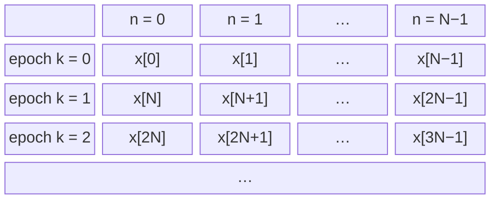
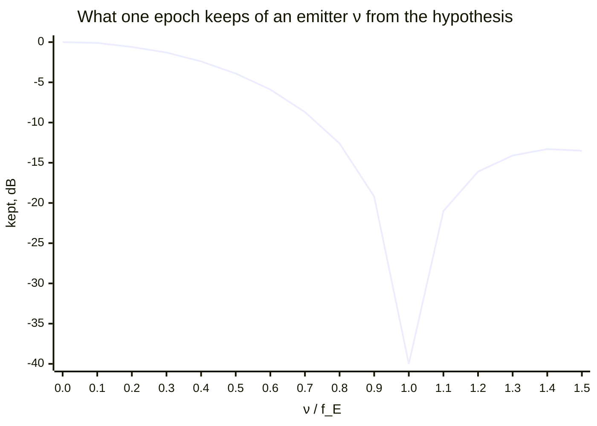
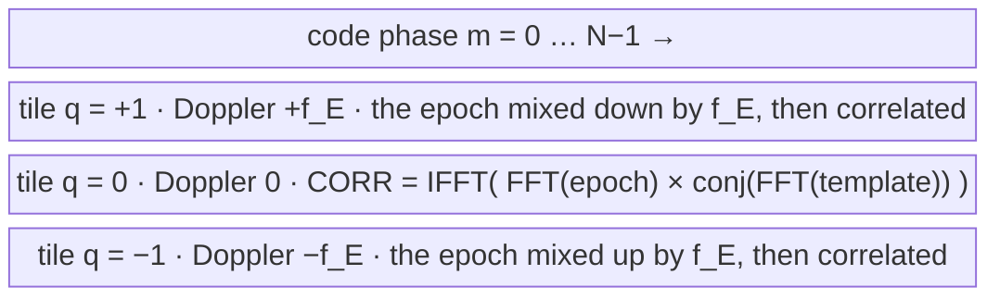

# The acquisition surface: equations and operations

What the continuous search engine (`dp_acq_create_continuous()`,
`native/src/acq/acq_core.c`) computes, from the input samples to a hand-off,
written as equations. Every step names the function that performs it. The
architecture, the trade space and the roadmap are
[dsss-acquisition.md](dsss-acquisition.md); the receiver that drives this
engine is [async-dsss-receiver.md](async-dsss-receiver.md). This page is the
one home of the surface's arithmetic.

## 1. Notation

| symbol                                            | meaning                                                                                                                                               | in the code               |
| ------------------------------------------------- | ----------------------------------------------------------------------------------------------------------------------------------------------------- | ------------------------- |
| $x[n]$                                            | complex input samples, $n = 0, 1, \ldots$ counted from the engine's create or last reset                                                              | `x` of `dp_acq_push()`    |
| $b[\ell] \in \{0, 1\}$                            | the code's chips, $\ell = 0 \ldots L-1$                                                                                                               | `code`                    |
| $L$                                               | chips per code period (the spreading factor)                                                                                                          | `sf`                      |
| $S$                                               | samples per chip                                                                                                                                      | `spc`                     |
| $N = L S$                                         | samples per code period: one **epoch**                                                                                                                | `code_bins`               |
| $c[n]$                                            | the code template, one epoch long                                                                                                                     | `replica`                 |
| $f_S$, $\omega_S = 2\pi f_S$                      | sample rate, $f_S = S R_C$ for chip rate $R_C$; sample $n$ is at time $t_n = n / f_S$                                                                 | `fs`                      |
| $f_E = f_S / N = R_C / L$, $\omega_E = 2\pi f_E$  | epoch rate; one epoch lasts $T_E = 1/f_E$                                                                                                             | `2 * doppler_span_hz`     |
| $W$                                               | Doppler tiles, $r = 0 \ldots W-1$                                                                                                                     | `window_bins`             |
| $\hat f_q = q f_E$, $\hat\omega_q = q\, \omega_E$ | a coarse Doppler hypothesis, $q \in \{0, \pm 1, \pm 2, \ldots\}$; tile $r$'s is $q_r = f_{\text{FFT}}(r, W)$                                          | `dp_fftfreq_index(r, W)`  |
| $D$                                               | the slow-time depth: epochs per coherent block                                                                                                        | `coherent_bins`           |
| $I$                                               | slow-time interpolation, $I = 2$ when $D > 1$, else 1                                                                                                 | `interp`                  |
| $K$                                               | non-coherent looks per dwell                                                                                                                          | `n_noncoh`                |
| $\mathrm{FFT}\{y\}$                               | the unnormalized $P$-point transform of $y[n]$: $\mathrm{FFT}\{y\}[j] = \sum_{n=0}^{P-1} y[n]\, e^{-j 2\pi j n / P}$, with $P = N$ unless subscripted | `dp_fft_create(P, -1, 1)` |
| $\mathrm{IFFT}\{Y\}$                              | its unnormalized inverse: $\mathrm{IFFT}\{Y\}[n] = \sum_{j=0}^{P-1} Y[j]\, e^{+j 2\pi j n / P}$, so $\mathrm{IFFT}\{\mathrm{FFT}\{y\}\} = P\, y$      | `dp_fft_create(P, +1, 1)` |

The signed index of bin $u$ of an $M$-point grid is numpy's `fftfreq` fold,
the one convention every axis below uses (`dp_fftfreq_index()`):

$$f_{\text{FFT}}(u, M) = \begin{cases} u & u \le \lfloor (M-1)/2 \rfloor \\ u - M & \text{otherwise} \end{cases}$$

## 2. The template and the epoch matrix

The template holds each chip for $S$ samples, mapped to $\pm 1$
(`acq_create_from_chips()`):

$$c[n] = 1 - 2\, b\big[\lfloor n / S \rfloor\big], \qquad n = 0 \ldots N-1$$

Its spectrum is taken once, conjugated, and kept (`acq_regrid()`):

$$C_T = \mathrm{FFT}\{c\}^{*}$$

The input is cut into epochs on the engine's own sample count and stacked as
the rows of a matrix: **fast time** $n$ runs along an epoch, **slow time**
$k$ across epochs,

$$x_k[n] = x[kN + n], \qquad n = 0 \ldots N-1$$

A row is one code period: fast time, which the correlation (§3) uses. A
column is the stream decimated by $N$, one sample per epoch at the epoch
rate $f_E$: slow time, which the Doppler transform (§4) uses. The epoch grid starts at the engine's create or reset, wherever the
code is in the stream; a receiver that wants several engines on one grid
aligns their resets ([async-dsss-receiver.md](async-dsss-receiver.md) §2.3).

## 3. Fast time: each epoch against the template

Each epoch is correlated circularly with the template at every lag $m$,
after a mix by a **coarse Doppler hypothesis**

$$\hat f_q = q f_E, \qquad q \in \{0, \pm 1, \pm 2, \ldots\}$$

so that, with the mixed epoch $\tilde x_{k,q}[n] = x_k[n]\, e^{-j \hat\omega_q t_n}$,

$$z_{k,q}[m] = N \sum_{n=0}^{N-1} \tilde x_{k,q}[n]\, c\big[(n - m) \bmod N\big] = \mathrm{IFFT}\big\{\mathrm{FFT}\{\tilde x_{k,q}\}\; C_T\big\}[m]$$

A circular correlation is a multiply of spectra: the mixed epoch's spectrum
times the template's conjugate spectrum, inverted. The factor $N$ is the
unnormalized inverse's.

**Why the mix.** The fast-time sum runs over $N$ samples, and an emitter
whose Doppler sits $\nu$ from the hypothesis turns $\nu / f_E$ cycles across
them. The sum keeps (§8)

$$|\chi(0, \nu)| = \left| \frac{\sin(\pi \nu T_E)}{\sin(\pi \nu T_E / N)} \right|$$

of its $N$: all of it at $\nu = 0$, $2N/\pi$ ($-3.9$ dB) at $\nu = f_E/2$,
and **nothing** at $\nu = f_E$. An emitter one epoch rate away from the
hypothesis forms no correlation peak at all. So each hypothesis holds the
emitters within $\pm f_E/2$ of $\hat f_q$, and covering a wider Doppler
uncertainty takes several. Because $q$ is an integer,
$\hat\omega_q T_E = 2\pi q$, so $e^{-j \hat\omega_q (t_n + k T_E)} = e^{-j \hat\omega_q t_n}$: the mix is continuous from
epoch to epoch, so what is left in the slow-time columns is the residual
$f - \hat f_q$.

At a tile's center the epoch keeps everything; at its edge, $f_E/2$ away,
3.9 dB is gone; one epoch rate away nothing is left (drawn at $-40$ dB), and
beyond it only the sinc's sidelobes. The tiles are spaced so that every
Doppler is within $f_E/2$ of one of them.

**How the code computes it.** Each epoch is transformed once (`wide_fwd`),

$$X_k = \mathrm{FFT}\{x_k\}$$

and a mix by $-\hat f_q$ is a circular shift of that spectrum by $q$ bins,
$\mathrm{FFT}\{\tilde x_{k,q}\}[j] = X_k[(j + q) \bmod N]$, so every
hypothesis costs one multiply and one inverse transform
(`acq_tile_epoch()`):

$$z_{k,q} = \mathrm{IFFT}\Big\{X_k\big[(j + q) \bmod N\big]\, C_T[j]\Big\}$$

This is the engine's **wideband window tiling** (the file doc of
`acq_core.h`), which the continuous engine runs whenever $W > 1$, with the
slow-time depth of §4 inside each tile. At $W = 1$ the only hypothesis is
$q = 0$, and the engine frames its $D$ epochs untiled (`acq_regrid()`'s
`frame_n`): the same $q = 0$ surface, with no shift to apply. The hypotheses are $q_r = f_{\text{FFT}}(r, W)$
for $r = 0 \ldots W-1$: the centers $0, \pm f_E, \pm 2 f_E, \ldots$, stored
in FFT order. With a
one-sided Doppler uncertainty $\Delta$ (`doppler_uncertainty`), there are
(`acq_cover_window_bins()`)

$$W = 2 \left\lceil \frac{\Delta - f_E/2}{f_E} \right\rceil + 1, \qquad W = 1 \text{ when } \Delta \le f_E / 2$$

For $W = 3$, one epoch becomes three correlations, one per tile, each over
every code phase:

## 4. Slow time: the Doppler inside each hypothesis, and the tiles

Column $m$ of $z_{k,q}$ is a series at the epoch rate. When $D > 1$ the
engine takes $D$ consecutive epochs, a **block** $k = bD + i'$ for
$i' = 0 \ldots D-1$, and transforms each column over it, zero-padded to $DI$
points (`acq_tile_block()`):

$$Z_{b,q}[\,\cdot\,, m] = \mathrm{FFT}_{DI}\big\{z_{bD + i',\, q}[m]\big\}, \qquad i' = 0 \ldots D-1$$

Row $i = 0 \ldots DI-1$ of the result is $Z_{b,q}[i, m]$, at the residual
$f_{\text{FFT}}(i, DI)\, f_E / (DI)$. A series at the epoch rate resolves
Doppler only within $\pm f_E/2$, and folds anything outside back into it:
emitters at $f$ and $f + f_E$ read the same in slow time. The fast-time mix
of §3 is what chooses which of those zones a block is looking at.

The zero padding is exact band-limited interpolation of the Doppler axis,
which halves the worst scalloping of a slow-time bin
(`ACQ_DOPPLER_INTERP`). Two optional factors multiply the series before the
transform: with a carrier set (`dp_acq_set_carrier_freq_hz()`), a linear
phase in the epoch's spectrum that shifts each epoch's lag to the block's
middle by the hypothesis' code-rate dilation; and with rate hypotheses
(burst engines), the de-chirp $e^{-j \pi a_h t_{i'}^2}$
(`acq_rate_table()`). The continuous engine runs one rate hypothesis, so it
has no de-chirp. With $D = 1$ there is no slow-time transform:
$Z_{k,q}[0, m] = z_{k,q}[m]$.

**One tile is a 2-D transform.** Per hypothesis, §3 and §4 together are one
separable $N \times DI$ transform of the block's product grid, inverse
along fast time and then forward along slow time:

$$Z_{b,q} = \mathrm{FFT}_{DI}\Big\{\mathrm{IFFT}\big\{X_k[(j + q) \bmod N]\, C_T[j]\big\}\Big\}, \qquad k = bD \ldots bD + D - 1$$

Done naively, each hypothesis would mix the epochs in time and transform
them forward itself: $WD$ forward transforms a block. Tiling computes
$X_k$ once per epoch for every tile, and the mix becomes a free index
shift, so a block costs $D$ forward, $WD$ inverse and $WN$ slow-time
transforms:

$$\underbrace{D \cdot N \log N}_{\text{forward, shared}} + \underbrace{W D \cdot N \log N}_{\text{inverse, per tile}} + \underbrace{W N \cdot D I \log (D I)}_{\text{slow time, per tile}}$$

against $2WD \cdot N \log N + WN \cdot DI \log(DI)$ naively. The tiles are
independent after the shared forward transform, which is why they fan
across threads (`dp_acq_set_threads()`) with bit-identical results.

**The depth.** From the code-only window $E$ in whole epochs
(`code_only_epochs`) and the Doppler rate $\dot f$ (`doppler_rate`)
(`acq_block_depth()`):

$$D = \mathrm{smooth}_7\!\left(\max\!\left(1,\ \min\!\left(\left\lfloor \frac{E+1}{2} \right\rfloor,\ \left\lfloor \frac{f_E}{\sqrt{2 \dot f}} \right\rfloor\right)\right)\right)$$

The first bound keeps a whole block inside the window at any window phase;
the second keeps the drift over a block inside half a slow-time row.
$\mathrm{smooth}_7$ rounds down to a length whose prime factors are at most
7 (`dp_fft_smooth_floor()`). $\dot f = 0$ drops the second bound; $E = 1$
gives $D = 1$.

**A tile** is the two-dimensional grid of one coarse hypothesis $\hat f_q$:
$DI$ Doppler rows, $f_E/(DI)$ apart over $\hat f_q \pm f_E/2$, by $N$ lag
columns, each cell one $Z_{b,q}[i, m]$. At $D = 1$ a tile is one row. The
**surface** is the $W$ tiles stacked along Doppler. Here for $W = 3$,
$D = 2$ and $I = 2$, so each tile is $DI = 4$ rows, $f_E/4$ apart.
$Z_q[i, m]$ is the block's $Z_{b,q}[i, m]$: row $i$ of tile $q$, with
$f_{\text{FFT}}(i, DI) = +1, 0, -1, -2$ reading top to bottom inside each tile, at
lag $m$ along each row:

$$
\begin{array}{ll|cccc}
 & \text{Doppler} & m = 0 & m = 1 & \cdots & m = N-1 \\ \hline
\text{tile } q = +1 & +1.25\, f_E & Z_{+1}[1, 0] & Z_{+1}[1, 1] & \cdots & Z_{+1}[1, N-1] \\
 & +1.00\, f_E & Z_{+1}[0, 0] & Z_{+1}[0, 1] & \cdots & Z_{+1}[0, N-1] \\
 & +0.75\, f_E & Z_{+1}[3, 0] & Z_{+1}[3, 1] & \cdots & Z_{+1}[3, N-1] \\
 & +0.50\, f_E & Z_{+1}[2, 0] & Z_{+1}[2, 1] & \cdots & Z_{+1}[2, N-1] \\ \hline
\text{tile } q = 0 & +0.25\, f_E & Z_{0}[1, 0] & Z_{0}[1, 1] & \cdots & Z_{0}[1, N-1] \\
 & +0.00\, f_E & Z_{0}[0, 0] & Z_{0}[0, 1] & \cdots & Z_{0}[0, N-1] \\
 & -0.25\, f_E & Z_{0}[3, 0] & Z_{0}[3, 1] & \cdots & Z_{0}[3, N-1] \\
 & -0.50\, f_E & Z_{0}[2, 0] & Z_{0}[2, 1] & \cdots & Z_{0}[2, N-1] \\ \hline
\text{tile } q = -1 & -0.75\, f_E & Z_{-1}[1, 0] & Z_{-1}[1, 1] & \cdots & Z_{-1}[1, N-1] \\
 & -1.00\, f_E & Z_{-1}[0, 0] & Z_{-1}[0, 1] & \cdots & Z_{-1}[0, N-1] \\
 & -1.25\, f_E & Z_{-1}[3, 0] & Z_{-1}[3, 1] & \cdots & Z_{-1}[3, N-1] \\
 & -1.50\, f_E & Z_{-1}[2, 0] & Z_{-1}[2, 1] & \cdots & Z_{-1}[2, N-1]
\end{array}
$$

Together the rows make one uniform Doppler grid, here $+1.25 f_E$ down to
$-1.5 f_E$ in steps of $f_E/4$. Lag $m$ reports the chip phase
$(L - m/S) \bmod L$. At $D = 1$ each tile is one row.

Row $i$ of tile $r$ is stored at surface row (`acq_block_row()`)

$$u = \big(q_r \cdot DI + f_{\text{FFT}}(i, DI)\big) \bmod (W D I)$$

so the tiles' rows make one uniform grid of $WDI$ rows at spacing
$f_E/(DI)$, in FFT order. The native resolution, the spacing a hit's
`doppler_bin` counts in, is

$$\delta f = \frac{f_E}{D} = \frac{R_C}{L D}$$

($\delta f = f_E$ at $D = 1$, where row $u = r$). The surface has
$M = WDI \times N$ cells, and the engine decides it once per block (once
per epoch at $D = 1$).

## 5. The dwell's statistic and gate

**False-alarm split.** The system false-alarm probability $P_{fa}$ is split
over the $M$ cells the peak search ranges over (Šidák, `dp_det_pfa_cell()`,
`acq_band_cells()`):

$$p_c = 1 - (1 - P_{fa})^{1/M}$$

**One look ($K = 1$)** (`acq_compute_stat()`). The cell amplitude is
$A[u, m] = |Z[u, m]|$. The reference is the surface's mean amplitude (the
default `noise_mode`, mean), and for Rayleigh noise
$\mathbb{E}|Z| = \sigma \sqrt{\pi/2}$, so

$$\mu = \frac{1}{M} \sum_{u, m} A[u, m], \qquad \hat\sigma = \mu \sqrt{2/\pi}$$

A cell passes when

$$A[u, m] > \eta\, \hat\sigma, \qquad \eta = \sqrt{-2 \ln p_c}$$

(`dp_det_threshold()`); the dwell's `test_stat` is $\max A / \mu$, compared
with $\eta \sqrt{2/\pi}$ (`threshold`).

**$K$ looks** (`acq_tile_nc_acc()`, `acq_compute_stat_nc()`). $K$
consecutive surfaces are summed in power,

$$P[u, m] = \sum_{\ell = 1}^{K} \big|Z_\ell[u, m]\big|^2, \qquad \bar P = \frac{1}{M} \sum_{u,m} P[u, m]$$

and a cell passes when its normalized statistic clears the order-$K$ gate:

$$R[u, m] = \sqrt{\frac{2K\, P[u, m]}{\bar P}} > \eta_K, \qquad Q_K(0, \eta_K) = p_c$$

where $Q_K$ is the generalized Marcum Q-function
(`dp_det_threshold_noncoherent()`). $K$ is the smallest count, at most
`ACQ_N_NONCOH_SAFETY_CEILING` (256), whose averaged $P_d$ meets the target
at the design C/N0 (`acq_ascend_n_noncoh()`).

One dwell is therefore $K$ blocks, $KDN$ samples.

## 6. The peak list

Up to `max_peaks` peaks are taken from the decided surface, strongest
first (`acq_list_peaks()`):

1. Take the largest cell not yet masked. Stop if it does not pass the gate,
    or if the list is full.
1. Mask its **zone**: the $I$ fine rows either side (one native Doppler
    row) by the code's mainlobe, `shape.zone` lags either side, circularly
    ($S$ lags, one chip, for a code).
1. Repeat.

Each listed cell is then reported (`acq_report_peaks()`):

- **Its native row**: the stronger native neighbor of an interpolated row
    (`acq_native_row()`).
- **Its tile**: near a tile edge both neighboring tiles read an emitter at
    the same row, so the block's raw epochs are correlated at the row's
    frequency and one epoch rate either side, and the strongest of the three
    names the tile (`acq_resolve_tile_alias()`).
- **The twin rule**: a pick within the zone of an already-listed pick's lag,
    at any row, is held for one dwell and listed only if, on the previous
    dwell, a pick stood at the same native row and within the zone of its
    lag. A data transition inside an epoch
    splits one emitter's correlation into partial correlations at its own lag
    on other tiles, and those move with the transition; a second emitter at
    the same lag stays.

The zone and the twin rule reach one chip from a listed lag. Nothing in the
list removes a peak further away: §8 is what can stand there.

## 7. From a cell to a hand-off

A reported cell, at native row $u'$ (of $WD$) and lag $m$, becomes physical
values (`dp_acq_build_handoff()`, `acq_handoff_chip_phase()`):

$$\hat f_{\text{hit}} = f_{\text{FFT}}(u', WD)\; \delta f, \qquad \hat\phi = \big(L - m/S\big) \bmod L \ \text{chips}$$

The chip phase inverts the lag into the code-tracking convention. With a
carrier $f_C$ set, it also advances by the dilation over half the dwell,
$\tfrac{1}{2} K D L\, \hat f_{\text{hit}} / f_C$ chips, since the peak is the dwell's
middle and the seed is wanted at its end.

The C/N0 estimate inverts the statistic per sample
(`acq_report_peaks()`, `dp_det_snr_to_cn0()`), with $N_c = DN$ samples per
coherent look:

$$\hat a = \begin{cases} \dfrac{\max A / \mu}{\sqrt{2/\pi}\,\sqrt{2 N_c}} & K = 1 \\[2ex] \dfrac{\max R}{\sqrt{2 N_c K}} & K > 1 \end{cases}, \qquad \widehat{C/N_0} = 20 \log_{10} \hat a + 10 \log_{10} f_S$$

`samples_consumed` is the engine's position at the end of the decided dwell.

## 8. What the surface holds for one emitter: the code's ambiguity

Let one emitter arrive at lag $\tau$ samples, Doppler $f$ and phase
$\theta$, in noise $w[n]$, with no data transition inside the epoch:

$$x[n] = a\, c\big[(n - \tau) \bmod N\big]\, e^{j (\omega t_n + \theta)} + w[n]$$

Substituting into §3, hypothesis $q$ reads, at lag $m$,

$$z_{k,q}[m] = N a\, e^{j \theta_k}\; \chi\big(m - \tau,\ f - \hat f_q\big) + \text{noise}$$

with the code's periodic **ambiguity function**

$$\chi(\Delta, \nu) = \sum_{n=0}^{N-1} c[n]\, c\big[(n - \Delta) \bmod N\big]\, e^{j \omega_\nu t_n}, \qquad \omega_\nu = 2\pi \nu$$

and $\theta_k$ a phase that advances by $\omega T_E$ per epoch, $\omega = 2\pi f$, which is
what the slow-time transform of §4 resolves. Over a block every epoch
carries the same $|\chi|$, so the slow-time sum scales the emitter's peak
and every one of its sidelobes by the same factor: **ratios read on one
epoch hold on a code-only block, at any $D$.** A block over data does not
hold them: a data transition inside an epoch is outside $\chi$.

**The emitter's own peak**, $\Delta = 0$, is the Dirichlet kernel in the
residual $\nu = f - \hat f_q$:

$$|\chi(0, \nu)| = \left| \frac{\sin(\pi \nu T_E)}{\sin(\pi \nu T_E / N)} \right|$$

It is $N$ at a tile's center and falls to $\approx 2N/\pi$
($-3.9$ dB) at the tile's edge, $\nu = f_E/2$, where the emitter reads in
two tiles at once.

**Sidelobes at zero residual**, $\nu = 0$, are the code's periodic
autocorrelation. Their largest outside the zone, relative to the peak, is
the preamble's peak sidelobe, which the constructor already computes
(`acq_shape_t::psl`, `dp_acq_psl_db()`). For a Gold code of 1023 chips the
three autocorrelation values give $65/1023$: $-23.9$ dB.

**Sidelobes at a tile offset**, $\nu = f - \hat f_q$ for the tiles the
emitter is not in, are much larger. The engine computes their worst case
on first read (`acq_shape_t::dsl`, `dp_acq_dsl_db()`). Computed from $\chi$
for the Gold code the receiver validators use
(`dp_dsss_gold_1023()`, $S = 2$, $f_E = 3$ kHz, five tiles), the largest
$|\chi(\Delta, f - \hat f_q)|$ with $\Delta$ more than a chip from 0,
circularly, over every tile, relative to the emitter's own peak:

<!-- acq-surface:ambiguity:start -->

| emitter Doppler $f$ | from its tile's center  | largest off-lag sidelobe | where                                    |
| ------------------- | ----------------------- | ------------------------ | ---------------------------------------- |
| 200 Hz              | 200 Hz                  | $-22.02$ dB              | tile $-1$, 345 chips off                 |
| 1500 Hz             | $\pm 1500$ Hz, the edge | $-17.73$ dB              | tiles $-1$ and $+2$, tied, 277 chips off |
| $-2600$ Hz          | 400 Hz                  | $-21.29$ dB              | tile $+2$, 341 chips off                 |

<!-- acq-surface:ambiguity:end -->

They are fixed by the emitter: the engine's own peak lists show the same
cells dwell after dwell. An emitter at chip 873 and 1500 Hz lists a peak at
chip 127, 277 chips away circularly, dwell after dwell. At a tile edge the
emitter sits halfway between two tiles, so the next tiles out, $-1$ and
$+2$, both lie $1.5 f_E$ from it and read the same sidelobe. The
tile edge is the worst of the three because the emitter's own peak has lost
its 3.9 dB there and the sidelobe has not. Three emitters do not find the
band's worst, though: swept over the whole uncertainty, the code comes closer
still (the near-far limits, below).

**What the engine lists.** The shipped engine over the same code, sized at
47 dB-Hz over $\pm 5$ kHz with `max_peaks` 16, at a depth of one epoch and at
the depth [the specification](async-dsss-receiver.md#1-the-specification) window allows: 600-symbol streams framed 450 code-only
symbols in 500, at 200, 750, 1500 and $-2600$ Hz with 6 noise draws each.
Each cell is the largest off-lag peak in a list, relative to the list's
first, in power, and how many lists hold one. The last column is the deep
engine on a stream that is data throughout:

<!-- acq-surface:lists:start -->

| C/N0     | $D = 1$                           | $D = 90$                        | $D = 90$, data throughout |
| -------- | --------------------------------- | ------------------------------- | ------------------------- |
| 47 dB-Hz | $-2.1$ dB, in 7 of 4008 lists     | $-13.8$ dB, in 149 of 168 lists | —                         |
| 50 dB-Hz | $-5.0$ dB, in 9 of 4008 lists     | $-14.7$ dB, in 148 of 168 lists | —                         |
| 53 dB-Hz | $-8.0$ dB, in 15 of 4008 lists    | $-15.3$ dB, in 146 of 168 lists | —                         |
| 56 dB-Hz | $-10.8$ dB, in 72 of 4008 lists   | $-15.7$ dB, in 146 of 168 lists | —                         |
| 60 dB-Hz | $-13.0$ dB, in 771 of 4008 lists  | $-16.0$ dB, in 146 of 168 lists | none in 168 lists         |
| 70 dB-Hz | $-15.5$ dB, in 3985 of 4008 lists | $-16.4$ dB, in 147 of 168 lists | none in 168 lists         |

<!-- acq-surface:lists:end -->

At $D = 90$ the lists approach the code's ambiguity: a block inside the
code-only window is the code alone, and what is left above $\chi$ comes
from blocks that straddle the window's edge into data. At $D = 1$ they do
not, even at high C/N0, where an epoch's SNR leaves noise no room: a
one-epoch search over data sees partial-period correlations at bit
transitions, which $\chi$ excludes (this section's premise), so its
off-lag peaks stand several dB above $\chi$. Near the threshold the
emitter's own peak barely clears the gate, and an off-lag peak comes within
a few dB of it, rarely. On data throughout, $D = 90$ lists no off-lag peak:
a block over data spreads the emitter over its rows first.

**Why neither axis is windowed.** Sidelobes invite a taper, but neither
transform's window reaches these. They are computed for the same code and
geometry. Each window is the symmetric one whose zeros fall outside the block, so no
sample or epoch is weighted zero: Hann and Blackman are two points longer
with their zeros dropped, and Hamming has none. Every loss includes the
window's noise bandwidth, the SNR kept at a residual being
$|\sum_n w_n e^{j \omega_\nu t_n}|^2 / \big(N \sum_n w_n^2\big)$.

*Fast time*, a window on the epoch before the correlation. In the emitter's
own column $c[n]^2 = 1$, so the Doppler slice of §3 becomes the window's own
spectrum: the tile edge loses less, but every Doppler pays the noise
bandwidth, the next tile is no longer a null, and the off-lag sidelobes rise
relative to the peak, because they come from the code product
$c[n]\, c[n - \Delta]$, which is noise-like, and not from the window. The
edge is $\nu = f_E/2$, the average is the mean power over a tile, and the
next tile is read against the window's own center:

<!-- acq-surface:fast:start -->

| fast-time window | edge loss  | average loss | next tile, $\nu = f_E$ | worst off-lag sidelobe (200 / 1500 / $-2600$ Hz) |
| ---------------- | ---------- | ------------ | ---------------------- | ------------------------------------------------ |
| none (shipped)   | $-3.92$ dB | $-1.11$ dB   | null                   | $-22.02$ / $-17.73$ / $-21.29$ dB                |
| Hann             | $-3.18$    | $-2.21$      | $-6.03$                | $-18.38$ / $-17.26$ / $-18.32$                   |
| Hamming          | $-3.10$    | $-1.90$      | $-7.41$                | $-19.02$ / $-17.53$ / $-18.94$                   |
| Blackman         | $-3.47$    | $-2.72$      | $-4.51$                | $-17.28$ / $-16.45$ / $-17.23$                   |

<!-- acq-surface:fast:end -->

*Slow time*, a window on the block's $D$ epochs before $\mathrm{FFT}_{DI}$. It
runs down one lag column, so it cannot touch the off-lag sidelobes above: an
emitter and its sidelobe in another tile turn at the same $\omega T_E$ per
epoch and the window scales both alike. What it lowers is the emitter's own
leakage across its column's Doppler rows, which matters only for two
emitters within a chip of one code phase. The zero padding has already
brought the scalloping under a dB, so the window's noise bandwidth is a loss
at every Doppler, and its wider main lobe needs a wider zone, or its
shoulder is listed as a second peak. The worst loss is an emitter half a
fine row from its nearest row, the average is over that half row, and the
leakage is the largest row past the zone, relative to the picked row, over
every emitter offset:

<!-- acq-surface:slow:start -->

| slow-time window | worst loss | average loss | own-column leakage past the zone | zone               |
| ---------------- | ---------- | ------------ | -------------------------------- | ------------------ |
| none (shipped)   | $-0.91$ dB | $-0.29$ dB   | $-13.15$ dB                      | $\pm 1$ native bin |
| Hann             | $-2.07$    | $-1.83$      | $-31.29$                         | $\pm 2$            |
| Hamming          | $-1.81$    | $-1.52$      | $-42.56$                         | $\pm 2$            |
| Blackman         | $-2.60$    | $-2.42$      | $-58.11$                         | $\pm 3$            |

<!-- acq-surface:slow:end -->

Both trade detection for a sidelobe the search is not limited by. The
limit is the code's own ambiguity, below.

**What it means for a search that does not take the strongest peak.** The
strongest peak is the emitter, so a search that takes the first of the list
is unaffected. A search that skips peaks (a rank above 0, or exclusions:
[async-dsss-parallel.md](async-dsss-parallel.md) §3) can reach one of the
emitter's own sidelobes and take it as a second emitter. The zone and the
twin rule do not reach it, being one chip wide. So no list rule that keys on
the lag alone separates a second emitter from the first one's sidelobe when
the second sits further below the first than that sidelobe can come. That is
the **near-far limit** of a ranked or excluded search on this code, and it
has two sides. On a code-only block the code's ambiguity sets it. Over
data, which is what a one-epoch search always sees, the partial-period
correlations at bit transitions set it, and that side is set by the data,
not the noise. The ambiguity's own worst is in neither table above; it
takes sweeping the emitter over the band:

<!-- acq-surface:limits:start -->

| what sets it                                                           | closest an off-lag peak comes to the emitter's peak | where                                                    |
| ---------------------------------------------------------------------- | --------------------------------------------------- | -------------------------------------------------------- |
| the code's ambiguity, the emitter swept every 25 Hz over $\pm 5000$ Hz | $-16.95$ dB                                         | at $-4500$ Hz                                            |
| the engine's lists at $D = 90$                                         | $-13.8$ dB                                          | at 47 dB-Hz, in 149 of 168 lists; $-16.4$ dB at 70 dB-Hz |
| the engine's lists at $D = 1$                                          | $-2.1$ dB                                           | at 47 dB-Hz, in 7 of 4008 lists; $-15.5$ dB at 70 dB-Hz  |

<!-- acq-surface:limits:end -->

Any rule that admits a weaker second emitter has to know $\chi$, and over
data a floor at the ambiguity's level alone does not hold the sidelobes
off: the last row is far above it.

**Decided (2026-10-21).** The owner ruled that the ranked search's floor is
derived from the code's Doppler-offset sidelobe level, as `psl` is from its
zero-offset one; the level is defined on the grid the engine was built with
and computed on its first read, `dp_acq_dsl_db()`. A peak is a second emitter only
if its statistic stands higher than the stronger emitters' sidelobes can
reach, their statistic times that level, and it still clears the detector's
gate. The mechanism and its numbers are #2525's, in its design text.

**Where the numbers come from.** Every table in this section is the output
of one run of the validator `native/validation/acq_surface.c`
(`validate_acq_surface --emit`), kept beside this page in
`acq-surface-measurements/` and rendered there by `record.py`.
`make docs-check` fails when a table is not what the run's data renders,
and the validator's own `--check`, a CTest, pins the claims this section
draws from them. `make acq-surface-record` re-runs it and rewrites the tables:

<!-- acq-surface:stamp:start -->

| run                           | when                       | machine                                                          | commit             | toolchain                                                             | operating point                                           | command                   |
| ----------------------------- | -------------------------- | ---------------------------------------------------------------- | ------------------ | --------------------------------------------------------------------- | --------------------------------------------------------- | ------------------------- |
| `validate_acq_surface --emit` | 2026-10-21 21:17 UTC, 87 s | `swiftgo-ai9465`: AMD Ryzen AI 9 465 w/ Radeon 880M (20 threads) | `59cd886b2`, clean | GNU 14.2.0; glibc 2.41; build Release, flags -O3 -DNDEBUG, native OFF | $N = 2046$, $W = 5$ at $f_E = 3000$ Hz, $D = 90$, $I = 2$ | `make acq-surface-record` |

<!-- acq-surface:stamp:end -->

## Related

- [dsss-acquisition.md](dsss-acquisition.md): the acquisition architecture,
    the cross-ambiguity surface's decompositions, and the trade space
- [async-dsss-receiver.md](async-dsss-receiver.md): the receiver that runs
    this engine, its depth and its dwell alignment (§2.3)
- [async-dsss-parallel.md](async-dsss-parallel.md): the parallel design that
    ranks and excludes peaks (§3)
