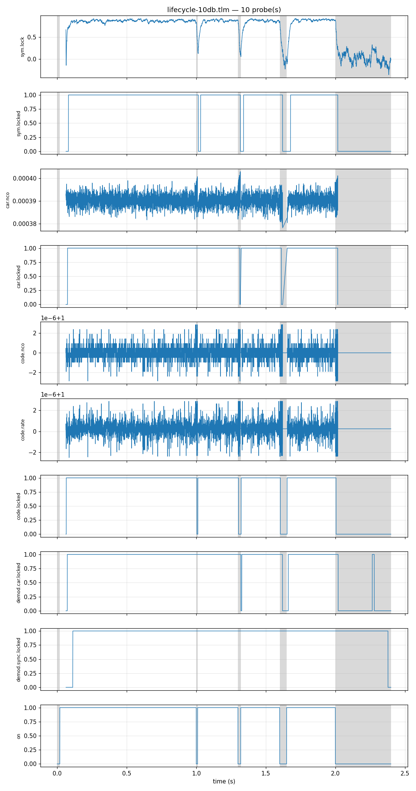
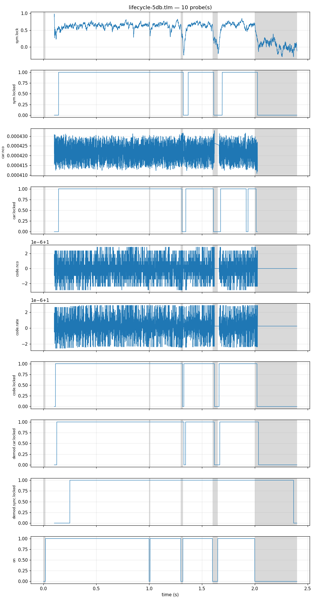
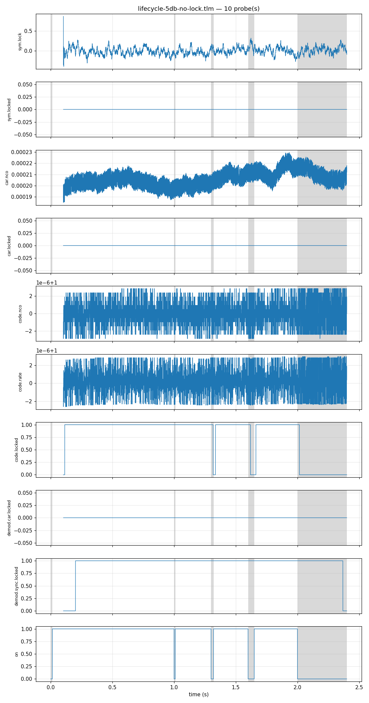

# Parallel Asynchronous-Data DSSS Receivers — the measurement record

*The dated record behind [the design page](async-dsss-parallel.md): what each
number there was measured by, with the run. Section numbers are shared, so a
`§3.1` cited on the design page, in an issue or in a code comment is the same
entry here. The tables come from two runs of shipped tools, at one commit:
the lock validator, `native/validation/async_dsss_receiver_lock.c`, and the
C benches of the three objects. A third run, of the same validator, draws
§3.2's figures, and is held to the first instead: each of its stories must
match its sweep trial's carrier, arrival and symbol-lock time. Every table below, and every number the
design page quotes from them, is rendered from their data, committed beside
this page in `async-dsss-parallel-measurements/` by its `record.py`, whose
`--check` (in `make docs-invariants`) fails when either page differs from
the data.*

<!-- async-dsss-parallel:stamp:start -->

| run                        | when                       | machine                                                               | load before / after | commit             | toolchain                                                             | command                                                                                                                         |
| -------------------------- | -------------------------- | --------------------------------------------------------------------- | ------------------- | ------------------ | --------------------------------------------------------------------- | ------------------------------------------------------------------------------------------------------------------------------- |
| lock validator, full sweep | 2026-10-18 12:36 UTC, 30 s | `cachyos-x8664-ai465`: AMD Ryzen AI 9 465 w/ Radeon 880M (20 threads) | 1.6 / 1.5           | `225ac3bd1`, clean | GNU 16.2.1; glibc 2.44; build Release, flags -O3 -DNDEBUG, native OFF | `make build`, then `record.py measure`                                                                                          |
| C benches                  | 2026-10-18 12:36 UTC       | `cachyos-x8664-ai465`: AMD Ryzen AI 9 465 w/ Radeon 880M (20 threads) | 1.7 / 1.6           | `225ac3bd1`, clean | GNU 16.2.1; glibc 2.44; build Release, flags -O3 -DNDEBUG, native OFF | `make bench BENCH_ARGS="--c-only acq async_dsss_receiver async_dsss_pool"` once the load fell under 2, rows kept by `record.py` |
| lifecycle stories (§3.2)   | 2026-10-18 12:37 UTC, 1 s  | `cachyos-x8664-ai465`: AMD Ryzen AI 9 465 w/ Radeon 880M (20 threads) | 1.5 / 1.5           | `225ac3bd1`, clean | GNU 16.2.1; glibc 2.44; build Release, flags -O3 -DNDEBUG, native OFF | `make build`, then `record.py stories`; each story is the sweep's arrival trial of its draws, checked                           |

<!-- async-dsss-parallel:stamp:end -->

*The operating point throughout: Gold-1023 (CCSDS #365) at 3.069 Mcps, two
samples a chip, so one code epoch is 2,046 samples, 333.3 µs, and 1/T_E is
3 kHz; asynchronous BPSK at 2,700 sym/s. The receiver is the searching flavor
at the binding's defaults, its own search over ±1/T_E, its lock detector the
shipped `lockdet` at the header's settings, read as it reports: locked or
not. The emitter is the shipped continuous-DSSS synth carrying the
validator's own data bits, with no data-free window, and the validator
checks the synth is sending them: every lock measurement is taken where the
symbols transition, and each row's "data flips" is the fraction of symbol
boundaries that flip around its event, counted from the bits. The noise is
the shipped awgn, and an arrival or a dropout cuts the signal only. A
fraction carries its 95% Wilson interval.*

______________________________________________________________________

### 3.1 Symbol lock through a dropout

The validator's `dropout` trials. Each draws its carrier over ±1/T_E, and is fed until the receiver tracks with symbol
lock up for 200 epochs in a row, then up to 10 ms more, then cut at a random
sample of the next epoch. A draw that has not held lock that long within
4 s, or whose lock is down at the cut, is excluded and counted (§5.1 says
why there are some); trials are drawn until 20 settle, so the intervals'
fixed-n assumption is approximate. The receiver's state at the cut is saved
and every case resumes from it on the same noise, so they differ only in
the dropout: the validator checks that the restore is exact, every case's
lock reading the for-good case's until its signal returns. Symbol lock is
read after every epoch, so every time is to 0.33 ms. The receiver stays
tracking throughout (`lost_confirm_s` = 0): a lock that falls comes back by
itself.

<!-- async-dsss-parallel:dropout:start -->

| Es/N0 | carriers drawn | draws settled: lock held 200 epochs within 4 s, up at the cut | lock falls after a loss, min / median / max | a 50 ms dropout: fell; back within 300 ms; min / median / max                | a 200 ms dropout: the same                                                   | data flips at the cut |
| ----- | -------------- | ------------------------------------------------------------- | ------------------------------------------- | ---------------------------------------------------------------------------- | ---------------------------------------------------------------------------- | --------------------- |
| 10 dB | -2892–+2821 Hz | 20 of 21 (0.77–0.99)                                          | 13.4 / 22.8 / 33.9 ms                       | fell 20 of 20 (0.84–1.00); back 20 of 20 (0.84–1.00); 18.8 / 28.2 / 48.2 ms  | fell 20 of 20 (0.84–1.00); back 20 of 20 (0.84–1.00); 19.6 / 39.6 / 53.2 ms  | 0.46–0.53             |
| 5 dB  | -2892–+2821 Hz | 20 of 28 (0.53–0.85)                                          | 13.9 / 17.8 / 27.9 ms                       | fell 20 of 20 (0.84–1.00); back 20 of 20 (0.84–1.00); 21.3 / 65.3 / 107.7 ms | fell 20 of 20 (0.84–1.00); back 18 of 20 (0.70–0.97); 47.0 / 76.6 / 141.3 ms | 0.45–0.53             |

<!-- async-dsss-parallel:dropout:end -->

**The hold, by dropout length.** Each trial is run through a dropout of every
length from one epoch to two past its own drop, each from the saved state:
held means symbol lock stayed up through the dropout and 60 ms after it.

<!-- async-dsss-parallel:hold:start -->

| Es/N0 | draws excluded: not settled | held 2 ms            | held 5 ms            | held 10 ms           | held 15 ms           | held 20 ms          | held 25 ms          | held 30 ms          | trials where a longer one held after a shorter fell |
| ----- | --------------------------- | -------------------- | -------------------- | -------------------- | -------------------- | ------------------- | ------------------- | ------------------- | --------------------------------------------------- |
| 10 dB | 1 of 21 (0.01–0.23)         | 20 of 20 (0.84–1.00) | 20 of 20 (0.84–1.00) | 16 of 20 (0.58–0.92) | 14 of 20 (0.48–0.85) | 7 of 20 (0.18–0.57) | 2 of 20 (0.03–0.30) | 0 of 20 (0.00–0.16) | 8                                                   |
| 5 dB  | 8 of 28 (0.15–0.47)         | 20 of 20 (0.84–1.00) | 20 of 20 (0.84–1.00) | 14 of 20 (0.48–0.85) | 2 of 20 (0.03–0.30)  | 1 of 20 (0.01–0.24) | 0 of 20 (0.00–0.16) | 0 of 20 (0.00–0.16) | 7                                                   |

<!-- async-dsss-parallel:hold:end -->

The hold is not one number per draw. In many trials a longer dropout held
after a shorter one fell (the last column): the lock average, an exponential
average over 30 symbols, sinks under the detector's drop level in the
dropout and climbs back too late after it, and where it lands depends on the
noise of those few milliseconds. So the hold is reported as a fraction per
length, never as an edge.

### 3.2 A receiver through a signal's life

The validator's lifecycle stories (`--telemetry DIR`): three of §5.1's
arrival trials, each run on past its own end as one receiver's whole life.
Its first second is the trial sample for sample, and the table holds each
story to its trial. Then the signal is cut for 10, 20 and 50 ms at 1.0, 1.3
and 1.6 s, every cut mid-data, and leaves for good at 2.0 s; the run ends
at 2.4 s. Each figure is the receiver's own telemetry from that run, drawn
by `scripts/plot_capture.py`. **Grey is where the signal was off**, read
from the stimulus the validator records beside the receiver's probes
(`stim.on`), not drawn from the schedule above. `stim.on` is emitted every
block from the first, so the shared time axis starts at the first block; the
receiver's own traces start where its live chain starts, not at the arrival
(none of them reports before then; the search's `rx.acq.*` are captured, not
drawn).

<!-- async-dsss-parallel:stories:start -->

| story                   | Es/N0 | seed | carrier    | arrival | symbol lock after arrival |
| ----------------------- | ----- | ---- | ---------- | ------- | ------------------------- |
| `lifecycle-10db`        | 10 dB | 1    | +2395.3 Hz | 19.5 ms | 62.2 ms                   |
| `lifecycle-5db`         | 5 dB  | 13   | +2587.8 Hz | 19.1 ms | 124.9 ms                  |
| `lifecycle-5db-no-lock` | 5 dB  | 5    | +737.3 Hz  | 13.8 ms | never                     |

<!-- async-dsss-parallel:stories:end -->

At 10 dB symbol lock falls in each fade and comes back after each, and
falls for good at the departure, as do the carrier and code flags. The
demodulator's timing flag (`demod.sync.locked`) does not: it stays up
through every fade and long after the signal has gone (#2409). The 5 dB
story that never locks is the trial §5.1 counts as never locking: its
refine seed is further off than the carrier loop pulls in, so the carrier
loop never declares and symbol lock never comes, while the code loop tracks
and the timing flag comes up and stays up. It is seed 5 at 5 dB (the table
below), the draw the seed-edge block below names as that SNR's largest seed
error, which gives its size.

### 5.1 Arrival to tracking, and to symbol lock

The validator's `arrival` trials: noise alone for a uniform 0 to 20 ms, so
the signal starts at any sample of an epoch and any code phase against the
feed, then the signal at a carrier uniform over ±1/T_E, for 2 s after it
arrives. Times are from the arrival sample, to the first epoch the receiver
reads tracking and to the first after which symbol lock is up.

<!-- async-dsss-parallel:arrival:start -->

| Es/N0 | tracking: draws; min / median / max after arrival | symbol lock: draws; min / median / max          | locked 2 s after arrival | data flips |
| ----- | ------------------------------------------------- | ----------------------------------------------- | ------------------------ | ---------- |
| 10 dB | 20 of 20 (0.84–1.00); 43.5 / 44.6 / 47.3 ms       | 20 of 20 (0.84–1.00); 57.9 / 86.2 / 698.0 ms    | 20 of 20 (0.84–1.00)     | 0.47–0.56  |
| 5 dB  | 20 of 20 (0.84–1.00); 79.4 / 86.3 / 100.8 ms      | 15 of 20 (0.53–0.89); 124.9 / 375.5 / 1734.3 ms | 15 of 20 (0.53–0.89)     | 0.47–0.56  |

<!-- async-dsss-parallel:arrival:end -->

**What decides the lock: the refine stage's carrier.** The same trials, by
how far the refine stage's carrier estimate, read when the receiver first
tracks (`get_doppler_hz()`, frozen from then), lands from the truth: the
residual the carrier loop must pull in. That loop's acquisition bound is
`bn / m`, 60 Hz at this front end, and `costas_pullin.c` measures it acquiring
every draw inside the bound, still reliably to twice it, and dead by four
times (`async_dsss_receiver_core.h`); doppler#982 found the refine handing
over outside it. The whole receiver is more forgiving than the loop alone:
lock time grows with the seed error, and the 200–300 Hz row still locks, past
four times the bound and slowly. The seed-edge block below gives the largest
locked error and the 5 dB draws at 250 Hz or more. The error is read when
tracking starts, which need not be the residual the loop finally pulls in;
`rx.car.nco` (#2412) now shows what the loop pulls in, and read as a residual
it is not yet measured (doppler#2409).

<!-- async-dsss-parallel:seed:start -->

| refine seed error | locked, 10 dB                      | locked, 5 dB                       |
| ----------------- | ---------------------------------- | ---------------------------------- |
| 0–100 Hz          | 15 of 15 (0.80–1.00), median 67 ms | 6 of 6 (0.61–1.00), median 151 ms  |
| 100–200 Hz        | 3 of 3 (0.44–1.00), median 143 ms  | 5 of 5 (0.57–1.00), median 419 ms  |
| 200–300 Hz        | 2 of 2 (0.34–1.00), median 599 ms  | 4 of 7 (0.25–0.84), median 1479 ms |
| ≥ 300 Hz          | —                                  | 0 of 2 (0.00–0.66)                 |

<!-- async-dsss-parallel:seed:end -->

<!-- async-dsss-parallel:seed-edge:start -->

| refine seed error, the sweep's arrival trials | 10 dB             | 5 dB              |
| --------------------------------------------- | ----------------- | ----------------- |
| largest seed error that locked                | 248.5 Hz (seed 2) | 245.2 Hz (seed 3) |
| draws at ≥ 250 Hz that locked                 | 0 of 0            | 0 of 5            |
| largest seed error, locked or not             | 248.5 Hz (seed 2) | 444.3 Hz (seed 5) |

<!-- async-dsss-parallel:seed-edge:end -->

### 6. What a receiver costs

The C benches, `jm_bench.h`'s wall clock over its rounds (min, mean and max
per row), each round a whole dwell (the engine) or a block of samples (the
receiver). The engine's work per 2,046-sample epoch depends on its tile count
and its coherent depth, not on the chip rate, so a row timed at another chip
rate is this design's state by its tiles: one tile is `acq::native` (3.069
Mcps, no Doppler search), ±1/T_E is the 3-tile `op5M_U5k`, and its slow-time
search is that row at D = 154, deeper than the 94 this design's 500 Hz/s
rate allows, so it bounds it. The engine rows are sized at the bench's own
C/N0, 37.31 dB-Hz (`bench_acq_core.c`), which sets their dwell, not their
cost per sample. The tracking row is the receiver bench's held cell receiver
at 1,023 chips, which that bench reads as the searching flavor's steady
state. The real-time factor is the mean per sample times 6.138 MSa/s; the
four-thread row is wall time, the CPUs it spends are more. The machine's
load either side of the bench is in the stamp.

<!-- async-dsss-parallel:cost:start -->

| receiver state                              | bench row                                        | ns a sample, mean (min–max) | × real time at 6.138 MSa/s |
| ------------------------------------------- | ------------------------------------------------ | --------------------------- | -------------------------- |
| tracking                                    | `async_dsss_receiver::steps[cell,sf=1023,5Mcps]` | 9.6 (9.5–10.0)              | 0.06                       |
| searching one tile, one-epoch looks         | `acq::native_nc90`                               | 18.5 (18.4–19.4)            | 0.11                       |
| searching ±1/T_E (3 tiles), one-epoch looks | `acq::op5M_U5k_nc225`                            | 30.2 (30.1–31.8)            | 0.19                       |
| searching ±1/T_E, slow time over D = 154    | `acq::op5M_U5k_D154_t1_nc1`                      | 86.0 (85.8–86.9)            | 0.53                       |
| the same, four threads                      | `acq::op5M_U5k_D154_t4_nc1`                      | 42.8 (41.6–51.3)            | 0.26 on four threads       |

<!-- async-dsss-parallel:cost:end -->

### 7. The pool as built

The same run's pool bench (twelve slots, one emitter tracked, the searcher's
31-epoch window) and the engine at the pool's design point of
async-dsss-receiver.md §6.1, ±50 kHz, at the ends of its chip-rate range: 21
tiles at 5 Mcps with D = 154, 53 at 2 Mcps with D = 61. Each is at the rate it
was timed at; a threaded row is wall time.

<!-- async-dsss-parallel:pool:start -->

| per push                                   | bench row                                        | timed at | ns a sample, mean (min–max) | × real time at that rate |
| ------------------------------------------ | ------------------------------------------------ | -------- | --------------------------- | ------------------------ |
| one receiver, tracking                     | `async_dsss_receiver::steps[cell,sf=1023,5Mcps]` | 10 MSa/s | 9.6 (9.5–10.0)              | 0.10                     |
| the pool, 12 slots, one emitter tracked    | `async_dsss_pool::push[12 slots, serial]`        | 10 MSa/s | 142.6 (37.7–1625.3)         | 1.43                     |
| the same, across the machine's cores       | `async_dsss_pool::push[12 slots, all cores]`     | 10 MSa/s | 124.0 (44.0–1351.2)         | 1.24                     |
| its searcher at ±50 kHz, 21 tiles, D = 154 | `acq::op5M_U50k_D154_t1_nc1`                     | 10 MSa/s | 528.2 (521.6–531.8)         | 5.28                     |
| the same, eight threads                    | `acq::op5M_U50k_D154_t8_nc1`                     | 10 MSa/s | 145.7 (129.7–171.4)         | 1.46                     |
| its searcher at ±50 kHz, 53 tiles, D = 61  | `acq::op2M_U50k_D61_t1_nc1`                      | 4 MSa/s  | 2012.8 (2011.5–2015.6)      | 8.05                     |
| the same, four threads                     | `acq::op2M_U50k_D61_t4_nc1`                      | 4 MSa/s  | 590.8 (574.7–631.9)         | 2.36                     |

<!-- async-dsss-parallel:pool:end -->

The pool's mean push carries its searcher's dwells: its fastest push is the
receivers' work alone, and its slowest is a dwell (the min and max in the
row). The bench's rounds are not a whole number of dwells, so the mean is
approximate to within one dwell's share.
