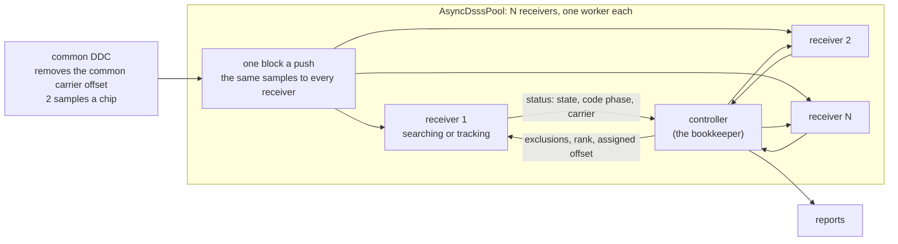

# Parallel Asynchronous-Data DSSS Receivers

*The name `AsyncDsssPool` returns on a new object; the pool as built, and its
cell receivers, were deleted. The new one is N
independent `AsyncDsssReceiver`s, each stepped on its own worker, under a
controller that only watches, excludes and reports. By default every
receiver searches the whole carrier range itself; the controller may also
place a receiver on an assigned carrier offset. This page is that design.
It replaces the pool [`async-dsss-receiver.md`](async-dsss-receiver.md)
describes in its §5–§9 and §11.1, the central searcher, the assigned table and
the cell receivers behind it. It keeps §11.2's `lost` state but not the
holder's release (here the receiver releases itself, under a controller that
only watches), keeps §11.3, and changes §10's release to symbol lock alone;
what else survives is doppler#2409's. Its measured numbers are [the measurement
record](async-dsss-parallel-measurements.md)'s, rendered from the runs of
shipped tools behind it under the same section numbers; the rest are derived
from §2's parameters. The points still to decide are doppler#2409.*

______________________________________________________________________

## 1. The signals

M out of N ($\leq 10$) possible signals are simultaneously on air with at
minimum differing code phase and carrier phase trajectory. Each signal may go
off air and be replaced by a new signal at any moment. All signals share a
common, periodic, simultaneous multi-epoch data-free time block lasting many
code epochs.

The carrier frequency, while bounded in range by $\approx T^{-1}_E$ (one
inverse code epoch), may take on any value within said range.

$$\left|f_m\right| \leq \Delta f_c \approx R_s \approx 1/T_E$$

In numbers, at the parameters of §2:

| quantity                                                             | value                                       |
| -------------------------------------------------------------------- | ------------------------------------------- |
| one code epoch $T_E$ = 1,023 chips at 3.069 Mcps                     | 333.3 µs, 2,046 samples at 2 samples a chip |
| $1/T_E$: the carrier bound $\Delta f_c$, and one search tile's width | 3,000 Hz                                    |
| $E_s/N_0 \geq 5$ dB at 2,700 sym/s                                   | C/N0 ≥ 39.3 dB-Hz, 4.5 dB per epoch         |
| the data-free block, by default (configurable)                       | 500 all-zero symbols: 185 ms, 555.6 epochs  |

**A signal changes only after a data-free block.** One goes off air, or a new
one comes on, at a frame boundary, never inside a frame. The 500-symbol block
is this design's; SPEC's code-only window is 450 symbols (167 ms), which the
pool as built is sized at, and either holds the 94-epoch depth the 500 Hz/s
Doppler rate allows at 3.069 Mcps.

## 2. Receiver operation

- The initial application is for continuously emitted CCSDS command link-like
    signals
    - $R_c=3.069$ Mcps
    - $N_E = R_c \times T_E = 1023$ chips per epoch
    - $E_s/N_0 \geq 5$ dB
- A slot is defined by a carrier offset $f_m$ and code phase with SNR the
    natural tie-breaker should signals be otherwise indistinguishable. The
    controller tells receivers' signals apart by code phase alone, within a
    chip (§4): keying on the carrier as well seeded duplicate receivers.
- The "bookkeeper" tracks status of all receivers which are all always online
    either searching or tracking. Search resumes on signal loss. By default
    every receiver searches the whole carrier range of §1 by itself: code
    phase across $\pm 1/T_E$, and its own slow-time Doppler search (§3). The
    bookkeeper commands no search; it may place a receiver on an assigned
    carrier offset instead of the whole range.
- The number of receivers, N, is a create parameter. One receiver holds one
    signal, so N bounds how many are held at once: 3 for the proof of
    concept, up to the $\leq 10$ signals of §1.
- Each receiver makes its current code phase and carrier estimate available
    for query
- Receivers are fed from a common DDC that removes any common carrier offset
    and resamples to twice the chip rate.

## 3. The receiver

One `AsyncDsssReceiver` per worker, run by its own state machine. **Without
symbol lock it searches; with it, it tracks.** Every receiver is always
online, so one that is not tracking is already searching: there is no
separate bench of spares.

- **Searching** covers the whole carrier range of §1, $|f_m| \leq 1/T_E$
    about the common DDC's zero: three tiles of width $1/T_E$, code phase in
    every one, which span $\pm 1.5/T_E$. That is today's receiver at
    `doppler_uncertainty` $= 1/T_E$.
- **The search runs continuously,** in dwells of D epochs back to back,
    with D at most half the data-free block. At least one dwell then lands
    wholly inside every data-free block with no frame timing at all, and a
    dwell partly in data gives only a weaker, smeared peak. A coherent dwell
    of D epochs resolves the carrier to $1/(D T_E)$ across the whole range: the
    receiver's only fine frequency search, and nothing commands it.
- **Refining, then tracking,** as the receiver does today: the carrier
    estimate refined, then the Costas, `Dll`, `RateConverter`, `MpskReceiver`
    chain live.
- **Tracking ends when symbol lock is lost,** and the receiver goes back to
    searching across the whole range. A signal changes only after a data-free block
    (§1), so a loss there is normally its signal leaving, and symbol lock
    lets go of a signal gone for good well inside one data-free block.
    Inside a frame it is less forgiving: under this rule a fade it does not
    ride out costs a re-search, and at the 5 dB floor a 20 ms one nearly
    always does.

Symbol lock through a fade, of the draws that held lock before it; the
draws that had not are excluded and counted (§3.1):

<!-- async-dsss-parallel:design-fade:start -->

| Es/N0 | draws not settled, excluded | rides out 5 ms       | rides out 10 ms      | rides out 20 ms      | lets go after a loss, the slowest |
| ----- | --------------------------- | -------------------- | -------------------- | -------------------- | --------------------------------- |
| 10 dB | 0 of 20                     | 19 of 20 (0.76–0.99) | 18 of 20 (0.70–0.97) | 15 of 20 (0.53–0.89) | 34.6 ms                           |
| 5 dB  | 0 of 20                     | 17 of 20 (0.64–0.95) | 16 of 20 (0.58–0.92) | 2 of 20 (0.03–0.30)  | 42.4 ms                           |

<!-- async-dsss-parallel:design-fade:end -->

What today's receiver must gain for this:

1. **Re-acquiring on loss of symbol lock — shipped (#2463).** The
    `reacquire` create parameter
    (`native/inc/doppler/async_dsss_receiver/async_dsss_receiver_core.h`,
    `dp_async_dsss_receiver_create()`) makes this design's rule the
    receiver's own: once symbol lock alone has been down for
    `lost_confirm_s`, it goes back to searching by itself, and the clock
    runs from the first tracking sample, so a hand-off that never locks is
    released too. Without it the earlier rule stands: both lock flags down,
    then `lost` until `reset()`.
1. **An assigned offset, optionally**: a search centered where the
    controller says instead of the whole range. Today's search is always
    centered on 0 Hz (`dp_acq_create_continuous()`), and the receiver's
    `carrier_freq_hz` is the RF carrier for code aiding, not a search
    center, so this is a new parameter, not a reuse of that one.
1. **The slow-time search of its own — shipped.** The receiver's
    `code_only_s` and `doppler_rate` create parameters size back-to-back
    D-epoch dwells over the whole range, D at most half the data-free block
    and within the depth the Doppler rate allows (`coherent_bins`;
    [async-dsss-receiver.md](async-dsss-receiver.md) §2.3). Its dwells start
    on multiples of D epochs of its own input count, which under the pool
    is the shared one, so the ranks below line up.
1. **One thread for its search — shipped.** A continuous engine with more
    than one tile starts a pool of every online core (`acq_core.h`,
    `dp_acq_set_threads()`), so N receivers would each claim the whole
    machine. `set_threads()` forwards it, so under the pool each receiver's
    engine runs on its own worker's thread (`threads` = 1).
1. **Exclusions — shipped.** Code phases the search must not take, because
    another receiver already tracks them (`set_exclusions()`). The zone is
    keyed on code phase alone, within a chip circularly, at any Doppler;
    keying on carrier seeded duplicate receivers
    (`async-dsss-receiver-measurements.md` §12.14). The filter runs on the
    dwell's peak list before ranking, not on a hit afterwards: refusing a
    hit is not enough, because a reset receiver finds the same peak again.
1. **A rank among the receivers searching — shipped.** Rank r
    (`set_rank()`) takes the r-th strongest peak that is not excluded, so k
    new signals arriving together lock on k receivers in one dwell. Ranks
    line up because every receiver's dwells start on multiples of D epochs
    of the shared sample count (item 3), whenever it was re-armed, with no
    command. Before ranking, the list is de-duplicated by code phase within
    a chip, so one signal's neighbouring cells, or its copy in a
    neighbouring Doppler tile, do not take two ranks. The receiver asks its
    engine for 16 peaks a dwell (`set_max_peaks`); a dwell with no peak at
    the receiver's rank seeds nothing, and its search goes on.

**A strong signal's own sidelobes are not a second signal.** One emitter's
peak list also holds its code's Doppler-offset sidelobes: the ambiguity
of the code at the offset between the emitter and each tile it is not in,
up to $-16.95$ dB below it for the SPEC Gold-1023 search, hundreds of chips
from its phase, dwell after dwell (the acquisition-surface design page,
`acq-surface.md` §8, doppler#2526).
The rank and the exclusions skip the strongest peak, so without a rule a
ranked or excluded search seeds on one, then tracks it, its flags flicker
on the emitter's data, and it never releases. The rule
(`async_dsss_receiver_core.h`, `set_rank()`): a peak counts as a second
signal only if its statistic exceeds the stronger signals' summed
statistic, times that sidelobe level, by more than the detector's own
gate. The level is computed once, by the searcher's constructor, over
every residual and tile offset its grid can put between an emitter and a
tile (`dp_acq_dsl_db()`, the Doppler-offset twin of `dp_acq_psl_db()`).
Noise riding on a sidelobe lifts it by no more than the noise's own
magnitude, so a sidelobe gets through only when that noise alone would
have cleared the gate: the false-alarm rate the search already runs at.

That sets the **near-far limit** of the pool: a second signal is taken
while a stronger one is on the air only if it clears the stronger one's
sidelobe level by the gate. On a deep block the gate is small beside a
strong signal and the limit approaches the sidelobe level; on a
one-epoch search the noise on the sidelobes is larger and so is the
gate's share. A signal below the limit is found once the stronger one
leaves, or by a receiver placed on an assigned offset that excludes the
stronger one's tiles, not by rank. A signal at or above it, and every
signal the pool holds alone, is unaffected.

## 4. The controller

The bookkeeper of §2. It searches nothing, seeds nothing and holds no
surface. It:

- **reads each receiver's `status()`** (state, chip phase, carrier, code and
    symbol lock) and keeps the table of who tracks what, never the demodulator's
    timing flag, which outlives the signal (record §3.2);
- **may place a receiver on an assigned carrier offset,** in place of the
    whole range;
- **hands every searching receiver the exclusions** (the code phases the
    others hold, refining or tracking: `status().chip_phase` names a
    refining receiver's signal too) and its rank among the receivers
    searching;
- **resolves duplicates**: two receivers holding the same code phase (within
    a chip, the exclusions' key), the first to lock keeps it and the other
    adds it to its exclusions; between signals otherwise indistinguishable,
    SNR decides;
- **runs the receivers in parallel**: one push hands the same block to every
    receiver and steps them on the `dp_parallel` workers, one per receiver,
    with a serial path when there is one CPU; the results do not depend on
    the thread count;
- **reports**.

Telemetry is single-producer, so each receiver attaches its own context,
and one context must not be shared across the workers. The controller
refuses a context shared across its receivers; nothing refuses one yet,
because the controller is not built.

## 5. Arrival to tracking

A new signal is found by the receivers already searching, without waiting
for anyone to be freed. With the receiver's own search over $\pm 1/T_E$, data
on, and a signal arriving at any time, code phase and carrier in range
(§5.1):

<!-- async-dsss-parallel:design-arrival:start -->

| Es/N0 | tracking (the state), median | symbol lock, median of those that lock | locked 2 s after arrival |
| ----- | ---------------------------- | -------------------------------------- | ------------------------ |
| 10 dB | 45 ms (slowest 47)           | 77 ms (slowest 219)                    | 20 of 20 (0.84–1.00)     |
| 5 dB  | 86 ms (slowest 101)          | 289 ms (slowest 1640)                  | 20 of 20 (0.84–1.00)     |

<!-- async-dsss-parallel:design-arrival:end -->

At 10 dB the median arrival locks inside one default data-free block
(185 ms), though not every draw does. At the 5 dB floor the search is not
what is slow: the state reads tracking on every draw, and it is symbol lock
that lags, on some draws for more than a second. What
decides it is the carrier the refine stage hands the carrier loop, by how
far it lands from the truth (§5.1):

<!-- async-dsss-parallel:design-seed:start -->

| refine seed error | locked, 10 dB                      | locked, 5 dB                        |
| ----------------- | ---------------------------------- | ----------------------------------- |
| 0–100 Hz          | 16 of 16 (0.81–1.00), median 74 ms | 10 of 10 (0.72–1.00), median 157 ms |
| 100–200 Hz        | 4 of 4 (0.51–1.00), median 165 ms  | 8 of 8 (0.68–1.00), median 482 ms   |
| 200–300 Hz        | —                                  | 2 of 2 (0.34–1.00), median 1424 ms  |
| ≥ 300 Hz          | —                                  | —                                   |

<!-- async-dsss-parallel:design-seed:end -->

The loop's acquisition bound is `bn / m`, 60 Hz at this front end, and it
acquires every draw inside it, reliably to twice it and not at all by four
times (`costas_pullin.c`, `async_dsss_receiver_core.h`). The whole receiver
is more forgiving than the loop alone: slower to lock as the seed error
grows, it still locked draws in the 200–300 Hz row, past four times the
bound; the record's seed-edge block gives the largest locked error and counts
the draws at 250 Hz or more, of which this run has none. Why it reaches past the loop's edge is open (doppler#2409): the
error here is read when tracking starts, which need not be the residual
the loop finally pulls in. That residual is doppler#982's. `rx.car.nco` (#2412) now shows what the loop
pulls in; read as a residual, it is not yet measured (doppler#2409). Since this design
defines tracking as symbol lock, a receiver at the floor that misses it
would let go of the signal it holds and search again, so the refine's
residual is a design input (doppler#2409).

## 6. What it costs

Every state fits one CPU (§6: the shipped C benches, the mean per sample at
6.138 MSa/s):

<!-- async-dsss-parallel:design-cost:start -->

| receiver state                              | × real time, one thread |
| ------------------------------------------- | ----------------------- |
| tracking                                    | 0.07                    |
| searching one tile, one-epoch looks         | 0.14                    |
| searching ±1/T_E (3 tiles), one-epoch looks | 0.22                    |
| searching ±1/T_E, slow time over D = 154    | 0.54                    |

<!-- async-dsss-parallel:design-cost:end -->

The slow-time row is deeper than the 94 epochs this design's Doppler rate
allows, so it bounds that search. Even it leaves the CPU spare, so every
receiver can search the whole range itself; an assigned offset is a
choice, never a need of the CPU budget.

## 7. Why the pool as built is replaced

Its push is one receiver's plus a central searcher's that never stops,
because a new emitter may appear at any time. At the design point it was
sized for, ±50 kHz at the Doppler-rate depth, that searcher alone runs
several times slower than real time on one thread, and threads bring it
down only in wall time, the CPUs they spend being more (§7):

<!-- async-dsss-parallel:design-pool:start -->

| per push                                   | timed at | × real time (wall) |
| ------------------------------------------ | -------- | ------------------ |
| one receiver, tracking                     | 10 MSa/s | 0.11               |
| the pool, 12 slots, one emitter tracked    | 10 MSa/s | 1.04               |
| the same, across the machine's cores       | 10 MSa/s | 1.07               |
| its searcher at ±50 kHz, 21 tiles, D = 154 | 10 MSa/s | 5.30               |
| the same, eight threads                    | 10 MSa/s | 1.41               |
| its searcher at ±50 kHz, 53 tiles, D = 61  | 4 MSa/s  | 8.60               |
| the same, four threads                     | 4 MSa/s  | 2.42               |

<!-- async-dsss-parallel:design-pool:end -->

Parallel receivers spend nothing like that: the search is each idle
receiver's own.

## Related

- [`async-dsss-receiver.md`](async-dsss-receiver.md): the receiver, and the
    pool this replaces (§5–§9 and §11.1)
- [the measurement record](async-dsss-parallel-measurements.md)
