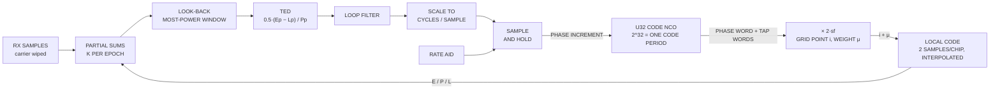
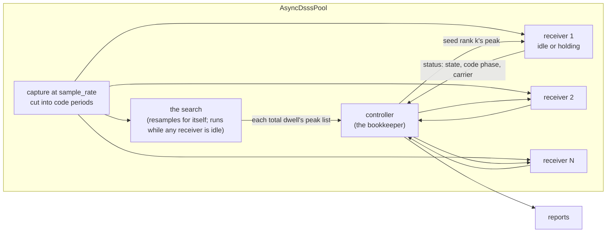

# AsyncDsssReceiver and AsyncDsssPool — continuous DSSS, from spec to object

*`AsyncDsssReceiver` is one C object that searches for a continuous DSSS
emitter, refines the detection, and tracks it until its own lock detectors
say it is gone. `AsyncDsssPool` holds up to ten such signals on one code: N
receivers that refine and track, and **one search, owned by the controller**,
run while any receiver is idle (§5). This page is the design of record for
both: the specification, the CCSDS 415.1-B-1 point with its stimulus and
its one case (§1), the acquisition engine's hand-off (§2), the
asynchronous despreader (§3), the receiver's states, its results at the
specification point, the conclusions, the open findings and next steps,
the tracking stage, the hand-over and the error-rate window (§4), the pool (§5–§9), the release (§10) and what a
holder reads (§11). Bursts are [`burst-bank.md`](burst-bank.md)'s. The runs
behind the numbers here are
[the measurement record](async-dsss-receiver-measurements.md), under the same
section numbers, and a cost is a [published benchmark](../benchmarks.md)
row.*

______________________________________________________________________

## 1. The specification

The receiver is specified at the forward link of CCSDS 415.1-B-1, the
command channel alone, with no ranging. The rule is the owner's: the
standard rules unless the owner sets otherwise, and no number is picked.
Every row names its source. A row that neither sets is **NOT SET**, and is
not invented.

| quantity                                | value                                                                                                                                                           | source                                                                                     |
| --------------------------------------- | --------------------------------------------------------------------------------------------------------------------------------------------------------------- | ------------------------------------------------------------------------------------------ |
| link                                    | forward (network to user), the command (I) channel only                                                                                                         | owner; 415.1-B-1 §4.2                                                                      |
| modulation                              | BPSK: with no range channel, the I channel's parameters apply to BPSK                                                                                           | 415.1-B-1 table 4-1, note 1                                                                |
| carrier suppression                     | 30 dB minimum                                                                                                                                                   | 415.1-B-1 table 4-1                                                                        |
| code                                    | Gold, 2^10 − 1 = 1,023 chips, the generator of figure 4-1, a user-unique initial condition                                                                      | 415.1-B-1 table 4-1, §4.4                                                                  |
| chip rate                               | F_fwd × 31 / (221 × 96)                                                                                                                                         | 415.1-B-1 table 4-1                                                                        |
| chip-rate coherence with the carrier    | peak chip-rate error at most 0.01 chips/s, relative to absolute coherence with the carrier rate                                                                 | 415.1-B-1 table 4-2                                                                        |
| data on the code                        | modulo-2 added, asynchronously                                                                                                                                  | 415.1-B-1 table 4-1                                                                        |
| symbol rate                             | 3,000 sym/s; the standard allows 0.1 to 300 ks/s                                                                                                                | owner: "the use case: 3kbps >= 4dB Es/N0"; the range, 415.1-B-1 table 4-1                  |
| symbol clock                            | within 1 ppm of nominal, on no relation to the code or the carrier; its stability is NOT SET                                                                    | owner: no link standard sets it (415.1, 232.0, 231.0 and 401.0 give no figure)             |
| carrier frequency F_fwd                 | 2.2 to 2.8 GHz                                                                                                                                                  | owner                                                                                      |
| chip rate, epoch rate                   | 3.2146 to 4.0913 Mcps; 3,142.3 to 3,999.3 Hz                                                                                                                    | derived from the two rows above                                                            |
| frequency uncertainty                   | Doppler pre-compensated; the received signal within ±1,500 Hz of best lock                                                                                      | owner-adopted: the owner sets it, taking 415.1-B-1 §7.4.1's figure; pre-compensation, §6.1 |
| frequency rate                          | 400 Hz/s selects which passes are in scope; the pre-compensated residual's rate, 11 Hz/s (`R_env`, §1.8), is the one the tracking loops are sized and judged at | owner; the 11 Hz/s ruled the governing rate, 2026-11-21                                    |
| acquisition                             | short-code PN lock with probability at least 90% within 20 s of arrival, the signal within ±1,500 Hz of best lock                                               | 415.1-B-1 §7.4.1                                                                           |
| sensitivity floor                       | Es/N0 = 4 dB: C/N0 38.8 dB-Hz; the BPSK bound there is a symbol error rate of 1.25%                                                                             | owner, the same ruling                                                                     |
| the receiver's design C/N0 (`cn0_dbhz`) | the floor's, 38.77 dB-Hz, at every level: a receiver is built once, for its weakest signal                                                                      | owner, 2026-11-21                                                                          |
| capture                                 | complex samples at 11 MSa/s                                                                                                                                     | owner                                                                                      |
| data                                    | the stimulus of §1.4: one CCSDS TC transfer frame a period, 8 to 1,024 octets, with its error control field; no SDLS                                            | owner; 232.0-B-4 §4.1, each field's section in §1.4                                        |
| coding                                  | none in this certification; the link will be coded later                                                                                                        | owner                                                                                      |
| between frames                          | all-zero data: code alone, no symbol transitions                                                                                                                | owner; 415.1-B-1 §6.1                                                                      |

Carrier and code come from one timebase, the chip rate a fixed fraction of
the carrier, and Doppler moves them together; the data clock belongs to
neither (§1.6). The point is one case, a symbol at least a code period
long (§1.5). What the owner has not ruled is §1.7. The receiver at this
point is §4.10 to §4.12, its runs [the record](async-dsss-receiver-measurements.md). A number in §2, §3 or §5–§11 names the point it is
measured at: the certification's 3.069 Mcps point, below, or the pool's
5 Mcps sizing point (§5).

**What the certification covers.** The receiver's
[certification record](https://github.com/doppler-dsp/doppler/blob/v0.83.0/src/doppler/dsss/tests/validation/async_dsss_receiver/results.md)
holds 23 of 23 limits at 3.069 Mcps and 2,700 sym/s, two samples a chip,
on continuous random data with no gap, `carrier_freq_hz` 0, and a search
over ±3 kHz (±1/T_E), and at no other point: not this point's chip rates,
not the gap, and not the coupling of code to carrier (§1.6). The C test
that pins its 5 dB floor, `_test_awgn_esn0_floor`, adds 3 dB less noise
than its label ([#689](https://github.com/doppler-dsp/doppler/issues/689));
at a true 5 dB the receiver does not decode random data
([#3080](https://github.com/doppler-dsp/doppler/issues/3080)). The certification is moving to this
point harness by harness, each retiring the old point's limits as it moves:
the dropout runs here, and 415.1-B-1 §7.4.1's acquisition requirement is
asserted on the pull-in validator's cells; the error rate follows, and the
loss decomposition is rebuilt inside the floor brief
([#3156](https://github.com/doppler-dsp/doppler/issues/3156)). A claim whose
requirement the owner has not set is printed, not asserted
([#3157](https://github.com/doppler-dsp/doppler/issues/3157)).

### 1.1 The signals

M out of N ($\leq 10$) possible signals are on air at once, with at least
differing code phase and carrier phase trajectory. Each may go off air and
be replaced by a new signal at any moment. All share a common, periodic,
simultaneous data-free block lasting many code epochs. **A signal changes
only after a data-free block**: one goes off air, or a new one comes on, at a
frame boundary, never inside a frame.

This is the pool's premise, from the 5 Mcps point (§5). Whether the single
receiver is certified at the 415.1-B-1 point with other emitters of its code
present is open (§1.7).

### 1.2 The sample rate is derived, not chosen

The caller states its capture's `sample_rate` (11 MSa/s here); neither the
receiver nor the pool takes a samples-per-chip. The **search** derives $N$,
the samples in one code period, as the smallest power of two of at least
two samples a chip: 2,048 for a 1,023-chip code, a rate of
$5\,\text{Mcps} \times 2048/1023 = 10.0098$ MSa/s. A search tile is one bin
of the $N$-point transform, $1/T_E$ wide, whatever $N$ is. At the
415.1-B-1 point $N$ is still 2,048, a rate of 6.4354 to 8.1905 MSa/s from
the 11 MSa/s capture across 2.2 to 2.8 GHz.

**Only the search is resampled.** The receiver builds a resampler for its
search and for nothing else (`dp_async_dsss_receiver_create()`), and skips
it when the caller's code period is already a whole number of samples.
Refining and tracking run at the caller's rate, in blocks of
`floor(code_len · sample_rate / chip_rate)` samples, 3,500 at 2.2 GHz and
2,750 at 2.8 GHz, where a code period is 3,500.64 and 2,750.50; the
partials close on the code NCO's phase, so a block need not be a whole
period. A pool has no front end of its own: its one search resamples
inside its own receiver, and every pooled receiver reads the caller's
capture as it arrives (§5).

**Why a power of two.** Every search transform is one code period long. At
two samples a chip that is $2 \times 1023 = 2 \cdot 3 \cdot 11 \cdot 31$,
and pocketfft has no radix-31 or fast radix-11 pass: profiling one total dwell of
the one-tile search put about 83% of it in FFT passes and 62% in the
generic radix-31 and the radix-11 passes, and a 2,046-point transform takes
9.89 µs against 1.99 µs at 2,048 (record §9.4). `Acquisition`, `AsyncDsssReceiver` and `AsyncDsssPool`
take no `spc`; the burst objects (`DsssBurstReceiver`, `BurstDemod`)
do.

### 1.3 The loop SNR rule

**The code loop and the demodulator's carrier loop are sized to a loop SNR
of at least 20 dB at the floor.** `rho(dB) = Es/N0(dB) − 10·log10(2·bn)`,
with `bn` normalized to the loop's own update rate so the rate cancels. At
the 4 dB floor that asks for `bn ≤ 0.0126`. The Dll ships at `bn` 0.002
(`ASYNC_DSSS_RX_DLL_BN`) and MpskReceiver's carrier loop at 0.01. The code
loop's per-epoch SNR is Es/N0 over `epochs_per_symbol`, 1.05 to 1.33 at
this point (§1.5), inside the same bound. The carrier loop (correction
before despreading, error formed after) is sized by the same rule, the
20 dB counting the M = 2 detector's squaring loss (owner): its per-update
SNR at the floor is `ρ = C/N0·T`, the loss is
`S_L = 1 / (1 + 1/(2ρ))`, so `bn = ρ·S_L/200`, 0.00993 at 2.2 GHz and
0.00744 at 2.8 GHz (`dp_async_dsss_receiver_carrier_bn()`, held by
`_test_carrier_bn_follows_the_loop_snr_rule`; `validate_async_dsss_receiver_pullin --design`
prints it). `create()` sizes the carrier loop with it at `cn0_dbhz`, no
wider than 0.04 (`ASYNC_DSSS_RX_BN_CARRIER`). Its acquisition bound,
`ASYNC_DSSS_RX_CARRIER_PULLIN_HZ` at that bandwidth, is 15.59 Hz at
2.2 GHz and 14.89 Hz at 2.8 GHz (the pull-in rows' `base_pullin_hz`):
the empirical offset inside which the loop locks in its normal `5/bn`
updates (§4.10, "Its bandwidth"). The two carriers differ only through the
squaring loss at each update SNR, so at the 415.1-B-1 floor the rule gives
about 30 Hz of loop bandwidth and a 15 Hz acquisition bound at both. The
step the loop pulls in from without slipping is §4.10's no-slip edge,
11.9 and 11.4 Hz. There is no FLL. Pulling a loop in from a coarse estimate is the hand-over's
problem (§4.4), not the bandwidth's.

### 1.4 The stimulus, one period

The stimulus repeats one period: a gap, an acquisition sequence, a start
sequence, then one CCSDS TC transfer frame of 232.0-B-4 with a data field
of random length. There is no coding and no SDLS.

| part                 | content                                                                                                                | source                                                       |
| -------------------- | ---------------------------------------------------------------------------------------------------------------------- | ------------------------------------------------------------ |
| gap                  | `G` symbols of all-zero data: code alone                                                                               | owner; 415.1-B-1 §6.1                                        |
| acquisition sequence | alternating ones and zeros, 128 bits                                                                                   | 231.0-B-4 §7.2.2 (16 octets is its preferred minimum length) |
| start sequence       | `1110 1011 1001 0000` (EB90), 16 bits, bit 0 first: it marks where the frame starts, so an error count needs no search | 231.0-B-4 §5.2.2.2                                           |
| transfer frame       | a 5-octet primary header, a data field of 1 to 1,017 octets, a 2-octet error control field: 8 to 1,024 octets in all   | owner; 232.0-B-4 §4.1.1, the fields below                    |

The frame, field by field, in transmission order:

| field                      | bits       | value in the stimulus                                                                | source                                      |
| -------------------------- | ---------- | ------------------------------------------------------------------------------------ | ------------------------------------------- |
| transfer frame version     | 2          | `00`                                                                                 | 232.0-B-4 §4.1.2.2.2                        |
| bypass flag                | 1          | `1`, Type-B \*                                                                       | 232.0-B-4 §4.1.2.3.1                        |
| control command flag       | 1          | `0`, Type-D: the data field is a frame data unit \*                                  | 232.0-B-4 §4.1.2.3.2, table 4-1 (Type-BD)   |
| reserved spare             | 2          | `00`                                                                                 | 232.0-B-4 §4.1.2.4.2                        |
| spacecraft identifier      | 10         | 42 \*                                                                                | 232.0-B-4 §4.1.2.5                          |
| virtual channel identifier | 6          | 1 \*                                                                                 | 232.0-B-4 §4.1.2.6                          |
| frame length               | 10         | the frame's total octets minus one: 7 to 1,023                                       | 232.0-B-4 §4.1.2.7.2, §4.1.2.7.3            |
| frame sequence number      | 8          | 0 * (the value the COP sets on a Type-B frame)                                       | 232.0-B-4 §4.1.2.8, note 3                  |
| data field                 | 8 to 8,136 | random octets, a whole number drawn per frame from 1 to 1,017; no segment header     | owner; 232.0-B-4 §4.1.3.1.2, §4.1.3.2.2.1.2 |
| frame error control (FECF) | 16         | CRC over the header and data field, G(X) = X^16 + X^12 + X^5 + 1, preset to all ones | 232.0-B-4 §4.1.4.1.2, §4.1.4.2              |

\* Arbitrary stimulus content, not the specification: a receiver at this
point makes no use of the field, and any value would do.

**The 1,024-octet maximum is normative from three sections**, not from the
frame-length field: a 5-octet header (§4.1.1), a data field of at most 1,017
octets when the error control field is present (§4.1.3.1.2), and that field's
2 octets (§4.1.4.1.2). §4.1.2.7's note 2 says the 10-bit length field limits
a frame to 1,024 octets; it is a note, and it agrees. The minimum, 1 octet of
data, is the smallest whole number the mandatory data field can hold
(§4.1.1 b, §4.1.3.1.2).

Dropped from 231.0-B-4's coding layer: the BCH codeblocks, the tail
sequence and the randomizer. A frame of 64 to 8,192 bits lasts 21 ms to
2.73 s at 3,000 sym/s.

**The gap is twice what the search needs.** The need is the search model's,
read from the receiver's own search sizing at the worst corner: the 2.2 GHz
end, a design C/N0 of 36.34 dB-Hz (the 4 dB floor, 38.77 dB-Hz, less the
edge's 2.43 dB of loss beyond the band average), R_env (11 Hz/s, §1.8), Pd 0.999 at the
receiver's `pfa` of 1e-3, and the whole total dwell inside the gap wherever it
starts, a gap of at least 2·K·D − 1 epochs
([#3082](https://github.com/doppler-dsp/doppler/issues/3082)):

| D   | K   | the need            | twice it, the gap G              |
| --- | --- | ------------------- | -------------------------------- |
| 72  | 1   | 144 epochs, 45.8 ms | 288 epochs, 91.7 ms, 275 symbols |

These are the model's numbers, not a detection measured at the band edge,
and the gap's length is open (§1.7). The search does not hold its total dwell
`K·D` inside a gap (#3082).

**72 is the model's need, not the depth the search runs.** Given this gap
the engine takes the deepest coherent dwell §2.1's rule allows. At the residual's
rate R_env (11 Hz/s, §1.8, `dp_s415_r_env()`), the drift bound
`f_epoch/√(2·R_env)` is far past the window, so the window's half binds:
`coherent_bins` reads 144 at 2.2 GHz and 180 at 2.8 GHz (⌊(287 + 1)/2⌋ and
⌊(366 + 1)/2⌋, 7-smooth), with a non-coherent count of 1 (`n_noncoh` 1), a total dwell of 45.8 and
45.0 ms. A whole coherent dwell of that depth lands inside the gap wherever it
starts once the gap holds 2·D − 1 code periods, 287 and 359; the 275-symbol
gap holds 287 and 365 whole ones. So the gap holds one whole coherent dwell at the depth run, and is
twice the need only at the model's depth.

**It is built from shipped tools.** Each frame is one `FrameDesc`: the
header and data field by `add_field`, the error control field by
`add_derived` and `add_stage_over(STAGE_CRC16, "header", "fecf")`.
`FrameDesc` has no stage that fills a length count, so the frame-length
field cannot be a derived field; it needs none, because each description
is one frame of one known length, and the caller writes the count into the
header's bits. Checked against main's build at 1, 17 and 1,017 data
octets: the length field reads the total minus one, the FECF matches
232.0-B-4 §4.1.4.2 computed independently, and `crc_ok()` passes.
`FrameDesc` does not bound the data field at 1,017 octets; the stimulus
does. The frame door assembles each period as a bit stream, a continuous
DSSS source takes that stream as its `data=`, the composer's Doppler
channel moves it, and a `RateConverter` takes it to 11 MSa/s. Two
shorter spellings drop a part without saying so: `frame=` on a continuous
DSSS source
([#3083](https://github.com/doppler-dsp/doppler/issues/3083)), and
`Synth.steps()`, which skips the Doppler channel
([#3091](https://github.com/doppler-dsp/doppler/issues/3091)).

### 1.5 The case: a symbol is at least a code period

One ratio sets the physics: the epochs a symbol spans, `E = Re / Rs`, the
epoch rate over the symbol rate. At 3,000 sym/s, across 2.2 to 2.8 GHz,
from the standard's chip rate:

|                                         | 2.2 GHz                                                                                                 | 2.8 GHz  |
| --------------------------------------- | ------------------------------------------------------------------------------------------------------- | -------- |
| epochs a symbol                         | 1.047: a symbol spans more than an epoch                                                                | 1.333    |
| symbol boundaries an epoch              | 0.95: at most one                                                                                       | 0.75     |
| one epoch's correlation in data         | full with no transition in it; with one at fraction f, reduced by the factor 2f − 1 in magnitude (§3.2) | the same |
| partials a symbol at `K` = 4, `P = K·E` | 4.2                                                                                                     | 5.3      |
| 500 symbols, in epochs                  | 524                                                                                                     | 667      |

The floor's C/N0 is 38.8 dB-Hz at both carriers.

What follows, by reasoning:

- **An epoch holds at most one transition**, so a code-period window that
    avoids it is always available: the look-back (§3.6) finds one. The
    carrier detector (§4.4, §4.10) rests on that, and holds only while a
    symbol is at least a code period, which is the case here.
- **2.2 GHz is the near-one end.** A symbol is 1.047 epochs, so
    the symbol boundary creeps through the epoch at the difference of the
    two rates, 142 Hz: almost every epoch holds a transition, and where it
    falls moves slowly.
- **Symbol timing.** The timing detector must hold through the gap,
    hundreds of symbols with no transition. It is Gardner, in
    `MpskReceiver`; the DTTL ties with it (
    [PR #3087](https://github.com/doppler-dsp/doppler/pull/3087)).

**The edge of the search's roll.** ±1,500 Hz is inside one epoch's span,
`±1/(2·T_E)`, at both carrier ends, so the search runs one roll (§2.3).
Two things follow, from the code's formulas:

- **The edge's loss.** One roll de-rotates at 0 Hz, so a signal at offset
    `f` loses `sinc(f / Re)` in every epoch: 3.5 dB at ±1,500 Hz at 2.2 GHz
    and 2.1 dB at 2.8 GHz. The search's predicted Pd charges the loss
    averaged over the band, not the edge's.
- **The fold.** One roll's Doppler axis repeats every epoch rate. At
    2.2 GHz the band edge is 71 Hz inside the fold (500 Hz at 2.8 GHz), so a
    signal near the edge can be reported one epoch rate away, and a one-roll
    search cannot tell which side it came from. That error is far outside
    the carrier loop's pull-in.

**Above one symbol a code period**, a symbol rate over the epoch rate
(3,142 to 3,999 sym/s across the band), no code-period window is free of a
transition, and the code loop's symbol-scale coherent dwell shrinks toward one
partial. `steps_max_out()` would not be a bound
there ([#2469](https://github.com/doppler-dsp/doppler/issues/2469)), and
`create()` refuses it, because the carrier loop's code-period window (§4.4)
needs a symbol of at least a code period.

### 1.6 Code and carrier are coherent; the data is not

The coherency is two statements:

- **Carrier and code come from one timebase.** The chip rate is the carrier
    times 31 / 21,216 (415.1-B-1 table 4-1), so code Doppler is carrier
    Doppler times 31 / 21,216, exactly: ±1,500 Hz is ±2.19 chips/s at any
    carrier. The channel dilates everything it carries by one factor.
- **The data clock is not part of that timebase.** It has no phase relation
    to the code and no fixed rate ratio to it; its rate is whatever its own
    source gives, within 1 ppm of nominal (§1). The receiver may assume
    nothing about symbol timing from the code or the carrier, before or
    after Doppler, so the symbol timing loop is the only thing that knows
    the data clock, and it acquires and holds it with no aid.

415.1-B-1 §2.1 offers BPSK for the forward data "when RF and PN coherency
is not required". That coherency is the turn-around kind, for ranging,
which this point does not do: §1's link is DSSS BPSK with no ranging. It
does not release the chip rate from table 4-1's
ratio or from table 4-2's 0.01 chips/s, and §1's row stands as written.

The code at `edea9c649` models the first as coherent at the source and
dilated in flight. The code-rate offset is `chip_rate · fd / fc` wherever it
is used: the search's hand-off phase (§2.2), the hand-over and both code
loops. The tracking code loop is aided every code period from the tracked
carrier (§4.1); the refine's code loop gets a one-time aid from the seed.
The model does not depend on the chip rate being on the standard's ratio,
and nothing checks that it is. With `carrier_freq_hz` 0 all of it is off.
At this point the harnesses build the receiver with the carrier on
(`dp_s415_rx()`, `dp_s415_pool()` in `native/tests/dp_s415_test.h`), so
every harness this page cites runs the coupling. The
certification record at 3.069 Mcps (§1) ran with `carrier_freq_hz` 0 and
certifies nothing about it. The library's Doppler channel dilates the whole stream by one
factor (code, data symbols and the gap) and offsets the carrier to match:
the same model. It cannot render a source whose code clock is off its
carrier, so table 4-2's 0.01 chips/s has no stimulus.

### 1.7 Open decisions

Not ruled by the owner, and not decided here:

1. **Where Es/N0 is defined**: at the source, or in the capture. The
    11 MSa/s capture reads 0.06 to 0.17 dB under the source's, mostly from
    its bandwidth; [the record](async-dsss-receiver-measurements.md)'s runs (§4.2) set it at the source.
1. **The gap's length.** Twice the search model's need (§1.4) is the rule
    proposed, not ruled.
1. **Keeping the EB90 start sequence** (§1.4).
1. **`reacquire` as the default.** It is off by default; at this point a lock
    on the wrong Doppler never releases without it
    ([#3092](https://github.com/doppler-dsp/doppler/issues/3092)).
1. **`refine`**, the knob §4.4 describes: its name, or its retirement.
1. **What must hold at the floor**: the allowed loss against the BPSK bound,
    and how soon after arrival the receiver must be decoding. With the
    dropout time and the lock budget, these are the figures the
    certification's unasserted rows wait on
    ([#3157](https://github.com/doppler-dsp/doppler/issues/3157)).
1. **Whether the link resolves half-cycle flips** (differential coding, or
    a phase-resolving word) or the carrier loop must not flip
    ([#3090](https://github.com/doppler-dsp/doppler/issues/3090)). The
    detector of §4.4 cuts them from 146 to 8 at the floor; it does not
    remove them.
1. **Alone or in company**: whether the single receiver is certified with
    other emitters of its code present, or alone, with company left to the
    pool.
1. **Whether the uncompensated ±50 kHz** of the 5 Mcps point stays a case
    for the single receiver.
1. **The data clock's stability**: how fast it may wander inside its 1 ppm.
1. **The stages with no certification on record.** The
    [validation log](../dev/contributing/validation-log.md) has no record
    for the code loop (`Dll`), the carrier loop, the Doppler refine
    (`CarrierAcquisition`) or `RateConverter`. Whether each is certified
    before the receiver is a decision of its own.

### 1.3 The loop SNR rule

**The code loop and the demodulator's carrier loop are sized to a loop SNR
of at least 20 dB at the floor.** `rho(dB) = Es/N0(dB) − 10·log10(2·bn)`,
with `bn` normalized to the loop's own update rate so the rate cancels. At
the 4 dB floor that asks for `bn ≤ 0.0126`. The Dll ships at `bn` 0.002
(`ASYNC_DSSS_RX_DLL_BN`) and MpskReceiver's carrier loop at 0.01. The code
loop's per-epoch SNR is Es/N0 over `epochs_per_symbol`, 1.05 to 1.33 at
this point (§1.5), inside the same bound. The carrier loop (correction
before despreading, error formed after) is wider, 0.04
(`ASYNC_DSSS_RX_BN_CARRIER`): pull-in and the 400 Hz/s rate set its width,
not jitter. There is no FLL. `bn` does not set the floor: sizing a loop
for steady-state jitter and pulling one in from a coarse estimate are
different problems, and the hand-over of §4.3 answers the second.

### 1.4 The stimulus, one period

The stimulus repeats one period: a gap, an acquisition sequence, a start
sequence, then one CCSDS TC transfer frame of 232.0-B-4 with a data field
of random length. There is no coding and no SDLS.

| part                 | content                                                                                                                | source                                                       |
| -------------------- | ---------------------------------------------------------------------------------------------------------------------- | ------------------------------------------------------------ |
| gap                  | `G` symbols of all-zero data: code alone                                                                               | owner; 415.1-B-1 §6.1                                        |
| acquisition sequence | alternating ones and zeros, 128 bits                                                                                   | 231.0-B-4 §7.2.2 (16 octets is its preferred minimum length) |
| start sequence       | `1110 1011 1001 0000` (EB90), 16 bits, bit 0 first: it marks where the frame starts, so an error count needs no search | 231.0-B-4 §5.2.2.2                                           |
| transfer frame       | a 5-octet primary header, a data field of 1 to 1,017 octets, a 2-octet error control field: 8 to 1,024 octets in all   | owner; 232.0-B-4 §4.1.1, the fields below                    |

The frame, field by field, in transmission order:

| field                      | bits       | value in the stimulus                                                                | source                                      |
| -------------------------- | ---------- | ------------------------------------------------------------------------------------ | ------------------------------------------- |
| transfer frame version     | 2          | `00`                                                                                 | 232.0-B-4 §4.1.2.2.2                        |
| bypass flag                | 1          | `1`, Type-B \*                                                                       | 232.0-B-4 §4.1.2.3.1                        |
| control command flag       | 1          | `0`, Type-D: the data field is a frame data unit \*                                  | 232.0-B-4 §4.1.2.3.2, table 4-1 (Type-BD)   |
| reserved spare             | 2          | `00`                                                                                 | 232.0-B-4 §4.1.2.4.2                        |
| spacecraft identifier      | 10         | 42 \*                                                                                | 232.0-B-4 §4.1.2.5                          |
| virtual channel identifier | 6          | 1 \*                                                                                 | 232.0-B-4 §4.1.2.6                          |
| frame length               | 10         | the frame's total octets minus one: 7 to 1,023                                       | 232.0-B-4 §4.1.2.7.2, §4.1.2.7.3            |
| frame sequence number      | 8          | 0 * (the value the COP sets on a Type-B frame)                                       | 232.0-B-4 §4.1.2.8, note 3                  |
| data field                 | 8 to 8,136 | random octets, a whole number drawn per frame from 1 to 1,017; no segment header     | owner; 232.0-B-4 §4.1.3.1.2, §4.1.3.2.2.1.2 |
| frame error control (FECF) | 16         | CRC over the header and data field, G(X) = X^16 + X^12 + X^5 + 1, preset to all ones | 232.0-B-4 §4.1.4.1.2, §4.1.4.2              |

\* Arbitrary stimulus content, not the specification: a receiver at this
point makes no use of the field, and any value would do.

**The 1,024-octet maximum is normative from three sections**, not from the
frame-length field: a 5-octet header (§4.1.1), a data field of at most 1,017
octets when the error control field is present (§4.1.3.1.2), and that field's
2 octets (§4.1.4.1.2). §4.1.2.7's note 2 says the 10-bit length field limits
a frame to 1,024 octets; it is a note, and it agrees. The minimum, 1 octet of
data, is the smallest whole number the mandatory data field can hold
(§4.1.1 b, §4.1.3.1.2).

Dropped from 231.0-B-4's coding layer: the BCH codeblocks, the tail
sequence and the randomizer. A frame of 64 to 8,192 bits lasts 21 ms to
2.73 s at 3,000 sym/s.

**The gap is twice what the search needs.** The need is the search model's,
read from the receiver's own search sizing at the worst corner: the 2.2 GHz
end, a design C/N0 of 36.34 dB-Hz (the 4 dB floor, 38.77 dB-Hz, less the
edge's 2.43 dB of loss beyond the band average), 400 Hz/s, Pd 0.999 at the
as-built `pfa` of 1e-3, and the whole dwell inside the gap wherever it
starts, a gap of at least 2·K·D − 1 epochs
([#3082](https://github.com/doppler-dsp/doppler/issues/3082)):

| D   | K   | the need            | twice it, the gap G              |
| --- | --- | ------------------- | -------------------------------- |
| 72  | 1   | 144 epochs, 45.8 ms | 288 epochs, 91.7 ms, 275 symbols |

These are the model's numbers, not a detection measured at the band edge,
and the gap's length is open (§1.7). The search does not hold its dwell
`K·D` inside a gap (#3082).

**72 is the model's need, not the depth the search runs.** Given this gap
the engine takes the deepest block §2.1's rule allows, which here is the
400 Hz/s drift bound: `coherent_bins` reads 108 at 2.2 GHz and 140 at
2.8 GHz, with one look (`n_noncoh` 1), a dwell of 34.4 and 35.0 ms. A whole
block of that depth lands inside the gap wherever it starts once the gap
holds 2·D − 1 code periods, 215 and 279; the 275-symbol gap holds 287 and
365 whole ones. So the gap holds one whole block at the depth run, and is
twice the need only at the model's depth.

**It is built from shipped tools.** Each frame is one `FrameDesc`: the
header and data field by `add_field`, the error control field by
`add_derived` and `add_stage_over(STAGE_CRC16, "header", "fecf")`.
`FrameDesc` has no stage that fills a length count, so the frame-length
field cannot be a derived field; it needs none, because each description
is one frame of one known length, and the caller writes the count into the
header's bits. Checked against main's build at 1, 17 and 1,017 data
octets: the length field reads the total minus one, the FECF matches
232.0-B-4 §4.1.4.2 computed independently, and `crc_ok()` passes.
`FrameDesc` does not bound the data field at 1,017 octets; the stimulus
does. The frame door assembles each period as a bit stream, a continuous
DSSS source takes that stream as its `data=`, the composer's Doppler
channel moves it, and a `RateConverter` takes it to 11 MSa/s. Two
shorter spellings drop a part without saying so: `frame=` on a continuous
DSSS source
([#3083](https://github.com/doppler-dsp/doppler/issues/3083)), and
`Synth.steps()`, which skips the Doppler channel
([#3091](https://github.com/doppler-dsp/doppler/issues/3091)).

### 1.5 The case: a symbol is at least a code period

One ratio sets the physics: the epochs a symbol spans, `E = Re / Rs`, the
epoch rate over the symbol rate. At 3,000 sym/s, across 2.2 to 2.8 GHz,
from the standard's chip rate:

|                                         | 2.2 GHz                                                                                                 | 2.8 GHz  |
| --------------------------------------- | ------------------------------------------------------------------------------------------------------- | -------- |
| epochs a symbol                         | 1.047: a symbol spans more than an epoch                                                                | 1.333    |
| symbol boundaries an epoch              | 0.95: at most one                                                                                       | 0.75     |
| one epoch's correlation in data         | full with no transition in it; with one at fraction f, reduced by the factor 2f − 1 in magnitude (§3.2) | the same |
| partials a symbol at `K` = 4, `P = K·E` | 4.2                                                                                                     | 5.3      |
| 500 symbols, in epochs                  | 524                                                                                                     | 667      |

The floor's C/N0 is 38.8 dB-Hz at both carriers.

What follows, by reasoning:

- **An epoch holds at most one transition**, so a code-period window that
    avoids it is always available: the look-back (§3.6) finds one. The
    carrier detector §4.4 proposes rests on that, and holds only while a
    symbol is at least a code period, which is the case here.
- **2.2 GHz is the near-one end.** A symbol is 1.047 epochs, so
    the symbol boundary creeps through the epoch at the difference of the
    two rates, 142 Hz: almost every epoch holds a transition, and where it
    falls moves slowly.
- **Symbol timing.** The timing detector must hold through the gap,
    hundreds of symbols with no transition. As built it is Gardner, in
    `MpskReceiver`; the DTTL ties with it (§4.2,
    [PR #3087](https://github.com/doppler-dsp/doppler/pull/3087)).

**The edge of the search's roll.** ±1,500 Hz is inside one epoch's span,
`±1/(2·T_E)`, at both carrier ends, so the search runs one roll (§2.3).
Two things follow, from the code's formulas:

- **The edge's loss.** One roll de-rotates at 0 Hz, so a signal at offset
    `f` loses `sinc(f / Re)` in every epoch: 3.5 dB at ±1,500 Hz at 2.2 GHz
    and 2.1 dB at 2.8 GHz. The search's predicted Pd charges the loss
    averaged over the band, not the edge's.
- **The fold.** One roll's Doppler axis repeats every epoch rate. At
    2.2 GHz the band edge is 71 Hz inside the fold (500 Hz at 2.8 GHz), so a
    signal near the edge can be reported one epoch rate away, and a one-roll
    search cannot tell which side it came from. That error is far outside
    the carrier loop's pull-in.

**Above one symbol a code period**, a symbol rate over the epoch rate
(3,142 to 3,999 sym/s across the band), no code-period window is free of a
transition, and the code loop's symbol-scale look shrinks toward one
partial. `create()` accepts such a rate (the chain asks only that the
symbol rate not exceed the chip rate), `steps_max_out()` is not a bound
there ([#2469](https://github.com/doppler-dsp/doppler/issues/2469)), and
the `code_period` carrier window proposed in §4.4 has to be refused or
warned there.

### 1.6 Code and carrier are coherent; the data is not

The coherency is two statements:

- **Carrier and code come from one timebase.** The chip rate is the carrier
    times 31 / 21,216 (415.1-B-1 table 4-1), so code Doppler is carrier
    Doppler times 31 / 21,216, exactly: ±1,500 Hz is ±2.19 chips/s at any
    carrier. The channel dilates everything it carries by one factor.
- **The data clock is not part of that timebase.** It has no phase relation
    to the code and no fixed rate ratio to it; its rate is whatever its own
    source gives, within 1 ppm of nominal (§1). The receiver may assume
    nothing about symbol timing from the code or the carrier, before or
    after Doppler, so the symbol timing loop is the only thing that knows
    the data clock, and it acquires and holds it with no aid.

415.1-B-1 §2.1 offers BPSK for the forward data "when RF and PN coherency
is not required". That coherency is the turn-around kind, for ranging,
which this point does not do: §1's link is DSSS BPSK with no ranging. It
does not release the chip rate from table 4-1's
ratio or from table 4-2's 0.01 chips/s, and §1's row stands as written.

The receiver as built models the first as coherent at the source and
dilated in flight. The code-rate offset is `chip_rate · fd / fc` wherever it
is used: the search's hand-off phase (§2.2), the hand-over and both code
loops. The tracking code loop is aided every code period from the tracked
carrier (§4.1); the refine's code loop gets a one-time aid from the seed.
The model does not depend on the chip rate being on the standard's ratio,
and nothing checks that it is. With `carrier_freq_hz` 0 all of it is off,
and the certification runs with it off (§1), so the coupling is not
certified. The library's Doppler channel dilates the whole stream by one
factor (code, data symbols and the gap) and offsets the carrier to match:
the same model. It cannot render a source whose code clock is off its
carrier, so table 4-2's 0.01 chips/s has no stimulus.

### 1.7 Open decisions

Not ruled by the owner, and not decided here:

1. **Where Es/N0 is defined**: at the source, or in the capture. The
    11 MSa/s capture reads 0.06 to 0.17 dB under the source's, mostly from
    its bandwidth; §4.2's runs set it at the source.
1. **How ±1,500 Hz and 400 Hz/s combine**: a linear ramp through the band,
    or a pass profile. §4.2's runs use both edges static, sweeps from one
    edge to the other at 400 Hz/s, and ramps from 0 Hz.
1. **The gap's length.** Twice the search model's need (§1.4) is the rule
    proposed, not ruled.
1. **Keeping the EB90 start sequence** (§1.4).
1. **`reacquire` as the default.** It is off as built; at this point a lock
    on the wrong Doppler never releases without it
    ([#3092](https://github.com/doppler-dsp/doppler/issues/3092)).
1. **The knob names** of §4.4.
1. **What must hold at the floor**: the allowed loss against the BPSK bound,
    and how soon after arrival the receiver must be decoding.
1. **Whether the link resolves half-cycle flips** (differential coding, or
    a phase-resolving word) or the carrier loop must not flip
    ([#3090](https://github.com/doppler-dsp/doppler/issues/3090)). The
    detector of §4.4 cuts them from 146 to 8 at the floor; it does not
    remove them.
1. **Alone or in company**: whether the single receiver is certified with
    other emitters of its code present, or alone, with company left to the
    pool.
1. **Whether the uncompensated ±50 kHz** of the 5 Mcps point stays a case
    for the single receiver.
1. **The data clock's stability**: how fast it may wander inside its 1 ppm.
1. **The stages with no certification on record.** The
    [validation log](../dev/contributing/validation-log.md) has no record
    for the code loop (`Dll`), the carrier loop, the Doppler refine
    (`CarrierAcquisition`) or `RateConverter`. Whether each is certified
    before the receiver is a decision of its own.

______________________________________________________________________

### 1.8 The dynamics the receiver is specified for

**The geometry.** The emitter is on a LEO satellite in a circular orbit,
and the receiver is a fixed point on a spherical Earth with a 10°
elevation mask. Earth rotation is left out, and its worst case is a factor
below.

**What 400 Hz/s is.** The specification's 400 Hz/s is the RAW pass's peak
Doppler rate. It fixes which passes are in scope; it is not a rate the
receiver meets.

- **Which passes:** a pass is in scope where its raw peak rate is exactly
    400 Hz/s. On a 50 km altitude grid from 350 km, with the maximum
    elevation solved at each altitude, that is 25 passes across the two
    carriers.
    - Examples: 550 km at 31° (2.2 GHz) or 22° (2.8 GHz); 800 km at 60°
        or 41°.
    - An altitude where even the lowest pass above the mask exceeds
        400 Hz/s, or even an overhead pass stays under it, has no pass in
        scope.
- **Raw figures:** on these passes the raw rate of change of rate peaks at
    2.70 Hz/s².

**Pre-compensation.** The link is steered from an ephemeris, and the
receiver sees what the steering leaves. The specification bounds that
residual offset at ±1,500 Hz.

**The ephemeris error model: an along-track timing error.** The pass
arrives `dt` early or late against the prediction.

- **Residual:** `f(t) − f(t − dt)`, about `f'(t)·dt`; its rate is about
    `f''(t)·dt`.
- **The range of `dt`:** up to the value that makes the residual reach
    1,500 Hz, 3.74 s on these passes.

**The envelope.** The largest |residual rate| at each |residual offset|,
over the 25 passes, every `dt` up to that bound, and both branches of the
pass:

| \|offset\|, Hz | 0-100 | 200-300 | 400-500 | 600-700 | 800-900 | 1000-1100 | 1200-1300 | 1400-1500 |
| -------------- | ----- | ------- | ------- | ------- | ------- | --------- | --------- | --------- |
| envelope, Hz/s | 1.20  | 3.59    | 5.99    | 8.13    | 9.63    | 10.10     | 9.71      | 6.69      |

- **Maximum:** 10.10 Hz/s, at |offset| about 1,050 Hz.
- **Small near zero offset:** under a timing error, zero residual offset is
    where the curve's slope is crossed, not where its rate peaks.
- **Sampled, not continuous:** the envelope is the maximum over a sampled
    grid. Halving the grid to 25 km (50 passes) moves the maximum to
    10.13 Hz/s, and the validator prints both.

**The cross-check: a proportional residual.** The steering removes all but
a fraction `ε` of the curve, so the residual is `ε·f(t)` and its rate is
largest at zero residual offset.

- **What `ε` means:** `ε = 1,500 Hz` over the pass's visible peak offset.
    That is a 3 to 6% error in the satellite's velocity.
- **Largest value:** 18.7 Hz/s on the 50 km grid, driven by the 400 km,
    13.0° pass at 2.8 GHz (`ε = 0.047`). On the 25 km grid it is 24.3 Hz/s,
    from 375 km at 11.6°.
- **It does not converge:** it grows toward the altitude where the
    400 Hz/s pass grazes the mask, where the visible arc and its peak
    offset are smallest.
- **Its role:** it is reported as the bound's cross-check and does not set
    it.

**What a draw is (conservative).**

- **Offset at arrival:** uniform in ±1,500 Hz.
- **Rate:** held constant over the 60 s draw at `R_env = 11 Hz/s`, sign
    drawn.
- **The conservatism, in one line:** `R_env` is the timing envelope's
    maximum over every offset (10.10 Hz/s), times the one effect the model
    leaves out, Earth rotation at its worst,
    `1 + ω_E·R_e / v_orbit = 1 + 0.465/7.33 = 1.063` (10.74), rounded up to
    the whole Hz/s. Against the envelope at a given offset, that is 1.1×
    at 1,050 Hz and about 9× near zero.
- **In bounds:** a constant 11 Hz/s moves the offset 660 Hz over 60 s.
    When `|f0| > 1,500 − 660 = 840 Hz`, the rate's sign is drawn toward
    zero, so the offset never leaves ±1,500 Hz.
- **Static draws:** a fixed offset at zero rate is the limit of a pass far
    from closest approach.
- **Not a use-case cell:** a constant rate at the specification's 400 Hz/s
    sweeps 6 to 24 kHz over a draw, far outside the span. It is a
    diagnostic only, never scored as the use case (owner, 11-17: "We don't
    want to test what will never happen").

**What the loops meet** at the owner's rule (§1.3; `bn = ρ_floor·S_L/200`,
0.00993 at 2.2 GHz and 0.00744 at 2.8 GHz), the larger of the carriers':

|                                                          | at R_env (11 Hz/s)        | at the cross-check's largest           |
| -------------------------------------------------------- | ------------------------- | -------------------------------------- |
| order-2 lag                                              | 1.27°                     | 2.15° (18.7 Hz/s) to 2.80° (24.3 Hz/s) |
| hand-over error from drift over the refine's total dwell | 11 Hz/s × 0.045 s, 0.5 Hz |                                        |

The hand-over figure compares with 7 to 8 Hz static.

The numbers on this section come from
`validate_async_dsss_receiver_pullin --design`, the `# pass` section, and
`--dynamics pass` draws them.

**The carrier-to-code rate aid.** Code and carrier are coupled at the
source and in the channel (owner, 2026-11-21): one timebase at the
emitter, and one dilation factor in flight (§1.6). A steering that
pre-compensates acts on the two together, so what it leaves is a residual
of the coupled pair: a residual carrier offset `δf` comes with a residual
code-rate offset of `δf · chip_rate / fc`, exactly. The receiver adds the
carrier loop's frequency, scaled by `chip_rate / carrier_freq_hz`, to the
code NCO's rate every code period (`adr_track_period()`, through
`dp_dll_set_rate_aid()`). That is this residual's code part, so the aid
stays on.

What the code loop carries is therefore the aided residual, not the
residual itself:

| at the specification point                                                   | unaided               | aided, what the code loop carries                        |
| ---------------------------------------------------------------------------- | --------------------- | -------------------------------------------------------- |
| offset, the carrier's ±1,500 Hz                                              | ±2.19 chips/s         | the carrier loop's frequency error × 1.461 × 10⁻³        |
| rate, `R_env` (11 Hz/s)                                                      | 0.0161 chips/s²       | one code period's hold of the aid: 4 to 5 × 10⁻⁶ chips/s |
| a hand-over error at the carrier loop's no-slip edge (11.9 / 11.4 Hz, §4.10) | inside the offset row | 0.017 chips/s while the carrier loop pulls in            |
| the source's own chip-rate error, table 4-2                                  | 0.01 chips/s at most  | the same; no aid sees it, and no stimulus renders it     |

`1.461 × 10⁻³` is 31 / 21,216. The hold is `R_env · T_E · 31/21,216`, with
`T_E` 0.318 ms at 2.2 GHz and 0.250 ms at 2.8.

So the code loop's stress is the carrier loop's own frequency error, the
hand-over's transient while the carrier pulls in, and table 4-2's
0.01 chips/s. None of the four rows reaches the code-lock sizing (§4.10): over
one code period the largest, 0.046 chips/s, moves the code 1.5 × 10⁻⁵ of
a chip, so the coherent dwell's derates are the replica and the placement alone.

## 2. Acquisition

### 2.1 Two searches, one engine

The continuous and burst searches are two flavors of one Python class,
`Correlator`, picked by `framing="continuous"` or `framing="burst"`, over
one `dp_correlator_state_t`
(`native/inc/doppler/correlator/correlator_core.h`). The one class refuses a knob its flavor would not honor instead of
carrying "ignored here" caveats
([the correlator's constructor](correlator.md#3-one-constructor)). State, auto-sizing,
`push()` and serialization are shared. The continuous search takes the code
(as NRZ chips), `sample_rate`, `chip_rate`, `symbol_rate`, a design
`cn0_dbhz`, a one-sided `doppler_uncertainty`, `pfa`, `pd`, a CFAR
`noise_mode`, and the two inputs that size its coherent depth, `code_only_epochs` and `doppler_rate`.
Everything else it derives; there is no `doppler_resolution` and no
`max_noncoh`.

**`doppler_bins` is the whole Doppler grid** a hit's `doppler_bin` indexes:
the coherent depth `coherent_bins` times the frequency windows the engine
rolls one epoch's spectrum across when the uncertainty is wider than one
epoch's span ([`acq-surface.md`](acq-surface.md) §3).
The non-coherent count is a separate axis. On the continuous door `n_noncoh`
is auto-selected to meet `pd` at `pfa` and read-only, bounded only by a
safety valve (`DP_CORRELATOR_N_NONCOH_SAFETY_CEILING`, a count of 256) because the
semi-analytical `pd_predicted` model turns non-monotonic past it. A burst
engine never adds to its non-coherent count: it sizes on the burst and reports `underpowered`.

**Two inputs size the coherent depth `D`: `code_only_epochs` and
`doppler_rate`.** It is the smaller of `⌊(code_only_epochs + 1)/2⌋`, so a
whole coherent dwell always fits inside the pure-code window, and
`f_epoch/√(2·doppler_rate)`, which is `f_epoch/√1000` at 500 Hz/s and
`f_epoch/√22` at the 415.1-B-1 point's residual rate R_env (11 Hz/s), so the
drift over one coherent dwell stays inside half a slow-time bin, rounded down to a
7-smooth length (`dp_fft_smooth_floor()`): `D` is a slow-time FFT length,
and a prime factor of 13 or more costs the FFT its slow path, so 94 epochs
run as 90. `code_only_epochs`
counts the **whole** epochs a window holds at any chip phase: the window is
`W` symbols on the data clock, with no fixed relation to the code clock, so
a partial epoch is lost at each edge and
`code_only_epochs = ⌊W · cps / L⌋ − 1`. It defaults to 1, which is `D = 1`:
the epoch-by-epoch search. `AsyncDsssReceiver` takes the window as a time,
`code_only_s`, and derives `code_only_epochs` from it (§2.3).

### 2.2 A detection is a physical record, never a grid index

`dp_correlator_handoff_t` (`native/inc/doppler/correlator/correlator_core.h`) is the data; the
*hand-off* is the action that turns a raw `push()` hit into it and gives it
to the next stage. The record crosses a thread or process boundary, so it
cannot be the grid-relative `(doppler_bin, code_phase)`, which mean nothing
without also shipping the emitting engine's `spc` and `doppler_res_hz`.
Every field is in a physical unit and the record is a flat, pointer-free
POD. `dp_correlator_build_handoff()` builds one from each hit of a continuous
engine. `AsyncDsssReceiver`'s `seed()` takes three of its fields,
`chip_phase`, `doppler_hz_est` and `cn0_dbhz_est`, and the receiver's own
hit takes that same path. A hit whose Doppler is at or past half the sample
rate is outside the seed domain (`dp_async_dsss_receiver_seed_ok()`): it is
refused as a seed and counted in `refused_hits`, and the search goes on.

| Field              | Type       | Description                                                                                      |
| ------------------ | ---------- | ------------------------------------------------------------------------------------------------ |
| `samples_consumed` | `uint64_t` | Sample offset since this engine's stream start that the detection's epoch ended at — replay-safe |
| `chip_phase`       | `double`   | Code phase in CHIPS, the code-tracking seed for the next stage                                   |
| `doppler_hz_est`   | `double`   | Coarse Doppler in Hz, already folded, signed and scaled from the raw bin index                   |
| `doppler_res_hz`   | `double`   | Width of that estimate — the ±`doppler_res_hz`/2 a refine or tracking stage still has to close   |
| `cn0_dbhz_est`     | `double`   | C/N0 estimate, dB-Hz — sizes downstream loop bandwidth and dwell                                 |
| `peak_mag`         | `float`    | Raw CFAR peak magnitude — observability passthrough                                              |
| `noise_est`        | `float`    | Raw CFAR noise-floor estimate — observability passthrough                                        |
| `test_stat`        | `float`    | Raw CFAR gating statistic — observability passthrough                                            |

**The record carries no timestamp.** The engines are pure sample-domain,
with no I/O; whatever feeds them samples owns the clock and stamps a record
at its `samples_consumed` (§11.3). The field list is the header's own.

**`chip_phase` is where the code will be, not where it was.** A hit is
decided at its total dwell's end and the seed is wanted at the next sample, so
`dp_correlator_build_handoff()` advances the phase by the drift over half the
total dwell on the hit's own Doppler. **Neither constructor takes a
`carrier_freq`**: the engine works in baseband Doppler Hz, and a
baseband-only caller never has to name one. A caller that knows the carrier
tells the engine afterwards (`dp_correlator_set_carrier_freq_hz()` /
`set_carrier_freq_hz`), which turns on that advance and, inside a
coherent dwell of `D > 1` epochs, aligns the coherent dwell's epochs on the dilated code
clock. `AsyncDsssReceiver` passes its own `carrier_freq_hz` on.

### 2.3 The receiver's search: a slow-time depth from the code-only window, total dwells on the shared sample count

**The receiver's search** is the continuous door, sized from two physical
create parameters: `code_only_s`, the code-only window in seconds, which
the receiver turns into `code_only_epochs = ⌊code_only_s · chip_rate / L⌋ − 1`, and `doppler_rate` in Hz/s, passed through. Both default to 0, which is
`D = 1`: one-epoch coherent dwells over its one-sided `doppler_uncertainty`. The
depth it runs is the read-only `coherent_bins`. `n_noncoh` is sized to `pd`
at `pfa` for its `cn0_dbhz`. The engine reports up to 16 peaks a total dwell
(`max_peaks`); the receiver drops those within a chip of an excluded code
phase (`set_exclusions()`) or of a stronger peak, and takes the survivor at
its rank (`set_rank()`, 0 = the strongest, the default), or nothing that
total dwell. With no exclusions at rank 0 that is the one-peak detector's pick.
An uncertainty wider than one epoch's span, `±1/(2·T_E)`,
is covered by the engine's roll across frequency windows, which it fans
across its tiles' worth of online cores unless `set_threads()` says
otherwise; a pool's one search takes the pool's own thread count (§5).
The search is
bit-identical at any thread count. What
searching costs is §9.

**Every total dwell starts on the coherent-dwell grid of the receiver's own input count.**
The receiver counts every sample fed since create; in a pool the one search
counts the pool's samples the same way. A search restarted by `reset()`, a release, a refused hand-over or
`configure_search_raw()` first discards input up to the next multiple of
`D · N` samples, at most one coherent dwell (30 ms at `D = 90`), so searchers
re-armed at different times still sum the same coherent dwells. The count and
the alignment owed travel in the state blob. At `D = 1` the grid is one
code epoch.

**The slow-time depth `D > 1` is safe only inside a pure-code window.**
Coherent combining across data aliases the data's own spectrum across the
Doppler axis and mislocks structurally
([`acq-surface.md`](acq-surface.md) §9). Inside a window of code
alone there is nothing to alias. The engine does not know any emitter's
window phase, so it sums **non-overlapping coherent dwells of `D` epochs**, one
coherent surface per coherent dwell, detected per coherent dwell. A whole coherent dwell always lands
inside a window once `W ≥ 2D − 1`, and `⌊W/D⌋` land in a row for
`n_noncoh` to accumulate. A `D`-point slow-time FFT at the epoch rate
subdivides one epoch's span into `D` rows; it never widens it. At the
3.069 Mcps geometry a 450-symbol code-only window holds 499 whole
epochs, and the 500 Hz/s bound gives 94, which the engine runs at the
7-smooth `D = 90` (a slow-time FFT length, #1247): a 33.3 Hz row and 19.5 dB
of coherent gain. A coherent dwell that straddles data spreads its emitter over the `D`
rows, about `10·log10 D` down **at its own code phase**: a weaker copy, not
a mislock. Pinned by `native/validation/acq_block_coherent.c`. The receiver
runs this depth when given its window: at 32 dB-Hz, `D = 90` finds a signal
inside one 170-symbol window that `D = 1`, needing a non-coherent count of 256, cannot decide
there (`test_async_dsss_receiver_core.c`,
`_test_depth_finds_what_one_epoch_misses`).

**At the 415.1-B-1 point** the 275-symbol gap and the residual's rate R_env
(11 Hz/s, §1.8: the receiver is told the rate it meets, `doppler_rate`,
and the raw pass's 400 Hz/s only selects which passes are in scope) give
`coherent_bins` 144 at 2.2 GHz and 180 at 2.8 GHz (the window's half, the
drift bound far past it), a non-coherent count of 1, and one frequency window, since
±1,500 Hz is inside one epoch's span. A row is 21.8 and 22.2 Hz, and the
surface the peak is picked on is interpolated to twice that density
(`DP_CORRELATOR_DOPPLER_INTERP`). A coherent dwell's Doppler is its mean over the
coherent dwell, so at the coherent dwell's end it is half a coherent dwell old, about 23 ms: 0.25 Hz
at R_env. That is what a hit hands on: one of the two rows bracketing
the truth, not always the nearer, since at a near tie noise decides. So
it is within a row, 21.8 / 22.2 Hz, plus the age, and within half a row,
10.9 / 11.1 Hz, only when the nearer row wins.
`validate_async_dsss_receiver_lock`'s ramp asserts the first on every draw
(a hand-over two rows off is its failing case) and prints how many land on
the far row. At `f4d885343` its `--check` put one of six there, from the
start whose truth sits 0.9 Hz from the two rows' midpoint (+10.21 and
−12.01 Hz, one row apart). The refine then hands the carrier loop its fine
estimate (§4.11, "The hand-over: the M-th power of the refine's partial
dumps").

**With the refine off, the far row is outside the carrier loop's edge.**
The no-slip edge is 11.9 and 11.4 Hz (§4.10, "Its bandwidth"), so a hand-over on the far
row starts the loop past it, and that draw's lock time is the loop's
pull-in law's, not the budget's. That is the fallback's pull-in time. Its
value is not derived on this page: it waits on the pull-in law's paper.

**The engine's windowing ships.** Its roll of one epoch's spectrum across
frequency windows, the alias check a pick near a window's edge gets
(`search_resolve_tile_alias`), and the roll per thread on persistent workers
are current engine behavior, and the pool's search runs on them. Their design text is §2.3 at
[`4a4c437d0`](https://github.com/doppler-dsp/doppler/blob/4a4c437d0/docs/design/async-dsss-receiver.md)
until it moves to [`acq-surface.md`](acq-surface.md)
([#2500](https://github.com/doppler-dsp/doppler/issues/2500)).

### 2.4 The searcher is watched, not trusted

A hit says where a peak was and nothing about what else stood on the
surface, how close the gate came on the total dwells that fired nothing, or
whether one emitter's splatter was about to be listed as two. So the engine
carries its own instruments, attach-on-demand: detached, a decided total dwell
costs three predicted-not-taken branches, and nothing rides in a state
blob. `AsyncDsssReceiver.set_telemetry` forwards them as `<prefix>.acq`.

- **Ten probes per decided total dwell**, `set_telemetry(tlm, prefix, decim)`:
    the test statistic and the gate it was held to (plotted together they
    show where a hit fired and how close the misses came), the CFAR
    reference, the strongest cell's value and its native row and column,
    the picks in the total dwell and how many were held as same-code-phase twins,
    the strongest pick's concentration, and whether the gate fired.
- **The surface and the complex intermediates under it.** `keep_surface`
    then `surface(out)` gives every cell divided by the reference the gate
    used, so a cell reads as its own test statistic and the gate is a flat
    plane on a plot, with `surface_doppler_hz()`/`surface_chip_phase()` as
    its axes, from the same mapping an `dp_correlator_handoff_t` carries.
    `dp_correlator_set_surface_sink(fn, ctx, decim)` hands every `decim`-th
    total dwell's surface to a callback on the pushing thread. Underneath,
    `surface_complex(out)` is the coherent dump the last total dwell was decided
    on, `block_prompt(tile, col, out)` one cell's `D` per-epoch correlations
    (the despread stream at epoch rate), and `block_raw(out)` the coherent dwell's
    epochs as pushed, for a re-correlation at any phase, rate or symbol
    boundary the grid lacks.
- **The concentration is the splatter discriminator.** One emitter does
    not make one peak, and every extra copy sits at its **own code phase**,
    while a second emitter is a second column. So the probe is the
    strongest pick's main-lobe power (its row and one either side, the
    exclusion zone's width) over the total power of its whole column: near
    1 for one clean emitter, about 0.5 when a data transition splits it
    into twins at other Doppler, lower for a coherent dwell that straddles data.

______________________________________________________________________

## 3. The asynchronous despreader

The receive-side despreader when the **data-symbol rate is on the order of the
code-epoch rate but asynchronous** to it. Its shipped form is
`track.Dll(..., segments=K)` (§3.4).

### 3.1 An independent symbol clock slides through the epoch

A DSSS receiver despreads by integrating early/prompt/late correlations over one
**code epoch** (`TE = sf·sps` samples) — an integrate-and-dump locked to the
*code* clock. That works when the symbol clock is locked to it at an integer
ratio (GPS C/A: 20 epochs per bit, edges on epoch edges). It breaks when the
symbol clock is independent: with `T_sym = TE · (1 + delta)`, an independent
symbol phase and `T_sym ≈ TE`, there is about one symbol per epoch, a transition
roughly every epoch, and `delta ≠ 0` slides the symbol boundary continuously
through the epoch at the beat rate `delta / TE`.

### 3.2 Per-epoch despreading cancels itself half the time

The coherent prompt over an epoch whose data flips at fraction `f ∈ [0,1]` is
`P(f) = A·[f·d1 + (1−f)·d2] = A·d1·(2f−1)`: full despread at an epoch edge, and
**zero** for a flip mid-epoch. Because `f` sweeps through every value, about half
of all epochs straddle a transition and their prompts collapse. Both
consequences follow from `P(f)` alone. Per-epoch data decisions floor, because
`P(f)` near `f = 1/2` is near zero at any Es/N0, and `(|E|−|L|)/(|E|+|L|)`
collapses to `0/0` on those epochs, starving the DLL. At one prompt per epoch
the symbol clock is **unobservable**, and the integration window is forced to
straddle transitions. And the failure has a fingerprint: the flip's fraction
`f` advances by `delta` each epoch, so the envelope `A·|2f−1|` of the
prompt-magnitude stream `|P[n]|` repeats every `1/|delta|` epochs and its
spectrum carries a **tone at `|delta|` cycles per epoch** — what to look for
when a DSSS link shows unexplained despread fades.

### 3.3 Partials give the symbol clock its own observability

Each code epoch is split into `K` sub-epoch **partial** prompt correlations of
`TE/K` samples at known code phase — `K` despread samples per epoch, so the
symbol clock is observable. The full-symbol despread the epoch-locked window
could not form is then a matched filter over the partial stream, run on the
symbol clock instead of the code clock. In `AsyncDsssReceiver` that is
`MpskReceiver`'s integrate-and-dump matched filter (`MPSK_RX_PULSE_IANDD`, the
rectangular symbol's own), reached through a `RateConverter` that takes the
partial rate to `sps` samples a symbol (§3.4), with `MpskReceiver`'s timing
loop placing the dump on the symbol boundaries. Without a matched filter a
rectangular symbol is sampled at one partial, which carries about `1/P` of
its energy, `P` the partials a symbol spans (4.44 at the 3.069 Mcps
point's geometry, §3.7).

At the 3.069 Mcps geometry (Gold-1023, 3.069 Mcps, 2,700 sym/s
asynchronous BPSK, two samples a chip, no Doppler) the receiver holds a BER
under 5% at Es/N0 10, 8 and 5 dB, that point's floor, and exceeds 10% at
4 dB (levels as labeled, §1), with the self-referenced EVM and the
blind M2M4 SNR corroborating:
`_test_awgn_esn0_floor` in `native/tests/async_dsss_receiver/test_async_dsss_receiver_core.c`.
Against the bound, `Q(sqrt(2 Es/N0))`, the BER of a receiver that has settled
sits 0.65 to 0.89 dB from it from 5 to 8 dB, and every burst of the sweep
settled. A hand-over can still miss (finding `handoff_can_miss_the_carrier`),
and a burst that did not settle
would be counted beside the loss. Both are measured, with the loss's
interval, in the
[certification record](https://github.com/doppler-dsp/doppler/blob/v0.85.0/src/doppler/dsss/tests/validation/async_dsss_receiver/results.md)
(§2.6). Where the loss goes is the record's §2.7, measured by
`validate_async_dsss_receiver_loss`
(`native/validation/async_dsss_receiver_loss.c`): the 3.069 Mcps point's
stimulus at known truth, through more and more of the shipped chain, each
stage scored as a BER-equivalent loss. At 5 dB, over 16 bursts:

| stage                                                                                                                                 | its cost at 5 dB                           |
| ------------------------------------------------------------------------------------------------------------------------------------- | ------------------------------------------ |
| the cut into `K` = 4 partials a code period                                                                                           | 0.41 dB                                    |
| the `Dll`'s output, held at truth                                                                                                     | none measurable (−0.01 dB)                 |
| the `RateConverter`                                                                                                                   | none measurable (+0.01 dB)                 |
| the demodulator's timing and carrier loops                                                                                            | 0.23 dB                                    |
| the front end's tracking: the carrier loop (correction before despreading, error formed after), the code loop and the refine hand-off | 0.20 dB (over its 15 settled bursts of 16) |

**The cut is geometry.** At 4.44 partials a symbol a partial straddles a
symbol edge, and the matched filter cannot weigh its two halves apart; ideal
sums at known timing lose the same. Against `K`, the ideal sums' loss on the
same bursts (the cut above is that less S0's 0.02 dB): 3.79 dB at 1, 1.17 at
2, 0.43 at 4, 0.18 at 8, 0.09 at 16. The receiver does not
run at `K` = 8
([#2506](https://github.com/doppler-dsp/doppler/issues/2506)).

**The code path sums the partials coherently** over a one-period window and
takes the powers of the sums. A data flip changes the sign of every partial after
it, so a window across a flip cancels in part (§3.2); the look-back (§3.6) picks,
each period, the one-period window with the most prompt power, the one with the
least of a flip in it, and the discriminator runs on that window's sums. It needs
no symbol timing, so it works from cold start: the bootstrap order is code
(the DLL) → symbol timing → data. Given the symbol period, §3.7 lifts the same
search to the symbol scale.
`K` sets two things: the output rate, `K` despread samples per period, and the
look-back's grain, since a candidate window starts only on a partial boundary.

### 3.4 The despreader removes the code and outputs samples

Its one job is to remove the PN code and emit samples. The asynchronous symbol
clock is merely *why* it despreads in `K` partials; symbol extraction is
downstream, in separate objects fed from its output. This is
`track.Dll(..., segments=K)` and no new object: `segments=1` is the classic
coherent full-epoch DLL, `segments=K>1` is the streaming async despreader, and
what follows it is symbol timing, then bits.

**The carrier is wiped before it.** The code loop's sums are coherent over a
code period (§3.3), so it is blind to the carrier's phase but not to a residual
frequency: a residual `Δf` costs a window of `T` seconds `sinc²(Δf·T)` of its
power, **−3.9 dB** at half a `1/T` bin, and a whole cycle per period nulls it
(`native/tests/dll/test_dll_core.c` §6d). So the receiver runs its carrier loop
upstream: `carrier_nda` at M = 2 wipes the carrier from the input once a
sample, takes one update a code period on the coherent sum over the window
the Dll's look-back picks, and hands the same estimate to the code loop as
its rate aid, `carrier_offset / carrier_freq`, because the motion that
shifts the carrier dilates the code (§4.10). Each emitted partial is a `TE/K`-sample integrate-and-dump, so
whatever residual the carrier loop has not yet nulled barely dents the output:
`sinc(Δφ/2)` with `Δφ = π/K` at half a bin, **−0.2 dB** at `K = 4`. That
residual rides out to the demodulator's own carrier loop.

**This is the carrier loop: correction before despreading, error formed
after.** Its error is the M = 2 error `Im(w²)` on one code period's
coherent window sum `w`, over the unit denominator: the square removes the
data's sign with no decision. Its bandwidth is §1.3's rule, a loop SNR of
20 dB at the floor counting the squaring loss, which at the 415.1-B-1 floor
is about 30 Hz of loop bandwidth at both carriers (§4.10, "Its
bandwidth").

**Its one job also forbids coupling `segments` to a demodulator's `sps`.** The
partial rate is `K·chip_rate/SF`, chosen for the code loop's own variance and
nothing else; a demodulator's `sps` is chosen for its own reasons, and
`doppler.resample.RateConverter` bridges them. Picking `K` so that
`round(K·T_sym/T_epoch)` lands on an integer makes a perfectly good `Dll`
tuning look downstream-broken.

### 3.5 Code lock reuses acquisition's own statistic

A tracking channel must always answer *am I locked?*, so the DLL carries an
always-on lock detector built on **acquisition's** non-coherent test
statistic — acquire and track then agree on what "detected" means. Each coherent
dwell contributes its prompt power: a partial in `segments` mode, the full-epoch
prompt at `segments=1`, and the symbol window once the symbol period is
given (§3.7). `N = n_looks` consecutive coherent dwells give
`R = sqrt(2·Σ|P_k|² / E|O|²)`, which under H0 has
`P(R > η) = marcum_q(N, 0, η)`, exactly the acquisition tail; a caller sizes
`η = det_threshold_noncoherent(pfa, N)` and `N = det_n_noncoh(snr, …)` for a
target `(Pfa, Pd)`.

**The noise reference is an off-peak tap, not a second channel.** Each coherent
dwell is correlated a second time at a random whole-chip offset, re-drawn every
epoch and kept `noise_guard` chips, the spacing plus two, clear of the
prompt/early/late lobe; for a low-sidelobe code that correlation is
signal-free, so `|O_k|²` samples the per-coherent-dwell noise power. **The test depth
and the noise-averaging length are decoupled**: `N` sets the χ²(2N)
threshold, but the reference must average many more cells or its own
variance inflates Pfa. `dp_dll_configure_lock()` sizes the reference's EMA
for an estimator SNR (`dp_det_ema_alpha()`); left to derive it from `N`, it
holds the reference's spread to an eighth of the statistic's own
`1/sqrt(N)`, floored at about 33 dB, which is `1/α = max(1024, 32·N)`
(`native/tests/dll/test_dll_core.c` §7). It is a cumulative-mean bootstrap until
`1/α` coherent dwells have accrued and a fixed-α EMA after, so the floor is unbiased
from the first coherent dwell rather than seed-dominated through a warm-up of `1/α`
coherent dwells. The decision is verify-counted (`lockdet`): declared after
`det_verify_count(pfa, pfa·1e-3)` consecutive decisions over the gate, two
at 1e-3, and dropped after two under it. On noise its realized
per-decision rate runs above the configured `pfa` (the record's §12.15
measured about twice it;
[#2503](https://github.com/doppler-dsp/doppler/issues/2503)).
`Dll.locked`, `Dll.lock_stat` and `Dll.noise_est` read
it back, inside the normal `steps()`, with no opt-in.

### 3.6 The look-back window finds the transition-free epoch

The code loop's error comes from the one-epoch window with the **most prompt
power**, found per epoch across the current and the previous epoch, on the
assumption of at most one data transition per epoch.
`native/inc/doppler/dll/dll_core.h` is the C port of this design and names
its artifacts after it, so the two can be read against each other.



The epoch is cut into `windows` = `segments` partials, each closing when
the code phase crosses the next `sf/segments` chips, so the count need not
divide the epoch's samples: the receiver's tracking `Dll` takes 4, partials
of 511.5 samples on average at the 3.069 Mcps point's 2046 (§3.4, §4.1). A
count can also be derived from a tolerable async correlation loss
`max_error` in dB: `dp_dll_lookback_segments()` takes the partial length as
the divisor of `sf·spc` nearest the coverage `1 − 10^(−max_error/10)` asks
for, 11 partials at 2046 samples and 0.5 dB, which is how the receiver
sizes its refine-stage `Dll` (`refine_max_error_db`). Per epoch, over the
prompt product `x`, schematically (the `reshape` is exact only when
`windows` divides the epoch's samples):

```text
partial_sums    = x.reshape(windows, window_size).sum(axis=1)
sums            = partial_sums.cumsum()         # this epoch, forward
backward_sums   = partial_sums[::-1].cumsum()   # this epoch, reversed
correlations[k] = |sums[k] + last_backward_sums[::-1][k+1]| / (sf·spc)
correlations[-1]= |sums[-1]| / (sf·spc)
max_window      = argmax(correlations)
window_index    = (windows − 1 − max_window) · window_size
```

`max_window` is the transition-free window, `window_index` its start measured
back from the end of the previous correlation, and `correlations[max_window]²`
the signal-plus-noise power the discriminator normalizes by. Early and late are
summed over the same window, and the error is the **power-domain**,
prompt-normalized form
`0.5 · (early_power − late_power) / signal_plus_noise_power` — not a
magnitude-domain `(|E|−|L|)/(|E|+|L|)` ratio.

The partial sums double as the integrate-and-dump output, each divided by
the samples it spans and by a **slowly tracked level**: the running mean of
the winner's magnitude, `max_abs` = `correlations[max_window]`, over
`DLL_OUT_LEVEL_PERIODS` = 32 periods, its plain mean until 32 have accrued. The output then sits near unit amplitude at any input gain,
which the timing detectors downstream assume. Not by the period's own
`max_abs`: that divisor carries the period's own noise, so it compresses the
in-phase error against the quadrature and couples the symbols that share a
period, measured at 0.2 dB of error rate while the EVM reads better than the
error rate allows
([#2495](https://github.com/doppler-dsp/doppler/issues/2495)). The header
(`dll_core.h`) sets the length inside a band, 16 to 40: at least 16 holds
the compression, measured, under 0.15 dB, and at most 40 settles a step in
level to 1% inside a third of the data-free block. At 32 the settle is 146
periods, 49 ms at the 3.069 Mcps point, and the output's scale follows a step
until then. Over the first periods after create or reset the level is their
plain mean, so it is not yet slow.

The replica the loop steers is the code held at **2 samples per chip and
linearly interpolated** at any fractional position, sampled at
chip-relative `{0.25, 0.75}` rather than `{0, 0.5}`, which centers the
interpolation transition zone symmetrically on each chip boundary and keeps
early and late symmetric about prompt. Every tap is read at a **phase
word**: the code NCO's 32-bit phase, in which `2^32` is one code period,
taken at the sample's dwell center and moved to the grid's quarter-chip
origin, plus one constant word per tap — the spacing either side for early
and late, the offset for §3.5's noise tap. One 32×32→64-bit multiply by
`2·sf` gives the grid point and the interpolation weight, the weight
truncated to 24 bits, so a tap costs no division, no `fmod` and no double,
and the period's wrap is the word's own overflow (`dll_replica_word()`,
`dll_tap_base()`; `nco_word_to_grid()` and `nco_frac_to_weight()` in
`nco_core.h`). The loop filter's output is scaled to cycles per sample,
summed with the nominal rate and the rate aid, and **sampled and held** into
the NCO's increment, never kicked into its phase.

**The interpolated replica costs a correlation loss wherever the samples
fall between its grid points.** Each chip boundary where the code changes
sign becomes a ramp half a chip wide, so the replica is a trapezoid. Over
chip phases spread uniformly, its correlation with the transmitted chips
is ρ = 1 − p/4 and its energy is κ = 1 − p/3, where p is the code's
fraction of sign-changing boundaries. Every correlation through it, the
prompt's and the lock statistic's alike, gives up ρ²/κ: 0.39 dB for the
415.1 Gold code (p = 544/1023). `native/tests/dll/test_dll_core.c`,
`replica_terms_follow_transitions`, holds both terms on the replica
itself, and the lock harness's `# code_lock_terms` reads them at the
receiver (#3134). The certification's stage-by-stage loss table
(`async_dsss_receiver_loss.c`) shows the Dll adding +0.02 dB over an ideal
despread. That table is at the 3.069 Mcps point, which ran exactly 2
samples per chip: there every sample lands on one of the replica's own
grid points, where the trapezoid equals the chip, so ρ = κ = 1 and nothing
is lost. At 415.1 (2.69 and 3.42 samples per chip) the samples sweep every
chip phase, and the loss is ρ²/κ. No committed error-rate measurement at
415.1 contains it yet.

**The loop can be held** (`dp_dll_set_coast()`). On entry the filter
returns to the last `dp_dll_hold_here()`, the point the caller marked while
the loop was on its signal, and the NCO runs at that filter's integrator
alone: the proportional term is a phase correction meant for one interval,
and held as a rate it walks the phase off at chips per second. Held, the
discriminator still reads (`dp_dll_take_error()` sums it), the filter takes
no update, the lock detector keeps looking, a new rate aid takes effect at
once, and `code_rate`, the `.rate` probe and every status record that
carries it report the rate the held NCO runs at
(`native/tests/dll/test_dll_core.c`, `coast_reports_the_held_rate`, at one and
four segments). When the receiver holds it is §10's.

### 3.7 The symbol period lifts the code lock's coherent dwell to symbol scale

The partial form of §3.3 is forced by the data: a full-epoch coherent dwell
collapses on a transition, so the code-lock detector's coherent dwell is the
quarter-epoch partial — the smallest integration the asynchronous data
allows when nothing is known about where its transitions fall, and
therefore the weakest. At the 3.069 Mcps geometry a symbol spans 4.44
partials, so at the 5 dB floor one partial carries −1.5 dB per coherent dwell.

§3.6's search already finds a transition-free window; what it does not know
is the symbol *period*, and the receiver does —
`P = segments · chip_rate / (sf · symbol_rate)` partials, 4.44 at the
3.069 Mcps geometry (6.52 at the 5 Mcps point; at the 415.1-B-1 point,
§1.5). With the period the same search lifts to the
symbol scale: `ceil(P)` boundary-phase hypotheses, five at the 3.069 Mcps
point and seven at the 5 Mcps point, each placing a
boundary every `P` partials and owning a window of
`L = min(floor(P) − 1, 4 · segments)` partials after it — short enough to
sit inside one symbol under the hypothesis's quantization, capped so a slow
data clock never asks for coherence across more carrier than the wipe-off
holds. Each hypothesis sums its window coherently and keeps an EMA of its
power over about 32 symbols; the one with the most power **is** the symbol
timing, and its windows are the detector's coherent dwells. One then integrates
`L` partials coherently and never straddles a transition: three instead of
one at the 3.069 Mcps point, 4.8 dB more per coherent dwell, so `det_n_noncoh`
sizes the detector at a non-coherent count of 17 for Pd 0.99 at Pfa 1e-3 at the floor, against 92 one-partial coherent dwells.
The search needs no decision and no external timing, so it costs nothing at
cold start and follows a drifting symbol clock by itself. A coherent
dwell that overlaps the previous one is not counted: overlapping
coherent dwells read the same noise several times, and on noise they returned the
code flag about once a second after a departure, restarting §10's clock
(`native/tests/dll/test_dll_core.c` §6b′; the record's §12.15).

**The code discriminator runs on the same window**, steering once per
symbol on the early/prompt/late sums over the winner, its filter re-timed to
the symbol interval so `bn` keeps its per-epoch meaning and the tracked rate
is continuous whether the aid is on or off (`native/tests/dll/test_dll_core.c`
§6c). Against the per-epoch loop it pulls in faster and is tighter at high
C/N0, and at the 40 dB-Hz floor, where the noise sets the jitter and the
window's unused partials cost more than its coherence buys, it costs a
little more — hundredths of a chip either way (the record's §12.5). CI holds
the relation: `validate_dll_aid_jitter --check` keeps the aided jitter
within 1.25× the per-epoch loop's at 45 dB-Hz and 1.6× at 40, and its
pull-in no slower than 1.1× (`native/validation/dll_aid_jitter.c`). The
emitted partial stream is untouched by the aid: the look-back still
supplies, averaged slowly, the output's level (§3.6).

The receiver applies it at chain build: `dp_dll_set_symbol_period` from its
configuration, `n_looks` from `det_n_noncoh` for Pd 0.99 at Pfa 1e-3 over
the window at its `cn0_dbhz`, and the drop count from
`det_verify_count(0.01, 1e-6)` — three consecutive misses against the DLL's
fixed two — so the verify hysteresis is a budget rather than a constant.
Pinned by `native/tests/dll/test_dll_core.c` §6b (the default per-partial
detector up under half the time, the aided one over 95%, the chosen phase
within one partial of the truth) and §6c (the loop steers on the window,
the two modes' step transients agree, the rate is continuous across the
switch).

______________________________________________________________________

## 4. The receiver is one object with five states

`AsyncDsssReceiver`
(`native/inc/doppler/async_dsss_receiver/async_dsss_receiver_core.h`) is
the composed continuous receiver, one C object, read back through the
`get_*()` family, the `lifecycle` property and §11.3's status record. A
receiver in a pool is §6, where it has a fifth state, idle; this section is
the chain under both.

- **searching** — on its own, samples feed an embedded continuous
    search (§2)
    over `±doppler_uncertainty`, at the coherent depth `D` its code-only
    window sizes (§2.3; `D = 1`, a one-epoch coherent dwell, without one). A hit becomes
    a seed through `dp_correlator_build_handoff()` and `seed()`, and the
    unconsumed tail of the same call goes straight on. A hit at or past
    half the sample rate is outside the seed domain: it is refused, counted
    in `refused_hits`, and the search goes on over its tail. In a pool the
    receiver has no search: it is **idle** until the controller seeds it
    (§6).
- **refining** — a frozen-carrier derotation at the coarse estimate
    (`costas_wipeoff` with `costas_update` never called) feeds a collection
    `Dll` whose look-back segments oversample each epoch, then a
    `RateConverter` to `CarrierAcquisition`'s own rate, then
    `CarrierAcquisition`. Oversampling is required rather than tidy: the
    asynchronous data's residual carrier rides a spectrum about
    `symbol_rate` wide, which one dump per epoch aliases. When the
    estimator reports ready or gives up, the live chain is built **fresh**
    from the seed's chip phase, advanced by the clock dilation over the
    refine (doppler#1249) — not wherever the refine `Dll` drifted to — and
    the refined Doppler, or the seed's on a give-up. It starts at the
    refine's estimate of where it stopped, `ceil(k · period)` samples from
    the hand-off (k whole code periods, the fraction carried in its phase),
    on the same input sample at any chunking: the refine decides up to its
    chain's lag past that estimate, and a ring of its last samples, sized
    for that lag, holds the start when it is behind the call (the hand-over
    ring, below). A start past the input so far is waited for, the receiver
    still refining. A refined Doppler outside the seed domain is refused like
    a hit, and the receiver searches again.
- **tracking** — the refined carrier is unfrozen into the live carrier loop
    (correction before despreading, error formed after) → `Dll` (§3) →
    `RateConverter` → `MpskReceiver`.
    The carrier loop takes one update a code period on a **non-data-aided**
    M = 2 error over the period's window sum, which removes the data's sign
    with no decision. Its bandwidth is §1.3's rule at the design C/N0, no
    wider than `ASYNC_DSSS_RX_BN_CARRIER` (0.04), and it follows the use
    case's residual rate with a constant lag, so despreading is coherent and
    `MpskReceiver` is left a small residual (§4.10). It is a **pure PLL**:
    no FLL is exposed.
- **lost** — the release verdict without `reacquire` (§10). The loops stop
    updating and samples are discarded until `reset()`. With `reacquire` a
    release returns the receiver to searching, and it never reads lost.

**The hand-over ring** (doppler#2974). The refine's estimate counts its
blocks and ignores its chain's lag, so the refine decides at `D`, past the
estimate `S` by up to that lag. A caller feeding a few samples a call has
already passed `S` when the refine decides. The receiver keeps the last
`refine_hist_cap` refine samples so the live chain starts at `S` at any
chunking. The cap is derived at create from the configuration: how far
the refine `RateConverter`'s output count can trail its input
(`dp_RateConverter_get_count_lag()`, about one output a stage, in partials
of `period / refine_segments` samples), plus one partial of `Dll` framing,
one code period of the estimate's round-up and one `tsamps` block. It is
checked against measurements:

| sweep (CODE7 unless noted)                                | geometries | largest `D − S`                 | smallest margin (cap − (`D − S`)) |
| --------------------------------------------------------- | ---------- | ------------------------------- | --------------------------------- |
| signal, 90 dB-Hz, 2–7.25 samples a chip, 3000–35714 sym/s | 108        | 299 samples (5.9 periods)       | 44 samples (3.1 periods)          |
| noise, refine Dll free-running, CODE7 and Gold-1023       | 1320       | 16368 samples (Gold, 4 periods) | 30 over the cap: the fallback     |

The cap ranges over 44–1225 samples on the signal sweep, and is 4847
(2.4 periods, 38 KiB) for Gold-1023 at 2 samples a chip and 1136 chips a
symbol. A refine that decides further past than the cap -- a refine `Dll`
drifting on noise, in 30 of the 1320 noise geometries -- starts the live
chain at the first `ceil(k · period)` at or past `D − cap`, the oldest
sample held at every chunking, so the start is still the same at any
chunking.

Two lock detectors run while tracking: the `Dll`'s CFAR-based **code lock**
(§3.5) and a hysteretic **symbol lock** on the emitted symbols — the BPSK
`cos(2φ)` statistic as an SNR-weighted EMA with a memory of 30 symbols, declared
after 30 consecutive symbols above 0.5 and dropped after 15 below 0.3.
The statistic certifies that the symbols are clean, not that they are
the right symbols: `cos(2φ)` is the same after a half-cycle carrier slip,
and every symbol after a whole-symbol timing slip is still a clean ±1, so
the symbol lock stays up through both. A slip shows in the data, and the
validator scores it there (`slipped`).
`reset()` returns the receiver to searching: a receiver that has locked
cannot be reset back onto the same signal.
The receiver carries the standard `state_bytes`/`get_state`/`set_state`
triplet (`native/inc/doppler/dp_state.h`), every child included. The blob's
layout key is `segments`/`sps`/`n`/`refine_segments`, and a `reacquire`
receiver refuses a blob in the lost state.

`DsssReceiver` is the composition without a refine: a hit's coarse Doppler
goes straight to tracking, its carrier loop is the
decision-directed, FLL-assisted one, and it has no symbol lock and no
release. A coarse-only hand-off leaves a pull-in gap at low Es/N0 and large
static Doppler, and the refine is what closes it when the search runs one
epoch deep (`D = 1`), where a hit's Doppler is known only to a whole
epoch's span. With a deep coherent dwell the search's own row is already inside the
carrier loop's pull-in (§2.3), and at the 415.1-B-1 point the refine's
estimate measures worse than the search's ([the record](async-dsss-receiver-measurements.md), §4.2).

### 4.1 The parts

- **The despreader** is `Dll(..., segments=K)`, validated carrier-present:
    code lock holds with a residual carrier on the samples, and the partial
    output is losslessly recoverable by a downstream carrier wipe and symbol
    despread. Its `bn` is 0.002 per epoch, whatever the steer rate (§3.7),
    not `dp_dll_create()`'s 0.01 default, and its early-late spacing is
    0.5 chips, so the normalized power discriminator reads
    `2 − spacing = 1.5` units per chip of offset.
- **Around it**: the carrier loop, `carrier_nda` at M = 2, whose
    correction is applied before despreading and whose error is formed after
    it, wipes the carrier ahead of the Dll (§4.10), and `RateConverter` → `MpskReceiver`
    follow it, whose timing loop is RateSync's. The `RateConverter` bridges the partial rate
    to the demodulator's `sps` and never couples the two (§3.4): `K = 4` is
    the code loop's choice, while a downstream demodulator wants a much
    larger `K` for coherent gain.
- **`carrier_freq_hz` couples the code rate to the carrier.** The coupled
    code-rate Doppler `carrier_offset/carrier_freq` is fed to the tracking
    `Dll` through `dp_dll_set_rate_aid()` and refreshed every code period
    from the live carrier loop, so the code loop rides a dilated clock the
    discriminator alone cannot pull in at low SNR. `0.0` turns it off.
- **The escape hatches are separate knobs**: `configure_search_raw` pins
    the embedded search grid, `configure_lock_raw` re-tunes the live
    `Dll`'s code detector, `configure_chain_raw` re-pins
    `segments`/`sps`/`n` (allocating every replacement before adopting it,
    so a refused grid leaves the receiver usable on its prior grid; an `n`
    outside `dp_ratesync_m_ok()` is refused
    ([doppler#2421](https://github.com/doppler-dsp/doppler/issues/2421)),
    and only an allocation failure still aborts
    ([#2112](https://github.com/doppler-dsp/doppler/issues/2112))), and
    `set_refine_min_blocks` floors the refine's total dwell. That floor is not
    cosmetic: `CarrierAcquisition`'s total dwell is sized for *detection* at the
    derated C/N0, so it shortens as C/N0 rises while the noise of the
    estimate it hands the tracking chain does not, and too short a total dwell
    hands the chain an estimate it cannot pull in. The default, seven
    blocks (42 ms at 2,700 sym/s), is the floor the record measured
    (§12.10, §12.16); `_test_refine_dwell_floor` pins that it binds.
- **Telemetry** is attached on demand: `set_telemetry` in
    `async_dsss_receiver_core.h`. Telemetry is single-producer, so each
    receiver steps on one thread with its own context (§8).
- **What it costs**: tracking is the published row
    `async_dsss_receiver::steps[track,sf=1023,3.069Mcps]` in
    [the benchmarks](../benchmarks.md), at the 3.069 Mcps point, and searching
    is the `search` row beside it. The search at the 5 Mcps point is §9.
- **Steady tracking allocates nothing** (§11.5).

Every part is pinned in `native/tests/async_dsss_receiver/test_async_dsss_receiver_core.c`,
`src/doppler/dsss/tests/test_async_dsss_receiver.py`,
`native/tests/dll/test_dll_core.c` and `src/doppler/track/tests/test_dll.py`.

### 4.2 Results at the specification point

The use case's results are the cells of
`validate_async_dsss_receiver_pullin --emit --dynamics pass` (§1.8),
scored with `record_415.py acq`: a draw works when all five lock
indicators are up at the end with none changing over the data, it is not
a false lock, and its data does not slip. They come onto this page once
they are run under carrier-only pre-compensation
([#3135](https://github.com/doppler-dsp/doppler/issues/3135)). The runs
that led here, with scratch patches or at 400 Hz/s, are [the record](async-dsss-receiver-measurements.md), §4.

### 4.3 Conclusions

What the runs established is stated where it is built: the hand-over and
the carrier window in §4.4, the carrier loop's bandwidth in §4.8 and its
order in §4.9. The runs themselves are [the record](async-dsss-receiver-measurements.md), §4.3.

### 4.4 The hand-over and the carrier window

**The carrier error's integration window is the code period.** `segments`
only divides it into partials. With no data the despread signal is a
tone, so the gap holds the loop on any window; the data is where the
window matters.

The carrier loop forms its error, once a code period, from one coherent
sum: the prompt over the code-period window the Dll's look-back picks
(find_max_power's winner, `dp_dll_get_window_sum()`): the M = 2 error
`Im(w²)` over the unit denominator (§4.10).
The look-back picks that window every period, whether or not the
symbol-period aid steers the code loop. It holds only while a symbol is at
least a code period (`symbol_rate · code_len ≤ chip_rate`), so a window
free of transitions exists. The specification's case is one (§1.5), and
create refuses a shorter symbol. `K` is the existing `segments`, default 4
([#3095](https://github.com/doppler-dsp/doppler/issues/3095) on 8). It
is the one mode: there is no `carrier_window` argument.
The measurement it rests on, the partials window against this one at the
4 dB floor, is [the record](async-dsss-receiver-measurements.md), §12.30.

`refine` is a constructor knob (bool, default true); its name is a
placeholder (§1.7). False skips the refine: the search's Doppler is the
hand-over, the refine's total dwell is not spent, tracking starts at the seed's
sample, and the `refine_*` settings are unused.

`refine` false skips the refining state: a seed builds the tracking chain
at the seed's own sample, from its code phase and Doppler, and the
receiver goes from searching (or idle) to tracking. The pool passes it to
every receiver. It holds only while half the search's Doppler row is
inside the carrier loop's acquisition bound,
`ASYNC_DSSS_RX_CARRIER_PULLIN_HZ`, which a deep coherent dwell gives (half
a row of 21.8 / 22.2 Hz against 15.59 / 14.89 Hz at the 415.1-B-1 floor,
§2.3 and §4.10) and a one-epoch search does not. The row is
`chip_rate / (code_len · D)` and the bound `bn · chip_rate / (2 · code_len)`,
so the rule is `D ≥ 1 / bn` at any chip rate
(`ASYNC_DSSS_RX_NO_REFINE_MIN_BINS`): `1/bn` is 100.7 and 134.4 at the
rule's `bn`. Create refuses `refine` false below
it, and `set_state()` refuses a blob in the refining state, a state such a
receiver cannot reach.

### 4.5 Open findings

- The demodulator's timing sync re-acquires a whole symbol off at the
    floor ([#3132](https://github.com/doppler-dsp/doppler/issues/3132)).
- RateSync's lock declares with no time hysteresis
    ([#3133](https://github.com/doppler-dsp/doppler/issues/3133)).
- The code lock's non-coherent count: from which C/N0, and its loss term
    ([#3134](https://github.com/doppler-dsp/doppler/issues/3134)).
- The BER meter's end sync refuses a clean, aligned end
    ([#3131](https://github.com/doppler-dsp/doppler/issues/3131)).
- Half-cycle flips at the floor
    ([#3090](https://github.com/doppler-dsp/doppler/issues/3090)).
- `segments` 8 slips symbols
    ([#3095](https://github.com/doppler-dsp/doppler/issues/3095)).
- The timing loop's level
    ([#3079](https://github.com/doppler-dsp/doppler/issues/3079)).
- **The integration branch's own floor tests fail under true noise**, since
    the test captures take their noise from the shipped `awgn`
    ([#689](https://github.com/doppler-dsp/doppler/issues/689)). Eight checks
    are red: in `test_async_dsss_receiver_core`, `_test_awgn_esn0_floor`'s
    `snr_at[4] > 10.0`, `_test_handover_under_clock_offset`'s "the carrier
    locks and decodes on every seed at both operating points", and
    `_test_ranks_and_exclusions_split_two_signals`'s `at0 == at1` and
    `_chip_dist (r1->seed_chip_phase, pb, 1023.0) <= 1.0`; in
    `test_async_dsss_pool_core`, `_test_zone_keeps_the_outcome`'s "a deep run
    filled today's list", four times. They are the retired 3.069 Mcps point's
    floor claims, neither loosened nor marked expected to fail: they retire
    with that point, and their 415.1 successors are what the floor brief
    establishes ([#3080](https://github.com/doppler-dsp/doppler/issues/3080),
    [#3079](https://github.com/doppler-dsp/doppler/issues/3079)). Until then
    every "ready" from the branch names them and shows nothing else is red.
- **The code lock holds over the data at 10 dB**
    ([#3134](https://github.com/doppler-dsp/doppler/issues/3134)). Sized at
    a cell's own C/N0 (a non-coherent count of 3 at 2.8 GHz, 10 dB) it changed after it
    sustained on 16 of 60 static draws, the other flags never. The receiver
    sizes it at its design C/N0, the floor's (a count of 20 there).
    `validate_async_dsss_receiver_pullin --check`'s "#3134: the code lock
    does not change over the data once sustained" pins it on seed 5, and
    the same draw on a lock sized at a count of 2 is its failing case: it
    changes 6 times.
- **The certification report asserts 4 limits while it moves to the
    415.1 point**, pinned exactly in `test_validation_limits.py`
    (`ENVELOPE_EXACT`), and each harness's move sets its new count. Before
    release it returns to the shared floor of 15 or justifies its count.
- The stage-by-stage loss decomposition is not held at the 415.1 point: its
    harness retires with the 3.069 Mcps point and is rebuilt inside the floor
    brief ([#3156](https://github.com/doppler-dsp/doppler/issues/3156)).

### 4.6 Next steps

1. The use-case cells under carrier-only pre-compensation
    ([#3135](https://github.com/doppler-dsp/doppler/issues/3135)).
1. `reacquire` as the default
    ([#3092](https://github.com/doppler-dsp/doppler/issues/3092)).
1. Order 3's pull-in with this discriminator
    ([#3123](https://github.com/doppler-dsp/doppler/issues/3123)).
1. A one-tile deep search fans its coherent dwell across the workers
    ([#3055](https://github.com/doppler-dsp/doppler/issues/3055)).

### 4.7 The refine: the data template's estimator

The refine is one `CarrierAcquisition` estimator on the despread stream of a seed (`ca`): the data spectrum's template, `sinc²` over `symbol_rate`, against a block of the despread stream, and a detection when the statistic passes its threshold. That threshold is `CARRIER_ACQ_KAPPA`'s rule, which is fitted, not derived. The hand-over takes its estimate when it decides, and the seed's own Doppler when the total dwell reaches its cap (`get_handover_source()`). At the use case's configuration it tests once, at its total dwell target, so its per-total-dwell false-alarm rate is its `pfa`; `validate_async_dsss_receiver_refine` reads that rate on noise and the hand-over's error on the emitter.

### 4.8 The carrier loop's bandwidth

The bandwidth's rule is §1.3's: a loop SNR of 20 dB at the floor, counting
the M = 2 detector's squaring loss, `bn = ρ · S_L / 200`. `create()` sizes
the carrier loop by it at the design C/N0, no wider than
`ASYNC_DSSS_RX_BN_CARRIER` (0.04). §4.10, "Its bandwidth", states the
figures it gives, the acquisition bound and the no-slip edge.

- **Update:** once a code period, `T = code_len / chip_rate`: 318.2 and
    250.0 µs at 2.2 and 2.8 GHz.
- **Detector:** `carrier_nda`'s M = 2 error over the unit denominator, its
    slope divided out before the filter (§4.10).
- **Filter:** dp_loop_filter at `t = 1`, `ωn·T = 8ζ·bn / (4ζ² + 1)`
    (1.886 `bn` at ζ 0.707), with bilinear `kp` and `ki`, its command spread
    over the update's samples.
- **Noise:** the unit form's phase variance, `bn (1 + 1/(2γ)) / γ`, which is
    1/200 rad² at the rule's `bn` (§4.10).
- **Dynamic stress, from the residual's rate.** A second-order loop lags a
    ramp by `x/ki`, `x = R·T²`. At the use case's `R_env` and the rule's
    `bn` that is the `o2_lag_at_r_env_deg` column of
    `validate_async_dsss_receiver_pullin --design`'s `# pass` section (§1.8).
- **Transient stress, from the hand-over.** The tracking chain starts the
    loop at the hand-over's frequency, so only the estimate's error steps
    it: inside the no-slip edge it crosses fewer than two lock points, and
    inside the acquisition bound it locks in about `5/bn` updates (§4.10).

### 4.9 The carrier loop's order

The receiver's carrier loop is second order. Under the use case's
residual rate it holds the ramp with the constant lag of §4.8, and that
lag is the `o2_lag_at_r_env_deg` column §1.8 quotes. The study of the order
on a constant 400 Hz/s ramp, outside the use case, is
[the record](async-dsss-receiver-measurements.md), §4.9.

### 4.10 The tracking stage

The tracking chain is the receiver's state after the hand-over: the
pre-despread carrier loop, the Dll and its lock, the resampler to the
demodulator's rate, and `MpskReceiver`'s carrier and timing loops.
`adr_build_track_chain()` builds it at every hand-over, `reset()` and
`configure_chain_raw()`, and `adr_track_period()` runs it a code period
at a time. Every size in it follows from arguments
`dp_async_dsss_receiver_create()` takes: `chip_rate`, `symbol_rate`,
`sample_rate`, `segments` (K), `cn0_dbhz` (the design C/N0), `pfa`, `pd`
and the code. The receiver sizes for the C/N0 the caller states, whatever
the link delivers.

The cells: 2.2 and 2.8 GHz at Es/N0 4 dB (the floor) and 10 dB, 11 MSa/s, K = 4.

|                                                                | 2.2 GHz                | 2.8 GHz                |
| -------------------------------------------------------------- | ---------------------- | ---------------------- |
| chip rate, code period `T`                                     | 3.2146 Mcps, 318.24 µs | 4.0913 Mcps, 250.05 µs |
| samples a code period `N`                                      | 3,501                  | 2,751                  |
| partials a symbol `P` (`K · chip_rate / (1023 · symbol_rate)`) | 4.190                  | 5.332                  |
| a code period's coherent SNR `ρ = C/N0 · T`, 4 / 10 dB         | 3.80 / 9.80 dB         | 2.75 / 8.75 dB         |

#### The pre-despread carrier loop

The loop that corrects the carrier before despreading is `carrier_nda` at
M = 2 (`carrier_nda_core.h`), built for each tracking chain by
`adr_build_track_chain()` and run by `adr_track_period()`.

- **Wipe-off once a sample, update once a code period.** The loop's NCO
    rotates every input sample (`carrier_nda_wipeoff()`). When the Dll
    closes an epoch, the loop takes one update on the coherent sum over the
    one-code-period window the Dll's look-back picked,
    `dp_dll_get_window_sum()`, with the Dll's noise power on that sum,
    `dp_dll_get_window_noise()` (`carrier_nda_update()`). The update period
    is one code period in samples (`dp_carrier_nda_set_update_period()`), so
    `bn` is per update. A period in which no epoch closes, and every period
    of a coast, runs the NCO on the loop's integrator alone
    (`dp_carrier_nda_hold()`).
- **The error is non-data-aided.** `Im(w²)` over the denominator removes
    the BPSK data (`d² = 1`) with no sign decision. The error, its
    denominator and the carrier lock are all formed on the despread window
    sum. The one operation before despreading is the wipe-off, which
    measures nothing.
- **The denominator is the unit form.** `dp_carrier_nda_set_denominator()`
    takes `alpha` = `ASYNC_DSSS_RX_CAR_DEN_ALPHA` (1/256 updates) and
    `gamma_d` = `car_gamma`, the update SNR `C/N0 · T` at the design C/N0
    (`cn0_dbhz`). The error is divided by the running average of `abs(w)²`
    less the Dll's window noise, clamped between `avg · γ_d / (γ_d + 1)` and
    the average itself. Its gain is 1 while the noise estimate holds; the
    clamp keeps it at most 1 at the design point and keeps the average's
    sign at boot.
- **The denominator's floor.** The denominator is never under the
    update's own `abs(z)²` over `CARRIER_NDA_DEN_STEP`, `−ln(10⁻⁶)` =
    13.8, so the discriminator's error is never past 13.8 in magnitude
    (6.9 rad after the slope is divided out). The constant is derived from
    a chosen rate: on noise alone `abs(z)²` over its mean is exponential,
    so the floor engages on one update in 10⁶; with a signal at the
    415.1-B-1 floor the unit form engages on 2.6 × 10⁻⁹ of updates at
    2.2 GHz and 1.3 × 10⁻⁷ at 2.8 GHz. Otherwise it engages only on a level
    step the running average has not followed. `test_carrier_nda_core.c`
    section 17c prints those rates through `dp_marcum_q()` and holds them
    under 10⁻⁶, and a 40 dB step reads the floor exactly.
- **The filter sees a slope of 1.** The discriminator's slope at lock is 2
    (`CARRIER_NDA_DISC_SLOPE`), and `carrier_nda_loop_error()` divides it out
    before the loop filter, so `bn` and ζ are the closed loop's.
    `test_carrier_nda_core.c` section 18 (`test_bn_is_the_loops`) holds it:
    the measured noise bandwidth is 1.00 to 1.04 of `bn` at every M and
    every denominator.
- **Order 2, ζ 0.707, no FLL.** The use case's residual is a ramp (§1.8),
    which a second-order loop follows with a constant phase lag,
    `2π R T² / (ω_n T)²` with `ω_n T = 8ζ bn / (4ζ² + 1)`.
    `validate_async_dsss_receiver_pullin --design` prints it at each cell.

#### Its bandwidth

- **`bn` is §1.3's rule.** `dp_async_dsss_receiver_carrier_bn()` gives
    `ρ · S_L / 200` at the design C/N0, no wider than
    `ASYNC_DSSS_RX_BN_CARRIER` (0.04): 0.00993 at 2.2 GHz and 0.00744 at
    2.8 GHz, held by `_test_carrier_bn_follows_the_loop_snr_rule`. The loop
    bandwidth `B_L = bn / T` is 31.18 and 29.78 Hz, and the loop's phase
    jitter at the floor is 4.05° at both carriers
    (`validate_costas_pullin --design`, `# design_sweep`, the `unit` rows;
    committed at
    [sweep-1b7312b09/design.txt](async-dsss-receiver-measurements/sweep-1b7312b09/design.txt)).
    The jitter is the rule's own: the unit form's phase variance,
    `bn (1 + 1/(2γ)) / γ`, is 1/200 rad² wherever `bn` is the rule's.

- **Why the two carriers differ at all.** `B_L = C/N0 · S_L / 200`, and
    the C/N0 is the same at both carriers; only the squaring loss differs,
    `S_L` 0.827 at 2.2 GHz and 0.790 at 2.8 GHz at each one's update SNR. So
    the rule gives about 30 Hz of loop bandwidth and a 15 Hz acquisition
    bound at the 415.1-B-1 floor. The receiver sizes `bn` from the design
    C/N0 it is given, so another design point gets other figures.

- **The acquisition bound: where the loop locks in its normal time.**
    `ASYNC_DSSS_RX_CARRIER_PULLIN_HZ` is half the loop bandwidth, `0.5 bn`
    an update or `bn / (2T)` in hertz: 15.59 Hz at 2.2 GHz and 14.89 Hz at
    2.8 GHz at the rule's `bn` (the `base_pullin_hz` column of
    [d-6fc84cc80/pullin_rows.csv](async-dsss-receiver-measurements/d-6fc84cc80/pullin_rows.csv)).
    It is empirical, not derived from the loop equations: it is the offset
    inside which the loop locks in its normal lock time, about `5/bn`
    updates (`5 / B_L`, 0.16 and 0.17 s at the floor). Past it the lock time
    is the pull-in's and grows with the offset. Two readings hold it, each
    with its own criterion:

    - **`carrier_nda` as a general object, against the ideal loop.**
        `CarrierNda`'s validation report
        (`src/doppler/track/tests/validation/carrier_nda/results.md`, §2.5,
        held by `make validate-check`) measures the settling time
        against the offset in units of `u = df · M / bn`, the tracked
        frequency within 5% of the offset. Inside `u = 1`, which is
        `0.5 bn` at M = 2 and so this bound, the loop settles within five
        loop time constants, `5/bn` updates, at every M and `bn` measured
        (the largest `u` that does is 1.03 to 1.08). Inside `u = 1/4` it
        settles in a constant 1.6 time constants whatever the offset, as a
        linear second-order loop does; past `u = 1` the time grows as the
        pull-in law, 4.4 to 4.8 constants at `u = 1` and 15 to 19 at
        `u = 2`. The same report's §2.10 runs the closed-loop reference
        (`src/doppler/tests/loop_reference.py`: a real `LoopFilter` and NCO
        around the ideal detector, subtraction, which no loop on this
        filter betters): at `bn = 0.01` it absorbs a frequency ramp in 408
        updates (`4.1/bn`) and a 0.25-cycle step in 273 (`2.7/bn`), each to
        1% of its peak error. That report runs the object at one update a
        sample on its default denominator.

    - **The receiver's configuration.** The committed sweep runs the loop
        as the receiver builds it, unit denominator, one update a code
        period. At the floor, 120 draws a step, the median and worst times
        to sustained lock are:

        | step, `B_L` | 2.2 GHz, median / worst | 2.8 GHz, median / worst |
        | ----------- | ----------------------- | ----------------------- |
        | 0.25        | 0.062 / 0.115 s         | 0.064 / 0.182 s         |
        | 0.5         | 0.153 / 0.268 s         | 0.159 / 0.279 s         |
        | 1.0         | 0.568 / 0.864 s         | 0.568 / 0.944 s         |
        | 2.0         | 2.316 / 3.358 s         | 2.271 / 3.654 s         |

        At the bound, half the loop bandwidth, the median is `5 / B_L`; at
        twice the loop bandwidth it is about 14 times that. Printed by
        `python3 -I read_sweep.py .` in
        [sweep-1b7312b09](async-dsss-receiver-measurements/sweep-1b7312b09/read_sweep.py),
        "Lock time by hand-over error". Inside the bound a draw may slip on
        the way in (76 and 79 of 120 at 0.5 `B_L`, the same reader's
        "Slips"); slips before the declared lock are printed and never
        gated ("Slips").

- **The no-slip edge: where no lock point is crossed twice on the way.**
    On the mean loop a step up to 0.382 `B_L` at 2.2 GHz and 0.383 `B_L`
    at 2.8 GHz (11.9 and 11.4 Hz, about 11 to 12 Hz) crosses fewer than two
    lock points from every start phase, and up to 0.459 and 0.460 `B_L`
    crosses none from a start at 0 (the same `# design_sweep` rows,
    `edge_worst` and `edge_start0`). The hand-over is held to this edge
    ("The hand-over: `CarrierAcquisition`'s dwell", below), and the error-rate
    window's settle budget is checked only inside it (§4.12). The
    acquisition bound is what the no-refine search depth below is sized
    to.

- **A receiver without the refine needs a deep search.** Its hand-over is
    the search's Doppler, so half a search row must lie inside the
    acquisition bound: `coherent_bins` must be at least `1/bn`
    (`ASYNC_DSSS_RX_NO_REFINE_MIN_BINS(bn)`). `create()` refuses a
    shallower search
    (`_test_no_refine_needs_a_deep_search`). The search's depth at the
    415.1-B-1 point is the `coherent_bins` column of
    `validate_async_dsss_receiver_pullin`'s `# search` section.

#### The rate aid

With `carrier_freq_hz` set, the carrier loop steers the code NCO's rate.
The tracking chain is built with the hand-over's Doppler over the carrier
as the Dll's rate aid (`dp_dll_set_rate_aid()`), and after every carrier
update the aid is refreshed to the loop's frequency over the carrier. A
period without an update, a coast included, leaves the aid where the last
update put it. The code loop then follows any constant code rate the
carrier implies; only an unseeded step's acquisition is bounded.

#### The carrier lock

- **The statistic.** The ratio of sums `R = Σ(I² − Q²) / Σ(I² + Q²)` over
    `car_blk` updates of the window sum, decided once per `car_blk`
    updates (`dp_carrier_nda_set_block_lock()`). On noise alone `(R + 1)/2`
    is exactly `Beta(car_blk/2, car_blk/2)`: the sums' own total power is the
    noise reference, so the threshold, that law's upper point at
    `ASYNC_DSSS_RX_CAR_LOCK_PFA` (10⁻³ a decision), needs no noise estimate.

- **Its length, from the detection module.**
    `dp_det_ratio_block_len()` gives the least number of updates whose
    decision detects at `ASYNC_DSSS_RX_CAR_LOCK_PD` (0.99) against that
    threshold, at the design update SNR `car_gamma` and the loop's jitter
    there, `bn (1 + 1/(2γ)) / γ` (`adr_size_carrier_lock()`). At the floor
    that is 33 updates at 2.2 GHz and 43 at 2.8 GHz: the `car` row's `looks`
    column of `validate_async_dsss_receiver_pullin --emit`'s rule rows. The
    detection module computes the same at the rule's jitter, 1/200 rad², and
    the floor's update SNR:

    ```pycon
    >>> from doppler.detection import det_ratio_block_len
    >>> [det_ratio_block_len(g, 1 / 200, 1e-3, 0.99, 10**7)
    ...  for g in (2.397, 1.884)]
    [33, 43]
    ```

    Where no length up to `CARRIER_NDA_BLOCK_MAX_LEN` reaches the detection
    probability (`car_blk` 0), the receiver sets no ratio-of-sums lock, and the
    carrier flag is `carrier_nda`'s EMA with its fixed thresholds: a lock
    whose rates are not sized. `create()` builds such a receiver without
    a refusal or a warning.

- **Its counts.** LockDet declares on `dp_det_verify_count(10⁻³, 10⁻⁶)` =
    2 decisions above the threshold and drops on
    `dp_det_verify_count(0.01, 10⁻⁶)` = 3 below it, the code lock's counts
    (the `n_up` and `n_down` columns of the same rule rows).

- **Who decides what.** The detection module holds the statistical model
    and sizes the length; LockDet holds the threshold and the counts; the
    receiver chooses the rates, and its header carries them
    (`ASYNC_DSSS_RX_CAR_LOCK_PFA`, `ASYNC_DSSS_RX_CAR_LOCK_PD`).
    `_test_carrier_bn_follows_the_loop_snr_rule` holds that the loop the
    receiver builds has the length `adr_size_carrier_lock()` sizes.

#### The code loop and its lock

The Dll (`dll_core.h`) is built at `ASYNC_DSSS_RX_DLL_BN` (0.002), ζ
`ASYNC_DSSS_RX_DLL_ZETA` (0.707) and early-late spacing
`ASYNC_DSSS_RX_DLL_SPACING` (0.5 chip), with K = `segments` partial
correlations a code period.

- **The symbol-period aid.** Where a symbol is at least two partials,
    `dp_dll_set_symbol_period()` (§3.7) sets `Q = ⌈P⌉` boundary hypotheses,
    boundary `n` of hypothesis `h` at `⌊h + nP + ½⌋`. Each hypothesis's
    window power is averaged by an EMA over 32 symbols
    (`DLL_AID_EMA_SYMBOLS`), and the hypothesis with the most power is the
    symbol timing. The loop steers once a symbol on the coherent early,
    prompt and late sums over the winner's window, `L = ⌊P⌋ − 1` partials,
    and the code lock takes one coherent dwell a symbol from the same window
    (`aid_look()`). The choice is read on the window being summed, so under
    noise a coherent dwell reads the power that chose it.
- **The lock statistic.** `R = sqrt(2 Σ abs(P)² / E abs(O)²)` over a
    non-coherent count of `n` coherent dwells, with `E abs(O)²` the offset tap's noise
    power, an EMA of weight 1/1024. Under noise `R²/2` is chi-square with
    `2n` degrees of freedom, and the threshold is
    `det_threshold_noncoherent(10⁻³, n)`.
- **Its count, from the detection module.** `adr_build_track_chain()`
    takes the coherent dwell, the aid's window in samples, and the
    per-sample SNR at the design C/N0, and asks
    `dp_det_n_noncoh(…, Pd 0.99, Pfa 10⁻³)` for the count. At the
    415.1-B-1 floor that is n = 22 at 2.2 GHz and 20 at 2.8 GHz, with
    thresholds 8.874 and 8.567: the `code` row of the committed rule rows,
    `validate_async_dsss_receiver_pullin --emit`, at `2bb1a6c8f`
    (for example
    [G-never-2.2-4-3](async-dsss-receiver-measurements/run415/captures/G-never-2.2-4-3/pullin_2.2GHz_4dB_0Hzs_s3.rules.csv);
    every capture at the same carrier reads the same `code` row). The
    sizing code is unchanged from that commit to this page's. A receiver
    designed at the floor keeps that count on a stronger link: the 10 dB
    captures read the same rows.
- **Its counts.** LockDet declares on `n_up = 2` decisions above the
    threshold (`dp_dll_configure_lock()`, `det_verify_count(10⁻³, 10⁻⁶)`)
    and drops on `n_down = dp_det_verify_count(0.01, 10⁻⁶)` = 3 below it
    (`dp_dll_set_lock_verify()`): the miss rate the count was sized for, at
    a 10⁻⁶ false-drop budget. The same rule rows print both.
- **Overrides.** `dp_dll_configure_lock()` and `dp_dll_set_lock_verify()`
    on the Dll, and the receiver's `configure_lock_raw()`, which retunes the
    Dll it holds now; every chain build replaces that Dll with a freshly
    sized one.

#### The demodulator's loops

`MpskReceiver` takes the despread, resampled stream at `sps` samples a
symbol, its carrier loop seeded at 0 Hz: the pre-despread loop has removed
the carrier, and only a residual reaches it.

- **Carrier:** bn `ASYNC_DSSS_RX_DEMOD_BN_CARRIER` (0.01 a symbol), ζ
    `ASYNC_DSSS_RX_DEMOD_ZETA` (0.707). Its loop SNR by §1.3's form at the
    floor is `Es/N0 − 10 log10(2 bn)` = 21 dB.
- **Timing:** `RateSync`'s Gardner loop at bn
    `ASYNC_DSSS_RX_DEMOD_BN_TIMING` (0.005 a symbol). Its detector's noise
    at the floor is not derived, so this bandwidth is not sized by §1.3's
    rule; measuring it needs the strobe's input-sample time as telemetry
    ([#3177](https://github.com/doppler-dsp/doppler/issues/3177)).
- Both are `MpskReceiver`'s create arguments, passed by the track-chain
    build; neither has a setter on this receiver.

#### Slips

A BPSK carrier loop has a lock point every π, so a slip is a reversal of
every later symbol, and no lock flag sees it: the symbol and demodulator
carrier statistics are `cos 2φ`-type, the sync statistic an eye ratio,
and the code and pre-despread carrier statistics magnitudes.

- **Before the declared lock**, reversals are the pull-in's: printed
    (`slips_pre`) and never gated.
- **After it**, the net reversal count is gated at zero:
    `validate_async_dsss_receiver_pullin`'s sweep and `--check` fail any
    draw whose `net_rev_post` is not 0. Its failing case is constructed in
    every run: a π slip spliced in a second after the first draw's declared
    lock must read one net reversal (`pi_forced_slip()`), and a run in which
    no draw qualified for it fails.
- **Read:** 0 net reversals after lock in all 720 draws of the `d-6fc84cc80` run
    at `6fc84cc80`, both carriers, 4, 5 and 10 dB, static and ±R_env
    ([d-6fc84cc80/read_d.py](async-dsss-receiver-measurements/d-6fc84cc80/read_d.py),
    `python -I read_d.py`, the "net rev post (draws)" column).

#### The five lock flags

Five flags report the tracking chain's health. A working link holds all
five after they settle: the pull-in validator's per-draw `works` verdict
(`pi_works()`) requires every flag sustained, no change of any flag over
the data, and every flag up at the end. The rule rows of
`validate_async_dsss_receiver_pullin --emit` print each flag's thresholds,
counts and length (the `.rules.csv` beside each capture).

| flag                | statistic, per decision                                                                                                                                          | threshold, and where it comes from                                                                                            | counts (up / down)                                     | sized at the design C/N0?                                                                  |
| ------------------- | ---------------------------------------------------------------------------------------------------------------------------------------------------------------- | ----------------------------------------------------------------------------------------------------------------------------- | ------------------------------------------------------ | ------------------------------------------------------------------------------------------ |
| `code.locked`       | `R = sqrt(2 Σ abs(P)² / E abs(O)²)` over a non-coherent count of n = 22 / 20 coherent dwells, one a symbol, each the aid's window ("The code loop and its lock") | `det_threshold_noncoherent(10⁻³, n)`, 8.874 / 8.567: H0 at a stated Pfa                                                       | 2 / 3, `det_verify_count` at a 10⁻⁶ budget             | yes: n from `dp_det_n_noncoh()` at Pd 0.99                                                 |
| `car.locked`        | `Σ(I² − Q²) / Σ(I² + Q²)` over `car_blk` = 33 / 43 window sums, one a code period ("The carrier lock")                                                           | the exact `Beta(car_blk/2, car_blk/2)` point at Pfa 10⁻³                                                                      | 2 / 3, the code lock's                                 | yes: `car_blk` from `dp_det_ratio_block_len()` at Pd 0.99                                  |
| `sym.locked`        | the receiver's power-weighted EMA, weight 1/30 a symbol (`ASYNC_DSSS_RX_LOCK_DWELL`), of `(I² − Q²)/(I² + Q²)` = `cos 2φ` on the demodulator's symbols           | up 0.5, down 0.3 (`ASYNC_DSSS_RX_LOCK_UP`, `ASYNC_DSSS_RX_LOCK_DOWN`): constants                                              | 30 / 15 symbols (`ASYNC_DSSS_RX_LOCK_N_UP`, `_N_DOWN`) | no: its rates are not stated ([#3253](https://github.com/doppler-dsp/doppler/issues/3253)) |
| `demod.car.locked`  | `MpskReceiver`'s EMA, weight 0.05 a symbol (`CARRIER_NDA_LOCK_ALPHA`), of `Re((z/abs(z))²)` = `cos 2φ` of the on-time strobe                                     | up 0.3 (`ASYNC_DSSS_RX_DEMOD_LOCK_THRESH`), down 0.24: constants                                                              | 8 / 32 symbols                                         | no                                                                                         |
| `demod.sync.locked` | `RateSync`'s `2(abs(on)² − abs(mid)²)/(abs(on)² + abs(mid)²)` averaged over 133 symbols                                                                          | 0.311: sized for symsync's pulse at roll-off 0.35 and Es/N0 10 dB (`ratesync_core.c`), not for this receiver's pulse or floor | 2 / 6                                                  | no                                                                                         |

The values are the 415.1-B-1 point's at 2.2 / 2.8 GHz, from the committed
rule rows at `2bb1a6c8f` for every flag but `car.locked`, whose length is
"The carrier lock"'s.

- **A decision of an EMA flag is not independent of the next.** The
    counts on `sym.locked` and `demod.car.locked` count consecutive updates
    of an average whose memory (59 and 39 symbols) is longer than the
    counts, so they do not give the false-drop rate a count on disjoint
    decisions would. `code.locked` and `car.locked` decide on disjoint total dwells.
- **No flag sees a carrier slip.** The symbol and demodulator statistics
    are `cos 2φ`, blind to π, the sync statistic an eye ratio, and the code
    and carrier statistics magnitudes ("Slips").
- **The code lock false-declares above its stated rate.** On noise alone
    it declares 1.66 to 2.19 × 10⁻³ a decision against the 10⁻³ its
    threshold is set for, at both carriers and both design points; the same
    statistic with its coherent dwell held at one timing hypothesis reads 0.86 to 1.22 × 10⁻³ (`# code_lock_noise`
    of `validate_async_dsss_receiver_lock`, committed at `edea9c649` in
    `src/doppler/dsss/tests/validation/async_dsss_receiver/data/sweep.txt`).
    The aid's choice reads the window being summed ("The code loop and its
    lock"), which is the difference.

### 4.11 The hand-over

The refine's estimate is the carrier the tracking chain starts from. Its total dwell is `CarrierAcquisition`'s, lengthened to the fine hand-over's where that is designed, and the fine estimate is the hand-over when its check passes.

#### The hand-over: `CarrierAcquisition`'s dwell

The refine estimates the carrier the tracking chain starts from. Its
estimator is `CarrierAcquisition` (`carrier_acq_core.h`), the
frequency-domain matched filter: a Welch-averaged power spectrum of the
refine chain's despread stream, correlated against the `sinc²` spectrum of
random rectangular BPSK, its argmax refined by a three-point parabola.
`adr_new_carrier_acq()` builds it at every seed from the receiver's
arguments; at the 415.1-B-1 point (`dp_s415_rx()`) they are:

- the stream at `refine_samples_per_symbol` (4) samples a symbol, 12 kSa/s;
- blocks of `refine_n_fft` (64) samples, 16 symbols, 5.33 ms, a 187.5 Hz
    resolution, zero-padded × `refine_zero_pad` (8), Hann window;
- its detection sized at the design C/N0 less `refine_design_margin_db`
    (14 dB), at the receiver's `pfa` and `pd`;
- `refine_sequential` false: it decides once, at its total dwell target, not on
    a first crossing; `refine_max_n_blocks` (100,000) caps the total dwell.

**The total dwell, in refine blocks,** is the largest of three, capped by
`refine_max_n_blocks`:

- the detection sizing's, `det_n_noncoh` at the derated C/N0;
- the floor `refine_min_blocks` (`ASYNC_DSSS_RX_REFINE_MIN_BLOCKS`, 7;
    `set_refine_min_blocks()`), which holds the estimate the loop must pull
    in from where the detection sizing alone would stop short (#1265);
- the fine hand-over's total dwell, when the fine hand-over is designed
    ("The hand-over: the M-th power of the refine's partial dumps", below).

A sequential estimator that detects early decides when the fine buffer has
the fine hand-over's total dwell of sums, not at its own crossing.

**What it hands over.** At the decision the receiver takes the fine
estimate when its check passes (`ASYNC_DSSS_RX_HO_FINE`), else
`CarrierAcquisition`'s when it detected (`ASYNC_DSSS_RX_HO_DATA`), else
the seed's (`ASYNC_DSSS_RX_HO_SEED`), and reports which
(`get_handover_source()`, the `.ho_src` probe). A refined Doppler outside
the seed domain is refused like a hit: the receiver returns to its search,
or to idle when pooled.

**Against the loop's requirement.** The hand-over must land inside the
carrier loop's no-slip edge, 11.9 Hz at 2.2 GHz and 11.4 Hz at 2.8 GHz at
the floor (§4.10, "Its bandwidth"). In the 720 draws of the `d-6fc84cc80` run
every hand-over is the fine estimate (`ho_src` 3), and the worst error is
1.68 Hz
([d-6fc84cc80/read_d.py](async-dsss-receiver-measurements/d-6fc84cc80/read_d.py),
the `fine_err med/max Hz` column).

#### The hand-over: the M-th power of the refine's partial dumps

The receiver hands over this estimate: `dp_async_dsss_receiver_fine_design()` derives it at create, and the refine's decision runs it. The `d-6fc84cc80` run, below, measures it.

**The owner, 2026-11-22.**

- "Agreed in principle, the I\*Q is the Mth power loop for BPSK and it collapses the modulation, yielding a tone".
- "However, the sample-rate may need to be sufficient oversampling to avoid-aliasing".
- "The oversampling simply outputs the summation's intermediate results every N samples - likely good enough".
- "Right, you get decimation for free".

**The design.** The M-th power of a despread sum collapses the modulation to a tone at `M·Δf`. The pre-despread loop tracks that tone closed-loop (`carrier_nda`, above). The hand-over locates it open-loop, once, at the end of the refine's dwell.

**The sums are the refine `Dll`'s partial dumps.** They are disjoint sub-sums that add up to the window sum. Running-accumulator readings are not used: successive readings are cumulative, so their noise is correlated, and their differences are the dumps anyway.

- **What the code emits.** `dp_dll_steps()` on the refine `Dll` (`adr_refine_period()`, into `refine_dll_out_buf`) emits `refine_segments` dumps a code period. `dp_dll_lookback_segments(tsamps, refine_max_error_db = 0.5)` sets that count to 10 at both carriers:
    - 2.2 GHz: dumps of 350 of the period's 3,500 samples;
    - 2.8 GHz: dumps of 275 of 2,750.
- **The estimate sums them in pairs:** `K = 5` sums a period, `N` = 700 / 550 samples each.
- **Decimation for free.** The summation is the anti-alias filter (a `sinc` with its first null at the dump rate `K/T`) and the dump is the decimator. Nothing else is added.
- **What feeds the refine `Dll`.**
    - The carrier is wiped at the search's seed and held there (`car_frozen`), so the residual is the seed's error `e`.
    - The code is aligned by the seed's code phase, with the `Dll` closed on it and rate-aided from the seed's Doppler.
- **No dump straddles the code epoch.** A dump closes on the code phase (§3.6), and the code is periodic.
- **A dump can straddle a symbol edge.** The data is asynchronous, so a sum of `T/K` holds an edge with probability `q = T/(K·Ts)`, and half of those edges change sign.
    - Squaring removes the sign. A sign change at a fraction `x` of the sum leaves `(1 − 2x)²` of the squared amplitude.
    - The squared tone's mean amplitude is `c = 1 − q/3`. The spread about that mean, `v = (1 − 0.4q) − c²`, is counted as noise.

**Their SNR during the refine.** It is not the tracking `Dll`'s γ. One sum's SNR is

`g = (γ/K) · ρ²/κ · (1 − ε)² · sinc²(e·T/K)`, with `γ_sq = c²g² / (4g + 2 + v·g²)` once squared (M = 2).

- `γ = C/N0 · T`, the window sum's SNR.
- `ρ²/κ` is the replica's 0.39 dB (§3.6).
- `ε` is the code error in chips.
    - The search's grid places the seed within half a sample, 0.25 chip (`base_half_sample_chip`).
    - The `run415` rows read more than that: `seed_code_chip` has a median of 0.11 to 0.15 and a worst of 0.40, and the tracking `Dll`'s first error after the hand-over (`ho_code_chip`) is as high as 0.39. That excess is not explained here.
    - The refine `Dll`'s own error during the total dwell is in no row.
- `e` is the seed's error in Hz.
    - Its design bound is `min(2 · doppler_uncertainty, Rs + row)`. At the certified point the span's arm binds, 2 × 1,500 = 3,000 Hz, against `Rs + row` = 3,021.8 / 3,022.2 Hz (below, "The seed's error bound").
    - The `run415` rows' worst seed errors are 371, 936, 1,235 and 1,498 Hz at the four cells.

**The seed's error bound.** The bound the design covers is the right emitter's seed error, `min(2 · doppler_uncertainty, Rs + row)`.

- **The span's worst pair** (the seed and the truth each inside `±doppler_uncertainty`) bounds any peak the search returns. It is kept as the cap. It is not a bound on the mechanism: a wide span asks for a `K` no divisor of `refine_segments` covers, and the fine hand-over goes off exactly where the coarse seed is worst.
- **Carrier images.** A carrier estimate formed from sums one code period
    long, squared (the M = 2 carrier loop's update, and the fine hand-over's
    sums at `K = 1`), sees the carrier modulo half the code-period rate:
    it can sit a whole number of `1/(2T)` away from the true carrier, `T`
    one code period. Such an estimate is a **carrier image**, and `1/(2T)`
    is the **image spacing**: 1,571 Hz at 2.2 GHz and 2,000 Hz at 2.8 GHz
    at the certified point.
- **The right emitter's seed lands inside the data spectrum's main lobe.** A search coherent dwell partly in data smears the peak (§2.3) to anywhere inside `±Rs`, the first nulls, and the search's row adds its resolution. The `d-6fc84cc80` run's 720 draws (`async-dsss-receiver-measurements/d-6fc84cc80/`, `seed_err_hz`) read:

| carrier | row     | image spacing `1/(2T)` | median abs | p90    | p99      | max      | past 3 rows | nearest whole image spacing |
| ------- | ------- | ---------------------- | ---------- | ------ | -------- | -------- | ----------- | --------------------------- |
| 2.2 GHz | 21.8 Hz | 1,571 Hz               | 9.2 Hz     | 607 Hz | 1,219 Hz | 1,260 Hz | 114 of 360  | 0: 336, ±1: 24              |
| 2.8 GHz | 22.2 Hz | 2,000 Hz               | 9.0 Hz     | 573 Hz | 1,004 Hz | 1,252 Hz | 74 of 360   | 0: 356, ±1: 4               |

- **Not Doppler images.** The errors past three rows form a continuum at 0.4 to 0.8 of an image spacing, not on a carrier image: the ±1 counts are their rounding, not carrier images. The largest is 0.42 of `Rs + row`. `Rs / 2` is not taken: the rows reach 0.84 of it.
- **At the certified point the span's arm binds:** `e` is 3,000 Hz, and the other arm, 3,022 Hz, designs the same `K = 5` and 39 / 43 blocks (`_test_fine_seed_bound`).
- **Where the span would turn it off:** a 5 Mcps, 1,023-chip search one period deep (row 4,888 Hz) told a 20 ppm span at 2.5 GHz (±60 kHz). The span asks for `K > 98` sums a period, no divisor of `refine_segments` (11) covers it, and the receiver falls back. At 40 dB-Hz two of four seeds were handed over 1,124 and 273 Hz off by the fallback and never locked inside 20 s. At `Rs + row` (7,588 Hz) the design is `K = 11`, 44 blocks (`_test_fine_seed_bound`; the row `_test_clock_offset_decodes_inside_the_allocation` is its use).
- **A seed further off than the bound** (a wrong peak: a carrier image or another emitter's) aliases by `K / (M T)`. The tone check passes an aliased tone, the carrier loop never locks there, and only a loss release (`lost_confirm_s > 0`) frees the receiver. The standalone receiver's default, 0, never releases it, and neither does the fallback, `CarrierAcquisition`'s estimate or the seed, at such a seed. The guard that would refuse it, comparing the fine estimate with CarrierAcquisition's within `K / (2 M T)`, is not built ([#3262](https://github.com/doppler-dsp/doppler/issues/3262)).

**K, by rule.** `K` is the smallest divisor of `refine_segments` with `K/(2MT)` above the seed's design bound. At M = 2 that needs `K > 4T · 3,000 Hz` = 3.82 at 2.2 GHz and 3.00 at 2.8 GHz, so `K = 5` at both: four does not divide 10. `K = 1` is shown beside it.

Losses at `ε` 0.13 with the replica's 0.39 dB. The roll-off is `sinc²(e·T/K)` on `g`, and the squaring loss is `1 + 1/(2g)` at the reduced `g`. They add to give the squared sum's SNR against a clean sum's `γ/(4K)`.

| cell   | K   | range `±K/(4T)` | at the design bound, 3,000 Hz: roll-off + squaring | at the cell's worst seed: roll-off + squaring | symbol edges |
| ------ | --- | --------------- | -------------------------------------------------- | --------------------------------------------- | ------------ |
| 2.2/4  | 1   | ±786 Hz         | 26.5 + 21.3 = 47.8 dB                              | 371 Hz: 0.2 + 1.2 = 1.4 dB                    | 3.3 dB       |
| 2.2/4  | 5   | ±3,928 Hz       | 0.5 + 4.3 = 4.8 dB                                 | 0.0 + 4.0 = 4.0 dB                            | 0.6 dB       |
| 2.8/4  | 1   | ±1,000 Hz       | 10.5 + 7.2 = 17.7 dB                               | 936 Hz: 0.8 + 1.7 = 2.4 dB                    | 2.5 dB       |
| 2.8/4  | 5   | ±4,999 Hz       | 0.3 + 4.9 = 5.2 dB                                 | 0.0 + 4.7 = 4.7 dB                            | 0.5 dB       |
| 2.2/10 | 1   | ±786 Hz         | 26.5 + 15.4 = 41.9 dB                              | 1,235 Hz: 2.3 + 0.5 = 2.9 dB                  | 3.3 dB       |
| 2.2/10 | 5   | ±3,928 Hz       | 0.5 + 1.6 = 2.1 dB                                 | 0.1 + 1.4 = 1.5 dB                            | 0.6 dB       |
| 2.8/10 | 1   | ±1,000 Hz       | 10.5 + 3.2 = 13.6 dB                               | 1,498 Hz: 2.1 + 0.6 = 2.7 dB                  | 2.5 dB       |
| 2.8/10 | 5   | ±4,999 Hz       | 0.3 + 1.8 = 2.1 dB                                 | 0.1 + 1.7 = 1.8 dB                            | 0.5 dB       |

- **`K = 1` cannot hand over at the design bound.** At 2.2 GHz a 3,000 Hz error is 0.95 of a cycle across the period, at the sum's own null. At the `run415` rows' worst seeds it costs 2.4 to 2.9 dB, and it still needs the spectral estimate to pick the image.
    - That pick fails when the coarse error passes `1/(4T)`, 786 / 1,000 Hz. The coarse sd is 92 Hz, so that is `2Q(8.6)`, about 10⁻¹⁷. The rows' worst coarse error is 403 Hz.
    - `K = 1` also pays 2.5 to 3.3 dB on symbol edges.
- **`K = 5` stands alone.** Its range covers the design bound with 928 / 1,999 Hz to spare. At the floor it pays about 3 dB more squaring loss than `K = 1` at the rows' seeds, and gets most of it back on symbol edges.
- **Where more `K` stops paying.** Past the smallest `K` that covers the bound, a larger `K` only adds squaring loss. The dumps unpaired (`K = 10`) cost a further 1.8 to 2.0 dB at the floor and buy range nobody needs.

**Locating the tone: reused, not new.** `PolynomialPhaseEstimator` (`dp_ppe_estimate()`, `ppe_core.h`) is a coherent transform:

- a Kaiser window at `dp_kaiser_beta_for_sidelobe(50)`, β = 6.85, 4× zero padding, and the peak refined by `spectral_core`'s `dp_find_peaks_f32()` parabola;
- a chirp-rate axis when `max_rate > 0`;
- its header names this use: raise to the M-th power, then divide the result by M.

**The rate axis, decided by the design at `doppler_rate`.** A carrier changing at `R` Hz/s puts a chirp of `M·R·(T/K)²` cycles a sum, squared, on the tone. The hand-over designs to `doppler_rate`, the one rate the receiver is told (the owner, 2026-11-22), with no new argument. The design compares the two ways to meet `P_ho` under it, and the shorter total dwell is the design; a tie keeps the axis off:

- the axis off (`max_rate` 0), the window's chirp loss taken at each candidate length;
- the axis on, with `PolynomialPhaseEstimator`'s own rows at the buffer's length joining the union bound and the check's cells.

The frequency handed over is the tone's at the buffer's end, `f + r(n − 1)`. At the 415.1-B-1 floor, `P_ho` 0.99, `_test_fine_design` prints:

| carrier | rate            | chirp loss at `max_rate` 0 | axis         | total dwell                           |
| ------- | --------------- | -------------------------- | ------------ | ------------------------------------- |
| 2.2 GHz | 11 Hz/s (R_env) | 0.06 dB                    | off          | 39 blocks                             |
| 2.8 GHz | 11 Hz/s         | 0.08 dB                    | off          | 43 blocks (one past the rate-free 42) |
| 2.2 GHz | 400 Hz/s        | 8.84 dB                    | on, 229 rows | 50 blocks                             |
| 2.8 GHz | 400 Hz/s        | 9.49 dB                    | on, 267 rows | 54 blocks                             |

The receiver meets R_env (§1.8), so at the spec point the axis is off. The 400 Hz/s rows are the stress the design still answers.

- **New code:** the pair sums, their M-th power (one multiply a sum at M = 2), a buffer of `N_s` sums, and the check.
- **M is the receiver's `m`** (2, 4 or 8). The loss law above is M = 2's; M = 4 and 8 need their own, which is not derived here. 415.1 is M = 2.
- **Not reused: `CarrierAcquisition`'s detector.** It correlates a spectrum against a template, and against a tone's template that reduces to the periodogram peak `PolynomialPhaseEstimator` already takes.
- **Not reused: a squared-stream estimator** (`79fa50cfe`): the 12 kSa/s stream after the `RateConverter` squared, at −2.0 dB a sample, and tested with a fitted κ.

**The estimate's error, derived.**

- **Output SNR:** `ρ = N_s · γ_sq`, with `N_s = K·D/T` sums in the total dwell `D`.
- **sd:** `sd(Δf) = (1/M) · √(6η) / (2π D √ρ)`.
    - `η` = 2.36 is the Kaiser window's variance over the rectangular bound, from the estimator's own window (β 6.85): `Σw²m² · (N³/12) / (Σwm²)²`.
- **A wrong peak:** `P_w ≈ ((N_s − 1)/2) · exp(−p·ρ/2)`.
    - `p` = 0.643 is the window's peak-bin share, `(Σw)² / (N Σw²)`, at the same β.
    - The union runs over every bin, since `PolynomialPhaseEstimator` searches them all.
    - A squared sum's noise is not Gaussian at `g` below 0 dB. A bin sums `N_s` of them, so it is.
- **The sums are independent.** The dumps are disjoint, so their noise is independent and there is no overlap term.
    - The look-back window sums overlap, wherever the window borrows the previous period, so they are not the sums.
- **At `CarrierAcquisition`'s 85.3 ms, `K = 5`, the floor.** `ρ` is 15.9 / 15.4 dB at the rows' median conditions (`P_w` 2.5 × 10⁻³ / 1.2 × 10⁻²). At the design bound it is 12.9 / 12.6 dB, where the union bound reads past 1 (1.3 / 2.4). **85.3 ms is too short at the floor.**

**The check.**

- **The rule.** The fine peak is handed over if its peak-to-mean clears the largest of `N_s` noise bins at the receiver's `pfa`: `t = ln(N_s/pfa)` bin means.
    - `PolynomialPhaseEstimator`'s `snr_db` is the peak's dB less the spectrum's mean dB.
    - An exponential bin's mean dB sits 2.51 dB under the dB of its mean (Euler's constant).
    - So the threshold is `snr_db ≥ 10·log10(t) + 2.51` = 14.2 dB at 2.2 GHz and 14.3 dB at 2.8, at `pfa` 10⁻³. It is derived, not fitted.
- **A refusal falls back** to `CarrierAcquisition`'s estimate if it fired, otherwise the seed.
- **The spectral estimate leaves the decision.** Its value is kept as a probe beside the fine one, and the `d-6fc84cc80` rows count where the two disagree.
- **A new source:** `ho_src` 3, the fine estimate.

**The total dwell, derived.** It is the smallest whole number of refine blocks (5.33 ms each) with `P_w + P_miss ≤ 1 − P_ho`. Here `P_ho` is the ruled 0.99, and `P_miss` is the check's (non-central χ², Marcum Q). It is evaluated at the design C/N0, `e` 3,000 Hz and `ε` 0.25. The design point's columns are `_test_fine_design`'s printout; the median columns are this section's formulas at the same `N_s`.

| carrier | blocks, `D`  | `N_s` | at the design bound: `ρ`, `P_w`, `P_miss`, sd | at the rows' median (`ε` 0.13, `e` 0): `ρ`, sd |
| ------- | ------------ | ----- | --------------------------------------------- | ---------------------------------------------- |
| 2.2 GHz | 39, 208.0 ms | 3,268 | 16.8 dB, 3.8 × 10⁻⁴, 7.9 × 10⁻³, 0.21 Hz      | 19.8 dB, 0.15 Hz                               |
| 2.8 GHz | 42, 224.0 ms | 4,479 | 16.8 dB, 4.4 × 10⁻⁴, 8.2 × 10⁻³, 0.19 Hz      | 19.6 dB, 0.14 Hz                               |

At 10 dB the same total dwell gives `ρ` 26 to 29 dB and sd 0.05 to 0.07 Hz. At 11 Hz/s the 2.8 GHz total dwell is 43 blocks (229.3 ms), the rate rule's one block.

**What `P_ho` costs**, the same design at the other two values (`_test_fine_design`):

| `P_ho` | 2.2 GHz            | 2.8 GHz     |
| ------ | ------------------ | ----------- |
| 0.9    | 29 blocks (155 ms) | 32 (171 ms) |
| 0.99   | 39 (208 ms)        | 42 (224 ms) |
| 0.999  | 47 (251 ms)        | 51 (272 ms) |

- **The estimate's age.** At 11 Hz/s, `R·D/2` is 1.14 / 1.26 Hz. With the sd, the hand-over sits well inside the no-slip edge (11.4 Hz at 2.8 GHz, the narrower; §4.10) whenever the right peak is taken. So the edge's probability is `1 − P_w − P_miss`.
- **`CarrierAcquisition`'s test runs over the same total dwell.** Its `dwell_target` is raised to the fine one, which only makes its detection more certain.
- **If `ε`'s bound is the rows' 0.40, not 0.25,** the total dwell is longer, and the rate rule above may turn the axis on there. Its length at β 6.85 is not printed yet. No committed row reads `ε` (the `d-6fc84cc80` rows have no column for it), so this is open.
- **A candidate cause of the 0.40, not established.** The refine `Dll` runs at bn 0.002, and a closed-loop reading of the `Dll` at the receiver's configuration (Gold-1023, 2 samples a chip, segments 4 and 10, the aid on and off; #3234) measures its loop about 19 times wider than that. A loop that wide has about 4.4 times the code jitter sd its bn predicts. That could be the rows' 0.40 chip against the grid's 0.25. The reading was at 3.069 Mcps; the one at 415.1-B-1's rates is owed, and a row with the refine `Dll`'s code error over the total dwell would decide; none is committed.

**What the run measured.** The `d-6fc84cc80` run: `validate_async_dsss_receiver_pullin --emit --dynamics pass` at `6fc84cc80` on a clean tree, 2.2 and 2.8 GHz × 4, 5 and 10 dB × 0 and ±R_env, 60 draws a cell, and `--fine-k1` on the eight draws whose seed error in the `run415` rows was past `±1/(4T)` (listed in [the record](async-dsss-receiver-measurements.md)'s copy of the test row). Its rows, and `read_d.py`, the reader that prints every number below, are in `docs/design/async-dsss-receiver-measurements/d-6fc84cc80/`.

- **The hand-over.** `ho_src` 3 on all 720 draws, no refusal. The median `|fine_err|` at 0 Hz/s is 0.10 / 0.06 Hz at the floor (2.2 / 2.8 GHz) and 0.04 / 0.02 Hz at 10 dB, the derivation's 0.10 / 0.09 Hz and 0.03 to 0.05 Hz. At ±11 Hz/s it is 1.10 to 1.27 Hz, the age. The worst of the 720 is 1.68 Hz, against the no-slip edge, 11.9 / 11.4 Hz (§4.10).
- **The check's `snr_db`** reads above the prediction: medians 21.6 / 21.9 dB at the floor and 30.2 / 30.8 dB at 10 dB, against 20.4 / 20.2 and 28.9 / 29.0. So the SNR model is conservative by 1.1 to 1.8 dB. The refine `Dll`'s code error over the total dwell (`ε`) is in no column, so which loss is over-counted is not read.
- **The image control discriminates at 2.2 GHz only.** The deeper search moved the seeds, and 2 of those 8 draws seed past `±1/(4T)` this run: 2.2 GHz seeds 13 and 5 (+1,031 / −1,037 Hz). There `K = 1` hands over +1,571.06 / −1,571.18 Hz, one image off, and `K = 5` hands over −0.01 / +0.04 Hz. **The 2.8 GHz image claim is untested**: no 2.8 GHz draw seeded past 1,000 Hz. A row that forces the seed's offset past it is owed.
- **Lock inside 20 s:** every draw of every cell. The worst is 3.49 s at the floor; the medians are 0.70 / 0.76 s at 4 dB, 0.57 to 0.66 s at 5 dB and 0.41 to 0.54 s at 10 dB.
- **The first detection** (`seed_t_s`) at 10 dB is 0.092 / 0.090 s on every draw: two total dwells after arrival (2 × 45.8 / 45.0 ms), the partly filled one and a whole one. At the floor the median is 0.138 / 0.135 s, three total dwells. The search's predicted Pd at the design C/N0 (`pd_predicted`, the `# search` section of `--design`) reads 1.000000 at both carriers, so the design Pd has no margin left in which a depth's gain could show. What the R_env sizing buys is the hand-over's frequency error, through the narrower row (§2.3), not detection.
- **No phase reversal after the declared lock.** The fold crossings after it (`slips_post`) and the net π reversals (`net_rev_post`) are 0 in all 12 cells, over 33,000 s of on-code tracking after the declared lock. The crossings before it (`slips_pre`, 0 to 9 a cell) are printed, never gated, as ruled. The design reason is the loop SNR: Lindsey's first-order mean time to a slip, `π ρ′ I₀(ρ′)² / (2 B_L)`, at the ruled `ρ_L` of 20 dB, gives about 10²⁰ s at `B_L` 31.1 / 29.6 Hz. `ρ_L` already counts the squaring loss. The further `ρ′ = ρ_L / 4` is the M = 2 loop's phase process, `2φ` (a factor of M² on the phase), not the squaring loss a second time.
- **The error rate** of the aligned, unslipped draws, pooled: 2.0 × 10⁻² / 1.1 × 10⁻² / 3.3 × 10⁻⁵ at 4 / 5 / 10 dB, against BPSK's 1.25 × 10⁻² / 6.0 × 10⁻³ / 3.9 × 10⁻⁶. As an Es/N0 loss that is 0.76 / 0.78 / 1.0 dB, the same at both carriers. The derived part is the replica's 0.39 dB (§3.6); the rest is open.
    - The loss grows with Es/N0, and thermal timing jitter falls with it even in a loop wider than its stated bn. So the remainder points at something deterministic: the `Dll` increment's truncation (#3249, a loop frozen between least significant bits), the timing detector's pattern self-noise, or the replica and interpolation geometry.
    - #3249's test is the loss at 10 dB at an integer against a non-integer samples-a-chip. This run cannot read it: both carriers are non-integer (3.42 and 2.69 samples a chip), and their 10 dB losses agree.
    - The draws are not the cause: leaving out the ones that do not work, the 10 dB pooled rate is unchanged, and the per-draw median is 3.1 / 3.4 × 10⁻⁵.
- **At 10 dB static "every draw's link works" is red** on 1 to 3 draws a cell, where the error-rate meter is unaligned at the start or unsynced at the end. The receiver shows no carrier crossing and no flag change on those draws, and they carry 3 to 8 errors in 178,000 symbols. The `run415` rows show the same at that cell; `d-6fc84cc80` has 57 (2.2 GHz) and 58 (2.8 GHz) of 60 working at 10 dB static, against 40 and 53 in `run415`. It is the meter, not a symbol-timing slip. A capture of 2.2 GHz seed 43 (`--telemetry --draw 2.2,10,0,43`) re-detects the alignment 113 times from 3.6 to 59.6 s (`err.sym_lag`) and reads a lag of 0 every time, with 6 errors to the end (`err.count`). So the end check's refusal (`dp_ber_sync` placing no marker near the end) is the meter's own, as the validator's comment already records at 20 dB. The end marker the noiseless replay resolves sat 0.26 dB under the noisy threshold, at the right lag. The validator judges an end the sync cannot place on its tail: the start's alignment over the last 1,000 symbols, in 100-symbol blocks, each refused past the midpoint between the contract's rate and a slip's 0.5 (`pi_end_verdict`). Seed 43 works under it; a symbol dropped 500 before the end is refused, with the end sync and without it (the `--check` controls).

**What the receiver does.**

- **The refine period.** After `dp_dll_steps()`, the dumps are summed in groups to `fine.k` sums a period, squared, and appended to the fine buffer. The buffer holds the total dwell and a period, and slides if the refine runs longer, so the estimate is always the latest total dwell's.
- **At the refine's decision.** It waits out the fine hand-over's total dwell (`adr_refine_decided`): `dwell_target` is the larger of `CarrierAcquisition`'s detection total dwell and the fine one, and a sequential estimator that fires early waits for it too. Then `dp_ppe_estimate()` runs, the check is applied, and the result divided by M is handed over against the frozen carrier's reference (`ASYNC_DSSS_RX_HO_FINE`, 3). Refused, it falls back to `CarrierAcquisition`'s estimate if it fired, otherwise the seed. A give-up at the block cap runs the same check, so the fine estimate can be handed over there too.
- **Probes:** `rx.ref_fine.hz`, `.snr_db`, `.n`, once at the decision, whether or not the check passed.
- **Configuration.** The design is derived at create from `cn0_dbhz`, `m`, the code's flips, `refine_segments`, `doppler_uncertainty`, `doppler_rate`, the search's half sample, the refine block, `pfa` and `refine_max_n_blocks`, plus one constant, `ASYNC_DSSS_RX_FINE_P_HO` (0.99, ruled). The caller passes no new argument, and no mutator reaches any of them. It is off where the design refuses (M other than 2).
- **State.** The `PolynomialPhaseEstimator` child is stateless and outside the blob. The buffer and its count go in, after the hand-over ring: `ASYNC_DSSS_RECEIVER_STATE_VERSION` 23. The buffer's size, `fine_cap`, follows from create's C/N0, so a blob from a receiver built at another C/N0 is refused on size.
- **`ho_src`** is refused past 3.
- **Its near-far tolerance is about 23 dB at every lag (at K 5),** below tracking's 60.2 dB on three quarters of the lags: a stronger emitter's partial-period leak can carry the hand-over a whole image spacing onto its own lines. Declared in §8.2, with the measurement and doppler#3263.
- **Pins, each with its sabotage** (`test_async_dsss_receiver_core.c`):
    - `_test_fine_design`: the six total dwells of the cost table, `K` 5, the rate rows, M 4 and an uncovered `e` refused, and a Monte Carlo through `PolynomialPhaseEstimator` itself (400 draws, 3 failed against a designed 8.1 × 10⁻³). Sabotage: a β of 4.55 gives 32 / 35 and fails the Monte Carlo at that total dwell.
    - `_test_fine_hands_over`: Gold-1023, 50 dB-Hz, the carrier 500 Hz off and seeded 1,200 Hz off, past a whole-period sum's 781 Hz: hands over at 499.41 Hz with `ho_src` 3; noise alone refuses (9.9 dB) and falls back to the seed. Sabotage: `K` forced to 1 lands one image off, at 2,063.41 Hz.
    - The hand-over's domain test hands the fine estimate over past fs/2 and is refused.
- **Unchanged:** `CarrierAcquisition`, `PolynomialPhaseEstimator`, the search.

### 4.12 The error-rate window

Every harness that scores the receiver's errors scores them in one window,
which opens at the observed lock. The 415.1-B-1 allocation gives a signal
20 s to lock (§7.4.1, `DP_S415_LOCK_S`), and the requirement is that a link
at 4 and 5 dB locks inside it (the owner's ruling;
`validate_async_dsss_receiver_pullin`'s `check_acq()` holds it per cell).

- **The start** is the latest of the five flags' sustained times
    (`dp_ber_lock_all()`, `native/tests/dp_ber_test.h`): symbol, code,
    carrier, demodulator carrier and sync, read through one reader,
    `dp_s415_lock_flags()` (`native/tests/dp_s415_test.h`). A flag is
    sustained at the first of 200 decisions up in a row after which it is up
    for 90% of the rest (`dp_ber_lock_symbol()`).
- **A link whose latest flag has not sustained 20 s after arrival has not
    locked.** It is counted as not locked in 20 s and never scored.
- **The meter aligns once, at that start.** A failure to align is its own
    verdict, `unaligned_lock`, never a score of 0.
- **The settle budget is a check, used only on hand-overs inside the
    carrier loop's no-slip edge**, where the loop's path is predictable:
    `hb_edge_hz()` (`native/validation/carrier_edge.h`), the unit-form
    detector's mean-loop edge at the draw's Es/N0 and the loop's own `bn`
    (§4.10, "Its bandwidth"). A window that opens before the hand-over plus
    the budget is a flag that declared before its loops settled, printed as
    `early_lock`; the window stays the observed one. Outside the edge the
    budget is not computed.

**Where it is used:**

| harness                                                                    | flags in                | scored                                                                                                                                   | its verdicts                                                                                                                                |
| -------------------------------------------------------------------------- | ----------------------- | ---------------------------------------------------------------------------------------------------------------------------------------- | ------------------------------------------------------------------------------------------------------------------------------------------- |
| pull-in, every draw (`async_dsss_receiver_pullin.c`)                       | blocks of 4,096 samples | from the start to the draw's end; the 90% test over the whole draw                                                                       | columns `t_lock_s`, `lock20`, `unaligned_lock`, `edge_hz`, `budget_s`, `early_lock`; `works` (`pi_works()`) requires `lock20` and `aligned` |
| error rate, a burst (`async_dsss_receiver_ber.c`)                          | symbols                 | `DP_S415_SCORE_S`, 5 s. The burst runs until all five have been up 200 in a row, then 5 s more, stopping at 20 s with none: at most 25 s | columns `lock_at`, `lock20`, `unaligned_lock`, `early_lock`; a burst that did not lock or align is unsettled                                |
| error rate, the pool rows (same file, `spec_draw()`)                       | symbols, per receiver   | 5 s per held receiver. The draw runs until three receivers have scored, or 20 s with none still filling: at most 25 s                    | `unlocked` (not locked in 20 s), `unaligned`; `--check` asserts every emitter held, locked and aligned                                      |
| the decode floor, 3.069 Mcps (`_test_awgn_esn0_floor`)                     | symbols                 | from the start to the record's end, 5,400 symbols (2 s)                                                                                  | the floor's error rate at 4 to 10 dB                                                                                                        |
| the hand-over under the clock offset (`_test_handover_under_clock_offset`) | symbols                 | one second from the start, which must come inside `DP_S415_LOCK_S`                                                                       | `decoded == 4` of the four seeds                                                                                                            |

**The pins**, each red under its sabotage:

- `test_dp_ber.c`'s `test_settle`, on `dp_ber_lock_all()` with three
    flags: the latest of three differing flags decides; the 20 s limit is
    inclusive (a start at the limit is locked, one sample past is not); a
    flag that never sustains is not locked, whatever the others do.
- The pull-in `--check`'s `check_cell()`: a working draw with `lock20`
    cleared, or with `aligned` cleared, must not work, so dropping either term
    from `pi_works()` fails its own line.
- The pull-in validator's controls, receivers broken by construction:
    `--no-emitter` (the emitter 400 dB under the noise) asserts that no flag
    sustains; `--expect-broken` with the carrier loop opened (`--bn-carrier 0`), and `--carrier-null`, assert that no draw works.

## 5. The pool: N receivers, one search

`AsyncDsssPool` (`native/inc/doppler/async_dsss_pool/async_dsss_pool_core.h`)
holds the signals of §1.1 on one code.

**The pool's sizing point** is 5 Mcps:

| quantity                 | value                                                                      |
| ------------------------ | -------------------------------------------------------------------------- |
| nominal frequency        | 2.5 GHz, uncertainty ±50 kHz                                               |
| frequency rate of change | < 500 Hz/s                                                                 |
| waveform                 | continuous DSSS BPSK, asynchronous rectangular data                        |
| code                     | CCSDS command-link Gold code, 1,023 chips, at 5 Mcps                       |
| capture                  | complex samples at 11 MSa/s                                                |
| data rate                | 3 kbps (3,000 sym/s), on no fixed relation to the chip clock               |
| data-free block          | periodic and long, common to every signal: 500 all-zero symbols by default |
| signals                  | up to 10 on the one code at once                                           |
| sensitivity              | Es/N0 ≥ 5 dB                                                               |
| deliverable              | one C receiver and one pool in `libdoppler.{a,so}`, the same via Python    |

In numbers: one code epoch $T_E$ is 1,023 chips at 5 Mcps, 204.6 µs, so
$1/T_E$ is 4,887.6 Hz, one search tile's width, and ±50 kHz is 21 tiles.
A symbol spans 1.63 epochs. Es/N0 ≥ 5 dB at 3,000 sym/s is C/N0 ≥ 39.8
dB-Hz. The default data-free block is 167 ms, 814 whole epochs. **500 Hz/s**
is set against the LEO nadir-pass figure `f_dot_max = (f_c/c)·(v²/h)`,
about 579 Hz/s at 2.5 GHz and 800 km; the engine's coherent depth is sized
from the bound (§2.1).

- **No shared front end.** The pool hands every code period of the
    caller's capture, as it arrives, to the search and to each receiver.
    The search resamples it to $N$ samples a code period inside its own
    receiver (§1.2); each tracking receiver wipes the carrier and
    correlates over the capture's own samples, so N trackers do that work
    N times.
- **One search, owned by the controller.** Code phase across the whole
    carrier range, ±50 kHz, with the slow-time Doppler search of §2.3, on
    the one acquisition kernel. It runs **only while at least one receiver
    is idle**: with every receiver holding a signal there is nobody to hand
    a detection to, so it stops, and it starts again on the next sample a
    receiver is free. Each total dwell's peak list goes through the pick of §7.2
    once, and the controller seeds the survivors into the idle receivers
    in rank order (§8).
- **N receivers, each refining and tracking.** A pooled receiver has no
    search of its own (§6). One receiver holds one signal, so N bounds how
    many are held: 3 for the proof of concept, up to 10.
- **The controller steps once a group of M code periods**
    (`ASYNC_DSSS_POOL_PERIODS_PER_JOIN`, 16), on a grid counted from create
    or reset, so how the stream is cut into pushes changes nothing. In each
    group the search runs first, one call a period, while any receiver is
    idle at the group's start; then every receiver takes the group's M
    periods, one call a period, across the workers when two or more hold a
    signal, each worker writing its own receiver's ghost history after
    each period; then the controller reads the statuses once. The workers
    are joined once a group, not once a period: a join costs about as much
    as a receiver's period on WSL2. What moves for a caller: a pushed
    sample reaches the receivers when its group is whole, and the lost,
    duplicate and ghost releases and the seeds land up to M − 1 periods
    later than once a period would. The ghost rule still reads one ring
    row a period, written by the workers, and decides at the group's end:
    on identical streams a real ghost is released on the same draws'
    counts at M = 1 and 16 (25 of 30), a median 3 to 8 ms later, and a
    weak true emitter (44 to 52 dB-Hz, 90 draws) is kept in both. The search carries its exclusions and
    its picks by the sample each names, and a signal picked again in a
    later total dwell of one group replaces its earlier pick. The search runs on
    the pool's thread count, at most one worker a Doppler tile, so a
    one-tile search is serial
    ([#3055](https://github.com/doppler-dsp/doppler/issues/3055)). It fans the
    stages that run once a coherent dwell, and only when a coherent dwell is
    more than one epoch; the stages that run once an epoch run inline, where a wake-up
    hands out one lag inverse a tile. On bare metal that takes a full-span
    total dwell to 0.52-0.68 of the serial time at 2 workers to all cores, on
    WSL2 to 0.47-0.66, and every one-epoch row ties serial on both. A
    standalone `acq` keeps its per-epoch fan, which pays on bare metal
    (async-dsss-receiver-measurements.md §9.8). The result does not depend
    on the thread count or on how a caller blocks its pushes.
- **Each receiver makes its code phase and carrier estimate available**,
    through `status()` (§11.3).



**Why the controller owns the search.** Every searching receiver would
build the same surface: the same samples, the same code, the same grid,
total dwells on the same coherent-dwell grid (the ranks depend on it). N idle receivers
searching each for itself cost N searches, and the pinned bench measured
3.4 to 4.0 searches for four (§9). One search costs one, whatever N is.
One search is not enough on its own: a search that **never stops** costs
more than real time (§9). This one stops whenever no receiver can take a
hit.

## 6. A receiver in the pool

A pooled `AsyncDsssReceiver` has three states: **idle**, refining and
tracking (§4). Idle is state value 3 (`ASYNC_DSSS_RX_IDLE`,
§11.1). A seed from the controller (`seed()`, §2.2's three fields) starts the
refine at the seed's sample; a release returns the receiver to idle, and
the controller's search picks the next signal for it. At the manifest's
default, `reacquire` false (`objects/async_dsss_pool.toml`), the release is
§10's both-flags rule: the receiver enters lost and the controller frees it
(`released_lost`).
A standalone `AsyncDsssReceiver` keeps its own search, unchanged.

- **The search covers the whole carrier range**, in coherent dwells of D epochs back
    to back, with D at most half the data-free block. At least one coherent dwell
    then lands wholly inside every data-free block with no frame timing at
    all, and a coherent dwell partly in data gives only a weaker, smeared peak. A
    coherent dwell of D epochs resolves the carrier to $1/(D T_E)$ across
    the whole range: the only fine frequency search, and nothing commands
    it. At the 5 Mcps point the 500 Hz/s rate allows D = 154, run at the
    7-smooth 150 (§9).
- **Tracking ends on §10's rule:** both flags down for `lost_confirm_s` at
    the manifest's default, symbol lock alone with `reacquire`.
    A signal changes only after a data-free block, so a loss there is
    normally its signal leaving, and symbol lock lets go of a signal gone
    for good well inside one data-free block. Inside a frame it is less
    forgiving: a fade it does not ride out costs a re-search, and at the
    5 dB floor a 20 ms one nearly always does.

Symbol lock through a fade, of the draws that held lock before it, at the
3.069 Mcps point (record §6.1):

<!-- async-dsss-pool:design-fade:start -->

| Es/N0 | draws not settled, excluded | rides out 5 ms       | rides out 10 ms      | rides out 20 ms      | lets go after a loss, the slowest |
| ----- | --------------------------- | -------------------- | -------------------- | -------------------- | --------------------------------- |
| 10 dB | 0 of 20                     | 19 of 20 (0.76–0.99) | 18 of 20 (0.70–0.97) | 15 of 20 (0.53–0.89) | 34.6 ms                           |
| 5 dB  | 0 of 20                     | 17 of 20 (0.64–0.95) | 16 of 20 (0.58–0.92) | 2 of 20 (0.03–0.30)  | 42.4 ms                           |

<!-- async-dsss-pool:design-fade:end -->

**Arrival to tracking.** A new signal is found by the next total dwell that
decides it, without waiting for a receiver to be freed if one is idle.
Measured at the 3.069 Mcps point with each receiver searching ±1/T_E for
itself, a signal arriving at any time, code phase and carrier in range
(record §6.3):

<!-- async-dsss-pool:design-arrival:start -->

| Es/N0 | tracking (the state), median | symbol lock, median of those that lock | locked 2 s after arrival |
| ----- | ---------------------------- | -------------------------------------- | ------------------------ |
| 10 dB | 45 ms (slowest 47)           | 77 ms (slowest 219)                    | 20 of 20 (0.84–1.00)     |
| 5 dB  | 86 ms (slowest 101)          | 289 ms (slowest 1640)                  | 20 of 20 (0.84–1.00)     |

<!-- async-dsss-pool:design-arrival:end -->

At 10 dB the median arrival locks inside one data-free block, though not
every draw does. At the 5 dB floor the search is not what is slow: the state
reads tracking on every draw, and it is symbol lock that lags, on some draws
for more than a second. What decides it is the carrier the refine stage
hands the carrier loop, by how far it lands from the truth (record §6.3):

<!-- async-dsss-pool:design-seed:start -->

| refine seed error | locked, 10 dB                      | locked, 5 dB                        |
| ----------------- | ---------------------------------- | ----------------------------------- |
| 0–100 Hz          | 16 of 16 (0.81–1.00), median 74 ms | 10 of 10 (0.72–1.00), median 157 ms |
| 100–200 Hz        | 4 of 4 (0.51–1.00), median 165 ms  | 8 of 8 (0.68–1.00), median 482 ms   |
| 200–300 Hz        | —                                  | 2 of 2 (0.34–1.00), median 1424 ms  |
| ≥ 300 Hz          | —                                  | —                                   |

<!-- async-dsss-pool:design-seed:end -->

Lock is slower as the seed error grows, and the receiver still locked
draws in the 200–300 Hz row. These runs are at the 3.069 Mcps point, on the
carrier loop of that run (record §6.3); §4.10 and §4.11 state the loop and
the hand-over at the 415.1-B-1 point. Since tracking is symbol lock, a
receiver at the floor that misses it lets go and is searched for again, so
the refine's residual is a design input (doppler#2409).

## 7. The peak list, and the pick

### 7.1 The peak list

`Correlator.set_max_peaks`, on either search, lists every
peak above the total dwell's gate, strongest first, with an exclusion zone of one
Doppler bin by one chip around each and the two-epoch rule for a peak at an
already-listed code phase. The receiver's searcher widens the zone to every
Doppler bin of every roll (`Correlator.set_peak_zone`), half a chip
(`DP_CORRELATOR_SAME_PHASE_CHIPS / 2`) either side across the lags, so one
emitter is about one listed peak and cannot take the list's slots from
another ([#3067](https://github.com/doppler-dsp/doppler/issues/3067)). Half,
not the whole of §7.2's rule-1 width: the zone is a lag at the middle of the
total dwell, and with a carrier set the rule's key is a code phase carried to
the total dwell's end at the hit's own Doppler, off the lag grid, so a zone as wide
as the key would mask pairs the key keeps. Inside it, the zone removes only what
the pick drops anyway (doppler#3060); two emitters crossing one lag are picked at most a total dwell apart. An
emitter off the grid by half a lag lists its shoulder once a total dwell; the twin
rule, which keeps the mainlobe's width, holds that shoulder a total dwell, and rule
1 drops it either way. `det_peak_list`
(`native/inc/doppler/correlator/correlator_private.h`) is the one primitive under
both detectors, and §7.2's pick reads it. Its design is §7.1 at
[`4a4c437d0`](https://github.com/doppler-dsp/doppler/blob/4a4c437d0/docs/design/async-dsss-receiver.md)
until it moves to [`acq-surface.md`](acq-surface.md)
([#2500](https://github.com/doppler-dsp/doppler/issues/2500)).

### 7.2 The pick

One function turns a total dwell's list into the signals it may seed, in order;
a standalone receiver applies it to its own search's list, and the pool's
controller to the one search's. The engine is asked for 16 peaks a total dwell.

1. **Duplicates.** A peak within a chip of a stronger one, circularly, is
    the same signal (a neighbouring cell, or its copy in a neighbouring
    tile): it does not take a second place.
1. **Sidelobes.** A strong signal's own Doppler-offset sidelobes are not a
    second signal. One emitter's list also holds its code's ambiguity at
    the offset between the emitter and each tile it is not in, up to
    $-16.95$ dB below it for the Gold-1023 search, hundreds of chips from
    its phase, total dwell after total dwell (`acq-surface.md` §8, doppler#2526). A
    peak counts as a second signal only if its statistic exceeds what the
    stronger signals' sidelobes can read **at its own cell** by more than
    the detector's own gate. Each stronger signal contributes its
    statistic on its own lag (`test_stat_peak`: a straddle between two lag
    columns put back, since its sidelobes keep their level) times the
    code's ambiguity from it to that cell (`dp_correlator_sidelobe_ratio()`,
    computed the way the surface is made, over what the hits leave
    unknown). That is the worst sidelobe level only at the worst cells;
    bounded by it everywhere, a signal at the design floor would never be
    taken beside any stronger one its sidelobes could reach. The
    contributions combine so: the strongest one;
    on a deep coherent dwell, the sum over the stronger signals on the peak's own
    Doppler row (modulo the epoch rate) and its neighbours when that is
    larger, because two signals on one row can stack their sidelobes on
    one cell (doppler#2554, doppler#2556). A deep coherent dwell keeps the worst
    sidelobe level (`dp_correlator_dsl_db()`, read at create) as a floor under
    each ratio: with data inside the coherent dwell a strong signal's own data
    splatter adds to a cell beyond its ambiguity, and is not modelled yet
    (doppler#2730). Noise riding on a sidelobe lifts it by no more than
    the noise's own magnitude, so a sidelobe passes only when that noise
    alone would have cleared the gate: the false-alarm rate the search
    already runs at. **One epoch deep, the model is one clean code
    period**, and a data transition falls inside the stronger signal's
    epoch in 55% of epochs at 1.8 epochs a symbol.
    Then its sidelobes read far above the model at some cells: 20.4 dB at
    one, measured (`native/validation/acq_emitter_floor.c`; a clean
    emitter's cells all sit under it, by 0.61 dB at least). Only the gate
    stands between such a cell and a false second signal. Over the
    operating range the gate held, since the near-far sweep with data on
    both signals took no sidelobe; past it the pick is not bounded
    (doppler#2734).
1. **Exclusions.** A peak within a chip of a code phase another receiver
    holds, refining or tracking, at any Doppler, is that receiver's signal.
    Keying on carrier as well seeded duplicate receivers (record §12.14).
    It still counts in rule 2's bound.

The survivors seed the idle receivers, the strongest first, so k signals
arriving together are held by k receivers after one total dwell; a standalone
receiver takes the first. The rule lives once, in the receiver's core, and
the controller calls it (`async_dsss_receiver_core.h`).

That sets the **near-far limit**: a second signal is taken while a stronger
one is on the air only if it clears what the stronger one's sidelobes reach
at its cell by the gate. The operating range is the 3.069 Mcps point's floor
(Es/N0 5 dB) to 20 dB above it, so the case that bounds it is the weaker signal at the
floor, where its statistic is closest to the gate. Measured at the 3.069
Mcps point with the weaker signal there and the stronger one above it,
both carrying data, at random code phases and carriers
(`native/validation/async_dsss_near_far.c`): the share of streams whose
rank-1 search takes the second signal. A stream whose two signals landed
within 50 chips of each other is dropped as invalid (it tests the zone,
not rule 2), so a row's count is of the valid streams. At +0 dB "taken"
includes a swap, the rank-1 search taking the nominally stronger signal
because the weaker read stronger (14 of 32 at $D = 1$, 9 of 15 at
$D = 90$); from +4 dB there are none, and the validator gates that.

<!-- async-dsss-pool:design-near-far:start -->

| stronger, above the weaker | $D = 1$, weaker taken | $D = 90$, weaker taken |
| -------------------------- | --------------------- | ---------------------- |
| +0 dB                      | 32 of 32 (0.89–1.00)  | 15 of 15 (0.80–1.00)   |
| +4 dB                      | 39 of 39 (0.91–1.00)  | 20 of 20 (0.84–1.00)   |
| +8 dB                      | 37 of 37 (0.91–1.00)  | 18 of 18 (0.82–1.00)   |
| +10 dB                     | 37 of 37 (0.91–1.00)  | 19 of 19 (0.83–1.00)   |
| +12 dB                     | 34 of 35 (0.85–0.99)  | 17 of 17 (0.82–1.00)   |
| +14 dB                     | 36 of 40 (0.77–0.96)  | 12 of 20 (0.39–0.78)   |
| +16 dB                     | 28 of 36 (0.62–0.88)  | 8 of 18 (0.25–0.66)    |
| +18 dB                     | 13 of 32 (0.26–0.58)  | 0 of 17 (0.00–0.18)    |
| +20 dB                     | 7 of 34 (0.10–0.37)   | 0 of 17 (0.00–0.18)    |

Sidelobes taken, with or without the weaker emitter, over every row: 0. Run `validate_async_dsss_near_far --emit` at `b15233152`, 2026-11-01 20:05 UTC on `zen-x2elite-x`, 1343.6 s. b15233152 is a pre-squash commit of #2731, not an ancestor of the merged head; its rule-2 code (adr_pick, adr_sidelobe_bound, the sidelobe ratio, which the tree names dp_correlator_sidelobe_ratio, acq_sidelobe_row, acq_peak_on_lag) is byte-identical to the squashed commit's, so the data stands (doppler#2735).

<!-- async-dsss-pool:design-near-far:end -->

A signal below the limit is found once the stronger one leaves. Removing
the stronger one's replica before the search (cancellation) is what would
move the limit, and is not built (doppler#2531).

## 8. The controller

The bookkeeper of §5. It owns the search and runs once a group of M code
periods (§5). It:

- **reads each receiver's `status()`** (state, chip phase, carrier, code and
    symbol lock) and keeps the table of who holds what, never the
    demodulator's timing flag, which outlives the signal (record §6.2);
- **seeds the idle receivers** from the total dwell's pick (§7.2), the strongest
    survivor into the lowest-numbered idle receiver;
- **resolves duplicates**: two receivers holding the same code phase (within
    a chip, the exclusions' key) hold the same signal; the one that keeps it
    is the one tracking over the one refining, then the first to lock, then
    the higher C/N0 its seed was estimated at (`status().cn0_dbhz_est`, the
    search's estimate at the seed; a receiver keeps no running one), then the
    lower index, and the other goes idle;
- **releases ghosts** (below);
- **runs the receivers in parallel** between its steps, one per worker,
    with a serial path when there is one CPU; the results do not depend on
    the thread count;
- **reports**.

Telemetry is single-producer, so each receiver attaches its own context,
and one context must not be shared across the workers. The controller
refuses a context shared across its receivers
(`dp_async_dsss_pool_set_telemetry()`).

**Ghosts.** The code-phase key does not catch every duplicate. A receiver
seeded on a strong emitter's Doppler-offset sidelobe holds a phase hundreds
of chips from the emitter's and despreads the emitter's own data, so it
tracks a copy no exclusion names. The controller releases such a ghost on
two of its traits together, each over the same trailing 0.2 s (owner ruling
on doppler#2529):

- **its carrier moves in lockstep with a stronger holder's** (stronger as
    each was estimated at its seed, `status().cn0_dbhz_est`), a whole nonzero
    number of image spacings, $1/(2T_E)$, away: the sidelobe sits on its parent's
    carrier a tile off, and the carrier loop, updating once a code period
    from a squaring combine, reads that modulo half the epoch rate;
- **its Dll rarely holds code lock**, since a sidelobe is not the code's
    triangle.

Neither alone will do. A distinct emitter can co-move with another an image
spacing away, but it usually holds code lock; a true track near the floor loses
code lock, but its carrier is its own. Measured at the 3.069 Mcps point on
the reviewer's populations, the pair caught all 416 Doppler-offset ghosts in
a median 0.20 s and released 23 of 2050 true emitters, all 20 dB below a
60 dB-Hz partner they co-move with (doppler#2550). A ghost on its parent's
own carrier (k = 0) is left alone: allowing it releases most true emitters
that share a stronger one's Doppler (doppler#2551). The constants are
`ASYNC_DSSS_POOL_GHOST_*` in `async_dsss_pool_core.h`, and the measurements
behind them are on doppler#2529.

### 8.1 The holder owns the clock; events are SigMF annotations

Whatever feeds the samples owns the clock: one `dp_sample_clock_t` per
stream (`native/inc/doppler/timing/timing_core.h`) stamps a record as
`dp_sample_clock_stamp_at(n)`. A run's events are SigMF annotations,
appended live and finalized at close (`dp_event_log`,
`native/inc/doppler/dp_event_log/dp_event_log_core.h`), while telemetry stays
a flat record file the sidecar points at, each in the format that suits its
rate. The clock rule the receiver obeys is §11.3.

### 8.2 The near-far limit, declared

Two emitters on one code, one stronger than the other, are told apart at
two places, and each has its own tolerance. The exact figures come first.
They are printed from the code by `_test_near_far_levels`
(`test_async_dsss_receiver_core.c`).

| where                                  | what the weaker one meets                                                          | tolerance                                                                      | on which lags                                                             |
| -------------------------------------- | ---------------------------------------------------------------------------------- | ------------------------------------------------------------------------------ | ------------------------------------------------------------------------- |
| tracking, a full code period           | the stronger one's autocorrelation at their offset: +63, −65 or −1 of 1023         | 24.2, 23.9, 60.2 dB                                                            | +63 and −65 on 136 lags each (a quarter of the 1022), −1 on the other 750 |
| the fine hand-over, a K-th of a period | the stronger one's partial-period correlation, about K / N of its power on any lag | 10 log10(N / K): 22.9 dB at K 5 (derived 23.1), 19.6 dB at K 11 (derived 19.7) | every lag                                                                 |

**In practice, 20 dB.** An emitter within 20 dB of the strongest one in
the fine estimator's range (Rs plus the search's row) is handed over,
held and decoded. At the certified point (K 5) the leak is 22.9 dB, so 20
dB leaves about 3 dB in hand for estimate bias and uncertainty. At K 11,
which the fine hand-over's seed bound, `min(2 × doppler_uncertainty, symbol_rate + row)`, picks at a 5 Mcps, ±60 kHz configuration, the
leak is itself 19.6 dB: 20 dB to the nearest dB, with nothing in hand.
That figure is computed from the code and not measured in a receiver. For
any other code length N and sum count K, the exact figure is
10 log10(N / K).

**What 20 dB looks like, measured.** B at 50 dB-Hz under a 70 dB-Hz A on
A's carrier:

- **Held on B, not A.** Its carrier cannot say which: B sits within 5 Hz
    of A by construction. Its code phase can. On both of its draws the
    receiver ends 0.14 to 0.19 chip from B's code phase, 111 chips from
    A's, with code lock up 99.6 and 99.7% of the time over 4 s
    (`run-ho-74185cf38`, `handover.csv`'s `end_b_chips`, `end_a_chips` and
    `code_frac`).
- **Never released by the ghost rule.** None of 28 draws was released over
    20 s (`run-rho-145281207`, `read_rho.py`).
- **Decoded.** B's error rate is 1 × 10⁻⁴ (median) on a −1 lag, and 7 × 10⁻⁴
    to 3 × 10⁻³ on the +63 and −65 lags (`run-cen-0373a01d5`, `read_cen.py`).

**Past it, the fine hand-over is where the limit bites.** The estimator
squares K partial-period sums. A stronger emitter's partial-period leak is
periodic in the code period, so it puts lines at that emitter's carrier
plus whole image spacings, 1 / (2 T_period). More than about 23 dB stronger
(at K 5), one of those lines beats the weaker emitter's own, and the
hand-over lands on it. Tracking tolerates 60.2 dB on three quarters of the
lags; the hand-over tolerates about 23 dB on all of them.

- **Measured:** B seeded at its own truth under a 70 dB-Hz A, seeds 4 and
    5, both carriers. With the fine hand-over, 6 of 17 scored draws are
    handed over a whole image spacing or more off B (−2 at 42 and 44 dB-Hz,
    +1 at 44 and 46). The ghost rule then releases 3 of them, correctly: by
    then they track A's image, not B. Without the fine hand-over, at
    `b1b1090d5`, none and none: every draw is handed over within 230 Hz and
    held (`run-ho-74185cf38`, `read_ho.py`).
- **Why no guard closes it.** A refusal keyed on "a whole image
    spacing off the seed" cannot be used: a correct search seed is itself off
    by up to 0.8 of an image spacing (the `d-6fc84cc80` run's 720 draws reach 1,260 Hz
    against the 1,571 Hz spacing, on the data-smeared peak). Full-period sums
    cannot resolve k at all, because the image spacing is exactly
    their ambiguity.

**The pool: a ghost on its parent's carrier.** A receiver on a strong
emitter's code sidelobe and a weak emitter within about 24 dB on the same
carrier cannot be separated by power, code phase or data without also
releasing usable tracks. The fine hand-over moves most ghosts onto their
parent's carrier (k = 0), where the ghost rule leaves them (§8,
doppler#2551): every one forced at k = −1, 0, +1 and +2. At k = −2, 5 of
20 at each carrier end 1, 2 or 4 image spacings off instead, and the ghost
rule releases each (`run-cen-0373a01d5`'s `ghosts_forced.csv`,
`df_end_hz`). At 2.8 GHz the shipped pool holds 4 to 8 of 20 ghosts for
20 s, per k.

- **Evidence:** `run-b-34cfdce9b` (`read_b.py`), `run-pc-8df79b4cc`
    (`read_pc.py`: the prompt ratio and the phase spread both fail) and
    `run-cen-0373a01d5` (`read_cen.py`).
- **The closest candidate,** the centered data-copy test, catches 27 of 27
    held ghosts but releases 13 of 180 distinct emitters that decode.
- **The pin.** `_test_shipped_pool_leaves_one_on_a` is a strict xfail on
    seed 5, a draw the record holds for the whole 20 s allocation. Seed 2,
    which the loss release frees inside the allocation, is its failing
    case.

**What the evidence is, and is not.** The limit is measured in static
scenes: a strong emitter with a second one pinned within 5 Hz of its
carrier for 20 s. That is the bounding case, and one the use case produces
only in passing, as two tracks cross. The gallery scene (ten moving
emitters within 16 dB at 2.2 GHz, `scene-ghosts`, `read_scene.py`) shows
no ghost, with the fine hand-over and without it alike:

- 0 ghost and 0 duplicate releases;
- tracking with no emitter matched only as one pull-in transient (0.025 s
    and 0.017 s).

The pool's real test has not been run: a dense LEO constellation of
emitters rising and setting on differing pass tracks, with a spread past
20 dB. The rule that would close the limit, its acceptance scene and the
candidates are doppler#3263.

## 9. What it costs

**No row here is at the 415.1-B-1 point.** Every cost below is measured at
the 5 Mcps or the 3.069 Mcps point; neither the receiver nor the pool has a
benchmark row at the specification point.

**The pinned bench** (`native/benchmarks/async_dsss_pool/bench_async_dsss_pool_core.c`, the
`async_dsss_pool::push[...]` rows): the 5 Mcps point (§5) at 11 MSa/s
through the front end, D = 150, noise alone so every receiver is idle and
the controller searches, one push a total dwell. ns an input sample, with a search in every receiver
("before", record §9.3) and with the controller's one search ("now",
record §9.5); the load is CPU time per
second of signal, 1 being exactly real time:

<!-- async-dsss-pool:design-pool-bench:start -->

| search span, receivers, threads | ns a sample, before | ns a sample, now | load now |
| ------------------------------- | ------------------- | ---------------- | -------- |
| one tile (±2,444 Hz), 1, 1      | 37.1                | 27.3             | 0.30     |
| one tile, 4, 1                  | 126.8               | 27.4             | 0.30     |
| one tile, 4, 4                  | 101.8               | 27.4             | 0.30     |
| ±50 kHz, 1, 1                   | 317.2               | 174.9            | 1.92     |
| ±50 kHz, 4, 1                   | 1264.0              | 174.9            | 1.92     |

<!-- async-dsss-pool:design-pool-bench:end -->

With a search in every receiver, four receivers cost 3.4 to 4.0 searches,
and four threads buy little back: every receiver builds the same surface,
and the workers join once a code period. A cost argument that every state
fits one CPU, so every receiver can search the whole range itself, prices
one receiver and never multiplies by N. Two things set the pool's cost:

1. **The controller owns one search** (§5): a pool of N idle receivers
    costs one search, so the cost does not scale with N.
1. **The search reads its lag axis on a padded power-of-two grid** (§1.2),
    and the decision pass's peak scan skips the parts of the surface that
    cannot move the pick. On the 2,046-point period's own grid the one-tile
    search is about 83% FFT passes, 62% of it in the radix-31 and radix-11
    passes (record §9.4).

**A searcher that never stops costs more than real time.** A pool whose
push is one receiver's plus a central searcher's that runs continuously,
because a new emitter may appear at any time, runs at ±50 kHz several times
slower than real time on one thread, and threads bring it down only in wall
time (record §9.2, the pool before the controller's one search):

<!-- async-dsss-pool:design-pool:start -->

| per push                                   | timed at | × real time (wall) |
| ------------------------------------------ | -------- | ------------------ |
| one receiver, tracking                     | 10 MSa/s | 0.11               |
| the pool, 12 slots, one emitter tracked    | 10 MSa/s | 1.04               |
| the same, across the machine's cores       | 10 MSa/s | 1.07               |
| its searcher at ±50 kHz, 21 tiles, D = 154 | 10 MSa/s | 5.30               |
| the same, eight threads                    | 10 MSa/s | 1.41               |
| its searcher at ±50 kHz, 53 tiles, D = 61  | 4 MSa/s  | 8.60               |
| the same, four threads                     | 4 MSa/s  | 2.42               |

<!-- async-dsss-pool:design-pool:end -->

So the one search runs only while a receiver is idle (§5). Each receiver
state at the 3.069 Mcps point, one thread (record §9.1):

<!-- async-dsss-pool:design-cost:start -->

| receiver state                                        | × real time, one thread |
| ----------------------------------------------------- | ----------------------- |
| tracking                                              | 0.07                    |
| searching one tile, one-epoch coherent dwells         | 0.14                    |
| searching ±1/T_E (3 tiles), one-epoch coherent dwells | 0.22                    |
| searching ±1/T_E, slow time over D = 154              | 0.54                    |

<!-- async-dsss-pool:design-cost:end -->

______________________________________________________________________

## 10. The release — the lock flags decide "gone"

`AsyncDsssReceiver` carries two de-chattered lock flags, each a `lockdet`
(`native/inc/doppler/lockdet/lockdet_core.h`: level hysteresis between a
declare and a drop threshold, time hysteresis of consecutive decisions either
way, a NaN decision's statistic counted as a miss). **Code lock** (`get_code_locked()`) is
the live `Dll`'s CFAR-based, verify-counted detector — "am I despreading" —
and, sized for the C/N0 and coherent over a symbol (§3.7), it is the
presence flag: an emitter that leaves takes its code with it. **Symbol
lock** (`get_locked()`) is the BPSK `cos(2φ)` statistic over the emitted
symbols, the health of the *carrier* leg: a cycle slip or a deep fade drops
it while the code is still being despread.

**With `reacquire` the rule is symbol lock alone**:
once symbol lock has been down without a break for longer than
`lost_confirm_s`, the receiver resets itself to searching (idle, in a
pool), and nobody calls `reset()`. Without `reacquire` the rule is both flags down for longer than
`lost_confirm_s`, and the receiver enters lost until `reset()`; one flag
down is a degrade, reported and not acted on. Either way the clock runs
from the first tracking sample, when no flag is up yet, so a hand-off that
never locks is released the same way as a signal that leaves, and a flag
the rule counts coming back restarts it. `lost_confirm_s = 0`, the
default, disables the clock; `reacquire` refuses a
confirm time under one input sample. Size it past the longest fade the
link must ride, and with `reacquire` past the pull-in to symbol lock.
Pinned by
`native/tests/async_dsss_receiver/test_async_dsss_receiver_core.c`
(`_test_lost_after_switch_off`, `_test_reacquire_after_switch_off`,
`_test_reacquire_is_symbol_lock_alone`,
`_test_reacquire_clock_restarts_on_lock`,
`_test_a_handoff_that_never_locks_is_released`).

The drop times after a switch-off, the flags through a fade and through a
phase step are the record's §12.3. CI's
`validate_async_dsss_receiver_release --check` holds both drops under
0.5 s and the flags to at most two returns on noise.

**While both flags are down after the first lock, the loops hold** at what
they settled on with both flags up, their lock detectors still looking at
the held replica (§3.6). Left running on noise, a departed receiver's code
loop free-runs at whatever its filter holds, sweeps its phase through every
live emitter's and can capture one crossing slowly enough (the record's
§12.19). Held, the receiver dead-reckons from where its emitter left it,
at the rate its code loop held, and a genuine return within about 0.6 chip
of the replica lands on it, lights a flag, and the loops run again on it.
That is a feature for fades; no fade duration is required of it. What it
covers is set by the held rate's error, which is the trial's own and
fixed through the hold. At the 415.1-B-1 point, 10 dB, that error spans
-3.0 to +1.9 chips/s over 40 trials. A held receiver rides back onto its
replica after every 0.1 s dropout, 38 of 40 at 0.2 s, 31 of 40 at 0.5 s
and 17 of 40 at 1 s; at 2 s the release (2.0 s, both flags down) takes 32
of 40 first (`longdrop-6b54f4a54`, `read_ld.py`, a characterization that
gates nothing). The spread is about one phase-word step of code rate either
way (fs sf / 2^32 = 2.62 chips/s), the width a truncating rate conversion
leaves the loop's integrator free to sit in (doppler#3249);
a neighbor passing through lights the code flag for the crossing, steers
for the blip, and is dropped on re-entry, because the hold point is marked
with both flags up. Holding on **one** flag down fails:
two live emitters crossing each other's code phase degrade both symbol
flags, and a code loop held through that cannot re-center on its own
emitter afterwards, while a running one rides the crossing out. Before the
first lock the loops must run — that is the pull-in. The hold is the same
with or without `reacquire`; with it, the release ends the hold. Pinned by
the release validator's `--check`, the crossing and the live crossing
included. A neighbor within about a kilohertz crossing at a chip or two a
second is, to a receiver on its own, a return: the pool's controller,
which knows every receiver's code phase, is where it is told apart ([#1275](https://github.com/doppler-dsp/doppler/issues/1275)).

______________________________________________________________________

## 11. What a holder needs from the receiver

### 11.1 Idle is the receiver with no search of its own

A pooled receiver is seeded from outside (§6), and while it holds nothing
it is idle, state value 3. The values are persisted, so 3 means idle in every blob.

### 11.2 Lost is a state of the receiver

Without `reacquire` the receiver enters **lost** on §10's both-flags rule.
In it the loops stop updating, samples are consumed and discarded, and
`get_lost()` reports it until `reset()`. `lost_confirm_s = 0` never enters
it. With `reacquire` the receiver releases itself back to searching and is
never lost. The pool's manifest default is `reacquire` false
(`objects/async_dsss_pool.toml`), so a pooled receiver is released through
lost; whether that default becomes `reacquire` is the owner's
([#3092](https://github.com/doppler-dsp/doppler/issues/3092)).

### 11.3 The status record is one consistent picture, by value

The receiver's getters are one call each, so a reader on another thread
cannot assemble a consistent picture across a `steps()` call. `status()`
returns that picture as one record by value, a jm-generated structseq whose
fields are the header's (`async_dsss_receiver_status_t` in
`native/inc/doppler/async_dsss_receiver/async_dsss_receiver_core.h`). It is
allocation-free: every field is a read of live state. The pool's
controller keys its table and its exclusions on it, never on the seed (§8).

**It carries no timestamp.** The receiver, its engine and every record they
produce are sample-domain: each carries a stream position, never a time.
Whatever feeds the samples owns the clock, one `dp_sample_clock_t` per
stream (`native/inc/doppler/timing/timing_core.h`), and stamps a record as
`dp_sample_clock_stamp_at(n)`; telemetry takes the same stamp through
`dp_tlm_set_now()`. And it is **not `get_state()`**: the bytes triplet
resumes the receiver elsewhere, this record describes it here.

### 11.4 The replica output is not built

No replica output exists; cancelling a strong emitter's replica is
not designed (§8.2's near-far limit, doppler#2531).

### 11.5 Nothing grows with time

Steady tracking allocates nothing: `steps()` with no transition runs on
scratch sized at the last chain build, grow-only, never in the hot path
(#1192). A chain build allocates, and frees the chain it replaces. A seed
builds the refine chain (`Dll`, `RateConverter`, `CarrierAcquisition`). The
hand-over and `configure_chain_raw()` build the track chain (`Dll`,
`RateConverter`, `MpskReceiver`), and `reset()` builds both. The status record is returned by value.

______________________________________________________________________

## What this is not

- **Not a burst receiver.** No preamble, no `reps`, no capture ring, no
    frame demodulator. The data-free block is a coherence opportunity, not a
    preamble, and the search's product is an `dp_correlator_handoff_t`. Bursts are
    [`burst-bank.md`](burst-bank.md)'s and
    [`dsss-burst-receiver.md`](dsss-burst-receiver.md)'s.
- **No clock inside.** No engine, receiver or record here reads a time;
    every one carries a stream position (§2.2, §11.3).
- **No carrier recovery or symbol extraction inside the despreader**, and
    no coupling of `segments` to a demodulator's `sps` (§3.4).
- **The frame epoch is not recovered.** Nothing in the receiver finds where
    a data-free block starts, and its search needs no frame timing (§6).

______________________________________________________________________

## See also

- [the measurement record](async-dsss-receiver-measurements.md) — every run
    behind the numbers here, under the same section numbers, the pool's
    included.
- [the certification record](https://github.com/doppler-dsp/doppler/blob/v0.85.0/src/doppler/dsss/tests/validation/async_dsss_receiver/results.md)
    — the receiver at the 3.069 Mcps point (§1), and only there; the
    [validation log](../dev/contributing/validation-log.md) holds the stages
    under it.
- [`acq-surface.md`](acq-surface.md) — the acquisition engine
    under §2: the windowing, the CFAR gate, what is open.
- [`dsss-burst-receiver.md`](dsss-burst-receiver.md) — the burst chain,
    which shares §2.2's `dp_correlator_handoff_t`.
- [`burst-bank.md`](burst-bank.md) — the burst bank this page's continuous
    case was split from.
- [AsyncDsssReceiver: the specification waveform](../gallery/async-dsss-receiver-spec.md)
    and [Streaming Async Despreader](../gallery/async-despread.md) — the
    gallery demonstrations of §4 and §3.
