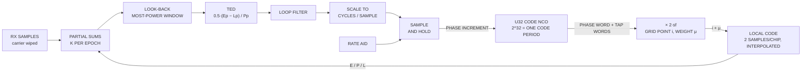
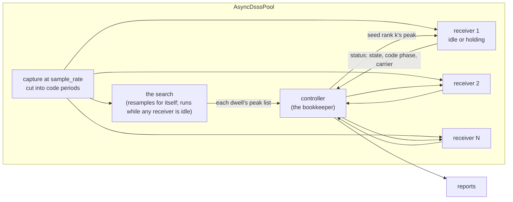

# AsyncDsssReceiver and AsyncDsssPool — continuous DSSS, from spec to object

*`AsyncDsssReceiver` is one C object that searches for a continuous DSSS
emitter, refines the detection, and tracks it until its own lock detectors
say it is gone. `AsyncDsssPool` holds up to ten such signals on one code: N
receivers that refine and track, and **one search, owned by the controller**,
run while any receiver is idle (§5). This page is the design of record for
both: the specification, the CCSDS 415.1-B-1 point with its stimulus and
its one case (§1), the acquisition engine's hand-off (§2), the
asynchronous despreader (§3), the receiver's states, its results at the
specification point, the conclusions, the proposed design, the hypotheses
and the next steps (§4), the pool (§5–§9), the release (§10) and what a
holder reads (§11). Bursts are [`burst-bank.md`](burst-bank.md)'s. The runs
behind the numbers here are
[the measurement record](async-dsss-receiver-measurements.md), under the same
section numbers, and a cost is a [published benchmark](../benchmarks.md)
row.*

______________________________________________________________________

## 1. The specification

The receiver is specified at the forward link of CCSDS 415.1-B-1, the
command channel alone, with no ranging. The rule is the owner's: the
standard rules unless the owner sets otherwise, and no number is picked.
Every row names its source. A row that neither sets is **NOT SET**, and is
not invented.

| quantity                                | value                                                                                                                                                           | source                                                                                     |
| --------------------------------------- | --------------------------------------------------------------------------------------------------------------------------------------------------------------- | ------------------------------------------------------------------------------------------ |
| link                                    | forward (network to user), the command (I) channel only                                                                                                         | owner; 415.1-B-1 §4.2                                                                      |
| modulation                              | BPSK: with no range channel, the I channel's parameters apply to BPSK                                                                                           | 415.1-B-1 table 4-1, note 1                                                                |
| carrier suppression                     | 30 dB minimum                                                                                                                                                   | 415.1-B-1 table 4-1                                                                        |
| code                                    | Gold, 2^10 − 1 = 1,023 chips, the generator of figure 4-1, a user-unique initial condition                                                                      | 415.1-B-1 table 4-1, §4.4                                                                  |
| chip rate                               | F_fwd × 31 / (221 × 96)                                                                                                                                         | 415.1-B-1 table 4-1                                                                        |
| chip-rate coherence with the carrier    | peak chip-rate error at most 0.01 chips/s, relative to absolute coherence with the carrier rate                                                                 | 415.1-B-1 table 4-2                                                                        |
| data on the code                        | modulo-2 added, asynchronously                                                                                                                                  | 415.1-B-1 table 4-1                                                                        |
| symbol rate                             | 3,000 sym/s; the standard allows 0.1 to 300 ks/s                                                                                                                | owner: "the use case: 3kbps >= 4dB Es/N0"; the range, 415.1-B-1 table 4-1                  |
| symbol clock                            | within 1 ppm of nominal, on no relation to the code or the carrier; its stability is NOT SET                                                                    | owner: no link standard sets it (415.1, 232.0, 231.0 and 401.0 give no figure)             |
| carrier frequency F_fwd                 | 2.2 to 2.8 GHz                                                                                                                                                  | owner                                                                                      |
| chip rate, epoch rate                   | 3.2146 to 4.0913 Mcps; 3,142.3 to 3,999.3 Hz                                                                                                                    | derived from the two rows above                                                            |
| frequency uncertainty                   | Doppler pre-compensated; the received signal within ±1,500 Hz of best lock                                                                                      | owner-adopted: the owner sets it, taking 415.1-B-1 §7.4.1's figure; pre-compensation, §6.1 |
| frequency rate                          | 400 Hz/s selects which passes are in scope; the pre-compensated residual's rate, 11 Hz/s (`R_env`, §1.8), is the one the tracking loops are sized and judged at | owner; the 11 Hz/s ruled the governing rate, 2026-11-21                                    |
| acquisition                             | short-code PN lock with probability at least 90% within 20 s of arrival, the signal within ±1,500 Hz of best lock                                               | 415.1-B-1 §7.4.1                                                                           |
| sensitivity floor                       | Es/N0 = 4 dB: C/N0 38.8 dB-Hz; the BPSK bound there is a symbol error rate of 1.25%                                                                             | owner, the same ruling                                                                     |
| the receiver's design C/N0 (`cn0_dbhz`) | the floor's, 38.77 dB-Hz, at every level: a receiver is built once, for its weakest signal                                                                      | owner, 2026-11-21                                                                          |
| capture                                 | complex samples at 11 MSa/s                                                                                                                                     | owner                                                                                      |
| data                                    | the stimulus of §1.4: one CCSDS TC transfer frame a period, 8 to 1,024 octets, with its error control field; no SDLS                                            | owner; 232.0-B-4 §4.1, each field's section in §1.4                                        |
| coding                                  | none in this certification; the link will be coded later                                                                                                        | owner                                                                                      |
| between frames                          | all-zero data: code alone, no symbol transitions                                                                                                                | owner; 415.1-B-1 §6.1                                                                      |

Carrier and code come from one timebase, the chip rate a fixed fraction of
the carrier, and Doppler moves them together; the data clock belongs to
neither (§1.6). The point is one case, a symbol at least a code period
long (§1.5). What the owner has not ruled is §1.7. The receiver's results
at this point are §4.2. A number in §2, §3 or §5–§11 names the point it is
measured at: the certification's 3.069 Mcps point, below, or the pool's
5 Mcps sizing point (§5).

**What the certification covers.** The receiver's
[certification record](https://github.com/doppler-dsp/doppler/blob/v0.85.0/src/doppler/dsss/tests/validation/async_dsss_receiver/results.md)
holds 23 of 23 limits at 3.069 Mcps and 2,700 sym/s, two samples a chip,
on continuous random data with no gap, `carrier_freq_hz` 0, and a search
over ±3 kHz (±1/T_E), and at no other point: not this point's chip rates,
not the gap, and not the coupling of code to carrier (§1.6). The C test
that pins its 5 dB floor, `_test_awgn_esn0_floor`, adds 3 dB less noise
than its label ([#689](https://github.com/doppler-dsp/doppler/issues/689));
at a true 5 dB the receiver does not decode random data
([#3080](https://github.com/doppler-dsp/doppler/issues/3080)). The certification is moving to this
point harness by harness, each retiring the old point's limits as it moves:
the dropout runs here, and 415.1-B-1 §7.4.1's acquisition requirement is
asserted on the pull-in validator's cells; the error rate follows, and the
loss decomposition is rebuilt inside the floor brief
([#3156](https://github.com/doppler-dsp/doppler/issues/3156)). A claim whose
requirement the owner has not set is printed, not asserted
([#3157](https://github.com/doppler-dsp/doppler/issues/3157)).

### 1.1 The signals

M out of N ($\leq 10$) possible signals are on air at once, with at least
differing code phase and carrier phase trajectory. Each may go off air and
be replaced by a new signal at any moment. All share a common, periodic,
simultaneous data-free block lasting many code epochs. **A signal changes
only after a data-free block**: one goes off air, or a new one comes on, at a
frame boundary, never inside a frame.

This is the pool's premise, from the 5 Mcps point (§5). Whether the single
receiver is certified at the 415.1-B-1 point with other emitters of its code
present is open (§1.7).

### 1.2 The sample rate is derived, not chosen

The caller states its capture's `sample_rate` (11 MSa/s here); neither the
receiver nor the pool takes a samples-per-chip. The **search** derives $N$,
the samples in one code period, as the smallest power of two of at least
two samples a chip: 2,048 for a 1,023-chip code, a rate of
$5\,\text{Mcps} \times 2048/1023 = 10.0098$ MSa/s. A search tile is one bin
of the $N$-point transform, $1/T_E$ wide, whatever $N$ is. At the
415.1-B-1 point $N$ is still 2,048, a rate of 6.4354 to 8.1905 MSa/s from
the 11 MSa/s capture across 2.2 to 2.8 GHz.

**Only the search is resampled.** The receiver builds a resampler for its
search and for nothing else (`dp_async_dsss_receiver_create()`), and skips
it when the caller's code period is already a whole number of samples.
Refining and tracking run at the caller's rate, in blocks of
`floor(code_len · sample_rate / chip_rate)` samples, 3,500 at 2.2 GHz and
2,750 at 2.8 GHz, where a code period is 3,500.64 and 2,750.50; the
partials close on the code NCO's phase, so a block need not be a whole
period. A pool has no front end of its own: its one search resamples
inside its own receiver, and every pooled receiver reads the caller's
capture as it arrives (§5).

**Why a power of two.** Every search transform is one code period long. At
two samples a chip that is $2 \times 1023 = 2 \cdot 3 \cdot 11 \cdot 31$,
and pocketfft has no radix-31 or fast radix-11 pass: profiling one dwell of
the one-tile search put about 83% of it in FFT passes and 62% in the
generic radix-31 and the radix-11 passes, and a 2,046-point transform takes
9.89 µs against 1.99 µs at 2,048 (record §9.4). `spc` is removed from
`Acquisition`, `AsyncDsssReceiver` and `AsyncDsssPool`, a breaking change
made before 1.0. The burst objects (`DsssBurstReceiver`, `BurstDemod`)
keep it.

### 1.3 The loop SNR rule

**The code loop and the demodulator's carrier loop are sized to a loop SNR
of at least 20 dB at the floor.** `rho(dB) = Es/N0(dB) − 10·log10(2·bn)`,
with `bn` normalized to the loop's own update rate so the rate cancels. At
the 4 dB floor that asks for `bn ≤ 0.0126`. The Dll ships at `bn` 0.002
(`ASYNC_DSSS_RX_DLL_BN`) and MpskReceiver's carrier loop at 0.01. The code
loop's per-epoch SNR is Es/N0 over `epochs_per_symbol`, 1.05 to 1.33 at
this point (§1.5), inside the same bound. The carrier loop (correction
before despreading, error formed after) is sized by the same rule: its
per-update SNR at the floor is `ρ = C/N0·T`, so `bn = ρ/200`, 0.0120 at
2.2 GHz and 0.0094 at 2.8 GHz (`validate_async_dsss_receiver_pullin --design`). The receiver holds it at the constant 0.04
(`ASYNC_DSSS_RX_BN_CARRIER`); the validator applies the rule
(`--bn-carrier rule`), and the use-case cells are run at it
([#3135](https://github.com/doppler-dsp/doppler/issues/3135)). There is
no FLL. Pulling a loop in from a coarse estimate is the hand-over's
problem (§4.4), not the bandwidth's.

### 1.4 The stimulus, one period

The stimulus repeats one period: a gap, an acquisition sequence, a start
sequence, then one CCSDS TC transfer frame of 232.0-B-4 with a data field
of random length. There is no coding and no SDLS.

| part                 | content                                                                                                                | source                                                       |
| -------------------- | ---------------------------------------------------------------------------------------------------------------------- | ------------------------------------------------------------ |
| gap                  | `G` symbols of all-zero data: code alone                                                                               | owner; 415.1-B-1 §6.1                                        |
| acquisition sequence | alternating ones and zeros, 128 bits                                                                                   | 231.0-B-4 §7.2.2 (16 octets is its preferred minimum length) |
| start sequence       | `1110 1011 1001 0000` (EB90), 16 bits, bit 0 first: it marks where the frame starts, so an error count needs no search | 231.0-B-4 §5.2.2.2                                           |
| transfer frame       | a 5-octet primary header, a data field of 1 to 1,017 octets, a 2-octet error control field: 8 to 1,024 octets in all   | owner; 232.0-B-4 §4.1.1, the fields below                    |

The frame, field by field, in transmission order:

| field                      | bits       | value in the stimulus                                                                | source                                      |
| -------------------------- | ---------- | ------------------------------------------------------------------------------------ | ------------------------------------------- |
| transfer frame version     | 2          | `00`                                                                                 | 232.0-B-4 §4.1.2.2.2                        |
| bypass flag                | 1          | `1`, Type-B \*                                                                       | 232.0-B-4 §4.1.2.3.1                        |
| control command flag       | 1          | `0`, Type-D: the data field is a frame data unit \*                                  | 232.0-B-4 §4.1.2.3.2, table 4-1 (Type-BD)   |
| reserved spare             | 2          | `00`                                                                                 | 232.0-B-4 §4.1.2.4.2                        |
| spacecraft identifier      | 10         | 42 \*                                                                                | 232.0-B-4 §4.1.2.5                          |
| virtual channel identifier | 6          | 1 \*                                                                                 | 232.0-B-4 §4.1.2.6                          |
| frame length               | 10         | the frame's total octets minus one: 7 to 1,023                                       | 232.0-B-4 §4.1.2.7.2, §4.1.2.7.3            |
| frame sequence number      | 8          | 0 * (the value the COP sets on a Type-B frame)                                       | 232.0-B-4 §4.1.2.8, note 3                  |
| data field                 | 8 to 8,136 | random octets, a whole number drawn per frame from 1 to 1,017; no segment header     | owner; 232.0-B-4 §4.1.3.1.2, §4.1.3.2.2.1.2 |
| frame error control (FECF) | 16         | CRC over the header and data field, G(X) = X^16 + X^12 + X^5 + 1, preset to all ones | 232.0-B-4 §4.1.4.1.2, §4.1.4.2              |

\* Arbitrary stimulus content, not the specification: a receiver at this
point makes no use of the field, and any value would do.

**The 1,024-octet maximum is normative from three sections**, not from the
frame-length field: a 5-octet header (§4.1.1), a data field of at most 1,017
octets when the error control field is present (§4.1.3.1.2), and that field's
2 octets (§4.1.4.1.2). §4.1.2.7's note 2 says the 10-bit length field limits
a frame to 1,024 octets; it is a note, and it agrees. The minimum, 1 octet of
data, is the smallest whole number the mandatory data field can hold
(§4.1.1 b, §4.1.3.1.2).

Dropped from 231.0-B-4's coding layer: the BCH codeblocks, the tail
sequence and the randomizer. A frame of 64 to 8,192 bits lasts 21 ms to
2.73 s at 3,000 sym/s.

**The gap is twice what the search needs.** The need is the search model's,
read from the receiver's own search sizing at the worst corner: the 2.2 GHz
end, a design C/N0 of 36.34 dB-Hz (the 4 dB floor, 38.77 dB-Hz, less the
edge's 2.43 dB of loss beyond the band average), R_env (11 Hz/s, §1.8), Pd 0.999 at the
as-built `pfa` of 1e-3, and the whole dwell inside the gap wherever it
starts, a gap of at least 2·K·D − 1 epochs
([#3082](https://github.com/doppler-dsp/doppler/issues/3082)):

| D   | K   | the need            | twice it, the gap G              |
| --- | --- | ------------------- | -------------------------------- |
| 72  | 1   | 144 epochs, 45.8 ms | 288 epochs, 91.7 ms, 275 symbols |

These are the model's numbers, not a detection measured at the band edge,
and the gap's length is open (§1.7). The search does not hold its dwell
`K·D` inside a gap (#3082).

**72 is the model's need, not the depth the search runs.** Given this gap
the engine takes the deepest block §2.1's rule allows. At the residual's
rate R_env (11 Hz/s, §1.8, `dp_s415_r_env()`), the drift bound
`f_epoch/√(2·R_env)` is far past the window, so the window's half binds:
`coherent_bins` reads 144 at 2.2 GHz and 180 at 2.8 GHz (⌊(287 + 1)/2⌋ and
⌊(366 + 1)/2⌋, 7-smooth), with one look (`n_noncoh` 1), a dwell of 45.8 and
45.0 ms. A whole block of that depth lands inside the gap wherever it
starts once the gap holds 2·D − 1 code periods, 287 and 359; the 275-symbol
gap holds 287 and 365 whole ones. So the gap holds one whole block at the depth run, and is
twice the need only at the model's depth.

**It is built from shipped tools.** Each frame is one `FrameDesc`: the
header and data field by `add_field`, the error control field by
`add_derived` and `add_stage_over(STAGE_CRC16, "header", "fecf")`.
`FrameDesc` has no stage that fills a length count, so the frame-length
field cannot be a derived field; it needs none, because each description
is one frame of one known length, and the caller writes the count into the
header's bits. Checked against main's build at 1, 17 and 1,017 data
octets: the length field reads the total minus one, the FECF matches
232.0-B-4 §4.1.4.2 computed independently, and `crc_ok()` passes.
`FrameDesc` does not bound the data field at 1,017 octets; the stimulus
does. The frame door assembles each period as a bit stream, a continuous
DSSS source takes that stream as its `data=`, the composer's Doppler
channel moves it, and a `RateConverter` takes it to 11 MSa/s. Two
shorter spellings drop a part without saying so: `frame=` on a continuous
DSSS source
([#3083](https://github.com/doppler-dsp/doppler/issues/3083)), and
`Synth.steps()`, which skips the Doppler channel
([#3091](https://github.com/doppler-dsp/doppler/issues/3091)).

### 1.5 The case: a symbol is at least a code period

One ratio sets the physics: the epochs a symbol spans, `E = Re / Rs`, the
epoch rate over the symbol rate. At 3,000 sym/s, across 2.2 to 2.8 GHz,
from the standard's chip rate:

|                                         | 2.2 GHz                                                                                                 | 2.8 GHz  |
| --------------------------------------- | ------------------------------------------------------------------------------------------------------- | -------- |
| epochs a symbol                         | 1.047: a symbol spans more than an epoch                                                                | 1.333    |
| symbol boundaries an epoch              | 0.95: at most one                                                                                       | 0.75     |
| one epoch's correlation in data         | full with no transition in it; with one at fraction f, reduced by the factor 2f − 1 in magnitude (§3.2) | the same |
| partials a symbol at `K` = 4, `P = K·E` | 4.2                                                                                                     | 5.3      |
| 500 symbols, in epochs                  | 524                                                                                                     | 667      |

The floor's C/N0 is 38.8 dB-Hz at both carriers.

What follows, by reasoning:

- **An epoch holds at most one transition**, so a code-period window that
    avoids it is always available: the look-back (§3.6) finds one. The
    carrier detector §4.4 proposes rests on that, and holds only while a
    symbol is at least a code period, which is the case here.
- **2.2 GHz is the near-one end.** A symbol is 1.047 epochs, so
    the symbol boundary creeps through the epoch at the difference of the
    two rates, 142 Hz: almost every epoch holds a transition, and where it
    falls moves slowly.
- **Symbol timing.** The timing detector must hold through the gap,
    hundreds of symbols with no transition. As built it is Gardner, in
    `MpskReceiver`; the DTTL ties with it (
    [PR #3087](https://github.com/doppler-dsp/doppler/pull/3087)).

**The edge of the search's roll.** ±1,500 Hz is inside one epoch's span,
`±1/(2·T_E)`, at both carrier ends, so the search runs one roll (§2.3).
Two things follow, from the code's formulas:

- **The edge's loss.** One roll de-rotates at 0 Hz, so a signal at offset
    `f` loses `sinc(f / Re)` in every epoch: 3.5 dB at ±1,500 Hz at 2.2 GHz
    and 2.1 dB at 2.8 GHz. The search's predicted Pd charges the loss
    averaged over the band, not the edge's.
- **The fold.** One roll's Doppler axis repeats every epoch rate. At
    2.2 GHz the band edge is 71 Hz inside the fold (500 Hz at 2.8 GHz), so a
    signal near the edge can be reported one epoch rate away, and a one-roll
    search cannot tell which side it came from. That error is far outside
    the carrier loop's pull-in.

**Above one symbol a code period**, a symbol rate over the epoch rate
(3,142 to 3,999 sym/s across the band), no code-period window is free of a
transition, and the code loop's symbol-scale look shrinks toward one
partial. `steps_max_out()` would not be a bound
there ([#2469](https://github.com/doppler-dsp/doppler/issues/2469)), and
`create()` refuses it, because the carrier loop's code-period window (§4.4)
needs a symbol of at least a code period.

### 1.6 Code and carrier are coherent; the data is not

The coherency is two statements:

- **Carrier and code come from one timebase.** The chip rate is the carrier
    times 31 / 21,216 (415.1-B-1 table 4-1), so code Doppler is carrier
    Doppler times 31 / 21,216, exactly: ±1,500 Hz is ±2.19 chips/s at any
    carrier. The channel dilates everything it carries by one factor.
- **The data clock is not part of that timebase.** It has no phase relation
    to the code and no fixed rate ratio to it; its rate is whatever its own
    source gives, within 1 ppm of nominal (§1). The receiver may assume
    nothing about symbol timing from the code or the carrier, before or
    after Doppler, so the symbol timing loop is the only thing that knows
    the data clock, and it acquires and holds it with no aid.

415.1-B-1 §2.1 offers BPSK for the forward data "when RF and PN coherency
is not required". That coherency is the turn-around kind, for ranging,
which this point does not do: §1's link is DSSS BPSK with no ranging. It
does not release the chip rate from table 4-1's
ratio or from table 4-2's 0.01 chips/s, and §1's row stands as written.

The code at `edea9c649` models the first as coherent at the source and
dilated in flight. The code-rate offset is `chip_rate · fd / fc` wherever it
is used: the search's hand-off phase (§2.2), the hand-over and both code
loops. The tracking code loop is aided every code period from the tracked
carrier (§4.1); the refine's code loop gets a one-time aid from the seed.
The model does not depend on the chip rate being on the standard's ratio,
and nothing checks that it is. With `carrier_freq_hz` 0 all of it is off.
At this point the harnesses build the receiver with the carrier on
(`dp_s415_rx()`, `dp_s415_pool()` in `native/tests/dp_s415_test.h`), so
every row of the validation plan (§4.10) runs the coupling. The
certification record at 3.069 Mcps (§1) ran with `carrier_freq_hz` 0 and
certifies nothing about it. The library's Doppler channel dilates the whole stream by one
factor (code, data symbols and the gap) and offsets the carrier to match:
the same model. It cannot render a source whose code clock is off its
carrier, so table 4-2's 0.01 chips/s has no stimulus.

### 1.7 Open decisions

Not ruled by the owner, and not decided here:

1. **Where Es/N0 is defined**: at the source, or in the capture. The
    11 MSa/s capture reads 0.06 to 0.17 dB under the source's, mostly from
    its bandwidth; [the record](async-dsss-receiver-measurements.md)'s runs (§4.2) set it at the source.
1. **The gap's length.** Twice the search model's need (§1.4) is the rule
    proposed, not ruled.
1. **Keeping the EB90 start sequence** (§1.4).
1. **`reacquire` as the default.** It is off by default; at this point a lock
    on the wrong Doppler never releases without it
    ([#3092](https://github.com/doppler-dsp/doppler/issues/3092)). §4.10
    proposes it (D9); it is also how a carrier break ends (red 1).
1. **`refine`**, the one knob §4.4 still has: its name, or its retirement
    (§4.10, D2). The `carrier_window` knob is removed on this branch,
    pending D1.
1. **What must hold at the floor**: the allowed loss against the BPSK bound,
    and how soon after arrival the receiver must be decoding. With the
    dropout time and the lock budget, these are the figures the
    certification's unasserted rows wait on
    ([#3157](https://github.com/doppler-dsp/doppler/issues/3157)).
1. **Whether the link resolves half-cycle flips** (differential coding, or
    a phase-resolving word) or the carrier loop must not flip
    ([#3090](https://github.com/doppler-dsp/doppler/issues/3090)). The
    detector of §4.4 cuts them from 146 to 8 at the floor; it does not
    remove them.
1. **Alone or in company**: whether the single receiver is certified with
    other emitters of its code present, or alone, with company left to the
    pool.
1. **Whether the uncompensated ±50 kHz** of the 5 Mcps point stays a case
    for the single receiver.
1. **The data clock's stability**: how fast it may wander inside its 1 ppm.
1. **The stages with no certification on record.** The
    [validation log](../dev/contributing/validation-log.md) has no record
    for the code loop (`Dll`), the carrier loop, the Doppler refine
    (`CarrierAcquisition`) or `RateConverter`. Whether each is certified
    before the receiver is a decision of its own.

______________________________________________________________________

### 1.8 The dynamics the receiver is specified for

**The geometry.** The emitter is on a LEO satellite in a circular orbit,
and the receiver is a fixed point on a spherical Earth with a 10°
elevation mask. Earth rotation is left out, and its worst case is a factor
below.

**What 400 Hz/s is.** The specification's 400 Hz/s is the RAW pass's peak
Doppler rate. It fixes which passes are in scope; it is not a rate the
receiver meets.

- **Which passes:** a pass is in scope where its raw peak rate is exactly
    400 Hz/s. On a 50 km altitude grid from 350 km, with the maximum
    elevation solved at each altitude, that is 25 passes across the two
    carriers.
    - Examples: 550 km at 31° (2.2 GHz) or 22° (2.8 GHz); 800 km at 60°
        or 41°.
    - An altitude where even the lowest pass above the mask exceeds
        400 Hz/s, or even an overhead pass stays under it, has no pass in
        scope.
- **Raw figures:** on these passes the raw rate of change of rate peaks at
    2.70 Hz/s².

**Pre-compensation.** The link is steered from an ephemeris, and the
receiver sees what the steering leaves. The specification bounds that
residual offset at ±1,500 Hz.

**The ephemeris error model: an along-track timing error.** The pass
arrives `dt` early or late against the prediction.

- **Residual:** `f(t) − f(t − dt)`, about `f'(t)·dt`; its rate is about
    `f''(t)·dt`.
- **The range of `dt`:** up to the value that makes the residual reach
    1,500 Hz, 3.74 s on these passes.

**The envelope.** The largest |residual rate| at each |residual offset|,
over the 25 passes, every `dt` up to that bound, and both branches of the
pass:

| \|offset\|, Hz | 0-100 | 200-300 | 400-500 | 600-700 | 800-900 | 1000-1100 | 1200-1300 | 1400-1500 |
| -------------- | ----- | ------- | ------- | ------- | ------- | --------- | --------- | --------- |
| envelope, Hz/s | 1.20  | 3.59    | 5.99    | 8.13    | 9.63    | 10.10     | 9.71      | 6.69      |

- **Maximum:** 10.10 Hz/s, at |offset| about 1,050 Hz.
- **Small near zero offset:** under a timing error, zero residual offset is
    where the curve's slope is crossed, not where its rate peaks.
- **Sampled, not continuous:** the envelope is the maximum over a sampled
    grid. Halving the grid to 25 km (50 passes) moves the maximum to
    10.13 Hz/s, and the validator prints both.

**The cross-check: a proportional residual.** The steering removes all but
a fraction `ε` of the curve, so the residual is `ε·f(t)` and its rate is
largest at zero residual offset.

- **What `ε` means:** `ε = 1,500 Hz` over the pass's visible peak offset.
    That is a 3 to 6% error in the satellite's velocity.
- **Largest value:** 18.7 Hz/s on the 50 km grid, driven by the 400 km,
    13.0° pass at 2.8 GHz (`ε = 0.047`). On the 25 km grid it is 24.3 Hz/s,
    from 375 km at 11.6°.
- **It does not converge:** it grows toward the altitude where the
    400 Hz/s pass grazes the mask, where the visible arc and its peak
    offset are smallest.
- **Its role:** it is reported as the bound's cross-check and does not set
    it.

**What a draw is (conservative).**

- **Offset at arrival:** uniform in ±1,500 Hz.
- **Rate:** held constant over the 60 s draw at `R_env = 11 Hz/s`, sign
    drawn.
- **The conservatism, in one line:** `R_env` is the timing envelope's
    maximum over every offset (10.10 Hz/s), times the one effect the model
    leaves out, Earth rotation at its worst,
    `1 + ω_E·R_e / v_orbit = 1 + 0.465/7.33 = 1.063` (10.74), rounded up to
    the whole Hz/s. Against the envelope at a given offset, that is 1.1×
    at 1,050 Hz and about 9× near zero.
- **In bounds:** a constant 11 Hz/s moves the offset 660 Hz over 60 s.
    When `|f0| > 1,500 − 660 = 840 Hz`, the rate's sign is drawn toward
    zero, so the offset never leaves ±1,500 Hz.
- **Static draws:** a fixed offset at zero rate is the limit of a pass far
    from closest approach.
- **Not a use-case cell:** a constant rate at the specification's 400 Hz/s
    sweeps 6 to 24 kHz over a draw, far outside the span. It is a
    diagnostic only, never scored as the use case (owner, 11-17: "We don't
    want to test what will never happen").

**What the loops meet** at the owner's rule (§1.3; `bn = ρ_floor/200`,
0.0120 at 2.2 GHz and 0.0094 at 2.8 GHz):

|                                                  | at R_env (11 Hz/s)                                  | at the cross-check's largest           |
| ------------------------------------------------ | --------------------------------------------------- | -------------------------------------- |
| order-2 lag                                      | 0.80°                                               | 1.35° (18.7 Hz/s) to 1.76° (24.3 Hz/s) |
| order-3 steady error                             | 0.0011° under the largest residual f'' (0.28 Hz/s²) |                                        |
| hand-over error from drift over the refine dwell | 11 Hz/s × 0.045 s, 0.5 Hz                           |                                        |

The hand-over figure compares with 7 to 8 Hz static.

The numbers on this section come from
`validate_async_dsss_receiver_pullin --design`, the `# pass` section, and
`--dynamics pass` draws them.

**The carrier-to-code rate aid.** Code and carrier are coupled at the
source and in the channel (owner, 2026-11-21): one timebase at the
emitter, and one dilation factor in flight (§1.6). A steering that
pre-compensates acts on the two together, so what it leaves is a residual
of the coupled pair: a residual carrier offset `δf` comes with a residual
code-rate offset of `δf · chip_rate / fc`, exactly. The receiver adds the
carrier loop's frequency, scaled by `chip_rate / carrier_freq_hz`, to the
code NCO's rate every code period (`adr_track_period()`, through
`dp_dll_set_rate_aid()`). That is this residual's code part, so the aid
stays on.

What the code loop carries is therefore the aided residual, not the
residual itself:

| at the specification point                                                                                    | unaided               | aided, what the code loop carries                        |
| ------------------------------------------------------------------------------------------------------------- | --------------------- | -------------------------------------------------------- |
| offset, the carrier's ±1,500 Hz                                                                               | ±2.19 chips/s         | the carrier loop's frequency error × 1.461 × 10⁻³        |
| rate, `R_env` (11 Hz/s)                                                                                       | 0.0161 chips/s²       | one code period's hold of the aid: 4 to 5 × 10⁻⁶ chips/s |
| a hand-over error at the carrier's reliable pull-in, twice `ASYNC_DSSS_RX_CARRIER_PULLIN_HZ` (37.7 / 37.6 Hz) | inside the offset row | 0.055 chips/s while the carrier loop pulls in            |
| the source's own chip-rate error, table 4-2                                                                   | 0.01 chips/s at most  | the same; no aid sees it, and no stimulus renders it     |

`1.461 × 10⁻³` is 31 / 21,216. The hold is `R_env · T_E · 31/21,216`, with
`T_E` 0.318 ms at 2.2 GHz and 0.250 ms at 2.8.

So the code loop's stress is the carrier loop's own frequency error, the
hand-over's transient while the carrier pulls in, and table 4-2's
0.01 chips/s. None of the four rows reaches the code-lock sizing (§4.10): over
one code period the largest, 0.055 chips/s, moves the code 1.8 × 10⁻⁵ of
a chip, so the look's derates are the replica and the placement alone.

## 2. Acquisition

### 2.1 Two searches, one engine

The continuous and burst searches are two flavors of one Python class,
`Correlator`, picked by `framing="continuous"` or `framing="burst"`, over
one `dp_correlator_state_t`
(`native/inc/doppler/correlator/correlator_core.h`). The one class refuses a knob its flavor would not honor instead of
carrying "ignored here" caveats
([the correlator's constructor](correlator.md#3-one-constructor)). State, auto-sizing,
`push()` and serialization are shared. The continuous search takes the code
(as NRZ chips), `sample_rate`, `chip_rate`, `symbol_rate`, a design
`cn0_dbhz`, a one-sided `doppler_uncertainty`, `pfa`, `pd`, a CFAR
`noise_mode`, and the two inputs that size its coherent depth, `code_only_epochs` and `doppler_rate`.
Everything else it derives; there is no `doppler_resolution` and no
`max_noncoh`.

**`doppler_bins` is the whole Doppler grid** a hit's `doppler_bin` indexes:
the coherent depth `coherent_bins` times the frequency windows the engine
rolls one epoch's spectrum across when the uncertainty is wider than one
epoch's span ([`acq-surface.md`](acq-surface.md) §3).
Non-coherent looks are a separate axis. On the continuous door `n_noncoh`
is auto-selected to meet `pd` at `pfa` and read-only, bounded only by a
safety valve (`DP_CORRELATOR_N_NONCOH_SAFETY_CEILING`, 256 looks) because the
semi-analytical `pd_predicted` model turns non-monotonic past it. A burst
engine never adds looks: it sizes on the burst and reports `underpowered`.

**Two inputs size the coherent depth `D`: `code_only_epochs` and
`doppler_rate`.** It is the smaller of `⌊(code_only_epochs + 1)/2⌋`, so a
whole block always fits inside the pure-code window, and
`f_epoch/√(2·doppler_rate)`, which is `f_epoch/√1000` at 500 Hz/s and
`f_epoch/√22` at the 415.1-B-1 point's residual rate R_env (11 Hz/s), so the
drift over one block stays inside half a slow-time bin, rounded down to a
7-smooth length (`dp_fft_smooth_floor()`): `D` is a slow-time FFT length,
and a prime factor of 13 or more costs the FFT its slow path, so 94 epochs
run as 90. `code_only_epochs`
counts the **whole** epochs a window holds at any chip phase: the window is
`W` symbols on the data clock, with no fixed relation to the code clock, so
a partial epoch is lost at each edge and
`code_only_epochs = ⌊W · cps / L⌋ − 1`. It defaults to 1, which is `D = 1`:
the epoch-by-epoch search. `AsyncDsssReceiver` takes the window as a time,
`code_only_s`, and derives `code_only_epochs` from it (§2.3).

### 2.2 A detection is a physical record, never a grid index

`dp_correlator_handoff_t` (`native/inc/doppler/correlator/correlator_core.h`) is the data; the
*hand-off* is the action that turns a raw `push()` hit into it and gives it
to the next stage. The record crosses a thread or process boundary, so it
cannot be the grid-relative `(doppler_bin, code_phase)`, which mean nothing
without also shipping the emitting engine's `spc` and `doppler_res_hz`.
Every field is in a physical unit and the record is a flat, pointer-free
POD. `dp_correlator_build_handoff()` builds one from each hit of a continuous
engine. `AsyncDsssReceiver`'s `seed()` takes three of its fields,
`chip_phase`, `doppler_hz_est` and `cn0_dbhz_est`, and the receiver's own
hit takes that same path. A hit whose Doppler is at or past half the sample
rate is outside the seed domain (`dp_async_dsss_receiver_seed_ok()`): it is
refused as a seed and counted in `refused_hits`, and the search goes on.

| Field              | Type       | Description                                                                                      |
| ------------------ | ---------- | ------------------------------------------------------------------------------------------------ |
| `samples_consumed` | `uint64_t` | Sample offset since this engine's stream start that the detection's epoch ended at — replay-safe |
| `chip_phase`       | `double`   | Code phase in CHIPS, the code-tracking seed for the next stage                                   |
| `doppler_hz_est`   | `double`   | Coarse Doppler in Hz, already folded, signed and scaled from the raw bin index                   |
| `doppler_res_hz`   | `double`   | Width of that estimate — the ±`doppler_res_hz`/2 a refine or tracking stage still has to close   |
| `cn0_dbhz_est`     | `double`   | C/N0 estimate, dB-Hz — sizes downstream loop bandwidth and dwell                                 |
| `peak_mag`         | `float`    | Raw CFAR peak magnitude — observability passthrough                                              |
| `noise_est`        | `float`    | Raw CFAR noise-floor estimate — observability passthrough                                        |
| `test_stat`        | `float`    | Raw CFAR gating statistic — observability passthrough                                            |

**The record carries no timestamp.** The engines are pure sample-domain,
with no I/O; whatever feeds them samples owns the clock and stamps a record
at its `samples_consumed` (§11.3). The field list is the header's own.

**`chip_phase` is where the code will be, not where it was.** A hit is
decided at its dwell's end and the seed is wanted at the next sample, so
`dp_correlator_build_handoff()` advances the phase by the drift over half the
dwell on the hit's own Doppler. **Neither constructor takes a
`carrier_freq`**: the engine works in baseband Doppler Hz, and a
baseband-only caller never has to name one. A caller that knows the carrier
tells the engine afterwards (`dp_correlator_set_carrier_freq_hz()` /
`set_carrier_freq_hz`), which turns on that advance and, inside a coherent
block of `D > 1` epochs, aligns the block's epochs on the dilated code
clock. `AsyncDsssReceiver` passes its own `carrier_freq_hz` on.

### 2.3 The receiver's search: a slow-time depth from the code-only window, dwells on the shared sample count

**The receiver's search** is the continuous door, sized from two physical
create parameters: `code_only_s`, the code-only window in seconds, which
the receiver turns into `code_only_epochs = ⌊code_only_s · chip_rate / L⌋ − 1`, and `doppler_rate` in Hz/s, passed through. Both default to 0, which is
`D = 1`: one-epoch looks over its one-sided `doppler_uncertainty`. The
depth it runs is the read-only `coherent_bins`. `n_noncoh` is sized to `pd`
at `pfa` for its `cn0_dbhz`. The engine reports up to 16 peaks a dwell
(`max_peaks`); the receiver drops those within a chip of an excluded code
phase (`set_exclusions()`) or of a stronger peak, and takes the survivor at
its rank (`set_rank()`, 0 = the strongest, the default), or nothing that
dwell. With no exclusions at rank 0 that is the one-peak detector's pick.
An uncertainty wider than one epoch's span, `±1/(2·T_E)`,
is covered by the engine's roll across frequency windows, which it fans
across its tiles' worth of online cores unless `set_threads()` says
otherwise; a pool's one search takes the pool's own thread count (§5).
The search is
bit-identical at any thread count. What
searching costs is §9.

**Every dwell starts on the block grid of the receiver's own input count.**
The receiver counts every sample fed since create; in a pool the one search
counts the pool's samples the same way. A search restarted by `reset()`, a release, a refused hand-over or
`configure_search_raw()` first discards input up to the next multiple of
`D · N` samples, at most one block (30 ms at `D = 90`), so searchers
re-armed at different times still decide on the same blocks. The count and
the alignment owed travel in the state blob. At `D = 1` the grid is one
code epoch.

**The slow-time depth `D > 1` is safe only inside a pure-code window.**
Coherent combining across data aliases the data's own spectrum across the
Doppler axis and mislocks structurally
([`acq-surface.md`](acq-surface.md) §9). Inside a window of code
alone there is nothing to alias. The engine does not know any emitter's
window phase, so it sums **non-overlapping blocks of `D` epochs**, one
coherent surface per block, detected per block. A whole block always lands
inside a window once `W ≥ 2D − 1`, and `⌊W/D⌋` land in a row for
`n_noncoh` to accumulate. A `D`-point slow-time FFT at the epoch rate
subdivides one epoch's span into `D` rows; it never widens it. At the
earlier 3.069 Mcps geometry a 450-symbol code-only window holds 499 whole
epochs, and the 500 Hz/s bound gives 94, which the engine runs at the
7-smooth `D = 90` (a slow-time FFT length, #1247): a 33.3 Hz row and 19.5 dB
of coherent gain. A block that straddles data spreads its emitter over the `D`
rows, about `10·log10 D` down **at its own code phase**: a weaker copy, not
a mislock. Pinned by `native/validation/acq_block_coherent.c`. The receiver
runs this depth when given its window: at 32 dB-Hz, `D = 90` finds a signal
inside one 170-symbol window that `D = 1`, needing 256 looks, cannot decide
there (`test_async_dsss_receiver_core.c`,
`_test_depth_finds_what_one_epoch_misses`).

**At the 415.1-B-1 point** the 275-symbol gap and the residual's rate R_env
(11 Hz/s, §1.8: the receiver is told the rate it meets, `doppler_rate`,
and the raw pass's 400 Hz/s only selects which passes are in scope) give
`coherent_bins` 144 at 2.2 GHz and 180 at 2.8 GHz (the window's half, the
drift bound far past it), one look, and one frequency window, since
±1,500 Hz is inside one epoch's span. A row is 21.8 and 22.2 Hz, and the
surface the peak is picked on is interpolated to twice that density
(`DP_CORRELATOR_DOPPLER_INTERP`). A block's Doppler is its mean over the
block, so at the block's end it is half a dwell old, about 23 ms: 0.25 Hz
at R_env. That is what a hit hands on: within half a row, 11.1 Hz. The
refine then hands the carrier loop its fine estimate.

**The engine's windowing ships.** Its roll of one epoch's spectrum across
frequency windows, the alias check a pick near a window's edge gets
(`search_resolve_tile_alias`), and the roll per thread on persistent workers
are current engine behavior, and the pool's search runs on them. Their design text is §2.3 at
[`4a4c437d0`](https://github.com/doppler-dsp/doppler/blob/4a4c437d0/docs/design/async-dsss-receiver.md)
until it moves to [`acq-surface.md`](acq-surface.md)
([#2500](https://github.com/doppler-dsp/doppler/issues/2500)).

### 2.4 The searcher is watched, not trusted

A hit says where a peak was and nothing about what else stood on the
surface, how close the gate came on the dwells that fired nothing, or
whether one emitter's splatter was about to be listed as two. So the engine
carries its own instruments, attach-on-demand: detached, a decided dwell
costs three predicted-not-taken branches, and nothing rides in a state
blob. `AsyncDsssReceiver.set_telemetry` forwards them as `<prefix>.acq`.

- **Ten probes per decided dwell**, `set_telemetry(tlm, prefix, decim)`:
    the test statistic and the gate it was held to (plotted together they
    show where a hit fired and how close the misses came), the CFAR
    reference, the strongest cell's value and its native row and column,
    the picks in the dwell and how many were held as same-code-phase twins,
    the strongest pick's concentration, and whether the gate fired.
- **The surface and the complex intermediates under it.** `keep_surface`
    then `surface(out)` gives every cell divided by the reference the gate
    used, so a cell reads as its own test statistic and the gate is a flat
    plane on a plot, with `surface_doppler_hz()`/`surface_chip_phase()` as
    its axes, from the same mapping an `dp_correlator_handoff_t` carries.
    `dp_correlator_set_surface_sink(fn, ctx, decim)` hands every `decim`-th
    dwell's surface to a callback on the pushing thread. Underneath,
    `surface_complex(out)` is the coherent dump the last dwell was decided
    on, `block_prompt(tile, col, out)` one cell's `D` per-epoch correlations
    (the despread stream at epoch rate), and `block_raw(out)` the block's
    epochs as pushed, for a re-correlation at any phase, rate or symbol
    boundary the grid lacks.
- **The concentration is the splatter discriminator.** One emitter does
    not make one peak, and every extra copy sits at its **own code phase**,
    while a second emitter is a second column. So the probe is the
    strongest pick's main-lobe power (its row and one either side, the
    exclusion zone's width) over the total power of its whole column: near
    1 for one clean emitter, about 0.5 when a data transition splits it
    into twins at other Doppler, lower for a block that straddles data.

______________________________________________________________________

## 3. The asynchronous despreader

The receive-side despreader when the **data-symbol rate is on the order of the
code-epoch rate but asynchronous** to it. Its shipped form is
`track.Dll(..., segments=K)` (§3.4).

### 3.1 An independent symbol clock slides through the epoch

A DSSS receiver despreads by integrating early/prompt/late correlations over one
**code epoch** (`TE = sf·sps` samples) — an integrate-and-dump locked to the
*code* clock. That works when the symbol clock is locked to it at an integer
ratio (GPS C/A: 20 epochs per bit, edges on epoch edges). It breaks when the
symbol clock is independent: with `T_sym = TE · (1 + delta)`, an independent
symbol phase and `T_sym ≈ TE`, there is about one symbol per epoch, a transition
roughly every epoch, and `delta ≠ 0` slides the symbol boundary continuously
through the epoch at the beat rate `delta / TE`.

### 3.2 Per-epoch despreading cancels itself half the time

The coherent prompt over an epoch whose data flips at fraction `f ∈ [0,1]` is
`P(f) = A·[f·d1 + (1−f)·d2] = A·d1·(2f−1)`: full despread at an epoch edge, and
**zero** for a flip mid-epoch. Because `f` sweeps through every value, about half
of all epochs straddle a transition and their prompts collapse. Both
consequences follow from `P(f)` alone. Per-epoch data decisions floor, because
`P(f)` near `f = 1/2` is near zero at any Es/N0, and `(|E|−|L|)/(|E|+|L|)`
collapses to `0/0` on those epochs, starving the DLL. At one prompt per epoch
the symbol clock is **unobservable**, and the integration window is forced to
straddle transitions. And the failure has a fingerprint: the flip's fraction
`f` advances by `delta` each epoch, so the envelope `A·|2f−1|` of the
prompt-magnitude stream `|P[n]|` repeats every `1/|delta|` epochs and its
spectrum carries a **tone at `|delta|` cycles per epoch** — what to look for
when a DSSS link shows unexplained despread fades.

### 3.3 Partials give the symbol clock its own observability

Each code epoch is split into `K` sub-epoch **partial** prompt correlations of
`TE/K` samples at known code phase — `K` despread samples per epoch, so the
symbol clock is observable. The full-symbol despread the epoch-locked window
could not form is then a matched filter over the partial stream, run on the
symbol clock instead of the code clock. In `AsyncDsssReceiver` that is
`MpskReceiver`'s integrate-and-dump matched filter (`MPSK_RX_PULSE_IANDD`, the
rectangular symbol's own), reached through a `RateConverter` that takes the
partial rate to `sps` samples a symbol (§3.4), with `MpskReceiver`'s timing
loop placing the dump on the symbol boundaries. Without a matched filter a
rectangular symbol is sampled at one partial, which carries about `1/P` of
its energy, `P` the partials a symbol spans (4.44 at the 3.069 Mcps
point's geometry, §3.7).

At the earlier 3.069 Mcps geometry (Gold-1023, 3.069 Mcps, 2,700 sym/s
asynchronous BPSK, two samples a chip, no Doppler) the receiver holds a BER
under 5% at Es/N0 10, 8 and 5 dB, the earlier floor, and exceeds 10% at
4 dB (levels as labeled, §1), with the self-referenced EVM and the
blind M2M4 SNR corroborating:
`_test_awgn_esn0_floor` in `native/tests/async_dsss_receiver/test_async_dsss_receiver_core.c`.
Against the bound, `Q(sqrt(2 Es/N0))`, the BER of a receiver that has settled
sits 0.65 to 0.89 dB from it from 5 to 8 dB, and every burst of the sweep
settled. A hand-over can still miss (finding `handoff_can_miss_the_carrier`),
and a burst that did not settle
would be counted beside the loss. Both are measured, with the loss's
interval, in the
[certification record](https://github.com/doppler-dsp/doppler/blob/v0.85.0/src/doppler/dsss/tests/validation/async_dsss_receiver/results.md)
(§2.6). Where the loss goes is the record's §2.7, measured by
`validate_async_dsss_receiver_loss`
(`native/validation/async_dsss_receiver_loss.c`): the 3.069 Mcps point's
stimulus at known truth, through more and more of the shipped chain, each
stage scored as a BER-equivalent loss. At 5 dB, over 16 bursts:

| stage                                                                                                                                 | its cost at 5 dB                           |
| ------------------------------------------------------------------------------------------------------------------------------------- | ------------------------------------------ |
| the cut into `K` = 4 partials a code period                                                                                           | 0.41 dB                                    |
| the `Dll`'s output, held at truth                                                                                                     | none measurable (−0.01 dB)                 |
| the `RateConverter`                                                                                                                   | none measurable (+0.01 dB)                 |
| the demodulator's timing and carrier loops                                                                                            | 0.23 dB                                    |
| the front end's tracking: the carrier loop (correction before despreading, error formed after), the code loop and the refine hand-off | 0.20 dB (over its 15 settled bursts of 16) |

**The cut is geometry.** At 4.44 partials a symbol a partial straddles a
symbol edge, and the matched filter cannot weigh its two halves apart; ideal
sums at known timing lose the same. Against `K`, the ideal sums' loss on the
same bursts (the cut above is that less S0's 0.02 dB): 3.79 dB at 1, 1.17 at
2, 0.43 at 4, 0.18 at 8, 0.09 at 16. The receiver does not
run at `K` = 8 today
([#2506](https://github.com/doppler-dsp/doppler/issues/2506)).

**The code path sums the partials coherently** over a one-period window and
takes the powers of the sums. A data flip changes the sign of every partial after
it, so a window across a flip cancels in part (§3.2); the look-back (§3.6) picks,
each period, the one-period window with the most prompt power, the one with the
least of a flip in it, and the discriminator runs on that window's sums. It needs
no symbol timing, so it works from cold start: the bootstrap order is code
(the DLL) → symbol timing → data. Given the symbol period, §3.7 lifts the same
search to the symbol scale.
`K` sets two things: the output rate, `K` despread samples per period, and the
look-back's grain, since a candidate window starts only on a partial boundary.

### 3.4 The despreader removes the code and outputs samples

Its one job is to remove the PN code and emit samples. The asynchronous symbol
clock is merely *why* it despreads in `K` partials; symbol extraction is
downstream, in separate objects fed from its output. This is
`track.Dll(..., segments=K)` and no new object: `segments=1` is the classic
coherent full-epoch DLL, `segments=K>1` is the streaming async despreader, and
what follows it is symbol timing, then bits.

**The carrier is wiped before it.** The code loop's sums are coherent over a
code period (§3.3), so it is blind to the carrier's phase but not to a residual
frequency: a residual `Δf` costs a window of `T` seconds `sinc²(Δf·T)` of its
power, **−3.9 dB** at half a `1/T` bin, and a whole cycle per period nulls it
(`native/tests/dll/test_dll_core.c` §6d). So the receiver runs its carrier loop
upstream. Its Costas loop wipes the carrier from the input, is steered from the
Dll's partials, once per code period on a squaring combine of that period's
partials, and hands the same estimate to the code loop as its rate aid,
`carrier_offset / carrier_freq`, because the motion that shifts the carrier
dilates the code. Each emitted partial is a `TE/K`-sample integrate-and-dump, so
whatever residual the carrier loop has not yet nulled barely dents the output:
`sinc(Δφ/2)` with `Δφ = π/K` at half a bin, **−0.2 dB** at `K = 4`. That
residual rides out to the demodulator's own carrier loop.

**This is the carrier loop: correction before despreading, error formed
after.** Its error squares each despread partial before any longer sum, so
the coherent integration ahead of the non-linearity is one partial, a
`K`-th of an epoch (about 256 chips at `K` = 4), not a symbol or an epoch.
Its noise bandwidth is 0.04 of the epoch rate, 125.7 to 160.0 Hz across
2.2 to 2.8 GHz. At the 415.1-B-1 point's 4 dB floor the loop's SNR
measures 10.2 to 12.8 dB ([the record](async-dsss-receiver-measurements.md), §4.2), under the 14.5 dB or so where half-cycle
flips stop
([#3090](https://github.com/doppler-dsp/doppler/issues/3090)).

**Its one job also forbids coupling `segments` to a demodulator's `sps`.** The
partial rate is `K·chip_rate/SF`, chosen for the code loop's own variance and
nothing else; a demodulator's `sps` is chosen for its own reasons, and
`doppler.resample.RateConverter` bridges them. Picking `K` so that
`round(K·T_sym/T_epoch)` lands on an integer makes a perfectly good `Dll`
tuning look downstream-broken.

### 3.5 Code lock reuses acquisition's own statistic

A tracking channel must always answer *am I locked?*, so the DLL carries an
always-on lock detector built on **acquisition's** non-coherent test
statistic — acquire and track then agree on what "detected" means. Each look
contributes its prompt power: a partial in `segments` mode, the full-epoch
prompt at `segments=1`, and the symbol window once the symbol period is
given (§3.7). `N = n_looks` consecutive looks give
`R = sqrt(2·Σ|P_k|² / E|O|²)`, which under H0 has
`P(R > η) = marcum_q(N, 0, η)`, exactly the acquisition tail; a caller sizes
`η = det_threshold_noncoherent(pfa, N)` and `N = det_n_noncoh(snr, …)` for a
target `(Pfa, Pd)`.

**The noise reference is an off-peak tap, not a second channel.** Each look
is correlated a second time at a random whole-chip offset, re-drawn every
epoch and kept `noise_guard` chips, the spacing plus two, clear of the
prompt/early/late lobe; for a low-sidelobe code that correlation is
signal-free, so `|O_k|²` samples the per-look noise power. **The test depth
and the noise-averaging length are decoupled**: `N` sets the χ²(2N)
threshold, but the reference must average many more cells or its own
variance inflates Pfa. `dp_dll_configure_lock()` sizes the reference's EMA
for an estimator SNR (`dp_det_ema_alpha()`); left to derive it from `N`, it
holds the reference's spread to an eighth of the statistic's own
`1/sqrt(N)`, floored at about 33 dB, which is `1/α = max(1024, 32·N)`
(`native/tests/dll/test_dll_core.c` §7). It is a cumulative-mean bootstrap until
`1/α` looks have accrued and a fixed-α EMA after, so the floor is unbiased
from the first look rather than seed-dominated through a warm-up of `1/α`
looks. The decision is verify-counted (`lockdet`): declared after
`det_verify_count(pfa, pfa·1e-3)` consecutive decisions over the gate, two
at 1e-3, and dropped after two under it. On noise its realized
per-decision rate runs above the configured `pfa` (the record's §12.15
measured about twice it;
[#2503](https://github.com/doppler-dsp/doppler/issues/2503)).
`Dll.locked`, `Dll.lock_stat` and `Dll.noise_est` read
it back, inside the normal `steps()`, with no opt-in.

### 3.6 The look-back window finds the transition-free epoch

The code loop's error comes from the one-epoch window with the **most prompt
power**, found per epoch across the current and the previous epoch, on the
assumption of at most one data transition per epoch.
`native/inc/doppler/dll/dll_core.h` is the C port of this design and names
its artifacts after it, so the two can be read against each other.



The epoch is cut into `windows` = `segments` partials, each closing when
the code phase crosses the next `sf/segments` chips, so the count need not
divide the epoch's samples: the receiver's tracking `Dll` takes 4, partials
of 511.5 samples on average at the 3.069 Mcps point's 2046 (§3.4, §4.1). A
count can also be derived from a tolerable async correlation loss
`max_error` in dB: `dp_dll_lookback_segments()` takes the partial length as
the divisor of `sf·spc` nearest the coverage `1 − 10^(−max_error/10)` asks
for, 11 partials at 2046 samples and 0.5 dB, which is how the receiver
sizes its refine-stage `Dll` (`refine_max_error_db`). Per epoch, over the
prompt product `x`, schematically (the `reshape` is exact only when
`windows` divides the epoch's samples):

```text
partial_sums    = x.reshape(windows, window_size).sum(axis=1)
sums            = partial_sums.cumsum()         # this epoch, forward
backward_sums   = partial_sums[::-1].cumsum()   # this epoch, reversed
correlations[k] = |sums[k] + last_backward_sums[::-1][k+1]| / (sf·spc)
correlations[-1]= |sums[-1]| / (sf·spc)
max_window      = argmax(correlations)
window_index    = (windows − 1 − max_window) · window_size
```

`max_window` is the transition-free window, `window_index` its start measured
back from the end of the previous correlation, and `correlations[max_window]²`
the signal-plus-noise power the discriminator normalizes by. Early and late are
summed over the same window, and the error is the **power-domain**,
prompt-normalized form
`0.5 · (early_power − late_power) / signal_plus_noise_power` — not a
magnitude-domain `(|E|−|L|)/(|E|+|L|)` ratio.

The partial sums double as the integrate-and-dump output, each divided by
the samples it spans and by a **slowly tracked level**: the running mean of
the winner's magnitude, `max_abs` = `correlations[max_window]`, over
`DLL_OUT_LEVEL_PERIODS` = 32 periods, its plain mean until 32 have accrued. The output then sits near unit amplitude at any input gain,
which the timing detectors downstream assume. Never by the period's own
`max_abs`: that divisor carries the period's own noise, so it compressed the
in-phase error against the quadrature and coupled the symbols that share a
period, and the receiver lost 0.2 dB of error rate while its EVM read better
than the error rate allowed
([#2495](https://github.com/doppler-dsp/doppler/issues/2495)). The header
(`dll_core.h`) sets the length inside a band, 16 to 40: at least 16 holds
the compression, measured, under 0.15 dB, and at most 40 settles a step in
level to 1% inside a third of the data-free block. At 32 the settle is 146
periods, 49 ms at the 3.069 Mcps point, and the output's scale follows a step
until then. Over the first periods after create or reset the level is their
plain mean, so it is not yet slow.

The replica the loop steers is the code held at **2 samples per chip and
linearly interpolated** at any fractional position, sampled at
chip-relative `{0.25, 0.75}` rather than `{0, 0.5}`, which centers the
interpolation transition zone symmetrically on each chip boundary and keeps
early and late symmetric about prompt. Every tap is read at a **phase
word**: the code NCO's 32-bit phase, in which `2^32` is one code period,
taken at the sample's dwell center and moved to the grid's quarter-chip
origin, plus one constant word per tap — the spacing either side for early
and late, the offset for §3.5's noise tap. One 32×32→64-bit multiply by
`2·sf` gives the grid point and the interpolation weight, the weight
truncated to 24 bits, so a tap costs no division, no `fmod` and no double,
and the period's wrap is the word's own overflow (`dll_replica_word()`,
`dll_tap_base()`; `nco_word_to_grid()` and `nco_frac_to_weight()` in
`nco_core.h`). The loop filter's output is scaled to cycles per sample,
summed with the nominal rate and the rate aid, and **sampled and held** into
the NCO's increment, never kicked into its phase.

**The interpolated replica costs a correlation loss wherever the samples
fall between its grid points.** Each chip boundary where the code changes
sign becomes a ramp half a chip wide, so the replica is a trapezoid. Over
chip phases spread uniformly, its correlation with the transmitted chips
is ρ = 1 − p/4 and its energy is κ = 1 − p/3, where p is the code's
fraction of sign-changing boundaries. Every correlation through it, the
prompt's and the lock statistic's alike, gives up ρ²/κ: 0.39 dB for the
415.1 Gold code (p = 544/1023). `native/tests/dll/test_dll_core.c`,
`replica_terms_follow_transitions`, holds both terms on the replica
itself, and the lock harness's `# code_lock_terms` reads them at the
receiver (#3134). The certification's stage-by-stage loss table
(`async_dsss_receiver_loss.c`) shows the Dll adding +0.02 dB over an ideal
despread. That table is at the old 3.069 Mcps point, which ran exactly 2
samples per chip: there every sample lands on one of the replica's own
grid points, where the trapezoid equals the chip, so ρ = κ = 1 and nothing
is lost. At 415.1 (2.69 and 3.42 samples per chip) the samples sweep every
chip phase, and the loss is ρ²/κ. No committed error-rate measurement at
415.1 contains it yet.

**The loop can be held** (`dp_dll_set_coast()`). On entry the filter
returns to the last `dp_dll_hold_here()`, the point the caller marked while
the loop was on its signal, and the NCO runs at that filter's integrator
alone: the proportional term is a phase correction meant for one interval,
and held as a rate it walks the phase off at chips per second. Held, the
discriminator still reads (`dp_dll_take_error()` sums it), the filter takes
no update, the lock detector keeps looking, a new rate aid takes effect at
once, and `code_rate`, the `.rate` probe and every status record that
carries it report the rate the held NCO runs at
(`native/tests/dll/test_dll_core.c`, `coast_reports_the_held_rate`, at one and
four segments). When the receiver holds it is §10's.

### 3.7 The symbol period lifts the look to symbol scale

The partial form of §3.3 is forced by the data: a full-epoch coherent look
collapses on a transition, so the code-lock detector's look is the
quarter-epoch partial — the smallest integration the asynchronous data
allows when nothing is known about where its transitions fall, and
therefore the weakest. At the earlier 3.069 Mcps geometry a symbol spans 4.44
partials, so at the 5 dB floor one partial carries −1.5 dB per look.

§3.6's search already finds a transition-free window; what it does not know
is the symbol *period*, and the receiver does —
`P = segments · chip_rate / (sf · symbol_rate)` partials, 4.44 at the earlier
3.069 Mcps geometry (6.52 at the 5 Mcps point; at the 415.1-B-1 point,
§1.5). With the period the same search lifts to the
symbol scale: `ceil(P)` boundary-phase hypotheses, five at the 3.069 Mcps
point and seven at the 5 Mcps point, each placing a
boundary every `P` partials and owning a window of
`L = min(floor(P) − 1, 4 · segments)` partials after it — short enough to
sit inside one symbol under the hypothesis's quantization, capped so a slow
data clock never asks for coherence across more carrier than the wipe-off
holds. Each hypothesis sums its window coherently and keeps an EMA of its
power over about 32 symbols; the one with the most power **is** the symbol
timing, and its windows are the detector's looks. A look then integrates
`L` partials coherently and never straddles a transition: three instead of
one at the 3.069 Mcps point, 4.8 dB more per look, so `det_n_noncoh`
sizes the detector at 17 looks for Pd 0.99 at Pfa 1e-3 at the floor, against 92 per-partial looks.
The search needs no decision and no external timing, so it costs nothing at
cold start and follows a drifting symbol clock by itself. A look that
overlaps the previous one is not a look and is not counted: overlapping
looks read the same noise several times, and on noise they returned the
code flag about once a second after a departure, restarting §10's clock
(`native/tests/dll/test_dll_core.c` §6b′; the record's §12.15).

**The code discriminator runs on the same window**, steering once per
symbol on the early/prompt/late sums over the winner, its filter re-timed to
the symbol interval so `bn` keeps its per-epoch meaning and the tracked rate
is continuous whether the aid is on or off (`native/tests/dll/test_dll_core.c`
§6c). Against the per-epoch loop it pulls in faster and is tighter at high
C/N0, and at the 40 dB-Hz floor, where the noise sets the jitter and the
window's unused partials cost more than its coherence buys, it costs a
little more — hundredths of a chip either way (the record's §12.5). CI holds
the relation: `validate_dll_aid_jitter --check` keeps the aided jitter
within 1.25× the per-epoch loop's at 45 dB-Hz and 1.6× at 40, and its
pull-in no slower than 1.1× (`native/validation/dll_aid_jitter.c`). The
emitted partial stream is untouched by the aid: the look-back still
supplies, averaged slowly, the output's level (§3.6).

The receiver applies it at chain build: `dp_dll_set_symbol_period` from its
configuration, `n_looks` from `det_n_noncoh` for Pd 0.99 at Pfa 1e-3 over
the window at its `cn0_dbhz`, and the drop count from
`det_verify_count(0.01, 1e-6)` — three consecutive misses against the DLL's
fixed two — so the verify hysteresis is a budget rather than a constant.
Pinned by `native/tests/dll/test_dll_core.c` §6b (the default per-partial
detector up under half the time, the aided one over 95%, the chosen phase
within one partial of the truth) and §6c (the loop steers on the window,
the two modes' step transients agree, the rate is continuous across the
switch).

______________________________________________________________________

## 4. The receiver is one object with five states

`AsyncDsssReceiver`
(`native/inc/doppler/async_dsss_receiver/async_dsss_receiver_core.h`) is
the composed continuous receiver, one C object, read back through the
`get_*()` family, the `lifecycle` property and §11.3's status record. A
receiver in a pool is §6, where it has a fifth state, idle; this section is
the chain under both.

- **searching** — on its own, samples feed an embedded continuous
    continuous search (§2)
    over `±doppler_uncertainty`, at the coherent depth `D` its code-only
    window sizes (§2.3; `D = 1`, one epoch a look, without one). A hit becomes
    a seed through `dp_correlator_build_handoff()` and `seed()`, and the
    unconsumed tail of the same call goes straight on. A hit at or past
    half the sample rate is outside the seed domain: it is refused, counted
    in `refused_hits`, and the search goes on over its tail. In a pool the
    receiver has no search: it is **idle** until the controller seeds it
    (§6).
- **refining** — a frozen-carrier derotation at the coarse estimate
    (`costas_wipeoff` with `costas_update` never called) feeds a collection
    `Dll` whose look-back segments oversample each epoch, then a
    `RateConverter` to `CarrierAcquisition`'s own rate, then
    `CarrierAcquisition`. Oversampling is required rather than tidy: the
    asynchronous data's residual carrier rides a spectrum about
    `symbol_rate` wide, which one dump per epoch aliases. When the
    estimator reports ready or gives up, the live chain is built **fresh**
    from the seed's chip phase, advanced by the clock dilation over the
    refine (doppler#1249) — not wherever the refine `Dll` drifted to — and
    the refined Doppler, or the seed's on a give-up. It starts at the
    refine's estimate of where it stopped, `ceil(k · period)` samples from
    the hand-off (k whole code periods, the fraction carried in its phase),
    on the same input sample at any chunking: the refine decides up to its
    chain's lag past that estimate, and a ring of its last samples, sized
    for that lag, holds the start when it is behind the call (the hand-over
    ring, below). A start past the input so far is waited for, the receiver
    still refining. A refined Doppler outside the seed domain is refused like
    a hit, and the receiver searches again.
- **tracking** — the refined carrier is unfrozen into the live carrier loop
    (correction before despreading, error formed after) → `Dll` (§3) →
    `RateConverter` → `MpskReceiver`.
    `costas_update()` runs once per code period on a **non-data-aided
    (squaring)** discriminator over that period's coherent partials: a code
    period spans about 0.9 data symbols at the 3.069 Mcps point's ratio, so a
    transition lands inside nearly every period, and a decision-directed,
    sign-aligned combine averages to zero. With that clean error and
    `ASYNC_DSSS_RX_BN_CARRIER = 0.04` the loop pulls the refined seed in
    and rides the 500 Hz/s ramp, so despreading is coherent and
    `MpskReceiver` is left a small residual (at the earlier points; at the
    415.1-B-1 point, [the record](async-dsss-receiver-measurements.md), §4.2). It is a **pure PLL**: the FLL
    cross-product discriminator is far too noisy on this input and is not
    exposed at all.
- **lost** — the release verdict without `reacquire` (§10). The loops stop
    updating and samples are discarded until `reset()`. With `reacquire` a
    release returns the receiver to searching, and it never reads lost.

**The hand-over ring** (doppler#2974). The refine's estimate counts its
blocks and ignores its chain's lag, so the refine decides at `D`, past the
estimate `S` by up to that lag. A caller feeding a few samples a call has
already passed `S` when the refine decides. The receiver keeps the last
`refine_hist_cap` refine samples so the live chain starts at `S` at any
chunking. The cap is derived at create from the configuration: how far
the refine `RateConverter`'s output count can trail its input
(`dp_RateConverter_get_count_lag()`, about one output a stage, in partials
of `period / refine_segments` samples), plus one partial of `Dll` framing,
one code period of the estimate's round-up and one `tsamps` block. It is
checked against measurements:

| sweep (CODE7 unless noted)                                | geometries | largest `D − S`                 | smallest margin (cap − (`D − S`)) |
| --------------------------------------------------------- | ---------- | ------------------------------- | --------------------------------- |
| signal, 90 dB-Hz, 2–7.25 samples a chip, 3000–35714 sym/s | 108        | 299 samples (5.9 periods)       | 44 samples (3.1 periods)          |
| noise, refine Dll free-running, CODE7 and Gold-1023       | 1320       | 16368 samples (Gold, 4 periods) | 30 over the cap: the fallback     |

The cap ranges over 44–1225 samples on the signal sweep, and is 4847
(2.4 periods, 38 KiB) for Gold-1023 at 2 samples a chip and 1136 chips a
symbol. A refine that decides further past than the cap -- a refine `Dll`
drifting on noise, in 30 of the 1320 noise geometries -- starts the live
chain at the first `ceil(k · period)` at or past `D − cap`, the oldest
sample held at every chunking, so the start is still the same at any
chunking.

Two lock detectors run while tracking: the `Dll`'s CFAR-based **code lock**
(§3.5) and a hysteretic **symbol lock** on the emitted symbols — the BPSK
`cos(2φ)` statistic as an SNR-weighted EMA over a 30-symbol dwell, declared
after 30 consecutive symbols above 0.5 and dropped after 15 below 0.3.
The statistic certifies that the symbols are clean, not that they are
the right symbols: `cos(2φ)` is the same after a half-cycle carrier slip,
and every symbol after a whole-symbol timing slip is still a clean ±1, so
the symbol lock stays up through both. A slip shows in the data, and the
validator scores it there (`slipped`).
`reset()` returns the receiver to searching: a receiver that has locked
cannot be reset back onto the same signal.
The receiver carries the standard `state_bytes`/`get_state`/`set_state`
triplet (`native/inc/doppler/dp_state.h`), every child included. The blob's
layout key is `segments`/`sps`/`n`/`refine_segments`, and a `reacquire`
receiver refuses a blob in the lost state.

`DsssReceiver` is the composition without a refine: a hit's coarse Doppler
goes straight to tracking, its carrier loop is the
decision-directed, FLL-assisted one, and it has no symbol lock and no
release. A coarse-only hand-off leaves a pull-in gap at low Es/N0 and large
static Doppler, and the refine is what closes it when the search runs one
epoch deep (`D = 1`), where a hit's Doppler is known only to a whole
epoch's span. With a deep block the search's own row is already inside the
carrier loop's pull-in (§2.3), and at the 415.1-B-1 point the refine's
estimate measures worse than the search's ([the record](async-dsss-receiver-measurements.md), §4.2).

### 4.1 The parts

- **The despreader** is `Dll(..., segments=K)`, validated carrier-present:
    code lock holds with a residual carrier on the samples, and the partial
    output is losslessly recoverable by a downstream carrier wipe and symbol
    despread. Its `bn` is 0.002 per epoch, whatever the steer rate (§3.7),
    not `dp_dll_create()`'s 0.01 default, and its early-late spacing is
    0.5 chips, so the normalized power discriminator reads
    `2 − spacing = 1.5` units per chip of offset.
- **Around it**: the carrier loop, a `Costas` loop whose correction is
    applied before despreading and whose error is formed after it, wipes
    the carrier ahead of the Dll, and `RateConverter` → `MpskReceiver`
    follow it, whose timing loop is RateSync's. The `RateConverter` bridges the partial rate
    to the demodulator's `sps` and never couples the two (§3.4): `K = 4` is
    the code loop's choice, while a downstream demodulator wants a much
    larger `K` for coherent gain.
- **`carrier_freq_hz` couples the code rate to the carrier.** The coupled
    code-rate Doppler `carrier_offset/carrier_freq` is fed to the tracking
    `Dll` through `dp_dll_set_rate_aid()` and refreshed every code period
    from the live carrier loop, so the code loop rides a dilated clock the
    discriminator alone cannot pull in at low SNR. `0.0` turns it off.
- **The escape hatches are separate knobs**: `configure_search_raw` pins
    the embedded search grid, `configure_lock_raw` re-tunes the live
    `Dll`'s code detector, `configure_chain_raw` re-pins
    `segments`/`sps`/`n` (allocating every replacement before adopting it,
    so a refused grid leaves the receiver usable on its prior grid; an `n`
    outside `dp_ratesync_m_ok()` is refused
    ([doppler#2421](https://github.com/doppler-dsp/doppler/issues/2421)),
    and only an allocation failure still aborts
    ([#2112](https://github.com/doppler-dsp/doppler/issues/2112))), and
    `set_refine_min_blocks` floors the refine's dwell. That floor is not
    cosmetic: `CarrierAcquisition`'s dwell is sized for *detection* at the
    derated C/N0, so it shortens as C/N0 rises while the noise of the
    estimate it hands the tracking chain does not, and too short a dwell
    hands the chain an estimate it cannot pull in. The default, seven
    blocks (42 ms at 2,700 sym/s), is the floor the record measured
    (§12.10, §12.16); `_test_refine_dwell_floor` pins that it binds.
- **Telemetry** is attached on demand: `set_telemetry` in
    `async_dsss_receiver_core.h`. Telemetry is single-producer, so each
    receiver steps on one thread with its own context (§8).
- **What it costs**: tracking is the published row
    `async_dsss_receiver::steps[track,sf=1023,3.069Mcps]` in
    [the benchmarks](../benchmarks.md), at the earlier point, and searching
    is the `search` row beside it. The search at the 5 Mcps point is §9.
- **Steady tracking allocates nothing** (§11.5).

Every part is pinned in `native/tests/async_dsss_receiver/test_async_dsss_receiver_core.c`,
`src/doppler/dsss/tests/test_async_dsss_receiver.py`,
`native/tests/dll/test_dll_core.c` and `src/doppler/track/tests/test_dll.py`.

### 4.2 Results at the specification point

The use case's results are the cells of
`validate_async_dsss_receiver_pullin --emit --dynamics pass` (§1.8),
scored with `record_415.py acq`: a draw works when all five lock
indicators are up at the end with none changing over the data, it is not
a false lock, and its data does not slip. They come onto this page once
they are run under carrier-only pre-compensation
([#3135](https://github.com/doppler-dsp/doppler/issues/3135)). The runs
that led here, with scratch patches or at 400 Hz/s, are [the record](async-dsss-receiver-measurements.md), §4.

### 4.3 Conclusions

What the runs established is stated where it is built: the hand-over and
the carrier window in §4.4, the carrier loop's bandwidth in §4.8 and its
order in §4.9. The runs themselves are [the record](async-dsss-receiver-measurements.md), §4.3.

### 4.4 The hand-over and the carrier window

**The carrier error's integration window is the code period.** `segments`
only divides it into partials. With no data the despread signal is a
tone, so the gap holds the loop on any window; the data is where the
window matters.

The carrier loop forms its error, once a code period, from one coherent
sum: the prompt over the code-period window the Dll's look-back picks
(find_max_power's winner, `dp_dll_get_window_sum()`), squared and halved.
The look-back picks that window every period, whether or not the
symbol-period aid steers the code loop. It holds only while a symbol is at
least a code period (`symbol_rate · code_len ≤ chip_rate`), so a window
free of transitions exists. The specification's case is one (§1.5), and
create refuses a shorter symbol. `K` is the existing `segments`, default 4
([#3095](https://github.com/doppler-dsp/doppler/issues/3095) on 8). On
this branch it is the one mode: the `carrier_window` argument is removed
(72f577f90, parked), and whether it stays removed is the owner's ruling,
D1 of §4.10. The measurement it rests on, the partials window against
this one at the 4 dB floor, is
[the record](async-dsss-receiver-measurements.md), §12.30. §4.10's D0
proposes the window the symbol aid looks at in place of the look-back's.

`refine` is a constructor knob (bool, default true); its name is a
placeholder (§1.7), and §4.10 proposes retiring it (D2). False skips the refine: the search's Doppler is the
hand-over, the refine's dwell is not spent, tracking starts at the seed's
sample, and the `refine_*` settings are unused.

`refine` false skips the refining state: a seed builds the tracking chain
at the seed's own sample, from its code phase and Doppler, and the
receiver goes from searching (or idle) to tracking. The pool passes it to
every receiver. It holds only while half the search's Doppler row is
inside the carrier loop's pull-in, `ASYNC_DSSS_RX_CARRIER_PULLIN_HZ`, which
a deep block gives (14.5 Hz against 63 to 80 Hz here, §2.3) and a
one-epoch search does not (§4). The row is `chip_rate / (code_len · D)` and
the pull-in `bn · chip_rate / (2 · code_len)`, so the rule is `D ≥ 1 / bn`,
25 at the carrier loop's 0.04, at any chip rate
(`ASYNC_DSSS_RX_NO_REFINE_MIN_BINS`). Create refuses `refine` false below
it, and `set_state()` refuses a blob in the refining state, a state such a
receiver cannot reach.

### 4.5 Open findings

- The demodulator's timing sync re-acquires a whole symbol off at the
    floor ([#3132](https://github.com/doppler-dsp/doppler/issues/3132)).
- RateSync's lock declares with no time hysteresis
    ([#3133](https://github.com/doppler-dsp/doppler/issues/3133)).
- The code lock's look count: from which C/N0, and its loss term
    ([#3134](https://github.com/doppler-dsp/doppler/issues/3134)).
- The BER meter's end sync refuses a clean, aligned end
    ([#3131](https://github.com/doppler-dsp/doppler/issues/3131)).
- Half-cycle flips at the floor
    ([#3090](https://github.com/doppler-dsp/doppler/issues/3090)).
- `segments` 8 slips symbols
    ([#3095](https://github.com/doppler-dsp/doppler/issues/3095)).
- The timing loop's level
    ([#3079](https://github.com/doppler-dsp/doppler/issues/3079)).
- **The integration branch's own floor tests fail under true noise**, since
    the test captures take their noise from the shipped `awgn`
    ([#689](https://github.com/doppler-dsp/doppler/issues/689)). Eight checks
    are red: in `test_async_dsss_receiver_core`, `_test_awgn_esn0_floor`'s
    `snr_at[4] > 10.0`, `_test_handover_under_clock_offset`'s "the carrier
    locks and decodes on every seed at both operating points", and
    `_test_ranks_and_exclusions_split_two_signals`'s `at0 == at1` and
    `_chip_dist (r1->seed_chip_phase, pb, 1023.0) <= 1.0`; in
    `test_async_dsss_pool_core`, `_test_zone_keeps_the_outcome`'s "a deep run
    filled today's list", four times. They are the retired 3.069 Mcps point's
    floor claims, neither loosened nor marked expected to fail: they retire
    with that point, and their 415.1 successors are what the floor brief
    establishes ([#3080](https://github.com/doppler-dsp/doppler/issues/3080),
    [#3079](https://github.com/doppler-dsp/doppler/issues/3079)). Until then
    every "ready" from the branch names them and shows nothing else is red.
- **The code lock changes over the data at 10 dB**
    ([#3134](https://github.com/doppler-dsp/doppler/issues/3134)): at 2.8
    GHz, static, it changes after it is sustained on 11 of 60 draws with the window it has
    and 16 of 60 with the code-period window, the other flags never; its
    look count is 3 there, and the same draw at 4 holds.
    `validate_async_dsss_receiver_pullin --check`'s "#3134: the code lock
    does not change over the data once sustained" pins it on seed 5, both
    windows, and is in the branch's known red set until the fix.
- **The certification report asserts 4 limits while it moves to the
    415.1 point**, pinned exactly in `test_validation_limits.py`
    (`ENVELOPE_EXACT`), and each harness's move sets its new count. Before
    release it returns to the shared floor of 15 or justifies its count.
- The stage-by-stage loss decomposition is not held at the 415.1 point: its
    harness retires with the 3.069 Mcps point and is rebuilt inside the floor
    brief ([#3156](https://github.com/doppler-dsp/doppler/issues/3156)).

### 4.6 Next steps

1. The use-case cells under carrier-only pre-compensation
    ([#3135](https://github.com/doppler-dsp/doppler/issues/3135)).
1. `reacquire` as the default
    ([#3092](https://github.com/doppler-dsp/doppler/issues/3092)).
1. Order 3's pull-in with this discriminator
    ([#3123](https://github.com/doppler-dsp/doppler/issues/3123)).
1. A one-tile deep search fans its block across the workers
    ([#3055](https://github.com/doppler-dsp/doppler/issues/3055)).

### 4.7 The refine: the data template's estimator

The refine is one `CarrierAcquisition` estimator on the despread stream of a seed (`ca`): the data spectrum's template, `sinc²` over `symbol_rate`, against a block of the despread stream, and a detection when the statistic passes its threshold. That threshold is `CARRIER_ACQ_KAPPA`'s rule, which is fitted, not derived. The hand-over takes its estimate when it decides, and the seed's own Doppler when the dwell reaches its cap (`get_handover_source()`). At the use case's configuration it tests once, at its dwell target, so its per-dwell false-alarm rate is its `pfa`; `validate_async_dsss_receiver_refine` reads that rate on noise and the hand-over's error on the emitter.

A squared-stream estimator with a derived threshold was built beside it (`79fa50cfe`) and reverted on this branch: a behavior change with no failing requirement behind it (owner, 2026-11-21). It stays in the branch's history at that commit.

### 4.8 The carrier loop's bandwidth

**The detector this section's loop SNR assumes** is now `carrier_nda` at M = 2 on the window sum, with its squaring loss restated: see "The pre-despread carrier loop becomes `carrier_nda`", below.

The bandwidth's rule is §1.3's: a loop SNR of 20 dB at the floor,
`bn = ρ_floor/200`. The receiver holds the constant 0.04 until the
use-case cells score the rule
([#3135](https://github.com/doppler-dsp/doppler/issues/3135)). What the
rule needs from the loop is below. The proposal it replaces, a
minimum-rms rule sized at 400 Hz/s, is [the record](async-dsss-receiver-measurements.md), §4.8.

#### The loop as coded

- **Update:** once a code period, `T = code_len / chip_rate`: 333.3, 318.2
    and 250.0 µs.
- **Detector:** one coherent sum over the code-period window, `K = 1`
    on a transition-free window, squared. The error is
    `e = sin(½·arg Σ)`, unit slope at high SNR. It has a period of π and
    folds at ±π/2.
- **Filter:** dp_loop_filter at `t = 1`, `ωn·T = 8ζ·bn / (4ζ² + 1)`
    (1.886 `bn` at ζ 0.707), with bilinear `kp` and `ki`. The NCO runs at
    `integ` and steps its phase by `kp·e`.

#### Noise: the detector's gain falls at the floor

`e` is normalized, so its mean slope `g` falls below 1 as `ρ` falls.
`g` is computed, not fitted, for `K = 1`. It comes from the phase density
of a phasor in Gaussian noise,
`p(φ) = e^(−ρ)/(2π)·[1 + √(πρ)·cos φ·e^(ρ cos²φ)·(1 + erf(√ρ cos φ))]`,
as `g = d/dθ E[sin(fold(φ + θ))]`. `K = 4` has no such form, and `g(ρ/K)`
does not reproduce it. The validator's `# design` section prints `g` for
each cell from a Monte Carlo of the shipped detector on shipped noise.

In closed loop under noise:

- **Lag:** the noise-free lag over `g`, as measured.
- **Jitter:** `σ² = (bn/ρ)·(1 + K/(2ρ))`, the squaring-loss form; it
    holds more closely for `K = 1` than for `K = 4` ([the record](async-dsss-receiver-measurements.md), §4.8).

#### The two stresses

- **Dynamic stress, from the residual's rate.** A second-order loop lags a
    ramp by `x/ki`, `x = R·T²`. At the use case's `R_env` and the rule's
    `bn` that is the `o2_lag_at_r_env_deg` the validator's `# pass`
    section prints.
- **Transient stress, from the hand-over.** The seed sets the NCO and the
    integrator at the estimate (`seed()` in `costas_core.c`), so only the
    estimate's error steps the loop. Past the lock-in, about `0.75·bn/T`,
    the step's peak passes the detector's fold and the loop slips while it
    pulls in.

### 4.9 The carrier loop's order

The receiver's carrier loop is second order. `Costas` has a third-order
mode that holds a ramp with no steady phase error
([#3127](https://github.com/doppler-dsp/doppler/pull/3127)); the receiver
does not use it. Under the use case's 11 Hz/s the second-order lag at the
rule's `bn` is under a degree (§4.8), and on the cells with the code
compensated the third order shows no consistent difference from the
second. The study on a constant 400 Hz/s ramp is [the record](async-dsss-receiver-measurements.md), §4.9.

### 4.10 The tracking stage, derived (proposed, not built)

**Status.** This is a proposal for the owner's ruling. None of it is in the code except the `carrier_window` removal this branch is written on (`72f577f90`, D1, pending). The comparison runs that led here are committed on a parked branch (`park/look-comparison-3134`, 54374605a), not on the line to main, and are not cited. Each part names the decision it serves (D0 to D14), and the validation plan at the end gives each decision its row. Every number below is derived here, cited to a committed file, or marked *uncommitted, to be rerun*. Where a derivation does not exist, the part says **not derived** and what it needs.

**Inputs: nothing new.** Every size in this section follows from arguments `dp_async_dsss_receiver_create()` already takes: `chip_rate`, `symbol_rate`, `sample_rate`, `segments` (K), `cn0_dbhz` (the design C/N0), `pfa`, `pd` and the code. No new required argument appears. The receiver sizes for the C/N0 the caller states. A link stronger than stated keeps the floor's sizing: at 10 dB on a receiver designed for the 4 dB floor, the code look keeps n = 19 (2.2 GHz), so it decides about 6 times more slowly than a 10 dB design would (n = 3), and misses less. Every derived value has a setter that overrides it, named in each part (the card's principle 8: least input, every knob behind it).

The cells: 2.2 and 2.8 GHz at Es/N0 4 dB (the floor) and 10 dB, 11 MSa/s, K = 4.

|                                                                | 2.2 GHz                | 2.8 GHz                |
| -------------------------------------------------------------- | ---------------------- | ---------------------- |
| chip rate, code period `T`                                     | 3.2146 Mcps, 318.24 µs | 4.0913 Mcps, 250.05 µs |
| samples a code period `N`                                      | 3,501                  | 2,751                  |
| partials a symbol `P` (`K · chip_rate / (1023 · symbol_rate)`) | 4.190                  | 5.332                  |
| a code period's coherent SNR `ρ = C/N0 · T`, 4 / 10 dB         | 3.80 / 9.80 dB         | 2.75 / 8.75 dB         |

#### D0: the carrier error on the epoch the code loop finds (proposed)

**The code at `edea9c649`.** The Dll makes two window choices. The symbol-period aid
(`aid_look()`, `dll_core.c:209`) keeps `Q = ⌈P⌉` boundary hypotheses, an EMA
of each one's window power over about 32 symbols, and steers the code loop
once a symbol on the winner's window. The per-epoch look-back
(`dll_core.c:1207-1229`) takes, at each epoch boundary, the argmax of `|Σ|`
over K one-epoch windows shifted by whole partials, with no memory. It runs
whether or not the aid is on, and its winner is `win_p`, which
`dp_dll_get_window_sum()` returns. With the aid on, the look-back has two
consumers left: the output level and the carrier, which forms its error
from `win_p` (`adr_track_period()`). No design reason is recorded for the
carrier taking the look-back's window; §4.4 states the choice and not why.

**Proposed.** The carrier's error is formed on the window the aid looks at:
the winner's coherent prompt sum `Σ_k ring_p[k]` over its window, which
`aid_look()` already forms. The window is the one D5 decides: one epoch,
K partials, chosen on ended windows. The shipped aid's window, `L = ⌊P⌋ − 1`
partials, is 3 at 2.2 GHz and 4 at 2.8 GHz. At 2.2 GHz it is always
transition-free, since its slack `P − L` is 1.19, but it holds 3/4 of a
code period. Under §4.8's variance model, below, that costs the carrier
1.2 dB of loop SNR against the epoch window's placement cost, so the
carrier takes the epoch window (D5), not L.

**The window's sum, from the rings.** The aid's rings hold the last
`aid_ring` partial prompts (`ring_p`). A look is the sum over the
winner's window, `start … i`, and only the winner's look is formed
(`aid_look()`'s second pass). D0 needs it kept: the Dll stores the look's
prompt sum and counts its looks, and the receiver forms one carrier update
per new look. Both are a field and an accessor on the Dll, beside
`dp_dll_get_window_sum()`. A window holding a data transition at
`x` partials from its edge sums to `(1 − 2x/K)` of the clean amplitude,
still on the carrier's axis: squaring removes the sign, and the
transition costs amplitude, not phase. With a residual frequency `δf`, the
two signs' parts differ in phase by at most `ε = 2π δf T`. That biases the
squared phase by about `ε · x/(K − 2x)`: 2.2° at `x` = 1 partial and
`δf` = 37.6 Hz, the reliable pull-in (twice the bound). A window centred on a transition
(`x = K/2`) has no signal at all; its EMA power is the lowest, so the
aid does not choose it once it has settled.

**What changes in the loop.**

- **Cadence.** One update a look, once a symbol. Consecutive looks are
    `⌊P⌋` or `⌈P⌉` partials apart (4 or 5 at 2.2 GHz, 5 or 6 at 2.8), with
    mean `T_sym` = 333.3 µs, 1.0475 T at 2.2 GHz and 1.333 T at 2.8. The Costas
    instance is created with `tsamps` = the symbol in samples, rounded (3,667 at
    11 MSa/s). Its frequency conversion, `integ / tsamps`, then holds on the
    mean interval to 10⁻⁴. A loop created with the code period's `tsamps`
    and updated once a symbol would scale its integral path by `P/K`.
- **The rule's bn is per update and unchanged** (§1.3: `bn = ρ/200`, `ρ`
    the window's SNR, which is still one code period's). The loop SNR does
    not move, and the loop's bandwidth in hertz falls by `K/P`:
    `B_L = bn / T_sym`, 36.0 Hz at 2.2 GHz (37.7 today) and 28.2 Hz at
    2.8 GHz (37.6).
- **The reliable pull-in** (twice `ASYNC_DSSS_RX_CARRIER_PULLIN_HZ`, which is `bn / T_u`) falls with it: from 37.7 to 36.0 Hz
    at 2.2 GHz, and from 37.6 to 28.2 Hz at 2.8. The uncommitted hand-over
    errors at 2.8 GHz 4 dB (90th percentile 22.8 Hz, worst 68.8 Hz) put
    more of the tail outside it. D2's row reads it. This sharpens the
    question the Costas part leaves **not derived**: whether the tail past
    the bound needs a wide acquisition bn that narrows after pull-in. At
    2.8 GHz the bound the tail is set against is 37.6 Hz today and 28.2 Hz
    under D0.
- **The ramp lag** at 11 Hz/s scales as `T_u²`: 0.86° at 2.2 GHz and
    1.40° at 2.8, against 0.78° and 0.79° on the code-period cadence. Both
    stay under the jitter's 5°.
- **The squaring detector's unambiguous range**, `±1/(4 T_u)`, goes from
    786 and 1,000 Hz to 750 Hz at both carriers. That is far outside the
    pull-in bound. It matters only to a carrier break (red 1, below).
- **The delay** from a window's centre to its update is at most 1.5 T.
    That is `ωn τ` of 1.9° of phase margin at 2.2 GHz and 1.1° at 2.8.

**When the aid's winner changes.** The new window sits a whole number of
partials from the old one. Its phase differs only by the residual frequency
over that shift: 1.1° a partial at the 37.6 Hz reliable pull-in, and nothing once the
loop holds the frequency. So a change of winner steps the phase by no more
than that. If the new winner's window overlaps the last look, `aid_look()`
skips it (`aid_last_end`), and the carrier skips that update. On signal,
the winner changed between neighbours 1,800 to 5,500 times in 20 s
(#3134, the 2026-11-19 comment, integ `d2e66eea9`), at most 9% of the
symbols. That is a gain loss of at most 9% while it lasts. The error's gain
also follows the new window's placement, through `g(ρ)` below.

**Before the hypothesis settles: the pull-in rule.** The carrier loop
does not switch (owner, 2026-11-21: "There should be no switching in the
carrier loop; always on"). At the chain's build the aid's EMAs are zero.
Its first look comes after one window ends, so the first carrier update
comes within two symbols of the hand-over; until then the NCO holds the
seed's frequency. From the first look on, the carrier takes the aid's
window. Before the EMAs settle, the winner may be a neighbour one partial
off. On a symbol with a transition, its window carries `1 − 2/K` = 0.5 of
the amplitude (−6 dB on that update), with the phase bias bounded above,
about 2°. The cost is a lower window SNR on some updates for as long as
the aid takes to settle, and that time is not derived (the EMA length,
D5). There is one window source, one cadence, no switch condition and no
added state. If D0's row refutes it, what stands is today's look-back,
which does not switch either. The rules weighed against it are in
[the measurements companion](async-dsss-receiver-measurements.md#1231-what-was-weighed-2026-11-21-the-carriers-window-before-the-hypothesis-settles).

**The expected effect, with numbers.** §4.8's variance model gives the loop
phase variance as `σ² = 2 bn · E[e²] / ḡ²`, with `g` and `E[e²]` from the
phase density by quadrature. At high SNR that is `bn/ρ`. A window's
amplitude `a` sets its SNR to `ρa²`, and half the boundaries carry a
transition. The model's loop SNR (`1/σ²`) at the rule's bn:

| window                                                        | 2.2 GHz 4 / 10 dB | 2.8 GHz 4 / 10 dB                                                                 |
| ------------------------------------------------------------- | ----------------- | --------------------------------------------------------------------------------- |
| one epoch, always clean (the bound)                           | 21.8 / 28.8 dB    | 21.4 / 28.7 dB                                                                    |
| one epoch, the aid's fixed hypothesis (D0)                    | 20.9 / 28.0 dB    | 21.3 / 28.7 dB                                                                    |
| one epoch, the look-back's best placement, noise-free         | 21.2 / 28.3 dB    | 21.4 / 28.7 dB                                                                    |
| the shipped aid's `L` (3 partials at 2.2 GHz), clean          | 20.0 / 27.4 dB    | = the epoch                                                                       |
| the symbol's span, `⌊P⌋` partials, at its own rule bn (below) | = the epoch       | 21.2 / 28.3 dB placed by its own hypothesis; 20.6 / 27.7 dB placed by the epoch's |

The two choices place windows differently. The look-back picks, per
epoch, the whole-partial start nearest the clean span of *that* symbol.
The aid's hypotheses are whole partials too (`⌊h + nP + ½⌋`, h an
integer), so one fixed hypothesis sits at an offset from the true
boundary whose fractional part the signal sets and no hypothesis can
choose. Its rounding then sweeps a unit interval across the symbols.
Averaged over the boundary's phase:

- **At 2.2 GHz (slack 0.19 partial).** The look-back's noise-free
    placement leaves a transition window at most 0.405 partial of the wrong
    sign (amplitude ≥ 0.795, mean 0.918). The aid's fixed hypothesis leaves
    up to 0.9 partial (amplitude ≥ 0.551, mean 0.877). **In this model D0
    costs 0.34 dB** of loop SNR at 2.2 GHz (20.9 against 21.2 dB), against
    0.55 dB that the look-back already pays to the always-clean bound.
- **At 2.8 GHz (slack 1.33).** The fixed hypothesis rounds a window up to
    0.16 partial past a boundary on some symbols, which costs 0.04 dB.
- **What D0 removes is the look-back's choice on its own noise.** The argmax of `|Σ|`
    over overlapping windows also picks a transition window when the noise
    favours it. The same kind of choice measured 1.7 to 2.6 times its Pfa in
    the code look (§4.10's code look, below). For the carrier, that effect is
    **not derived**.

**A third window: the symbol's whole transition-free span.** This is
`⌊P⌋` partials on a symbol hypothesis. At 2.2 GHz that is 4, the epoch
itself. At 2.8 GHz it is 5 of the 5.33 partials a symbol holds, where the
epoch window uses 4. Derived at 2.8 GHz, 4 dB, on the same model and the
same integer hypotheses:

- **Slack and placement.** The slack is `P − 5` = 0.33 partial, against
    the epoch's 1.33.

    - Placed by its own best hypothesis, a transition window keeps a mean
        0.923 of the amplitude (worst 0.670).
    - Placed by the epoch's choice, it keeps a mean 0.845 (worst 0.473). The
        aid ranks hypotheses on epoch power, and at 2.8 GHz two neighbours'
        epochs lie clean inside a symbol and rank alike. So the fifth partial
        lands past the boundary about half the time.

- **The rule's bn.** The window's SNR is 3.72 dB (`ρ · 5/4`), so §1.3's
    rule gives bn 0.0118 per update, against the epoch's 0.0094.

- **The bandwidth.** `B_L` is 35.3 Hz, and so is the reliable pull-in (28.2 Hz
    for the epoch, 37.6 Hz today). The ramp lag at 11 Hz/s is 0.89°
    (1.39° for the epoch).

- **The loop SNR.**

    | window                                   | at its own rule bn | at an equal 35.3 Hz |
    | ---------------------------------------- | ------------------ | ------------------- |
    | 5 partials, placed by its own hypothesis | 21.2 dB            | 21.2 dB             |
    | 5 partials, placed by the epoch's choice | 20.6 dB            | 20.6 dB             |
    | the epoch                                | 21.3 dB            | 20.4 dB             |

    The epoch pays `10 log10(35.3/28.2)` = 0.96 dB to widen to 35.3 Hz. At
    equal bandwidth the 5-partial window then gains 0.8 dB placed by its own
    hypothesis, and 0.2 dB placed by the epoch's choice.

- **The cost in the Dll.** The code look stays one epoch, which is the
    owner's fixed-epoch ruling (D5), and nothing here changes it.

    - The 5-partial sum is the look's sum plus the next partial, read from
        the same ring (32 slots already cover it). It is ready one partial
        later: one more add, one more field, and 0.25 T more delay.
    - The 0.8 dB needs its own placement, and that is a second choice. The
        hypothesis ranking is on epoch power, which cannot tell the clean
        5-partial position from its neighbour. Placing it needs an EMA bank of
        its own over 5-partial windows, or a rule that takes the earlier of two
        hypotheses tied on epoch power. That is a second choice on the same
        hypotheses, against one window chosen one way.

**So the 5-partial window does not earn a second window length.** Placed
by the one choice, it gains 0.2 dB at equal bandwidth, which is no
margin. Its 0.8 dB needs a second placement mechanism.

What it buys is bandwidth: 35.3 Hz of pull-in against 28.2. The epoch
window can have the same bandwidth by raising its bn per update, for
0.96 dB of loop SNR, which on this model still leaves it at 20.4 dB, above
the rule's 20. Whether to do that belongs to D2's row (the hand-over tail
against the bound) and to the wide-acquisition question in the Costas
part, not to a second window.

The slips this tests are not steady-state noise. On the doubled phase, a
first-order loop's mean time to slip, `π² ρ₂ I₀(ρ₂)² / (2 B_L)` with
`ρ₂` = loop SNR/4, is over 10¹⁵ s at 19 dB or more. One draw in ten
slipping within 59 s needs a loop SNR near 13 dB at both carriers.
(This is the first-order result, used here as an order of magnitude.) The
uncommitted 5 to 6 of 60 slipping draws at 2.2 GHz, at a measured 20.6 dB,
are events. D0's prediction follows. If the look-back's noise-driven
choice is the event, D0 clears the 2.2 GHz slips. If it is not, they are
unchanged and the cause is open (D4).

**The row.** The pull-in validator at 4 dB, static, both carriers,
`--bn-carrier rule`, on the same seeds in each arm: the look-back window
(today) against D0. It runs 120 draws at 2.2 GHz and 60 at 2.8. Each arm reports draws with
`car_slips` > 0, `ho_slips`, and `err.car_deg`'s sd. The decision is a
paired sign test on the draws whose slip outcome differs between arms.
D0 clears the 2.2 GHz slips if those pairs favour it at one-sided
p ≤ 0.05; with none against it, that is 5 or more of 5. It is **refuted**
as their cause otherwise: D4 stays open and D3 stays held. D0 is harmful,
and refuted as a change, if the D0 arm is worse at p ≤ 0.05 on
`car_slips` at 2.8 GHz or on `ho_slips` at either carrier. The loop SNR
is predicted 0.34 dB lower in the D0 arm at 2.2 GHz, and equal at 2.8. A
D0 arm more than 0.8 dB below the look-back arm at 2.2 GHz, or 0.5 dB
below it at 2.8, refutes the placement model.

#### The code look (the Dll, `dp_dll_state_t`)

- **Window: one code period, K partials, coherent** (the owner's fixed-epoch ruling). A window one epoch long avoids a data transition only when it lies inside a symbol, so its position matters.
- **Position: the Dll's symbol-period hypotheses** (`dp_dll_set_symbol_period()`, §3.7). `Q = ⌈P⌉` hypotheses, boundary `n` of `h` at `⌊h + nP + ½⌋`. The hypothesis whose windows carry the most power is the timing, and its windows are the looks. The power is an EMA over **about 32 symbols** (`DLL_AID_EMA_SYMBOLS`). That length is **not derived**: it needs the probability that the EMA's argmax is the true hypothesis, as a function of its length and the floor's ρ, set against how quickly a re-acquired timing must be found. Under Doppler, the chip and symbol clocks scale together, so `P` does not change and a fixed hypothesis needs no drift tracking.
- **Why the choice is independent of the window looked at.** The EMAs take a window only once it has ended *and* the window to be looked at has not started. At partial `i` they fold the windows that ended at `i − L`, and the winner is read after that. No partial of a looked-at window is in any window the choice has seen, so under noise the look is the single window det's model sizes for. The choice is one window late. The reason, measured (committed, `data/sweep.txt`, `# code_lock_pinned` and `# code_lock_noise`, integ `d2e66eea9`): the shipped choice, which reads the current window's own power, false-declares 1.66 to 2.64 × 10⁻³ per decision against det's 10⁻³. The same look held at one hypothesis reads 0.98 to 1.20 × 10⁻³.
- **The statistic.** `R = sqrt(2 Σ|P|² / E|O|²)` over `n` looks. It is χ² with 2n degrees of freedom under noise and non-central under signal, and its threshold is `det_threshold_noncoherent(Pfa, n)`. `E|O|²` is a running estimate. Its effect on the tail is **not derived**; the held control's 1.0 to 1.2 × 10⁻³ is the only reading of it.
- **Derates, from the code and the geometry.**
    - **The replica:** `(1 − p/4)² / (1 − p/3)` = 0.392 dB for the 415.1 Gold code (`p = 544/1023`). It is held on the replica by `test_dll_core.c`, `replica_terms_follow_transitions` (`bc2b41de9`), and read at the receiver by `# code_lock_terms` (`110ee156e`).
    - **The placement** of an epoch-long window on the partial grid, derived from the slack `s = P − K`. The window starts `u` partials after the true boundary. The edge partial then carries a wrong-sign fraction `x = −u` (u < 0), `0` (0 ≤ u ≤ s) or `u − s` (u > s), and with a transition the amplitude is `1 − 2x/K`. Transitions fall on half the boundaries (random data; the frame's code-only symbols are not counted on). The hypotheses are whole partials (`⌊h + nP + ½⌋`, h an integer), so the fractional part of a hypothesis's offset from the true boundary is set by the signal, not chosen. Along the symbols the rounding sweeps `u` over a unit interval around that offset. The winning hypothesis is the best of its integer neighbours, and the cost is averaged over the boundary's phase. The look's statistic is a power, so the derate is the RMS amplitude, which is what `# code_lock_terms` reads as ρ (`sqrt(E|P|²)/L`).
        - **At K = 4 (D5):** RMS amplitude 0.9436 (0.50 dB) at 2.2 GHz, where `s` = 0.19. At 2.8 GHz, where `s` = 1.33, it is 0.997 (0.026 dB): a fixed hypothesis still rounds a window up to 0.16 partial past a boundary on some symbols. Re-derived for this commit, §4.10's 2.2 GHz figure was already the fixed hypothesis averaged over phase, and it stands.
        - **It is an expectation, not a bound.** No whole-partial placement can do better than choosing afresh for each symbol, and that gives 0.961, a cost of 0.34 dB. So placement alone costs between 0.34 dB (per-symbol best) and 0.50 dB (one hypothesis) at 2.2 GHz.
        - **The uncommitted 0.25 dB reading at 2.2 GHz is not inside that range:** it is 0.09 dB under the best any placement can do. It was taken on the shipped aid, which chooses on the current window's own power. That inflates the power read, as the free look against the held one shows (#3134, the 2026-11-19 comment). Under D5's choice on ended windows the prediction is 0.50 dB, and the 0.25 dB reading is no evidence for it either way.
- **n and thresholds**, from `det_n_noncoh(a, N, Pd 0.99, Pfa 10⁻³)`, with `a` the per-sample amplitude times both derates (computed with the library's own functions):

| cell          | look SNR, derated | n   | threshold | predicted miss / decision | decisions / s (`symbol_rate / n`) |
| ------------- | ----------------- | --- | --------- | ------------------------- | --------------------------------- |
| 2.2 GHz 4 dB  | 2.90 dB           | 19  | 8.409     | 0.0087                    | 158                               |
| 2.2 GHz 10 dB | 8.90 dB           | 3   | 4.739     | 0.0057                    | 1,000                             |
| 2.8 GHz 4 dB  | 2.33 dB           | 23  | 9.022     | 0.0091                    | 130                               |
| 2.8 GHz 10 dB | 8.33 dB           | 4   | 5.111     | 0.0023                    | 750                               |

The false declare is 10⁻³ per decision by construction, before the noise reference's effect. The verify counts are `n_up = det_verify_count(10⁻³, 10⁻⁶)` = 2 and `n_down = det_verify_count(0.01, 10⁻⁶)` = 3. Overrides: `dp_dll_configure_lock()`, `dp_dll_set_lock_verify()`, and the receiver's `configure_lock_raw()`.

- **The option at 2.2 GHz: K = 8** (`segments`, an existing argument). The placement grid halves, so `s` = 0.38 of a partial. On the same fixed-hypothesis average the RMS amplitude becomes 0.9788 (0.19 dB), against 0.988 (0.10 dB) for the per-symbol best. That halving is what K = 8 buys. The look SNR at 2.2 GHz becomes 3.22 / 9.22 dB. n at 4 dB moves from 19 to 17 (threshold 8.078, miss 0.0089); at 10 dB it stays at 3 (threshold 4.739, miss 0.0028). 2.8 GHz is unaffected. The costs:

    - the Dll's partial buffers and look-back candidates double;
    - Q rises to 9 (2.2 GHz) and 11 (2.8 GHz);
    - the EMA work per partial doubles.

    The per-partial SNR halves, which matters only to per-partial consumers; there are none in this design.

- **Steer and carrier on the same window.** The code loop's discriminator and the pre-despread carrier's error both take the looked-at window. Today the carrier takes `dp_dll_get_window_sum()`, the per-epoch look-back's winner; D0 above moves it. One window, chosen one way, feeds all three.

#### The pre-despread carrier loop (the existing `Costas`, `dp_costas_state_t`)

The pre-despread loop **is** `dp_costas`: `dp_costas_init()` at `async_dsss_receiver_core.c:387` (and `:170` for the refine's frozen copy), with bn `ASYNC_DSSS_RX_BN_CARRIER` = 0.04 and ζ 0.707. Everything below is configuration of that object through setters it already has, except the lock metric's block average.

- **bn from §1.3's rule** (`dp_costas_configure()` or `dp_costas_set_bn()`): `bn = ρ_floor / 200`, a loop SNR of 20 dB at the floor. That is 0.0120 at 2.2 GHz and 0.0094 at 2.8 GHz. With the K = 1 detector's squaring loss `1 + 1/(2ρ)`, the predicted loop SNR is 19.2 dB (2.2 GHz) and 19.0 dB (2.8 GHz) at the floor, and 25.8 and 25.7 dB at 10 dB. The squaring-loss term is **not validated** for this detector: the uncommitted reading (20.2 to 20.6 dB at both carriers) is about 1.5 dB better than it predicts. Measured at 2.8 GHz 4 dB over 60 draws (*uncommitted, to be rerun*): 20.5 dB, and carrier-slip draws fall from 32 at the shipped bn to 1.
- **Order 2** (`dp_costas_set_order()`, 2; or 3 if the ramp rows refute this). The use case's 11 Hz/s residual is a ramp, which a second-order loop holds with a steady phase error of `2π R T² / (ω_n T)²`, `ω_n T = 8ζ bn / (4ζ² + 1)`. At the rule's bn that is 0.78° (2.2 GHz) and 0.79° (2.8 GHz); the pull-in validator's `--design` prints 0.797° at 2.8 GHz. The jitter is about 5.5°, so a third order would remove an error that does not matter.
- **Pull-in at hand-over.** Reliable to twice `bn · chip_rate / (2 · 1023)` (`ASYNC_DSSS_RX_CARRIER_PULLIN_HZ`): 37.7 Hz (2.2 GHz) and 37.6 Hz (2.8 GHz) at the rule's bn, against 126 and 160 Hz at 0.04.
    - The refine's hand-over error at 2.8 GHz 4 dB (*uncommitted, to be rerun*): 6.0 Hz median, 22.8 Hz at the 90th percentile and 68.8 Hz worst over 60 draws. No draw failed to pull in at the rule's bn.
    - Whether the tail past 37.6 Hz needs a wide acquisition bn that narrows after pull-in is **not derived**: it needs the hand-over error's distribution at the floor, set against the bound.
- **The search depth tied to bn.** `ASYNC_DSSS_RX_NO_REFINE_MIN_BINS` requires `coherent_bins ≥ 1/bn` for a receiver without the refine, so that half the search's Doppler row lies inside the pull-in bound. At the rule's bn that is 83 bins (2.2 GHz) and 106 (2.8 GHz). The engine runs 108 and 140 (the pull-in validator's `# search`), which holds with about 30% margin at both carriers. With `refine` always on (D2, proposed) the hand-over comes from the refine, not the search's row, so the requirement no longer binds. It moves with bn if it is kept.

#### The pre-despread carrier loop becomes `carrier_nda`, and the half-bandwidth rule is tested on it (proposed; not built, not run)

**The rulings (owner, 2026-11-22).**

- A second-order loop is predictable for a frequency step under half its loop bandwidth, and where that holds "depends on the detector".
- "The snr is too low for decision-directed".
- Every loop and lock statistic "should be non data-aided", and "all be calculated on the despread signal".
- The phase detector "should see unit amplitude - as far as possible".
- The first loop is the library's NDA loop: "I thought we already had this NDA loop?", then, on this row's reuse answer, "Agreed, and the division is correct but the denominator could be averaged as well".

**The word to build (owner, 2026-11-22): "Let's do it".** The owner gave it on the recommended set, as relayed by visionary-architect, who recorded it as five rulings:

- The 20 dB loop-SNR rule counts the squaring loss: bn 0.00993 at 2.2 GHz and 0.00744 at 2.8 GHz.
- The denominator is the unit amplitude. The averaged form `⟨abs(w)²⟩` bounds it from above, through the derived clamp below.
- The error-rate window is as proposed ("The error-rate window", below).
- The block lock detectors are sized as proposed ("The five lock detectors at today's settings", below). The sync detector waits for its derivation.
- The hand-over is the M-th power of the summation's intermediate dumps ("The hand-over: the M-th power of the refine's partial dumps", below).

They are built in this order, each step with its pin and its sabotage:

1. the meter;
1. `carrier_nda`'s options, on the object alone;
1. the sweep below, on that commit.

The receiver's swap to `carrier_nda`, the hand-over and the receiver's detector changes wait until the owner has read the sweep.

So the pre-despread loop becomes `carrier_nda` at M = 2, fed the Dll's despread window sum once a code period, and `Costas` gains no detector mode. This row derives that loop at the four cells, compares its two denominators, and specifies the sweep that tests the half-bandwidth rule on it.

**Every number in this row is printed by `validate_costas_pullin --design`.** It derives the S-curve by quadrature of the window sum's Gaussian noise and runs the loop's mean equations. It draws nothing and adds no noise. Its `today` rows are the present receiver's `Costas` detector, kept for comparison. Half the loop bandwidth is `ASYNC_DSSS_RX_CARRIER_PULLIN_HZ`, `bn / (2T)`: 18.84 Hz at both carriers at the rule's bn, where `B_L = bn / T` = 37.7 Hz.

##### Today's detector, and why it goes

`Costas`'s detector is `sgn(Re P) · Im P / |P|` (`costas_update()`), the sine of P's phase folded to ±90°. The receiver feeds it a unit phasor at half the angle of the squared window sum (`async_dsss_receiver_core.c:870-887`). `½ atan2` of the square is the same fold as the sign decision. So the error is decision-directed in effect, whichever feed it gets, and the comment at `:872-883` calling it "the NDA principle" of `MpskReceiver`'s loop is not what it computes.

##### `carrier_nda` at M = 2, and its two denominators

Its error is `Im((z/|z|)²) = 2IQ/(I² + Q²)`, the I·Q detector (`carrier_nda_disc()`, `carrier_nda_core.h:292`). Its lock signal is `(I² − Q²)/(I² + Q²)`. On the window sum `w = I + jQ` at update SNR `γ = C/N0 · T`, the two denominators are:

- **as it is:** the update's own `I² + Q²`, a per-update limiter;
- **the owner's option:** the same numerator over an average of `I² + Q²`.

The average of `I² + Q²` is `A² + E|n|²`, signal plus noise. So the averaged form's gain is `A²/(A² + E|n|²) = γ/(γ + 1)`. That is the size of "as far as possible" without subtracting the noise: 0.706 (−1.51 dB) and 0.653 (−1.85 dB) at the floor, and 0.905 and 0.882 at 10 dB. Subtracting the Dll's noise estimate would take it to 1, at the cost of that estimate's own error. That is the `iq_unit` row, left for the owner.

Slopes are given in the convention where an ideal detector's slope is 1 (`I·Q/A²`), so they compare directly with today's.

| cell   | γ, dB | today: slope, `B_eff/B_L` | limiter: slope, `B_eff/B_L` | averaged: slope, `B_eff/B_L` | unit (noise subtracted): slope |
| ------ | ----- | ------------------------- | --------------------------- | ---------------------------- | ------------------------------ |
| 2.2/4  | 3.80  | 0.826, 0.884              | 0.621, 0.747                | 0.706, 0.804                 | 1, 1                           |
| 2.8/4  | 2.75  | 0.761, 0.841              | 0.550, 0.700                | 0.653, 0.769                 | 1, 1                           |
| 2.2/10 | 9.80  | 0.973, 0.982              | 0.895, 0.930                | 0.905, 0.937                 | 1, 1                           |
| 2.8/10 | 8.75  | 0.964, 0.976              | 0.867, 0.911                | 0.882, 0.922                 | 1, 1                           |

**Noise and loop SNR at the rule's bn.** `var(e)/K²` is the noise at the loop's input. The jitter is `σ_θ² = 2 B_eff T var(e)/K²`, and the loop SNR is `1/σ_θ²`.

| cell   | limiter: var/K², σ_θ, loop SNR | averaged: var/K², σ_θ, loop SNR |
| ------ | ------------------------------ | ------------------------------- |
| 2.2/4  | 0.258, 3.89°, 23.4 dB          | 0.252, 3.99°, 23.1 dB           |
| 2.8/4  | 0.352, 3.90°, 23.3 dB          | 0.336, 4.00°, 23.1 dB           |
| 2.2/10 | 0.055, 2.01°, 29.1 dB          | 0.055, 2.02°, 29.1 dB           |
| 2.8/10 | 0.071, 2.00°, 29.1 dB          | 0.071, 2.01°, 29.1 dB           |

- **The averaged form has less noise at the loop's input**, by 0.10 dB at 2.2/4 and 0.20 dB at 2.8/4.
- **Its σ_θ reads higher at the same bn only because it keeps more of its bandwidth.** The limiter's lower jitter is its narrower loop, not a better detector.
- **Effective bn against design over 4 to 10 dB:** the limiter's spans 0.70 to 0.93, the averaged 0.77 to 0.94, today's 0.84 to 0.98.

**The averaging length.** An EMA of α = 1/256 updates: 81 ms at 2.2 GHz and 64 ms at 2.8, against the loop's `1/(4 B_L)` = 6.6 ms.

- **Slow enough not to modulate the error**, at 10 to 12 times slower. Its relative sd is `√(2γ + 1)/(γ + 1) · √(α/(2 − α))`: 3.1% / 3.3% at the floor and 1.9% / 2.1% at 10 dB.
- **Fast enough for the use case's level changes**, which follow range over a pass, seconds and longer. After a step it follows in about 3 time constants (0.25 s). Until then the gain is off by the step's ratio.
- **Before lock** it reads what it reads in lock: `|w|²` does not depend on the carrier phase. So the gain during pull-in is the gain in track. It needs only the code aligned, which the hand-over gives, and loses only the window's sinc to the frequency error: under 0.01 dB at 2 `B_L` and the rule's bn.
- **It starts as a cumulative mean from the hand-over**, the Dll's own boot (`lock_nz`). After 16 updates (5 ms) its sd is under 20% at the floor.

**The unit form: subtracting the noise, and what it costs.** "Unit amplitude - as far as possible" reaches 1 only if the noise is taken out of the denominator: `² = ⟨abs(w)²⟩ − N̂_w`, with `N̂_w` the Dll's offset-tap noise estimate (`noise_ema`, `dll_core.c:158`). It is converted from the look's normalization to the window sum's by the geometry's sample counts, a conversion pinned in the build. At the floor it moves the worst-start edge from 0.27 to 0.29 `B_L` to 0.38, and the effective bandwidth to the design bn.

- **The noise estimate's own error.** `noise_ema` is an EMA of the offset tap's power, once a look (a symbol), at α = 1/1024 (the code rule's `alpha`, `rules.csv`), booted as a cumulative mean (`lock_nz`). One look's power is exponential, relative sd 1, so the EMA's relative sd is `√(α/(2 − α))` = 2.2%, over about 0.68 s.
- **The gain's error.** In units of the noise power, `⟨abs(w)²⟩` at α = 1/256 has sd `√(2γ + 1) · 0.044`, and `N̂_w` has sd 0.022. So `²`'s relative sd is 4.5% (2.2/4), 5.3% (2.8/4), 2.1% (2.2/10) and 2.4% (2.8/10). That is the gain's sd, and about ±3% on the effective bn at the floor, against the averaged form's 3.1 to 3.3% on a gain that sits at 0.65 to 0.71.
- **Its biases.** The offset code's Gold sidelobe in `N̂_w` is at most (65/1023)² of `A²`, a 0.4% gain error. The look-back's pick of the strongest window inflates `⟨abs(w)²⟩` under noise, in both forms alike. It is not derived; the run prints `²` beside the truth's `A²`.
- **At boot, and when signal less noise goes small or negative.** Both averages boot as cumulative means. After 16 updates `²` has a relative sd of 27% (2.2/4) and 32% (2.8/4), and the chance it is at or below 0 is about 10⁻⁴. A small `²` is a large gain, and a negative one turns the loop's sign. So `²` is clamped between two values:
    - **below,** at `⟨abs(w)²⟩ · γ_d / (γ_d + 1)`, with `γ_d` the update SNR at the receiver's design C/N0, which it is built with (`cn0_dbhz`). At the floor the gain is then at most 1, and at higher SNR the clamp lies below the estimate and is inactive.
    - **above,** at `⟨abs(w)²⟩`, which is the averaged form.
    - The clamp is derived from the design point, not fitted. With no signal it holds the gain at the averaged form's.

**Recommendation: the unit form, with the clamp. The averaged form is its floor and its fallback.**

- At the floor its no-slip edge is 0.38 `B_L` (14.4 Hz at today's rule bn) against 0.27 to 0.29 (10.3 to 10.9 Hz), 31 to 39% wider.
- Its effective bandwidth is the design bn ±3% at every level, against 0.77 to 0.94.
- It costs a dependence on the Dll's noise estimate, a gain sd of 4.5 to 5.3% at the floor against 3.1 to 3.3%, and a clamp at boot.
- The dwell paper below sizes the refine to each, since the hand-over requirement is the edge: the averaged form's narrower edge needs a longer dwell.
- Both forms are options in `carrier_nda`, with its default unchanged (the limiter). Each is pinned and sabotaged there: the slope at a known power, the gain against level, and the clamp at boot, with the option ignored as the failing case. `MpskReceiver`'s loop may take either later, on its own evidence; not in this change.

**All of it on the despread signal.** The error, the averaged denominator and the lock statistic are all formed on the Dll's despread window sum, `w = dp_dll_get_window_sum()` (read at `async_dsss_receiver_core.c:884`), or on sums of it.

- **Nothing in the carrier loop's gain path is measured before despreading.** The one pre-despread operation is the wipe-off, a rotation by the NCO once a sample. It measures nothing.
- **The receiver's one AGC is `MpskReceiver`'s** (`MPSK_RX_AGC_BW_RATIO`, `:379`). It acts after despreading and feeds the demodulator's timing detector level, not this loop.
- **Why**, in numbers:

| cell   | SNR of one window sum (γ) | SNR of one pre-despread sample (C/N0 / 11 MSa/s) |
| ------ | ------------------------- | ------------------------------------------------ |
| 2.2/4  | 3.80 dB                   | −31.6 dB                                         |
| 2.8/4  | 2.75 dB                   | −31.6 dB                                         |
| 2.2/10 | 9.80 dB                   | −25.6 dB                                         |
| 2.8/10 | 8.75 dB                   | −25.6 dB                                         |

**The loop SNR rule, restated with the squaring loss.** §1.3's `bn = ρ/200` is `ρ − 10 log10(2 bn)` = 20 dB with no squaring loss. I·Q's loss at the floor is 0.82 dB (2.2 GHz) and 1.02 dB (2.8 GHz), and the averaged denominator's gain moves the effective bandwidth further (0.80 / 0.77).

- **If the 20 dB includes the loss,** `bn = ρ · S_L / 200`: 0.00993 and 0.00744, against 0.0120 and 0.0094. Half the bandwidth then becomes 15.6 and 14.8 Hz.
- **The owner's rule stands;** whether its 20 dB counts the squaring loss is the owner's to say.
- **The two conventions differ by 3 dB.** §1.3's form `ρ/(2bn)` is 3 dB under `1/σ_θ²` for an ideal loop: the table's 23.1 dB at the floor is that form's 20 dB.

##### The half-bandwidth rule on this detector: the mean loop's edge

The S-curve is `sin 2φ` in shape: it peaks at ±45°, and its restoring range ends at the unstable null at ±90°, as today's does. Both 0 and π are lock points for BPSK. So a start near the null may end at the adjacent one: one lock point crossed, a choice of ambiguity resolved downstream. **A slip is two or more lock points crossed.**

The edge below is the largest step from which no start phase slips (the worst start), and from which the start at 0 crosses none. It uses the mean equations, the detector's mean S-curve at its slope, and the rule's bn. Its peak restoring force is half of today's high-SNR peak (½ at 45° against today's 0.82 at 63° at 10 dB), and that is what sets the edge.

| cell   | today: worst, start 0 | limiter: worst, start 0 | averaged: worst, start 0 | unit: worst, start 0 |
| ------ | --------------------- | ----------------------- | ------------------------ | -------------------- |
| 2.2/4  | 0.405, 0.482 `B_L`    | 0.263, 0.332            | 0.290, 0.361             | 0.382, 0.458         |
| 2.8/4  | 0.368, 0.442          | 0.240, 0.307            | 0.274, 0.344             | 0.383, 0.459         |
| 2.2/10 | 0.572, 0.653          | 0.349, 0.424            | 0.353, 0.428             | 0.382, 0.458         |
| 2.8/10 | 0.553, 0.633          | 0.342, 0.416            | 0.347, 0.421             | 0.383, 0.459         |

**What this does to the rule.** For `carrier_nda` at M = 2 the half-bandwidth rule is predicted not to hold at any cell. The worst-start edge is 0.27 to 0.29 `B_L` at the floor (10.3 to 10.9 Hz at the rule's bn) and 0.35 at 10 dB (13.1 to 13.3 Hz) with the averaged denominator. Even at unit amplitude it is 0.38. In units of the loop's own effective bandwidth the averaged edges are 0.36 at the floor and 0.38 at 10 dB: the gain lost to the noise explains part of the gap, the S-curve's half-height peak the rest. The hand-over requirement that follows from the owner's rule, for this detector, is that edge, not one half. The sweep tests it.

##### The sweep, on `carrier_nda` at M = 2 (after its changes are built)

It cannot run on today's `carrier_nda`, which updates once a sample and has no averaged denominator. It runs after the changes listed below, in the configuration the receiver would build: once a code period, on the window sum, ζ 0.707.

- **Points:**
    - the step `Δf/B_L` at 0.15, 0.20, 0.25, 0.30, 0.35, 0.40, 0.45, 0.50, 0.65, 1.0 and 2.0, both signs, read as separate sets of 60 and pooled;
    - γ at the four cells;
    - the rule's bn as the owner rules it: 0.0120 / 0.0094 if §1.3's 20 dB is taken without the squaring loss, 0.00993 / 0.00744 if with it (put to the owner, 2026-11-22);
    - three denominators: the limiter, the averaged, and the unit form with its clamp;
    - 60 draws a point.
    - That is 11 × 2 × 4 × 3 × 60 = 15,840 draws.
- **Each draw** starts at a uniform phase from its own stream, independent of the sign, the data and the noise. The phase is `dp_xs32` seeded `104729 · seed + 7`, the data `7919 · seed + 3`, and the noise `dp_awgn` seeded `7919 · seed + 1`. A draw runs to its sustained lock plus 1,000 updates, capped at 20 s of updates.
- **Readings, from the loop's probes**, with the `.nco` probe `carrier_nda` gains:
    - **the phase error** at the update's middle: the truth's phase less the summed `.nco` command;
    - **its pin:** the summed probe is the LO's phase word, and read one update late it is not;
    - **the lock points crossed** by the lock time, and the gross crossings;
    - **the lock time**, the start of the first 200-update run inside `3 σ_θ` of a lock point, then 90% of the rest (`dp_ber_lock_symbol()`). `σ_θ` is the derived jitter, checked on every draw against the folded error's sd past the lock;
    - **beside it**, `.freq` within `B_L/4` (comparable with run 415's `t_pull_s`) and the `.locked` flag's sustained time;
    - **the mean loop's prediction** for the draw's own start phase and step.
- **The prediction, fixed before the run:**
    1. **Slips.** At or below a configuration's worst-start edge, 0 of 60 draws a sign cross two or more lock points. Past it, the share is above 0 by the first grid point beyond the edge. The owner's one half is predicted to show slips at every cell.
    1. **Lock points crossed.** Draws starting `3 σ_θ` or more from the null cross the number their own start predicts.
    1. **Lock time.** Inside the edge, a draw starting `3 σ_θ` or more from the null locks by the point's budget. The budget is the worst over such starts of the mean loop's last update more than `σ_θ` from its lock point, printed by `--design`. `5 / B_eff` is printed beside it.
        - A local pilot of today's detector (60 draws, one point) had 3 of 52 such draws past the budget, up to 0.128 s against 0.098 s.
        - So this prediction may be refuted by the noise's delay of the first sustained run, which is not derived. The prediction is kept as written; a refutation is read as that.
- **The control, which must fail:** a step of 10 `B_L`, both signs, 60 draws in each of the twelve configurations (four cells, three denominators). The mean loop spins through the whole 20 s cap in every configuration, so every draw should reach the cap slipping throughout. A draw that locks inside 20 s refutes that.
- **Run:** 15,840 draws plus 1,440 control, one job on swiftgo-ai9465 from a clean detached tree at the commit that builds `carrier_nda`'s changes. About 5.3 CPU-hours, 20 minutes over 16 processes. One shard is timed first, and the rows are committed with their command.

**`validate_costas_pullin --half-bw`** runs this sweep on `carrier_nda` from `1b7312b09`, where today's `Costas` draw was retired. `--design` prints the predictions below, the object's filter for each configuration, and each point's budget.

##### The sweep's read, at `1b7312b09`

The run: 17,280 draws (288 points × 60) in 16 shards, one job on swiftgo-ai9465 from a clean detached tree, 15 minutes. The rows, `--design`'s output and the read script are `async-dsss-receiver-measurements/sweep-1b7312b09/`. `python3 read_sweep.py .` prints every number below.

**The configured loop is the design's, measured.** From the jitter, `B_eff` is the design's `B_eff` times (the tail's sd / the derived σ)², over the locked draws inside the edge. It reads 0.964 to 1.003 of the design at the twelve configurations. Eleven of the 95% intervals hold 1; the twelfth (2.8/10, averaged) is [0.929, 0.998].

| prediction                                                                                     | verdict                | the reading                                                                                                                                                                                                                                                                                            |
| ---------------------------------------------------------------------------------------------- | ---------------------- | ------------------------------------------------------------------------------------------------------------------------------------------------------------------------------------------------------------------------------------------------------------------------------------------------------ |
| 4. The 10 `B_L` control never locks inside 20 s                                                | **holds**              | 0 of 1,440 locked                                                                                                                                                                                                                                                                                      |
| 1. At or below the worst-start edge, no draw slips; past it, some do from the first grid point | **refuted as written** | 13 (configuration, step) pairs inside the noise-free edge slipped, 1 to 8 draws in 120, all at the last one or two grid points under it. Past the edge every configuration slipped from the first point. The owner's one half slips at all twelve configurations, 72 to 120 draws in 120, as predicted |
| 2. A draw starting 3 σ or more from the null crosses the lock points its start predicts        | **refuted as written** | 9,268 of 14,608 agree. Inside the edge 5,277 of 5,440 (97.0%); past it 3,991 of 9,168, where the mean loop spins and the noise picks where it stops                                                                                                                                                    |
| 3. Inside the edge, such a draw locks by the point's budget                                    | **refuted as written** | 114 of 5,560 (2.1%) locked after it, by up to 0.088 s against budgets of 0.12 to 0.27 s. The pilot had flagged this: the noise's delay of the first sustained run is not derived                                                                                                                       |

**The noise-free edge is not the noisy one.** In 120 draws no configuration slipped up to a step of 0.57 to 0.87 of its mean-loop edge, and the first slips came at 0.76 to 1.02 of it:

| cell   | limiter: edge, last step with no slip, first slip | averaged          | unit              |
| ------ | ------------------------------------------------- | ----------------- | ----------------- |
| 2.2/4  | 0.263, 0.15, 0.20 `B_L`                           | 0.291, 0.20, 0.25 | 0.382, 0.25, 0.30 |
| 2.8/4  | 0.240, 0.15, 0.20                                 | 0.274, 0.20, 0.25 | 0.383, 0.25, 0.30 |
| 2.2/10 | 0.350, 0.30, 0.35                                 | 0.353, 0.30, 0.35 | 0.382, 0.30, 0.35 |
| 2.8/10 | 0.343, 0.30, 0.35                                 | 0.347, 0.30, 0.35 | 0.383, 0.30, 0.35 |

**What it says about the owner's rule.** For `carrier_nda` at M = 2 the half-bandwidth rule does not hold, at any cell or with any denominator. A step under the last slip-free one is the reach. 0 slips in 120 draws bounds the slip probability under 3% (95%). The reach is 0.15 to 0.25 `B_L` at the floor and 0.30 at 10 dB:

- the unit form, 7.8 Hz (2.2 GHz) and 7.4 Hz (2.8 GHz) at the floor;
- the averaged form, 6.2 and 6.0 Hz;
- the limiter, 4.7 and 4.5 Hz;
- 9.4 and 8.9 Hz at 10 dB for every form.

`B_L` is 31.2 and 29.8 Hz at the rule's bn with the squaring loss. The hand-over requirement is that reach, not the mean-loop edge. The fine estimate proposed above (sd 0.2 Hz, age about 1 Hz at 11 Hz/s) sits inside it.

**The `.nco` pin, and its limit.** The summed probe is the NCO's word to under 10⁻³ cycles on every draw of up to 4,145 updates (1.3 s). Past that the float probe's rounding accumulates: up to 1.2 × 10⁻² cycles (4.3°) on a locked draw and 1.9 × 10⁻² on a capped one. Read one update late it is off by at least 2.7 × 10⁻³ on every locked draw. The verdicts above rest on draws that lock inside their budgets, well under 1.3 s, or on counts of whole half-cycles, which 4° does not move. A rerun accumulates the phase from the NCO's word.

**The owner's rulings on the sweep, 2026-11-22: "1 go, 2 yes, 3 lock time".**

1. The receiver's swap to `carrier_nda` goes ahead.
1. #3224, yes: the object accounts for its own detector slope, so `bn` is the loop's bandwidth.
1. The hand-over's requirement is a lock time within a budget, not zero slips. With it: "Slips can't reliably be controlled". A cycle slip on the way in is therefore a reading, never a pass criterion: no check, pin or prediction may require zero slips during pull-in. Each is printed, and the gate is lock inside the budget and inside 20 s.

**Prediction 3, restated as ruling 3 makes it.** The budget is a lock-time bound as a function of the hand-over error in `B_L`, taken from this sweep with its interval. It is not `5 / B_eff`, and not the mean loop's last excursion.

- The table holds every draw of a step: both signs and every start phase, slips included.
- The worst of 120 bounds the chance of a longer lock under 2.5% (95%, the rule of three).
- `read_sweep.py` prints every step, with the 90th percentile beside these.

Time to the sustained phase lock, s, median / worst of 120 draws, by the hand-over error:

| cell   | form     | 0.25 `B_L`  | 0.5         | 1.0         | 2.0          | unlocked in 20 s |
| ------ | -------- | ----------- | ----------- | ----------- | ------------ | ---------------- |
| 2.2/4  | limiter  | 0.12 / 0.26 | 0.38 / 0.59 | 1.43 / 1.92 | 5.87 / 8.27  | 0 of 480         |
| 2.2/4  | averaged | 0.10 / 0.23 | 0.29 / 0.45 | 1.16 / 1.67 | 4.40 / 7.32  | 0 of 480         |
| 2.2/4  | unit     | 0.06 / 0.12 | 0.15 / 0.27 | 0.57 / 0.86 | 2.32 / 3.36  | 0 of 480         |
| 2.8/4  | limiter  | 0.17 / 0.31 | 0.51 / 0.76 | 1.92 / 2.87 | 7.86 / 12.39 | 2 of 480         |
| 2.8/4  | averaged | 0.11 / 0.24 | 0.36 / 0.66 | 1.38 / 2.18 | 5.52 / 7.83  | 0 of 480         |
| 2.8/4  | unit     | 0.06 / 0.18 | 0.16 / 0.28 | 0.57 / 0.94 | 2.27 / 3.65  | 0 of 480         |
| 2.2/10 | limiter  | 0.08 / 0.20 | 0.21 / 0.29 | 0.73 / 0.84 | 2.83 / 3.29  | 0 of 480         |
| 2.2/10 | averaged | 0.08 / 0.16 | 0.21 / 0.32 | 0.71 / 0.86 | 2.75 / 3.30  | 0 of 480         |
| 2.2/10 | unit     | 0.07 / 0.14 | 0.17 / 0.28 | 0.58 / 0.68 | 2.27 / 2.60  | 0 of 480         |
| 2.8/10 | limiter  | 0.09 / 0.20 | 0.23 / 0.30 | 0.79 / 0.94 | 3.09 / 3.55  | 0 of 480         |
| 2.8/10 | averaged | 0.09 / 0.19 | 0.22 / 0.32 | 0.77 / 0.92 | 2.97 / 3.62  | 0 of 480         |
| 2.8/10 | unit     | 0.08 / 0.19 | 0.17 / 0.25 | 0.59 / 0.76 | 2.33 / 2.86  | 0 of 480         |

The unit form locks about twice as fast as the averaged form at the floor. Up to 2 `B_L` every form locks inside 20 s, except 2 of 480 draws of the limiter at 2.8/4.

##### `carrier_nda`'s options

Built at `cac908f39`, step 2 of the build order, on the object alone; the review's four defects are fixed at the commit after it. Each option is off by default. `steps()`, `MpskReceiver` (which shares only `carrier_nda_disc()`) and every existing caller are unchanged.

| option            | the call                                                    | what it does                                                                                                                                                                                                                                                                                                                                                                                            | its pin, in `test_carrier_nda_core.c` §17                                                                                                                                                                                                                                                                                                                                                       |
| ----------------- | ----------------------------------------------------------- | ------------------------------------------------------------------------------------------------------------------------------------------------------------------------------------------------------------------------------------------------------------------------------------------------------------------------------------------------------------------------------------------------------- | ----------------------------------------------------------------------------------------------------------------------------------------------------------------------------------------------------------------------------------------------------------------------------------------------------------------------------------------------------------------------------------------------- |
| the update period | `dp_carrier_nda_set_update_period (s, t_upd)`               | `bn` per update; the filter's output, cycles an update, is spread over the update's `t_upd` samples (`carrier_nda_steer()`), and `get_norm_freq` follows. `steps()` is the per-sample loop and returns 0 at any other period. On a running loop the integrator, cycles an update, is rescaled by new over old, so the tracked frequency holds through the call                                          | the steer against an independent filter, exactly; a composer's sums at 0.2 `B_L` settle on the step, and with the period left at 1 they do not; a loop tracking 0.004 cycles a sample keeps it through a change of period to 64, which unscaled would read 64 times low                                                                                                                         |
| the denominator   | `dp_carrier_nda_set_denominator (s, alpha, gamma_d)`        | `alpha` 1 with `gamma_d` 0 is the limiter (the default, `carrier_nda_disc()`'s arithmetic); `alpha` < 1 the averaged form, an EMA booted as a cumulative mean; `gamma_d` > 0 the unit form, the average less the caller's noise power, clamped between `avg · γ_d/(γ_d + 1)` and `avg`. M = 2 only, except the limiter                                                                                  | the quotient on known inputs, exactly, against the limiter's value; the same at 10⁻³ and 10³ times the level; the clamp from below, from a noise past the power (the sign kept) and from above; the weight at α once the boot's 1/n falls under it; under noise at γ 2.4, the averaged gain 0.718 against `γ/(γ + 1)` = 0.706 and the unit gain 1.017 against 1, the limiter's 0.639 under both |
| the block lock    | `dp_carrier_nda_set_block_lock (s, len, pfa, n_up, n_down)` | `R = Σ(I² − Q²)/Σ(I² + Q²)` on a block, once a block, against the Beta threshold through `dp_det_threshold_f()`: `r = (g − 1)/(g + 1)`. M = 2 only, and `len` at most `CARRIER_NDA_BLOCK_MAX_LEN` (10⁷): against scipy the quantile holds r to 10⁻⁹ relative there and fails outright between 2 × 10⁸ and 5 × 10⁸. `configure_lock()` returns to the EMA, so `block_thresh` and the rule deciding agree | 0.518 at 31 updates and 0.463 at 40 (this page's table); 211 crossings in 200,000 noise blocks against Pfa 10⁻³ (Wilson 99%); the decision's 2 up and 3 down; the length cap and a length past 2³¹ refused                                                                                                                                                                                      |
| `.nco`            | `set_telemetry`                                             | the full NCO command, cycles a sample, a fifth probe                                                                                                                                                                                                                                                                                                                                                    | the probe list and its record, against `.freq`; the command and its record at a period of 64, the filter's output over the period                                                                                                                                                                                                                                                               |

- **One update, for a composer:** `carrier_nda_update (s, z, noise_pw)` runs the configured denominator and lock on its integrate-and-dump `z`, then steers. `steps()` calls it, and at the defaults it is the same arithmetic in the same order.
- **State version 6.** The options and their running sums are in the blob, and a blob its setters and an update could not leave is refused. That covers a period under 1, an unknown form or weight, an averaged form at M ≠ 2, a block of 1, a count past its block, sums an update could not give (`abs(num) > den`, `den < 0`, any sum with the block off or at a block's start), an average under 0 or left with the limiter, the lock rule apart from the block's threshold, the padding word, and a v5 blob. Fifteen forgeries are pinned.
    - The block's threshold is checked against its `(len, pfa)` within 10⁻⁹ relative, not bit for bit. It comes out of a bisection over `lgamma` and a continued fraction, so a blob written on one libm may differ by ulps on another, and a threshold one ulp off restores (pinned).
    - The four 32-bit fields sit together with a zero word (`opt_zero`), so the whole-struct blob has no padding among them.
- **Sabotage.** Each of twenty breaks turns §17 red, from 1 to 10 checks:
    - the steer not spread; the denominator ignored; the unit form unclamped; the average not booted; the weight held at 1/n;
    - the block lock ignored; the threshold left as `g`; the threshold compared bit for bit; no length cap; `configure_lock()` leaving the block in force;
    - no `.nco` emit; `steps()` ignoring a period; `get_norm_freq` not spread; the period's integrator not rescaled;
    - the period, the block's sums, the sums with the block off, the limiter's average, the padding word or the lock rule's agreement left out of the blob check.
- **The defaults, shown unchanged.**
    - Every existing C, Python, stub and state-matrix test passes.
    - `carrier_nda`'s validation report regenerates byte-identical data on this tree and on the base (`befe01125`). The committed data was already stale against that base. `cac908f39` carries its regeneration, and the data's change is not that commit's effect: the base regenerates the same bytes.
- **The Python face grew.**
    - `set_update_period`, `set_denominator`, `set_block_lock` and `block_thresh` are bound. #2022's gate probes every mutator, and its exempt list only shrinks, so a C-only setter could not land. Bound, the three read TRAVELS. A second state-matrix row, `CarrierNda_m2`, gives the probe the order they accept.
    - `set_denominator` takes two numbers, not a mode name. A method's `string_enum` renders as `str` in the stub, which no probe can make; an init parameter's renders as `Literal`.
    - The probe list gains `car.nco`.

**The gains under noise read high, inside the interval.** §17's gain row measures the averaged form at 0.718 against `γ/(γ + 1)` = 0.706, and the unit form at 1.017 against 1.

- Its estimate's sd, from the error's variance `2A² + 1` over 200,000 updates and divided by `sin 0.2`, is 0.0080 for the averaged form and 0.0113 for the unit form. Both readings are +1.5 σ.
- The three forms read one noise stream (seed 99), so that is one draw seen twice, not two biases.
- The quotient's own bias, `var(avg)/avg²` at α 1/256, is about 0.1%.

**The detector's slope (#3224).**

- **The finding.** `carrier_nda_disc()` is scaled to slope 2 at lock for every M (`sin 2θ` at M = 2), and `dp_loop_filter`'s gains assume the rest of the loop has unit gain.
    - So the object's `bn` is its filter's design value, not its loop's bandwidth. At ζ 0.707 the closed loop runs about 1.67 times wider, at ζ about 1.0.
    - This holds for `MpskReceiver`'s carrier loop too, and nothing in either validation report measures the bandwidth against `bn`. That is a fact about the shipped object, filed on the general object.
- **The sweep's handling.** The sweep configures the object's filter so that the closed loop is the design's. It solves `2·kp′ = kp(bn, 0.707)` and `2·ki′ = ki(bn, 0.707)` on `dp_loop_filter_init()`'s own gains, giving bn′ 0.006593 / 0.004952 and ζ′ 0.498. The solve is pinned, and the sweep's read sets the jitter it measures against the design's.
- **For the receiver swap, two options:**
    - (a) **Configure (bn′, ζ′) at the call site,** as the sweep does. Nothing in the object changes. The receiver carries a solve, and `bn` stays nominal for every other caller.
    - (b) **The object owns its slope,** so `bn` means the loop's bandwidth for every M and every denominator. The averaged form's `γ/(γ + 1)` is the same kind of term. That changes every caller's loop and every pinned pull-in and settling number in `carrier_nda`'s and `MpskReceiver`'s reports.
    - **Recommended: (b),** once the owner rules on #3224. A general object's `bn` that names its loop's bandwidth is the object's job, and (a) would leave the receiver as the one caller whose `bn` means what it says. Until then the swap can use (a), which is exactly the configuration the sweep validates.

**The receiver:**

- `s->car`, `s->car_held` (the coast's snapshot) and `s->car_frozen` (the refine's) become `carrier_nda`, by-value POD; the boxcar ring is inline (`boxcar_core.h:61`), so the coast's struct copy holds.
- Once a code period it calls `carrier_nda_disc()` on the window sum and `_steer()`, with the boxcar arm bypassed: the window sum is already the integrate-and-dump.
- The rate aid's tap, `dp_costas_get_norm_freq (&s->car)` at `:901` and `:2339`, becomes `dp_carrier_nda_get_norm_freq()`.
- The probes stay under `rx.car`, so the pull-in harness and its figures keep their names.
- The receiver's state version moves.

**Why two carrier loops in cascade.**

- **The first loop runs before despreading.** It keeps the Dll's coherent integration coherent and supplies the code loop's rate aid, the coupling of §1.8 (`:901`).
- **The second**, `MpskReceiver`'s at 0.01 a symbol, takes up the residual phase at the decision strobe, after `RateConverter` and the matched filter: the first loop's jitter where its bandwidth passes it, and the reference that moves with the timing.
- **Control (b)** of run 415 shows the second loop alone carrying a 40 Hz hand-over error at 10 dB.

##### The loop's lock statistic: `I² − Q²` on a block

The owner's ruling, 2026-11-22.

**The statistic** is on the window sum, summed over a block of B updates and dumped: `R = Σ(I² − Q²) / Σ(I² + Q²)`, D8's ratio-of-sums form. It replaces D7's block mean of `|Re P|/|P|`, whose `|·|` is the fold.

- **Its noise scale** is the block's own total power. Under noise alone `(R + 1)/2` is exactly `Beta(B/2, B/2)`: mean 0, variance `1/(B + 1)`.
- **The threshold** is that Beta's 10⁻³ upper point. It needs no noise estimate and no Gaussian approximation; the Dll's noise estimate would bring its own error into the threshold.

**With signal at the floor, in lock,** the mean is `μ₁ = γ/(γ + 1) · E[cos 2θ]`, averaged over the loop's jitter at the rule's bn: the unit form's `σ_θ² = bn (1 + 1/(2γ))/γ`, 1/200 rad² (4.05°). The detection probability is exact for that model: `R > r` is `Σ((1 − r) I² − (1 + r) Q²) > 0`, a sum of independent terms, whose characteristic function is inverted (`det_ratio_pd()`). B is the least that reaches Pd 0.99 (`det_ratio_block_len()`). The length follows the jitter the denominator gives, so the receiver derives it at create from its design C/N0 (`adr_size_carrier_lock()`) and carries no table; `_test_carrier_bn_follows_the_loop_snr_rule` pins the loop it builds.

| cell  | γ     | μ₁    | B            | threshold (Beta, Pfa 10⁻³) | Pd    | false unlock a decision |
| ----- | ----- | ----- | ------------ | -------------------------- | ----- | ----------------------- |
| 2.2/4 | 2.397 | 0.699 | 33 (10.5 ms) | 0.504                      | 0.990 | 1.0 × 10⁻²              |
| 2.8/4 | 1.884 | 0.647 | 43 (10.8 ms) | 0.449                      | 0.991 | 8.8 × 10⁻³              |

**A Gaussian for the ratio undersizes the block.** D8's delta method gives the per-update sd (0.417 / 0.484) and, with a Gaussian block mean, B = 31 / 40 at Pd 0.992 / 0.991 (at 4.40° / 4.50°). Measured, those blocks detect at 0.982 / 0.983, and the exact tail gives the same (0.9822 against 0.9827, `test_detection_core.c`, the ratio section). The Gaussian is optimistic in the lower tail, where Pd 0.99 is read. At 4.40° / 4.50° the exact B is 34 / 43.

**Verify counts** are the code lock's budget, on independent block decisions: 2 up (`det_verify_count(10⁻³, 10⁻⁶)`) and 3 down (`(0.01, 10⁻⁶)`). The blocks are disjoint. Their only dependence is the loop's phase memory, about `1/(4 B_L)` = 6.6 ms, under one block.

**Out of lock**, at a frequency offset `Δf`, `cos 2φ` turns at `2Δf` and the block mean falls as `sinc(2 Δf B T)`. It averages fully to 0 from `1/(2BT)` = 51 / 50 Hz. Below that a slow beat reads partly as lock.

**A false lock exists** at `Δf = 1/(2T)` (1,571 / 2,000 Hz): the phase advances π an update and the square is still. The window sum's coherent loss there is 3.9 dB, and the statistic reads lock at that loss. It is past every hand-over error run 415 saw (worst 403 Hz).

##### Non-data-aided, every loop and lock statistic

The owner, 2026-11-22: "It should be non data-aided".

Magnitudes are written `abs(·)` so the table's cells hold.

| what                        | what it computes                                                                          | SNR a decision          | verdict                                                                                        |
| --------------------------- | ----------------------------------------------------------------------------------------- | ----------------------- | ---------------------------------------------------------------------------------------------- |
| pre-despread carrier error  | `sgn(Re P) · Im P / abs(P)` on the folded phasor (`costas_update()`; the feed `:870-887`) | γ 3.80 / 2.75 dB        | **fails**: a sign decision, and a fold in the feed. `carrier_nda` on the window sum fixes both |
| its lock metric             | EMA of `abs(Re P) / abs(P)` (`costas_update()`)                                           | the same                | **fails**: `abs` is the fold. `I² − Q²` on a block replaces it                                 |
| its FLL assist              | data-wiped cross product, `sgn(Re)` on both prompts (`costas_update()`)                   | —                       | decision-directed, **off** in the receiver (`bn_fll` 0, `:392`), and gone with `Costas`        |
| demodulator's carrier error | `carrier_nda_disc()`: `Im((z / abs(z))²)`, from `mpsk_rx_disc()` (`mpsk_rx_loops.h:590`)  | Es/N0 4 dB a symbol     | **complies**: no decision and no fold. Its limiter's gain falls with SNR (above)               |
| its lock output             | `Re((z / abs(z))²) = cos 2ψ`, EMA α 0.05 (`mpsk_rx_loops.h:591`)                          | the same                | **complies** in form; its sizing is the detector table's                                       |
| timing detector             | Gardner, `RATESYNC_TED_GARDNER` (`mpsk_receiver_core.c:419`), blind                       | the same                | **complies**                                                                                   |
| sync lock                   | `2(abs(on)² − abs(mid)²) / (abs(on)² + abs(mid)²)`, block of 133                          | the same                | **complies** in form; not sized for this pulse (D8)                                            |
| symbol lock                 | EMA of `(I² − Q²) / (I² + Q²)` (`async_dsss_receiver_core.c:972-976`)                     | the same                | **complies** in form; D8's block replaces the EMA                                              |
| code loop error             | `abs(E)² − abs(L)²` of the window's magnitudes (`dll_core.c:256`)                         | look SNR 2.55 / 2.75 dB | **complies**: powers, no decision                                                              |
| code lock                   | `R = sqrt(2 Σ abs(P)² / noise)` over n looks                                              | the same                | **complies**                                                                                   |

#### The five lock flags

The owner's rule is that a working link shows **no toggle of any flag** in the data section.

| flag                | object, statistic                                                                                         | sized today                                                                                                             | proposed                                                                 |
| ------------------- | --------------------------------------------------------------------------------------------------------- | ----------------------------------------------------------------------------------------------------------------------- | ------------------------------------------------------------------------ |
| `code.locked`       | the Dll, R above                                                                                          | det, Pd 0.99 / Pfa 10⁻³ (#3134)                                                                                         | the code look above                                                      |
| `car.locked`        | `Costas`: EMA (α 0.1) of \|Re P\|/\|P\| = \|cos φ\| per update                                            | under noise only: up 0.85, down 0.78, n 8 / 32 (`costas_core.c:7-17`, #3176)                                            | block average, below                                                     |
| `sym.locked`        | the receiver: power-weighted EMA over 30 symbols of (I² − Q²)/(I² + Q²) = cos 2φ (`ASYNC_DSSS_RX_LOCK_*`) | constants: up 0.5, down 0.3, n 30 / 15                                                                                  | block of B = 40 / 41, threshold 0.463 / 0.458 (D8, below)                |
| `demod.car.locked`  | `MpskReceiver`: EMA (`CARRIER_NDA_LOCK_ALPHA`) of `carrier_nda_disc()`'s lock output                      | constants: 0.3, down 0.24, n 8 / 32                                                                                     | block of B = 35 / 36, threshold 0.369 / 0.364 (D8, below)                |
| `demod.sync.locked` | `RateSync`: block of 133 of 2(\|on\|² − \|mid\|²)/(\|on\|² + \|mid\|²)                                    | symsync's Pfa 10⁻³ / Pd 0.9 sizing at roll-off 0.35, Es/N0 10 dB, transferred (`ratesync_core.c:18-32`); 0.311, n 1 / 8 | **not derived** for this pulse at the floor; what it needs is below (D8) |

- **`car.locked`, derived.** With the code-period window the metric is `|cos φ|` per update, where φ is a phasor's phase at the window's ρ.

    - Under noise φ is uniform: mean 2/π = 0.637, sd 0.308.
    - Under signal, §4.8's density gives single quadratures: 0.884 / 0.169 at 2.2 GHz 4 dB, and 0.858 / 0.196 at 2.8 GHz 4 dB. The loop's 5° error lowers the mean by about 0.4%.
    - With a block average of B updates, so that decisions are independent as det assumes, and a Gaussian approximation of the block mean (B ≥ 30): `√B = (z_fa σ₀ + z_d σ₁) / (μ₁ − μ₀)`, threshold `= μ₀ + z_fa σ₀ / √B`. At Pfa 10⁻³ and Pd 0.99 per decision that is B = 30 (9.5 ms) with threshold 0.810 at 2.2 GHz, and B = 41 (10.3 ms) with threshold 0.785 at 2.8 GHz. The verify counts come from the code lock's 10⁻⁶ budget (2 up, 3 down).
    - **This is a change to the general `Costas` object**, not configuration. It gains a lock-metric mode: a block average of B with caller-given thresholds, beside today's EMA, or replacing it. B and the thresholds are sized by the caller from its own ρ, not hardcoded for this receiver.
    - Users of `Costas`'s lock metric that it touches: the Python `Costas` (`track_ext_costas.c`), the `Despreader` (`despreader_core.c:59`, `:383-389`), `DsssReceiver` (`dsss_receiver_core.c:148`) and this receiver (`:170`, `:387`). Each keeps today's rule unless it opts in. The override is `dp_costas_configure_lock()`.
    - Measured today at 2.8 GHz 4 dB (*uncommitted, to be rerun*): the metric's mean is 0.839 at the shipped bn and 0.851 at the rule's bn. Both sit on the 0.85 declare threshold, and the flag drops 25 times in 53 s.
    - Under D0 the metric updates once a symbol, so B = 30 and 41 updates last 10.0 and 13.7 ms. At 2.2 GHz the placement lowers the signal mean slightly. The sizing is redone on the window D0 decides, by the same formula.

- **D8: how the three receiver-side flags are sized.** A flag decides on a block of B symbols, so that its decisions are independent, as `det` assumes. It declares at Pfa 10⁻³ and Pd 0.99 per decision, with verify counts 2 up and 3 down from the code lock's 10⁻⁶ budget, as `car.locked` does. The signal model is fixed before any run:

    - the Es/N0 at the decisions is the floor less the replica (0.39 dB) and the front-end band (0.24 / 0.38 dB): 3.37 dB at 2.2 GHz and 3.23 dB at 2.8;
    - the phase error at the decisions is Gaussian, with sd 5.6° (the predicted jitter handed over, plus the demodulator's own 1.6° at bn 0.001) or 7.4° (the uncommitted reading at the shipped demodulator bn). The table gives the larger;
    - the timing loss is 0. That is **not derived** (#3177), and the rows' measured mean tests it.

    A receiver sized at the floor keeps its sizing at 10 dB, as the code look does (§4.10's inputs).

- **`sym.locked`, derived.** The statistic is `R = (ΣI² − ΣQ²) / Σ(I² + Q²)` over B symbols, a ratio of sums: the power weighting the EMA form approximated.

    - **Under noise** I and Q are independent `N(0, σ²)`, so `ΣI²` and `ΣQ²` are independent `σ²χ²_B`, and `(R + 1)/2` is exactly `Beta(B/2, B/2)`. Its mean is 0 and its variance `1/(B + 1)`. The threshold is that Beta's 10⁻³ upper point, with no Gaussian approximation.
    - **Under signal** (`A² = 2 Es/N0` with σ = 1), the mean is `μ₁ = (Es/N0) E[cos 2θ] / (Es/N0 + 1)`. The delta method gives the per-symbol sd as `√(Var x − 2μ₁ Cov(x, y) + μ₁² Var y) / E y`, with `x = I² − Q²`, `y = I² + Q²`, `Var x = Var y = 4 + 4A²` and `Cov = 4A² E[cos 2θ]`.
    - At the floor that gives μ₁ 0.662 / 0.656 and per-symbol sd 0.459 / 0.468. `√B = (z_fa · 1 + z_d σ₁)/μ₁` gives B = 40 (13.3 ms) at 2.2 GHz with threshold 0.463, and B = 41 (13.7 ms) at 2.8 GHz with threshold 0.458. The Pd at the Beta threshold is 0.996 to 0.997.
    - At 10 dB on a 10 dB design the same formula gives B = 17 and threshold 0.662. That is under 30, where the Gaussian form for the signal is not trusted, so the floor's sizing is the one proposed.
    - **Setter: none today.** It needs one on the receiver (B, thresholds, verify counts), and the receiver's `configure_lock_raw()` is where it goes.

- **`demod.car.locked`, derived.** The statistic per decision is `carrier_nda_disc()`'s lock output, `Re((z/|z|)²) = cos 2φ` of the limited strobe, which `mpsk_rx_disc()` steps once an on-time strobe.

    - **Under noise** it is bounded, with mean 0 and variance exactly ½ (`carrier_nda_core.h`, for every M).
    - **Under signal** its mean and variance come from §4.8's phase density at the decision's Es/N0: `E[cos 2φ]` and `(1 + E[cos 4φ])/2 − E[cos 2φ]²`, each scaled by the Gaussian phase error's `e^(−2s²)` and `e^(−8s²)`. At the floor that gives μ₁ 0.573 / 0.564 and sd 0.501 / 0.508.
    - The block mean, by the same Gaussian form (B ≥ 30), gives B = 35 (11.7 ms) at 2.2 GHz with threshold 0.369, and B = 36 (12.0 ms) at 2.8 GHz with threshold 0.364.
    - Today's rule is an EMA (N_eff 39) at 0.3 / 0.24 with n 8 / 32. Its verify counts are shorter than its correlation length, the failure mode `carrier_nda_core.h` documents for n_up = 8.
    - **This is a change to `MpskReceiver`**, a block mode beside its EMA, as `car.locked`'s is to `Costas`. It needs a setter too, since `lock_thresh` is create-only.

- **`demod.sync.locked`, not derived, and what is missing.** The statistic is `2(|on|² − |mid|²)/(|on|² + |mid|²)`, averaged over a block of 133. Three things are missing:

    - **The pulse.** The despread stream's symbol is a rectangle (the Dll's integrate-and-dump partials) through `RateConverter` and `MpskReceiver`'s RRC (β 0.35, span 8). The on-time and mid strobes' signal values follow from that composite pulse sampled at `RateConverter`'s sps, with the data's transitions on half the boundaries. Nobody has written that composite pulse down.
    - **The noise.** The on and mid strobes share noise through the same filter. Their correlation is the composite filter's autocorrelation at half a symbol, which is not computed.
    - **The timing error at the strobes** (#3177), which shifts both values.

    With those three, the statistic's mean and variance follow from the same delta method, and the block's B and threshold by the formula above. `RateSync`'s transferred 0.311 at roll-off 0.35, Es/N0 10 dB was sized for a different pulse and a different floor, and its own source declines to resize it. The override is `dp_ratesync_configure_lock_raw()`.

#### The π slip

**Not designed.** A carrier π slip (seed 11 at 55.3 s, *uncommitted*) inverts every later symbol, and none of the five flags sees it: `sym.locked` and `demod.car.locked` read cos 2φ-type statistics, which are blind to π; `demod.sync.locked` is an eye ratio, blind to sign; and the code and pre-despread carrier statistics are magnitudes. The receiver has no polarity reference. The 415.1 frame has one: its 275 code-only symbols in every 1,000 are known (unmodulated) and would read inverted after a slip. No frame layer in the tree uses them for polarity. The design's answer is the rule's bandwidth, which takes carrier-slip draws from 32 to 1 of 60 at the floor (*uncommitted*); it is not a detector.

#### The demodulator's carrier loop (`MpskReceiver`, `mpsk_rx_loops_t`)

- **What it is for, once the first loop is at the rule.** It is handed the first loop's residual: zero-mean jitter of about 5.4° in a band of `bn / T` ≈ 38 Hz, plus the ramp's 0.8° steady error. At its shipped bn of 0.01 a symbol (`ASYNC_DSSS_RX_DEMOD_BN_CARRIER`, 30 Hz), its own loop SNR at the floor is `Es/N0 − 10 log10(2 bn)` = 21 dB, so it adds about 5° and cannot remove jitter that sits in a band as wide as its own. Measured at the decisions (*uncommitted, to be rerun*; upper bounds): 7.35° total against 5.36° handed over at 2.2 GHz at the rule's bn, a quadrature excess of 5.0°, which is its own noise.
- **Proposed: bn 0.001 a symbol**, for a quasi-static offset: 31 dB of its own (1.6°). The time it must take to remove the hand-over's phase is **not derived**; it needs the error-rate harness's settling budget (`dp_ber_settle()`). Whether to track at all is open: a fixed rotation set once fails when the first loop's steady error moves.
- **Setter: none.** The bn is `MpskReceiver`'s create argument, passed by the receiver's track-chain build. `configure_chain_raw()` re-pins segments, sps and n, but not this.

#### The demodulator's timing loop (`RateSync`, `ratesync_loop_t`, inside `MpskReceiver`)

**Not derived, and not measured.**

- Shipped bn: 0.005 a symbol (`ASYNC_DSSS_RX_DEMOD_BN_TIMING`), ported from DsssReceiver, where it was chosen on steady-state EVM.
- The rule it needs is §1.3's loop-SNR form with the Gardner detector's gain and noise on the integrate-and-dump pulse. The gain exists (`dp_symsync_ted_slope()`, which `ted_scale` inverts). The detector's noise variance at the floor, thermal plus self-noise for this pulse, is not derived.
- Measuring it needs the strobe's input-sample time as telemetry ([#3177](https://github.com/doppler-dsp/doppler/issues/3177)).
- **Setter: none** (a create argument, like the carrier's).

#### The removal's three reds (D1)

72f577f90 diagnosed three reds and fixed none. D1 keeps the one mode only
if each ends as a fix or a declared limit. Each is written here before
any run.

**Red 1: code lock falls after a carrier break, without `reacquire`**
(`_test_reacquire_is_symbol_lock_alone`, `code_held == 1` fails twice;
there is one check per arm, so both arms fail).

- **The fixture:** a 7-chip code at 1 Mcps, 4 samples a chip, 35,714
    symbols a second, so `P` = 16 partials. The aid's window is `L` = 15
    partials (26.25 µs), at 70 dB-Hz. A 20 kHz carrier step is applied, with
    a 0.02 s confirm interval.
- **What was measured** (72f577f90's message; the run is not committed): at
    every step of 10 kHz or more, code lock falls 0.12 to 0.14 s after the
    break.
- **The step alone does not do it.** The look's coherent loss at the step
    is `sinc²(δf · T_look)` = −4.4 dB at 20 kHz, against a look SNR of
    24 dB (70 dB-Hz over 26.25 µs). The fall comes from the carrier NCO
    moving after the step, and how it moves is **not derived**. The
    code-period loop's pull-in at this fixture is `bn/T` = 0.04/7 µs =
    5.7 kHz, and its unambiguous range is ±35.7 kHz, so the step sits outside
    the pull-in and is not aliased. The partials form updated four times a
    code period, and the test's own comment records that it re-locked at
    16 kHz.
- **Declared limit.** A carrier break outside the pull-in takes the code
    lock with it, because the code look is coherent over the carrier's
    wipe-off. The test's control arm assumed a code loop blind to the
    carrier, which was a property of the `partials` form. With
    `reacquire` (D9) the break is a release and a new search, which is the
    intended behaviour.
- **Fix to the test:** its claim stands (reacquire's trigger is symbol lock
    alone), but it is pinned on a step inside the code look's coherence and
    outside the carrier's pull-in.
    - On this tree that band is 5.7 kHz (the pull-in) to 7.6 kHz
        (`δf · T_look ≤ 0.2`, a 0.6 dB look loss).
    - Under D0 the cadence is a symbol (28 µs) and the window is one epoch
        (7 µs). The pull-in is 1.4 kHz, the unambiguous range ±8.9 kHz, and
        the coherence 28.6 kHz.
    - A **6.5 kHz** step lies inside both trees' bands.
- **Refuted if,** at 6.5 kHz, the control arm's code lock falls within the
    0.02 s confirm interval of symbol lock's fall. That would mean the NCO's
    walk, not the step, sets the timing. The claim would then need a stimulus
    that leaves the carrier loop where it is, and none is designed.
- Both arms failing `code_held` means that in the reacquire arm the code
    lock fell before the release. The release's timing is not in the
    message, so the run must print it.
- **Now green, both arms, on its fixture unchanged,** with the pre-despread
    loop `carrier_nda` at M = 2 (`730820f5e`; the gate run at `e6a47ba9f`).
    What turned it back is not isolated: the swap changed the detector, its
    denominator, the bandwidth rule and the lock statistic at once. The
    refutation above (the 6.5 kHz step) still stands as the claim's test.

**Red 2: the lifecycle example loses lock after its 10 ms fade.**

- **The example:** the retired 3.069 Mcps point, 2,700 symbols a second,
    10 dB, carrier bn 0.04, and a fade of 30 code periods (333.3 µs each).
- **Why both loops run on noise through the fade.** Neither flag falls in
    10 ms: the code lock needs `n_down` decisions, and the symbol lock 15
    symbols below 0.3 on a 30-symbol EMA. So the coast (both flags down)
    never engages.
- **The walk, derived.** On noise the folded phase is uniform: the error
    has mean 0 and `E[e²] = ½`. The integrator random-walks, with
    `σ_f = ki √(N/2) / (2π T)`. `dp_loop_filter`'s gains at bn 0.04 and
    ζ 0.707 are kp 0.1011 and ki 5.39 × 10⁻³. That gives σ_f = 10.0 Hz and a
    phase walk of 31° over the fade.
- **Measured** (72f577f90's message, one draw): 17 Hz (1,517 against
    1,500), which is 1.7 σ. The `partials` form walked 9.5 Hz on the same
    draw. One draw each says nothing about which form walks less.
- **Under D0** the error on noise is the same. On noise the aid's EMAs
    decay together and the winner holds. Only the cadence moves the walk:
    with bn per update fixed, `σ_f ∝ T_u^(−3/2)`, so 2,700 symbols a second
    (370 µs) walks 15% less.
- **At the 415.1 point at the rule's bn** (D3) the same formula gives
    1.0 Hz and 7° at 2.2 GHz, and 0.9 Hz and 7° at 2.8, over 10 ms. That
    is 30 to 40 times inside the pull-in. At bn 0.04 it is 10.7 Hz and
    15.4 Hz, still inside the 126 and 160 Hz pull-in.
- **What is not derived:** the walk stays inside the pull-in, so why the
    carrier, demodulator-carrier and symbol flags fall *after* the fade.
    The candidate is the re-pull of a 30° to 40° phase walk against the
    symbol flag's 15-symbol drop count.
- **Fix:** the example moves to 415.1-B-1 (with the rest of the line) at
    the bn D3 decides. **Declared limit** until D3 rules: a fade shorter than
    the flags' drop time is ridden by loops running on noise, with the walk
    above.
- **Row:** the example at 415.1 with its 10 ms fade, plus the fades at
    415.1 the report lacks (§2 of the plan). It is **refuted** if any flag
    falls after a 10 ms fade at the rule's bn, at 10 dB.
- **Now green, both faces, on the example unchanged,** with the
    pre-despread loop `carrier_nda` at M = 2 (`730820f5e`; the gate run at
    `e6a47ba9f`). As for red 1, what turned it back is not isolated, and the
    row above is still its test.

**Red 3: `pullin --check` at 10 dB static** (2.8 GHz, one 20 s draw).

- **Read as #3134** (its 2026-11-18 comment): the code lock's
    `det_n_noncoh` takes the antenna's C/N0 with no replica derate and picks
    n = 3 where 4 holds. That gives a miss of 1.6 to 2.0% a decision, and
    drops at about 1.5 × miss³, because decisions share the noise reference.
- Which flag changed in the failing draw is not in 72f577f90's message.
    If it is not the code lock, this reading is wrong, and the run must
    print it.
- **Fix: D5's derates.** The replica's 0.39 dB and the 0.026 dB placement
    cost at 2.8 GHz give n = 4 at 2.8 GHz 10 dB (the receiver is designed
    at the true C/N0 in the pull-in validator). That is a predicted miss of
    0.0023 a decision. A 20 s check at 750 decisions a second then expects
    `1.5 × 0.0023³ × 15,000` ≈ 3 × 10⁻⁴ drops, and the 60-draw, 60 s row
    0.05.
- **Refuted if** the `--check` fails at D5's sizing, or the 60-draw
    10 dB static row shows any code-lock drop.

#### What retires

- The `partials` carrier window: removed on this branch, pending D1. Its evidence is measurements §12.30. `refine` as an argument (it always runs), proposed as D2.
- The symbol aid's choice made on the current window (the shipped `aid_look()`), replaced by the choice on ended windows.
- The aid's window `L = ⌊P⌋ − 1`, replaced by the epoch, K partials.
- The per-epoch look-back's argmax as the source of the steer's and the carrier's window. The output level it supplies today would read the looked-at window instead; that is **not derived**.
- `ASYNC_DSSS_RX_NO_REFINE_MIN_BINS`, with `refine` as an argument.
- The shipped constants this replaces with derived values: carrier bn 0.04; the Costas default lock rule for this loop; the demod carrier's bn 0.01.
- The receiver's symbol-lock EMA and `MpskReceiver`'s carrier-lock EMA, replaced by the block decisions of D8 (each as an opt-in mode of its object).

#### What moves

- `validate_async_dsss_near_far` and `validate_async_dsss_receiver_release` run at their own older points with `carrier_freq_hz` 0, the aid off. Each moves to the 415.1 point, with the aid on, when its inventory item comes up. Their present mode is not a choice.
- The comment in `adr_track_period()` (`async_dsss_receiver_core.c:928`) names a 500 Hz/s ramp. The specified rate is 11 Hz/s (§1.8). The build step corrects it.

#### Validation plan (written before any of it runs)

Each row confirms or refutes one prediction. Unless a row says otherwise it
runs at the four cells (2.2 and 2.8 GHz, 4 and 10 dB), with 60 draws (the
pull-in validator) or 300 s of noise (the lock harness), on the same seeds
as the committed runs, one heavy run at a time. Every decision of the
session plan has a row. One marked "n/a" is the owner's to state, and has
nothing to refute.

|               | prediction                                                                                                                                                                                                                                                                                                                                       | row that tests it                                                                                                      | refuted if                                                                                                                                                                                                                                                                             |
| ------------- | ------------------------------------------------------------------------------------------------------------------------------------------------------------------------------------------------------------------------------------------------------------------------------------------------------------------------------------------------ | ---------------------------------------------------------------------------------------------------------------------- | -------------------------------------------------------------------------------------------------------------------------------------------------------------------------------------------------------------------------------------------------------------------------------------- |
| D0            | the carrier on the found epoch clears the 2.2 GHz carrier slips, if the look-back's own-noise choice causes them; its loop SNR on §4.8's model is 0.34 dB under the look-back's at 2.2 GHz (20.9 against 21.2 dB) and equal at 2.8 (21.3)                                                                                                        | D0's row above: pull-in, 4 dB static, rule bn, look-back against D0, same seeds, 120 draws at 2.2 GHz and 60 at 2.8    | the paired sign test on slip draws does not favour D0 at one-sided p ≤ 0.05 (then the cause is open, D4); or D0 is worse at p ≤ 0.05 on 2.8 GHz `car_slips` or either carrier's `ho_slips`; or its loop SNR is more than 0.8 dB under the look-back arm's at 2.2 GHz, or 0.5 dB at 2.8 |
| D1            | `code_period` is the one mode                                                                                                                                                                                                                                                                                                                    | the committed comparison holds it (`window_comparison.txt`); the three reds' rows above                                | a red ends as a defect of the mode itself, not a fix or a declared limit                                                                                                                                                                                                               |
| D1, red 1     | at a 6.5 kHz step, symbol lock falls and code lock holds past the 0.02 s interval                                                                                                                                                                                                                                                                | `_test_reacquire_is_symbol_lock_alone` at 6.5 kHz, both arms                                                           | the control's code lock falls within 0.02 s of symbol lock's fall                                                                                                                                                                                                                      |
| D1, red 2     | a 10 ms fade at 415.1 and the rule's bn walks about 1 Hz and 7° (1 σ), and every flag holds                                                                                                                                                                                                                                                      | the lifecycle example at 415.1-B-1, 10 dB, with its fade                                                               | any flag falls after the fade                                                                                                                                                                                                                                                          |
| D1, red 3     | D5's n = 4 at 2.8 GHz 10 dB: about 3 × 10⁻⁴ drops in the 20 s check                                                                                                                                                                                                                                                                              | `pullin --check`; the 10 dB static row                                                                                 | the check fails, or any code-lock drop in 60 draws                                                                                                                                                                                                                                     |
| D2            | the refine's hand-over error stays inside the reliable pull-in, twice the bound, at the cadence D0 decides (36.0 / 28.2 Hz under D0; 37.7 / 37.6 Hz today)                                                                                                                                                                                       | pull-in: untracked or unsettled draws against `ho_err_hz`                                                              | any failure with `ho_err_hz` inside the bound                                                                                                                                                                                                                                          |
| D3            | the loop SNR at the floor, on §4.8's variance model: 21.2 dB at 2.2 GHz and 21.4 at 2.8 on today's window (sd 5.0° and 4.9°); 20.9 dB at 2.2 GHz on D0's (sd 5.2°). §1.3's form, read as `1/σ²`, gives 19.2 / 19.0 dB at the same bn: it is 3 dB under `bn/ρ` before the squaring and placement terms. This row decides which describes the loop | capture `err.car_deg` sd at the rule's bn, both carriers; and the pull-in `car_slips` at the shipped and the rule's bn | the sd lies outside ±1 dB of the variance model (4.4° to 5.6° at 2.2 GHz, 4.4° to 5.5° at 2.8); or, once D0's row has run, the rule bn's slip-draw interval excludes 0                                                                                                                 |
| D4            | the 2.2 GHz slip cause is the one D0 tests                                                                                                                                                                                                                                                                                                       | D0's row                                                                                                               | the slips are unchanged after D0: the cause is open, and D3 stays held                                                                                                                                                                                                                 |
| D5            | the code look's false declare is 10⁻³, free and held                                                                                                                                                                                                                                                                                             | `# code_lock_noise`, both looks                                                                                        | either is outside its 95% interval around 10⁻³                                                                                                                                                                                                                                         |
| D5            | the look's miss is 0.23 to 0.91% a decision                                                                                                                                                                                                                                                                                                      | `# code_lock`, misses over decisions                                                                                   | any cell is above 1%, outside its interval                                                                                                                                                                                                                                             |
| D5            | placement, from the fixed hypothesis averaged over phase: ρ ≈ 0.818 at 2.2 GHz (0.9436 × 0.867) and 0.864 at 2.8 (0.997 × 0.867); the per-symbol best gives 0.833 at 2.2 GHz                                                                                                                                                                     | `# code_lock_terms`, ρ on clean draws                                                                                  | 2.2 GHz is below 0.818, or 2.8 GHz is below 0.864, by more than seed scatter; or 2.2 GHz is above 0.833, which no whole-partial placement reaches, and would mean the choice is reading its own window again                                                                           |
| D6            | K = 8 at 2.2 GHz: ρ ≈ 0.849 (0.9788 × 0.867), at most 0.857 (the per-symbol best)                                                                                                                                                                                                                                                                | `# code_lock_terms` at `segments` 8; run only if D5's 2.2 GHz row fails                                                | below the bound                                                                                                                                                                                                                                                                        |
| D7            | `car.locked` on blocks of 30 / 41 at 0.810 / 0.785 holds in the data                                                                                                                                                                                                                                                                             | capture at 4 dB static: changes of the flag after settling                                                             | any change                                                                                                                                                                                                                                                                             |
| D8            | `sym.locked` on blocks of 40 / 41 at 0.463 / 0.458, and `demod.car.locked` on blocks of 35 / 36 at 0.369 / 0.364, hold in the data. Their signal means at the floor are 0.66 / 0.66 and 0.57 / 0.56, with timing loss 0                                                                                                                          | capture at 4 and 10 dB static: each flag's changes after settling, and each statistic's mean on signal                 | any change at 4 dB static; or a measured signal mean more than 3 standard errors under the prediction, which would mean the timing loss is not 0 and the sizing must be redone; `demod.sync.locked` has no prediction until its pulse is derived                                       |
| D8, no toggle | a working link at 10 dB: no change of **any** of the five flags after settling                                                                                                                                                                                                                                                                   | pull-in `works`                                                                                                        | under 57 of 60 at either carrier                                                                                                                                                                                                                                                       |
| D9            | `reacquire` releases a wrong-Doppler lock (#3092)                                                                                                                                                                                                                                                                                                | #3092's runs at 415.1 on the decided tree                                                                              | a wrong-Doppler lock that does not release                                                                                                                                                                                                                                             |
| D10           | n/a: the owner chooses a π-slip detector or the bandwidth alone                                                                                                                                                                                                                                                                                  | the slip rate at the decided bn (D3's row) is printed for that choice                                                  | n/a                                                                                                                                                                                                                                                                                    |
| D11           | the demodulator's carrier adds 1.6° or less at bn 0.001                                                                                                                                                                                                                                                                                          | capture `err.demod_car_deg` against `err.car_deg`, after #3177's probe; not this session                               | a quadrature excess above 2.5°                                                                                                                                                                                                                                                         |
| D12           | n/a: the owner states the allowed loss, time to decode, dropout time and lock budget (#3157)                                                                                                                                                                                                                                                     | they become the report's limits                                                                                        | n/a                                                                                                                                                                                                                                                                                    |
| D13           | BER loss over unslipped draws: replica 0.39 + band 0.24 / 0.38 + carrier jitter `4.34 σ²` ≈ 0.06 dB; timing and the band-replica interaction are not derived                                                                                                                                                                                     | pull-in, pooled errors over unslipped draws                                                                            | more than 0.2 dB above the predicted total                                                                                                                                                                                                                                             |
| D14           | n/a: the PR stack                                                                                                                                                                                                                                                                                                                                | —                                                                                                                      | n/a                                                                                                                                                                                                                                                                                    |
| ramp          | the lag at 11 Hz/s at the rule's bn is 0.78 / 0.79° on today's cadence, and 0.86 / 1.40° under D0                                                                                                                                                                                                                                                | `--dynamics pass`, the carrier error's mean                                                                            | outside ±0.3°                                                                                                                                                                                                                                                                          |
| timing        | —                                                                                                                                                                                                                                                                                                                                                | none until #3177                                                                                                       | —                                                                                                                                                                                                                                                                                      |

### 4.11 The receiver as it is: what is run, what it shows, and what the harness can tell (step 1, proposed)

The owner's rulings of 2026-11-21 come before any change of behavior: the testing is made right first, and the receiver is seen as it is, with all of its telemetry. One kind of change is not held: a change that brings a setting into line with a guideline the owner has already set, such as §1.3's 20 dB of loop SNR. This section is step 1, on paper only. It states which commit is the receiver (A), what it can show and what it hides (B), what the harness can and cannot tell (C), and where each setting stands against its guideline (D). Nothing in it has been run.

#### A. The baseline

**The baseline is `integ/async-rx` at the commit after the squared refine's revert, D3 and the instrumentation of B**, on the one branch this work commits to (owner, 2026-11-21); the run names it. It is the design branch merged with `main` twice, last at `91d77d55d`. It holds the 415.1 harness and the receiver this page describes, its tree is clean, and the validators' seeds are their own (`1 … draws`, per cell). A figure is cited by its command and a commit on this branch.

**Where its receiver differs from the last release (`93083ee01`)**, in the library source:

- D1, owner's ruling 5 (§12.30): the carrier error is formed over the code-period window, its one mode (`72f577f90`).
- `refine` is an argument (`b3d3bdf1c`), and its default is the release's behavior.
- The refine's estimator is the release's. The squared-stream estimator (`79fa50cfe`) is reverted on this branch: a behavior change with no failing requirement behind it (owner, 2026-11-21).
- The pool's ghost test has no 60 dB-Hz k = 0 row: its premise, a ghost on its parent's carrier, came from the reverted squared refine, and its scene waits to be derived under the release's refine ([#3216](https://github.com/doppler-dsp/doppler/issues/3216)). The pool test no longer covers that case.
- The Dll's run correlation (`b6ed0118a`, `7e80adb45`), a performance change; the Dll's own tests hold its outputs.
- The pool joins its workers once every 16 code periods (`3b41f5dd1`).
- Probes and readbacks: the Dll's look terms, the receiver's state probes, and the lock-rule getters (`7772ced26`, `edfcb0c86`, `8a1e04e34`). No decision is touched.

The comparison arm is this commit at the release's carrier bn (D's rows), so the owner sees what each conformance change does.

#### B. What the receiver shows: loops, detectors and their settings

Read from the code at `eef09663f` (A's baseline). A probe is a `dp_tlm` probe under the receiver's prefixes (`adr_tlm_attach()`): `rx.code` (the Dll), `rx.car` (the pre-despread Costas, and `car_held` under the same ids), `rx.demod` (MpskReceiver), and `rx.demod.sync` (its RateSync). All of them are decimated by the receiver's `d`. A setting that is "a field" can be read from a built receiver's public state struct and has no getter.

**The loops.** "kp·e" is the proportional term and "integ" the integrator.

| loop                         | update and flush                                                                                                                                | error                                        | kp·e                                            | integ                                                                                 | filter output / NCO control                                                                                                                                               | bn: value, where set, readback                                                               |
| ---------------------------- | ----------------------------------------------------------------------------------------------------------------------------------------------- | -------------------------------------------- | ----------------------------------------------- | ------------------------------------------------------------------------------------- | ------------------------------------------------------------------------------------------------------------------------------------------------------------------------- | -------------------------------------------------------------------------------------------- |
| Dll (code)                   | steers once per symbol window (the aid, `dll.c:257`); its probes flush once per code epoch (`dll.c:1088`, `:1328`), so they hold the last steer | `rx.code.e`, `0.5(\|E\|²−\|L\|²)/\|P\|²`, ±1 | **no probe**                                    | **no probe**; the field `dll->lf.integ`                                               | `rx.code.rate` (the loop's code rate, periods per nominal period, without the aid); `rx.code.nco` (with the aid); the aid itself: **no probe**, the field `dll->rate_aid` | 0.002, `ASYNC_DSSS_RX_DLL_BN`; `dp_dll_get_bn()`                                             |
| pre-despread Costas          | once per code period (`adr.c:922-955`); none in the hold                                                                                        | `rx.car.e`, `Im/\|P\|`                       | **no probe** (it is `rx.car.nco − rx.car.freq`) | `rx.car.freq`, cycles/sample at `chip_rate·spc`                                       | `rx.car.nco`, cycles/sample. `.car.freq_rate` and `.car.order`, the release's, kept at the merge                                                                          | 0.04, `ASYNC_DSSS_RX_BN_CARRIER`; `dp_costas_get_bn()`                                       |
| demod carrier (MpskReceiver) | once per symbol (`mpsk_rx_steer`)                                                                                                               | `rx.demod.car.e`, radians                    | **no probe** (`nco − freq`)                     | `rx.demod.car.freq`                                                                   | `rx.demod.car.nco`, `(integ + kp·e)·freq_scale`, cycles per LO sample (inferred from `mr.c:47`)                                                                           | 0.01 a symbol, `ASYNC_DSSS_RX_DEMOD_BN_CARRIER`; **no getter**, the field `rx->l.bn_carrier` |
| RateSync timing              | once per symbol (`rs.c:180-191`)                                                                                                                | `rx.demod.sync.e`, TED × `ted_scale`         | **no probe**                                    | **no probe**; recoverable from `rx.demod.sync.rate = sps/(1+integ)` outside its clamp | `rx.demod.sync.ctrl` (filter output × `term_rate`); `rx.demod.sync.mu` (the resampler's accumulator)                                                                      | 0.005, `ASYNC_DSSS_RX_DEMOD_BN_TIMING`; **no getter**, the field `l.timing.lf`               |

**The lock detectors.** Thresholds are given as up / down, and verify counts as `n_up` / `n_down`. "Rule getter" means `dp_async_dsss_receiver_get_<x>_lock_rule()`, which the baseline has. The pull-in capture's `<stem>.rules.csv` prints the five rules from those getters, as `up_thresh, down_thresh, n_up, n_down`.

| detector          | statistic (probe)                                                                                                                                        | thresholds                                        | verify counts                                          | other settings                                                                                                                       | sized from                                                                                             | readback                                                                                                                                                                |
| ----------------- | -------------------------------------------------------------------------------------------------------------------------------------------------------- | ------------------------------------------------- | ------------------------------------------------------ | ------------------------------------------------------------------------------------------------------------------------------------ | ------------------------------------------------------------------------------------------------------ | ----------------------------------------------------------------------------------------------------------------------------------------------------------------------- |
| code (Dll)        | `rx.code.lock`, `R = sqrt(2Σ\|P\|²/noise_ema)` over n looks. It holds between decisions. and the look's terms, `.code.prompt_amp` and `.code.offset_pwr` | η = `det_threshold_noncoherent(1e-3, n)` for both | 2 / 3, `det_verify_count(1e-3, 1e-6)` / `(0.01, 1e-6)` | n = `det_n_noncoh(amp(cn0_dbhz), look, 0.99, 1e-3)`; the look is the aid's window `⌊P⌋−1` partials; noise EMA α from `det_ema_alpha` | Pfa 1e-3, Pd 0.99 at the design `cn0_dbhz`; budget 1e-6 (`adr.c:310-335`)                              | rule getter; n and α as the fields `dll->n_looks`, `dll->lock_alpha`; the noise from `dp_dll_get_noise_est()`. Pfa, Pd and the budget are literals with **no readback** |
| carrier (Costas)  | `rx.car.lock`, EMA of `\|Re P\|/\|P\|`                                                                                                                   | 0.85 / 0.78                                       | 8 / 32                                                 | α 0.1 a code period (`COSTAS_LOCK_ALPHA`)                                                                                            | the Costas default (`cos.c:14-17`), "about 2σ" on noise alone; never set by the receiver               | rule getter; α: **no readback** (a compile-time constant)                                                                                                               |
| symbol (receiver) | `rx.sym.lock`, a power-weighted EMA of cos 2φ, per symbol                                                                                                | 0.5 / 0.3                                         | 30 / 15                                                | EMA 1/30 (`ASYNC_DSSS_RX_LOCK_DWELL`)                                                                                                | **no derivation**                                                                                      | rule getter; `get_lock_threshold()` (up only); α and the EMA's terms as fields: **no probe** for `lock_num`/`lock_den`                                                  |
| demod carrier     | `rx.demod.lock`, EMA of the NDA lock statistic                                                                                                           | 0.3 / 0.24                                        | 8 / 32                                                 | α 0.05 (`CARRIER_NDA_LOCK_ALPHA`)                                                                                                    | **no derivation** (`ASYNC_DSSS_RX_DEMOD_LOCK_THRESH`, and 0.8 of it to drop)                           | rule getter; `dp_mpsk_receiver_get_lock_thresh()` / `_drop_thresh()`; α: **no readback**                                                                                |
| sync (RateSync)   | `rx.demod.sync.lock`, the tumbling mean of `2(\|on\|²−\|mid\|²)/ref` over 133 looks                                                                      | 0.311 for both                                    | 2 / 6 (the release's; `84b68f9ab` had 1 / 8)           | 133 looks (`RATESYNC_LOCK_DEFAULT_AVGS`)                                                                                             | counts from a per-decision budget (`08aa82223`); the threshold's source is not stated at the call site | rule getter; `get_sync_lock_thresh()`; looks as a field                                                                                                                 |

**The receiver's own probes.**

- `rx.state`, `rx.handover_hz`, `rx.refused`, `rx.sym.lock` and `rx.sym.locked`.
- `rx.ho_src`, `rx.cn0`, `rx.phase.car` and `rx.phase.code`; `rx.had_lock`, `rx.coast` and `rx.hold` once a code period; `rx.release`; and the refine's `rx.ref.*`.
- The pull-in `--telemetry` capture adds, once a block: `truth.{car,code,hz,data}`, `err.{car_deg,code_chip,car_unwrapped,sym_lag,count,demod_car_deg}`, `car.order`, `car.rate_hz_s` and `rx.code.hyp`.

**The one switch: the coast (#1271).** Once both flags have been up in this stint (`had_lock`, set when code and symbol lock are up together and cleared when a chain is built, `adr.c:580`), both down at a code period's start (`adr.c:856-893`) enters it:

- **The carrier.** It is restored to `car_held`, the snapshot taken at the last period with both flags up (`adr.c:886`, `:891`). Its updates stop while the coast lasts (`adr.c:904`: no `costas_update`), and its NCO keeps turning at the held frequency.
- **The Dll.** It is held, `dp_dll_set_coast()` (`dll.c:1391`): its filter goes back to the point `dp_dll_hold_here()` marked with both flags up (`dll.c:1360`), and nothing steers its phase increment. Its lock detector keeps looking.
- **The exit.** Either flag up again ends it, and both loops run from where they were held. A blip that steers them is dropped on the next entry, because the hold point moves only with both flags up.
- **Its probes,** once a code period: `rx.had_lock`, `rx.coast` (the carrier is held) and `rx.hold` (both flags up, the hold point moving).

**Each loop's outputs at its own update.** The owner asked to see every loop's error, proportional term, integrator and NCO control at that loop's cadence.

- **Pre-despread Costas:** it updates once a code period and flushes at each update, so the error (`.e`), the integrator (`.freq`) and the control (`.nco`) are there at its cadence. The proportional term is the control less the integrator, `nco − freq`, in the same record. Nothing is added; the figure draws `freq` and `nco` together and says the gap between them is kp·e.
- **The demodulator's carrier loop:** the same, once a symbol (`rx.demod.car.e`, `.freq`, `.nco`).
- **RateSync:** once a symbol, `.e` and `.ctrl` (the filter output) are there. The integrator is not: `.rate` is `sps/(1 + integ)`, clamped. Added: `rx.demod.sync.integ`. The proportional term is then `ctrl/term_rate − integ`, and the figure says so.
- **The Dll does not meet it.** It steers once a symbol window (`dll.c:257`), but its probes flush once a code epoch (`dll.c:1088`, `:1328`). So `rx.code.e`, `.rate` and `.nco` hold the last steer, and it has no proportional or integrator probe. Added: a second, per-steer set, registered by its own setter (`dp_dll_set_steer_telemetry()`) that the receiver calls and the despreader does not. It holds `rx.code.steer.e`, `.prop`, `.integ`, `.ctrl` (the filter output) and `.aid` (the rate aid), emitted at each steer. The epoch-cadence probes and the despreader's fourteen records stay as they are. A held value sampled at another cadence is drawn as held, and its figure says so.

**Gaps.** Every addition below is instrumentation: a probe or a getter, with no decision touched. Each arrives with its header doc and a pin. The pin reads the value back from a receiver whose setting is known, and fails if the probe reads anything else.

| gap                                                                                                                 | addition                                                                                       |
| ------------------------------------------------------------------------------------------------------------------- | ---------------------------------------------------------------------------------------------- |
| no proportional term on the Dll; Costas and the demod carrier have it as `nco − freq`                               | the Dll's per-steer set: `rx.code.steer.prop`                                                  |
| no integrator probe on the Dll or RateSync                                                                          | `rx.code.steer.integ`, `rx.demod.sync.integ`                                                   |
| the Dll's aid                                                                                                       | `rx.code.steer.aid`                                                                            |
| the Dll's probes hold the last steer at epoch cadence                                                               | the per-steer set, by its own setter, so the despreader's fourteen records do not move         |
| the symbol lock's EMA terms                                                                                         | `rx.sym.num`, `rx.sym.den`                                                                     |
| each lockdet's running count                                                                                        | `<x>.lock_cnt`                                                                                 |
| settings with no getter: Dll n and α, demod bn and α, the timing bn, the sync looks, the Costas α, the symbol dwell | getters, and columns in `rules.csv`: n or looks, α or dwell, bn, the sizing Pfa, Pd and budget |
| the refine stage's Dll and Costas                                                                                   | not instrumented. Whether they are wanted is the owner's call                                  |

#### C. What "testing correct" needs: the harness's own defects

Each defect is read from the harness at `eef09663f` (`native/validation/async_dsss_receiver_pullin.c` unless named). Each has a fix, and a negative control that shows the fixed test can tell a working receiver from a broken one.

| #   | defect                                                                                                                                                                                                                                                                                                                                                                                                                                                                                                                                                                                                                                                                                                                                                                 | where                                                                      | fix                                                                                                                                                                                                                            | negative control                                                                                                                                                                                           |
| --- | ---------------------------------------------------------------------------------------------------------------------------------------------------------------------------------------------------------------------------------------------------------------------------------------------------------------------------------------------------------------------------------------------------------------------------------------------------------------------------------------------------------------------------------------------------------------------------------------------------------------------------------------------------------------------------------------------------------------------------------------------------------------------- | -------------------------------------------------------------------------- | ------------------------------------------------------------------------------------------------------------------------------------------------------------------------------------------------------------------------------ | ---------------------------------------------------------------------------------------------------------------------------------------------------------------------------------------------------------- |
| C1  | **A flag that never sustains counts no changes.** The changes over the data are counted from the sustained point (`dp_ber_lock_symbol()`, 200 blocks up and 90% of the rest). A flag that flaps too often to sustain gets `*_tog = 0`. "Works" still fails it, through `*_up_end` and `s_* >= 0`, but every count of "draws whose flags change" is low by the draws that never sustain. The 11-18 tallies were read this way.                                                                                                                                                                                                                                                                                                                                          | `:1528-1567` (`sym_tog`, `code_tog`, and the loop for car, demod and sync) | Per flag and draw, print three values: sustained or not, changes after the sustained point, and changes over the data from the hand-over on. Count a draw whose flag never sustains as its own category, never as "no change". | A flag array that toggles every 50 blocks, through the same code: never sustained, so it must be reported as not sustained, not as 0 changes. A unit row beside `dp_ber_lock_transitions()`'s own example. |
| C2  | **Flags are sampled once a block.** One read per 4,096 samples (0.372 ms; `PI_PUSH`), at the block's end. The carrier flag decides once a code period (0.250 to 0.318 ms), faster than the block, so a change and its return inside one block are never seen.                                                                                                                                                                                                                                                                                                                                                                                                                                                                                                          | `:1394` (`f_x`), `PI_PUSH`                                                 | Count from each flag's own decisions, through its probe at its own cadence (B lists the probes), and keep the block read beside it.                                                                                            | On one captured draw, the probe count is at least the block count, and the two agree on a draw where the flag is slow (code, symbol).                                                                      |
| C3  | **The same cell gives two counts.** The code flag changes on 11 (or 16) of 60 draws at 2.8 GHz 10 dB static on the page (§4.5), and on 32 of 60 in the 11-18 `cmp` run. They come from different scratch trees, and neither is committed.                                                                                                                                                                                                                                                                                                                                                                                                                                                                                                                              | §4.5; swiftgo `logs/cmp`                                                   | Both are replaced by one run on A's baseline, committed with its command. The figure with no commit is withdrawn from the page.                                                                                                | The same command, run twice on the same commit, prints identical rows: the harness is deterministic in its seeds.                                                                                          |
| C4  | **Figures from dirty trees.** Every 11-18 pull-in tally (`sf2-new` at `c7f10fc06`, `sf2-unaid` at `d2e66eea9`) was compiled from a tree with uncommitted edits. Nothing can reproduce them.                                                                                                                                                                                                                                                                                                                                                                                                                                                                                                                                                                            | swiftgo `logs/{cmp,bn,dyn}`                                                | Each `--emit` run prints the commit it was compiled from and whether the tree was clean (a build-time stamp). The record script refuses a dirty run.                                                                           | Build with one file touched: the stamp reads dirty, and `record_415.py` refuses the output.                                                                                                                |
| C5  | **The 10 dB claim's sweep is red, and nothing runs it.** `check_cell()` asserts that every draw works at 10 dB static. At 2.8 GHz the 11-18 run has 27 of 60 working, and the cause is the code flag (#3134). `--check` runs one draw, seed 1, and the #3134 pin (seed 5) is in the known red set.                                                                                                                                                                                                                                                                                                                                                                                                                                                                     | `check_cell()` `:2061`; the #3134 block `:2532`                            | The 60-draw sweep on A's baseline is run and committed. Its result is stated as the known red with #3134, not left implied by one draw.                                                                                        | Already a control: the n = 4 look count holds seed 5 (`:2558`).                                                                                                                                            |
| C6  | **Rows that assert nothing.** They print at the floor and assert nothing: the 4 and 5 dB cells (the header: "printed with their intervals and not claimed"); the lock harness's dropout times (#3157); `# code_lock_noise` (sweep only); the error-rate harness's losses against an allowed loss that is NOT SET (#3157).                                                                                                                                                                                                                                                                                                                                                                                                                                              | the three harnesses' headers                                               | Each row is one of VA's three kinds, named on the row: asserted; a gap with its issue; or printed citing #3157. A printed row is never cited as a pass.                                                                        | For each asserted row, the sabotage that turns it red, named beside it (the repo's rule).                                                                                                                  |
| C7  | **A `--check` that bounds only one side.** The error-rate harness asserts `ber.hi >= theory`, that the rate is not better than physics allows. Any receiver worse than theory passes it, up to a rate of 0.5. What fails a broken receiver there is the settle, alignment and slip asserts beside it, at 7 dB.                                                                                                                                                                                                                                                                                                                                                                                                                                                         | `async_dsss_receiver_ber.c:714-727`                                        | Say so on the row, and add the upper side once #3157 sets an allowed loss. Until then the 7 dB slip row is the claim that can fail.                                                                                            | The carrier loop opened (bn 0) on the `--check` burst fails the slip or settle row.                                                                                                                        |
| C8  | **#689, the noise label.** The DSSS test captures (`dp_dsss_capture`) add 3 dB less noise than they are labeled. Eight checks in `test_async_dsss_receiver_core` and `test_async_dsss_pool_core` are red for it. The 415.1 harnesses do not use these captures: their noise is the shipped `awgn`, sized by `dp_awgn_amplitude_for_snr()` (`dp_air_test.h:18`).                                                                                                                                                                                                                                                                                                                                                                                                        | §4.5; `023a9682f` (the fold, WIP)                                          | The fold lands. The eight old-point checks retire with the 3.069 Mcps point, and their 415.1 successors are the floor brief's.                                                                                                 | A capture's measured Es/N0 (M2M4 over a known stream) equals its label within its interval.                                                                                                                |
| C9  | **The known red set.** The eight #689 checks, plus the #3134 pin in `pullin --check` (seed 5).                                                                                                                                                                                                                                                                                                                                                                                                                                                                                                                                                                                                                                                                         | §4.5                                                                       | Printed by name on every "ready". It may only shrink.                                                                                                                                                                          | Each entry's own failing case, already in the set.                                                                                                                                                         |
| C10 | **Loop SNR read from a folded error.** `car_sd_deg` is the sd of the carrier error folded to the detector's half cycle, over the whole draw. A slip inflates it. The 11-18 tally used the median over draws for that reason.                                                                                                                                                                                                                                                                                                                                                                                                                                                                                                                                           | `:1609` on                                                                 | Loop SNR per draw over the settled, unslipped stretches, from the unwrapped error (`err.car_unwrapped`), with the stretch length printed.                                                                                      | A draw at 30 dB reads the variance model's value within ±1 dB. A draw with a forced π step reads the same SNR outside the step, and counts one slip.                                                       |
| C11 | **The carrier flag is a detector nobody sized.** "Works" includes `car.locked`, whose rule is the Costas default, sized on noise alone (#3176). A draw can fail on that detector alone with the loop fine.                                                                                                                                                                                                                                                                                                                                                                                                                                                                                                                                                             | `:1883`                                                                    | Keep it in "works", because a user acts on it. Print the per-flag counts, so a draw failing on the carrier flag alone reads as that (D7's row).                                                                                | —                                                                                                                                                                                                          |
| C12 | **No run shows that "works" can fail on a broken receiver, or that no flag rises on noise.**                                                                                                                                                                                                                                                                                                                                                                                                                                                                                                                                                                                                                                                                           | the pull-in harness                                                        | `--check` gains two draws. A no-emitter draw: no flag may sustain. And the baseline with the carrier loop opened: "works" must be 0.                                                                                           | These two draws are the controls.                                                                                                                                                                          |
| C13 | **A time budget read by hand.** `scripts/.validation-time-budget` carries this branch's readings for `validate_dll_aid_jitter` (1.6 s) and `validate_rx_battery` (9.0 s), kept over main's (4.2 and 3.5 s) at the merge `43e4379e5`. Main's numbers were read on main's receiver.                                                                                                                                                                                                                                                                                                                                                                                                                                                                                      | the merge's item 7                                                         | CI re-reads both when the first piece of this branch goes up as a pull request. No hand value survives that.                                                                                                                   | The budget gate's own: a run over its budget fails `make test-sweep`.                                                                                                                                      |
| C14 | **A count no conflict flags.** The despreader's per-period record count was a literal, 12, in its header, its doctest and `test_despreader_core.c`. Each side of the merge added two probes, the branch on the Dll and main on Costas, and each side's 12 stayed true on its own. The merge was 14, and neither file conflicted.                                                                                                                                                                                                                                                                                                                                                                                                                                       | `despreader_core.h`, `test_despreader_core.c:489`                          | Fixed at the merge (14). A count that sums other objects' probes is derived from their tables, not written as a literal.                                                                                                       | The test itself: at 12 it fails on the merged tree.                                                                                                                                                        |
| C15 | **A cited row moved with code nobody aimed at it.** The lock harness's 2.8 GHz 10 dB dropout draw (seed 1) read 21.0 ms at `84b68f9ab` and 24.4 ms at the merge (`1c7d81fa7`), and the release rows' worst drop went from 34 to 45 ms. By reading, with no run: the merge brought the release's SSE2 FIR tier (`ee32b38e4`, `2a095533b`) into the portable build. Before it, that build's FIR was scalar. The FIR runs in the `RateConverter` on the draw's path, in the scene's front end and in the receiver's chain. Its outputs move in the last place, and a single noisy draw then lands elsewhere. The release's other changes on the path touch no symbol-lock arithmetic: RateSync's verify counts are the sync flag's, and Costas's are probes and contract. | `data/dropout.csv`; results.md §2.5                                        | A drop time is a distribution, not a draw. It is cited as the median over its draws with its spread (23 ms over 80 settled draws, at both commits), never as one seed's value.                                                 | Two builds of one commit, portable and native, give the same median within its interval.                                                                                                                   |
| C16 | **A scratch build that changed a constant.** In `wt-bnt` (detached at `4c96f8853`, 2026-11-17), `ASYNC_DSSS_RX_DEMOD_BN_TIMING` was halved, 0.005 → 0.0025, uncommitted. It answered the owner's question, "What happens if the symbol bn is halved?", at 2.2 GHz 4 dB: a scratch result, never cited.                                                                                                                                                                                                                                                                                                                                                                                                                                                                 | the old scratch tree, now pruned                                           | No page, report or data file carries a timing-loop figure at 0.0025: the timing bn is 0.005 everywhere (§4.10, B, D). A scratch build changes no constant in a tree a figure is cited from (C4's stamp).                       | C4's: the stamp reads dirty on such a build, and the record refuses it.                                                                                                                                    |
| C17 | **"Works" passes a draw whose carrier flag never sustains.** At `5e9b56301`, `d->works` (`:1961`) requires `s_sym >= 0 && s_cod >= 0` (symbol and code sustained), zero changes of all five flags, and `car_up_end && dem_up_end && syn_up_end` (each up at the last block). It has no sustained term for the carrier, demod or sync flags. Their change counts are taken only from a sustained point (`*tog[k] = s >= 0 ? dp_ber_lock_transitions (...) : 0`, `:1634`), so a flag that never sustains scores 0 changes (C1). Control (b)'s draws passed on both: the carrier flag never sustained (`t_car_s` NaN), so it scored 0 changes, and it happened to be up at the last block (`car_up_end` 1, its last change at 59.99 s of 60).                             | `:1634`, `:1644`, `:1961`                                                  | Proposed below as (i).                                                                                                                                                                                                         | Control (b) and its proposed successor (ii) below.                                                                                                                                                         |
| C18 | **A probe whose name reads as a held loop.** `rx.hold` is `code_up && sym_up` (`async_dsss_receiver_core.c:864`): 1 in every code period where both flags are up, the same periods that re-mark the hold point (`car_held = car`, `dp_dll_hold_here()`). The loops are held only by the coast (`rx.coast`). The header says so ("whether this period re-marked the hold point"), but beside `rx.coast` the name reads as "a loop is held", and a tracking draw shows it at 1 for most of its length.                                                                                                                                                                                                                                                                   | `async_dsss_receiver_core.c:864`; the header's probe list                  | Proposed, not done: rename it `rx.mark`, the doc unchanged. Until then every figure's caption says what it is.                                                                                                                 | A reader of a tracking draw's page who takes 1 as "held" — the caption names it.                                                                                                                           |

#### D. Conformance: each setting against the guideline that governs it

At the specification point the floor is Es/N0 4 dB, C/N0 38.77 dB-Hz. The code period is 0.318 ms at 2.2 GHz and 0.250 ms at 2.8, and ρ = C/N0·T is 3.80 and 2.75 dB there. A loop SNR comes from §1.3's form, `ρ_upd(dB) − 10 log10(2 bn)`, with ρ_upd the update's SNR. Each guideline value below is computed at the four cells, and a measured value is given where one exists (uncommitted unless named).

| setting                        | guideline (source)                                                                                           | the code at `eef09663f`                                                                                                                       | the guideline's value: 2.2/4, 2.8/4, 2.2/10, 2.8/10                                                                                    | verdict                                                                                                                                                                                                                  |
| ------------------------------ | ------------------------------------------------------------------------------------------------------------ | --------------------------------------------------------------------------------------------------------------------------------------------- | -------------------------------------------------------------------------------------------------------------------------------------- | ------------------------------------------------------------------------------------------------------------------------------------------------------------------------------------------------------------------------ |
| pre-despread carrier bn        | §1.3: ≥ 20 dB of loop SNR at the floor, `bn = ρ_floor/200` (owner's rule)                                    | 0.04                                                                                                                                          | bn 0.0120 and 0.0094. At 0.04 the form gives 14.8 / 13.7 / 20.8 / 19.7 dB; the 11-18 runs read 14.9 / 13.7 / 21.5 / 20.3 (uncommitted) | owner's rule: **does not conform**. A create-time derivation. Built as D3 (below)                                                                                                                                        |
| its error window               | owner's ruling 5: the code-period window (§12.30)                                                            | the code period, the one mode (D1, `72f577f90`); the release forms it from the sum of squared partials                                        | —                                                                                                                                      | owner's rule: conforms. It is a precondition of D3: at the rule bn the `partials` form reads 18.1 dB at 2.8 GHz 4 dB and the code period 20.5 (uncommitted), so the 20 dB needs both                                     |
| carrier loop order             | owner, 2026-11-21: second order                                                                              | 2                                                                                                                                             | 2                                                                                                                                      | owner's rule: conforms                                                                                                                                                                                                   |
| the carrier loop's switching   | owner, 2026-11-21: no switching in the carrier loop; always on                                               | the coast (#1271, B): with both flags down after a lock, the carrier is restored to its snapshot and its updates stop, and the Dll is held    | —                                                                                                                                      | owner's rule: **does not conform**; left by the owner until the run shows whether it engages here (2026-11-21). Step 2's figures mark `rx.coast` and `rx.hold` on every panel                                            |
| the carrier-to-code rate aid   | owner, 2026-11-21: on (§1.8)                                                                                 | on whenever `carrier_freq_hz` > 0: `dp_dll_set_rate_aid(dll, norm_freq · chip_rate · spc / carrier_freq_hz)` once a code period (`adr.c:935`) | on, at both carriers                                                                                                                   | owner's rule: conforms                                                                                                                                                                                                   |
| Dll bn                         | §1.3 as the page states it; the owner ruled the carrier loop's, and the Dll's rule is the page's proposal    | 0.002                                                                                                                                         | 28.0 / 28.0 / 34.0 / 34.0 dB by the form                                                                                               | the page's proposal: conforms (form only, not measured)                                                                                                                                                                  |
| demod carrier bn               | §1.3 as the page states it; the owner ruled the carrier loop's, and the demodulator's is the page's proposal | 0.01 a symbol                                                                                                                                 | 21.0 / 21.0 / 27.0 / 27.0 dB by the form                                                                                               | the page's proposal: conforms (form only). The 11-18 reading of its excess jitter (5°, uncommitted) is D11's, not this row's                                                                                             |
| timing (RateSync) bn           | none: no rule exists (#3177)                                                                                 | 0.005                                                                                                                                         | —                                                                                                                                      | **no guideline**                                                                                                                                                                                                         |
| code lock: n and threshold     | the code's own claim: det sizing at Pfa 1e-3, Pd 0.99 (`adr.c:310-329`)                                      | sized by `det` at the design C/N0                                                                                                             | n 22 / 20 / 4 / 3 on the lock harness (`sweep.txt`, `# code_lock`, committed `d2e66eea9`)                                              | the code's own claim: **does not conform in measurement**: the free look false-declares 1.7 to 2.2 × 10⁻³ (`# code_lock_noise`, committed), and the held look 0.86 to 1.2 × 10⁻³. The fix is a design choice (D5): paper |
| code lock: verify counts       | the code's own claim: the 10⁻⁶ budget, `det_verify_count`                                                    | 2 / 3                                                                                                                                         | 2 / 3                                                                                                                                  | the code's own claim: conforms                                                                                                                                                                                           |
| carrier lock                   | no owner-set guideline; the library's convention is det sizing at a stated Pfa and Pd                        | the Costas default, 0.85 / 0.78, 8 / 32, α 0.1, sized on noise alone                                                                          | D7's derivation: B 30 / 41 updates, thresholds 0.810 / 0.785 (2.2 / 2.8 GHz)                                                           | convention: **does not follow it**. D7 derives a block mean that would (a new mode on the general object); paper                                                                                                         |
| symbol lock                    | none stated                                                                                                  | 0.5 / 0.3, 30 / 15, EMA 30                                                                                                                    | not derived (D8)                                                                                                                       | **no guideline**: paper (D8)                                                                                                                                                                                             |
| demod carrier lock             | none stated                                                                                                  | 0.3 / 0.24, 8 / 32, α 0.05                                                                                                                    | not derived (D8)                                                                                                                       | **no guideline**: paper (D8)                                                                                                                                                                                             |
| sync lock: verify counts       | the code's own claim: a per-decision budget (`08aa82223`)                                                    | 2 / 6                                                                                                                                         | 2 / 6                                                                                                                                  | the code's own claim: conforms (the release's counts, brought in by the merge)                                                                                                                                           |
| sync lock: threshold and looks | not stated at the call site                                                                                  | 0.311, 133                                                                                                                                    | —                                                                                                                                      | **no guideline found**. To check against RateSync's record before the run                                                                                                                                                |

**The owner's rulings this table rests on (2026-11-21).** 11 Hz/s governs the tracking loops (§1). The receiver's `cn0_dbhz` is the floor's at every level (§1), so the harness builds every cell's receiver at 38.77 dB-Hz.

- **What the second does at the 10 dB cells:** D3 gives the floor's bandwidth there too, 0.0120 and 0.0094. The code lock's look count, sized by `det` at `cn0_dbhz`, goes from 3 or 4 (the cell's own C/N0) to 22 or 20, the floor's. The 10 dB cells at 3 and 4 looks are where #3134's changes of the code flag were seen. This table predicts nothing about them; the run reads them.

**D3, the row that is built.** The carrier bn becomes `bn = ρ/200` at create, with `ρ = 10^(cn0_dbhz/10) · code_len / chip_rate`, replacing `ASYNC_DSSS_RX_BN_CARRIER`. It is one formula, in one place in the receiver. The validator's `pi_bn_rule()` calls it, not a copy of it. `--bn-carrier BN` stays, so the comparison arm can run at 0.04. Each arm's rows print the bandwidth it ran at, read from the built receiver (`dp_costas_get_bn()`; the rows' `bn_car`). Every cell's receiver is built at the floor's C/N0. The comparison arm keeps the release's carrier bandwidth (`--bn-carrier 0.04`) at that same `cn0_dbhz`, so the arms differ in one thing.

- **What it changes:** the loop's bandwidth, and with it the acquisition bound `ASYNC_DSSS_RX_CARRIER_PULLIN_HZ`, from 62.9 / 80.0 Hz to 18.8 Hz at both carriers, and the reliable pull-in, twice that bound (`native/validation/costas_pullin.c`: reliable to twice, dead by four), from 126 / 160 Hz to 37.7 Hz.
- **The risk the row names:** hand-over errors between the rule's reliable pull-in (37.7 Hz at both carriers, twice its 18.8 Hz bound) and the release's (126 / 160 Hz, twice 62.9 / 80.0 Hz). The evidence that the bound held the hand-over tail (worst 68.8 Hz over 60 draws at 2.8 GHz 4 dB, uncommitted) was taken with the squared refine, which is reverted. Under the release's refine the hand-over error at this point is unmeasured until step 2's run.
- **What it moved, open:** four rows went red with D3. They are not on the known red set and are not edited. All three are decided after the run (owner, 2026-11-21).
    - Two are 3.069 Mcps rows of `test_async_dsss_receiver_core`: `_test_awgn_esn0_floor`'s `ber_at[1] < 0.05` (5 dB reads 0.44), and `_test_handover_under_clock_offset`'s "the carrier locks and decodes on every seed". At that point's 5 dB design C/N0 the rule gives bn 0.0142 and a 21 Hz pull-in bound, against 0.04 and 60 Hz, and that point's hand-overs run 2 to 6 times the 60 Hz bound (#982).
    - One is at 415.1: `validate_async_dsss_receiver_ber --check` fails "at the regression point no burst slips" (2.8 GHz, 7 dB, eight bursts), through `make validate-check` and the Python validation tests. Its printed output on `integ/async-rx` at `d9041d731` is one `--check` draw per seed, not a rate, and it is not cited as one:

| seed | hand-over error | outcome                |
| ---- | --------------- | ---------------------- |
| 1    | +44.0 Hz        | settled, 22 errors     |
| 2    | +2.1 Hz         | settled, 32 errors     |
| 3    | −13.6 Hz        | settled, 31 errors     |
| 4    | −69.6 Hz        | slipped, 13,948 errors |
| 5    | −21.4 Hz        | settled, 36 errors     |
| 6    | +8.9 Hz         | settled, 36 errors     |
| 7    | −34.6 Hz        | settled, 13 errors     |
| 8    | +40.4 Hz        | settled, 34 errors     |

```
- The fourth is `validate_async_dsss_receiver_pullin --check`'s "the live carrier holds a 400 Hz/s ramp at 10 dB" (2.8 GHz), on `integ/async-rx` at `5e9b56301`. It asserts tracking at a rate the owner's ruling 4 says the loops are not sized for (11 Hz/s governs; 400 Hz/s only selects the passes in scope). At the floor's bandwidth, 0.0094 at 2.8 GHz, an order-2 loop lags that ramp past the check's limit. It is no longer gated: the check prints it as an out-of-use-case stress, with the receiver configured for R_env (`dp_s415_r_env()`).
```

- **What left the known set with it:** the #3134 pin in the same `--check` now holds. The cn0_dbhz ruling puts the code lock at the floor's look count, and the pin printed, at `5e9b56301`: "code lock, 2.8 GHz 10 dB static seed 5: the receiver's own (n = 20) changes 0 times over the data; at n = 4, 0 (#3134)".

- **Its pin:** a receiver created at the floor's `cn0_dbhz` reads `dp_costas_get_bn()` equal to ρ/200 at both carriers. The failing case is the constant restored, which reads 0.04.

- **The changelog** says the default bandwidth moved, and gives the rule.

- **Where it is built:** on `integ/async-rx`, A's baseline, after this table is reviewed.

#### Step 2, proposed: the telemetry run

This runs after A to D are reviewed, the owner has seen them, and the instrumentation gaps of B are closed on the baseline. One heavy job at a time, on swiftgo, announced with a measured shard time before it starts.

1. **The rows.** `validate_async_dsss_receiver_pullin --emit --fc F --esn0 E --rate 0 --shard i/n` at the four cells, 60 draws a cell (seeds 1 to 60). It runs in two arms on the baseline commit: the guideline receiver (D3), and the shipped settings with `--bn-carrier 0.04`.

1. **The draws, chosen by rule from those rows before any capture.** Per cell and arm, the lowest seed that:

    - works;
    - has a flag change over the data after it sustained, by C1's corrected count;
    - has a flag that never sustains;
    - slips (`car_slips > 0`);
    - hands over outside the guideline arm's acquisition bound, `ASYNC_DSSS_RX_CARRIER_PULLIN_HZ` at its bandwidth, 18.8 Hz (`|ho_err_hz| > base_pullin_hz`), pulled in or not. Its figure shows the carrier loop's error, integrator and NCO control from the hand-over on, with the truth error (`err.car_unwrapped`) beside them.

    An empty category is reported as empty. Nothing replaces it.

1. **The captures.** `--telemetry DIR --draw F,E,0,SEED`, whole draw. Each writes `<stem>.tlm` and `<stem>.rules.csv`.

1. **The figures**, with `scripts/plot_capture.py --time` only. Per captured draw:

    - each loop's error, proportional term, integrator and NCO control (B's probes);
    - each detector's statistic, with its up and down thresholds drawn by `--line` from that draw's `rules.csv`, and its flag on the panel beneath;
    - `--mark rx.state` across every panel;
    - the truth errors (`err.car_unwrapped`, `err.code_chip`) beside them.

1. **The settings table**, printed by the harness from the built receiver's getters (B's `rules.csv` with its added columns). It is not restated by hand.

1. **The pull-in, every draw of both arms.** Each row carries the signed hand-over error against the truth (`ho_err_hz`), the arm's pull-in bound read from the built receiver (`base_pullin_hz`, at `bn_car`), whether the loop pulled in (`pulled_in`: tracking at the end with the live carrier inside that bound) the carrier flag's sustained time (`t_car_s`, NaN for never), and the time the loop brought its frequency error against the truth inside half its own bound and held it there (`t_pull_s`: the per-block test `|status().doppler_hz − truth| < 0.5 × ASYNC_DSSS_RX_CARRIER_PULLIN_HZ(bn)`, sustained by `dp_ber_lock_symbol()`'s rule, 200 blocks and 90% of the rest; NaN for never). `t_car_s`, `pulled_in` and `t_pull_s` were added for this run; `t_car_s` is the lock flag's time, and `t_pull_s` is the truth's. `record_415.py handover` summarizes each cell and arm: the hand-over error's median, 90th percentile and worst, the count outside the bound, how many of those pulled in, and the carrier-lock times with the count that never locked.

The rows, the selection and the captures' sidecars are committed to the measurements companion with their commands. Nothing on this page cites them until they are.

**After the controls (2026-11-21), proposed and not built.** Control (a) passed. Control (b), the first loop at bn 0, failed: "works" read 1 on seed 1 at 10 dB static at both carriers (measurements §12.32). The arithmetic of that row:

- With the first loop open its NCO holds the hand-over's frequency, so its error against the truth spins at the hand-over error: 21.27 Hz at 2.2 GHz and 40.30 Hz at 2.8. Over a 60 s draw that is about 2,550 and 4,840 crossings of its ±90° fold, against the 2,504 and 4,742 carrier slips the rows count. Those slips are the first loop's own spin.

- The spin is 0.0068 and 0.0101 cycle per code period, so the despreading's coherent loss is negligible.

- `status().doppler_hz` is the first loop's frequency plus the demodulator's carrier-loop integrator (`adr_tracked_doppler_hz()`), and it ends within 0.4 Hz of the truth. So the demodulator's loop took up the whole hand-over error.

- At its 0.01 a symbol, the bound in `ASYNC_DSSS_RX_CARRIER_PULLIN_HZ`'s form is 15 Hz, reliable to twice that, 30 Hz. It took up 40.3 Hz, 2.7 times its bound: inside the measured "dead by four" (costas_pullin.c). This holds for a Costas-type loop, which is not measured for this demodulator.

- So at 10 dB static this draw decodes with no pre-despread loop.

- **(i) The flags in "works".** "Works" requires each of the five flags sustained (`s >= 0`, i.e. `t_car_s`, `t_demod_s` and `t_sync_s` not NaN, beside the symbol's and the code's), not only up at the end. A flag that never sustains is written as its own value in the rows, `-1` changes, not `0`, so no consumer can read it as clean (C1). Its negative control is control (b), which must then read `works` 0: its carrier flag never sustains.

- **(ii) A receiver broken by construction.** The first loop is opened (bn 0) and its NCO is set off the hand-over by `K / T` (four partials a code period): 12,569 Hz at 2.2 GHz and 15,997 Hz at 2.8. That is harness-only, through `dp_costas_set_norm_freq()` at the entry to tracking. Every partial's coherent sum is then at the null of `sinc(Δf T / K)`, so no despread quantity carries signal: not the code loop's looks, not the symbols, not the demodulator's input. Required before it is run, by that arithmetic: the code and symbol flags never sustain, and the symbols' error rate is chance. "Works" must read 0 under (i) and under the criterion as it stands.

#### The hand-over: `CarrierAcquisition`'s dwell

On paper; nothing in this section is built or run.

**The owner's direction.**

- "Why raise the noise by squaring? The quasi-maximum likelihood is the frequency domain matched filter, i.e. correlate the spectra - you just need to do it for longer which you now can given the reduced doppler rate."
- "The data region is unavoidable": the estimator is sized on data symbols and may not assume or wait for the frame's code-only symbols.
- The hand-over requirement is the pre-despread loop's worst-start no-slip edge, not 18.84 Hz: 14.4 Hz for `carrier_nda` at unit amplitude, and 10.3 to 10.9 Hz with the averaged denominator, at today's rule bn (the section above).

**The estimator as it is.** `CarrierAcquisition` (`carrier_acq_core.h`) is that frequency-domain matched filter:

- a Welch-averaged power spectrum of the refine chain's despread stream, correlated against the `sinc²` spectrum of random rectangular BPSK;
- the argmax, refined by a three-point parabola on the correlation map.

The 415.1 receiver builds it (`adr_new_carrier_acq()`, `async_dsss_receiver_core.c:621`; `dp_s415_rx()`'s arguments) with:

- a stream at 12 kSa/s (4 samples a symbol);
- blocks of 64 samples: 16 symbols, 5.33 ms, 187.5 Hz resolution;
- zero-padding × 8: 512 bins of 23.4 Hz;
- a Hann window;
- `refine_sequential` false: it tests **once**, at a fixed `dwell_target` sized by `det_n_noncoh` to **detect** at C/N0 − 14 dB, floored at 7 blocks (`ASYNC_DSSS_RX_REFINE_MIN_BLOCKS`). It does not stop on a first crossing.

In run 415 that dwell is 16 blocks, 85.3 ms, in every row (`ho_age_s`). All 240 guideline-arm rows hand over from a detection (`ho_src` 2), none from the search's seed. The dwell is sized to detect, not to an accuracy.

**What the averaged spectrum is, by where the dwell falls in the frame.** The 415.1 frame is 1,000 symbols: 275 code-only, then 725 data (`dp_air_symbol_bit()`, `dp_air_test.h:355`).

| the dwell is  | its despread spectrum                                                         | what the `sinc²` template does with it                                                                            |
| ------------- | ----------------------------------------------------------------------------- | ----------------------------------------------------------------------------------------------------------------- |
| all data      | the `sinc²` of random BPSK, 6 kHz between first nulls, centred on the carrier | the matched case: the correlation peaks at the centre                                                             |
| all code-only | a line at the carrier                                                         | the correlation is the template itself, centred on the line, so it peaks at the line, with a far sharper estimate |
| straddling    | the two, weighted by their shares                                             | the line dominates in proportion to its share; both are centred on the carrier, so the peak is too                |

**Its error, derived.**

- **The law.** For a shift of a known spectral shape `S(f)` in white noise, the bound is `var ≥ 1/J`, with `J = T ∫ (S'(f)/(S(f) + N0))² df` (Whittle).
- **The sd falls as `1/√T`.** A fixed-width hump gains information only in proportion to the dwell `T`.
- **At the point,** with `S` the `sinc²` at Es/N0 over ±2 symbol rates (the stream's ±6 kHz): 91.8 Hz at the floor and 45.9 Hz at 10 dB, for the 85.3 ms dwell.
- **The estimator's own losses** are small against that. The block resolution, 187.5 Hz, is 32 times finer than the hump. The correlation peak spans about 128 bins, so the parabola's bias over its top three bins is far under a hertz.
- **The bound is for the all-data case.** A code-only line obeys a tone's bound, which falls as `T^(−3/2)`: 0.2 Hz at 85 ms at the floor.

**Against run 415** (guideline arm; the share of the 85.3 ms dwell that was code-only, read from `frame_off`, `t_track_s` and `ho_age_s` in the committed rows):

| cell   | all data: n, median abs error, worst | straddling: n, median, worst | all code-only: n, median |
| ------ | ------------------------------------ | ---------------------------- | ------------------------ |
| 2.2/4  | 8, 70.2 Hz, 402.9 Hz                 | 49, 54.6 Hz, 147.3 Hz        | 3, 28.2 Hz               |
| 2.8/4  | 4, 162.4 Hz, 351.1 Hz                | 55, 19.4 Hz, 178.2 Hz        | 1, 7.2 Hz                |
| 2.2/10 | 29, 43.4 Hz, 115.9 Hz                | 30, 17.7 Hz, 71.4 Hz         | 1, 9.4 Hz                |
| 2.8/10 | 26, 32.5 Hz, 173.9 Hz                | 31, 11.8 Hz, 47.3 Hz         | 3, 2.4 Hz                |

```text
python3 - <<'EOF'   # prints the table above from the committed rows
import csv, statistics as st
R = [r for r in csv.DictReader(open(
    "docs/design/async-dsss-receiver-measurements/run415/pullin_rows.csv"))
     if r["arm"] == "G"]
def frac(r):
    t1 = float(r["t_track_s"]); t0 = t1 - float(r["ho_age_s"])
    fo = int(r["frame_off"]); n0, n1 = int(t0 * 3000), int(t1 * 3000)
    return sum((fo + n) % 1000 < 275 for n in range(n0, n1)) / (n1 - n0)
for c in [("2.2", "4.0"), ("2.8", "4.0"), ("2.2", "10.0"), ("2.8", "10.0")]:
    g = {"none": [], "part": [], "all": []}
    for r in R:
        if (r["fc_ghz"], r["esn0_db"]) == c:
            f = frac(r)
            g["none" if f == 0 else "all" if f == 1 else "part"].append(
                abs(float(r["ho_err_hz"])))
    print(c, {k: (len(v), round(st.median(v), 1), max(v)) for k, v in g.items() if v})
EOF
```

- **The tails to 403 Hz are all-data dwells at the floor.** Their median, 70 and 162 Hz, sits where a 92 Hz sd puts it (the median of `abs(N(0, 92))` is 62 Hz), with the tail a long-dwell bound does not reach. Every row's source is a detection, so they are not seed fallbacks. A sidelobe or wrong-lobe peak is not ruled out on three draws.
- **The medians of 19 to 55 Hz at the floor come from dwells that straddle the code-only window:** 49 of 60 and 55 of 60 there, against 30 and 31 at 10 dB. The rows are consistent with the search detecting preferentially on the code-only stretch, where its coherent sums are not split by data, so that the refine that follows overlaps it. That is an inference from the rows, not derived.
- **At 10 dB the all-data medians (43 and 33 Hz) sit at the bound's 46 Hz sd**, so the estimator is near efficient there.

**hand-over error against `frame_off`:** the dependence is through where the dwell falls, as above. The split is printed by the command.

**The requirement: the hand-over inside the loop's worst-start edge with probability 0.99, all-data, at the floor** (the owner, 2026-11-22: "0.99 is fine"). It comes from 415.1-B-1 §7.4.1's acquisition: 0.9 within the 20 s lock allocation (`PI_ACQ_P`, `PI_ACQ_S`). The hand-over is one link of that chain, and it is held one decade under the allowed miss so the search's own Pd (0.9 a dwell, the receiver's `pd`) stays the binding term. It is `ASYNC_DSSS_RX_FINE_P_HO`.

**The dwell that meets it, all-data, at the bound** (`T = 85.3 ms · (σ₀ z / edge)²`, with σ₀ the bound above and z the two-sided quantile; no Doppler rate):

| edge                      | P    | floor, 2.2 / 2.8 GHz | 10 dB, 2.2 / 2.8 GHz |
| ------------------------- | ---- | -------------------- | -------------------- |
| unit (14.4 Hz)            | 0.99 | 23.0 / 22.9 s        | 5.8 / 5.7 s          |
| unit (14.4 Hz)            | 0.9  | 9.4 / 9.3 s          | 2.3 / 2.3 s          |
| averaged (10.9 / 10.3 Hz) | 0.99 | 39.9 / 44.8 s        | 10.0 / 11.2 s        |
| averaged (10.9 / 10.3 Hz) | 0.9  | 16.3 / 18.3 s        | 4.1 / 4.6 s          |

The dwell grows as the edge's inverse square, so the averaged form's narrower edge costs 1.7 to 2.0 times the unit form's dwell. That is part of the choice between them.

**What bounds the dwell from above.**

- **The 20 s allocation.** At the floor, 0.99 does not fit for either form, even at the bound and with no Doppler rate.
- **The Doppler rate, 11 Hz/s.** The estimate is the dwell's mean, so at the hand-over it is `R T / 2` stale: 5.5 Hz at 1 s, 27.5 Hz at 5 s, 110 Hz at 20 s. Over the dwell the hump also smears by `R T`.
    - At any dwell long enough to meet the edge, the staleness alone is past it.
    - The rate must be handled: estimated within the dwell, or supplied.
- **Within the dwell, by regression on sub-dwell estimates.** For a straight line through evenly spaced estimates, the end-point's sd is twice the mean's. That is four times the dwell for the same edge: 92 s at the floor (unit, 0.99), 23 s at 10 dB. It does not fit at the floor, and fits at 10 dB only for P = 0.9 (9.2 s, unit).
- **Supplied by the refine Dll's rate aid?** No. The code rate is the carrier rate over `fc / chip_rate` (1,449), so its noise is multiplied by 1,449 on the way back to carrier hertz.
- **The search's seed** has no rate.

**So, plainly: the dwell that meets the edge does not fit at the floor.** The all-data frequency-domain matched filter's sd falls as `1/√T`. With the 11 Hz/s rate handled in the dwell, no dwell inside 20 s puts the hand-over inside either form's edge at 0.99, or at 0.9, at the floor. At 10 dB, 0.9 fits for the unit form.

**What does fit, and the pull-in that then follows**, from run 415's committed rows (today's `Costas` detector, so the pull-in times are not yet `carrier_nda`'s). With today's 85.3 ms dwell:

| cell   | inside the unit edge | inside the averaged edge | the draws outside the unit edge: pull-in after the hand-over, median / p90 / worst; never |
| ------ | -------------------- | ------------------------ | ----------------------------------------------------------------------------------------- |
| 2.2/4  | 11 / 60              | 8 / 60                   | 0.82 / 2.01 / 6.64 s; 3 never                                                             |
| 2.8/4  | 23 / 60              | 13 / 60                  | 0.74 / 2.78 / 13.66 s; 1 never                                                            |
| 2.2/10 | 24 / 60              | 17 / 60                  | 0.22 / 0.75 / 1.66 s                                                                      |
| 2.8/10 | 26 / 60              | 20 / 60                  | 0.08 / 0.33 / 3.73 s                                                                      |

- **A dwell of a few hundred milliseconds** would cut the noise term by `√(T / 85 ms)`, with a staleness under 2 Hz: 300 ms gives 49 Hz sd at the floor and 24 Hz at 10 dB. That still puts most floor hand-overs outside the edge, so the loop pulls in on the path the owner calls non-deterministic.
- **The code-only line.** Any dwell of a frame or more (0.333 s) holds a whole code-only window, so its spectrum holds the line. With that line in it, the tone's `T^(−3/2)` law would put the hand-over inside the edge. The owner ruled that the estimator may not rely on it. It is stated here as what the frame structure gives, not as the design.

**The fine estimate below is the hand-over, and `CarrierAcquisition`'s estimate is its fallback.** The numbers above stand as `CarrierAcquisition`'s own.

#### The hand-over: the M-th power of the refine's partial dumps

The receiver hands over this estimate: `dp_async_dsss_receiver_fine_design()` derives it at create, and the refine's decision runs it. The test row below is what measures it.

**The owner, 2026-11-22.**

- "Agreed in principle, the I\*Q is the Mth power loop for BPSK and it collapses the modulation, yielding a tone".
- "However, the sample-rate may need to be sufficient oversampling to avoid-aliasing".
- "The oversampling simply outputs the summation's intermediate results every N samples - likely good enough".
- "Right, you get decimation for free".

**The design.** The M-th power of a despread sum collapses the modulation to a tone at `M·Δf`. The pre-despread loop tracks that tone closed-loop (`carrier_nda`, above). The hand-over locates it open-loop, once, at the end of the refine's dwell.

**The sums are the refine `Dll`'s partial dumps.** They are disjoint sub-sums that add up to the window sum. Running-accumulator readings are not used: successive readings are cumulative, so their noise is correlated, and their differences are the dumps anyway.

- **What the code emits today.** `dp_dll_steps()` on the refine `Dll` (`async_dsss_receiver_core.c:676`, into `refine_dll_out_buf`) emits `refine_segments` dumps a code period. `dp_dll_lookback_segments(tsamps, refine_max_error_db = 0.5)` sets that count to 10 at both carriers:
    - 2.2 GHz: dumps of 350 of the period's 3,500 samples;
    - 2.8 GHz: dumps of 275 of 2,750.
- **The estimate sums them in pairs:** `K = 5` sums a period, `N` = 700 / 550 samples each.
- **Decimation for free.** The summation is the anti-alias filter (a `sinc` with its first null at the dump rate `K/T`) and the dump is the decimator. Nothing else is added.
- **What feeds the refine `Dll`.**
    - The carrier is wiped at the search's seed and held there (`car_frozen`), so the residual is the seed's error `e`.
    - The code is aligned by the seed's code phase, with the `Dll` closed on it and rate-aided from the seed's Doppler.
- **No dump straddles the code epoch.** A dump closes on the code phase (§3.6), and the code is periodic.
- **A dump can straddle a symbol edge.** The data is asynchronous, so a sum of `T/K` holds an edge with probability `q = T/(K·Ts)`, and half of those edges change sign.
    - Squaring removes the sign. A sign change at a fraction `x` of the sum leaves `(1 − 2x)²` of the squared amplitude.
    - The squared tone's mean amplitude is `c = 1 − q/3`. The spread about that mean, `v = (1 − 0.4q) − c²`, is counted as noise.

**Their SNR during the refine.** It is not the tracking `Dll`'s γ. One sum's SNR is

`g = (γ/K) · ρ²/κ · (1 − ε)² · sinc²(e·T/K)`, with `γ_sq = c²g² / (4g + 2 + v·g²)` once squared (M = 2).

- `γ = C/N0 · T`, the window sum's SNR.
- `ρ²/κ` is the replica's 0.39 dB (§3.6).
- `ε` is the code error in chips.
    - The search's grid places the seed within half a sample, 0.25 chip (`base_half_sample_chip`).
    - Run 415's rows read more than that: `seed_code_chip` has a median of 0.11 to 0.15 and a worst of 0.40, and the tracking `Dll`'s first error after the hand-over (`ho_code_chip`) is as high as 0.39. That excess is not explained here.
    - The refine `Dll`'s own error during the dwell is in no row.
- `e` is the seed's error in Hz.
    - Its design bound is 3,000 Hz: the seed's row and the truth each lie within the ±1,500 Hz span (`doppler_uncertainty`).
    - Run 415's worst seed errors are 371, 936, 1,235 and 1,498 Hz at the four cells.

**K, by rule.** `K` is the smallest divisor of `refine_segments` with `K/(2MT)` above the seed's design bound. At M = 2 that needs `K > 4T · 3,000 Hz` = 3.82 at 2.2 GHz and 3.00 at 2.8 GHz, so `K = 5` at both. Four does not divide 10, and at 2.8 GHz it would only equal the bound. `K = 1` is shown beside it.

Losses at `ε` 0.13 with the replica's 0.39 dB. The roll-off is `sinc²(e·T/K)` on `g`, and the squaring loss is `1 + 1/(2g)` at the reduced `g`. They add to give the squared sum's SNR against a clean sum's `γ/(4K)`.

| cell   | K   | range `±K/(4T)` | at the design bound, 3,000 Hz: roll-off + squaring | at the cell's worst seed: roll-off + squaring | symbol edges |
| ------ | --- | --------------- | -------------------------------------------------- | --------------------------------------------- | ------------ |
| 2.2/4  | 1   | ±786 Hz         | 26.5 + 21.3 = 47.8 dB                              | 371 Hz: 0.2 + 1.2 = 1.4 dB                    | 3.3 dB       |
| 2.2/4  | 5   | ±3,928 Hz       | 0.5 + 4.3 = 4.8 dB                                 | 0.0 + 4.0 = 4.0 dB                            | 0.6 dB       |
| 2.8/4  | 1   | ±1,000 Hz       | 10.5 + 7.2 = 17.7 dB                               | 936 Hz: 0.8 + 1.7 = 2.4 dB                    | 2.5 dB       |
| 2.8/4  | 5   | ±4,999 Hz       | 0.3 + 4.9 = 5.2 dB                                 | 0.0 + 4.7 = 4.7 dB                            | 0.5 dB       |
| 2.2/10 | 1   | ±786 Hz         | 26.5 + 15.4 = 41.9 dB                              | 1,235 Hz: 2.3 + 0.5 = 2.9 dB                  | 3.3 dB       |
| 2.2/10 | 5   | ±3,928 Hz       | 0.5 + 1.6 = 2.1 dB                                 | 0.1 + 1.4 = 1.5 dB                            | 0.6 dB       |
| 2.8/10 | 1   | ±1,000 Hz       | 10.5 + 3.2 = 13.6 dB                               | 1,498 Hz: 2.1 + 0.6 = 2.7 dB                  | 2.5 dB       |
| 2.8/10 | 5   | ±4,999 Hz       | 0.3 + 1.8 = 2.1 dB                                 | 0.1 + 1.7 = 1.8 dB                            | 0.5 dB       |

- **`K = 1` cannot hand over at the design bound.** At 2.2 GHz a 3,000 Hz error is 0.95 of a cycle across the period, at the sum's own null. At run 415's worst seeds it costs 2.4 to 2.9 dB, and it still needs the spectral estimate to pick the image.
    - That pick fails when the coarse error passes `1/(4T)`, 786 / 1,000 Hz. The coarse sd is 92 Hz, so that is `2Q(8.6)`, about 10⁻¹⁷. The rows' worst coarse error is 403 Hz.
    - `K = 1` also pays 2.5 to 3.3 dB on symbol edges.
- **`K = 5` stands alone.** Its range covers the design bound with 928 / 1,999 Hz to spare. At the floor it pays about 3 dB more squaring loss than `K = 1` at the rows' seeds, and gets most of it back on symbol edges.
- **Where more `K` stops paying.** Past the smallest `K` that covers the bound, a larger `K` only adds squaring loss. The dumps unpaired (`K = 10`) cost a further 1.8 to 2.0 dB at the floor and buy range nobody needs.

**Locating the tone: reused, not new.** `PolynomialPhaseEstimator` (`dp_ppe_estimate()`, `ppe_core.h`) is a coherent transform:

- a Kaiser window at `dp_kaiser_beta_for_sidelobe(50)`, β = 6.85, 4× zero padding, and the peak refined by `spectral_core`'s `dp_find_peaks_f32()` parabola;
- a chirp-rate axis when `max_rate > 0`;
- its header names this use: raise to the M-th power, then divide the result by M.

**The rate axis, decided by the design at `doppler_rate`.** A carrier changing at `R` Hz/s puts a chirp of `M·R·(T/K)²` cycles a sum, squared, on the tone. The hand-over designs to `doppler_rate`, the one rate the receiver is told (the owner, 2026-11-22), with no new argument. The design compares the two ways to meet `P_ho` under it, and the shorter dwell is the design; a tie keeps the axis off:

- the axis off (`max_rate` 0), the window's chirp loss taken at each candidate length;
- the axis on, with `PolynomialPhaseEstimator`'s own rows at the buffer's length joining the union bound and the check's cells.

The frequency handed over is the tone's at the buffer's end, `f + r(n − 1)`. At the 415.1-B-1 floor, `P_ho` 0.99, `_test_fine_design` prints:

| carrier | rate            | chirp loss at `max_rate` 0 | axis         | dwell                                 |
| ------- | --------------- | -------------------------- | ------------ | ------------------------------------- |
| 2.2 GHz | 11 Hz/s (R_env) | 0.06 dB                    | off          | 39 blocks                             |
| 2.8 GHz | 11 Hz/s         | 0.08 dB                    | off          | 43 blocks (one past the rate-free 42) |
| 2.2 GHz | 400 Hz/s        | 8.84 dB                    | on, 229 rows | 50 blocks                             |
| 2.8 GHz | 400 Hz/s        | 9.49 dB                    | on, 267 rows | 54 blocks                             |

The receiver meets R_env (§1.8), so at the spec point the axis is off. The 400 Hz/s rows are the stress the design still answers.

- **New code:** the pair sums, their M-th power (one multiply a sum at M = 2), a buffer of `N_s` sums, and the check.
- **M is the receiver's `m`** (2, 4 or 8). The loss law above is M = 2's; M = 4 and 8 need their own, which is not derived here. 415.1 is M = 2.
- **Not reused: `CarrierAcquisition`'s detector.** It correlates a spectrum against a template, and against a tone's template that reduces to the periodogram peak `PolynomialPhaseEstimator` already takes.
- **Not reused: `79fa50cfe`.** It squared the 12 kSa/s stream after the `RateConverter`, at −2.0 dB a sample, and tested it with a fitted κ.

**The estimate's error, derived.**

- **Output SNR:** `ρ = N_s · γ_sq`, with `N_s = K·D/T` sums in the dwell `D`.
- **sd:** `sd(Δf) = (1/M) · √(6η) / (2π D √ρ)`.
    - `η` = 2.36 is the Kaiser window's variance over the rectangular bound, from the estimator's own window (β 6.85): `Σw²m² · (N³/12) / (Σwm²)²`.
- **A wrong peak:** `P_w ≈ ((N_s − 1)/2) · exp(−p·ρ/2)`.
    - `p` = 0.643 is the window's peak-bin share, `(Σw)² / (N Σw²)`, at the same β.
    - The union runs over every bin, since `PolynomialPhaseEstimator` searches them all.
    - A squared sum's noise is not Gaussian at `g` below 0 dB. A bin sums `N_s` of them, so it is.
- **The independence the earlier table assumed now holds.** The dumps are disjoint, so their noise is independent and there is no overlap term.
    - The look-back window sums do overlap, wherever the window borrows the previous period. They fed the `K = 1` table this section replaces, which also counted none of the code, replica, symbol-edge or roll-off losses (21 dB and < 10⁻²⁵ at 85.3 ms).
- **At `CarrierAcquisition`'s 85.3 ms, `K = 5`, the floor.** `ρ` is 15.9 / 15.4 dB at the rows' median conditions (`P_w` 2.5 × 10⁻³ / 1.2 × 10⁻²). At the design bound it is 12.9 / 12.6 dB, where the union bound reads past 1 (1.3 / 2.4). **85.3 ms is too short at the floor.**

**The check.**

- **The rule.** The fine peak is handed over if its peak-to-mean clears the largest of `N_s` noise bins at the receiver's `pfa`: `t = ln(N_s/pfa)` bin means.
    - `PolynomialPhaseEstimator`'s `snr_db` is the peak's dB less the spectrum's mean dB.
    - An exponential bin's mean dB sits 2.51 dB under the dB of its mean (Euler's constant).
    - So the threshold is `snr_db ≥ 10·log10(t) + 2.51` = 14.2 dB at 2.2 GHz and 14.3 dB at 2.8, at `pfa` 10⁻³. It is derived, not fitted.
- **A refusal falls back to today's chain:** `CarrierAcquisition`'s estimate if it fired, otherwise the seed.
- **The spectral estimate leaves the decision.** Its value is kept as a probe beside the fine one, and the test row counts where the two disagree.
- **A new source:** `ho_src` 3, the fine estimate.

**The dwell, derived.** It is the smallest whole number of refine blocks (5.33 ms each) with `P_w + P_miss ≤ 1 − P_ho`. Here `P_ho` is the ruled 0.99, and `P_miss` is the check's (non-central χ², Marcum Q). It is evaluated at the design C/N0, `e` 3,000 Hz and `ε` 0.25. The design point's columns are `_test_fine_design`'s printout; the median columns are this section's formulas at the same `N_s`.

| carrier | blocks, `D`  | `N_s` | at the design bound: `ρ`, `P_w`, `P_miss`, sd | at the rows' median (`ε` 0.13, `e` 0): `ρ`, sd |
| ------- | ------------ | ----- | --------------------------------------------- | ---------------------------------------------- |
| 2.2 GHz | 39, 208.0 ms | 3,268 | 16.8 dB, 3.8 × 10⁻⁴, 7.9 × 10⁻³, 0.21 Hz      | 19.8 dB, 0.15 Hz                               |
| 2.8 GHz | 42, 224.0 ms | 4,479 | 16.8 dB, 4.4 × 10⁻⁴, 8.2 × 10⁻³, 0.19 Hz      | 19.6 dB, 0.14 Hz                               |

At 10 dB the same dwell gives `ρ` 26 to 29 dB and sd 0.05 to 0.07 Hz. At 11 Hz/s the 2.8 GHz dwell is 43 blocks (229.3 ms), the rate rule's one block.

**What `P_ho` costs**, the same design at the other two values (`_test_fine_design`):

| `P_ho` | 2.2 GHz            | 2.8 GHz     |
| ------ | ------------------ | ----------- |
| 0.9    | 29 blocks (155 ms) | 32 (171 ms) |
| 0.99   | 39 (208 ms)        | 42 (224 ms) |
| 0.999  | 47 (251 ms)        | 51 (272 ms) |

- **The estimate's age.** At 11 Hz/s, `R·D/2` is 1.14 / 1.26 Hz. With the sd, the hand-over sits well inside the narrowest edge (10.3 Hz) whenever the right peak is taken. So the edge's probability is `1 − P_w − P_miss`.
- **`CarrierAcquisition`'s test runs over the same dwell.** Its `dwell_target` is raised to the fine one, which only makes its detection more certain.
- **If `ε`'s bound is the rows' 0.40, not 0.25,** the dwell is longer, and the rate rule above may turn the axis on there. Its length at β 6.85 is not printed yet. The test row measures `ε` and decides.
- **A candidate cause of the 0.40, not established.** The refine `Dll` runs at bn 0.002, and a closed-loop reading of the `Dll` at the receiver's configuration (Gold-1023, 2 samples a chip, segments 4 and 10, the aid on and off; #3234) measures its loop about 19 times wider than that. A loop that wide has about 4.4 times the code jitter sd its bn predicts. That could be the rows' 0.40 chip against the grid's 0.25. The reading was at 3.069 Mcps; the one at 415.1-B-1's rates is owed, and the test row's code error over the dwell decides.

**The test row, fixed before any run.**

- **The draws.** Run 415's guideline draws (seeds, `frame_off` and `f0`; 60 a cell) at 4, 5 and 10 dB on both carriers, at 0 Hz/s as run 415 ran and at R_env, 11 Hz/s (`--dynamics pass`). The 5 dB cells are there because the decision rule names 4 and 5 dB inside 20 s. Each draw records:

    - the refine `Dll`'s code error over the dwell, against the truth;
    - the fine estimate, its `snr_db`, `ho_src`;
    - `CarrierAcquisition`'s estimate beside it.

- **Pass.** In each cell, the hand-over error is inside the averaged form's worst-start edge (10.9 / 10.3 Hz) on at least 0.99 of the draws, which on 60 draws is all of them. It is reported separately for all-data, straddling and code-only dwells.

    - The dwell is 624 / 672 symbols (688 at 2.8 GHz and 11 Hz/s), so an all-data dwell lies wholly in the frame's 725 data symbols.

- **Predicted, from the derivation.**

    - No draw outside the edge.
    - A median abs error of 0.10 / 0.09 Hz at the floor (0.674 sd) and 0.03 to 0.05 Hz at 10 dB, at 0 Hz/s. At 11 Hz/s, add the age. 5 dB lies between; no separate number is derived for it.
    - No refusal: `P_miss` at the rows' conditions is about 10⁻⁸.
    - `snr_db` near `10·log10(1 + p·ρ) + 2.51`: 20.4 / 20.2 dB at the floor and 28.9 / 29.0 dB at 10 dB, at the rows' median `ε`.

- **The image cases, named.** These are the 8 draws whose seed error is past `±1/(4T)`:

    - 2.2/10: seeds 4, 5, 13, 46 and 50 (871 to 1,235 Hz);
    - 2.8/10: seeds 7, 31 and 46 (1,085 to 1,498 Hz).

    Each must hand over inside the edge with `ho_src` 3.

- **The control that must fail.** On those 8 draws, `K = 1` (the dumps summed to the whole period) used alone is predicted to land exactly one image off: 1,571 Hz at 2.2 GHz and 2,000 Hz at 2.8, each ± the edge. If they land inside the edge, the control does not discriminate and the image claim is unproven.

- **What refutes it.**

    - Any draw with `ho_src` 3 outside the edge.
    - A cell's median error more than 3 times the prediction.
    - Any refusal at the rows' conditions.
    - A median `snr_db` more than 1 dB under the prediction at the measured `ε`. That means the SNR model is wrong. If the measured `ε` is the cause, the dwell is resized at it.

**What the receiver does.**

- **The refine period.** After `dp_dll_steps()`, the dumps are summed in groups to `fine.k` sums a period, squared, and appended to the fine buffer. The buffer holds the dwell and a period, and slides if the refine runs longer, so the estimate is always the latest dwell's.
- **At the refine's decision.** It waits out the fine dwell (`adr_refine_decided`): `dwell_target` is the larger of `CarrierAcquisition`'s detection dwell and the fine one, and a sequential estimator that fires early waits for it too. Then `dp_ppe_estimate()` runs, the check is applied, and the result divided by M is handed over against the frozen carrier's reference (`ASYNC_DSSS_RX_HO_FINE`, 3). Refused, today's chain: `CarrierAcquisition`'s estimate if it fired, otherwise the seed. A give-up at the block cap runs the same check, so the fine estimate can be handed over there too.
- **Probes:** `rx.ref_fine.hz`, `.snr_db`, `.n`, once at the decision, whether or not the check passed.
- **Configuration.** The design is derived at create from `cn0_dbhz`, `m`, the code's flips, `refine_segments`, `doppler_uncertainty`, `doppler_rate`, the search's half sample, the refine block, `pfa` and `refine_max_n_blocks`, plus one constant, `ASYNC_DSSS_RX_FINE_P_HO` (0.99, ruled). The caller passes no new argument, and no mutator reaches any of them. It is off where the design refuses (M other than 2).
- **State.** The `PolynomialPhaseEstimator` child is stateless and outside the blob. The buffer and its count go in, after the hand-over ring: `ASYNC_DSSS_RECEIVER_STATE_VERSION` 23. The buffer's size, `fine_cap`, follows from create's C/N0, so a blob from a receiver built at another C/N0 is refused on size.
- **`ho_src`** is refused past 3.
- **Pins, each with its sabotage** (`test_async_dsss_receiver_core.c`):
    - `_test_fine_design`: the six dwells of the cost table, `K` 5, the rate rows, M 4 and an uncovered `e` refused, and a Monte Carlo through `PolynomialPhaseEstimator` itself (400 draws, 3 failed against a designed 8.1 × 10⁻³). Sabotage: the page's earlier β (4.55) gives 32 / 35 and fails the Monte Carlo at that dwell.
    - `_test_fine_hands_over`: Gold-1023, 50 dB-Hz, the carrier 500 Hz off and seeded 1,200 Hz off, past a whole-period sum's 781 Hz: hands over at 499.41 Hz with `ho_src` 3; noise alone refuses (9.9 dB) and falls back to the seed. Sabotage: `K` forced to 1 lands one image off, at 2,063.41 Hz.
    - The hand-over's domain test hands the fine estimate over past fs/2 and is refused.
- **Unchanged:** `CarrierAcquisition`, `PolynomialPhaseEstimator`, the search.

#### The error-rate window

Built at `77547aa86`, step 1 of the build order.

**The owner's points.**

- (a) "This tells me our ber meter is still flawed".
- (b) "These signals are typically allocated 20 seconds to lock".
- The analytic settle budget "is only budget-able when the offset is well inside the loop bandwidth ... otherwise it's non-deterministic and follows a different path each draw in phase space".

**The window opens at the observed lock and fails at 20 s.**

- **The start** is the latest of the five flags' sustained times: symbol, code, carrier, demodulator carrier and sync.
    - Each flag is held to `dp_ber_lock_symbol()`'s rule: 200 up in a row, then 90% of the rest.
    - The latest of the five is `dp_ber_lock_all()` (`native/tests/dp_ber_test.h`).
    - Every harness reads the five flags through one reader, `dp_s415_lock_flags()` (`dp_s415_test.h`).
    - All five, because "works" already needs all five sustained (C17). When the carrier loop changes, its flag becomes the `I² − Q²` block decision (above).
- **A link whose latest flag has not sustained by `DP_S415_LOCK_S` (20 s from arrival) has not locked.** It is counted as "not locked in 20 s" and never scored. The 20 s is 415.1-B-1 §7.4.1's allocation.
- **The meter aligns once, at that start.** A failure there is its own verdict, `unaligned_lock` / "unaligned at lock", never a silent 0.
- **The analytic budget is a check, used only on hand-overs inside the loop's worst-start edge**, where the loop's path is predictable.
    - The edge is today's detector on the mean loop, at the draw's Es/N0 and the loop's own bn: `hb_edge_hz()` in `native/validation/carrier_edge.h`. That is `validate_costas_pullin --design`'s derivation, moved there unchanged; `--design` prints identical output.
    - A window that opens before the hand-over plus the budget is a flag that declared before its loops settled. It is printed as `early_lock` / EARLY LOCK, and the window stays the observed one.
    - Outside the edge the budget is not computed.

**At each call site:**

| harness                                                                  | flags in                | scored                                                                                                                                   | its verdicts                                                                                                                                |
| ------------------------------------------------------------------------ | ----------------------- | ---------------------------------------------------------------------------------------------------------------------------------------- | ------------------------------------------------------------------------------------------------------------------------------------------- |
| pull-in, every draw (`async_dsss_receiver_pullin.c`)                     | blocks of 4,096 samples | from the start to the draw's end; the 90% test is read over the whole draw                                                               | columns `t_lock_s`, `lock20`, `unaligned_lock`, `edge_hz`, `budget_s`, `early_lock`; "works" (`pi_works()`) requires `lock20` and `aligned` |
| error rate, a burst (`async_dsss_receiver_ber.c`)                        | symbols                 | `DP_S415_SCORE_S`, 5 s. The burst runs until all five have been up 200 in a row, then 5 s more, stopping at 20 s with none: at most 25 s | columns `lock_at`, `lock20`, `unaligned_lock`, `early_lock`; a burst that did not lock or align is unsettled                                |
| error rate, the pool rows (same file, `spec_draw()`)                     | symbols, per receiver   | 5 s per held receiver. The draw runs until three receivers have scored, or 20 s with none still filling: at most 25 s                    | `unlocked` (not locked in 20 s), `unaligned`; `--check` asserts every emitter held, locked and aligned                                      |
| 3.069 Mcps unit tests (`_best_ber()`, `test_async_dsss_receiver_core.c`) | none                    | unchanged: the stream's back half, at the best of ±250 lags and both polarities                                                          | unchanged                                                                                                                                   |

**The 3.069 Mcps unit tests are not moved to the window.**

- Their streams are 0.56 s and 1 s, against a window that needs up to 25 s.
- The point they test is not the receiver's specification point.
- Two of them are D3's reds (i) and (ii), read below as too short to read the receiver.
- Moving them means 25 s streams in the unit suite, or retiring them with their point. That decision is #3080's, items 1 and 2, where this carve-out is recorded.

**The pins**, each red under its sabotage:

- `test_dp_ber`'s `test_settle`:
    - the latest of three differing flags decides (the earliest instead fails 3 checks);
    - the limit is inclusive (no limit fails 1; an exclusive one fails 1);
    - a flag that never sustains is not locked (ignoring it fails 2).
- The pull-in `--check`'s `check_cell()`: a working draw with `lock20` cleared, or with `aligned` cleared, must not work. Dropping either term from `pi_works()` fails its own line.

**At `77547aa86`, the `--check` runs** (dev box; one draw or one point each):

- **Burst, 2.8 GHz 7 dB:** 7 bursts, 0 unsettled, 0 slipped, loss 0.88 dB (0.71 to 1.05).
    - Seed 4, D3's slipped burst, opens at symbol 3,593 and scores 14,598 symbols with 27 errors, unslipped.
    - Three bursts handed over inside the edge (+2.1, −13.6 and +8.9 Hz) open at symbols 265 to 531, before the 3,000-symbol budget: EARLY LOCK. The budget is `2 (5/bn_t + 5/bn_c)` at the demodulator's bandwidths. That it is 6 to 11 times longer than the observed lock at 7 dB inside the edge is a finding for the detector row, not a meter defect.
- **Pool, the same cell:** 3 of 3 held, locked and aligned; loss 0.82 dB (0.62 to 1.02) over 43,146 symbols.
- **Pull-in, 2.8 GHz 10 dB:** works 1 of 1. Lock at 0.35 s, not locked 0, unaligned 0, early 0; 2 errors in 57,549.
- **The ramp row (D3's red (iv)) is still red,** as before.

**The controls, rerun at `77547aa86`** on a clean tree (swiftgo, one job; `async-dsss-receiver-measurements/meter-77547aa86/`, `verdicts.txt` and `controls.csv`): run 415's 13, all PASS.

- The 8 no-emitter draws: no flag sustains.
- The 3 carrier-null draws: they do not work; the symbol flag never sustains.
- The 2 opened-loop draws: they do not work; the carrier flag never sustains.
    - They score 0 of 0 now, against 9 / 176,133 and 8 / 176,129 in run 415. With the carrier flag down, the window never opens.
    - The old window scored them from the budget anyway.

**Why the old window was replaced.** Run 415's committed rows, read at `68047547b`, when the window started at `dp_ber_settle()`'s budget:

- **The meter aligned once,** at the budget plus the lag span. If the alignment failed, the draw was scored on nothing for its whole 60 s (`scored` 0).
- **33 guideline-arm draws never aligned:** 19 at 2.2/4, 11 at 2.8/4, 2 at 2.2/10 and 1 at 2.8/10. All 33 handed over outside 18.84 Hz, and pulled in after the alignment point (`t_track_s` + 1 s) or never.
- **The budget's premise holds inside the edge and nowhere else**, as the owner said. Hand-overs inside 18.84 Hz pulled in within 0.03 to 0.09 s. Those outside took up to 13.7 s.

**What the 20 s rule does to run 415's rows.**

- **One guideline-arm draw sustains all five past 20 s:** 2.8/4 seed 36, at 20.37 s, handed over at −218.6 Hz. It fails.
- **The 3 + 1 draws that never pulled in** (2.2/4 seeds 3, 8 and 33; 2.8/4 seed 34) handed over at +297, +403, +322 and −351 Hz.
    - All four came from dwells that were all data (the dwell section's table).
    - That is 8 to 11 times the loop bandwidth, where the mean loop spins through the 20 s cap (the half-bandwidth row's control).
    - They ran 60 s and never pulled in, so the draw's length is not the cause; the hand-over is.

**The four checks D3 turned red, against this.**

| check                                                                                                           | its window                                                                                          | verdict                                                                                                                                                                                                                                                                                                                                                                                                                                                                      | the line that shows it                                                                       |
| --------------------------------------------------------------------------------------------------------------- | --------------------------------------------------------------------------------------------------- | ---------------------------------------------------------------------------------------------------------------------------------------------------------------------------------------------------------------------------------------------------------------------------------------------------------------------------------------------------------------------------------------------------------------------------------------------------------------------------- | -------------------------------------------------------------------------------------------- |
| (i) `_test_awgn_esn0_floor` `ber_at[1] < 0.05`, 3.069 Mcps, 5 dB (`:764`)                                       | 1,500 symbols, 0.56 s (`:770`), scored on the back half by `_best_ber` with no lock                 | **too short to read, by construction.** The window starts 0.28 s after the first symbol, against a 20 s allocation, at a rule bn whose pull-in from outside the edge takes seconds (run 415). It says nothing either way about the receiver at that point                                                                                                                                                                                                                    | its reading, 0.44, is chance                                                                 |
| (ii) `_test_handover_under_clock_offset`, "locks and decodes on every seed" (`:586`)                            | 2,700 symbols, 1 s (`:605`), the symbol flag at the end and `_best_ber` on the back half            | **too short to read.** That point's hand-overs run 2 to 6 times the 60 Hz bound (#982), far outside the edge, so their pull-in is the non-deterministic path. 1 s holds none of it                                                                                                                                                                                                                                                                                           | `decoded == 8` fails                                                                         |
| (iii) `validate_async_dsss_receiver_ber --check`, "no burst slips" (2.8 GHz, 7 dB)                              | a 6 s burst, from the later of the 1 s budget and the symbol flag; the pre-despread loop in neither | **decided by the window: green at `77547aa86`.** Seed 4, which slipped under the old window, opens at symbol 3,593 (1.2 s) and scores 14,598 symbols with 27 errors, unslipped; all 7 bursts settle. Under the old window it was handed over at −69.6 Hz, about 4 times the 7 dB edge (17.9 Hz), and slipped with 13,948 errors                                                                                                                                              | D3's table of `d9041d731`'s eight `--check` bursts                                           |
| (iv) `validate_async_dsss_receiver_pullin --check`, "the live carrier holds a 400 Hz/s ramp at 10 dB" (`:2698`) | a 3 s draw (`PI_RAMP_CHECK_S`, `:232`); asserts the end state                                       | **not a window of this kind.** It asserts tracking at a rate the owner ruled outside the loops' sizing (11 Hz/s governs). D3's wording "an order-2 loop lags that ramp past the check's limit" is not borne out by the loop's own ramp error, `2π R T²/(ω_n T)²` (`:1642`): 0.79° at 11 Hz/s is 29° at 400 Hz/s, inside the fold. So the failure is the pull-in under the ramp, not a steady lag. No line from the failing run is committed. D3's wording is to be corrected | printed by `--check`, not gated (the receiver is configured for R_env); no committed reading |

So (i) and (ii) cannot read the receiver at all with a window that short, (iii) is green under the window at `77547aa86`, and (iv) is a check outside the use case. None of the four is shown on this page to be a receiver that fails inside a 20 s allocation.

#### The five lock detectors at today's settings, and the proposed sizing

On paper.

**The owner's question.** "are we using the proper integrate-and-dump length on the test statistic so that signals snr is high enough to not declare unlock falsely? Are we assuming a DC level in AWGN for the lock signal or are we calibrating the null hypothesis threshold to false alarm-rate?"

**How the table is computed.** H0 is noise alone. H1 is the floor, Es/N0 4 dB. The H1 per-look statistics are D7's and D8's (§4.10), and the code look's is `det`'s.

- An EMA's sd is the per-look sd times `√(α/(2 − α))`, with `N_eff = (2 − α)/α`.
- Rates on an EMA are per update, Gaussian on the EMA. They are not per-decision rates, because the verify counts are shorter than the EMA's memory.
- The changes measured are run 415's committed rows (guideline arm, at the floor, 2.2 / 2.8 GHz, after each flag sustained), per minute.

| flag                | statistic and integration                                                                                      | H0, and the threshold from it                                                                                                                                                                                                                                                                                       | H1 at the floor                                            | Pd, and the false-unlock rate                                                                                                                                              | consecutive decisions independent?                | measured changes, a minute |
| ------------------- | -------------------------------------------------------------------------------------------------------------- | ------------------------------------------------------------------------------------------------------------------------------------------------------------------------------------------------------------------------------------------------------------------------------------------------------------------- | ---------------------------------------------------------- | -------------------------------------------------------------------------------------------------------------------------------------------------------------------------- | ------------------------------------------------- | -------------------------- |
| code                | `R = √(2 Σ abs(P)² / noise)` over a block of n = 22 / 20 looks, one a symbol: 7.3 / 6.7 ms; noise EMA α 1/1024 | χ² with 2n degrees of freedom; η = `det_threshold_noncoherent(10⁻³, n)` = 8.87 / 8.57. **Set from H0 at a stated Pfa** (10⁻³), with the noise reference taken as exact                                                                                                                                              | look SNR 2.55 / 2.75 dB; R mean 11.10 / 10.74, sd 0.91     | Pd 0.993 / 0.992 a decision; false unlock 0.007 / 0.008 a decision, 10⁻⁶ after 3 down. Measured Pfa 1.7 to 2.2 × 10⁻³, twice the stated (`# code_lock_noise`, `d2e66eea9`) | yes: disjoint blocks, sharing only the noise EMA  | 0.07 / 0.13                |
| carrier (`Costas`)  | EMA (α 0.1) of `abs(Re P)/abs(P)` once a code period: `N_eff` 19, 6.0 / 4.75 ms                                | `abs(cos)` of a uniform phase: mean 0.637, sd 0.308, EMA sd 0.071. Up 0.85 sits 3.0 sd above, down 0.78 2.0 sd. **Modeled, but no Pfa is stated and none is derived**; "about 3σ" in Gaussian terms                                                                                                                 | mean 0.884 / 0.858, sd 0.169 / 0.196; EMA sd 0.039 / 0.045 | above up on 81% / 57% of updates; below down on 3.7 × 10⁻³ / 4.1 × 10⁻² of updates                                                                                         | no: 8 up and 32 down, against an EMA memory of 19 | 0.43 / 8.77                |
| symbol              | EMA ratio (α 1/30) of `(I² − Q²)/(I² + Q²)` once a symbol: `N_eff` 59, 19.7 ms                                 | mean 0, EMA sd 0.130; up 0.5 sits 3.8 sd above, down 0.3 2.3 sd. **No derivation** (`ASYNC_DSSS_RX_LOCK_*` constants)                                                                                                                                                                                               | mean 0.662 / 0.656, sd 0.459 / 0.468; EMA sd 0.060 / 0.061 | above up on 99.7% / 99.5% of symbols; below down on 7 × 10⁻¹⁰ / 3 × 10⁻⁹                                                                                                   | no: 30 up and 15 down, against 59                 | 1.16 / 0.69                |
| demodulator carrier | EMA (α 0.05) of `Re((z/abs(z))²)` once a symbol: `N_eff` 39, 13 ms                                             | exact: mean 0, variance ½, EMA sd 0.113. The object's own threshold, 0.5, is derived at Pfa 5 × 10⁻⁶ a look with n_up 64. **The receiver overrides it** with 0.3 (2.65 sd) and 8 / 32 (`ASYNC_DSSS_RX_DEMOD_LOCK_THRESH`, no derivation). `carrier_nda_core.h` measured n_up 8 false-locking 4 times in 30 on noise | mean 0.573 / 0.564, sd 0.501 / 0.508; EMA sd 0.080 / 0.081 | above up on 99.97% / 99.94%; below down on 1.7 × 10⁻⁵ / 3.4 × 10⁻⁵                                                                                                         | no: 8 and 32, against 39                          | 1.07 / 0.97                |
| sync                | block of 133 of `2(abs(on)² − abs(mid)²)/(abs(on)² + abs(mid)²)`: 44.3 ms                                      | symsync's Monte Carlo at Pfa 10⁻³, Pd 0.9, roll-off 0.35, **Es/N0 10 dB**, transferred (`ratesync_core.c:18-32`); 0.311 for both. **Not derived for this pulse or the floor**                                                                                                                                       | not derived (D8 lists the three missing inputs)            | not derived                                                                                                                                                                | yes: disjoint blocks; 2 / 6 from the 10⁻⁶ budget  | 3.69 / 3.45                |

**What the model and the measurement say together.** For the symbol and demodulator flags, the stationary model at the floor gives a false unlock of 10⁻⁹ to 10⁻⁵ an update. The rows show about one change a minute.

- So those changes come from outside the stationary model: excursions such as the carrier loop's slips, which the rows' `exc*_win_frac` columns attribute. They do not come from the threshold's noise.
- The carrier flag at 2.8 GHz sits on its own up threshold: H1's mean 0.858 against 0.85. It changes 8.8 times a minute. That one is the threshold.

**The answer to the owner's two questions, at today's settings.**

- **Integrate-and-dump length:** only the code flag's is sized for the floor's SNR (`det_n_noncoh` at Pd 0.99, Pfa 10⁻³).
    - The carrier, symbol and demodulator flags are EMAs with lengths not derived from SNR.
    - The sync flag's 133 was sized for another pulse at 10 dB.
- **A DC level in AWGN:** no detector assumes one.
- **Calibrating the null hypothesis to a false-alarm rate:**
    - only the code flag sets its threshold from H0 at a stated Pfa, and its measured Pfa is twice that;
    - the carrier flag's threshold is placed by a Gaussian rule of thumb on a modeled H0;
    - the symbol and demodulator thresholds are constants;
    - the sync threshold is calibrated for a different case.
- **The verify counts:** on every EMA they count correlated looks, so the 10⁻⁶ budget they are meant to give is not what they give.

**The proposed sizing, beside today's.** Every flag decides on a block of B with a threshold from H0 at Pfa 10⁻³ and B from H1 at the floor for Pd 0.99. The verify counts are 2 up and 3 down from the 10⁻⁶ budget, on independent blocks. Each is formed on the despread signal, without a decision (the NDA audit above).

| flag                | today                              | proposed                                                                                                                               | B, threshold (2.2 / 2.8 GHz)                    | Pd            | from                        |
| ------------------- | ---------------------------------- | -------------------------------------------------------------------------------------------------------------------------------------- | ----------------------------------------------- | ------------- | --------------------------- |
| code                | det block, n 22 / 20               | unchanged; the look's Pfa excess is D5's, on paper                                                                                     | —                                               | 0.993 / 0.992 | §4.10                       |
| carrier             | `Costas` EMA of `abs(Re P)/abs(P)` | `carrier_nda`'s `Σ(I² − Q²) / Σ(I² + Q²)` on the window sum, exact Beta threshold. This replaces D7's block mean of `abs(Re P)/abs(P)` | 33 / 43 updates (10.5 / 10.8 ms), 0.504 / 0.449 | 0.990 / 0.991 | the `carrier_nda` row above |
| symbol              | EMA, 0.5 / 0.3, 30 / 15            | block ratio of sums, exact Beta threshold                                                                                              | 40 / 41 symbols (13.3 / 13.7 ms), 0.463 / 0.458 | 0.996 / 0.997 | D8                          |
| demodulator carrier | EMA, 0.3 / 0.24, 8 / 32            | block of `Re((z/abs(z))²)`                                                                                                             | 35 / 36 symbols (11.7 / 12.0 ms), 0.369 / 0.364 | 0.99          | D8                          |
| sync                | block 133, 0.311                   | **not derived**: needs the composite pulse, the noise correlation at half a symbol, and the timing error (#3177)                       | —                                               | —             | D8                          |

**EARLY LOCK, from the error-rate window's budget check** (`77547aa86`, the burst `--check` at 2.8 GHz 7 dB): the three bursts handed over inside the edge (+2.1, −13.6 and +8.9 Hz) open their window at symbols 265 to 531. The budget is 3,000. Two readings fit it:

- **The budget is loose,** by 6 to 11 times. Its `2 (5/bn_t + 5/bn_c)` settles both demodulator loops from any start, and these hand-overs start inside the edge.
- **The flags declare before the loops settle.** The window then opens on a transient, and the first scored second carries it.

**What tells them apart.** The carrier phase error's sd over the first second of the scored window, against its last second.

- Equal within their intervals: the loops had settled, and the budget is loose.
- The first wider: the flags declared early, which is a detector finding for the sizing above.

It stays printed, and there is no run for it yet.

## 5. The pool: N receivers, one search

`AsyncDsssPool` (`native/inc/doppler/async_dsss_pool/async_dsss_pool_core.h`)
holds the signals of §1.1 on one code.

**The pool's sizing point** is 5 Mcps:

| quantity                 | value                                                                      |
| ------------------------ | -------------------------------------------------------------------------- |
| nominal frequency        | 2.5 GHz, uncertainty ±50 kHz                                               |
| frequency rate of change | < 500 Hz/s                                                                 |
| waveform                 | continuous DSSS BPSK, asynchronous rectangular data                        |
| code                     | CCSDS command-link Gold code, 1,023 chips, at 5 Mcps                       |
| capture                  | complex samples at 11 MSa/s                                                |
| data rate                | 3 kbps (3,000 sym/s), on no fixed relation to the chip clock               |
| data-free block          | periodic and long, common to every signal: 500 all-zero symbols by default |
| signals                  | up to 10 on the one code at once                                           |
| sensitivity              | Es/N0 ≥ 5 dB                                                               |
| deliverable              | one C receiver and one pool in `libdoppler.{a,so}`, the same via Python    |

In numbers: one code epoch $T_E$ is 1,023 chips at 5 Mcps, 204.6 µs, so
$1/T_E$ is 4,887.6 Hz, one search tile's width, and ±50 kHz is 21 tiles.
A symbol spans 1.63 epochs. Es/N0 ≥ 5 dB at 3,000 sym/s is C/N0 ≥ 39.8
dB-Hz. The default data-free block is 167 ms, 814 whole epochs. **500 Hz/s**
is set against the LEO nadir-pass figure `f_dot_max = (f_c/c)·(v²/h)`,
about 579 Hz/s at 2.5 GHz and 800 km; the engine's coherent depth is sized
from the bound (§2.1).

- **No shared front end.** The pool hands every code period of the
    caller's capture, as it arrives, to the search and to each receiver.
    The search resamples it to $N$ samples a code period inside its own
    receiver (§1.2); each tracking receiver wipes the carrier and
    correlates over the capture's own samples, so N trackers do that work
    N times.
- **One search, owned by the controller.** Code phase across the whole
    carrier range, ±50 kHz, with the slow-time Doppler search of §2.3, on
    the one acquisition kernel. It runs **only while at least one receiver
    is idle**: with every receiver holding a signal there is nobody to hand
    a detection to, so it stops, and it starts again on the next sample a
    receiver is free. Each dwell's peak list goes through the pick of §7.2
    once, and the controller seeds the survivors into the idle receivers
    in rank order (§8).
- **N receivers, each refining and tracking.** A pooled receiver has no
    search of its own (§6). One receiver holds one signal, so N bounds how
    many are held: 3 for the proof of concept, up to 10.
- **The controller steps once a group of M code periods**
    (`ASYNC_DSSS_POOL_PERIODS_PER_JOIN`, 16), on a grid counted from create
    or reset, so how the stream is cut into pushes changes nothing. In each
    group the search runs first, one call a period, while any receiver is
    idle at the group's start; then every receiver takes the group's M
    periods, one call a period, across the workers when two or more hold a
    signal, each worker writing its own receiver's ghost history after
    each period; then the controller reads the statuses once. The workers
    are joined once a group, not once a period: a join costs about as much
    as a receiver's period on WSL2. What moves for a caller: a pushed
    sample reaches the receivers when its group is whole, and the lost,
    duplicate and ghost releases and the seeds land up to M − 1 periods
    later than once a period would. The ghost rule still reads one ring
    row a period, written by the workers, and decides at the group's end:
    on identical streams a real ghost is released on the same draws'
    counts at M = 1 and 16 (25 of 30), a median 3 to 8 ms later, and a
    weak true emitter (44 to 52 dB-Hz, 90 draws) is kept in both. The search carries its exclusions and
    its picks by the sample each names, and a signal picked again in a
    later dwell of one group replaces its earlier pick. The search runs on
    the pool's thread count, at most one worker a Doppler tile, so a
    one-tile search is serial
    ([#3055](https://github.com/doppler-dsp/doppler/issues/3055)). It fans the
    stages that run once a block, and only when a block is more than one
    epoch; the stages that run once an epoch run inline, where a wake-up
    hands out one lag inverse a tile. On bare metal that takes a full-span
    dwell to 0.52-0.68 of the serial time at 2 workers to all cores, on
    WSL2 to 0.47-0.66, and every one-epoch row ties serial on both. A
    standalone `acq` keeps its per-epoch fan, which pays on bare metal
    (async-dsss-receiver-measurements.md §9.8). The result does not depend
    on the thread count or on how a caller blocks its pushes.
- **Each receiver makes its code phase and carrier estimate available**,
    through `status()` (§11.3).



**Why the controller owns the search.** Every searching receiver would
build the same surface: the same samples, the same code, the same grid,
dwells on the same block grid (the ranks depended on it). N idle receivers
searching each for itself cost N searches, and the pinned bench measured
3.4 to 4.0 searches for four (§9). One search costs one, whatever N is.
The earlier pool, before this design, also had one search, and failed
because it **never stopped** (§9); this one stops whenever no receiver can
take a hit.

## 6. A receiver in the pool

A pooled `AsyncDsssReceiver` has three states: **idle**, refining and
tracking (§4). Idle is state value 3 (`ASYNC_DSSS_RX_IDLE`,
§11.1), the value the earlier pool's cell receivers used for the same
thing. A seed from the controller (`seed()`, §2.2's three fields) starts the
refine at the seed's sample; a release (§10, with `reacquire`) returns the
receiver to idle, and the controller's search picks the next signal for it.
A standalone `AsyncDsssReceiver` keeps its own search, unchanged.

- **The search covers the whole carrier range**, in dwells of D epochs back
    to back, with D at most half the data-free block. At least one dwell
    then lands wholly inside every data-free block with no frame timing at
    all, and a dwell partly in data gives only a weaker, smeared peak. A
    coherent dwell of D epochs resolves the carrier to $1/(D T_E)$ across
    the whole range: the only fine frequency search, and nothing commands
    it. At the 5 Mcps point the 500 Hz/s rate allows D = 154, run at the
    7-smooth 150 (§9).
- **Tracking ends when symbol lock is lost** (§10's rule with `reacquire`).
    A signal changes only after a data-free block, so a loss there is
    normally its signal leaving, and symbol lock lets go of a signal gone
    for good well inside one data-free block. Inside a frame it is less
    forgiving: a fade it does not ride out costs a re-search, and at the
    5 dB floor a 20 ms one nearly always does.

Symbol lock through a fade, of the draws that held lock before it, at the
3.069 Mcps point (record §6.1):

<!-- async-dsss-pool:design-fade:start -->

| Es/N0 | draws not settled, excluded | rides out 5 ms       | rides out 10 ms      | rides out 20 ms      | lets go after a loss, the slowest |
| ----- | --------------------------- | -------------------- | -------------------- | -------------------- | --------------------------------- |
| 10 dB | 0 of 20                     | 19 of 20 (0.76–0.99) | 18 of 20 (0.70–0.97) | 15 of 20 (0.53–0.89) | 34.6 ms                           |
| 5 dB  | 0 of 20                     | 17 of 20 (0.64–0.95) | 16 of 20 (0.58–0.92) | 2 of 20 (0.03–0.30)  | 42.4 ms                           |

<!-- async-dsss-pool:design-fade:end -->

**Arrival to tracking.** A new signal is found by the next dwell that
decides it, without waiting for a receiver to be freed if one is idle.
Measured at the 3.069 Mcps point with each receiver searching ±1/T_E for
itself, a signal arriving at any time, code phase and carrier in range
(record §6.3):

<!-- async-dsss-pool:design-arrival:start -->

| Es/N0 | tracking (the state), median | symbol lock, median of those that lock | locked 2 s after arrival |
| ----- | ---------------------------- | -------------------------------------- | ------------------------ |
| 10 dB | 45 ms (slowest 47)           | 77 ms (slowest 219)                    | 20 of 20 (0.84–1.00)     |
| 5 dB  | 86 ms (slowest 101)          | 289 ms (slowest 1640)                  | 20 of 20 (0.84–1.00)     |

<!-- async-dsss-pool:design-arrival:end -->

At 10 dB the median arrival locks inside one data-free block, though not
every draw does. At the 5 dB floor the search is not what is slow: the state
reads tracking on every draw, and it is symbol lock that lags, on some draws
for more than a second. What decides it is the carrier the refine stage
hands the carrier loop, by how far it lands from the truth (record §6.3):

<!-- async-dsss-pool:design-seed:start -->

| refine seed error | locked, 10 dB                      | locked, 5 dB                        |
| ----------------- | ---------------------------------- | ----------------------------------- |
| 0–100 Hz          | 16 of 16 (0.81–1.00), median 74 ms | 10 of 10 (0.72–1.00), median 157 ms |
| 100–200 Hz        | 4 of 4 (0.51–1.00), median 165 ms  | 8 of 8 (0.68–1.00), median 482 ms   |
| 200–300 Hz        | —                                  | 2 of 2 (0.34–1.00), median 1424 ms  |
| ≥ 300 Hz          | —                                  | —                                   |

<!-- async-dsss-pool:design-seed:end -->

The loop's acquisition bound is `bn / m`, 60 Hz at that front end, and it
acquires every draw inside it, reliably to twice it and not at all by four
times (`costas_pullin.c`, `async_dsss_receiver_core.h`). The whole receiver
is more forgiving than the loop alone: slower to lock as the seed error
grows, it still locked draws in the 200–300 Hz row. Why it reaches past the
loop's edge is open (doppler#2409): the error is read when tracking starts,
which need not be the residual the loop finally pulls in. That residual is
doppler#982's; `rx.car.nco` (#2412) shows what the loop pulls in, not yet
measured as a residual. Since tracking is symbol lock, a receiver at the
floor that misses it lets go and is searched for again, so the refine's
residual is a design input (doppler#2409).

## 7. The peak list, and the pick

### 7.1 The peak list

`Correlator.set_max_peaks`, on either search, lists every
peak above the dwell's gate, strongest first, with an exclusion zone of one
Doppler bin by one chip around each and the two-epoch rule for a peak at an
already-listed code phase. The receiver's searcher widens the zone to every
Doppler bin of every roll (`Correlator.set_peak_zone`), half a chip
(`DP_CORRELATOR_SAME_PHASE_CHIPS / 2`) either side across the lags, so one
emitter is about one listed peak and cannot take the list's slots from
another ([#3067](https://github.com/doppler-dsp/doppler/issues/3067)). Half,
not the whole of §7.2's rule-1 width: the zone is a lag at the middle of the
total dwell, and with a carrier set the rule's key is a code phase carried to
the dwell's end at the hit's own Doppler, off the lag grid, so a zone as wide
as the key would mask pairs the key keeps. Inside it, the pool's outcome is
today's; two emitters crossing one lag are picked at most a dwell apart. An
emitter off the grid by half a lag lists its shoulder once a dwell; the twin
rule, which keeps the mainlobe's width, holds that shoulder a dwell, and rule
1 drops it either way. `det_peak_list`
(`native/inc/doppler/correlator/correlator_private.h`) is the one primitive under
both detectors, and §7.2's pick reads it. Its design is §7.1 at
[`4a4c437d0`](https://github.com/doppler-dsp/doppler/blob/4a4c437d0/docs/design/async-dsss-receiver.md)
until it moves to [`acq-surface.md`](acq-surface.md)
([#2500](https://github.com/doppler-dsp/doppler/issues/2500)).

### 7.2 The pick

One function turns a dwell's list into the signals it may seed, in order;
a standalone receiver applies it to its own search's list, and the pool's
controller to the one search's. The engine is asked for 16 peaks a dwell.

1. **Duplicates.** A peak within a chip of a stronger one, circularly, is
    the same signal (a neighbouring cell, or its copy in a neighbouring
    tile): it does not take a second place.
1. **Sidelobes.** A strong signal's own Doppler-offset sidelobes are not a
    second signal. One emitter's list also holds its code's ambiguity at
    the offset between the emitter and each tile it is not in, up to
    $-16.95$ dB below it for the Gold-1023 search, hundreds of chips from
    its phase, dwell after dwell (`acq-surface.md` §8, doppler#2526). A
    peak counts as a second signal only if its statistic exceeds what the
    stronger signals' sidelobes can read **at its own cell** by more than
    the detector's own gate. Each stronger signal contributes its
    statistic on its own lag (`test_stat_peak`: a straddle between two lag
    columns put back, since its sidelobes keep their level) times the
    code's ambiguity from it to that cell (`dp_correlator_sidelobe_ratio()`,
    computed the way the surface is made, over what the hits leave
    unknown). That is the worst sidelobe level only at the worst cells;
    bounded by it everywhere, a signal at the design floor would never be
    taken beside any stronger one its sidelobes could reach. The
    contributions combine so: the strongest one;
    on a deep block, the sum over the stronger signals on the peak's own
    Doppler row (modulo the epoch rate) and its neighbours when that is
    larger, because two signals on one row can stack their sidelobes on
    one cell (doppler#2554, doppler#2556). A deep block keeps the worst
    sidelobe level (`dp_correlator_dsl_db()`, read at create) as a floor under
    each ratio: with data inside the block a strong signal's own data
    splatter adds to a cell beyond its ambiguity, and is not modelled yet
    (doppler#2730). Noise riding on a sidelobe lifts it by no more than
    the noise's own magnitude, so a sidelobe passes only when that noise
    alone would have cleared the gate: the false-alarm rate the search
    already runs at. **One epoch deep, the model is one clean code
    period**, and a data transition falls inside the stronger signal's
    epoch in 55% of epochs at 1.8 epochs a symbol.
    Then its sidelobes read far above the model at some cells: 20.4 dB at
    one, measured (`native/validation/acq_emitter_floor.c`; a clean
    emitter's cells all sit under it, by 0.61 dB at least). Only the gate
    stands between such a cell and a false second signal. Over the
    operating range the gate held, since the near-far sweep with data on
    both signals took no sidelobe; past it the pick is not bounded
    (doppler#2734).
1. **Exclusions.** A peak within a chip of a code phase another receiver
    holds, refining or tracking, at any Doppler, is that receiver's signal.
    Keying on carrier as well seeded duplicate receivers (record §12.14).
    It still counts in rule 2's bound.

The survivors seed the idle receivers, the strongest first, so k signals
arriving together are held by k receivers after one dwell; a standalone
receiver takes the first. The rule lives once, in the receiver's core, and
the controller calls it (`async_dsss_receiver_core.h`).

That sets the **near-far limit**: a second signal is taken while a stronger
one is on the air only if it clears what the stronger one's sidelobes reach
at its cell by the gate. The operating range is the earlier floor
(Es/N0 5 dB) to 20 dB above it, so the case that bounds it is the weaker signal at the
floor, where its statistic is closest to the gate. Measured at the 3.069
Mcps point with the weaker signal there and the stronger one above it,
both carrying data, at random code phases and carriers
(`native/validation/async_dsss_near_far.c`): the share of streams whose
rank-1 search takes the second signal. A stream whose two signals landed
within 50 chips of each other is dropped as invalid (it tests the zone,
not rule 2), so a row's count is of the valid streams. At +0 dB "taken"
includes a swap, the rank-1 search taking the nominally stronger signal
because the weaker read stronger (14 of 32 at $D = 1$, 9 of 15 at
$D = 90$); from +4 dB there are none, and the validator gates that.

<!-- async-dsss-pool:design-near-far:start -->

| stronger, above the weaker | $D = 1$, weaker taken | $D = 90$, weaker taken |
| -------------------------- | --------------------- | ---------------------- |
| +0 dB                      | 32 of 32 (0.89–1.00)  | 15 of 15 (0.80–1.00)   |
| +4 dB                      | 39 of 39 (0.91–1.00)  | 20 of 20 (0.84–1.00)   |
| +8 dB                      | 37 of 37 (0.91–1.00)  | 18 of 18 (0.82–1.00)   |
| +10 dB                     | 37 of 37 (0.91–1.00)  | 19 of 19 (0.83–1.00)   |
| +12 dB                     | 34 of 35 (0.85–0.99)  | 17 of 17 (0.82–1.00)   |
| +14 dB                     | 36 of 40 (0.77–0.96)  | 12 of 20 (0.39–0.78)   |
| +16 dB                     | 28 of 36 (0.62–0.88)  | 8 of 18 (0.25–0.66)    |
| +18 dB                     | 13 of 32 (0.26–0.58)  | 0 of 17 (0.00–0.18)    |
| +20 dB                     | 7 of 34 (0.10–0.37)   | 0 of 17 (0.00–0.18)    |

Sidelobes taken, with or without the weaker emitter, over every row: 0. Run `validate_async_dsss_near_far --emit` at `b15233152`, 2026-11-01 20:05 UTC on `zen-x2elite-x`, 1343.6 s. b15233152 is a pre-squash commit of #2731, not an ancestor of the merged head; its rule-2 code (adr_pick, adr_sidelobe_bound, the sidelobe ratio (dp_correlator_sidelobe_ratio now), acq_sidelobe_row, acq_peak_on_lag) is byte-identical to the squashed commit's, so the data stands (doppler#2735).

<!-- async-dsss-pool:design-near-far:end -->

A signal below the limit is found once the stronger one leaves. Removing
the stronger one's replica before the search (cancellation) is what would
move the limit, and is not built (doppler#2531).

## 8. The controller

The bookkeeper of §5. It owns the search and runs once a group of M code
periods (§5). It:

- **reads each receiver's `status()`** (state, chip phase, carrier, code and
    symbol lock) and keeps the table of who holds what, never the
    demodulator's timing flag, which outlives the signal (record §6.2);
- **seeds the idle receivers** from the dwell's pick (§7.2), the strongest
    survivor into the lowest-numbered idle receiver;
- **resolves duplicates**: two receivers holding the same code phase (within
    a chip, the exclusions' key) hold the same signal; the one that keeps it
    is the one tracking over the one refining, then the first to lock, then
    the higher C/N0 its seed was estimated at (`status().cn0_dbhz_est`, the
    search's estimate at the seed; a receiver keeps no running one), then the
    lower index, and the other goes idle;
- **releases ghosts** (below);
- **runs the receivers in parallel** between its steps, one per worker,
    with a serial path when there is one CPU; the results do not depend on
    the thread count;
- **reports**.

Telemetry is single-producer, so each receiver attaches its own context,
and one context must not be shared across the workers. The controller
refuses a context shared across its receivers
(`dp_async_dsss_pool_set_telemetry()`).

**Ghosts.** The code-phase key does not catch every duplicate. A receiver
seeded on a strong emitter's Doppler-offset sidelobe holds a phase hundreds
of chips from the emitter's and despreads the emitter's own data, so it
tracks a copy no exclusion names. The controller releases such a ghost on
two of its traits together, each over the same trailing 0.2 s (owner ruling
on doppler#2529):

- **its carrier moves in lockstep with a stronger holder's** (stronger as
    each was estimated at its seed, `status().cn0_dbhz_est`), a whole nonzero
    number of steps of $1/(2T_E)$ away: the sidelobe sits on its parent's
    carrier a tile off, and the carrier loop, updating once a code period
    from a squaring combine, reads that modulo half the epoch rate;
- **its Dll rarely holds code lock**, since a sidelobe is not the code's
    triangle.

Neither alone will do. A distinct emitter can co-move with another a lattice
step away, but it usually holds code lock; a true track near the floor loses
code lock, but its carrier is its own. Measured at the 3.069 Mcps point on
the reviewer's populations, the pair caught all 416 Doppler-offset ghosts in
a median 0.20 s and released 23 of 2050 true emitters, all 20 dB below a
60 dB-Hz partner they co-move with (doppler#2550). A ghost on its parent's
own carrier (k = 0) is left alone: allowing it releases most true emitters
that share a stronger one's Doppler (doppler#2551). The constants are
`ASYNC_DSSS_POOL_GHOST_*` in `async_dsss_pool_core.h`, and the measurements
behind them are on doppler#2529.

### 8.1 The holder owns the clock; events are SigMF annotations

Whatever feeds the samples owns the clock: one `dp_sample_clock_t` per
stream (`native/inc/doppler/timing/timing_core.h`) stamps a record as
`dp_sample_clock_stamp_at(n)`. A run's events are SigMF annotations,
appended live and finalized at close (`dp_event_log`,
`native/inc/doppler/dp_event_log/dp_event_log_core.h`), while telemetry stays
a flat record file the sidecar points at, each in the format that suits its
rate. The clock rule the receiver obeys is §11.3.

## 9. What it costs

**No row here is at the 415.1-B-1 point.** Every cost below is measured at
the 5 Mcps or the 3.069 Mcps point; neither the receiver nor the pool has a
benchmark row at the specification point.

**The pinned bench** (`native/benchmarks/async_dsss_pool/bench_async_dsss_pool_core.c`, the
`async_dsss_pool::push[...]` rows): the 5 Mcps point (§5) at 11 MSa/s
through the front end, D = 150, noise alone so every receiver is idle and
the controller searches, one push a dwell. ns an input sample, before the
one search (record §9.3) and now (record §9.5); the load is CPU time per
second of signal, 1 being exactly real time:

<!-- async-dsss-pool:design-pool-bench:start -->

| search span, receivers, threads | ns a sample, before | ns a sample, now | load now |
| ------------------------------- | ------------------- | ---------------- | -------- |
| one tile (±2,444 Hz), 1, 1      | 37.1                | 27.3             | 0.30     |
| one tile, 4, 1                  | 126.8               | 27.4             | 0.30     |
| one tile, 4, 4                  | 101.8               | 27.4             | 0.30     |
| ±50 kHz, 1, 1                   | 317.2               | 174.9            | 1.92     |
| ±50 kHz, 4, 1                   | 1264.0              | 174.9            | 1.92     |

<!-- async-dsss-pool:design-pool-bench:end -->

Before, four receivers cost 3.4 to 4.0 searches, and four threads bought
little back: every receiver built the same surface, and the workers were
joined once a code period. The earlier cost argument, that every state fits
one CPU so every receiver can search the whole range itself, priced one
receiver and never multiplied by N. Two changes answer it:

1. **The controller owns one search** (§5): a pool of N idle receivers
    costs one search, so the rows no longer scale with N.
1. **The search is cheaper.** It was FFT-bound on its transform length:
    the one-tile search was about 83% FFT passes, 62% of it in the
    radix-31 and radix-11 passes of the 2,046-point period (record §9.4).
    The lag axis is now read on a padded power-of-two grid (§1.2), and the
    decision pass's peak scan skips blocks that cannot move the pick.

**What the earlier pool taught.** Its push was one receiver's plus a
central searcher's that never stopped, because a new emitter may appear at
any time; at ±50 kHz that searcher alone ran several times slower than real
time on one thread, and threads brought it down only in wall time (record
§9.2):

<!-- async-dsss-pool:design-pool:start -->

| per push                                   | timed at | × real time (wall) |
| ------------------------------------------ | -------- | ------------------ |
| one receiver, tracking                     | 10 MSa/s | 0.11               |
| the pool, 12 slots, one emitter tracked    | 10 MSa/s | 1.04               |
| the same, across the machine's cores       | 10 MSa/s | 1.07               |
| its searcher at ±50 kHz, 21 tiles, D = 154 | 10 MSa/s | 5.30               |
| the same, eight threads                    | 10 MSa/s | 1.41               |
| its searcher at ±50 kHz, 53 tiles, D = 61  | 4 MSa/s  | 8.60               |
| the same, four threads                     | 4 MSa/s  | 2.42               |

<!-- async-dsss-pool:design-pool:end -->

So the one search runs only while a receiver is idle (§5). Each receiver
state at the 3.069 Mcps point, one thread (record §9.1):

<!-- async-dsss-pool:design-cost:start -->

| receiver state                              | × real time, one thread |
| ------------------------------------------- | ----------------------- |
| tracking                                    | 0.07                    |
| searching one tile, one-epoch looks         | 0.14                    |
| searching ±1/T_E (3 tiles), one-epoch looks | 0.22                    |
| searching ±1/T_E, slow time over D = 154    | 0.54                    |

<!-- async-dsss-pool:design-cost:end -->

______________________________________________________________________

## 10. The release — the lock flags decide "gone"

`AsyncDsssReceiver` carries two de-chattered lock flags, each a `lockdet`
(`native/inc/doppler/lockdet/lockdet_core.h`: level hysteresis between a
declare and a drop threshold, time hysteresis of consecutive looks either
way, a NaN look counted as a miss). **Code lock** (`get_code_locked()`) is
the live `Dll`'s CFAR-based, verify-counted detector — "am I despreading" —
and, sized for the C/N0 and coherent over a symbol (§3.7), it is the
presence flag: an emitter that leaves takes its code with it. **Symbol
lock** (`get_locked()`) is the BPSK `cos(2φ)` statistic over the emitted
symbols, the health of the *carrier* leg: a cycle slip or a deep fade drops
it while the code is still being despread.

**The rule is symbol lock alone**, the pool's (§6), with `reacquire`:
once symbol lock has been down without a break for longer than
`lost_confirm_s`, the receiver resets itself to searching (idle, in a
pool), and nobody calls `reset()`. Without `reacquire` the rule is both flags down for longer than
`lost_confirm_s`, and the receiver enters lost until `reset()`; one flag
down is a degrade, reported and not acted on. Either way the clock runs
from the first tracking sample, when no flag is up yet, so a hand-off that
never locks is released the same way as a signal that leaves, and a flag
the rule counts coming back restarts it. `lost_confirm_s = 0`, the
default, disables the clock; `reacquire` refuses a
confirm time under one input sample. Size it past the longest fade the
link must ride, and with `reacquire` past the pull-in to symbol lock.
Pinned by
`native/tests/async_dsss_receiver/test_async_dsss_receiver_core.c`
(`_test_lost_after_switch_off`, `_test_reacquire_after_switch_off`,
`_test_reacquire_is_symbol_lock_alone`,
`_test_reacquire_clock_restarts_on_lock`,
`_test_a_handoff_that_never_locks_is_released`).

The drop times after a switch-off, the flags through a fade and through a
phase step are the record's §12.3. CI's
`validate_async_dsss_receiver_release --check` holds both drops under
0.5 s and the flags to at most two returns on noise.

**While both flags are down after the first lock, the loops hold** at what
they settled on with both flags up, their lock detectors still looking at
the held replica (§3.6). Left running on noise, a departed receiver's code
loop free-runs at whatever its filter holds, sweeps its phase through every
live emitter's and can capture one crossing slowly enough (the record's
§12.19). Held, the receiver stands where its emitter left it: a genuine
return lands on the replica, lights a flag, and the loops run again on it;
a neighbor passing through lights the code flag for the crossing, steers
for the blip, and is dropped on re-entry, because the hold point is marked
with both flags up. Holding on **one** flag down fails:
two live emitters crossing each other's code phase degrade both symbol
flags, and a code loop held through that cannot re-center on its own
emitter afterwards, while a running one rides the crossing out. Before the
first lock the loops must run — that is the pull-in. The hold is the same
with or without `reacquire`; with it, the release ends the hold. Pinned by
the release validator's `--check`, the crossing and the live crossing
included. A neighbor within about a kilohertz crossing at a chip or two a
second is, to a receiver on its own, a return: the pool's controller,
which knows every receiver's code phase, is where it is told apart ([#1275](https://github.com/doppler-dsp/doppler/issues/1275)).

______________________________________________________________________

## 11. What a holder needs from the receiver

### 11.1 Idle is the receiver with no search of its own

A pooled receiver is seeded from outside (§6), and while it holds nothing
it is idle, state value 3. The values are persisted, so 3 keeps the
meaning it has had since the pool's cell receivers, seeded the same way,
held it. The cell flavor as it stood is §11.1 at
[`4a4c437d0`](https://github.com/doppler-dsp/doppler/blob/4a4c437d0/docs/design/async-dsss-receiver.md),
its code at
[`35d8049a2`](https://github.com/doppler-dsp/doppler/blob/35d8049a2/native/inc/doppler/async_dsss_receiver/async_dsss_receiver_core.h).

### 11.2 Lost is a state of the receiver

Without `reacquire` the receiver enters **lost** on §10's both-flags rule.
In it the loops stop updating, samples are consumed and discarded, and
`get_lost()` reports it until `reset()`. `lost_confirm_s = 0` never enters
it. With `reacquire` the receiver releases itself back to searching and is
never lost. The pool runs its receivers with `reacquire` (§6).

### 11.3 The status record is one consistent picture, by value

The receiver's getters are one call each, so a reader on another thread
cannot assemble a consistent picture across a `steps()` call. `status()`
returns that picture as one record by value, a jm-generated structseq whose
fields are the header's (`async_dsss_receiver_status_t` in
`native/inc/doppler/async_dsss_receiver/async_dsss_receiver_core.h`). It is
allocation-free: every field is a read of live state. The pool's
controller keys its table and its exclusions on it, never on the seed (§8).

**It carries no timestamp.** The receiver, its engine and every record they
produce are sample-domain: each carries a stream position, never a time.
Whatever feeds the samples owns the clock, one `dp_sample_clock_t` per
stream (`native/inc/doppler/timing/timing_core.h`), and stamps a record as
`dp_sample_clock_stamp_at(n)`; telemetry takes the same stamp through
`dp_tlm_set_now()`. And it is **not `get_state()`**: the bytes triplet
resumes the receiver elsewhere, this record describes it here.

### 11.4 The replica output is not built

It belonged to the earlier pool's cancellation branch, never built
(§7.2's near-far limit, doppler#2531).

### 11.5 Nothing grows with time

Steady tracking allocates nothing: `steps()` with no transition runs on
scratch sized at the last chain build, grow-only, never in the hot path
(#1192). A chain build allocates, and frees the chain it replaces. A seed
builds the refine chain (`Dll`, `RateConverter`, `CarrierAcquisition`). The
hand-over and `configure_chain_raw()` build the track chain (`Dll`,
`RateConverter`, `MpskReceiver`), and `reset()` builds both. The status record is returned by value.

______________________________________________________________________

## What this is not

- **Not a burst receiver.** No preamble, no `reps`, no capture ring, no
    frame demodulator. The data-free block is a coherence opportunity, not a
    preamble, and the search's product is an `dp_correlator_handoff_t`. Bursts are
    [`burst-bank.md`](burst-bank.md)'s and
    [`dsss-burst-receiver.md`](dsss-burst-receiver.md)'s.
- **No clock inside.** No engine, receiver or record here reads a time;
    every one carries a stream position (§2.2, §11.3).
- **No carrier recovery or symbol extraction inside the despreader**, and
    no coupling of `segments` to a demodulator's `sps` (§3.4).
- **The frame epoch is not recovered.** Nothing in the receiver finds where
    a data-free block starts, and its search needs no frame timing (§6).

______________________________________________________________________

## See also

- [the measurement record](async-dsss-receiver-measurements.md) — every run
    behind the numbers here, under the same section numbers, the pool as
    built's included.
- [the certification record](https://github.com/doppler-dsp/doppler/blob/v0.85.0/src/doppler/dsss/tests/validation/async_dsss_receiver/results.md)
    — the receiver at the 3.069 Mcps point (§1), and only there; the
    [validation log](../dev/contributing/validation-log.md) holds the stages
    under it.
- [`acq-surface.md`](acq-surface.md) — the acquisition engine
    under §2: the windowing, the CFAR gate, what is open.
- [`dsss-burst-receiver.md`](dsss-burst-receiver.md) — the burst chain,
    which shares §2.2's `dp_correlator_handoff_t`.
- [`burst-bank.md`](burst-bank.md) — the burst bank this page's continuous
    case was split from.
- [AsyncDsssReceiver: the specification waveform](../gallery/async-dsss-receiver-spec.md)
    and [Streaming Async Despreader](../gallery/async-despread.md) — the
    gallery demonstrations of §4 and §3.
