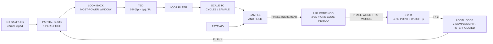
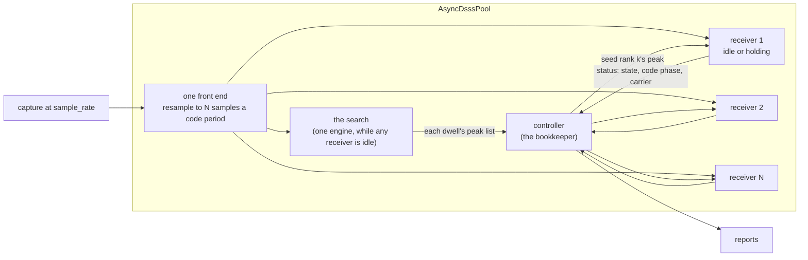

# AsyncDsssReceiver and AsyncDsssPool — continuous DSSS, from spec to object

*`AsyncDsssReceiver` is one C object that searches for a continuous DSSS
emitter, refines the detection, and tracks it until its own lock detectors
say it is gone. `AsyncDsssPool` holds up to ten such signals on one code: N
receivers that refine and track, and **one search, owned by the controller**,
run while any receiver is idle (§5). This page is the design of record for
both: the specification (§1), the acquisition engine's hand-off (§2), the
asynchronous despreader (§3), the receiver's states (§4), the pool (§5–§9),
the release (§10) and what a holder reads (§11). Bursts are
[`burst-bank.md`](burst-bank.md)'s. The runs behind the numbers here are
[the measurement record](async-dsss-receiver-measurements.md), under the same
section numbers, and a cost is a [published benchmark](../benchmarks.md)
row. The pool as built before this design, with its never-stopping central
searcher and its cell receivers, is at
[`4a4c437d0`](https://github.com/doppler-dsp/doppler/blob/4a4c437d0/docs/design/async-dsss-receiver.md);
§9 keeps what it taught.*

______________________________________________________________________

## 1. The specification

| quantity                 | value                                                                      |
| ------------------------ | -------------------------------------------------------------------------- |
| nominal frequency        | 2.5 GHz, uncertainty ±50 kHz                                               |
| frequency rate of change | < 500 Hz/s                                                                 |
| waveform                 | continuous DSSS BPSK, asynchronous rectangular data                        |
| code                     | CCSDS command-link Gold code, 1,023 chips, at 5 Mcps                       |
| capture                  | complex samples at 11 MSa/s                                                |
| data rate                | 3 kbps (3,000 sym/s), on no fixed relation to the chip clock               |
| data-free block          | periodic and long, common to every signal: 500 all-zero symbols by default |
| signals                  | up to 10 on the one code at once                                           |
| sensitivity              | Es/N0 ≥ 5 dB                                                               |
| deliverable              | one C receiver and one pool in `libdoppler.{a,so}`, the same via Python    |

In numbers: one code epoch $T_E$ is 1,023 chips at 5 Mcps, 204.6 µs, so
$1/T_E$ is 4,887.6 Hz, one search tile's width, and ±50 kHz is 21 tiles.
A symbol spans 1.63 epochs. Es/N0 ≥ 5 dB at 3,000 sym/s is C/N0 ≥ 39.8
dB-Hz. The default data-free block is 167 ms, 815 epochs.

Many of the numbers below were measured at the earlier specification point,
3.069 Mcps and 2,700 sym/s at two samples a chip (an epoch of 333.3 µs and
2,046 samples); each says so and names its record entry. They are not
re-measured at this point yet.

Two of those are derived. **500 Hz/s** is set against the LEO nadir-pass
figure `f_dot_max = (f_c/c)·(v²/h)`, about 579 Hz/s at 2.5 GHz and 800 km;
the engine's coherent depth is sized from the specification's bound
(§2.1). **5 dB** is the floor the receiver is held to at the specification's
geometry: its BER is under 5% at 5 dB and over 10% at 4 dB, with the
self-referenced EVM and the blind M2M4 SNR agreeing (`_test_awgn_esn0_floor`
in `native/tests/async_dsss_receiver/test_async_dsss_receiver_core.c`, at
the 3.069 Mcps point). §3.3 gives how far that BER sits from the bound.

**The code loop and the demodulator's carrier loop are sized to a loop SNR
of at least 20 dB at that floor.** `rho(dB) = Es/N0(dB) − 10·log10(2·bn)`,
with `bn` normalized to the loop's own update rate so the rate cancels,
gives `bn ≤ 0.0158` at 5 dB. The Dll ships at `bn` 0.002
(`ASYNC_DSSS_RX_DLL_BN`) and MpskReceiver's carrier loop at 0.01. The code
loop's per-epoch SNR is Es/N0 over `epochs_per_symbol`, 1.63 here, inside
the same bound. The pre-despread Costas loop is wider, 0.04
(`ASYNC_DSSS_RX_BN_CARRIER`): pull-in and the 500 Hz/s ramp set its width,
not jitter (§4). There is no FLL. `bn` does not set the floor: sizing a
loop for steady-state jitter and pulling one in from a coarse estimate are
different problems, and §4's refining stage answers the second.

### 1.1 The signals

M out of N ($\leq 10$) possible signals are on air at once, with at least
differing code phase and carrier phase trajectory. Each may go off air and
be replaced by a new signal at any moment. All share a common, periodic,
simultaneous data-free block lasting many code epochs. **A signal changes
only after a data-free block**: one goes off air, or a new one comes on, at a
frame boundary, never inside a frame.

### 1.2 The sample rate is derived, not chosen

The caller states its capture's `sample_rate` (11 MSa/s here); neither the
receiver nor the pool takes a samples-per-chip. Each derives $N$, the
samples in one code period, as the smallest power of two of at least two
samples a chip: 2,048 for a 1,023-chip code, a rate of
$5\,\text{Mcps} \times 2048/1023 = 10.0098$ MSa/s. It resamples once, on the
way in (one front end per pool, shared by its receivers and its search).
The Dll already tracks on a fractional code NCO, and a search tile is one
bin of the $N$-point transform, $1/T_E$ wide, whatever $N$ is.

**Why a power of two.** Every search transform is one code period long. At
two samples a chip that is $2 \times 1023 = 2 \cdot 3 \cdot 11 \cdot 31$,
and pocketfft has no radix-31 or fast radix-11 pass: profiling one dwell of
the one-tile search put about 90% of it in FFT passes and 62% in the
generic radix-31 and the radix-11 passes, and a 2,046-point transform takes
9.89 µs against 1.99 µs at 2,048 (record §9.4). `spc` is removed from every
object that took it, a breaking change made before 1.0.

______________________________________________________________________

## 2. Acquisition

### 2.1 Two front doors, one engine

`Acquisition` (continuous) and `BurstAcquisition` are two public
constructors over one `dp_acq_state_t`
(`native/inc/doppler/acq/acq_core.h`), each exposing only the parameters
that mean something for it rather than one class with a `mode` and
per-parameter "ignored here" caveats. State, auto-sizing, `push()` and
serialization are shared. `Acquisition` takes the code, `spc`, `chip_rate`,
`symbol_rate`, a design `cn0_dbhz`, a one-sided `doppler_uncertainty`,
`pfa`, `pd`, a CFAR `noise_mode`, and the two inputs that size its coherent
depth, `code_only_epochs` and `doppler_rate`. Everything else it derives;
there is no `doppler_resolution` and no `max_noncoh`.

**`doppler_bins` is the whole Doppler grid** a hit's `doppler_bin` indexes:
the coherent depth `coherent_bins` times the frequency windows the engine
rolls one epoch's spectrum across when the uncertainty is wider than one
epoch's span ([`acq-surface.md`](acq-surface.md) §3).
Non-coherent looks are a separate axis. On the continuous door `n_noncoh`
is auto-selected to meet `pd` at `pfa` and read-only, bounded only by a
safety valve (`ACQ_N_NONCOH_SAFETY_CEILING`, 256 looks) because the
semi-analytical `pd_predicted` model turns non-monotonic past it. A burst
engine never adds looks: it sizes on the burst and reports `underpowered`.

**Two inputs size the coherent depth `D`: `code_only_epochs` and
`doppler_rate`.** It is the smaller of `⌊(code_only_epochs + 1)/2⌋`, so a
whole block always fits inside the pure-code window, and
`f_epoch/√(2·doppler_rate)`, which is `f_epoch/√1000` at 500 Hz/s, so the
drift over one block stays inside half a slow-time bin, rounded down to a
7-smooth length (`dp_fft_smooth_floor()`): `D` is a slow-time FFT length,
and a prime factor of 13 or more costs the FFT its slow path, so 94 epochs
run as 90. `code_only_epochs`
counts the **whole** epochs a window holds at any chip phase: the window is
`W` symbols on the data clock, with no fixed relation to the code clock, so
a partial epoch is lost at each edge and
`code_only_epochs = ⌊W · cps / L⌋ − 1`. It defaults to 1, which is `D = 1`:
the epoch-by-epoch search. `AsyncDsssReceiver` takes the window as a time,
`code_only_s`, and derives `code_only_epochs` from it (§2.3).

### 2.2 A detection is a physical record, never a grid index

`acq_handoff_t` (`native/inc/doppler/acq/acq_core.h`) is the data; the
*hand-off* is the action that turns a raw `push()` hit into it and gives it
to the next stage. The record crosses a thread or process boundary, so it
cannot be the grid-relative `(doppler_bin, code_phase)`, which mean nothing
without also shipping the emitting engine's `spc` and `doppler_res_hz`.
Every field is in a physical unit and the record is a flat, pointer-free
POD. `dp_acq_build_handoff()` builds one from each hit of a continuous
engine. `AsyncDsssReceiver`'s `seed()` takes three of its fields,
`chip_phase`, `doppler_hz_est` and `cn0_dbhz_est`, and the receiver's own
hit takes that same path. A hit whose Doppler is at or past half the sample
rate is outside the seed domain (`dp_async_dsss_receiver_seed_ok()`): it is
refused as a seed and counted in `refused_hits`, and the search goes on.

| Field              | Type       | Description                                                                                      |
| ------------------ | ---------- | ------------------------------------------------------------------------------------------------ |
| `samples_consumed` | `uint64_t` | Sample offset since this engine's stream start that the detection's epoch ended at — replay-safe |
| `chip_phase`       | `double`   | Code phase in CHIPS, the code-tracking seed for the next stage                                   |
| `doppler_hz_est`   | `double`   | Coarse Doppler in Hz, already folded, signed and scaled from the raw bin index                   |
| `doppler_res_hz`   | `double`   | Width of that estimate — the ±`doppler_res_hz`/2 a refine or tracking stage still has to close   |
| `cn0_dbhz_est`     | `double`   | C/N0 estimate, dB-Hz — sizes downstream loop bandwidth and dwell                                 |
| `peak_mag`         | `float`    | Raw CFAR peak magnitude — observability passthrough                                              |
| `noise_est`        | `float`    | Raw CFAR noise-floor estimate — observability passthrough                                        |
| `test_stat`        | `float`    | Raw CFAR gating statistic — observability passthrough                                            |

**The record carries no timestamp.** The engines are pure sample-domain,
with no I/O; whatever feeds them samples owns the clock and stamps a record
at its `samples_consumed` (§11.3). The field list is the header's own.

**`chip_phase` is where the code will be, not where it was.** A hit is
decided at its dwell's end and the seed is wanted at the next sample, so
`dp_acq_build_handoff()` advances the phase by the drift over half the
dwell on the hit's own Doppler. **Neither constructor takes a
`carrier_freq`**: the engine works in baseband Doppler Hz, and a
baseband-only caller never has to name one. A caller that knows the carrier
tells the engine afterwards (`dp_acq_set_carrier_freq_hz()` /
`set_carrier_freq_hz`), which turns on that advance and, inside a coherent
block of `D > 1` epochs, aligns the block's epochs on the dilated code
clock. `AsyncDsssReceiver` passes its own `carrier_freq_hz` on.

### 2.3 The receiver's search: a slow-time depth from the code-only window, dwells on the shared sample count

**The receiver's search** is the continuous door, sized from two physical
create parameters: `code_only_s`, the code-only window in seconds, which
the receiver turns into `code_only_epochs = ⌊code_only_s · chip_rate / L⌋ − 1`, and `doppler_rate` in Hz/s, passed through. Both default to 0, which is
`D = 1`: one-epoch looks over its one-sided `doppler_uncertainty`. The
depth it runs is the read-only `coherent_bins`. `n_noncoh` is sized to `pd`
at `pfa` for its `cn0_dbhz`. The engine reports up to 16 peaks a dwell
(`max_peaks`); the receiver drops those within a chip of an excluded code
phase (`set_exclusions()`) or of a stronger peak, and takes the survivor at
its rank (`set_rank()`, 0 = the strongest, the default), or nothing that
dwell. With no exclusions at rank 0 that is the one-peak detector's pick.
An uncertainty wider than one epoch's span, `±1/(2·T_E)`,
is covered by the engine's roll across frequency windows, which it fans
across every online core unless `set_threads()` says otherwise; a pool's
one search may use every core, since no receiver of the pool runs a search
of its own (§5). The search is bit-identical at any thread count. What
searching costs is §9.

**Every dwell starts on the block grid of the receiver's own input count.**
The receiver counts every sample fed since create; in a pool the one search
counts the pool's samples the same way. A search restarted by `reset()`, a release, a refused hand-over or
`configure_search_raw()` first discards input up to the next multiple of
`D · N` samples, at most one block (30 ms at `D = 90`), so searchers
re-armed at different times still decide on the same blocks. The count and
the alignment owed travel in the state blob. At `D = 1` the grid is one
code epoch.

**The slow-time depth `D > 1` is safe only inside a pure-code window.**
Coherent combining across data aliases the data's own spectrum across the
Doppler axis and mislocks structurally
([`acq-surface.md`](acq-surface.md) §9). Inside a window of code
alone there is nothing to alias. The engine does not know any emitter's
window phase, so it sums **non-overlapping blocks of `D` epochs**, one
coherent surface per block, detected per block. A whole block always lands
inside a window once `W ≥ 2D − 1`, and `⌊W/D⌋` land in a row for
`n_noncoh` to accumulate. A `D`-point slow-time FFT at the epoch rate
subdivides one epoch's span into `D` rows; it never widens it. At the
earlier 3.069 Mcps geometry a 450-symbol code-only window holds 499 whole
epochs, and the 500 Hz/s bound gives 94, which the engine runs at the
7-smooth `D = 90` (a slow-time FFT length, #1247): a 33.3 Hz row and 19.5 dB
of coherent gain. A block that straddles data spreads its emitter over the `D`
rows, about `10·log10 D` down **at its own code phase**: a weaker copy, not
a mislock. Pinned by `native/validation/acq_block_coherent.c`. The receiver
runs this depth when given its window: at 32 dB-Hz, `D = 90` finds a signal
inside one 170-symbol window that `D = 1`, needing 256 looks, cannot decide
there (`test_async_dsss_receiver_core.c`,
`_test_depth_finds_what_one_epoch_misses`).

**The engine's windowing ships.** Its roll of one epoch's spectrum across
frequency windows, the alias check a pick near a window's edge gets
(`acq_resolve_tile_alias`), and the roll per thread on persistent workers
are current engine behavior, and the pool's search runs on them. Their design text is §2.3 at
[`4a4c437d0`](https://github.com/doppler-dsp/doppler/blob/4a4c437d0/docs/design/async-dsss-receiver.md)
until it moves to [`acq-surface.md`](acq-surface.md)
([#2500](https://github.com/doppler-dsp/doppler/issues/2500)).

### 2.4 The searcher is watched, not trusted

A hit says where a peak was and nothing about what else stood on the
surface, how close the gate came on the dwells that fired nothing, or
whether one emitter's splatter was about to be listed as two. So the engine
carries its own instruments, attach-on-demand: detached, a decided dwell
costs three predicted-not-taken branches, and nothing rides in a state
blob. `AsyncDsssReceiver.set_telemetry` forwards them as `<prefix>.acq`.

- **Ten probes per decided dwell**, `set_telemetry(tlm, prefix, decim)`:
    the test statistic and the gate it was held to (plotted together they
    show where a hit fired and how close the misses came), the CFAR
    reference, the strongest cell's value and its native row and column,
    the picks in the dwell and how many were held as same-code-phase twins,
    the strongest pick's concentration, and whether the gate fired.
- **The surface and the complex intermediates under it.** `keep_surface`
    then `surface(out)` gives every cell divided by the reference the gate
    used, so a cell reads as its own test statistic and the gate is a flat
    plane on a plot, with `surface_doppler_hz()`/`surface_chip_phase()` as
    its axes, from the same mapping an `acq_handoff_t` carries.
    `dp_acq_set_surface_sink(fn, ctx, decim)` hands every `decim`-th
    dwell's surface to a callback on the pushing thread. Underneath,
    `surface_complex(out)` is the coherent dump the last dwell was decided
    on, `block_prompt(tile, col, out)` one cell's `D` per-epoch correlations
    (the despread stream at epoch rate), and `block_raw(out)` the block's
    epochs as pushed, for a re-correlation at any phase, rate or symbol
    boundary the grid lacks.
- **The concentration is the splatter discriminator.** One emitter does
    not make one peak, and every extra copy sits at its **own code phase**,
    while a second emitter is a second column. So the probe is the
    strongest pick's main-lobe power (its row and one either side, the
    exclusion zone's width) over the total power of its whole column: near
    1 for one clean emitter, about 0.5 when a data transition splits it
    into twins at other Doppler, lower for a block that straddles data.

______________________________________________________________________

## 3. The asynchronous despreader

The receive-side despreader when the **data-symbol rate is on the order of the
code-epoch rate but asynchronous** to it. Its shipped form is
`track.Dll(..., segments=K)` (§3.4).

### 3.1 An independent symbol clock slides through the epoch

A DSSS receiver despreads by integrating early/prompt/late correlations over one
**code epoch** (`TE = sf·sps` samples) — an integrate-and-dump locked to the
*code* clock. That works when the symbol clock is locked to it at an integer
ratio (GPS C/A: 20 epochs per bit, edges on epoch edges). It breaks when the
symbol clock is independent: with `T_sym = TE · (1 + delta)`, an independent
symbol phase and `T_sym ≈ TE`, there is about one symbol per epoch, a transition
roughly every epoch, and `delta ≠ 0` slides the symbol boundary continuously
through the epoch at the beat rate `delta / TE`.

### 3.2 Per-epoch despreading cancels itself half the time

The coherent prompt over an epoch whose data flips at fraction `f ∈ [0,1]` is
`P(f) = A·[f·d1 + (1−f)·d2] = A·d1·(2f−1)`: full despread at an epoch edge, and
**zero** for a flip mid-epoch. Because `f` sweeps through every value, about half
of all epochs straddle a transition and their prompts collapse. Both
consequences follow from `P(f)` alone. Per-epoch data decisions floor, because
`P(f)` near `f = 1/2` is near zero at any Es/N0, and `(|E|−|L|)/(|E|+|L|)`
collapses to `0/0` on those epochs, starving the DLL. At one prompt per epoch
the symbol clock is **unobservable**, and the integration window is forced to
straddle transitions. And the failure has a fingerprint: the flip's fraction
`f` advances by `delta` each epoch, so the envelope `A·|2f−1|` of the
prompt-magnitude stream `|P[n]|` repeats every `1/|delta|` epochs and its
spectrum carries a **tone at `|delta|` cycles per epoch** — what to look for
when a DSSS link shows unexplained despread fades.

### 3.3 Partials give the symbol clock its own observability

Each code epoch is split into `K` sub-epoch **partial** prompt correlations of
`TE/K` samples at known code phase — `K` despread samples per epoch, so the
symbol clock is observable. The full-symbol despread the epoch-locked window
could not form is then a matched filter over the partial stream, run on the
symbol clock instead of the code clock. In `AsyncDsssReceiver` that is
`MpskReceiver`'s integrate-and-dump matched filter (`MPSK_RX_PULSE_IANDD`, the
rectangular symbol's own), reached through a `RateConverter` that takes the
partial rate to `sps` samples a symbol (§3.4), with `MpskReceiver`'s timing
loop placing the dump on the symbol boundaries. Without a matched filter a
rectangular symbol is sampled at one partial, which carries about `1/P` of
its energy, `P` the partials a symbol spans (4.44 at the specification's
geometry, §3.7).

At the earlier 3.069 Mcps geometry (Gold-1023, 3.069 Mcps, 2,700 sym/s
asynchronous BPSK, two samples a chip, no Doppler) the receiver holds a BER
under 5% at Es/N0 10, 8 and 5 dB, the specification's floor, and exceeds 10% at
4 dB, with the self-referenced EVM and the blind M2M4 SNR corroborating:
`_test_awgn_esn0_floor` in `native/tests/async_dsss_receiver/test_async_dsss_receiver_core.c`.
Against the bound, `Q(sqrt(2 Es/N0))`, the BER of a receiver that has settled
sits 0.65 to 0.89 dB from it from 5 to 8 dB, and every burst of the sweep
settled. A hand-over can still miss (F3), and a burst that did not settle
would be counted beside the loss. Both are measured, with the loss's
interval, in the
[certification record](https://github.com/doppler-dsp/doppler/blob/main/src/doppler/dsss/tests/validation/async_dsss_receiver/results.md)
(§2.6). Where the loss goes is the record's §2.7, measured by
`validate_async_dsss_receiver_loss`
(`native/validation/async_dsss_receiver_loss.c`): the specification's
stimulus at known truth, through more and more of the shipped chain, each
stage scored as a BER-equivalent loss. At 5 dB, over 16 bursts:

| stage                                                                                          | its cost at 5 dB                           |
| ---------------------------------------------------------------------------------------------- | ------------------------------------------ |
| the cut into `K` = 4 partials a code period                                                    | 0.41 dB                                    |
| the `Dll`'s output, held at truth                                                              | none measurable (−0.01 dB)                 |
| the `RateConverter`                                                                            | none measurable (+0.01 dB)                 |
| the demodulator's timing and carrier loops                                                     | 0.23 dB                                    |
| the front end's tracking: the pre-despread carrier loop, the code loop and the refine hand-off | 0.20 dB (over its 15 settled bursts of 16) |

**The cut is geometry.** At 4.44 partials a symbol a partial straddles a
symbol edge, and the matched filter cannot weigh its two halves apart; ideal
sums at known timing lose the same. Against `K`, the ideal sums' loss on the
same bursts (the cut above is that less S0's 0.02 dB): 3.79 dB at 1, 1.17 at
2, 0.43 at 4, 0.18 at 8, 0.09 at 16. The receiver does not
run at `K` = 8 today
([#2506](https://github.com/doppler-dsp/doppler/issues/2506)).

**The code path sums the partials coherently** over a one-period window and
takes the powers of the sums. A data flip changes the sign of every partial after
it, so a window across a flip cancels in part (§3.2); the look-back (§3.6) picks,
each period, the one-period window with the most prompt power, the one with the
least of a flip in it, and the discriminator runs on that window's sums. It needs
no symbol timing, so it works from cold start: the bootstrap order is code
(the DLL) → symbol timing → data. Given the symbol period, §3.7 lifts the same
search to the symbol scale.
`K` sets two things: the output rate, `K` despread samples per period, and the
look-back's grain, since a candidate window starts only on a partial boundary.

### 3.4 The despreader removes the code and outputs samples

Its one job is to remove the PN code and emit samples. The asynchronous symbol
clock is merely *why* it despreads in `K` partials; symbol extraction is
downstream, in separate objects fed from its output. This is
`track.Dll(..., segments=K)` and no new object: `segments=1` is the classic
coherent full-epoch DLL, `segments=K>1` is the streaming async despreader, and
what follows it is symbol timing, then bits.

**The carrier is wiped before it.** The code loop's sums are coherent over a
code period (§3.3), so it is blind to the carrier's phase but not to a residual
frequency: a residual `Δf` costs a window of `T` seconds `sinc²(Δf·T)` of its
power, **−3.9 dB** at half a `1/T` bin, and a whole cycle per period nulls it
(`native/tests/dll/test_dll_core.c` §6d). So the receiver runs its carrier loop
upstream. Its Costas loop wipes the carrier from the input, is steered from the
Dll's partials, once per code period on a squaring combine of that period's
partials, and hands the same estimate to the code loop as its rate aid,
`carrier_offset / carrier_freq`, because the motion that shifts the carrier
dilates the code. Each emitted partial is a `TE/K`-sample integrate-and-dump, so
whatever residual the carrier loop has not yet nulled barely dents the output:
`sinc(Δφ/2)` with `Δφ = π/K` at half a bin, **−0.2 dB** at `K = 4`. That
residual rides out to the demodulator's own carrier loop.

**Its one job also forbids coupling `segments` to a demodulator's `sps`.** The
partial rate is `K·chip_rate/SF`, chosen for the code loop's own variance and
nothing else; a demodulator's `sps` is chosen for its own reasons, and
`doppler.resample.RateConverter` bridges them. Picking `K` so that
`round(K·T_sym/T_epoch)` lands on an integer makes a perfectly good `Dll`
tuning look downstream-broken.

### 3.5 Code lock reuses acquisition's own statistic

A tracking channel must always answer *am I locked?*, so the DLL carries an
always-on lock detector built on **acquisition's** non-coherent test
statistic — acquire and track then agree on what "detected" means. Each look
contributes its prompt power: a partial in `segments` mode, the full-epoch
prompt at `segments=1`, and the symbol window once the symbol period is
given (§3.7). `N = n_looks` consecutive looks give
`R = sqrt(2·Σ|P_k|² / E|O|²)`, which under H0 has
`P(R > η) = marcum_q(N, 0, η)`, exactly the acquisition tail; a caller sizes
`η = det_threshold_noncoherent(pfa, N)` and `N = det_n_noncoh(snr, …)` for a
target `(Pfa, Pd)`.

**The noise reference is an off-peak tap, not a second channel.** Each look
is correlated a second time at a random whole-chip offset, re-drawn every
epoch and kept `noise_guard` chips, the spacing plus two, clear of the
prompt/early/late lobe; for a low-sidelobe code that correlation is
signal-free, so `|O_k|²` samples the per-look noise power. **The test depth
and the noise-averaging length are decoupled**: `N` sets the χ²(2N)
threshold, but the reference must average many more cells or its own
variance inflates Pfa. `dp_dll_configure_lock()` sizes the reference's EMA
for an estimator SNR (`dp_det_ema_alpha()`); left to derive it from `N`, it
holds the reference's spread to an eighth of the statistic's own
`1/sqrt(N)`, floored at about 33 dB, which is `1/α = max(1024, 32·N)`
(`native/tests/dll/test_dll_core.c` §7). It is a cumulative-mean bootstrap until
`1/α` looks have accrued and a fixed-α EMA after, so the floor is unbiased
from the first look rather than seed-dominated through a warm-up of `1/α`
looks. The decision is verify-counted (`lockdet`): declared after
`det_verify_count(pfa, pfa·1e-3)` consecutive decisions over the gate, two
at 1e-3, and dropped after two under it. On noise its realized
per-decision rate runs above the configured `pfa` (the record's §12.15
measured about twice it;
[#2503](https://github.com/doppler-dsp/doppler/issues/2503)).
`Dll.locked`, `Dll.lock_stat` and `Dll.noise_est` read
it back, inside the normal `steps()`, with no opt-in.

### 3.6 The look-back window finds the transition-free epoch

The code loop's error comes from the one-epoch window with the **most prompt
power**, found per epoch across the current and the previous epoch, on the
assumption of at most one data transition per epoch.
`native/inc/doppler/dll/dll_core.h` is the C port of this design and names
its artifacts after it, so the two can be read against each other.



The epoch is cut into `windows` = `segments` partials, each closing when
the code phase crosses the next `sf/segments` chips, so the count need not
divide the epoch's samples: the receiver's tracking `Dll` takes 4, partials
of 511.5 samples on average at the specification's 2046 (§3.4, §4.1). A
count can also be derived from a tolerable async correlation loss
`max_error` in dB: `dp_dll_lookback_segments()` takes the partial length as
the divisor of `sf·spc` nearest the coverage `1 − 10^(−max_error/10)` asks
for, 11 partials at 2046 samples and 0.5 dB, which is how the receiver
sizes its refine-stage `Dll` (`refine_max_error_db`). Per epoch, over the
prompt product `x`, schematically (the `reshape` is exact only when
`windows` divides the epoch's samples):

```text
partial_sums    = x.reshape(windows, window_size).sum(axis=1)
sums            = partial_sums.cumsum()         # this epoch, forward
backward_sums   = partial_sums[::-1].cumsum()   # this epoch, reversed
correlations[k] = |sums[k] + last_backward_sums[::-1][k+1]| / (sf·spc)
correlations[-1]= |sums[-1]| / (sf·spc)
max_window      = argmax(correlations)
window_index    = (windows − 1 − max_window) · window_size
```

`max_window` is the transition-free window, `window_index` its start measured
back from the end of the previous correlation, and `correlations[max_window]²`
the signal-plus-noise power the discriminator normalizes by. Early and late are
summed over the same window, and the error is the **power-domain**,
prompt-normalized form
`0.5 · (early_power − late_power) / signal_plus_noise_power` — not a
magnitude-domain `(|E|−|L|)/(|E|+|L|)` ratio.

The partial sums double as the integrate-and-dump output, each divided by
the samples it spans and by a **slowly tracked level**: the running mean of
the winner's magnitude, `max_abs` = `correlations[max_window]`, over
`DLL_OUT_LEVEL_PERIODS` = 32 periods, its plain mean until 32 have accrued. The output then sits near unit amplitude at any input gain,
which the timing detectors downstream assume. Never by the period's own
`max_abs`: that divisor carries the period's own noise, so it compressed the
in-phase error against the quadrature and coupled the symbols that share a
period, and the receiver lost 0.2 dB of error rate while its EVM read better
than the error rate allowed
([#2495](https://github.com/doppler-dsp/doppler/issues/2495)). The header
(`dll_core.h`) sets the length inside a band, 16 to 40: at least 16 holds
the compression, measured, under 0.15 dB, and at most 40 settles a step in
level to 1% inside a third of the data-free block. At 32 the settle is 146
periods, 49 ms at the specification, and the output's scale follows a step
until then. Over the first periods after create or reset the level is their
plain mean, so it is not yet slow.

The replica the loop steers is the code held at **2 samples per chip and
linearly interpolated** at any fractional position, sampled at
chip-relative `{0.25, 0.75}` rather than `{0, 0.5}`, which centers the
interpolation transition zone symmetrically on each chip boundary and keeps
early and late symmetric about prompt. Every tap is read at a **phase
word**: the code NCO's 32-bit phase, in which `2^32` is one code period,
taken at the sample's dwell center and moved to the grid's quarter-chip
origin, plus one constant word per tap — the spacing either side for early
and late, the offset for §3.5's noise tap. One 32×32→64-bit multiply by
`2·sf` gives the grid point and the interpolation weight, the weight
truncated to 24 bits, so a tap costs no division, no `fmod` and no double,
and the period's wrap is the word's own overflow (`dll_replica_word()`,
`dll_tap_base()`; `nco_word_to_grid()` and `nco_frac_to_weight()` in
`nco_core.h`). The loop filter's output is scaled to cycles per sample,
summed with the nominal rate and the rate aid, and **sampled and held** into
the NCO's increment, never kicked into its phase.

**The loop can be held** (`dp_dll_set_coast()`). On entry the filter
returns to the last `dp_dll_hold_here()`, the point the caller marked while
the loop was on its signal, and the NCO runs at that filter's integrator
alone: the proportional term is a phase correction meant for one interval,
and held as a rate it walks the phase off at chips per second. Held, the
discriminator still reads (`dp_dll_take_error()` sums it), the filter takes
no update, the lock detector keeps looking, a new rate aid takes effect at
once, and `code_rate`, the `.rate` probe and every status record that
carries it report the rate the held NCO runs at
(`native/tests/dll/test_dll_core.c`, `coast_reports_the_held_rate`, at one and
four segments). When the receiver holds it is §10's.

### 3.7 The symbol period lifts the look to symbol scale

The partial form of §3.3 is forced by the data: a full-epoch coherent look
collapses on a transition, so the code-lock detector's look is the
quarter-epoch partial — the smallest integration the asynchronous data
allows when nothing is known about where its transitions fall, and
therefore the weakest. At the earlier 3.069 Mcps geometry a symbol spans 4.44
partials, so at the 5 dB floor one partial carries −1.5 dB per look.

§3.6's search already finds a transition-free window; what it does not know
is the symbol *period*, and the receiver does —
`P = segments · chip_rate / (sf · symbol_rate)` partials, 4.44 at the earlier
3.069 Mcps geometry (6.52 at this specification). With the period the same search lifts to the
symbol scale: `ceil(P)` boundary-phase hypotheses, five at the earlier point and seven here, each placing a
boundary every `P` partials and owning a window of
`L = min(floor(P) − 1, 4 · segments)` partials after it — short enough to
sit inside one symbol under the hypothesis's quantization, capped so a slow
data clock never asks for coherence across more carrier than the wipe-off
holds. Each hypothesis sums its window coherently and keeps an EMA of its
power over about 32 symbols; the one with the most power **is** the symbol
timing, and its windows are the detector's looks. A look then integrates
`L` partials coherently and never straddles a transition: three instead of
one here, 4.8 dB more per look, so `det_n_noncoh` sizes the detector at 17
looks for Pd 0.99 at Pfa 1e-3 at the floor, against 92 per-partial looks.
The search needs no decision and no external timing, so it costs nothing at
cold start and follows a drifting symbol clock by itself. A look that
overlaps the previous one is not a look and is not counted: overlapping
looks read the same noise several times, and on noise they returned the
code flag about once a second after a departure, restarting §10's clock
(`native/tests/dll/test_dll_core.c` §6b′; the record's §12.15).

**The code discriminator runs on the same window**, steering once per
symbol on the early/prompt/late sums over the winner, its filter re-timed to
the symbol interval so `bn` keeps its per-epoch meaning and the tracked rate
is continuous whether the aid is on or off (`native/tests/dll/test_dll_core.c`
§6c). Against the per-epoch loop it pulls in faster and is tighter at high
C/N0, and at the 40 dB-Hz floor, where the noise sets the jitter and the
window's unused partials cost more than its coherence buys, it costs a
little more — hundredths of a chip either way (the record's §12.5). CI holds
the relation: `validate_dll_aid_jitter --check` keeps the aided jitter
within 1.25× the per-epoch loop's at 45 dB-Hz and 1.6× at 40, and its
pull-in no slower than 1.1× (`native/validation/dll_aid_jitter.c`). The
emitted partial stream is untouched by the aid: the look-back still
supplies, averaged slowly, the output's level (§3.6).

The receiver applies it at chain build: `dp_dll_set_symbol_period` from its
configuration, `n_looks` from `det_n_noncoh` for Pd 0.99 at Pfa 1e-3 over
the window at its `cn0_dbhz`, and the drop count from
`det_verify_count(0.01, 1e-6)` — three consecutive misses against the DLL's
fixed two — so the verify hysteresis is a budget rather than a constant.
Pinned by `native/tests/dll/test_dll_core.c` §6b (the default per-partial
detector up under half the time, the aided one over 95%, the chosen phase
within one partial of the truth) and §6c (the loop steers on the window,
the two modes' step transients agree, the rate is continuous across the
switch).

______________________________________________________________________

## 4. The receiver is one object with four states

`AsyncDsssReceiver`
(`native/inc/doppler/async_dsss_receiver/async_dsss_receiver_core.h`) is
the composed continuous receiver, one C object, read back through the
`get_*()` family, the `lifecycle` property and §11.3's status record. A
receiver in a pool is §6; this section is the chain under both.

- **searching** — on its own, samples feed an embedded continuous
    `Acquisition` (§2)
    over `±doppler_uncertainty`, at the coherent depth `D` its code-only
    window sizes (§2.3; `D = 1`, one epoch a look, without one). A hit becomes
    a seed through `dp_acq_build_handoff()` and `seed()`, and the
    unconsumed tail of the same call goes straight on. A hit at or past
    half the sample rate is outside the seed domain: it is refused, counted
    in `refused_hits`, and the search goes on over its tail. In a pool the
    receiver has no search: it is **idle** until the controller seeds it
    (§6).
- **refining** — a frozen-carrier derotation at the coarse estimate
    (`costas_wipeoff` with `costas_update` never called) feeds a collection
    `Dll` whose look-back segments oversample each epoch, then a
    `RateConverter` to `CarrierAcquisition`'s own rate, then
    `CarrierAcquisition`. Oversampling is required rather than tidy: the
    asynchronous data's residual carrier rides a spectrum about
    `symbol_rate` wide, which one dump per epoch aliases. When the
    estimator reports ready or gives up, the live chain is built **fresh**
    from the seed's chip phase, advanced by the clock dilation over the
    refine (doppler#1249) — not wherever the refine `Dll` drifted to — and
    the refined Doppler, or the seed's on a give-up. A refined Doppler
    outside the seed domain is refused like a hit, and the receiver
    searches again.
- **tracking** — the refined carrier is unfrozen into a live pre-despread
    Costas → `Dll` (§3) → `RateConverter` → `MpskReceiver`.
    `costas_update()` runs once per code period on a **non-data-aided
    (squaring)** discriminator over that period's coherent partials: a code
    period spans about 0.9 data symbols at the specification's ratio, so a
    transition lands inside nearly every period, and a decision-directed,
    sign-aligned combine averages to zero. With that clean error and
    `ASYNC_DSSS_RX_BN_CARRIER = 0.04` the loop pulls the refined seed in
    and rides the 500 Hz/s ramp, so despreading is coherent and
    `MpskReceiver` is left a small residual. It is a **pure PLL**: the FLL
    cross-product discriminator is far too noisy on this input and is not
    exposed at all.
- **lost** — the release verdict without `reacquire` (§10). The loops stop
    updating and samples are discarded until `reset()`. With `reacquire` a
    release returns the receiver to searching, and it never reads lost.

Two lock detectors run while tracking: the `Dll`'s CFAR-based **code lock**
(§3.5) and a hysteretic **symbol lock** on the emitted symbols — the BPSK
`cos(2φ)` statistic as an SNR-weighted EMA over a 30-symbol dwell, declared
after 30 consecutive symbols above 0.5 and dropped after 15 below 0.3.
`reset()` returns the receiver to searching: a receiver that has locked
cannot be reset back onto the same signal.
The receiver carries the standard `state_bytes`/`get_state`/`set_state`
triplet (`native/inc/doppler/dp_state.h`), every child included. The blob's
layout key is `segments`/`sps`/`n`/`refine_segments`, and a `reacquire`
receiver refuses a blob in the lost state.

`DsssReceiver` is the composition without a refine: a hit's coarse Doppler
goes straight to tracking, its pre-despread carrier loop is the
decision-directed, FLL-assisted one, and it has no symbol lock and no
release. A coarse-only hand-off leaves a pull-in gap at low Es/N0 and large
static Doppler, and the refine is what closes it.

### 4.1 The parts

- **The despreader** is `Dll(..., segments=K)`, validated carrier-present:
    code lock holds with a residual carrier on the samples, and the partial
    output is losslessly recoverable by a downstream carrier wipe and symbol
    despread. Its `bn` is 0.002 per epoch, whatever the steer rate (§3.7),
    not `dp_dll_create()`'s 0.01 default, and its early-late spacing is
    0.5 chips, so the normalized power discriminator reads
    `2 − spacing = 1.5` units per chip of offset.
- **Around it**: a pre-despread `Costas` carrier loop wipes the carrier
    ahead of the Dll, and `RateConverter` → `MpskReceiver` follow it, whose
    timing loop is RateSync's. The `RateConverter` bridges the partial rate
    to the demodulator's `sps` and never couples the two (§3.4): `K = 4` is
    the code loop's choice, while a downstream demodulator wants a much
    larger `K` for coherent gain.
- **`carrier_freq_hz` couples the code rate to the carrier.** The coupled
    code-rate Doppler `carrier_offset/carrier_freq` is fed to the tracking
    `Dll` through `dp_dll_set_rate_aid()` and refreshed every code period
    from the live carrier loop, so the code loop rides a dilated clock the
    discriminator alone cannot pull in at low SNR. `0.0` turns it off.
- **The escape hatches are separate knobs**: `configure_search_raw` pins
    the embedded search grid, `configure_lock_raw` re-tunes the live
    `Dll`'s code detector, `configure_chain_raw` re-pins
    `segments`/`sps`/`n` (allocating every replacement before adopting it,
    so a refused grid leaves the receiver usable on its prior grid; an `n`
    outside `dp_ratesync_m_ok()` is refused
    ([doppler#2421](https://github.com/doppler-dsp/doppler/issues/2421)),
    and only an allocation failure still aborts
    ([#2112](https://github.com/doppler-dsp/doppler/issues/2112))), and
    `set_refine_min_blocks` floors the refine's dwell. That floor is not
    cosmetic: `CarrierAcquisition`'s dwell is sized for *detection* at the
    derated C/N0, so it shortens as C/N0 rises while the noise of the
    estimate it hands the tracking chain does not, and too short a dwell
    hands the chain an estimate it cannot pull in. The default, seven
    blocks (42 ms at 2,700 sym/s), is the floor the record measured
    (§12.10, §12.16); `_test_refine_dwell_floor` pins that it binds.
- **Telemetry** is attached on demand: `set_telemetry` in
    `async_dsss_receiver_core.h`. Telemetry is single-producer, so each
    receiver steps on one thread with its own context (§8).
- **What it costs**: tracking is the published row
    `async_dsss_receiver::steps[track,sf=1023,3.069Mcps]` in
    [the benchmarks](../benchmarks.md), at the earlier point, and searching
    is the `search` row beside it. The search at this specification is §9.
- **Steady tracking allocates nothing** (§11.5).

Every part is pinned in `native/tests/async_dsss_receiver/test_async_dsss_receiver_core.c`,
`src/doppler/dsss/tests/test_async_dsss_receiver.py`,
`native/tests/dll/test_dll_core.c` and `src/doppler/track/tests/test_dll.py`.

______________________________________________________________________

## 5. The pool: N receivers, one search

`AsyncDsssPool` (`native/inc/doppler/async_dsss_pool/async_dsss_pool_core.h`)
holds the signals of §1.1 on one code.

- **One front end.** The caller's capture at `sample_rate` is resampled once
    to $N$ samples a code period (§1.2); the search and every receiver read
    the same samples.
- **One search, owned by the controller.** Code phase across the whole
    carrier range, ±50 kHz, with the slow-time Doppler search of §2.3, on
    the one acquisition kernel. It runs **only while at least one receiver
    is idle**: with every receiver holding a signal there is nobody to hand
    a detection to, so it stops, and it starts again on the next sample a
    receiver is free. Each dwell's peak list goes through the pick of §7.2
    once, and the controller seeds the survivors into the idle receivers
    in rank order (§8).
- **N receivers, each refining and tracking.** A pooled receiver has no
    search of its own (§6). One receiver holds one signal, so N bounds how
    many are held: 3 for the proof of concept, up to 10.
- **The controller steps at dwell boundaries.** Its levers, the seeds and
    the exclusions, act at the next dwell, so it runs once a dwell, after
    the search decides; between two boundaries the receivers run the whole
    segment in parallel, one per worker, and the search spreads its tiles
    across the cores (§2.3). The result does not depend on the thread count
    or on how a caller blocks its pushes.
- **Each receiver makes its code phase and carrier estimate available**,
    through `status()` (§11.3).



**Why the controller owns the search.** Every searching receiver would
build the same surface: the same samples, the same code, the same grid,
dwells on the same block grid (the ranks depended on it). N idle receivers
searching each for itself cost N searches, and the pinned bench measured
3.4 to 4.0 searches for four (§9). One search costs one, whatever N is.
The pool as built before this design also had one search, and failed
because it **never stopped** (§9); this one stops whenever no receiver can
take a hit.

## 6. A receiver in the pool

A pooled `AsyncDsssReceiver` has three states: **idle**, refining and
tracking (§4). Idle is the reserved state value 3 (`ASYNC_DSSS_RX_RESERVED`,
§11.1), the value the pool as built's cell receivers used for the same
thing. A seed from the controller (`seed()`, §2.2's three fields) starts the
refine at the seed's sample; a release (§10, with `reacquire`) returns the
receiver to idle, and the controller's search picks the next signal for it.
A standalone `AsyncDsssReceiver` keeps its own search, unchanged.

- **The search covers the whole carrier range**, in dwells of D epochs back
    to back, with D at most half the data-free block. At least one dwell
    then lands wholly inside every data-free block with no frame timing at
    all, and a dwell partly in data gives only a weaker, smeared peak. A
    coherent dwell of D epochs resolves the carrier to $1/(D T_E)$ across
    the whole range: the only fine frequency search, and nothing commands
    it. At this specification the 500 Hz/s rate allows D = 154, run at the
    7-smooth 150 (§9).
- **Tracking ends when symbol lock is lost** (§10's rule with `reacquire`).
    A signal changes only after a data-free block, so a loss there is
    normally its signal leaving, and symbol lock lets go of a signal gone
    for good well inside one data-free block. Inside a frame it is less
    forgiving: a fade it does not ride out costs a re-search, and at the
    5 dB floor a 20 ms one nearly always does.

Symbol lock through a fade, of the draws that held lock before it, at the
3.069 Mcps point (record §6.1):

<!-- async-dsss-pool:design-fade:start -->

| Es/N0 | draws not settled, excluded | rides out 5 ms       | rides out 10 ms      | rides out 20 ms      | lets go after a loss, the slowest |
| ----- | --------------------------- | -------------------- | -------------------- | -------------------- | --------------------------------- |
| 10 dB | 0 of 20                     | 19 of 20 (0.76–0.99) | 18 of 20 (0.70–0.97) | 15 of 20 (0.53–0.89) | 34.6 ms                           |
| 5 dB  | 0 of 20                     | 17 of 20 (0.64–0.95) | 16 of 20 (0.58–0.92) | 2 of 20 (0.03–0.30)  | 42.4 ms                           |

<!-- async-dsss-pool:design-fade:end -->

**Arrival to tracking.** A new signal is found by the next dwell that
decides it, without waiting for a receiver to be freed if one is idle.
Measured at the 3.069 Mcps point with each receiver searching ±1/T_E for
itself, a signal arriving at any time, code phase and carrier in range
(record §6.3):

<!-- async-dsss-pool:design-arrival:start -->

| Es/N0 | tracking (the state), median | symbol lock, median of those that lock | locked 2 s after arrival |
| ----- | ---------------------------- | -------------------------------------- | ------------------------ |
| 10 dB | 45 ms (slowest 47)           | 77 ms (slowest 219)                    | 20 of 20 (0.84–1.00)     |
| 5 dB  | 86 ms (slowest 101)          | 289 ms (slowest 1640)                  | 20 of 20 (0.84–1.00)     |

<!-- async-dsss-pool:design-arrival:end -->

At 10 dB the median arrival locks inside one data-free block, though not
every draw does. At the 5 dB floor the search is not what is slow: the state
reads tracking on every draw, and it is symbol lock that lags, on some draws
for more than a second. What decides it is the carrier the refine stage
hands the carrier loop, by how far it lands from the truth (record §6.3):

<!-- async-dsss-pool:design-seed:start -->

| refine seed error | locked, 10 dB                      | locked, 5 dB                        |
| ----------------- | ---------------------------------- | ----------------------------------- |
| 0–100 Hz          | 16 of 16 (0.81–1.00), median 74 ms | 10 of 10 (0.72–1.00), median 157 ms |
| 100–200 Hz        | 4 of 4 (0.51–1.00), median 165 ms  | 8 of 8 (0.68–1.00), median 482 ms   |
| 200–300 Hz        | —                                  | 2 of 2 (0.34–1.00), median 1424 ms  |
| ≥ 300 Hz          | —                                  | —                                   |

<!-- async-dsss-pool:design-seed:end -->

The loop's acquisition bound is `bn / m`, 60 Hz at that front end, and it
acquires every draw inside it, reliably to twice it and not at all by four
times (`costas_pullin.c`, `async_dsss_receiver_core.h`). The whole receiver
is more forgiving than the loop alone: slower to lock as the seed error
grows, it still locked draws in the 200–300 Hz row. Why it reaches past the
loop's edge is open (doppler#2409): the error is read when tracking starts,
which need not be the residual the loop finally pulls in. That residual is
doppler#982's; `rx.car.nco` (#2412) shows what the loop pulls in, not yet
measured as a residual. Since tracking is symbol lock, a receiver at the
floor that misses it lets go and is searched for again, so the refine's
residual is a design input (doppler#2409).

## 7. The peak list, and the pick

### 7.1 The peak list

`Acquisition.set_max_peaks` and `BurstAcquisition.set_max_peaks` list every
peak above the dwell's gate, strongest first, with an exclusion zone of one
Doppler bin by one chip around each and the two-epoch rule for a peak at an
already-listed code phase. `det_peak_list`
(`native/inc/doppler/detector/det_private.h`) is the one primitive under
both detectors, and §7.2's pick reads it. Its design is §7.1 at
[`4a4c437d0`](https://github.com/doppler-dsp/doppler/blob/4a4c437d0/docs/design/async-dsss-receiver.md)
until it moves to [`acq-surface.md`](acq-surface.md)
([#2500](https://github.com/doppler-dsp/doppler/issues/2500)).

### 7.2 The pick

One function turns a dwell's list into the signals it may seed, in order;
a standalone receiver applies it to its own search's list, and the pool's
controller to the one search's. The engine is asked for 16 peaks a dwell.

1. **Duplicates.** A peak within a chip of a stronger one, circularly, is
    the same signal (a neighbouring cell, or its copy in a neighbouring
    tile): it does not take a second place.
1. **Sidelobes.** A strong signal's own Doppler-offset sidelobes are not a
    second signal. One emitter's list also holds its code's ambiguity at
    the offset between the emitter and each tile it is not in, up to
    $-16.95$ dB below it for the Gold-1023 search, hundreds of chips from
    its phase, dwell after dwell (`acq-surface.md` §8, doppler#2526). A
    peak counts as a second signal only if its statistic exceeds what the
    stronger signals' sidelobes can read **at its own cell** by more than
    the detector's own gate. Each stronger signal contributes its
    statistic on its own lag (`test_stat_peak`: a straddle between two lag
    columns put back, since its sidelobes keep their level) times the
    code's ambiguity from it to that cell (`dp_acq_sidelobe_ratio()`,
    computed the way the surface is made, over what the hits leave
    unknown). That is the worst sidelobe level only at the worst cells;
    bounded by it everywhere, as it was until 2026-11-01, a signal at the
    design floor was never taken beside any stronger one its sidelobes
    could reach. The contributions combine as before: the strongest one;
    on a deep block, the sum over the stronger signals on the peak's own
    Doppler row (modulo the epoch rate) and its neighbours when that is
    larger, because two signals on one row can stack their sidelobes on
    one cell (doppler#2554, doppler#2556). A deep block keeps the worst
    sidelobe level (`dp_acq_dsl_db()`, read at create) as a floor under
    each ratio: with data inside the block a strong signal's own data
    splatter adds to a cell beyond its ambiguity, and is not modelled yet
    (doppler#2730). Noise riding on a sidelobe lifts it by no more than
    the noise's own magnitude, so a sidelobe passes only when that noise
    alone would have cleared the gate: the false-alarm rate the search
    already runs at.
1. **Exclusions.** A peak within a chip of a code phase another receiver
    holds, refining or tracking, at any Doppler, is that receiver's signal.
    Keying on carrier as well seeded duplicate receivers (record §12.14).
    It still counts in rule 2's bound.

The survivors seed the idle receivers, the strongest first, so k signals
arriving together are held by k receivers after one dwell; a standalone
receiver takes the first. The rule lives once, in the receiver's core, and
the controller calls it (`async_dsss_receiver_core.h`).

That sets the **near-far limit**: a second signal is taken while a stronger
one is on the air only if it clears what the stronger one's sidelobes reach
at its cell by the gate. The operating range is the floor (Es/N0 5 dB) to
20 dB above it, so the case that bounds it is the weaker signal at the
floor, where its statistic is closest to the gate. Measured at the 3.069
Mcps point with the weaker signal there and the stronger one above it,
both carrying data, at random code phases and carriers
(`native/validation/async_dsss_near_far.c`): the share of streams whose
rank-1 search takes the second signal.

<!-- async-dsss-pool:design-near-far:start -->

<!-- async-dsss-pool:design-near-far:end -->

A signal below the limit is found once the stronger one leaves. Removing
the stronger one's replica before the search (cancellation) is what would
move the limit, and is not built (doppler#2531).

## 8. The controller

The bookkeeper of §5. It owns the search and runs once a dwell. It:

- **reads each receiver's `status()`** (state, chip phase, carrier, code and
    symbol lock) and keeps the table of who holds what, never the
    demodulator's timing flag, which outlives the signal (record §6.2);
- **seeds the idle receivers** from the dwell's pick (§7.2), the strongest
    survivor into the lowest-numbered idle receiver;
- **resolves duplicates**: two receivers holding the same code phase (within
    a chip, the exclusions' key) hold the same signal; the one that keeps it
    is the one tracking over the one refining, then the first to lock, then
    the higher C/N0 estimate, then the lower index, and the other goes idle;
- **releases ghosts** (below);
- **runs the receivers in parallel** between its steps, one per worker,
    with a serial path when there is one CPU; the results do not depend on
    the thread count;
- **reports**.

Telemetry is single-producer, so each receiver attaches its own context,
and one context must not be shared across the workers. The controller
refuses a context shared across its receivers
(`dp_async_dsss_pool_set_telemetry()`).

**Ghosts.** The code-phase key does not catch every duplicate. A receiver
seeded on a strong emitter's Doppler-offset sidelobe holds a phase hundreds
of chips from the emitter's and despreads the emitter's own data, so it
tracks a copy no exclusion names. The controller releases such a ghost on
two of its traits together, each over the same trailing 0.2 s (owner ruling
on doppler#2529):

- **its carrier moves in lockstep with a stronger holder's**, a whole nonzero
    number of steps of $1/(2T_E)$ away: the sidelobe sits on its parent's
    carrier a tile off, and the carrier loop, updating once a code period
    from a squaring combine, reads that modulo half the epoch rate;
- **its Dll rarely holds code lock**, since a sidelobe is not the code's
    triangle.

Neither alone will do. A distinct emitter can co-move with another a lattice
step away, but it usually holds code lock; a true track near the floor loses
code lock, but its carrier is its own. Measured at the 3.069 Mcps point on
the reviewer's populations, the pair caught all 416 Doppler-offset ghosts in
a median 0.20 s and released 23 of 2050 true emitters, all 20 dB below a
60 dB-Hz partner they co-move with (doppler#2550). A ghost on its parent's
own carrier (k = 0) is left alone: allowing it releases most true emitters
that share a stronger one's Doppler (doppler#2551). The constants are
`ASYNC_DSSS_POOL_GHOST_*` in `async_dsss_pool_core.h`, and the measurements
behind them are on doppler#2529.

### 8.1 The holder owns the clock; events are SigMF annotations

Whatever feeds the samples owns the clock: one `dp_sample_clock_t` per
stream (`native/inc/doppler/timing/timing_core.h`) stamps a record as
`dp_sample_clock_stamp_at(n)`. A run's events are SigMF annotations,
appended live and finalized at close (`dp_event_log`,
`native/inc/doppler/dp_event_log/dp_event_log_core.h`), while telemetry stays
a flat record file the sidecar points at, each in the format that suits its
rate. The clock rule the receiver obeys is §11.3.

## 9. What it costs

**The pinned bench** (`native/benchmarks/bench_async_dsss_pool_core.c`, the
`async_dsss_pool::push[...]` rows): the §1 specification at 11 MSa/s
through the front end, D = 150, noise alone so every receiver searches, one
push a dwell. The load is CPU time per second of signal, 1 being exactly
real time; measured on `zen-x2elite-x` at the bench's own commit, before
this design is built (record §9.3):

| search span, receivers, threads | ns a sample | load |
| ------------------------------- | ----------- | ---- |
| one tile (±2,444 Hz), 1, 1      | 37.1        | 0.41 |
| one tile, 4, 1                  | 126.8       | 1.39 |
| one tile, 4, 4                  | 101.8       | 1.12 |
| ±50 kHz, 1, 1                   | 317.2       | 3.49 |
| ±50 kHz, 4, 1                   | 1264.0      | 13.9 |

Two findings, and the design answers each:

1. **Four searching receivers cost 3.4 to 4.0 searches**, and four threads
    buy little back, because every receiver builds the same surface and
    the workers were joined once a code period. The earlier cost argument,
    that every state fits one CPU so every receiver can search the whole
    range itself, priced one receiver and never multiplied by N. §5's one
    search costs one, and the controller steps once a dwell.
1. **One search is FFT-bound on its transform length.** The one-tile
    search is about 90% FFT passes, 62% of it in the radix-31 and radix-11
    passes of the 2,046-point period (record §9.4). §1.2's power-of-two
    period answers it: the transform is 5x faster at 2,048 points.

The same rows measure the design once it is built.

**What the pool as built taught.** Its push was one receiver's plus a
central searcher's that never stopped, because a new emitter may appear at
any time; at ±50 kHz that searcher alone ran several times slower than real
time on one thread, and threads brought it down only in wall time (record
§9.2):

<!-- async-dsss-pool:design-pool:start -->

| per push                                   | timed at | × real time (wall) |
| ------------------------------------------ | -------- | ------------------ |
| one receiver, tracking                     | 10 MSa/s | 0.11               |
| the pool, 12 slots, one emitter tracked    | 10 MSa/s | 1.04               |
| the same, across the machine's cores       | 10 MSa/s | 1.07               |
| its searcher at ±50 kHz, 21 tiles, D = 154 | 10 MSa/s | 5.30               |
| the same, eight threads                    | 10 MSa/s | 1.41               |
| its searcher at ±50 kHz, 53 tiles, D = 61  | 4 MSa/s  | 8.60               |
| the same, four threads                     | 4 MSa/s  | 2.42               |

<!-- async-dsss-pool:design-pool:end -->

So the one search runs only while a receiver is idle (§5). Each receiver
state at the 3.069 Mcps point, one thread (record §9.1):

<!-- async-dsss-pool:design-cost:start -->

| receiver state                              | × real time, one thread |
| ------------------------------------------- | ----------------------- |
| tracking                                    | 0.07                    |
| searching one tile, one-epoch looks         | 0.14                    |
| searching ±1/T_E (3 tiles), one-epoch looks | 0.22                    |
| searching ±1/T_E, slow time over D = 154    | 0.54                    |

<!-- async-dsss-pool:design-cost:end -->

______________________________________________________________________

## 10. The release — the lock flags decide "gone"

`AsyncDsssReceiver` carries two de-chattered lock flags, each a `lockdet`
(`native/inc/doppler/lockdet/lockdet_core.h`: level hysteresis between a
declare and a drop threshold, time hysteresis of consecutive looks either
way, a NaN look counted as a miss). **Code lock** (`get_code_locked()`) is
the live `Dll`'s CFAR-based, verify-counted detector — "am I despreading" —
and, sized for the C/N0 and coherent over a symbol (§3.7), it is the
presence flag: an emitter that leaves takes its code with it. **Symbol
lock** (`get_locked()`) is the BPSK `cos(2φ)` statistic over the emitted
symbols, the health of the *carrier* leg: a cycle slip or a deep fade drops
it while the code is still being despread.

**The rule is symbol lock alone**, the pool's (§6), with `reacquire`:
once symbol lock has been down without a break for longer than
`lost_confirm_s`, the receiver resets itself to searching (idle, in a
pool), and nobody calls `reset()`. Without `reacquire` the rule is both flags down for longer than
`lost_confirm_s`, and the receiver enters lost until `reset()`; one flag
down is a degrade, reported and not acted on. Either way the clock runs
from the first tracking sample, when no flag is up yet, so a hand-off that
never locks is released the same way as a signal that leaves, and a flag
the rule counts coming back restarts it. `lost_confirm_s = 0`, the
default, disables the clock; `reacquire` refuses a
confirm time under one input sample. Size it past the longest fade the
link must ride, and with `reacquire` past the pull-in to symbol lock.
Pinned by
`native/tests/async_dsss_receiver/test_async_dsss_receiver_core.c`
(`_test_lost_after_switch_off`, `_test_reacquire_after_switch_off`,
`_test_reacquire_is_symbol_lock_alone`,
`_test_reacquire_clock_restarts_on_lock`,
`_test_a_handoff_that_never_locks_is_released`).

The drop times after a switch-off, the flags through a fade and through a
phase step are the record's §12.3. CI's
`validate_async_dsss_receiver_release --check` holds both drops under
0.5 s and the flags to at most two returns on noise.

**While both flags are down after the first lock, the loops hold** at what
they settled on with both flags up, their lock detectors still looking at
the held replica (§3.6). Left running on noise, a departed receiver's code
loop free-runs at whatever its filter holds, sweeps its phase through every
live emitter's and can capture one crossing slowly enough (the record's
§12.19). Held, the receiver stands where its emitter left it: a genuine
return lands on the replica, lights a flag, and the loops run again on it;
a neighbor passing through lights the code flag for the crossing, steers
for the blip, and is dropped on re-entry, because the hold point is marked
with both flags up. Holding on **one** flag down was measured and rejected:
two live emitters crossing each other's code phase degrade both symbol
flags, and a code loop held through that cannot re-center on its own
emitter afterwards, while a running one rides the crossing out. Before the
first lock the loops must run — that is the pull-in. The hold is the same
with or without `reacquire`; with it, the release ends the hold. Pinned by
the release validator's `--check`, the crossing and the live crossing
included. A neighbor within about a kilohertz crossing at a chip or two a
second is, to a receiver on its own, a return: the pool's controller,
which knows every receiver's code phase, is where it is told apart ([#1275](https://github.com/doppler-dsp/doppler/issues/1275)).

______________________________________________________________________

## 11. What a holder needs from the receiver

### 11.1 Idle is the receiver with no search of its own

A pooled receiver is seeded from outside (§6), and while it holds nothing
it is idle, state value 3. That value was reserved
(`ASYNC_DSSS_RX_RESERVED`) when the pool as built's cell receivers, which
were seeded the same way, were deleted, because the values are persisted;
it returns to the same meaning. The cell flavor as it stood is §11.1 at
[`4a4c437d0`](https://github.com/doppler-dsp/doppler/blob/4a4c437d0/docs/design/async-dsss-receiver.md),
its code at
[`35d8049a2`](https://github.com/doppler-dsp/doppler/blob/35d8049a2/native/inc/doppler/async_dsss_receiver/async_dsss_receiver_core.h).

### 11.2 Lost is a state of the receiver

Without `reacquire` the receiver enters **lost** on §10's both-flags rule.
In it the loops stop updating, samples are consumed and discarded, and
`get_lost()` reports it until `reset()`. `lost_confirm_s = 0` never enters
it. With `reacquire` the receiver releases itself back to searching and is
never lost. The pool runs its receivers with `reacquire` (§6).

### 11.3 The status record is one consistent picture, by value

The receiver's getters are one call each, so a reader on another thread
cannot assemble a consistent picture across a `steps()` call. `status()`
returns that picture as one record by value, a jm-generated structseq whose
fields are the header's (`async_dsss_receiver_status_t` in
`native/inc/doppler/async_dsss_receiver/async_dsss_receiver_core.h`). It is
allocation-free: every field is a read of live state. The pool's
controller keys its table and its exclusions on it, never on the seed (§8).

**It carries no timestamp.** The receiver, its engine and every record they
produce are sample-domain: each carries a stream position, never a time.
Whatever feeds the samples owns the clock, one `dp_sample_clock_t` per
stream (`native/inc/doppler/timing/timing_core.h`), and stamps a record as
`dp_sample_clock_stamp_at(n)`; telemetry takes the same stamp through
`dp_tlm_set_now()`. And it is **not `get_state()`**: the bytes triplet
resumes the receiver elsewhere, this record describes it here.

### 11.4 The replica output is not built

It belonged to the pool as built's cancellation branch, never built
(§7.2's near-far limit, doppler#2531).

### 11.5 Nothing grows with time

Steady tracking allocates nothing: `steps()` with no transition runs on
scratch sized at the last chain build, grow-only, never in the hot path
(#1192). A chain build allocates, and frees the chain it replaces. A seed
builds the refine chain (`Dll`, `RateConverter`, `CarrierAcquisition`). The
hand-over and `configure_chain_raw()` build the track chain (`Dll`,
`RateConverter`, `MpskReceiver`), and `reset()` builds both. The status record is returned by value.

______________________________________________________________________

## What this is not

- **Not a burst receiver.** No preamble, no `reps`, no capture ring, no
    frame demodulator. The data-free block is a coherence opportunity, not a
    preamble, and the search's product is an `acq_handoff_t`. Bursts are
    [`burst-bank.md`](burst-bank.md)'s and
    [`dsss-burst-receiver.md`](dsss-burst-receiver.md)'s.
- **No clock inside.** No engine, receiver or record here reads a time;
    every one carries a stream position (§2.2, §11.3).
- **No carrier recovery or symbol extraction inside the despreader**, and
    no coupling of `segments` to a demodulator's `sps` (§3.4).
- **The frame epoch is not recovered.** Nothing in the receiver finds where
    a data-free block starts, and its search needs no frame timing (§6).

______________________________________________________________________

## See also

- [the measurement record](async-dsss-receiver-measurements.md) — every run
    behind the numbers here, under the same section numbers, the pool as
    built's included.
- [`acq-surface.md`](acq-surface.md) — the acquisition engine
    under §2: the windowing, the CFAR gate, what is open.
- [`dsss-burst-receiver.md`](dsss-burst-receiver.md) — the burst chain,
    which shares §2.2's `acq_handoff_t`.
- [`burst-bank.md`](burst-bank.md) — the burst bank this page's continuous
    case was split from.
- [AsyncDsssReceiver: the specification waveform](../gallery/async-dsss-receiver-spec.md)
    and [Streaming Async Despreader](../gallery/async-despread.md) — the
    gallery demonstrations of §4 and §3.
