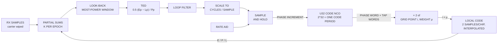
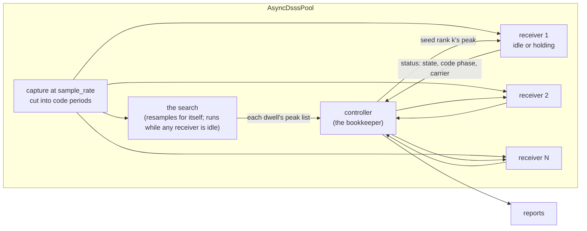

# AsyncDsssReceiver and AsyncDsssPool — continuous DSSS, from spec to object

*`AsyncDsssReceiver` is one C object that searches for a continuous DSSS
emitter, refines the detection, and tracks it until its own lock detectors
say it is gone. `AsyncDsssPool` holds up to ten such signals on one code: N
receivers that refine and track, and **one search, owned by the controller**,
run while any receiver is idle (§5). This page is the design of record for
both: the specification, the CCSDS 415.1-B-1 point with its stimulus and
its one case (§1), the acquisition engine's hand-off (§2), the
asynchronous despreader (§3), the receiver's states, its results at the
specification point, the conclusions, the proposed design, the hypotheses
and the next steps (§4), the pool (§5–§9), the release (§10) and what a
holder reads (§11). Bursts are [`burst-bank.md`](burst-bank.md)'s. The runs
behind the numbers here are
[the measurement record](async-dsss-receiver-measurements.md), under the same
section numbers, and a cost is a [published benchmark](../benchmarks.md)
row.*

______________________________________________________________________

## 1. The specification

The receiver is specified at the forward link of CCSDS 415.1-B-1, the
command channel alone, with no ranging. The rule is the owner's: the
standard rules unless the owner sets otherwise, and no number is picked.
Every row names its source. A row that neither sets is **NOT SET**, and is
not invented.

| quantity                             | value                                                                                                                | source                                                                                     |
| ------------------------------------ | -------------------------------------------------------------------------------------------------------------------- | ------------------------------------------------------------------------------------------ |
| link                                 | forward (network to user), the command (I) channel only                                                              | owner; 415.1-B-1 §4.2                                                                      |
| modulation                           | BPSK: with no range channel, the I channel's parameters apply to BPSK                                                | 415.1-B-1 table 4-1, note 1                                                                |
| carrier suppression                  | 30 dB minimum                                                                                                        | 415.1-B-1 table 4-1                                                                        |
| code                                 | Gold, 2^10 − 1 = 1,023 chips, the generator of figure 4-1, a user-unique initial condition                           | 415.1-B-1 table 4-1, §4.4                                                                  |
| chip rate                            | F_fwd × 31 / (221 × 96)                                                                                              | 415.1-B-1 table 4-1                                                                        |
| chip-rate coherence with the carrier | peak chip-rate error at most 0.01 chips/s, relative to absolute coherence with the carrier rate                      | 415.1-B-1 table 4-2                                                                        |
| data on the code                     | modulo-2 added, asynchronously                                                                                       | 415.1-B-1 table 4-1                                                                        |
| symbol rate                          | 3,000 sym/s; the standard allows 0.1 to 300 ks/s                                                                     | owner: "the use case: 3kbps >= 4dB Es/N0"; the range, 415.1-B-1 table 4-1                  |
| symbol clock                         | within 1 ppm of nominal, on no relation to the code or the carrier; its stability is NOT SET                         | owner: no link standard sets it (415.1, 232.0, 231.0 and 401.0 give no figure)             |
| carrier frequency F_fwd              | 2.2 to 2.8 GHz                                                                                                       | owner                                                                                      |
| chip rate, epoch rate                | 3.2146 to 4.0913 Mcps; 3,142.3 to 3,999.3 Hz                                                                         | derived from the two rows above                                                            |
| frequency uncertainty                | Doppler pre-compensated; the received signal within ±1,500 Hz of best lock                                           | owner-adopted: the owner sets it, taking 415.1-B-1 §7.4.1's figure; pre-compensation, §6.1 |
| frequency rate                       | 400 Hz/s                                                                                                             | owner                                                                                      |
| acquisition                          | short-code PN lock with probability at least 90% within 20 s of arrival, the signal within ±1,500 Hz of best lock    | 415.1-B-1 §7.4.1                                                                           |
| sensitivity floor                    | Es/N0 = 4 dB: C/N0 38.8 dB-Hz; the BPSK bound there is a symbol error rate of 1.25%                                  | owner, the same ruling                                                                     |
| capture                              | complex samples at 11 MSa/s                                                                                          | owner                                                                                      |
| data                                 | the stimulus of §1.4: one CCSDS TC transfer frame a period, 8 to 1,024 octets, with its error control field; no SDLS | owner; 232.0-B-4 §4.1, each field's section in §1.4                                        |
| coding                               | none in this certification; the link will be coded later                                                             | owner                                                                                      |
| between frames                       | all-zero data: code alone, no symbol transitions                                                                     | owner; 415.1-B-1 §6.1                                                                      |

Carrier and code come from one timebase, the chip rate a fixed fraction of
the carrier, and Doppler moves them together; the data clock belongs to
neither (§1.6). The point is one case, a symbol at least a code period
long (§1.5). What the owner has not ruled is §1.7. The receiver's results
at this point are §4.2. A number in §2, §3 or §5–§11 names the point it is
measured at: the certification's 3.069 Mcps point, below, or the pool's
5 Mcps sizing point (§5).

**What the certification covers.** The receiver's
[certification record](https://github.com/doppler-dsp/doppler/blob/v0.83.0/src/doppler/dsss/tests/validation/async_dsss_receiver/results.md)
holds 23 of 23 limits at 3.069 Mcps and 2,700 sym/s, two samples a chip,
on continuous random data with no gap, `carrier_freq_hz` 0, and a search
over ±3 kHz (±1/T_E), and at no other point: not this point's chip rates,
not the gap, and not the coupling of code to carrier (§1.6). The C test
that pins its 5 dB floor, `_test_awgn_esn0_floor`, adds 3 dB less noise
than its label ([#689](https://github.com/doppler-dsp/doppler/issues/689));
at a true 5 dB the receiver does not decode random data
([#3080](https://github.com/doppler-dsp/doppler/issues/3080)).

### 1.1 The signals

M out of N ($\leq 10$) possible signals are on air at once, with at least
differing code phase and carrier phase trajectory. Each may go off air and
be replaced by a new signal at any moment. All share a common, periodic,
simultaneous data-free block lasting many code epochs. **A signal changes
only after a data-free block**: one goes off air, or a new one comes on, at a
frame boundary, never inside a frame.

This is the pool's premise, from the 5 Mcps point (§5). Whether the single
receiver is certified at the 415.1-B-1 point with other emitters of its code
present is open (§1.7).

### 1.2 The sample rate is derived, not chosen

The caller states its capture's `sample_rate` (11 MSa/s here); neither the
receiver nor the pool takes a samples-per-chip. The **search** derives $N$,
the samples in one code period, as the smallest power of two of at least
two samples a chip: 2,048 for a 1,023-chip code, a rate of
$5\,\text{Mcps} \times 2048/1023 = 10.0098$ MSa/s. A search tile is one bin
of the $N$-point transform, $1/T_E$ wide, whatever $N$ is. At the
415.1-B-1 point $N$ is still 2,048, a rate of 6.4354 to 8.1905 MSa/s from
the 11 MSa/s capture across 2.2 to 2.8 GHz.

**Only the search is resampled.** The receiver builds a resampler for its
search and for nothing else (`dp_async_dsss_receiver_create()`), and skips
it when the caller's code period is already a whole number of samples.
Refining and tracking run at the caller's rate, in blocks of
`floor(code_len · sample_rate / chip_rate)` samples, 3,500 at 2.2 GHz and
2,750 at 2.8 GHz, where a code period is 3,500.64 and 2,750.50; the
partials close on the code NCO's phase, so a block need not be a whole
period. A pool has no front end of its own: its one search resamples
inside its own receiver, and every pooled receiver reads the caller's
capture as it arrives (§5).

**Why a power of two.** Every search transform is one code period long. At
two samples a chip that is $2 \times 1023 = 2 \cdot 3 \cdot 11 \cdot 31$,
and pocketfft has no radix-31 or fast radix-11 pass: profiling one dwell of
the one-tile search put about 83% of it in FFT passes and 62% in the
generic radix-31 and the radix-11 passes, and a 2,046-point transform takes
9.89 µs against 1.99 µs at 2,048 (record §9.4). `spc` is removed from
`Acquisition`, `AsyncDsssReceiver` and `AsyncDsssPool`, a breaking change
made before 1.0. The burst objects (`DsssBurstReceiver`, `BurstDemod`)
keep it.

### 1.3 The loop SNR rule

**The code loop and the demodulator's carrier loop are sized to a loop SNR
of at least 20 dB at the floor.** `rho(dB) = Es/N0(dB) − 10·log10(2·bn)`,
with `bn` normalized to the loop's own update rate so the rate cancels. At
the 4 dB floor that asks for `bn ≤ 0.0126`. The Dll ships at `bn` 0.002
(`ASYNC_DSSS_RX_DLL_BN`) and MpskReceiver's carrier loop at 0.01. The code
loop's per-epoch SNR is Es/N0 over `epochs_per_symbol`, 1.05 to 1.33 at
this point (§1.5), inside the same bound. The carrier loop (correction
before despreading, error formed after) is wider, 0.04
(`ASYNC_DSSS_RX_BN_CARRIER`): pull-in and the 400 Hz/s rate set its width,
not jitter. There is no FLL. `bn` does not set the floor: sizing a loop
for steady-state jitter and pulling one in from a coarse estimate are
different problems, and the hand-over of §4.3 answers the second.

### 1.4 The stimulus, one period

The stimulus repeats one period: a gap, an acquisition sequence, a start
sequence, then one CCSDS TC transfer frame of 232.0-B-4 with a data field
of random length. There is no coding and no SDLS.

| part                 | content                                                                                                                | source                                                       |
| -------------------- | ---------------------------------------------------------------------------------------------------------------------- | ------------------------------------------------------------ |
| gap                  | `G` symbols of all-zero data: code alone                                                                               | owner; 415.1-B-1 §6.1                                        |
| acquisition sequence | alternating ones and zeros, 128 bits                                                                                   | 231.0-B-4 §7.2.2 (16 octets is its preferred minimum length) |
| start sequence       | `1110 1011 1001 0000` (EB90), 16 bits, bit 0 first: it marks where the frame starts, so an error count needs no search | 231.0-B-4 §5.2.2.2                                           |
| transfer frame       | a 5-octet primary header, a data field of 1 to 1,017 octets, a 2-octet error control field: 8 to 1,024 octets in all   | owner; 232.0-B-4 §4.1.1, the fields below                    |

The frame, field by field, in transmission order:

| field                      | bits       | value in the stimulus                                                                | source                                      |
| -------------------------- | ---------- | ------------------------------------------------------------------------------------ | ------------------------------------------- |
| transfer frame version     | 2          | `00`                                                                                 | 232.0-B-4 §4.1.2.2.2                        |
| bypass flag                | 1          | `1`, Type-B \*                                                                       | 232.0-B-4 §4.1.2.3.1                        |
| control command flag       | 1          | `0`, Type-D: the data field is a frame data unit \*                                  | 232.0-B-4 §4.1.2.3.2, table 4-1 (Type-BD)   |
| reserved spare             | 2          | `00`                                                                                 | 232.0-B-4 §4.1.2.4.2                        |
| spacecraft identifier      | 10         | 42 \*                                                                                | 232.0-B-4 §4.1.2.5                          |
| virtual channel identifier | 6          | 1 \*                                                                                 | 232.0-B-4 §4.1.2.6                          |
| frame length               | 10         | the frame's total octets minus one: 7 to 1,023                                       | 232.0-B-4 §4.1.2.7.2, §4.1.2.7.3            |
| frame sequence number      | 8          | 0 * (the value the COP sets on a Type-B frame)                                       | 232.0-B-4 §4.1.2.8, note 3                  |
| data field                 | 8 to 8,136 | random octets, a whole number drawn per frame from 1 to 1,017; no segment header     | owner; 232.0-B-4 §4.1.3.1.2, §4.1.3.2.2.1.2 |
| frame error control (FECF) | 16         | CRC over the header and data field, G(X) = X^16 + X^12 + X^5 + 1, preset to all ones | 232.0-B-4 §4.1.4.1.2, §4.1.4.2              |

\* Arbitrary stimulus content, not the specification: a receiver at this
point makes no use of the field, and any value would do.

**The 1,024-octet maximum is normative from three sections**, not from the
frame-length field: a 5-octet header (§4.1.1), a data field of at most 1,017
octets when the error control field is present (§4.1.3.1.2), and that field's
2 octets (§4.1.4.1.2). §4.1.2.7's note 2 says the 10-bit length field limits
a frame to 1,024 octets; it is a note, and it agrees. The minimum, 1 octet of
data, is the smallest whole number the mandatory data field can hold
(§4.1.1 b, §4.1.3.1.2).

Dropped from 231.0-B-4's coding layer: the BCH codeblocks, the tail
sequence and the randomizer. A frame of 64 to 8,192 bits lasts 21 ms to
2.73 s at 3,000 sym/s.

**The gap is twice what the search needs.** The need is the search model's,
read from the receiver's own search sizing at the worst corner: the 2.2 GHz
end, a design C/N0 of 36.34 dB-Hz (the 4 dB floor, 38.77 dB-Hz, less the
edge's 2.43 dB of loss beyond the band average), 400 Hz/s, Pd 0.999 at the
as-built `pfa` of 1e-3, and the whole dwell inside the gap wherever it
starts, a gap of at least 2·K·D − 1 epochs
([#3082](https://github.com/doppler-dsp/doppler/issues/3082)):

| D   | K   | the need            | twice it, the gap G              |
| --- | --- | ------------------- | -------------------------------- |
| 72  | 1   | 144 epochs, 45.8 ms | 288 epochs, 91.7 ms, 275 symbols |

These are the model's numbers, not a detection measured at the band edge,
and the gap's length is open (§1.7). The search does not hold its dwell
`K·D` inside a gap (#3082).

**72 is the model's need, not the depth the search runs.** Given this gap
the engine takes the deepest block §2.1's rule allows, which here is the
400 Hz/s drift bound: `coherent_bins` reads 108 at 2.2 GHz and 140 at
2.8 GHz, with one look (`n_noncoh` 1), a dwell of 34.4 and 35.0 ms. A whole
block of that depth lands inside the gap wherever it starts once the gap
holds 2·D − 1 code periods, 215 and 279; the 275-symbol gap holds 287 and
365 whole ones. So the gap holds one whole block at the depth run, and is
twice the need only at the model's depth.

**It is built from shipped tools.** Each frame is one `FrameDesc`: the
header and data field by `add_field`, the error control field by
`add_derived` and `add_stage_over(STAGE_CRC16, "header", "fecf")`.
`FrameDesc` has no stage that fills a length count, so the frame-length
field cannot be a derived field; it needs none, because each description
is one frame of one known length, and the caller writes the count into the
header's bits. Checked against main's build at 1, 17 and 1,017 data
octets: the length field reads the total minus one, the FECF matches
232.0-B-4 §4.1.4.2 computed independently, and `crc_ok()` passes.
`FrameDesc` does not bound the data field at 1,017 octets; the stimulus
does. The frame door assembles each period as a bit stream, a continuous
DSSS source takes that stream as its `data=`, the composer's Doppler
channel moves it, and a `RateConverter` takes it to 11 MSa/s. Two
shorter spellings drop a part without saying so: `frame=` on a continuous
DSSS source
([#3083](https://github.com/doppler-dsp/doppler/issues/3083)), and
`Synth.steps()`, which skips the Doppler channel
([#3091](https://github.com/doppler-dsp/doppler/issues/3091)).

### 1.5 The case: a symbol is at least a code period

One ratio sets the physics: the epochs a symbol spans, `E = Re / Rs`, the
epoch rate over the symbol rate. At 3,000 sym/s, across 2.2 to 2.8 GHz,
from the standard's chip rate:

|                                         | 2.2 GHz                                                                                                 | 2.8 GHz  |
| --------------------------------------- | ------------------------------------------------------------------------------------------------------- | -------- |
| epochs a symbol                         | 1.047: a symbol spans more than an epoch                                                                | 1.333    |
| symbol boundaries an epoch              | 0.95: at most one                                                                                       | 0.75     |
| one epoch's correlation in data         | full with no transition in it; with one at fraction f, reduced by the factor 2f − 1 in magnitude (§3.2) | the same |
| partials a symbol at `K` = 4, `P = K·E` | 4.2                                                                                                     | 5.3      |
| 500 symbols, in epochs                  | 524                                                                                                     | 667      |

The floor's C/N0 is 38.8 dB-Hz at both carriers.

What follows, by reasoning:

- **An epoch holds at most one transition**, so a code-period window that
    avoids it is always available: the look-back (§3.6) finds one. The
    carrier detector §4.4 proposes rests on that, and holds only while a
    symbol is at least a code period, which is the case here.
- **2.2 GHz is the near-one end.** A symbol is 1.047 epochs, so
    the symbol boundary creeps through the epoch at the difference of the
    two rates, 142 Hz: almost every epoch holds a transition, and where it
    falls moves slowly.
- **Symbol timing.** The timing detector must hold through the gap,
    hundreds of symbols with no transition. As built it is Gardner, in
    `MpskReceiver`; the DTTL ties with it (§4.2,
    [PR #3087](https://github.com/doppler-dsp/doppler/pull/3087)).

**The edge of the search's roll.** ±1,500 Hz is inside one epoch's span,
`±1/(2·T_E)`, at both carrier ends, so the search runs one roll (§2.3).
Two things follow, from the code's formulas:

- **The edge's loss.** One roll de-rotates at 0 Hz, so a signal at offset
    `f` loses `sinc(f / Re)` in every epoch: 3.5 dB at ±1,500 Hz at 2.2 GHz
    and 2.1 dB at 2.8 GHz. The search's predicted Pd charges the loss
    averaged over the band, not the edge's.
- **The fold.** One roll's Doppler axis repeats every epoch rate. At
    2.2 GHz the band edge is 71 Hz inside the fold (500 Hz at 2.8 GHz), so a
    signal near the edge can be reported one epoch rate away, and a one-roll
    search cannot tell which side it came from. That error is far outside
    the carrier loop's pull-in.

**Above one symbol a code period**, a symbol rate over the epoch rate
(3,142 to 3,999 sym/s across the band), no code-period window is free of a
transition, and the code loop's symbol-scale look shrinks toward one
partial. `create()` accepts such a rate (the chain asks only that the
symbol rate not exceed the chip rate), `steps_max_out()` is not a bound
there ([#2469](https://github.com/doppler-dsp/doppler/issues/2469)), and
the `code_period` carrier window of §4.4 is refused or warned there.

### 1.6 Code and carrier are coherent; the data is not

The coherency is two statements:

- **Carrier and code come from one timebase.** The chip rate is the carrier
    times 31 / 21,216 (415.1-B-1 table 4-1), so code Doppler is carrier
    Doppler times 31 / 21,216, exactly: ±1,500 Hz is ±2.19 chips/s at any
    carrier. The channel dilates everything it carries by one factor.
- **The data clock is not part of that timebase.** It has no phase relation
    to the code and no fixed rate ratio to it; its rate is whatever its own
    source gives, within 1 ppm of nominal (§1). The receiver may assume
    nothing about symbol timing from the code or the carrier, before or
    after Doppler, so the symbol timing loop is the only thing that knows
    the data clock, and it acquires and holds it with no aid.

415.1-B-1 §2.1 offers BPSK for the forward data "when RF and PN coherency
is not required". That coherency is the turn-around kind, for ranging,
which this point does not do: §1's link is DSSS BPSK with no ranging. It
does not release the chip rate from table 4-1's
ratio or from table 4-2's 0.01 chips/s, and §1's row stands as written.

The receiver as built models the first as coherent at the source and
dilated in flight. The code-rate offset is `chip_rate · fd / fc` wherever it
is used: the search's hand-off phase (§2.2), the hand-over and both code
loops. The tracking code loop is aided every code period from the tracked
carrier (§4.1); the refine's code loop gets a one-time aid from the seed.
The model does not depend on the chip rate being on the standard's ratio,
and nothing checks that it is. With `carrier_freq_hz` 0 all of it is off,
and the certification runs with it off (§1), so the coupling is not
certified. The library's Doppler channel dilates the whole stream by one
factor (code, data symbols and the gap) and offsets the carrier to match:
the same model. It cannot render a source whose code clock is off its
carrier, so table 4-2's 0.01 chips/s has no stimulus.

### 1.7 Open decisions

Not ruled by the owner, and not decided here:

1. **Where Es/N0 is defined**: at the source, or in the capture. The
    11 MSa/s capture reads 0.06 to 0.17 dB under the source's, mostly from
    its bandwidth; §4.2's runs set it at the source.
1. **How ±1,500 Hz and 400 Hz/s combine**: a linear ramp through the band,
    or a pass profile. §4.2's runs use both edges static, sweeps from one
    edge to the other at 400 Hz/s, and ramps from 0 Hz.
1. **The gap's length.** Twice the search model's need (§1.4) is the rule
    proposed, not ruled.
1. **Keeping the EB90 start sequence** (§1.4).
1. **`reacquire` as the default.** It is off as built; at this point a lock
    on the wrong Doppler never releases without it
    ([#3092](https://github.com/doppler-dsp/doppler/issues/3092)).
1. **The knob names** of §4.4.
1. **What must hold at the floor**: the allowed loss against the BPSK bound,
    and how soon after arrival the receiver must be decoding.
1. **Whether the link resolves half-cycle flips** (differential coding, or
    a phase-resolving word) or the carrier loop must not flip
    ([#3090](https://github.com/doppler-dsp/doppler/issues/3090)). The
    detector of §4.4 cuts them from 146 to 8 at the floor; it does not
    remove them.
1. **Alone or in company**: whether the single receiver is certified with
    other emitters of its code present, or alone, with company left to the
    pool.
1. **Whether the uncompensated ±50 kHz** of the 5 Mcps point stays a case
    for the single receiver.
1. **The data clock's stability**: how fast it may wander inside its 1 ppm.
1. **The stages with no certification on record.** The
    [validation log](../dev/contributing/validation-log.md) has no record
    for the code loop (`Dll`), the carrier loop, the Doppler refine
    (`CarrierAcquisition`) or `RateConverter`. Whether each is certified
    before the receiver is a decision of its own.

### 1.3 The loop SNR rule

**The code loop and the demodulator's carrier loop are sized to a loop SNR
of at least 20 dB at the floor.** `rho(dB) = Es/N0(dB) − 10·log10(2·bn)`,
with `bn` normalized to the loop's own update rate so the rate cancels. At
the 4 dB floor that asks for `bn ≤ 0.0126`. The Dll ships at `bn` 0.002
(`ASYNC_DSSS_RX_DLL_BN`) and MpskReceiver's carrier loop at 0.01. The code
loop's per-epoch SNR is Es/N0 over `epochs_per_symbol`, 1.05 to 1.33 at
this point (§1.5), inside the same bound. The carrier loop (correction
before despreading, error formed after) is wider, 0.04
(`ASYNC_DSSS_RX_BN_CARRIER`): pull-in and the 400 Hz/s rate set its width,
not jitter. There is no FLL. `bn` does not set the floor: sizing a loop
for steady-state jitter and pulling one in from a coarse estimate are
different problems, and the hand-over of §4.3 answers the second.

### 1.4 The stimulus, one period

The stimulus repeats one period: a gap, an acquisition sequence, a start
sequence, then one CCSDS TC transfer frame of 232.0-B-4 with a data field
of random length. There is no coding and no SDLS.

| part                 | content                                                                                                                | source                                                       |
| -------------------- | ---------------------------------------------------------------------------------------------------------------------- | ------------------------------------------------------------ |
| gap                  | `G` symbols of all-zero data: code alone                                                                               | owner; 415.1-B-1 §6.1                                        |
| acquisition sequence | alternating ones and zeros, 128 bits                                                                                   | 231.0-B-4 §7.2.2 (16 octets is its preferred minimum length) |
| start sequence       | `1110 1011 1001 0000` (EB90), 16 bits, bit 0 first: it marks where the frame starts, so an error count needs no search | 231.0-B-4 §5.2.2.2                                           |
| transfer frame       | a 5-octet primary header, a data field of 1 to 1,017 octets, a 2-octet error control field: 8 to 1,024 octets in all   | owner; 232.0-B-4 §4.1.1, the fields below                    |

The frame, field by field, in transmission order:

| field                      | bits       | value in the stimulus                                                                | source                                      |
| -------------------------- | ---------- | ------------------------------------------------------------------------------------ | ------------------------------------------- |
| transfer frame version     | 2          | `00`                                                                                 | 232.0-B-4 §4.1.2.2.2                        |
| bypass flag                | 1          | `1`, Type-B \*                                                                       | 232.0-B-4 §4.1.2.3.1                        |
| control command flag       | 1          | `0`, Type-D: the data field is a frame data unit \*                                  | 232.0-B-4 §4.1.2.3.2, table 4-1 (Type-BD)   |
| reserved spare             | 2          | `00`                                                                                 | 232.0-B-4 §4.1.2.4.2                        |
| spacecraft identifier      | 10         | 42 \*                                                                                | 232.0-B-4 §4.1.2.5                          |
| virtual channel identifier | 6          | 1 \*                                                                                 | 232.0-B-4 §4.1.2.6                          |
| frame length               | 10         | the frame's total octets minus one: 7 to 1,023                                       | 232.0-B-4 §4.1.2.7.2, §4.1.2.7.3            |
| frame sequence number      | 8          | 0 * (the value the COP sets on a Type-B frame)                                       | 232.0-B-4 §4.1.2.8, note 3                  |
| data field                 | 8 to 8,136 | random octets, a whole number drawn per frame from 1 to 1,017; no segment header     | owner; 232.0-B-4 §4.1.3.1.2, §4.1.3.2.2.1.2 |
| frame error control (FECF) | 16         | CRC over the header and data field, G(X) = X^16 + X^12 + X^5 + 1, preset to all ones | 232.0-B-4 §4.1.4.1.2, §4.1.4.2              |

\* Arbitrary stimulus content, not the specification: a receiver at this
point makes no use of the field, and any value would do.

**The 1,024-octet maximum is normative from three sections**, not from the
frame-length field: a 5-octet header (§4.1.1), a data field of at most 1,017
octets when the error control field is present (§4.1.3.1.2), and that field's
2 octets (§4.1.4.1.2). §4.1.2.7's note 2 says the 10-bit length field limits
a frame to 1,024 octets; it is a note, and it agrees. The minimum, 1 octet of
data, is the smallest whole number the mandatory data field can hold
(§4.1.1 b, §4.1.3.1.2).

Dropped from 231.0-B-4's coding layer: the BCH codeblocks, the tail
sequence and the randomizer. A frame of 64 to 8,192 bits lasts 21 ms to
2.73 s at 3,000 sym/s.

**The gap is twice what the search needs.** The need is the search model's,
read from the receiver's own search sizing at the worst corner: the 2.2 GHz
end, a design C/N0 of 36.34 dB-Hz (the 4 dB floor, 38.77 dB-Hz, less the
edge's 2.43 dB of loss beyond the band average), 400 Hz/s, Pd 0.999 at the
as-built `pfa` of 1e-3, and the whole dwell inside the gap wherever it
starts, a gap of at least 2·K·D − 1 epochs
([#3082](https://github.com/doppler-dsp/doppler/issues/3082)):

| D   | K   | the need            | twice it, the gap G              |
| --- | --- | ------------------- | -------------------------------- |
| 72  | 1   | 144 epochs, 45.8 ms | 288 epochs, 91.7 ms, 275 symbols |

These are the model's numbers, not a detection measured at the band edge,
and the gap's length is open (§1.7). The search does not hold its dwell
`K·D` inside a gap (#3082).

**72 is the model's need, not the depth the search runs.** Given this gap
the engine takes the deepest block §2.1's rule allows, which here is the
400 Hz/s drift bound: `coherent_bins` reads 108 at 2.2 GHz and 140 at
2.8 GHz, with one look (`n_noncoh` 1), a dwell of 34.4 and 35.0 ms. A whole
block of that depth lands inside the gap wherever it starts once the gap
holds 2·D − 1 code periods, 215 and 279; the 275-symbol gap holds 287 and
365 whole ones. So the gap holds one whole block at the depth run, and is
twice the need only at the model's depth.

**It is built from shipped tools.** Each frame is one `FrameDesc`: the
header and data field by `add_field`, the error control field by
`add_derived` and `add_stage_over(STAGE_CRC16, "header", "fecf")`.
`FrameDesc` has no stage that fills a length count, so the frame-length
field cannot be a derived field; it needs none, because each description
is one frame of one known length, and the caller writes the count into the
header's bits. Checked against main's build at 1, 17 and 1,017 data
octets: the length field reads the total minus one, the FECF matches
232.0-B-4 §4.1.4.2 computed independently, and `crc_ok()` passes.
`FrameDesc` does not bound the data field at 1,017 octets; the stimulus
does. The frame door assembles each period as a bit stream, a continuous
DSSS source takes that stream as its `data=`, the composer's Doppler
channel moves it, and a `RateConverter` takes it to 11 MSa/s. Two
shorter spellings drop a part without saying so: `frame=` on a continuous
DSSS source
([#3083](https://github.com/doppler-dsp/doppler/issues/3083)), and
`Synth.steps()`, which skips the Doppler channel
([#3091](https://github.com/doppler-dsp/doppler/issues/3091)).

### 1.5 The case: a symbol is at least a code period

One ratio sets the physics: the epochs a symbol spans, `E = Re / Rs`, the
epoch rate over the symbol rate. At 3,000 sym/s, across 2.2 to 2.8 GHz,
from the standard's chip rate:

|                                         | 2.2 GHz                                                                                                 | 2.8 GHz  |
| --------------------------------------- | ------------------------------------------------------------------------------------------------------- | -------- |
| epochs a symbol                         | 1.047: a symbol spans more than an epoch                                                                | 1.333    |
| symbol boundaries an epoch              | 0.95: at most one                                                                                       | 0.75     |
| one epoch's correlation in data         | full with no transition in it; with one at fraction f, reduced by the factor 2f − 1 in magnitude (§3.2) | the same |
| partials a symbol at `K` = 4, `P = K·E` | 4.2                                                                                                     | 5.3      |
| 500 symbols, in epochs                  | 524                                                                                                     | 667      |

The floor's C/N0 is 38.8 dB-Hz at both carriers.

What follows, by reasoning:

- **An epoch holds at most one transition**, so a code-period window that
    avoids it is always available: the look-back (§3.6) finds one. The
    carrier detector §4.4 proposes rests on that, and holds only while a
    symbol is at least a code period, which is the case here.
- **2.2 GHz is the near-one end.** A symbol is 1.047 epochs, so
    the symbol boundary creeps through the epoch at the difference of the
    two rates, 142 Hz: almost every epoch holds a transition, and where it
    falls moves slowly.
- **Symbol timing.** The timing detector must hold through the gap,
    hundreds of symbols with no transition. As built it is Gardner, in
    `MpskReceiver`; the DTTL ties with it (§4.2,
    [PR #3087](https://github.com/doppler-dsp/doppler/pull/3087)).

**The edge of the search's roll.** ±1,500 Hz is inside one epoch's span,
`±1/(2·T_E)`, at both carrier ends, so the search runs one roll (§2.3).
Two things follow, from the code's formulas:

- **The edge's loss.** One roll de-rotates at 0 Hz, so a signal at offset
    `f` loses `sinc(f / Re)` in every epoch: 3.5 dB at ±1,500 Hz at 2.2 GHz
    and 2.1 dB at 2.8 GHz. The search's predicted Pd charges the loss
    averaged over the band, not the edge's.
- **The fold.** One roll's Doppler axis repeats every epoch rate. At
    2.2 GHz the band edge is 71 Hz inside the fold (500 Hz at 2.8 GHz), so a
    signal near the edge can be reported one epoch rate away, and a one-roll
    search cannot tell which side it came from. That error is far outside
    the carrier loop's pull-in.

**Above one symbol a code period**, a symbol rate over the epoch rate
(3,142 to 3,999 sym/s across the band), no code-period window is free of a
transition, and the code loop's symbol-scale look shrinks toward one
partial. `create()` accepts such a rate (the chain asks only that the
symbol rate not exceed the chip rate), `steps_max_out()` is not a bound
there ([#2469](https://github.com/doppler-dsp/doppler/issues/2469)), and
the `code_period` carrier window proposed in §4.4 has to be refused or
warned there.

### 1.6 Code and carrier are coherent; the data is not

The coherency is two statements:

- **Carrier and code come from one timebase.** The chip rate is the carrier
    times 31 / 21,216 (415.1-B-1 table 4-1), so code Doppler is carrier
    Doppler times 31 / 21,216, exactly: ±1,500 Hz is ±2.19 chips/s at any
    carrier. The channel dilates everything it carries by one factor.
- **The data clock is not part of that timebase.** It has no phase relation
    to the code and no fixed rate ratio to it; its rate is whatever its own
    source gives, within 1 ppm of nominal (§1). The receiver may assume
    nothing about symbol timing from the code or the carrier, before or
    after Doppler, so the symbol timing loop is the only thing that knows
    the data clock, and it acquires and holds it with no aid.

415.1-B-1 §2.1 offers BPSK for the forward data "when RF and PN coherency
is not required". That coherency is the turn-around kind, for ranging,
which this point does not do: §1's link is DSSS BPSK with no ranging. It
does not release the chip rate from table 4-1's
ratio or from table 4-2's 0.01 chips/s, and §1's row stands as written.

The receiver as built models the first as coherent at the source and
dilated in flight. The code-rate offset is `chip_rate · fd / fc` wherever it
is used: the search's hand-off phase (§2.2), the hand-over and both code
loops. The tracking code loop is aided every code period from the tracked
carrier (§4.1); the refine's code loop gets a one-time aid from the seed.
The model does not depend on the chip rate being on the standard's ratio,
and nothing checks that it is. With `carrier_freq_hz` 0 all of it is off,
and the certification runs with it off (§1), so the coupling is not
certified. The library's Doppler channel dilates the whole stream by one
factor (code, data symbols and the gap) and offsets the carrier to match:
the same model. It cannot render a source whose code clock is off its
carrier, so table 4-2's 0.01 chips/s has no stimulus.

### 1.7 Open decisions

Not ruled by the owner, and not decided here:

1. **Where Es/N0 is defined**: at the source, or in the capture. The
    11 MSa/s capture reads 0.06 to 0.17 dB under the source's, mostly from
    its bandwidth; §4.2's runs set it at the source.
1. **How ±1,500 Hz and 400 Hz/s combine**: a linear ramp through the band,
    or a pass profile. §4.2's runs use both edges static, sweeps from one
    edge to the other at 400 Hz/s, and ramps from 0 Hz.
1. **The gap's length.** Twice the search model's need (§1.4) is the rule
    proposed, not ruled.
1. **Keeping the EB90 start sequence** (§1.4).
1. **`reacquire` as the default.** It is off as built; at this point a lock
    on the wrong Doppler never releases without it
    ([#3092](https://github.com/doppler-dsp/doppler/issues/3092)).
1. **The knob names** of §4.4.
1. **What must hold at the floor**: the allowed loss against the BPSK bound,
    and how soon after arrival the receiver must be decoding.
1. **Whether the link resolves half-cycle flips** (differential coding, or
    a phase-resolving word) or the carrier loop must not flip
    ([#3090](https://github.com/doppler-dsp/doppler/issues/3090)). The
    detector of §4.4 cuts them from 146 to 8 at the floor; it does not
    remove them.
1. **Alone or in company**: whether the single receiver is certified with
    other emitters of its code present, or alone, with company left to the
    pool.
1. **Whether the uncompensated ±50 kHz** of the 5 Mcps point stays a case
    for the single receiver.
1. **The data clock's stability**: how fast it may wander inside its 1 ppm.
1. **The stages with no certification on record.** The
    [validation log](../dev/contributing/validation-log.md) has no record
    for the code loop (`Dll`), the carrier loop, the Doppler refine
    (`CarrierAcquisition`) or `RateConverter`. Whether each is certified
    before the receiver is a decision of its own.

______________________________________________________________________

## 2. Acquisition

### 2.1 Two searches, one engine

The continuous and burst searches are two flavors of one Python class,
`Correlator`, picked by `framing="continuous"` or `framing="burst"`, over
one `dp_correlator_state_t`
(`native/inc/doppler/correlator/correlator_core.h`). Until #2752 step 4
they were two public constructors, `Acquisition` and `BurstAcquisition`;
the one class refuses a knob its flavor would not honor instead of
carrying "ignored here" caveats
([the correlator's constructor](correlator.md#3-one-constructor)). State, auto-sizing,
`push()` and serialization are shared. The continuous search takes the code
(as NRZ chips), `sample_rate`, `chip_rate`, `symbol_rate`, a design
`cn0_dbhz`, a one-sided `doppler_uncertainty`, `pfa`, `pd`, a CFAR
`noise_mode`, and the two inputs that size its coherent depth, `code_only_epochs` and `doppler_rate`.
Everything else it derives; there is no `doppler_resolution` and no
`max_noncoh`.

**`doppler_bins` is the whole Doppler grid** a hit's `doppler_bin` indexes:
the coherent depth `coherent_bins` times the frequency windows the engine
rolls one epoch's spectrum across when the uncertainty is wider than one
epoch's span ([`acq-surface.md`](acq-surface.md) §3).
Non-coherent looks are a separate axis. On the continuous door `n_noncoh`
is auto-selected to meet `pd` at `pfa` and read-only, bounded only by a
safety valve (`DP_CORRELATOR_N_NONCOH_SAFETY_CEILING`, 256 looks) because the
semi-analytical `pd_predicted` model turns non-monotonic past it. A burst
engine never adds looks: it sizes on the burst and reports `underpowered`.

**Two inputs size the coherent depth `D`: `code_only_epochs` and
`doppler_rate`.** It is the smaller of `⌊(code_only_epochs + 1)/2⌋`, so a
whole block always fits inside the pure-code window, and
`f_epoch/√(2·doppler_rate)`, which is `f_epoch/√1000` at 500 Hz/s and
`f_epoch/√800` at the 415.1-B-1 point's 400 Hz/s, so the
drift over one block stays inside half a slow-time bin, rounded down to a
7-smooth length (`dp_fft_smooth_floor()`): `D` is a slow-time FFT length,
and a prime factor of 13 or more costs the FFT its slow path, so 94 epochs
run as 90. `code_only_epochs`
counts the **whole** epochs a window holds at any chip phase: the window is
`W` symbols on the data clock, with no fixed relation to the code clock, so
a partial epoch is lost at each edge and
`code_only_epochs = ⌊W · cps / L⌋ − 1`. It defaults to 1, which is `D = 1`:
the epoch-by-epoch search. `AsyncDsssReceiver` takes the window as a time,
`code_only_s`, and derives `code_only_epochs` from it (§2.3).

### 2.2 A detection is a physical record, never a grid index

`dp_correlator_handoff_t` (`native/inc/doppler/correlator/correlator_core.h`) is the data; the
*hand-off* is the action that turns a raw `push()` hit into it and gives it
to the next stage. The record crosses a thread or process boundary, so it
cannot be the grid-relative `(doppler_bin, code_phase)`, which mean nothing
without also shipping the emitting engine's `spc` and `doppler_res_hz`.
Every field is in a physical unit and the record is a flat, pointer-free
POD. `dp_correlator_build_handoff()` builds one from each hit of a continuous
engine. `AsyncDsssReceiver`'s `seed()` takes three of its fields,
`chip_phase`, `doppler_hz_est` and `cn0_dbhz_est`, and the receiver's own
hit takes that same path. A hit whose Doppler is at or past half the sample
rate is outside the seed domain (`dp_async_dsss_receiver_seed_ok()`): it is
refused as a seed and counted in `refused_hits`, and the search goes on.

| Field              | Type       | Description                                                                                      |
| ------------------ | ---------- | ------------------------------------------------------------------------------------------------ |
| `samples_consumed` | `uint64_t` | Sample offset since this engine's stream start that the detection's epoch ended at — replay-safe |
| `chip_phase`       | `double`   | Code phase in CHIPS, the code-tracking seed for the next stage                                   |
| `doppler_hz_est`   | `double`   | Coarse Doppler in Hz, already folded, signed and scaled from the raw bin index                   |
| `doppler_res_hz`   | `double`   | Width of that estimate — the ±`doppler_res_hz`/2 a refine or tracking stage still has to close   |
| `cn0_dbhz_est`     | `double`   | C/N0 estimate, dB-Hz — sizes downstream loop bandwidth and dwell                                 |
| `peak_mag`         | `float`    | Raw CFAR peak magnitude — observability passthrough                                              |
| `noise_est`        | `float`    | Raw CFAR noise-floor estimate — observability passthrough                                        |
| `test_stat`        | `float`    | Raw CFAR gating statistic — observability passthrough                                            |

**The record carries no timestamp.** The engines are pure sample-domain,
with no I/O; whatever feeds them samples owns the clock and stamps a record
at its `samples_consumed` (§11.3). The field list is the header's own.

**`chip_phase` is where the code will be, not where it was.** A hit is
decided at its dwell's end and the seed is wanted at the next sample, so
`dp_correlator_build_handoff()` advances the phase by the drift over half the
dwell on the hit's own Doppler. **Neither constructor takes a
`carrier_freq`**: the engine works in baseband Doppler Hz, and a
baseband-only caller never has to name one. A caller that knows the carrier
tells the engine afterwards (`dp_correlator_set_carrier_freq_hz()` /
`set_carrier_freq_hz`), which turns on that advance and, inside a coherent
block of `D > 1` epochs, aligns the block's epochs on the dilated code
clock. `AsyncDsssReceiver` passes its own `carrier_freq_hz` on.

### 2.3 The receiver's search: a slow-time depth from the code-only window, dwells on the shared sample count

**The receiver's search** is the continuous door, sized from two physical
create parameters: `code_only_s`, the code-only window in seconds, which
the receiver turns into `code_only_epochs = ⌊code_only_s · chip_rate / L⌋ − 1`, and `doppler_rate` in Hz/s, passed through. Both default to 0, which is
`D = 1`: one-epoch looks over its one-sided `doppler_uncertainty`. The
depth it runs is the read-only `coherent_bins`. `n_noncoh` is sized to `pd`
at `pfa` for its `cn0_dbhz`. The engine reports up to 16 peaks a dwell
(`max_peaks`); the receiver drops those within a chip of an excluded code
phase (`set_exclusions()`) or of a stronger peak, and takes the survivor at
its rank (`set_rank()`, 0 = the strongest, the default), or nothing that
dwell. With no exclusions at rank 0 that is the one-peak detector's pick.
An uncertainty wider than one epoch's span, `±1/(2·T_E)`,
is covered by the engine's roll across frequency windows, which it fans
across its tiles' worth of online cores unless `set_threads()` says
otherwise; a pool's one search takes the pool's own thread count (§5).
The search is
bit-identical at any thread count. What
searching costs is §9.

**Every dwell starts on the block grid of the receiver's own input count.**
The receiver counts every sample fed since create; in a pool the one search
counts the pool's samples the same way. A search restarted by `reset()`, a release, a refused hand-over or
`configure_search_raw()` first discards input up to the next multiple of
`D · N` samples, at most one block (30 ms at `D = 90`), so searchers
re-armed at different times still decide on the same blocks. The count and
the alignment owed travel in the state blob. At `D = 1` the grid is one
code epoch.

**The slow-time depth `D > 1` is safe only inside a pure-code window.**
Coherent combining across data aliases the data's own spectrum across the
Doppler axis and mislocks structurally
([`acq-surface.md`](acq-surface.md) §9). Inside a window of code
alone there is nothing to alias. The engine does not know any emitter's
window phase, so it sums **non-overlapping blocks of `D` epochs**, one
coherent surface per block, detected per block. A whole block always lands
inside a window once `W ≥ 2D − 1`, and `⌊W/D⌋` land in a row for
`n_noncoh` to accumulate. A `D`-point slow-time FFT at the epoch rate
subdivides one epoch's span into `D` rows; it never widens it. At the
earlier 3.069 Mcps geometry a 450-symbol code-only window holds 499 whole
epochs, and the 500 Hz/s bound gives 94, which the engine runs at the
7-smooth `D = 90` (a slow-time FFT length, #1247): a 33.3 Hz row and 19.5 dB
of coherent gain. A block that straddles data spreads its emitter over the `D`
rows, about `10·log10 D` down **at its own code phase**: a weaker copy, not
a mislock. Pinned by `native/validation/acq_block_coherent.c`. The receiver
runs this depth when given its window: at 32 dB-Hz, `D = 90` finds a signal
inside one 170-symbol window that `D = 1`, needing 256 looks, cannot decide
there (`test_async_dsss_receiver_core.c`,
`_test_depth_finds_what_one_epoch_misses`).

**At the 415.1-B-1 point** the 275-symbol gap and 400 Hz/s give
`coherent_bins` 108 at 2.2 GHz and 140 at 2.8 GHz (the drift bound's 111
and 141, 7-smooth), one look, and one frequency window, since ±1,500 Hz is
inside one epoch's span. A row is 29.1 and 28.6 Hz, and the surface the
peak is picked on is interpolated to twice that density
(`DP_CORRELATOR_DOPPLER_INTERP`). A block's Doppler is its mean over the
block, so at the block's end it is half a dwell old, about 17 ms: 7 Hz at
400 Hz/s. That is what a hit hands on: within half a row, 14.5 Hz, of a
value 7 Hz stale, against the carrier loop's pull-in of 63 to 80 Hz (§4.2
measures the hand-over at −0 ± 10 Hz).

**The engine's windowing ships.** Its roll of one epoch's spectrum across
frequency windows, the alias check a pick near a window's edge gets
(`search_resolve_tile_alias`), and the roll per thread on persistent workers
are current engine behavior, and the pool's search runs on them. Their design text is §2.3 at
[`4a4c437d0`](https://github.com/doppler-dsp/doppler/blob/4a4c437d0/docs/design/async-dsss-receiver.md)
until it moves to [`acq-surface.md`](acq-surface.md)
([#2500](https://github.com/doppler-dsp/doppler/issues/2500)).

### 2.4 The searcher is watched, not trusted

A hit says where a peak was and nothing about what else stood on the
surface, how close the gate came on the dwells that fired nothing, or
whether one emitter's splatter was about to be listed as two. So the engine
carries its own instruments, attach-on-demand: detached, a decided dwell
costs three predicted-not-taken branches, and nothing rides in a state
blob. `AsyncDsssReceiver.set_telemetry` forwards them as `<prefix>.acq`.

- **Ten probes per decided dwell**, `set_telemetry(tlm, prefix, decim)`:
    the test statistic and the gate it was held to (plotted together they
    show where a hit fired and how close the misses came), the CFAR
    reference, the strongest cell's value and its native row and column,
    the picks in the dwell and how many were held as same-code-phase twins,
    the strongest pick's concentration, and whether the gate fired.
- **The surface and the complex intermediates under it.** `keep_surface`
    then `surface(out)` gives every cell divided by the reference the gate
    used, so a cell reads as its own test statistic and the gate is a flat
    plane on a plot, with `surface_doppler_hz()`/`surface_chip_phase()` as
    its axes, from the same mapping an `dp_correlator_handoff_t` carries.
    `dp_correlator_set_surface_sink(fn, ctx, decim)` hands every `decim`-th
    dwell's surface to a callback on the pushing thread. Underneath,
    `surface_complex(out)` is the coherent dump the last dwell was decided
    on, `block_prompt(tile, col, out)` one cell's `D` per-epoch correlations
    (the despread stream at epoch rate), and `block_raw(out)` the block's
    epochs as pushed, for a re-correlation at any phase, rate or symbol
    boundary the grid lacks.
- **The concentration is the splatter discriminator.** One emitter does
    not make one peak, and every extra copy sits at its **own code phase**,
    while a second emitter is a second column. So the probe is the
    strongest pick's main-lobe power (its row and one either side, the
    exclusion zone's width) over the total power of its whole column: near
    1 for one clean emitter, about 0.5 when a data transition splits it
    into twins at other Doppler, lower for a block that straddles data.

______________________________________________________________________

## 3. The asynchronous despreader

The receive-side despreader when the **data-symbol rate is on the order of the
code-epoch rate but asynchronous** to it. Its shipped form is
`track.Dll(..., segments=K)` (§3.4).

### 3.1 An independent symbol clock slides through the epoch

A DSSS receiver despreads by integrating early/prompt/late correlations over one
**code epoch** (`TE = sf·sps` samples) — an integrate-and-dump locked to the
*code* clock. That works when the symbol clock is locked to it at an integer
ratio (GPS C/A: 20 epochs per bit, edges on epoch edges). It breaks when the
symbol clock is independent: with `T_sym = TE · (1 + delta)`, an independent
symbol phase and `T_sym ≈ TE`, there is about one symbol per epoch, a transition
roughly every epoch, and `delta ≠ 0` slides the symbol boundary continuously
through the epoch at the beat rate `delta / TE`.

### 3.2 Per-epoch despreading cancels itself half the time

The coherent prompt over an epoch whose data flips at fraction `f ∈ [0,1]` is
`P(f) = A·[f·d1 + (1−f)·d2] = A·d1·(2f−1)`: full despread at an epoch edge, and
**zero** for a flip mid-epoch. Because `f` sweeps through every value, about half
of all epochs straddle a transition and their prompts collapse. Both
consequences follow from `P(f)` alone. Per-epoch data decisions floor, because
`P(f)` near `f = 1/2` is near zero at any Es/N0, and `(|E|−|L|)/(|E|+|L|)`
collapses to `0/0` on those epochs, starving the DLL. At one prompt per epoch
the symbol clock is **unobservable**, and the integration window is forced to
straddle transitions. And the failure has a fingerprint: the flip's fraction
`f` advances by `delta` each epoch, so the envelope `A·|2f−1|` of the
prompt-magnitude stream `|P[n]|` repeats every `1/|delta|` epochs and its
spectrum carries a **tone at `|delta|` cycles per epoch** — what to look for
when a DSSS link shows unexplained despread fades.

### 3.3 Partials give the symbol clock its own observability

Each code epoch is split into `K` sub-epoch **partial** prompt correlations of
`TE/K` samples at known code phase — `K` despread samples per epoch, so the
symbol clock is observable. The full-symbol despread the epoch-locked window
could not form is then a matched filter over the partial stream, run on the
symbol clock instead of the code clock. In `AsyncDsssReceiver` that is
`MpskReceiver`'s integrate-and-dump matched filter (`MPSK_RX_PULSE_IANDD`, the
rectangular symbol's own), reached through a `RateConverter` that takes the
partial rate to `sps` samples a symbol (§3.4), with `MpskReceiver`'s timing
loop placing the dump on the symbol boundaries. Without a matched filter a
rectangular symbol is sampled at one partial, which carries about `1/P` of
its energy, `P` the partials a symbol spans (4.44 at the 3.069 Mcps
point's geometry, §3.7).

At the earlier 3.069 Mcps geometry (Gold-1023, 3.069 Mcps, 2,700 sym/s
asynchronous BPSK, two samples a chip, no Doppler) the receiver holds a BER
under 5% at Es/N0 10, 8 and 5 dB, the earlier floor, and exceeds 10% at
4 dB (levels as labeled, §1), with the self-referenced EVM and the
blind M2M4 SNR corroborating:
`_test_awgn_esn0_floor` in `native/tests/async_dsss_receiver/test_async_dsss_receiver_core.c`.
Against the bound, `Q(sqrt(2 Es/N0))`, the BER of a receiver that has settled
sits 0.65 to 0.89 dB from it from 5 to 8 dB, and every burst of the sweep
settled. A hand-over can still miss (finding `handoff_can_miss_the_carrier`),
and a burst that did not settle
would be counted beside the loss. Both are measured, with the loss's
interval, in the
[certification record](https://github.com/doppler-dsp/doppler/blob/v0.85.0/src/doppler/dsss/tests/validation/async_dsss_receiver/results.md)
(§2.6). Where the loss goes is the record's §2.7, measured by
`validate_async_dsss_receiver_loss`
(`native/validation/async_dsss_receiver_loss.c`): the 3.069 Mcps point's
stimulus at known truth, through more and more of the shipped chain, each
stage scored as a BER-equivalent loss. At 5 dB, over 16 bursts:

| stage                                                                                                                                 | its cost at 5 dB                           |
| ------------------------------------------------------------------------------------------------------------------------------------- | ------------------------------------------ |
| the cut into `K` = 4 partials a code period                                                                                           | 0.41 dB                                    |
| the `Dll`'s output, held at truth                                                                                                     | none measurable (−0.01 dB)                 |
| the `RateConverter`                                                                                                                   | none measurable (+0.01 dB)                 |
| the demodulator's timing and carrier loops                                                                                            | 0.23 dB                                    |
| the front end's tracking: the carrier loop (correction before despreading, error formed after), the code loop and the refine hand-off | 0.20 dB (over its 15 settled bursts of 16) |

**The cut is geometry.** At 4.44 partials a symbol a partial straddles a
symbol edge, and the matched filter cannot weigh its two halves apart; ideal
sums at known timing lose the same. Against `K`, the ideal sums' loss on the
same bursts (the cut above is that less S0's 0.02 dB): 3.79 dB at 1, 1.17 at
2, 0.43 at 4, 0.18 at 8, 0.09 at 16. The receiver does not
run at `K` = 8 today
([#2506](https://github.com/doppler-dsp/doppler/issues/2506)).

**The code path sums the partials coherently** over a one-period window and
takes the powers of the sums. A data flip changes the sign of every partial after
it, so a window across a flip cancels in part (§3.2); the look-back (§3.6) picks,
each period, the one-period window with the most prompt power, the one with the
least of a flip in it, and the discriminator runs on that window's sums. It needs
no symbol timing, so it works from cold start: the bootstrap order is code
(the DLL) → symbol timing → data. Given the symbol period, §3.7 lifts the same
search to the symbol scale.
`K` sets two things: the output rate, `K` despread samples per period, and the
look-back's grain, since a candidate window starts only on a partial boundary.

### 3.4 The despreader removes the code and outputs samples

Its one job is to remove the PN code and emit samples. The asynchronous symbol
clock is merely *why* it despreads in `K` partials; symbol extraction is
downstream, in separate objects fed from its output. This is
`track.Dll(..., segments=K)` and no new object: `segments=1` is the classic
coherent full-epoch DLL, `segments=K>1` is the streaming async despreader, and
what follows it is symbol timing, then bits.

**The carrier is wiped before it.** The code loop's sums are coherent over a
code period (§3.3), so it is blind to the carrier's phase but not to a residual
frequency: a residual `Δf` costs a window of `T` seconds `sinc²(Δf·T)` of its
power, **−3.9 dB** at half a `1/T` bin, and a whole cycle per period nulls it
(`native/tests/dll/test_dll_core.c` §6d). So the receiver runs its carrier loop
upstream. Its Costas loop wipes the carrier from the input, is steered from the
Dll's partials, once per code period on a squaring combine of that period's
partials, and hands the same estimate to the code loop as its rate aid,
`carrier_offset / carrier_freq`, because the motion that shifts the carrier
dilates the code. Each emitted partial is a `TE/K`-sample integrate-and-dump, so
whatever residual the carrier loop has not yet nulled barely dents the output:
`sinc(Δφ/2)` with `Δφ = π/K` at half a bin, **−0.2 dB** at `K = 4`. That
residual rides out to the demodulator's own carrier loop.

**This is the carrier loop: correction before despreading, error formed
after.** Its error squares each despread partial before any longer sum, so
the coherent integration ahead of the non-linearity is one partial, a
`K`-th of an epoch (about 256 chips at `K` = 4), not a symbol or an epoch.
Its noise bandwidth is 0.04 of the epoch rate, 125.7 to 160.0 Hz across
2.2 to 2.8 GHz. At the 415.1-B-1 point's 4 dB floor the loop's SNR
measures 10.2 to 12.8 dB (§4.2), under the 14.5 dB or so where half-cycle
flips stop
([#3090](https://github.com/doppler-dsp/doppler/issues/3090)).

**Its one job also forbids coupling `segments` to a demodulator's `sps`.** The
partial rate is `K·chip_rate/SF`, chosen for the code loop's own variance and
nothing else; a demodulator's `sps` is chosen for its own reasons, and
`doppler.resample.RateConverter` bridges them. Picking `K` so that
`round(K·T_sym/T_epoch)` lands on an integer makes a perfectly good `Dll`
tuning look downstream-broken.

### 3.5 Code lock reuses acquisition's own statistic

A tracking channel must always answer *am I locked?*, so the DLL carries an
always-on lock detector built on **acquisition's** non-coherent test
statistic — acquire and track then agree on what "detected" means. Each look
contributes its prompt power: a partial in `segments` mode, the full-epoch
prompt at `segments=1`, and the symbol window once the symbol period is
given (§3.7). `N = n_looks` consecutive looks give
`R = sqrt(2·Σ|P_k|² / E|O|²)`, which under H0 has
`P(R > η) = marcum_q(N, 0, η)`, exactly the acquisition tail; a caller sizes
`η = det_threshold_noncoherent(pfa, N)` and `N = det_n_noncoh(snr, …)` for a
target `(Pfa, Pd)`.

**The noise reference is an off-peak tap, not a second channel.** Each look
is correlated a second time at a random whole-chip offset, re-drawn every
epoch and kept `noise_guard` chips, the spacing plus two, clear of the
prompt/early/late lobe; for a low-sidelobe code that correlation is
signal-free, so `|O_k|²` samples the per-look noise power. **The test depth
and the noise-averaging length are decoupled**: `N` sets the χ²(2N)
threshold, but the reference must average many more cells or its own
variance inflates Pfa. `dp_dll_configure_lock()` sizes the reference's EMA
for an estimator SNR (`dp_det_ema_alpha()`); left to derive it from `N`, it
holds the reference's spread to an eighth of the statistic's own
`1/sqrt(N)`, floored at about 33 dB, which is `1/α = max(1024, 32·N)`
(`native/tests/dll/test_dll_core.c` §7). It is a cumulative-mean bootstrap until
`1/α` looks have accrued and a fixed-α EMA after, so the floor is unbiased
from the first look rather than seed-dominated through a warm-up of `1/α`
looks. The decision is verify-counted (`lockdet`): declared after
`det_verify_count(pfa, pfa·1e-3)` consecutive decisions over the gate, two
at 1e-3, and dropped after two under it. On noise its realized
per-decision rate runs above the configured `pfa` (the record's §12.15
measured about twice it;
[#2503](https://github.com/doppler-dsp/doppler/issues/2503)).
`Dll.locked`, `Dll.lock_stat` and `Dll.noise_est` read
it back, inside the normal `steps()`, with no opt-in.

### 3.6 The look-back window finds the transition-free epoch

The code loop's error comes from the one-epoch window with the **most prompt
power**, found per epoch across the current and the previous epoch, on the
assumption of at most one data transition per epoch.
`native/inc/doppler/dll/dll_core.h` is the C port of this design and names
its artifacts after it, so the two can be read against each other.



The epoch is cut into `windows` = `segments` partials, each closing when
the code phase crosses the next `sf/segments` chips, so the count need not
divide the epoch's samples: the receiver's tracking `Dll` takes 4, partials
of 511.5 samples on average at the 3.069 Mcps point's 2046 (§3.4, §4.1). A
count can also be derived from a tolerable async correlation loss
`max_error` in dB: `dp_dll_lookback_segments()` takes the partial length as
the divisor of `sf·spc` nearest the coverage `1 − 10^(−max_error/10)` asks
for, 11 partials at 2046 samples and 0.5 dB, which is how the receiver
sizes its refine-stage `Dll` (`refine_max_error_db`). Per epoch, over the
prompt product `x`, schematically (the `reshape` is exact only when
`windows` divides the epoch's samples):

```text
partial_sums    = x.reshape(windows, window_size).sum(axis=1)
sums            = partial_sums.cumsum()         # this epoch, forward
backward_sums   = partial_sums[::-1].cumsum()   # this epoch, reversed
correlations[k] = |sums[k] + last_backward_sums[::-1][k+1]| / (sf·spc)
correlations[-1]= |sums[-1]| / (sf·spc)
max_window      = argmax(correlations)
window_index    = (windows − 1 − max_window) · window_size
```

`max_window` is the transition-free window, `window_index` its start measured
back from the end of the previous correlation, and `correlations[max_window]²`
the signal-plus-noise power the discriminator normalizes by. Early and late are
summed over the same window, and the error is the **power-domain**,
prompt-normalized form
`0.5 · (early_power − late_power) / signal_plus_noise_power` — not a
magnitude-domain `(|E|−|L|)/(|E|+|L|)` ratio.

The partial sums double as the integrate-and-dump output, each divided by
the samples it spans and by a **slowly tracked level**: the running mean of
the winner's magnitude, `max_abs` = `correlations[max_window]`, over
`DLL_OUT_LEVEL_PERIODS` = 32 periods, its plain mean until 32 have accrued. The output then sits near unit amplitude at any input gain,
which the timing detectors downstream assume. Never by the period's own
`max_abs`: that divisor carries the period's own noise, so it compressed the
in-phase error against the quadrature and coupled the symbols that share a
period, and the receiver lost 0.2 dB of error rate while its EVM read better
than the error rate allowed
([#2495](https://github.com/doppler-dsp/doppler/issues/2495)). The header
(`dll_core.h`) sets the length inside a band, 16 to 40: at least 16 holds
the compression, measured, under 0.15 dB, and at most 40 settles a step in
level to 1% inside a third of the data-free block. At 32 the settle is 146
periods, 49 ms at the 3.069 Mcps point, and the output's scale follows a step
until then. Over the first periods after create or reset the level is their
plain mean, so it is not yet slow.

The replica the loop steers is the code held at **2 samples per chip and
linearly interpolated** at any fractional position, sampled at
chip-relative `{0.25, 0.75}` rather than `{0, 0.5}`, which centers the
interpolation transition zone symmetrically on each chip boundary and keeps
early and late symmetric about prompt. Every tap is read at a **phase
word**: the code NCO's 32-bit phase, in which `2^32` is one code period,
taken at the sample's dwell center and moved to the grid's quarter-chip
origin, plus one constant word per tap — the spacing either side for early
and late, the offset for §3.5's noise tap. One 32×32→64-bit multiply by
`2·sf` gives the grid point and the interpolation weight, the weight
truncated to 24 bits, so a tap costs no division, no `fmod` and no double,
and the period's wrap is the word's own overflow (`dll_replica_word()`,
`dll_tap_base()`; `nco_word_to_grid()` and `nco_frac_to_weight()` in
`nco_core.h`). The loop filter's output is scaled to cycles per sample,
summed with the nominal rate and the rate aid, and **sampled and held** into
the NCO's increment, never kicked into its phase.

**The loop can be held** (`dp_dll_set_coast()`). On entry the filter
returns to the last `dp_dll_hold_here()`, the point the caller marked while
the loop was on its signal, and the NCO runs at that filter's integrator
alone: the proportional term is a phase correction meant for one interval,
and held as a rate it walks the phase off at chips per second. Held, the
discriminator still reads (`dp_dll_take_error()` sums it), the filter takes
no update, the lock detector keeps looking, a new rate aid takes effect at
once, and `code_rate`, the `.rate` probe and every status record that
carries it report the rate the held NCO runs at
(`native/tests/dll/test_dll_core.c`, `coast_reports_the_held_rate`, at one and
four segments). When the receiver holds it is §10's.

### 3.7 The symbol period lifts the look to symbol scale

The partial form of §3.3 is forced by the data: a full-epoch coherent look
collapses on a transition, so the code-lock detector's look is the
quarter-epoch partial — the smallest integration the asynchronous data
allows when nothing is known about where its transitions fall, and
therefore the weakest. At the earlier 3.069 Mcps geometry a symbol spans 4.44
partials, so at the 5 dB floor one partial carries −1.5 dB per look.

§3.6's search already finds a transition-free window; what it does not know
is the symbol *period*, and the receiver does —
`P = segments · chip_rate / (sf · symbol_rate)` partials, 4.44 at the earlier
3.069 Mcps geometry (6.52 at the 5 Mcps point; at the 415.1-B-1 point,
§1.5). With the period the same search lifts to the
symbol scale: `ceil(P)` boundary-phase hypotheses, five at the 3.069 Mcps
point and seven at the 5 Mcps point, each placing a
boundary every `P` partials and owning a window of
`L = min(floor(P) − 1, 4 · segments)` partials after it — short enough to
sit inside one symbol under the hypothesis's quantization, capped so a slow
data clock never asks for coherence across more carrier than the wipe-off
holds. Each hypothesis sums its window coherently and keeps an EMA of its
power over about 32 symbols; the one with the most power **is** the symbol
timing, and its windows are the detector's looks. A look then integrates
`L` partials coherently and never straddles a transition: three instead of
one at the 3.069 Mcps point, 4.8 dB more per look, so `det_n_noncoh`
sizes the detector at 17 looks for Pd 0.99 at Pfa 1e-3 at the floor, against 92 per-partial looks.
The search needs no decision and no external timing, so it costs nothing at
cold start and follows a drifting symbol clock by itself. A look that
overlaps the previous one is not a look and is not counted: overlapping
looks read the same noise several times, and on noise they returned the
code flag about once a second after a departure, restarting §10's clock
(`native/tests/dll/test_dll_core.c` §6b′; the record's §12.15).

**The code discriminator runs on the same window**, steering once per
symbol on the early/prompt/late sums over the winner, its filter re-timed to
the symbol interval so `bn` keeps its per-epoch meaning and the tracked rate
is continuous whether the aid is on or off (`native/tests/dll/test_dll_core.c`
§6c). Against the per-epoch loop it pulls in faster and is tighter at high
C/N0, and at the 40 dB-Hz floor, where the noise sets the jitter and the
window's unused partials cost more than its coherence buys, it costs a
little more — hundredths of a chip either way (the record's §12.5). CI holds
the relation: `validate_dll_aid_jitter --check` keeps the aided jitter
within 1.25× the per-epoch loop's at 45 dB-Hz and 1.6× at 40, and its
pull-in no slower than 1.1× (`native/validation/dll_aid_jitter.c`). The
emitted partial stream is untouched by the aid: the look-back still
supplies, averaged slowly, the output's level (§3.6).

The receiver applies it at chain build: `dp_dll_set_symbol_period` from its
configuration, `n_looks` from `det_n_noncoh` for Pd 0.99 at Pfa 1e-3 over
the window at its `cn0_dbhz`, and the drop count from
`det_verify_count(0.01, 1e-6)` — three consecutive misses against the DLL's
fixed two — so the verify hysteresis is a budget rather than a constant.
Pinned by `native/tests/dll/test_dll_core.c` §6b (the default per-partial
detector up under half the time, the aided one over 95%, the chosen phase
within one partial of the truth) and §6c (the loop steers on the window,
the two modes' step transients agree, the rate is continuous across the
switch).

______________________________________________________________________

## 4. The receiver is one object with four states

`AsyncDsssReceiver`
(`native/inc/doppler/async_dsss_receiver/async_dsss_receiver_core.h`) is
the composed continuous receiver, one C object, read back through the
`get_*()` family, the `lifecycle` property and §11.3's status record. A
receiver in a pool is §6, where it has a fifth state, idle; this section is
the chain under both.

- **searching** — on its own, samples feed an embedded continuous
    continuous search (§2)
    over `±doppler_uncertainty`, at the coherent depth `D` its code-only
    window sizes (§2.3; `D = 1`, one epoch a look, without one). A hit becomes
    a seed through `dp_correlator_build_handoff()` and `seed()`, and the
    unconsumed tail of the same call goes straight on. A hit at or past
    half the sample rate is outside the seed domain: it is refused, counted
    in `refused_hits`, and the search goes on over its tail. In a pool the
    receiver has no search: it is **idle** until the controller seeds it
    (§6).
- **refining** — a frozen-carrier derotation at the coarse estimate
    (`costas_wipeoff` with `costas_update` never called) feeds a collection
    `Dll` whose look-back segments oversample each epoch, then a
    `RateConverter` to `CarrierAcquisition`'s own rate, then
    `CarrierAcquisition`. Oversampling is required rather than tidy: the
    asynchronous data's residual carrier rides a spectrum about
    `symbol_rate` wide, which one dump per epoch aliases. When the
    estimator reports ready or gives up, the live chain is built **fresh**
    from the seed's chip phase, advanced by the clock dilation over the
    refine (doppler#1249) — not wherever the refine `Dll` drifted to — and
    the refined Doppler, or the seed's on a give-up. It starts at the
    refine's estimate of where it stopped, `ceil(k · period)` samples from
    the hand-off (k whole code periods, the fraction carried in its phase),
    on the same input sample at any chunking: the refine decides up to its
    chain's lag past that estimate, and a ring of its last samples, sized
    for that lag, holds the start when it is behind the call (the hand-over
    ring, below). A start past the input so far is waited for, the receiver
    still refining. A refined Doppler outside the seed domain is refused like
    a hit, and the receiver searches again.
- **tracking** — the refined carrier is unfrozen into the live carrier loop
    (correction before despreading, error formed after) → `Dll` (§3) →
    `RateConverter` → `MpskReceiver`.
    `costas_update()` runs once per code period on a **non-data-aided
    (squaring)** discriminator over that period's coherent partials: a code
    period spans about 0.9 data symbols at the 3.069 Mcps point's ratio, so a
    transition lands inside nearly every period, and a decision-directed,
    sign-aligned combine averages to zero. With that clean error and
    `ASYNC_DSSS_RX_BN_CARRIER = 0.04` the loop pulls the refined seed in
    and rides the 500 Hz/s ramp, so despreading is coherent and
    `MpskReceiver` is left a small residual (at the earlier points; at the
    415.1-B-1 point, §4.2). It is a **pure PLL**: the FLL
    cross-product discriminator is far too noisy on this input and is not
    exposed at all.
- **lost** — the release verdict without `reacquire` (§10). The loops stop
    updating and samples are discarded until `reset()`. With `reacquire` a
    release returns the receiver to searching, and it never reads lost.

**The hand-over ring** (doppler#2974). The refine's estimate counts its
blocks and ignores its chain's lag, so the refine decides at `D`, past the
estimate `S` by up to that lag. A caller feeding a few samples a call has
already passed `S` when the refine decides. The receiver keeps the last
`refine_hist_cap` refine samples so the live chain starts at `S` at any
chunking. The cap is derived at create from the configuration: how far
the refine `RateConverter`'s output count can trail its input
(`dp_RateConverter_get_count_lag()`, about one output a stage, in partials
of `period / refine_segments` samples), plus one partial of `Dll` framing,
one code period of the estimate's round-up and one `tsamps` block. It is
checked against measurements:

| sweep (CODE7 unless noted)                                | geometries | largest `D − S`                 | smallest margin (cap − (`D − S`)) |
| --------------------------------------------------------- | ---------- | ------------------------------- | --------------------------------- |
| signal, 90 dB-Hz, 2–7.25 samples a chip, 3000–35714 sym/s | 108        | 299 samples (5.9 periods)       | 44 samples (3.1 periods)          |
| noise, refine Dll free-running, CODE7 and Gold-1023       | 1320       | 16368 samples (Gold, 4 periods) | 30 over the cap: the fallback     |

The cap ranges over 44–1225 samples on the signal sweep, and is 4847
(2.4 periods, 38 KiB) for Gold-1023 at 2 samples a chip and 1136 chips a
symbol. A refine that decides further past than the cap -- a refine `Dll`
drifting on noise, in 30 of the 1320 noise geometries -- starts the live
chain at the first `ceil(k · period)` at or past `D − cap`, the oldest
sample held at every chunking, so the start is still the same at any
chunking.

Two lock detectors run while tracking: the `Dll`'s CFAR-based **code lock**
(§3.5) and a hysteretic **symbol lock** on the emitted symbols — the BPSK
`cos(2φ)` statistic as an SNR-weighted EMA over a 30-symbol dwell, declared
after 30 consecutive symbols above 0.5 and dropped after 15 below 0.3.
`reset()` returns the receiver to searching: a receiver that has locked
cannot be reset back onto the same signal.
The receiver carries the standard `state_bytes`/`get_state`/`set_state`
triplet (`native/inc/doppler/dp_state.h`), every child included. The blob's
layout key is `segments`/`sps`/`n`/`refine_segments`, and a `reacquire`
receiver refuses a blob in the lost state.

`DsssReceiver` is the composition without a refine: a hit's coarse Doppler
goes straight to tracking, its carrier loop is the
decision-directed, FLL-assisted one, and it has no symbol lock and no
release. A coarse-only hand-off leaves a pull-in gap at low Es/N0 and large
static Doppler, and the refine is what closes it when the search runs one
epoch deep (`D = 1`), where a hit's Doppler is known only to a whole
epoch's span. With a deep block the search's own row is already inside the
carrier loop's pull-in (§2.3), and at the 415.1-B-1 point the refine's
estimate measures worse than the search's (§4.2, §4.4).

### 4.1 The parts

- **The despreader** is `Dll(..., segments=K)`, validated carrier-present:
    code lock holds with a residual carrier on the samples, and the partial
    output is losslessly recoverable by a downstream carrier wipe and symbol
    despread. Its `bn` is 0.002 per epoch, whatever the steer rate (§3.7),
    not `dp_dll_create()`'s 0.01 default, and its early-late spacing is
    0.5 chips, so the normalized power discriminator reads
    `2 − spacing = 1.5` units per chip of offset.
- **Around it**: the carrier loop, a `Costas` loop whose correction is
    applied before despreading and whose error is formed after it, wipes
    the carrier ahead of the Dll, and `RateConverter` → `MpskReceiver`
    follow it, whose timing loop is RateSync's. The `RateConverter` bridges the partial rate
    to the demodulator's `sps` and never couples the two (§3.4): `K = 4` is
    the code loop's choice, while a downstream demodulator wants a much
    larger `K` for coherent gain.
- **`carrier_freq_hz` couples the code rate to the carrier.** The coupled
    code-rate Doppler `carrier_offset/carrier_freq` is fed to the tracking
    `Dll` through `dp_dll_set_rate_aid()` and refreshed every code period
    from the live carrier loop, so the code loop rides a dilated clock the
    discriminator alone cannot pull in at low SNR. `0.0` turns it off.
- **The escape hatches are separate knobs**: `configure_search_raw` pins
    the embedded search grid, `configure_lock_raw` re-tunes the live
    `Dll`'s code detector, `configure_chain_raw` re-pins
    `segments`/`sps`/`n` (allocating every replacement before adopting it,
    so a refused grid leaves the receiver usable on its prior grid; an `n`
    outside `dp_ratesync_m_ok()` is refused
    ([doppler#2421](https://github.com/doppler-dsp/doppler/issues/2421)),
    and only an allocation failure still aborts
    ([#2112](https://github.com/doppler-dsp/doppler/issues/2112))), and
    `set_refine_min_blocks` floors the refine's dwell. That floor is not
    cosmetic: `CarrierAcquisition`'s dwell is sized for *detection* at the
    derated C/N0, so it shortens as C/N0 rises while the noise of the
    estimate it hands the tracking chain does not, and too short a dwell
    hands the chain an estimate it cannot pull in. The default, seven
    blocks (42 ms at 2,700 sym/s), is the floor the record measured
    (§12.10, §12.16); `_test_refine_dwell_floor` pins that it binds.
- **Telemetry** is attached on demand: `set_telemetry` in
    `async_dsss_receiver_core.h`. Telemetry is single-producer, so each
    receiver steps on one thread with its own context (§8).
- **What it costs**: tracking is the published row
    `async_dsss_receiver::steps[track,sf=1023,3.069Mcps]` in
    [the benchmarks](../benchmarks.md), at the earlier point, and searching
    is the `search` row beside it. The search at the 5 Mcps point is §9.
- **Steady tracking allocates nothing** (§11.5).

Every part is pinned in `native/tests/async_dsss_receiver/test_async_dsss_receiver_core.c`,
`src/doppler/dsss/tests/test_async_dsss_receiver.py`,
`native/tests/dll/test_dll_core.c` and `src/doppler/track/tests/test_dll.py`.

### 4.2 Results at the specification point

Measured 2026-11-15 at main `f34f70027` with scratch patches, none in the
tree, five seeds a cell, seven scenes at each of two carriers; the tables
are on [#3090](https://github.com/doppler-dsp/doppler/issues/3090#issuecomment-6902451986),
and the runs that lead here are in
[the measurement record](async-dsss-receiver-measurements.md), §4.

**Conditions.**

- **The frame has no primary header.** Each period is §1.4's gap of 275
    symbols, the 128 dotted bits and EB90, then a data field of 1 to 1,017
    random octets and a CRC-16 over the data field alone: 5 octets short of
    §1.4's transfer frame. This limits the result (§4.6).
- **Stimulus:** 20 frames a run, the data clock 1 ppm fast, built with the
    shipped `Frame` → the continuous DSSS source's `data=` → `Composer`
    (its Doppler channel) → `RateConverter` to 11 MSa/s; the Doppler is
    verified in every run, and Es/N0 is set at the source (§1.7).
- **Scenes:** static at +1,500, −1,500 and 0 Hz; sweeps from one band edge
    to the other at ±400 Hz/s; ramps from 0 Hz at ±400 Hz/s; each at 2.2
    and 2.8 GHz, for 70 runs a cell.
- **Receiver:** `AsyncDsssReceiver`, m 2, `segments` 4, `sps` 8,
    `carrier_freq_hz` the carrier, `doppler_uncertainty` 1,500,
    `doppler_rate` 400, `code_only_s` the gap over the symbol rate, and
    `cn0_dbhz` 38.77, the floor. The carrier loop's `bn` is 0.04 and the
    M-PSK loop's 0.010.
- **Rows**, each the receiver as built with scratch switches:
    - **A**: the search's Doppler is the hand-over, with no refine dwell;
    - **A'**: A with the symbol-period aid off;
    - **C**: A' with the carrier loop's error formed from one coherent sum
        over the code-period window find_max_power picks
        (`dll_core.c:1055-1068`), squared and halved, in place of the sum of
        squared partials (`async_dsss_receiver_core.c:812-815`).
- **Cells:** carried of 70 (a run carries when over 80% of its 500-symbol
    windows match the data at either polarity) · loss against the BPSK
    bound · flips (clean inversion onsets, plus frames inverted with no
    clean onset). The slip counter reads 0 in every cell but one run
    (§4.5).

| Es/N0                              | A                    | A'                  | C                   |
| ---------------------------------- | -------------------- | ------------------- | ------------------- |
| 3 dB, 1 dB under the floor: margin | 44 · 1.8 dB · 108+22 | 43 · 2.1 dB · 99+25 | 69 · 1.2 dB · 31+1  |
| **4 dB, the floor**                | 67 · 1.3 dB · 54+6   | 69 · 1.3 dB · 64+9  | **70 · 1.1 dB · 4** |
| 5 dB                               | 70 · 1.1 dB · 12     | 70 · 1.2 dB · 12    | 70 · 1.0 dB · 0     |

- **By carrier, at the floor:** A' carries 34 of 35 at 1.2 dB with 8 flips
    at 2.2 GHz, and 35 of 35 at 1.5 dB with 56+9 at 2.8 GHz. C carries 35 of
    35 at 1.1 dB at both, with 0 and 4 flips.
- **Hand-over and first data:** the hand-over error is −0 ± 10 Hz, and
    first data comes 0.07 s after arrival in every row that carries.

**Flips by region.** Every polarity change of the output against the
truth, from 16-symbol windows aligned to the truth by symbol count, all
runs; a flip and its return are two changes:

| row | Es/N0 | gap | dots | start sequence | data    |
| --- | ----- | --- | ---- | -------------- | ------- |
| A   | 3 dB  | 26  | 29   | 3              | 453     |
| A   | 4 dB  | 27  | 3    | 0              | 136     |
| A   | 5 dB  | 1   | 1    | 0              | 21      |
| A'  | 3 dB  | 22  | 17   | 5              | 477     |
| A'  | 4 dB  | 5   | 3    | 0              | **138** |
| A'  | 5 dB  | 0   | 0    | 0              | 23      |
| C   | 3 dB  | 0   | 14   | 0              | 65      |
| C   | 4 dB  | 0   | 1    | 0              | **7**   |
| C   | 5 dB  | 0   | 0    | 0              | 3       |

**The carrier loop's SNR by region**, gap / dots / data, from the measured
variance of its error and each detector's model slope, at `bn` 0.04. The
model is a Monte Carlo of the detector over `K` partials at a random
symbol-clock phase, the tone, dots and data modeled apart:

| GHz | Es/N0 | A'                 | C                  | model, C           |
| --- | ----- | ------------------ | ------------------ | ------------------ |
| 2.2 | 4 dB  | 12.8 / 11.7 / 12.3 | 16.8 / 13.9 / 15.4 | 17.5 / 14.4 / 16.1 |
| 2.8 | 4 dB  | 11.1 / 10.2 / 10.5 | 15.4 / 13.2 / 14.4 | 16.2 / 13.9 / 15.0 |
| 2.2 | 3 dB  | 11.4 / 10.1 / 10.6 | 15.6 / 12.2 / 14.3 | –                  |
| 2.8 | 3 dB  | 9.3 / 8.2 / 8.9    | 14.2 / 11.8 / 13.0 | –                  |

**Controls.**

- **A whole-multiple sample rate**, 10,997,988.93916541 Sa/s (3,500 times the
    code-period rate at 2.2 GHz, 2,750 times at 2.8 GHz), on A', the
    static scenes and the upward sweep: 40 of 40 at 1.3 dB with 64+2 flips
    at the floor, as A'.
- **Partials per block:** always exactly `segments`; 45,971 blocks of 4,
    never 3 or 5.
- **The M-PSK lock:** 0.97 to 1.00 in every region and row, but A' at
    2.8 GHz and 3 dB, at 0.88 on the dots and the data.

**What stays open, by the stage that owns it.** A finding is taken to the
lowest stage that owns it and validated there on §1.4's stimulus; a stage's
certification is not repeated. `MpskReceiver`, `CarrierNda`, `RateSync`,
the correlator, `resamp` and `lockdet` have records in the
[validation log](../dev/contributing/validation-log.md); four stages have
none (§1.7).

| stage                                    | finding                                                                                                                                                               | record                                                                                                                   |
| ---------------------------------------- | --------------------------------------------------------------------------------------------------------------------------------------------------------------------- | ------------------------------------------------------------------------------------------------------------------------ |
| test tools                               | the DSSS test captures add 3 dB less noise than their label                                                                                                           | [#689](https://github.com/doppler-dsp/doppler/issues/689)                                                                |
| symbol timing                            | the loop is level-sensitive, and the receiver hands it 0.50 to 0.63 of its contracted level                                                                           | [#3079](https://github.com/doppler-dsp/doppler/issues/3079)                                                              |
| matched filter and carrier               | `MpskReceiver` and `CarrierNda` run at settings their records do not cover                                                                                            | none                                                                                                                     |
| the Doppler refine into the carrier loop | residuals of hundreds of hertz against a pull-in of 63 to 80 Hz                                                                                                       | [#3080](https://github.com/doppler-dsp/doppler/issues/3080), [#3090](https://github.com/doppler-dsp/doppler/issues/3090) |
| search                                   | the dwell `K·D` is not bounded by the gap; the band edge is charged at the band's average loss, and one roll cannot tell which side of the fold a signal is on (§1.5) | [#3082](https://github.com/doppler-dsp/doppler/issues/3082)                                                              |
| receiver                                 | the code-carrier coupling is not in any certification (§1.6)                                                                                                          | none                                                                                                                     |
| receiver                                 | `steps_max_out()` is not a bound above one symbol a code period                                                                                                       | [#2469](https://github.com/doppler-dsp/doppler/issues/2469)                                                              |
| receiver                                 | two symbol-lock detectors on one symbol stream                                                                                                                        | [#3077](https://github.com/doppler-dsp/doppler/issues/3077)                                                              |

### 4.3 Conclusions

1. **The hand-over is the search's Doppler, with no refine dwell.** Its
    error is −0 ± 10 Hz; the refine's dwell alone ages an estimate 0.12 s,
    48 Hz at 400 Hz/s.
1. **With that hand-over the carrier loop tracks from acquisition; nothing
    is bypassed or steered.** A, the receiver as built but for the
    hand-over, carries 67 and 70 of 70 at 4 and 5 dB; A', with the aid off,
    69 and 70.
1. **The remaining errors are half-cycle flips in the data, and they stop
    near 14.5 dB of carrier-loop SNR.** At the floor 138 of A''s 146
    polarity changes are in the data, where its loop SNR is 10.5 to
    12.3 dB.
1. **The code-period window lifts that SNR 3.1 to 3.9 dB on the data**,
    and the changes at the floor fall from A''s 146 to C's 8.
1. **Not causes:** the symbol-period aid (A against A'), the sample rate's
    ratio to the code period (the whole-multiple control), the partial
    count per block (always `segments`), and the timing detector (Gardner
    and the DTTL tie, [PR #3087](https://github.com/doppler-dsp/doppler/pull/3087)).

### 4.4 Proposed design

**The carrier error's integration window is the code period.** `segments`
only divides it into partials. With no data the despread signal is a
tone, so the gap holds the loop on any window; the data is where the
window matters.

Proposed, not built, and the names are placeholders (§1.7). Every default
is the receiver as built, so a caller who sets none gets the as-built
behavior bit for bit.

| knob (constructor) | type | default, as built                                                   | proposed      | what it switches                                                                                                                                                 |
| ------------------ | ---- | ------------------------------------------------------------------- | ------------- | ---------------------------------------------------------------------------------------------------------------------------------------------------------------- |
| `refine`           | bool | true                                                                | false         | false: the search's Doppler is the hand-over and the refine's dwell is not spent (tracking starts at the seed's sample); the `refine_*` settings are then unused |
| `carrier_window`   | enum | `partials`: each partial squared, the squares summed over the block | `code_period` | the carrier loop's error from one coherent sum over the code-period window find_max_power picks, squared and halved                                              |

`refine` false skips the refining state: a seed builds the tracking chain
at the seed's sample. It holds only while half the search's Doppler row is
inside the carrier loop's pull-in, which a deep block gives (14.5 Hz
against 63 to 80 Hz here, §2.3) and a one-epoch search does not (§4), so a
refusal or a warning at `D = 1` is part of the knob's design.
`code_period` holds only while a symbol
is at least a code period, which the specification's case is (§1.5); a
receiver configured outside it keeps `partials`, and a refusal or a warning
there is part of the knob's design. `K` is the existing `segments`, default
4 (§4.5 on 8).

Alternatives measured and not proposed (the carrier loop off, a steered
correction, a derived M-PSK bandwidth) are in
[the measurement record](async-dsss-receiver-measurements.md), §4.3.

### 4.5 Hypotheses

Each with what would confirm it or kill it.

1. **C flips on the dots in a larger sample.** Its dots loop SNR is 13.2 to
    13.9 dB at the floor, under 14.5, and it reads 1 dots change in 70
    runs. Confirmed if, at §4.6's run count, its dots changes per symbol
    exceed its data's; killed if they do not.
1. **C's 4 flips at the floor are all at 2.8 GHz because its loop SNR is
    lower there**: 15.4 / 14.4 dB in the gap and the data, against 16.8 /
    15.4 at 2.2 GHz. Confirmed if flips across 2.2, 2.5 and 2.8 GHz follow
    the loop SNR; killed if 2.2 GHz flips at the same rate at §4.6's count.
1. **The symbol-period aid costs gap flips**: 27 with it on (A) against 5
    with it off (A') at the floor. Confirmed if the split holds at §4.6's
    count and the aid's steer is seen moving the code loop at each gap
    flip; killed if the counts meet.
1. **The slip counter reads an inverted stretch as slips.** One A' run at
    3 dB reads 1,922 slips with every frame's lag unchanged and five
    inversions. Confirmed if the counter, fed a clean stream with one
    inverted stretch, counts slips; killed if it counts none, and the
    1,922 are then real.
1. **`segments` 8 slips symbols**
    ([#3095](https://github.com/doppler-dsp/doppler/issues/3095)): 63 slips
    in the scratch prototype, all on one seed, against 0 on the receiver as
    built at 2.2 GHz on that seed. Confirmed if the receiver as built slips
    at `segments` 8 across the scenes; killed if it does not, which puts
    the slips in the prototype's patches.
1. **The timing loop runs at 0.50 to 0.63 of its contracted level**
    ([#3079](https://github.com/doppler-dsp/doppler/issues/3079)), at a cost
    not measured at this point. Confirmed if setting the level lowers C's
    1.1 dB loss at the floor; killed if the loss does not move.

### 4.6 Next steps

1. The owner rules the knob names (§1.7).
1. [`adding-algorithms.md`](../dev/contributing/adding-algorithms.md) in
    order: declare in `objects/async_dsss_receiver.toml`, implement, pin
    each knob in C and prove it by sabotage, bind.
1. Measure again through the knobs at the 4 dB floor, with:
    - **an as-built baseline row at the 4 dB design.** §4.2 has none; its
        as-built comparison is the record's runs at the 3 dB design;
    - **§1.4's full transfer frame**, primary header included;
    - **`reacquire` exercised**;
    - **3,010 runs a row**, 215 seeds over the 7 scenes at 2 carriers.
        Zero failures in n runs bound the failure rate under 3/n at 95%
        confidence, so 3,000 bound it under 1e-3, Pd 0.999's complement.
1. Settle §4.5's hypotheses at that count.

**Speed.** The goals, at 11 MSa/s in on the portable build: the receiver
at least five times real time on one thread in searching and in tracking
(18 ns a sample or less), and the pool at least twice real time on all
cores with nine receivers tracking and the search running (45.4 ns or
less). No row measures either at this point (§9). In order:

1. Benchmark rows at this point for the receiver and the pool, and a
    profile by stage.
1. A one-tile deep search fans its block across the workers
    ([#3055](https://github.com/doppler-dsp/doppler/issues/3055)).
1. The pool resamples the capture once, and its search and receivers are
    created at that rate, so each tracker works on $N$ samples a code
    period (§5).
1. The pool joins its workers once every several code periods, on a fixed
    grid, each receiver call still one period.
1. The search's resampler, written so the compiler vectorizes it.
1. Kernel changes, each adopted only on a measured gain of half or more.

______________________________________________________________________

## 5. The pool: N receivers, one search

`AsyncDsssPool` (`native/inc/doppler/async_dsss_pool/async_dsss_pool_core.h`)
holds the signals of §1.1 on one code.

**The pool's sizing point** is 5 Mcps:

| quantity                 | value                                                                      |
| ------------------------ | -------------------------------------------------------------------------- |
| nominal frequency        | 2.5 GHz, uncertainty ±50 kHz                                               |
| frequency rate of change | < 500 Hz/s                                                                 |
| waveform                 | continuous DSSS BPSK, asynchronous rectangular data                        |
| code                     | CCSDS command-link Gold code, 1,023 chips, at 5 Mcps                       |
| capture                  | complex samples at 11 MSa/s                                                |
| data rate                | 3 kbps (3,000 sym/s), on no fixed relation to the chip clock               |
| data-free block          | periodic and long, common to every signal: 500 all-zero symbols by default |
| signals                  | up to 10 on the one code at once                                           |
| sensitivity              | Es/N0 ≥ 5 dB                                                               |
| deliverable              | one C receiver and one pool in `libdoppler.{a,so}`, the same via Python    |

In numbers: one code epoch $T_E$ is 1,023 chips at 5 Mcps, 204.6 µs, so
$1/T_E$ is 4,887.6 Hz, one search tile's width, and ±50 kHz is 21 tiles.
A symbol spans 1.63 epochs. Es/N0 ≥ 5 dB at 3,000 sym/s is C/N0 ≥ 39.8
dB-Hz. The default data-free block is 167 ms, 814 whole epochs. **500 Hz/s**
is set against the LEO nadir-pass figure `f_dot_max = (f_c/c)·(v²/h)`,
about 579 Hz/s at 2.5 GHz and 800 km; the engine's coherent depth is sized
from the bound (§2.1).

- **No shared front end.** The pool hands every code period of the
    caller's capture, as it arrives, to the search and to each receiver.
    The search resamples it to $N$ samples a code period inside its own
    receiver (§1.2); each tracking receiver wipes the carrier and
    correlates over the capture's own samples, so N trackers do that work
    N times.
- **One search, owned by the controller.** Code phase across the whole
    carrier range, ±50 kHz, with the slow-time Doppler search of §2.3, on
    the one acquisition kernel. It runs **only while at least one receiver
    is idle**: with every receiver holding a signal there is nobody to hand
    a detection to, so it stops, and it starts again on the next sample a
    receiver is free. Each dwell's peak list goes through the pick of §7.2
    once, and the controller seeds the survivors into the idle receivers
    in rank order (§8).
- **N receivers, each refining and tracking.** A pooled receiver has no
    search of its own (§6). One receiver holds one signal, so N bounds how
    many are held: 3 for the proof of concept, up to 10.
- **The controller steps once a code period.** Each period the search runs
    first, while any receiver is idle; then every receiver takes the same
    period, across the workers when two or more hold a signal; then the
    controller reads the statuses. Its levers, the seeds and the
    exclusions, have something new to act on only when a dwell ends, but
    the lost, duplicate and ghost rules are read every period. The workers
    are therefore joined once a code period. The search runs on
    the pool's thread count, at most one worker a Doppler tile, so a
    one-tile search is serial
    ([#3055](https://github.com/doppler-dsp/doppler/issues/3055)). It fans the
    stages that run once a block, and only when a block is more than one
    epoch; the stages that run once an epoch run inline, where a wake-up
    hands out one lag inverse a tile. On bare metal that takes a full-span
    dwell to 0.52-0.68 of the serial time at 2 workers to all cores, on
    WSL2 to 0.47-0.66, and every one-epoch row ties serial on both. A
    standalone `acq` keeps its per-epoch fan, which pays on bare metal
    (async-dsss-receiver-measurements.md §9.8). The result does not depend
    on the thread count or on how a caller blocks its pushes.
- **Each receiver makes its code phase and carrier estimate available**,
    through `status()` (§11.3).



**Why the controller owns the search.** Every searching receiver would
build the same surface: the same samples, the same code, the same grid,
dwells on the same block grid (the ranks depended on it). N idle receivers
searching each for itself cost N searches, and the pinned bench measured
3.4 to 4.0 searches for four (§9). One search costs one, whatever N is.
The pool as built before this design also had one search, and failed
because it **never stopped** (§9); this one stops whenever no receiver can
take a hit.

## 6. A receiver in the pool

A pooled `AsyncDsssReceiver` has three states: **idle**, refining and
tracking (§4). Idle is state value 3 (`ASYNC_DSSS_RX_IDLE`,
§11.1), the value the pool as built's cell receivers used for the same
thing. A seed from the controller (`seed()`, §2.2's three fields) starts the
refine at the seed's sample; a release (§10, with `reacquire`) returns the
receiver to idle, and the controller's search picks the next signal for it.
A standalone `AsyncDsssReceiver` keeps its own search, unchanged.

- **The search covers the whole carrier range**, in dwells of D epochs back
    to back, with D at most half the data-free block. At least one dwell
    then lands wholly inside every data-free block with no frame timing at
    all, and a dwell partly in data gives only a weaker, smeared peak. A
    coherent dwell of D epochs resolves the carrier to $1/(D T_E)$ across
    the whole range: the only fine frequency search, and nothing commands
    it. At the 5 Mcps point the 500 Hz/s rate allows D = 154, run at the
    7-smooth 150 (§9).
- **Tracking ends when symbol lock is lost** (§10's rule with `reacquire`).
    A signal changes only after a data-free block, so a loss there is
    normally its signal leaving, and symbol lock lets go of a signal gone
    for good well inside one data-free block. Inside a frame it is less
    forgiving: a fade it does not ride out costs a re-search, and at the
    5 dB floor a 20 ms one nearly always does.

Symbol lock through a fade, of the draws that held lock before it, at the
3.069 Mcps point (record §6.1):

<!-- async-dsss-pool:design-fade:start -->

| Es/N0 | draws not settled, excluded | rides out 5 ms       | rides out 10 ms      | rides out 20 ms      | lets go after a loss, the slowest |
| ----- | --------------------------- | -------------------- | -------------------- | -------------------- | --------------------------------- |
| 10 dB | 0 of 20                     | 19 of 20 (0.76–0.99) | 18 of 20 (0.70–0.97) | 15 of 20 (0.53–0.89) | 34.6 ms                           |
| 5 dB  | 0 of 20                     | 17 of 20 (0.64–0.95) | 16 of 20 (0.58–0.92) | 2 of 20 (0.03–0.30)  | 42.4 ms                           |

<!-- async-dsss-pool:design-fade:end -->

**Arrival to tracking.** A new signal is found by the next dwell that
decides it, without waiting for a receiver to be freed if one is idle.
Measured at the 3.069 Mcps point with each receiver searching ±1/T_E for
itself, a signal arriving at any time, code phase and carrier in range
(record §6.3):

<!-- async-dsss-pool:design-arrival:start -->

| Es/N0 | tracking (the state), median | symbol lock, median of those that lock | locked 2 s after arrival |
| ----- | ---------------------------- | -------------------------------------- | ------------------------ |
| 10 dB | 45 ms (slowest 47)           | 77 ms (slowest 219)                    | 20 of 20 (0.84–1.00)     |
| 5 dB  | 86 ms (slowest 101)          | 289 ms (slowest 1640)                  | 20 of 20 (0.84–1.00)     |

<!-- async-dsss-pool:design-arrival:end -->

At 10 dB the median arrival locks inside one data-free block, though not
every draw does. At the 5 dB floor the search is not what is slow: the state
reads tracking on every draw, and it is symbol lock that lags, on some draws
for more than a second. What decides it is the carrier the refine stage
hands the carrier loop, by how far it lands from the truth (record §6.3):

<!-- async-dsss-pool:design-seed:start -->

| refine seed error | locked, 10 dB                      | locked, 5 dB                        |
| ----------------- | ---------------------------------- | ----------------------------------- |
| 0–100 Hz          | 16 of 16 (0.81–1.00), median 74 ms | 10 of 10 (0.72–1.00), median 157 ms |
| 100–200 Hz        | 4 of 4 (0.51–1.00), median 165 ms  | 8 of 8 (0.68–1.00), median 482 ms   |
| 200–300 Hz        | —                                  | 2 of 2 (0.34–1.00), median 1424 ms  |
| ≥ 300 Hz          | —                                  | —                                   |

<!-- async-dsss-pool:design-seed:end -->

The loop's acquisition bound is `bn / m`, 60 Hz at that front end, and it
acquires every draw inside it, reliably to twice it and not at all by four
times (`costas_pullin.c`, `async_dsss_receiver_core.h`). The whole receiver
is more forgiving than the loop alone: slower to lock as the seed error
grows, it still locked draws in the 200–300 Hz row. Why it reaches past the
loop's edge is open (doppler#2409): the error is read when tracking starts,
which need not be the residual the loop finally pulls in. That residual is
doppler#982's; `rx.car.nco` (#2412) shows what the loop pulls in, not yet
measured as a residual. Since tracking is symbol lock, a receiver at the
floor that misses it lets go and is searched for again, so the refine's
residual is a design input (doppler#2409).

## 7. The peak list, and the pick

### 7.1 The peak list

`Correlator.set_max_peaks`, on either search, lists every
peak above the dwell's gate, strongest first, with an exclusion zone of one
Doppler bin by one chip around each and the two-epoch rule for a peak at an
already-listed code phase. The receiver's searcher widens the zone to every
Doppler bin of every roll (`Correlator.set_peak_zone`), half a chip
(`DP_CORRELATOR_SAME_PHASE_CHIPS / 2`) either side across the lags, so one
emitter is about one listed peak and cannot take the list's slots from
another ([#3067](https://github.com/doppler-dsp/doppler/issues/3067)). Half,
not the whole of §7.2's rule-1 width: the zone is a lag at the middle of the
total dwell, and with a carrier set the rule's key is a code phase carried to
the dwell's end at the hit's own Doppler, off the lag grid, so a zone as wide
as the key would mask pairs the key keeps. Inside it, the pool's outcome is
today's; two emitters crossing one lag are picked at most a dwell apart. An
emitter off the grid by half a lag lists its shoulder once a dwell; the twin
rule, which keeps the mainlobe's width, holds that shoulder a dwell, and rule
1 drops it either way. `det_peak_list`
(`native/inc/doppler/correlator/correlator_private.h`) is the one primitive under
both detectors, and §7.2's pick reads it. Its design is §7.1 at
[`4a4c437d0`](https://github.com/doppler-dsp/doppler/blob/4a4c437d0/docs/design/async-dsss-receiver.md)
until it moves to [`acq-surface.md`](acq-surface.md)
([#2500](https://github.com/doppler-dsp/doppler/issues/2500)).

### 7.2 The pick

One function turns a dwell's list into the signals it may seed, in order;
a standalone receiver applies it to its own search's list, and the pool's
controller to the one search's. The engine is asked for 16 peaks a dwell.

1. **Duplicates.** A peak within a chip of a stronger one, circularly, is
    the same signal (a neighbouring cell, or its copy in a neighbouring
    tile): it does not take a second place.
1. **Sidelobes.** A strong signal's own Doppler-offset sidelobes are not a
    second signal. One emitter's list also holds its code's ambiguity at
    the offset between the emitter and each tile it is not in, up to
    $-16.95$ dB below it for the Gold-1023 search, hundreds of chips from
    its phase, dwell after dwell (`acq-surface.md` §8, doppler#2526). A
    peak counts as a second signal only if its statistic exceeds what the
    stronger signals' sidelobes can read **at its own cell** by more than
    the detector's own gate. Each stronger signal contributes its
    statistic on its own lag (`test_stat_peak`: a straddle between two lag
    columns put back, since its sidelobes keep their level) times the
    code's ambiguity from it to that cell (`dp_correlator_sidelobe_ratio()`,
    computed the way the surface is made, over what the hits leave
    unknown). That is the worst sidelobe level only at the worst cells;
    bounded by it everywhere, as it was until 2026-11-01, a signal at the
    design floor was never taken beside any stronger one its sidelobes
    could reach. The contributions combine as before: the strongest one;
    on a deep block, the sum over the stronger signals on the peak's own
    Doppler row (modulo the epoch rate) and its neighbours when that is
    larger, because two signals on one row can stack their sidelobes on
    one cell (doppler#2554, doppler#2556). A deep block keeps the worst
    sidelobe level (`dp_correlator_dsl_db()`, read at create) as a floor under
    each ratio: with data inside the block a strong signal's own data
    splatter adds to a cell beyond its ambiguity, and is not modelled yet
    (doppler#2730). Noise riding on a sidelobe lifts it by no more than
    the noise's own magnitude, so a sidelobe passes only when that noise
    alone would have cleared the gate: the false-alarm rate the search
    already runs at. **One epoch deep, the model is one clean code
    period**, and a data transition falls inside the stronger signal's
    epoch in 55% of epochs at 1.8 epochs a symbol.
    Then its sidelobes read far above the model at some cells: 20.4 dB at
    one, measured (`native/validation/acq_emitter_floor.c`; a clean
    emitter's cells all sit under it, by 0.61 dB at least). Only the gate
    stands between such a cell and a false second signal. Over the
    operating range the gate held, since the near-far sweep with data on
    both signals took no sidelobe; past it the pick is not bounded
    (doppler#2734).
1. **Exclusions.** A peak within a chip of a code phase another receiver
    holds, refining or tracking, at any Doppler, is that receiver's signal.
    Keying on carrier as well seeded duplicate receivers (record §12.14).
    It still counts in rule 2's bound.

The survivors seed the idle receivers, the strongest first, so k signals
arriving together are held by k receivers after one dwell; a standalone
receiver takes the first. The rule lives once, in the receiver's core, and
the controller calls it (`async_dsss_receiver_core.h`).

That sets the **near-far limit**: a second signal is taken while a stronger
one is on the air only if it clears what the stronger one's sidelobes reach
at its cell by the gate. The operating range is the earlier floor
(Es/N0 5 dB) to 20 dB above it, so the case that bounds it is the weaker signal at the
floor, where its statistic is closest to the gate. Measured at the 3.069
Mcps point with the weaker signal there and the stronger one above it,
both carrying data, at random code phases and carriers
(`native/validation/async_dsss_near_far.c`): the share of streams whose
rank-1 search takes the second signal. A stream whose two signals landed
within 50 chips of each other is dropped as invalid (it tests the zone,
not rule 2), so a row's count is of the valid streams. At +0 dB "taken"
includes a swap, the rank-1 search taking the nominally stronger signal
because the weaker read stronger (14 of 32 at $D = 1$, 9 of 15 at
$D = 90$); from +4 dB there are none, and the validator gates that.

<!-- async-dsss-pool:design-near-far:start -->

| stronger, above the weaker | $D = 1$, weaker taken | $D = 90$, weaker taken |
| -------------------------- | --------------------- | ---------------------- |
| +0 dB                      | 32 of 32 (0.89–1.00)  | 15 of 15 (0.80–1.00)   |
| +4 dB                      | 39 of 39 (0.91–1.00)  | 20 of 20 (0.84–1.00)   |
| +8 dB                      | 37 of 37 (0.91–1.00)  | 18 of 18 (0.82–1.00)   |
| +10 dB                     | 37 of 37 (0.91–1.00)  | 19 of 19 (0.83–1.00)   |
| +12 dB                     | 34 of 35 (0.85–0.99)  | 17 of 17 (0.82–1.00)   |
| +14 dB                     | 36 of 40 (0.77–0.96)  | 12 of 20 (0.39–0.78)   |
| +16 dB                     | 28 of 36 (0.62–0.88)  | 8 of 18 (0.25–0.66)    |
| +18 dB                     | 13 of 32 (0.26–0.58)  | 0 of 17 (0.00–0.18)    |
| +20 dB                     | 7 of 34 (0.10–0.37)   | 0 of 17 (0.00–0.18)    |

Sidelobes taken, with or without the weaker emitter, over every row: 0. Run `validate_async_dsss_near_far --emit` at `b15233152`, 2026-11-01 20:05 UTC on `zen-x2elite-x`, 1343.6 s. b15233152 is a pre-squash commit of #2731, not an ancestor of the merged head; its rule-2 code (adr_pick, adr_sidelobe_bound, the sidelobe ratio (dp_correlator_sidelobe_ratio now), acq_sidelobe_row, acq_peak_on_lag) is byte-identical to the squashed commit's, so the data stands (doppler#2735).

<!-- async-dsss-pool:design-near-far:end -->

A signal below the limit is found once the stronger one leaves. Removing
the stronger one's replica before the search (cancellation) is what would
move the limit, and is not built (doppler#2531).

## 8. The controller

The bookkeeper of §5. It owns the search and runs once a code period. It:

- **reads each receiver's `status()`** (state, chip phase, carrier, code and
    symbol lock) and keeps the table of who holds what, never the
    demodulator's timing flag, which outlives the signal (record §6.2);
- **seeds the idle receivers** from the dwell's pick (§7.2), the strongest
    survivor into the lowest-numbered idle receiver;
- **resolves duplicates**: two receivers holding the same code phase (within
    a chip, the exclusions' key) hold the same signal; the one that keeps it
    is the one tracking over the one refining, then the first to lock, then
    the higher C/N0 estimate, then the lower index, and the other goes idle;
- **releases ghosts** (below);
- **runs the receivers in parallel** between its steps, one per worker,
    with a serial path when there is one CPU; the results do not depend on
    the thread count;
- **reports**.

Telemetry is single-producer, so each receiver attaches its own context,
and one context must not be shared across the workers. The controller
refuses a context shared across its receivers
(`dp_async_dsss_pool_set_telemetry()`).

**Ghosts.** The code-phase key does not catch every duplicate. A receiver
seeded on a strong emitter's Doppler-offset sidelobe holds a phase hundreds
of chips from the emitter's and despreads the emitter's own data, so it
tracks a copy no exclusion names. The controller releases such a ghost on
two of its traits together, each over the same trailing 0.2 s (owner ruling
on doppler#2529):

- **its carrier moves in lockstep with a stronger holder's**, a whole nonzero
    number of steps of $1/(2T_E)$ away: the sidelobe sits on its parent's
    carrier a tile off, and the carrier loop, updating once a code period
    from a squaring combine, reads that modulo half the epoch rate;
- **its Dll rarely holds code lock**, since a sidelobe is not the code's
    triangle.

Neither alone will do. A distinct emitter can co-move with another a lattice
step away, but it usually holds code lock; a true track near the floor loses
code lock, but its carrier is its own. Measured at the 3.069 Mcps point on
the reviewer's populations, the pair caught all 416 Doppler-offset ghosts in
a median 0.20 s and released 23 of 2050 true emitters, all 20 dB below a
60 dB-Hz partner they co-move with (doppler#2550). A ghost on its parent's
own carrier (k = 0) is left alone: allowing it releases most true emitters
that share a stronger one's Doppler (doppler#2551). The constants are
`ASYNC_DSSS_POOL_GHOST_*` in `async_dsss_pool_core.h`, and the measurements
behind them are on doppler#2529.

### 8.1 The holder owns the clock; events are SigMF annotations

Whatever feeds the samples owns the clock: one `dp_sample_clock_t` per
stream (`native/inc/doppler/timing/timing_core.h`) stamps a record as
`dp_sample_clock_stamp_at(n)`. A run's events are SigMF annotations,
appended live and finalized at close (`dp_event_log`,
`native/inc/doppler/dp_event_log/dp_event_log_core.h`), while telemetry stays
a flat record file the sidecar points at, each in the format that suits its
rate. The clock rule the receiver obeys is §11.3.

## 9. What it costs

**No row here is at the 415.1-B-1 point.** Every cost below is measured at
the 5 Mcps or the 3.069 Mcps point; neither the receiver nor the pool has a
benchmark row at the specification point.

**The pinned bench** (`native/benchmarks/async_dsss_pool/bench_async_dsss_pool_core.c`, the
`async_dsss_pool::push[...]` rows): the 5 Mcps point (§5) at 11 MSa/s
through the front end, D = 150, noise alone so every receiver is idle and
the controller searches, one push a dwell. ns an input sample, before the
one search (record §9.3) and now (record §9.5); the load is CPU time per
second of signal, 1 being exactly real time:

<!-- async-dsss-pool:design-pool-bench:start -->

| search span, receivers, threads | ns a sample, before | ns a sample, now | load now |
| ------------------------------- | ------------------- | ---------------- | -------- |
| one tile (±2,444 Hz), 1, 1      | 37.1                | 27.3             | 0.30     |
| one tile, 4, 1                  | 126.8               | 27.4             | 0.30     |
| one tile, 4, 4                  | 101.8               | 27.4             | 0.30     |
| ±50 kHz, 1, 1                   | 317.2               | 174.9            | 1.92     |
| ±50 kHz, 4, 1                   | 1264.0              | 174.9            | 1.92     |

<!-- async-dsss-pool:design-pool-bench:end -->

Before, four receivers cost 3.4 to 4.0 searches, and four threads bought
little back: every receiver built the same surface, and the workers were
joined once a code period. The earlier cost argument, that every state fits
one CPU so every receiver can search the whole range itself, priced one
receiver and never multiplied by N. Two changes answer it:

1. **The controller owns one search** (§5): a pool of N idle receivers
    costs one search, so the rows no longer scale with N.
1. **The search is cheaper.** It was FFT-bound on its transform length:
    the one-tile search was about 83% FFT passes, 62% of it in the
    radix-31 and radix-11 passes of the 2,046-point period (record §9.4).
    The lag axis is now read on a padded power-of-two grid (§1.2), and the
    decision pass's peak scan skips blocks that cannot move the pick.

**What the pool as built taught.** Its push was one receiver's plus a
central searcher's that never stopped, because a new emitter may appear at
any time; at ±50 kHz that searcher alone ran several times slower than real
time on one thread, and threads brought it down only in wall time (record
§9.2):

<!-- async-dsss-pool:design-pool:start -->

| per push                                   | timed at | × real time (wall) |
| ------------------------------------------ | -------- | ------------------ |
| one receiver, tracking                     | 10 MSa/s | 0.11               |
| the pool, 12 slots, one emitter tracked    | 10 MSa/s | 1.04               |
| the same, across the machine's cores       | 10 MSa/s | 1.07               |
| its searcher at ±50 kHz, 21 tiles, D = 154 | 10 MSa/s | 5.30               |
| the same, eight threads                    | 10 MSa/s | 1.41               |
| its searcher at ±50 kHz, 53 tiles, D = 61  | 4 MSa/s  | 8.60               |
| the same, four threads                     | 4 MSa/s  | 2.42               |

<!-- async-dsss-pool:design-pool:end -->

So the one search runs only while a receiver is idle (§5). Each receiver
state at the 3.069 Mcps point, one thread (record §9.1):

<!-- async-dsss-pool:design-cost:start -->

| receiver state                              | × real time, one thread |
| ------------------------------------------- | ----------------------- |
| tracking                                    | 0.07                    |
| searching one tile, one-epoch looks         | 0.14                    |
| searching ±1/T_E (3 tiles), one-epoch looks | 0.22                    |
| searching ±1/T_E, slow time over D = 154    | 0.54                    |

<!-- async-dsss-pool:design-cost:end -->

______________________________________________________________________

## 10. The release — the lock flags decide "gone"

`AsyncDsssReceiver` carries two de-chattered lock flags, each a `lockdet`
(`native/inc/doppler/lockdet/lockdet_core.h`: level hysteresis between a
declare and a drop threshold, time hysteresis of consecutive looks either
way, a NaN look counted as a miss). **Code lock** (`get_code_locked()`) is
the live `Dll`'s CFAR-based, verify-counted detector — "am I despreading" —
and, sized for the C/N0 and coherent over a symbol (§3.7), it is the
presence flag: an emitter that leaves takes its code with it. **Symbol
lock** (`get_locked()`) is the BPSK `cos(2φ)` statistic over the emitted
symbols, the health of the *carrier* leg: a cycle slip or a deep fade drops
it while the code is still being despread.

**The rule is symbol lock alone**, the pool's (§6), with `reacquire`:
once symbol lock has been down without a break for longer than
`lost_confirm_s`, the receiver resets itself to searching (idle, in a
pool), and nobody calls `reset()`. Without `reacquire` the rule is both flags down for longer than
`lost_confirm_s`, and the receiver enters lost until `reset()`; one flag
down is a degrade, reported and not acted on. Either way the clock runs
from the first tracking sample, when no flag is up yet, so a hand-off that
never locks is released the same way as a signal that leaves, and a flag
the rule counts coming back restarts it. `lost_confirm_s = 0`, the
default, disables the clock; `reacquire` refuses a
confirm time under one input sample. Size it past the longest fade the
link must ride, and with `reacquire` past the pull-in to symbol lock.
Pinned by
`native/tests/async_dsss_receiver/test_async_dsss_receiver_core.c`
(`_test_lost_after_switch_off`, `_test_reacquire_after_switch_off`,
`_test_reacquire_is_symbol_lock_alone`,
`_test_reacquire_clock_restarts_on_lock`,
`_test_a_handoff_that_never_locks_is_released`).

The drop times after a switch-off, the flags through a fade and through a
phase step are the record's §12.3. CI's
`validate_async_dsss_receiver_release --check` holds both drops under
0.5 s and the flags to at most two returns on noise.

**While both flags are down after the first lock, the loops hold** at what
they settled on with both flags up, their lock detectors still looking at
the held replica (§3.6). Left running on noise, a departed receiver's code
loop free-runs at whatever its filter holds, sweeps its phase through every
live emitter's and can capture one crossing slowly enough (the record's
§12.19). Held, the receiver stands where its emitter left it: a genuine
return lands on the replica, lights a flag, and the loops run again on it;
a neighbor passing through lights the code flag for the crossing, steers
for the blip, and is dropped on re-entry, because the hold point is marked
with both flags up. Holding on **one** flag down was measured and rejected:
two live emitters crossing each other's code phase degrade both symbol
flags, and a code loop held through that cannot re-center on its own
emitter afterwards, while a running one rides the crossing out. Before the
first lock the loops must run — that is the pull-in. The hold is the same
with or without `reacquire`; with it, the release ends the hold. Pinned by
the release validator's `--check`, the crossing and the live crossing
included. A neighbor within about a kilohertz crossing at a chip or two a
second is, to a receiver on its own, a return: the pool's controller,
which knows every receiver's code phase, is where it is told apart ([#1275](https://github.com/doppler-dsp/doppler/issues/1275)).

______________________________________________________________________

## 11. What a holder needs from the receiver

### 11.1 Idle is the receiver with no search of its own

A pooled receiver is seeded from outside (§6), and while it holds nothing
it is idle, state value 3. That value was reserved
(`ASYNC_DSSS_RX_RESERVED`) when the pool as built's cell receivers, which
were seeded the same way, were deleted, because the values are persisted;
it returns to the same meaning. The cell flavor as it stood is §11.1 at
[`4a4c437d0`](https://github.com/doppler-dsp/doppler/blob/4a4c437d0/docs/design/async-dsss-receiver.md),
its code at
[`35d8049a2`](https://github.com/doppler-dsp/doppler/blob/35d8049a2/native/inc/doppler/async_dsss_receiver/async_dsss_receiver_core.h).

### 11.2 Lost is a state of the receiver

Without `reacquire` the receiver enters **lost** on §10's both-flags rule.
In it the loops stop updating, samples are consumed and discarded, and
`get_lost()` reports it until `reset()`. `lost_confirm_s = 0` never enters
it. With `reacquire` the receiver releases itself back to searching and is
never lost. The pool runs its receivers with `reacquire` (§6).

### 11.3 The status record is one consistent picture, by value

The receiver's getters are one call each, so a reader on another thread
cannot assemble a consistent picture across a `steps()` call. `status()`
returns that picture as one record by value, a jm-generated structseq whose
fields are the header's (`async_dsss_receiver_status_t` in
`native/inc/doppler/async_dsss_receiver/async_dsss_receiver_core.h`). It is
allocation-free: every field is a read of live state. The pool's
controller keys its table and its exclusions on it, never on the seed (§8).

**It carries no timestamp.** The receiver, its engine and every record they
produce are sample-domain: each carries a stream position, never a time.
Whatever feeds the samples owns the clock, one `dp_sample_clock_t` per
stream (`native/inc/doppler/timing/timing_core.h`), and stamps a record as
`dp_sample_clock_stamp_at(n)`; telemetry takes the same stamp through
`dp_tlm_set_now()`. And it is **not `get_state()`**: the bytes triplet
resumes the receiver elsewhere, this record describes it here.

### 11.4 The replica output is not built

It belonged to the pool as built's cancellation branch, never built
(§7.2's near-far limit, doppler#2531).

### 11.5 Nothing grows with time

Steady tracking allocates nothing: `steps()` with no transition runs on
scratch sized at the last chain build, grow-only, never in the hot path
(#1192). A chain build allocates, and frees the chain it replaces. A seed
builds the refine chain (`Dll`, `RateConverter`, `CarrierAcquisition`). The
hand-over and `configure_chain_raw()` build the track chain (`Dll`,
`RateConverter`, `MpskReceiver`), and `reset()` builds both. The status record is returned by value.

______________________________________________________________________

## What this is not

- **Not a burst receiver.** No preamble, no `reps`, no capture ring, no
    frame demodulator. The data-free block is a coherence opportunity, not a
    preamble, and the search's product is an `dp_correlator_handoff_t`. Bursts are
    [`burst-bank.md`](burst-bank.md)'s and
    [`dsss-burst-receiver.md`](dsss-burst-receiver.md)'s.
- **No clock inside.** No engine, receiver or record here reads a time;
    every one carries a stream position (§2.2, §11.3).
- **No carrier recovery or symbol extraction inside the despreader**, and
    no coupling of `segments` to a demodulator's `sps` (§3.4).
- **The frame epoch is not recovered.** Nothing in the receiver finds where
    a data-free block starts, and its search needs no frame timing (§6).

______________________________________________________________________

## See also

- [the measurement record](async-dsss-receiver-measurements.md) — every run
    behind the numbers here, under the same section numbers, the pool as
    built's included.
- [the certification record](https://github.com/doppler-dsp/doppler/blob/v0.83.0/src/doppler/dsss/tests/validation/async_dsss_receiver/results.md)
    — the receiver at the 3.069 Mcps point (§1), and only there; the
    [validation log](../dev/contributing/validation-log.md) holds the stages
    under it.
- [`acq-surface.md`](acq-surface.md) — the acquisition engine
    under §2: the windowing, the CFAR gate, what is open.
- [`dsss-burst-receiver.md`](dsss-burst-receiver.md) — the burst chain,
    which shares §2.2's `dp_correlator_handoff_t`.
- [`burst-bank.md`](burst-bank.md) — the burst bank this page's continuous
    case was split from.
- [AsyncDsssReceiver: the specification waveform](../gallery/async-dsss-receiver-spec.md)
    and [Streaming Async Despreader](../gallery/async-despread.md) — the
    gallery demonstrations of §4 and §3.
