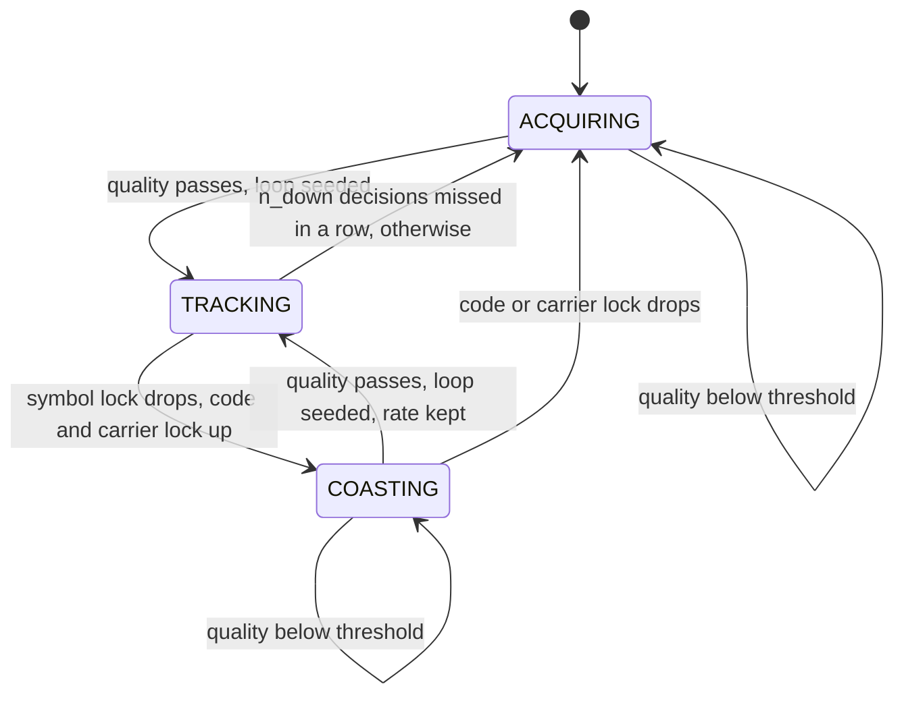

# Symbol Timing on a Rate Cascade

Symbol-timing recovery is usually built as two things: a matched filter, and
an interpolator steered by a timing loop. `RateSync` is built as **one**. It
owns a `RateConverter` whose terminal stage carries the pulse, and it closes
the timing loop around that stage's control port — so the matched filter is
the cascade's last dot product, and the polyphase arm that dot product
selects *is* the fractional timing delay.

This page is the **why**: what that fusion buys, which of its conventions are
load-bearing, and the two arguments that are easy to get wrong. The contract
itself — what each function promises, argument by argument — lives in
`native/inc/doppler/ratesync/ratesync_core.h`, and the measured envelope lives in
`src/doppler/track/tests/validation/ratesync/results.md`. This page does not
restate either.

Related: [The NCO](nco.md), [Continuously Variable Resampler](RESAMPLER.md),
[Timing Lock Detector](timing_lock_detector.md), [MPSK Receiver](mpsk.md),
[CIC Decimator](cic.md).

______________________________________________________________________

## 1. What it is for

A receiver is handed samples on the ADC's clock and needs symbols on the
transmitter's. Those two clocks are never the same, are usually not even
rationally related, and drift against each other. Timing recovery is the loop
that closes that gap.

The design bargain that shapes everything on this page:

> **Let the planner decide how to get down to a few samples per symbol, and
> steer only the last stage.**

Everything else follows from taking that seriously.

______________________________________________________________________

## 2. Why fuse the matched filter and the interpolator

`SymbolSync` separates the jobs — a matched FIR, then a Farrow interpolator
steered by a timing NCO. That is the textbook arrangement and it works. It
also does the same arithmetic twice: the matched filter computes a dot
product against the pulse, and the interpolator then computes a second dot
product to land between the samples the first one produced.

A polyphase bank already contains both. An arm of a `num_phases`-arm bank
*is* the pulse, sampled at a particular fractional offset. Selecting the arm
selects the delay; the dot product against it is the matched filter. One
filter, one pass, no Farrow.

That only steers a loop if neighboring arms differ, and for the rectangle
sampling does not make them differ: a tap is in the symbol or out of it, so
every arm inside one input interval is the same taps. The rectangle's arms
are therefore an integral over exactly one symbol. Interior taps weigh 1
and each edge tap weighs the share of its own input interval that lies
inside the symbol, so the two edge taps trade weight as the arm moves and
the weights always sum to one symbol. With that the loop's timing error is
the linear loop's at 2, 4 and 8 input samples per symbol
([measured](symsync.md#11-measured-both-loops-on-the-rectangle)).

The consequence that matters more than the saved multiplies is what sits in
**front** of the terminal stage. Because the cascade is a full
`RateConverter`, the planner is free to put halfband and CIC stages ahead of
it, and those do the bulk decimation for nearly nothing. The matched filter
is therefore sized by the **post-decimation** rate, not the input rate:

| input samples/symbol | planned cascade                         | terminal bank |
| -------------------- | --------------------------------------- | ------------- |
| 4                    | HalfbandDecimator + Resampler(1.0, rrc) | 34 taps       |
| 17.333               | CIC(8) + Resampler(0.923, rrc)          | 43 taps       |
| 64                   | CIC(32) + Resampler(1.0, rrc)           | 40 taps       |

A 16x span of input rates leaves the expensive filter the same size. A
matched filter at 256 samples per symbol costs what one at 4 costs.

### The pulse the bank sees

The integer stages ahead of the bank band-limit the rectangle, so what
reaches the bank is not a rectangle. The cascade ahead of the bank is
linear and decimates by `D`; write `g[n]` for its response at the input
rate. A unit symbol is `S` input samples of one starting at input `a`, and
`a mod D` is where its edge falls inside a bank-grid interval. At the
bank's input the pulse and the noise (white at the input, variance `N0` a
sample) are

```text
q_a[j] = sum_{i=a}^{a+S-1} g[j*D - i]          the pulse
r[k]   = sum_n g[n] g[n + k*D]                 the noise's autocorrelation
```

An arm `h` returns `h'q` for the symbol with noise variance `N0 * h'Rh`,
`R[t,u] = r[t-u]`. An ideal integrate-and-dump at the input returns `S`
with variance `N0 * S`, so the arm's loss against it is

```text
L(h) = (h'q)^2 / (S * h'Rh)      <= 1,   largest at  h = R^-1 q
```

`h = R^-1 q` is the matched filter for the rectangle given the cascade,
one arm a position of the edge, and `L = q'R^-1 q / S` is the most any
arm can keep. An arm's ISI is its response to the neighboring symbols,
`h'q_{a +- S} / h'q_a`.

`validate_ratesync_pulse_model` measures `g` from the built converter
through its pre-terminal tap, forms `q` and `r`, and prints the built
arms beside the optimum for nine plans. Worst edge position of each:

| input samples per symbol | `m` | plan ahead of the bank | best arm, dB | built arm, dB | built arm's worst neighbor, dB |
| ------------------------ | --- | ---------------------- | ------------ | ------------- | ------------------------------ |
| 8                        | 8   | none                   | 0.000        | 0.000         | none                           |
| 8                        | 4   | halfband               | -0.179       | -0.206        | -28.0                          |
| 8                        | 2   | two halfbands          | -0.430       | -0.491        | -19.1                          |
| 16                       | 8   | halfband               | -0.091       | -0.104        | -34.5                          |
| 16                       | 4   | two halfbands          | -0.222       | -0.263        | -26.1                          |
| 16                       | 2   | CIC(8)                 | -0.482       | -0.566        | -18.7                          |
| 64                       | 8   | CIC(8)                 | -0.132       | -0.153        | -31.6                          |
| 64                       | 4   | CIC(16)                | -0.263       | -0.313        | -25.1                          |
| 64                       | 2   | CIC(32)                | -0.488       | -0.572        | -18.6                          |

Three things follow.

- **The loss is the band-limit's, and it is set by the bank's grid.** A
    rectangle keeps 90.3%, 95.0% and 97.5% of its energy inside the
    Nyquist band of a grid of 2, 4 and 8 samples per symbol: 0.44, 0.22
    and 0.11 dB. The best arm reads 0.43 to 0.49, 0.18 to 0.26 and 0.09 to
    0.13 dB.
- **The built arms are within 0.084 dB of the best.** They are the
    integral over one symbol (above) with the droop compensator folded in.
- **Neither is free of ISI on a coarse grid.** At 2 samples per symbol a
    neighbor comes through at about -19 dB on the built arm and -22 to
    -26 dB on the best one. An arm that trades noise for ISI is not
    derived here.

With no stage ahead of the bank (`D = 1`) the pulse is whatever the caller
delivers, and the object cannot know its band.

### The detector that goes with that pulse

The optimum arm depends on the timing hypothesis `tau`: `h(tau) = R^-1 q_tau`. Its derivative in `tau` is a second bank, and the pair is a
timing detector:

```text
y  = h(tau)' s            the symbol
dy = (dh/dtau)' s         its derivative in the timing hypothesis
e  = Re{ conj(y) * dy }   zero where |y| peaks
```

One accumulator steers both banks. For the rectangle, `dh/dtau` is the
two band-limited edges of the pulse with opposite signs, so it weighs the
samples that carry the timing and ignores the flat middle that carries
none.

A loop of noise bandwidth `bn` has a timing variance of
`2 * bn * S_e(0) / Kd^2`, so a detector is judged on `S_e(0) / Kd^2`: the
spectral density of its output at zero over the square of its slope.
For a pulse of normalized mean-square bandwidth `xi`, the bound on that
figure is `1 / (8 * pi^2 * xi * gamma)` with `gamma` the Es/N0; the
rectangle band-limited to `N` samples per symbol has `xi = N / (2 pi^2)`,
so the bound is `1 / (4 * N * gamma)`.

`validate_ratesync_pulse_model` runs both detectors open loop at the eye
center on the measured cascade, at a bank grid of 4 samples per symbol
(64 in, CIC(16) ahead; 40,000 symbols by 4 seeds a row):

| Es/N0 | Gardner, built arm: `S_e(0)/Kd^2` | derivative bank: `S_e(0)/Kd^2` | the bound times `(1 + 1/gamma)` | derivative against Gardner |
| ----- | --------------------------------- | ------------------------------ | ------------------------------- | -------------------------- |
| 4 dB  | 0.1429                            | 0.0342                         | 0.0348                          | -6.2 dB                    |
| 7 dB  | 0.0608                            | 0.0147                         | 0.0150                          | -6.2 dB                    |
| 10 dB | 0.0278                            | 0.0068                         | 0.0069                          | -6.1 dB                    |
| none  | 1.2e-05                           | 5.2e-05                        |                                 | +6.5 dB                    |

- **The derivative bank sits on the bound**, less the same `1 + 1/gamma`
    squaring term Gardner carries, at all three levels.
- **It is 6.2 dB below Gardner at 4 samples per symbol**: the same loop
    SNR at four times the bandwidth, or four times the loop SNR at the
    same one.
- **With no noise it is the noisier of the two**, by 6.5 dB. That floor
    is the data pattern's own, and it is a timing error of 0.0007 symbols
    rms at `bn = 0.005`.
- Gardner on the optimum arm is 2.3 dB worse than Gardner on the built
    arm. The optimum arm is matched to the symbol at its center, which is
    not what the half-symbol strobe wants.

**The arm's scale is part of the detector.** The energy an arm's window
keeps of the pulse, `q'R^-1 q`, changes with where the edge falls on the
bank's grid. `|y|^2` peaks at the true timing only when the arm is scaled
to unit noise gain, `h = R^-1 q / sqrt(q'R^-1 q)`, and the derivative bank
is the derivative of that scaled arm. Scaled to return the symbol, or left
unscaled, the peak is pulled toward the grid positions that keep more of
the pulse: a standing error of 0.01 symbols behind CIC(16), and no usable
S-curve at all on exactly 4 samples per symbol with nothing ahead of the
bank. The symbol itself is read from the arm scaled to return it.

### Closed, and on inputs with no whole number of samples per symbol

`validate_ratesync_loop_model` closes both detectors around the measured
cascade with the library's loop filter, each divided by its own slope at
lock, one strobe per symbol out. The symbol period is any real number of
input samples, and an input sample is the waveform's average over its own
interval, so the timing is continuous in the samples. Timing error rms in
symbols at Es/N0 4 dB and `bn = 0.005`, 120,000 symbols:

| input samples per symbol | ahead of the bank | bank grid | Gardner | derivative | derivative against Gardner | half-symbol pull-in, symbols: Gardner / derivative |
| ------------------------ | ----------------- | --------- | ------- | ---------- | -------------------------- | -------------------------------------------------- |
| 64                       | CIC(16)           | 4         | 0.0400  | 0.0188     | -6.5 dB                    | 148 / 945                                          |
| 34.67                    | CIC(8)            | 4.333     | 0.0413  | 0.0200     | -6.4 dB                    | 159 / 486                                          |
| 9.3                      | none              | 9.3       | 0.0444  | 0.0144     | -9.5 dB                    | 176 / 659                                          |
| 4.3                      | none              | 4.3       | 0.0416  | 0.0209     | -5.6 dB                    | 193 / 460                                          |
| 4                        | none              | 4         | 0.0412  | 0.0203     | -6.0 dB                    | 282 / not inside 4000                              |

- **The gain holds on a non-integer grid**, and it grows with the grid:
    5.6 to 6.5 dB at 4 to 4.3 samples per symbol, 9.5 dB at 9.3.
- **Each closed loop reads its own open-loop prediction.**
    `sqrt(2 * bn * S_e(0) / Kd^2)` is within 6% of the measured rms on
    every row at `bn` of 0.01 and under, at Es/N0 4, 7 and 10 dB.
- **It holds where Gardner slips.** At `bn = 0.02` and Es/N0 4 dB Gardner
    slips on four of the five plans (one to three symbols, or it leaves by
    more than four); the derivative detector does not slip on any.
- **It pulls in from far off more slowly, at the same `bn`.** Its
    S-curve peaks at 0.05 to 0.10 of a symbol's worth near 0.19 symbols
    off and falls away toward half a symbol, where Gardner's peaks at
    0.15 to 0.17 at a quarter symbol. From half a symbol off it takes 2.4
    to 6 times as long, and on exactly 4 samples per symbol with nothing
    ahead of the bank its S-curve has extra zero crossings and it did not
    arrive inside 4000 symbols.

So the derivative detector is the tracking detector, and the loop is not
what acquires.

### Acquisition is feedforward, so it is bounded

The same arms give an estimate of the timing with no loop. Take the
likelihood `|y|^2` from the unit-noise-gain arm at `K` hypotheses per
symbol, sum it over `L` symbols, and read the phase of its first Fourier
coefficient across the hypotheses:

```text
c       = sum_k sum_{i=0}^{K-1} |y_k(tau0 + i*S/K)|^2 exp(-j 2 pi i / K)
tau_hat = tau0 - (S / 2 pi) arg c
```

This is the Oerder and Meyr estimator read off the bank. It takes `L`
symbols whatever the starting offset, it has no half-symbol point to hang
at, and its error is what the loop is handed. Modeled with `K = 4` at
Es/N0 4 dB, from 64 starting offsets spread over one whole symbol
(`validate_ratesync_loop_model`), error rms and worst in symbols:

| input samples per symbol | 32 symbols   | 64 symbols   | 128 symbols  | 256 symbols  |
| ------------------------ | ------------ | ------------ | ------------ | ------------ |
| 64, CIC(16)              | 0.050, 0.123 | 0.034, 0.088 | 0.022, 0.068 | 0.016, 0.044 |
| 34.67, CIC(8)            | 0.047, 0.133 | 0.032, 0.103 | 0.020, 0.051 | 0.013, 0.028 |
| 9.3                      | 0.072, 0.377 | 0.035, 0.107 | 0.024, 0.052 | 0.017, 0.037 |
| 4.3                      | 0.052, 0.102 | 0.036, 0.103 | 0.021, 0.061 | 0.016, 0.044 |
| 4                        | 0.050, 0.169 | 0.030, 0.081 | 0.027, 0.069 | 0.022, 0.060 |

With 128 symbols the worst of 64 starts is inside 0.07 symbols on every
plan, which is inside the derivative detector's linear range, so the loop
starts already tracking. The estimate's rms is 1.1 to 1.5 times
`sqrt(figure / L)`, the figure being the tracking detector's
`S_e(0) / Kd^2`. Seeding the loop's rate state from two successive
estimates, the handover rule, and `K` and `L` as derived quantities are
not modeled.

The model is not the library. Its optimum arms are recomputed for every
symbol's timing, where a bank holds a fixed number of them, and its
Gardner reads the converter's own bank rows.

### Arbitrary rate is not a feature, it is the default

`sps` is a `double`. 4, 17.33389, an irrational ratio and a slowly drifting
clock are all the same case, because the terminal stage (`resamp`) takes its
rate as a double, re-derives each output's step from it, and keeps its place
in a 32-bit phase word — a `uint32_t` fraction of one input interval, so
`2^-32` resolution — and the loop only has to steer the strobe. There is no
integer-ratio path and no special case for one — which is the honest
arrangement, since a free-running ADC clock against a symbol clock is the
normal situation rather than the exotic one.

______________________________________________________________________

## 3. The loop is a separate object, and that is load-bearing

`ratesync_loop_t` holds the strobe ring, the TED, the PI filter, the lock
detector and the telemetry. It holds **no filter and no cascade**. It
consumes a stream of terminal-stage outputs and produces a per-input rate
deviation for whoever owns the accumulator those outputs came from.

That split is why a receiver can reuse it verbatim. `RateSync` owns a
`RateConverter` and steers it directly; `MpskReceiver` owns a `Ddc`/`Ddcr`
— a mixer in front of the same cascade — and steers the *same* accumulator
through the DDC's `rate_ctrl` port. Both drive one implementation of the
timing loop, so a fix to the TED or the normaliser reaches both. They are not
peers that can drift apart, and `test_ratesync_core.c` §11 pins that by
driving a hand-owned cascade through the loop API and requiring the symbols
to match `RateSync`'s bit for bit.

The loop has to be told the geometry of the accumulator it steers, and there
are exactly two numbers:

- **the terminal stage's own rate**, because that is the scale `ctrl` is
    referenced to (§4 below);
- **the terminal bank's tap count**, because that is how many outputs are
    delay-line fill rather than signal (§5 below).

`dp_ratesync_loop_bind_cascade()` reads both off a cascade so no owner has to
know how.

______________________________________________________________________

## 4. `ctrl` is referenced to the TERMINAL rate

This is the convention most likely to be got wrong, because the obvious
choice is wrong.

`dp_loop_filter_step` returns a correction in symbols per symbol. `ctrl` is a
rate deviation the **terminal stage** adds to its accumulator once per one of
**its own** inputs — not once per cascade input. Those differ by the whole
integer decimation in front.

Over one symbol the terminal stage sees `N = m / rate_term` inputs, so the
accumulator gains `N * ctrl` output periods, i.e. `N * ctrl / m` symbols.
Setting that equal to the requested correction gives

```text
ctrl = correction * rate_term
```

with no reference to `sps` or to the decimation at all. Scaling by the
*cascade* rate `m/sps` instead under-drives the loop by exactly the
decimation factor — 32x at `sps = 64` behind a CIC(32).

The cost is measured rather than argued. `test_ratesync_core.c` §12 binds the
cascade rate where the terminal rate belongs and measures **18 dB** of EVM
lost. Note what does *not* catch it: given a long enough record the
under-driven loop still crawls to a nominally open eye and `locked` reads
true. The lock detector answers "is the eye open", which it eventually is; it
was never a check on loop gain.

This is also why `bn` means the same thing whatever the planner built. The
validation report sweeps `bn` across all three cascades above and finds them
within a decibel of each other at the useful settings — which is the whole
point of referencing the control to the terminal rate.

______________________________________________________________________

## 5. The loop stays open until the cascade is primed

A cascade's first outputs are its delay lines filling, not signal. The eye
statistic swings over its whole ±2 range through them, and steering on that
is meaningless — measured, it was worth one lost acquisition in sixteen.

So the loop discards `prime_taps + 1` terminal outputs before it closes, and
`prime_taps` is not a tuned constant: it is the terminal bank's own tap
count, read off the stage at construction. Counting **outputs** rather than
strobes is what makes it rate-independent — the bank spans `num_taps` of its
own input samples, and since the terminal stage never interpolates here
(`rate = m/sps ≤ 1`) it cannot emit more than `num_taps` outputs while those
inputs arrive. Discarding `num_taps` outputs therefore always covers the
fill, whatever `m` and `sps` are.

The strobe phase is deliberately *not* advanced during the discard, so the
first real strobe starts a clean count.

______________________________________________________________________

## 6. Two things that are easy to get wrong

### 6.1 Normalising the TED

A Gardner error is a timing error multiplied by three things the detector did
not choose: the signal amplitude, the transition density, and the detector's
own slope against the pulse. Only the last of those is the detector's to
remove.

`RateSync` divides it out with a **construct-time reciprocal**
(`dp_symsync_ted_slope()`, computed once by `dp_ratesync_loop_bind_cascade()`); the
hot path multiplies by it. Amplitude does not appear — it enters the raw
error as `A²` for Gardner and `A¹` for DTTL, and a unity-gain matched cascade
delivers the amplitude it was sent, so levelling is an AGC's job upstream.
Transition density does not appear either; it is data, and whatever slope it
yields is the honest slope.

What this replaced was a running 1%-per-symbol average of `|on|² + |mid|²`,
and it is worth recording why that was wrong, because the intuition behind it
is appealing:

- It is an `A²` quantity, so it was right for Gardner's amplitude law and
    left DTTL's gain proportional to `1/A` — a 4x swing over a 4x level
    change, in the detector BPSK selects.
- Being an average, it **lagged**. Seeded on the first post-prime strobe,
    which lands in the cascade's amplitude ramp, it ran the loop at up to
    thousands of times its designed gain for exactly the interval that
    decides acquisition. Measured: that wound the integrator past pull-in and
    cost 7000–25000 symbols to recover across a 0.3-symbol-wide band of
    initial offsets. With the lag gone that band acquires like every other
    offset, inside the first few lock decisions; RateSync's certification
    report, §2.4, measures the declare at each offset.

A separate and *earlier* mistake is worth keeping on the record because it is
the more tempting one: normalising by `|on|²` **alone**. The on-time energy
vanishes exactly when the strobe sits on the symbol transitions — precisely
the state the loop must recover *from* — so that divides by zero at the worst
possible moment. Measured, the error reached −91, the control drove the
terminal stage's effective rate negative, its accumulator stopped advancing,
and the cascade emitted nothing ever again: 2 symbols where 4000 were
expected. A permanent death, not a transient.

The energy **sum** `|on|² + |mid|²` survives as the lock statistic's
normaliser, where it belongs: the two energies are the same signal half a
symbol apart, so their sum is bounded away from zero at every timing phase.

**Why there is no clamp on the control anywhere.** With a construct-time
constant there is nothing that can vanish, so there is no runaway to clamp;
the error is bounded by the detector's own S-curve, which is bounded by
construction. Measured from the worst offset at `bn = 0.02`, `ctrl` stays
inside a few parts in a thousand.

### 6.2 The T/2 role ambiguity resolves itself

Gardner needs an on-time strobe and a transition gate half a symbol earlier.
Running at `rate = m/sps` and taking every m-th output as on-time makes that
assignment a **parity count**, which looks like it should be ambiguous — and
a half-symbol error genuinely is an equilibrium of the detector.

It is an **unstable** one. Swept over a fine grid of standing timing offsets,
the S-curve has exactly two zeros per symbol, crossing in opposite senses:
one at the eye centre, which restores, and one at the T/2 point, which does
not. The loop runs away from the wrong one on its own.

So **the parity does not matter**, and no eye-sign detector or counter flip
is needed. An earlier prototype ran two displaced banks to pin the roles
structurally; measurement showed that buys nothing and costs double the
multiplies.

**The object never inspects the eye, and must not.** The escape from the T/2
point is feedback: at that offset the crossing has the non-restoring sense,
so any perturbation is amplified rather than corrected, and the loop leaves
on its own. That argument holds for whatever is on the input — a modulated
signal, noise, or a buffer of zeros — because it is a property of the loop's
sign, not of the signal's quality. A receiver that gated on an open eye
before trusting its own timing loop would stall on exactly the inputs it most
needs to survive: an unmodulated dwell, a squelched channel, the fill between
bursts. There is no such gate here and none is wanted.

### What the validator has to do instead, and why it is not this

The validation report faces a question the object does not. It measures
**open-loop** (`bn = 0`), so nothing pulls the strobe anywhere: it has to
name the equilibrium it is differentiating before it can check that the
normalised slope there is unity (§6.1). Getting that wrong is not
hypothetical — it produced the first version of the report's finding
`normalised_slope_unity`, an apparent 8.7x roll-off dependence in DTTL's
normaliser that was the T/2 zero all along.

It cannot name it by the sign of the slope. A sign is only meaningful
relative to a timing axis, and the two harnesses run theirs in opposite
senses — the Python validator offsets the decimation phase, the C one offsets
the transmitter — so a hard-coded `slope <= 0` test picks the eye centre in
one and the T/2 point in the other, while both report identical numbers.
Gardner's near-sinusoidal S-curve carries the same slope magnitude at both
zeros, so nothing on the default detector reveals the mistake.

Eye opening does distinguish them, without reference to any axis: mean
`|symbol|` measures 1.000 at the eye centre against 0.53–0.79 half a symbol
away. That is a **measurement-time** discrimination, run on a known modulated
stimulus the validator generated itself, and it belongs there and nowhere
else — it is available precisely because a validator controls its own input,
which is the one thing the object can never assume.

______________________________________________________________________

## 7. The caller owns the input level

There is no AGC in `RateSync`, deliberately: a receiver composing it already
levels in its own front-end cascade (`dp_RateConverter_enable_agc()`, one per
receiver), so an AGC here would be a second one integrating against the
first. The level to hit is not a tuned number — it is unit-amplitude symbols,
the reference the bank already defines.

The consequence is sharper than "present a sensible level", and the
validation report measures it: because the Gardner error carries an `A²`
factor, **the input level multiplies the loop gain**. The level axis *is* the
`bn` axis. Too hot tracks noisily; too cold has not settled. EVM is therefore
not monotone in level — it improves slightly below the contracted amplitude
before collapsing — so a receiver tuned against EVM alone is rewarded for
drifting toward a cliff.

`dp_ratesync_get_clipped()` reports the subset of over-drive a CIC's input
quantiser sees (a CIC bounds its input to its full scale, 4.0 as built, and
clips silently at and past that).
It is not a level check: on a plan the planner built without a CIC there is
nothing to clip, and over-driving costs EVM with the flag reading clean. The
missing under-drive report is tracked as
[gh-661](https://github.com/doppler-dsp/doppler/issues/661).

______________________________________________________________________

## 8. One input can complete two outputs

The cascade rate is `m/sps ≤ 1`, so it is tempting to assume the terminal
stage emits at most one output per input. It does not. Whenever the terminal
stage's own rate is at or near 1.0 — a cascade like HB + Resampler(1.0),
which is exactly what an integer `sps` plans — the control can push the
accumulator over and that input emits **two**.

Asking for only one silently drops the second, which permanently shifts the
strobe parity and leaves the loop sliding: measured as `rate_est` walking
monotonically away while the eye never opens. `ratesync_step_ted()`
therefore drains up to four outputs per input.

Two is the bound, since the cascade rate is at most 1, and with `m ≥ 2` two
consecutive outputs can contain at most one on-time strobe — so the
single-symbol return of `ratesync_step()` is still correct.

______________________________________________________________________

## 9. The design the models lead to

Section 2's three models settle what the object should be. Four choices
follow from them, and the header states the result once it is built:

| question                              | decision                                                                                                     |
| ------------------------------------- | ------------------------------------------------------------------------------------------------------------ |
| detectors                             | the derivative-bank detector is the default; Gardner and DTTL stay selectable                                |
| acquisition                           | a feedforward estimate off the bank by default, and a seed call for a consumer that already knows the timing |
| input with no stage ahead of the bank | each sample is the waveform's average over its own interval                                                  |
| the cascade's response                | derived from the stage definitions at construction, never measured through the signal path                   |

### 9.1 The bank

For the pulse `p` and the plan's response `g` (CIC and halfband impulse
responses convolved, at the input rate), each of `num_phases` arms over
one bank-sample interval is built for its own position `u` of the symbol
edge:

```text
q_u  = p * g, sampled on the bank's grid at offset u
h_u  = R^-1 q_u / sqrt(q_u' R^-1 q_u)        the arm, unit noise gain
dh_u = d h_u / du                             the derivative arm
a_u  = 1 / (h_u' q_u)                         what scales y to the symbol
```

Three tables: `h` and `dh` (`num_phases x num_taps` each) and `a`
(`num_phases`). The terminal Resampler stores the second bank and returns
`y = h_u's` and `dy = dh_u's` for each output, from one phase word. The
droop compensator is no longer a separate fold: `R^-1` is that inverse,
exact for the plan.

The rectangle is built this way. The root-raised cosine keeps its sampled
arms (its band already fits the grid) and gains `dh` and `a` by the same
definitions.

### 9.2 The detectors

| `ted`                               | error                         | outputs per symbol it needs | on        |
| ----------------------------------- | ----------------------------- | --------------------------- | --------- |
| `RATESYNC_TED_DERIVATIVE` (default) | `Re{ conj(y) dy }`            | 1                           | `h`, `dh` |
| `RATESYNC_TED_GARDNER`              | `Re{ conj(mid) (on - prev) }` | 2                           | `h`       |
| `RATESYNC_TED_DTTL`                 | sign-sign                     | 2                           | `h`       |

Each is divided by its slope at lock for random data, computed at
construction from the tables (not measured, not fitted), so `bn` is the
closed loop's one-sided noise bandwidth as a fraction of the symbol rate
for any of them. `m` may be 1 with the derivative detector; Gardner and
DTTL keep `m` even.

### 9.3 Acquisition, then tracking

The loop has three states. Acquisition is a feedforward estimate whose
length is fixed at construction, and the loop closes on its result, so
the time to a closed loop is a count and not a pull-in. Coasting is
defined by three lock flags and no new statistic: the code lock and the
carrier lock are up and the symbol lock is not.



The diagram shows what the loop does unprompted. Two calls move it as
well: a seed enters `TRACKING` from either state and resets the lock
detector, so `valid` is 0 until lock is declared again, and a reset
enters `ACQUIRING`.

| state       | what runs                                                  | `valid`                  | bounded by                                   |
| ----------- | ---------------------------------------------------------- | ------------------------ | -------------------------------------------- |
| `ACQUIRING` | the estimator, on its own matched filter; the loop is open | 0                        | its lead-in, then `L` symbols an attempt     |
| `TRACKING`  | the loop, closed                                           | the lock detector's flag | nothing while the lock decisions keep coming |
| `COASTING`  | the estimator; the symbol clock runs on at the held rate   | 0                        | `L` symbols an attempt                       |

A loop with no estimator beside it starts in `TRACKING`, which is the
loop as it is today.

**What is built.** The three states, the presence input, the seed and
`valid` are in `ratesync_loop_t`, and `RateSync` owns a matched
estimator and runs it while the loop is not tracking. The acquisition is
a setting, `dp_ratesync_configure_acquisition (symbols, quality)`, off
until it is called: `L` and the quality threshold are the caller's, since
neither has a derived default (the open items below, and #3371). Off, the
object is in `TRACKING` from reset and never leaves it.

| what                                             | where                                                          | held by                                                    |
| ------------------------------------------------ | -------------------------------------------------------------- | ---------------------------------------------------------- |
| the states and their transitions                 | `dp_ratesync_loop_decide()`, `dp_ratesync_loop_set_presence()` | `test_ratesync_core.c`, `test_lifecycle`                   |
| the seed in the loop: the count and the stretch  | `dp_ratesync_loop_seed()`                                      | `test_seed`, part 2                                        |
| where the next output reads, steered or not      | `dp_resamp_get_ctrl_lead()`, `dp_ratesync_seed()`              | `test_seed`, parts 1 and 3                                 |
| the estimator beside the loop, reset an attempt  | `dp_ratesync_acquire_push()`                                   | `test_lifecycle`, the eye over the 60 symbols after a seed |
| the blob: the setting, the counts, the estimator | `dp_ratesync_get_state()`, version 3                           | `test_lifecycle`, the two splits and five refusals         |
| `settle_time` with one attempt ahead of the loop | `dp_ratesync_get_settle_time()`                                | `test_lifecycle`                                           |

`valid` is read after each symbol in C (`dp_ratesync_get_valid()`); a
block call returns the symbols and the flag as of the last one. The
receivers compose the loop without an estimator, so they are unchanged
until each is re-certified on it (§9.6).

**Coasting is the signal present and the symbol clock not declared.**
The state is `code_lock and carrier_lock and not symbol_lock`, entered
from `TRACKING` when a symbol lock that had declared drops. The code and
carrier locks say the signal is still there, so the symbol clock is
worth keeping: the loop is held, as `dp_dll_set_coast()` holds the Dll,
its filter takes no update and the clock runs on at the rate it had.
The estimator starts at once, as in `ACQUIRING`, and the first estimate
whose quality passes seeds the loop into `TRACKING` with the held rate
kept. A coast is therefore acquisition with the rate remembered, and it
is bounded the same way. A stretch with no transitions passes no
estimate and coasts until they return. Either of the other two locks
dropping ends the coast in `ACQUIRING`, where the rate starts from zero.
A symbol lock that drops without them, or `n_down` missed decisions on a
loop that never declared, goes to `ACQUIRING` directly.

The two flags are the owner's, not the loop's. The loop takes them as
one presence input, which a loop with no code or carrier lock beside it
never raises, and that loop has two states.

**One symbol a symbol period, in every state.** The count does not
change with the state and nothing is dropped; `valid` is a flag beside
the symbol and the state is readable by name. Nothing is emitted while
the cascade's delay lines fill: that is the countdown the loop has today
(`prime_left`), not a state, and it is over long before the first
estimate, whose block is longer than the bank.

What the states leave to what already exists:

- **A second decision before `valid`.** The estimate's quality threshold
    is a presence test: set for a false-alarm probability of 0.01, it
    passes a rectangle 0.66 of the time from 128 symbols at Es/N0 0 dB
    (the estimator's report, §2.6, in
    `src/doppler/estimation/tests/validation/timing_est/results.md`). The
    estimate also carries the block's own error. `valid` is the lock detector's flag, so a symbol is called
    valid only after `n_up` lock decisions on the closed loop.
- **One missed decision does not drop `valid`.** The lock detector drops
    after `n_down` misses in a row (6 decisions of 133 symbols by
    default, about 800 symbols). That count, already sized from the
    per-decision budget, is how long the loop holds through a bad
    stretch.
- **A stretch with no transitions.** It gives the detector nothing, and
    a run shorter than `n_down` decisions never leaves `TRACKING`.
    Gardner's error is zero in the mean through one. The derivative
    detector's is not, and that is the detector's to fix (the error is
    taken on a transition), since it acts long before a state could
    change. A longer one, with the code and the carrier still locked, is
    a coast.

`TRACKING` leaves on `n_down` missed decisions in a row whether or not
lock was ever declared; only a lock that had declared can leave it for
`COASTING`. The lock detector counts misses only once it has
declared, so the loop keeps the count of consecutive misses itself.

Acquisition estimates timing only. One block of `L` symbols; the loop's
rate state starts at zero and the loop pulls the rate in. A second
block, and the rate it gives, is an argument for a caller with a large
clock offset, and the seed call takes a rate too.

What bounds each state, and what each bound is derived from:

| quantity          | from                                                                                                      |
| ----------------- | --------------------------------------------------------------------------------------------------------- |
| prime length      | the terminal bank's taps, plus one (as today)                                                             |
| lead-in           | the estimator's own converter's memory (`dp_RateConverter_get_memory()`), a CIC's startup burst in it     |
| `L`               | the design Es/N0 and the detector's monotone range, from the estimate's tail and not its rms (open)       |
| quality threshold | a stated false-alarm probability on noise alone, from the noise's autocorrelation at the estimator's bank |
| `n_up`, `n_down`  | the per-decision budget, as today (2 and 6)                                                               |

Open, and settled before the seed is built:

- **`L` from the tail.** The hand-over fails when the estimate's error
    is past the detector's monotone range, which is a tail event: the
    worst error over the report's rows is several times the rms. `L` is
    sized from the probability of that given the quality passed.
- **The capture envelope with no rate seed.** One block reads the timing
    with a clock offset out to `0.4 / L` symbols a symbol (3125 ppm at
    128 symbols). That is the estimator's bin, not what the loop then
    captures: the timing drifts for half a block and the hand-over's
    latency, and the loop's rate state starts from zero. The offset the
    default hand-over holds is smaller and is not derived yet.
- **`m = 1` on a power-of-two `sps`.** The planner decimates to `m`
    samples a symbol ahead of the terminal stage, so the bank has one
    sample a symbol there and is not a matched filter: the seed lands
    and the eye reads 0.72 to 0.90 (`validate_ratesync_seed`, the rows it
    prints and does not hold; #3370).
- **Four samples a symbol with nothing ahead of the bank.** The
    derivative detector's error has extra zeros there (§2); that geometry
    is refused or its zeros are mapped.
- **What `MpskReceiver` supplies.** It has a carrier lock and no code
    lock, and its carrier lock is formed on the symbols the timing loop
    emits, so it is not evidence apart from the symbol clock. Until that
    is settled it raises no presence and does not coast.
- **A false alarm costs `n_down` decisions.** An estimate that passes on
    noise closes the loop on nothing, and the loop returns to
    `ACQUIRING` only after `n_down` missed decisions, about 800 symbols.
    Running the estimator beside the closed loop as a monitor would
    shorten that, and would see a slip; it is not in this design.

**The estimator brings its own matched filter.** The matched flavor of
[`SymbolTimingEstimator`](timing-estimator.md#the-matched-flavor) owns a
matched converter of its own: the same decimating cascade, with a
terminal stage that runs at a fixed rate to 4 samples a symbol and is
never steered. `RateSync` hands it the samples it hands its own cascade.
Acquisition therefore does not depend on `m`, on the detector, or on
where the loop has pushed the tracking bank: it is the same at `m = 1`,
2 and 4. It runs only in `ACQUIRING`.

**The estimate reaches the loop through the seed call.** The estimate's
`eye` is a sample index into the samples both converters are handed: the
estimator has already taken its own converter's delay and lead-in out.
The tracking converter's group delay
(`dp_RateConverter_get_group_delay()`) then says which of its outputs
carries that sample: `j_on = (eye + group_delay) * rate`, not whole,
while the cascade has not been steered. Once it has, the count of
outputs no longer says where an output reads, and the terminal stage's
accumulator still does: the inputs it has been handed plus
`dp_resamp_get_ctrl_lead()`, scaled by the decimation ahead of it, less
the group delay. `dp_ratesync_seed()` places the next output that way and
takes any eye center of the stream, past or future. The
on-time outputs are `floor (j_on)` and every `m`-th after it, which is a
count, and the remainder `r`, under one output period and never negative, goes to the
terminal stage as one symbol of control. The terminal stage sets the
interval to its next output as each output is emitted, `1 / (R + ctrl)`
of its inputs at its own rate `R`, so `ctrl = -R r / (m + r)` held while
`m` outputs are emitted moves the symbol by `r` outputs exactly. The
seed is always a stretch: a control that shortened an interval below one
terminal input would put two outputs in one call. The seed resets the
lock detector and the loop stays open for `2 m` outputs, the stretch and
the gate behind it, so the stretched symbols are never called valid. A
seed is taken while the cascade is still filling too: the outputs the
fill drops are counted.

`validate_ratesync_seed` does this from outside, on the public calls, and
reads where the on-time outputs land with a probe tone through a second
cascade: within 0.002 symbols of where the estimate pointed on the
rectangle and 0.010 on the root-raised cosine, over 88 rows (`sps` 4 to
67.3, `m` 1, 2 and 4, four offsets), with the eye open on each. The
root-raised cosine's bound is how far an arm's delay sits from its
pulse's center (#3368). Built-in acquisition is
`RateSync` making the seed call a caller could make.

**The machine is the loop's; the estimator is its owner's.** The states,
`valid` and the transitions live in `ratesync_loop_t`, where the terminal
outputs arrive, so a receiver that composes the loop gets the same
machine. The presence input is the owner's too: `AsyncDsssReceiver` sets
it from its Dll's lock and its carrier lock. The estimator needs the samples ahead of the cascade, which the
loop never sees, so it sits beside the loop in whatever owns the cascade:
`RateSync` here, and each receiver when it is re-certified (§9.6 step
10). A loop with no estimator beside it starts in `TRACKING` and pulls in as
it does today.

### 9.4 What a caller sizes from

The header states, and the certification holds, for a pulse, a detector,
an Es/N0 `gamma` and a `bn`:

```text
timing variance   sigma_tau^2 = 2 * bn * F(gamma)       symbols^2
loop SNR          rho = 1 / ((2 pi)^2 sigma_tau^2)
figure            F = S_e(0) / Kd^2, from the tables, printed by a helper
```

and a helper returns the `bn` that gives a stated loop SNR (20 dB by
rule) at a stated Es/N0, so the least input is the Es/N0 the link is
designed for.

`settle_time` is where the output may be measured from: the symbols the
loop emits before its timing error is under 2% of where it started,
`2.59 / bn` at damping 0.707
([`dp_loop_filter_settle_time()`](loop-filter.md#14-closed-forms-a-caller-sizes-from)).
The lock flag declares before that, on a statistic that crossed a
threshold, so a window opened at the flag holds the pull-in. `MpskReceiver`
and `AsyncDsssReceiver` report the timing and carrier loops' figures
added. With `RateSync`'s acquisition on, one attempt is added ahead of
the loop: the estimator's lead-in, the block, and the seed's two symbols.

### 9.5 The surface that changes

|               | today                                                                        | finalized                                                                                                                                                                                                          |
| ------------- | ---------------------------------------------------------------------------- | ------------------------------------------------------------------------------------------------------------------------------------------------------------------------------------------------------------------ |
| create        | `sps, pulse, beta, span, m, num_phases, bn, zeta, ted`                       | the same arguments; `ted` gains `DERIVATIVE` and it is the default of the least-input constructor; `m >= 1`                                                                                                        |
| new           |                                                                              | a seed call (timing, rate); the acquisition's setting; the presence input; the state, readable by name; `valid` beside each symbol; the figure at a stated Es/N0; the `bn` for a stated loop SNR at a stated Es/N0 |
| new object    |                                                                              | the feedforward timing estimator, composed here                                                                                                                                                                    |
| symbol out    | the arm's output, 0.88 to 0.96 of the symbol on a band-limited input (#3366) | `a_u * y`: the symbol                                                                                                                                                                                              |
| Resampler     | one bank                                                                     | an optional second bank and a paired output                                                                                                                                                                        |
| RateConverter | `rc_build_bank` samples or integrates the pulse                              | builds `h`, `dh`, `a` from the plan's derived response                                                                                                                                                             |
| blob          | version N                                                                    | version N + 1: the acquisition's sums and state                                                                                                                                                                    |

### 9.6 The order of work

1. The plan's response, derived (`RateConverter`), held to the measured
    one by `validate_ratesync_pulse_model`.
1. The three tables, held to the model's optimum arm by the same
    validator, and the bank's gain (#3366) pinned.
1. The Resampler's second bank and paired output.
1. The derivative detector in `ratesync_loop_t`, its slope from the
    tables, `m = 1`.
1. The converter's group delay on every plan; the estimator's matched
    flavor; then the state machine and the seed in the loop.
1. The header rewritten claim by claim, the manifest, the bindings.
1. The C pins with their sabotage; the state round trip; the probes.
1. The six measurement lanes against §2's predictions, and the report.
1. The guide, both examples, the gallery page, the benchmarks.
1. The consumers: the M-PSK receiver, then the DSSS receivers, each
    re-certified on it.

## 10. What is deliberately not here

- **A (pfa, pd) sizing entry point.** `dp_symsync_configure_lock()`'s constants
    were calibrated against symsync's own geometry by Monte Carlo. Re-exposing
    the formula for a different front end without repeating that validation
    would be asserting a calibration nobody measured, so `RateSync` ships
    symsync's empirically validated sizing as the default (`avgs = 133`,
    threshold 0.311, at a per-decision pfa of 1e-3 and pd of 0.9) with verify
    counts derived from a per-decision budget of 1e-6: it declares after
    `n_up = 2` decisions and drops after `n_down = 6`. It exposes
    `dp_ratesync_configure_lock_raw()` for a caller that sizes its own. See
    [Timing Lock Detector](timing_lock_detector.md).
- **A second timing mechanism.** The terminal stage's accumulator is the only
    thing that decides when a sample is taken. Nothing else adjusts timing.
- **Droop compensation as a choice.** `dp_ratesync_create()` builds the cascade
    with CIC droop compensation on unconditionally: it folds into the terminal
    bank at six taps per arm, costs no extra stage and no extra pass, and is
    worth ~28 dB of EVM on any plan containing a CIC. There is no
    configuration under which paying for it is wrong.
