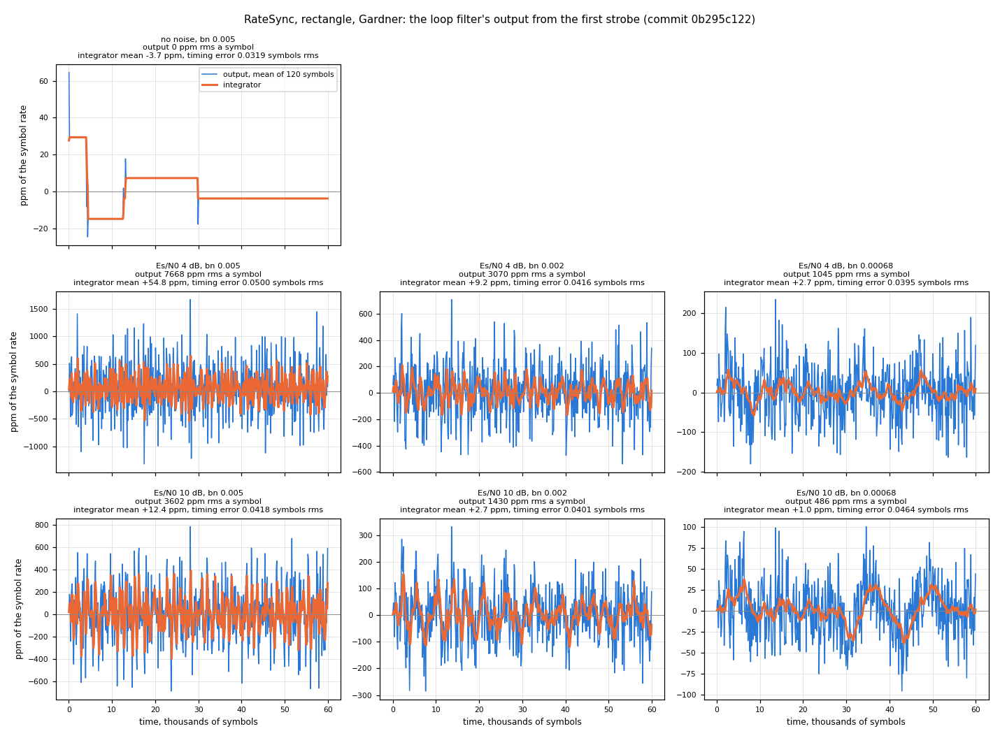
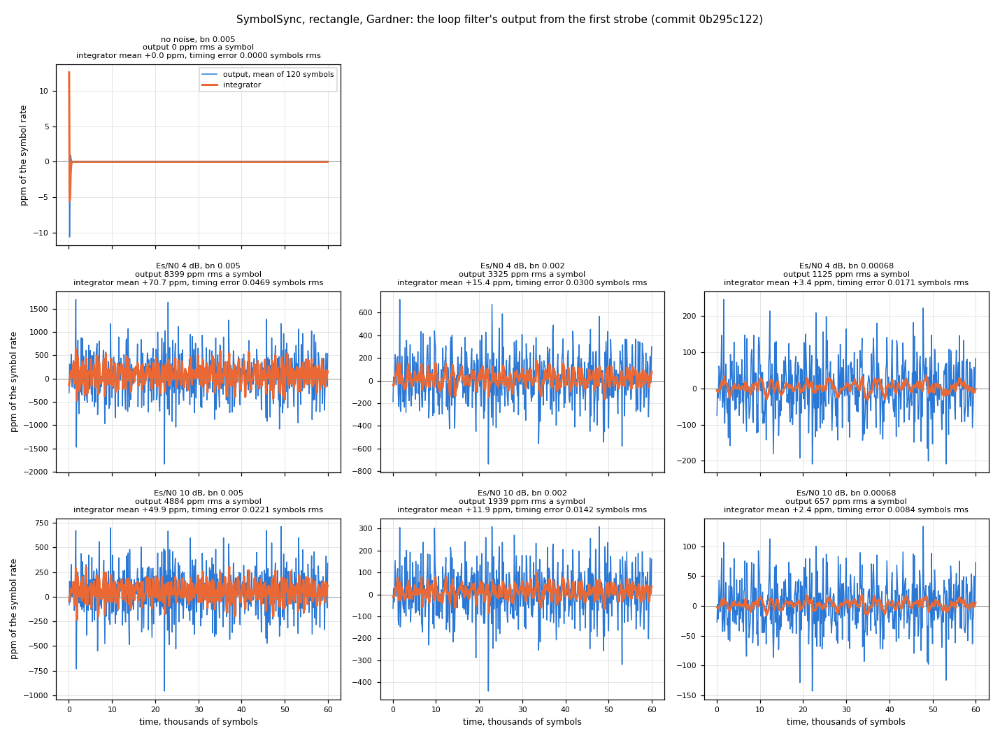
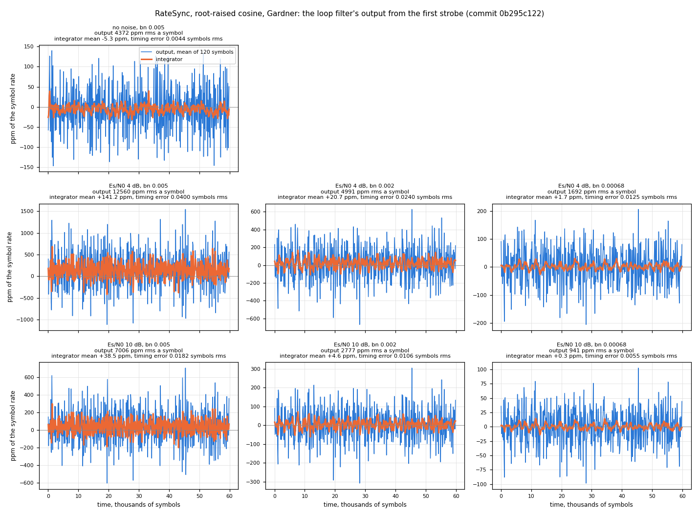
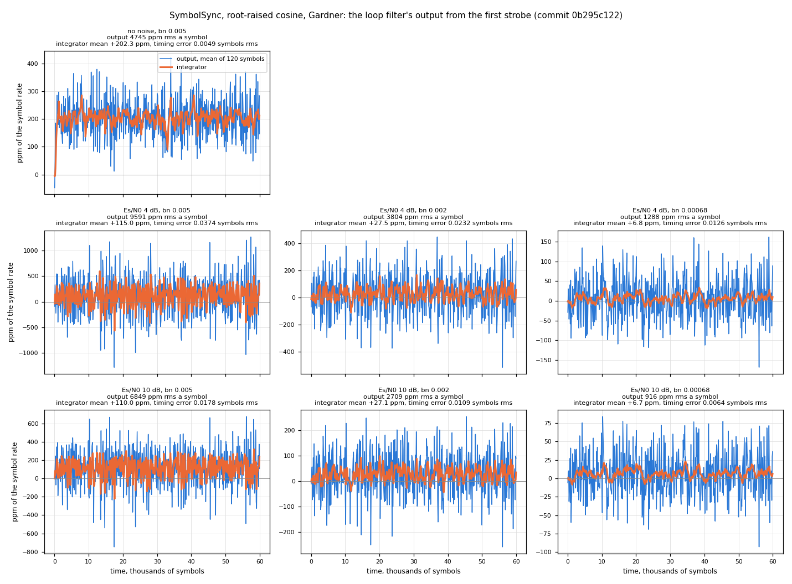
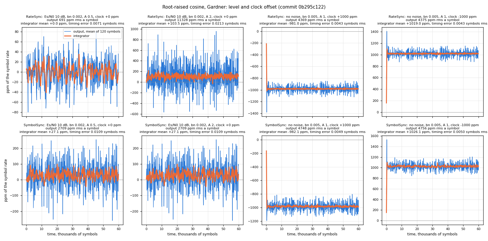

# SymbolSync

`SymbolSync` recovers symbol timing from a baseband stream: a timing
error detector (TED) measures how far the sampling instant is from the
symbol's centre, a loop filter turns that into a rate correction, and an
NCO moves the sampling instant. The same loop, with the same detectors
and the same lock quantity, is `ratesync_loop_t`, which `RateSync` and the
receivers' demodulators run. This page is the design of that loop. It
derives what the loop's timing error must be from the signal, and sizes
the loop from it.

## 1. Who uses it

| consumer                          | pulse                     | detector        | outputs a symbol   | bn (a symbol) |
| --------------------------------- | ------------------------- | --------------- | ------------------ | ------------- |
| `SymbolSync`                      | the caller's              | Gardner or DTTL | the caller's `sps` | the caller's  |
| `RateSync`                        | RRC or integrate-and-dump | Gardner or DTTL | `m`                | the caller's  |
| `MpskReceiver`                    | RRC or integrate-and-dump | Gardner         | 8                  | the caller's  |
| `AsyncDsssReceiver`'s demodulator | integrate-and-dump        | Gardner         | 8                  | 0.005         |
| `DsssReceiver`'s demodulator      | integrate-and-dump        | Gardner         | 8                  | 0.005         |

The DSSS receivers are the demanding case. Their symbol clock is not tied
to the code, so after despreading the timing is recovered from data
transitions alone, at Es/N0 from 4 dB, through stretches with no
transitions (the 415.1-B-1 period's 275-symbol gap).

## 2. Design goals

1. **The timing loop is sized by the loop SNR rule**, as the code and
    carrier loops are (async-dsss-receiver.md §1.3): a loop SNR of at
    least 20 dB at the lowest Es/N0 the consumer states, counting the
    detector's noise-by-noise loss.
1. **The timing error's variance is derived for each detector and each
    pulse, and measured**, open loop and closed loop. The two must agree.
1. **A locked loop does not slip.** At a 20 dB loop SNR a whole-symbol
    slip is a rare event with a rate theory gives; the loop meets it.
1. **The rate state stays inside what the signal can have.** The symbol
    rate is known to the source's tolerance and the Doppler dilation;
    nothing in the loop may sit outside that.
1. **The lock quantity says whether the loop samples near the eye
    centre of a signal that has transitions.** It does not measure the
    timing error (§7); the timing error is measured at the strobe. Its
    threshold separates a locked loop from an unlocked one at the
    consumer's lowest Es/N0, with stated false-lock and false-unlock
    probabilities.

## 3. What it composes, and what each leaves to it

| object               | what it guarantees                                    | what it leaves to this loop                                                            |
| -------------------- | ----------------------------------------------------- | -------------------------------------------------------------------------------------- |
| `NCO`                | the phase word and its control port, exact to one LSB | "`nco_steer_scale` has no production caller"; steering is unbounded                    |
| `LoopFilter`         | `bn` is the loop's noise bandwidth, to a closed form  | "no anti-windup and no output bound"                                                   |
| Farrow / `Resampler` | the interpolant; `mu`, the sampling instant           | "a wrapping `mu` is a residual rate error, and one wrap is one input interval of slip" |
| `LockDet`            | the verify counts compound as documented              | which quantity it is stepped on, and its thresholds                                    |

Each of the three certified reports hands the bound to its caller. This
loop is that caller, so goals 3 and 4 are its to meet.

## 4. The detector

With `y_k` the matched-filter output at the symbol strobe and `y_mid,k`
the output half a symbol earlier:

```text
Gardner:  e_k = Re{ y_mid,k · conj(y_k − y_{k−1}) }
DTTL:     e_k = Re{ y_mid,k · conj(d_k − d_{k−1}) },  d = the hard decision
```

Its mean against a standing timing offset `τ` (in symbols) is the
S-curve `S(τ)`, with two zeros a symbol: a stable one at the eye centre
and an unstable one half a symbol away. The slope at the stable zero is
the detector gain `Kd = S′(0)`, per symbol of timing error. The loop
divides by it once, at construction (`dp_symsync_ted_slope()`), so a
correctly normalized detector has unit slope.

For data symbols `a_k` and the overall pulse `g(t)` (Nyquist, `g(0)` = 1):

```text
S(τ) = Σ_m g((m − ½)T + τ) · [ g(mT + τ) − g((m − 1)T + τ) ]
```

## 5. The timing error's variance

The loop is far narrower than the symbol rate, so it sees the detector's
noise only through its spectral density at zero frequency,
`S_e(0) = Σ_m R_e(m)`, the sum of the error's autocorrelation over all
lags. Adjacent errors share samples, so the lags matter: summing them is
what separates this from the variance of one error. For a loop of noise
bandwidth `bn` a symbol:

```text
σ_τ² = 2 · bn · S_e(0) / Kd²          (symbols²)
```

`S_e(0)` has three parts, each a function of the pulse alone:

```text
S_e(0) = S_self + S_sn / γ + S_nn / γ²,      γ = Es/N0
```

- `S_self`: self noise, the data's own contribution at zero timing
    error. It is the floor a noiseless loop rests on.
- `S_sn / γ`: signal by noise.
- `S_nn / γ²`: noise by noise. It is this detector's squaring loss.

### 5.1 Gardner on integrate-and-dump BPSK

This is the DSSS receivers' case, and it has a closed form. The pulse
after the integrator is the triangle `g(t) = 1 − |t|/T`. At zero timing
error a mid sample is `(a_k + a_{k−1})/2`, which is 0 on a transition and
±1 otherwise, and the difference `a_k − a_{k−1}` is 0 where the mid
sample is not. Their product is always 0:

- **`S_self` = 0.** This detector on this pulse has no self noise.
- **`Kd` = 3/2.** From `S(τ) = (3/2)τ − 3τ²` for i.i.d. data.
- **`S_e(0) = (3/4)(1/γ)(1 + 1/γ)`.** One error has variance
    `(3/2)/γ + 1/γ²`; the lag-1 correlation is `−(3/8)/γ − (1/8)/γ²`;
    further lags are 0.

So:

```text
σ_τ² = (2 · bn / 3) · (1/γ) · (1 + 1/γ)      (symbols²)
```

The factor `1 + 1/γ` is the noise-by-noise loss, `S_L = 1/(1 + 1/γ)`.
The result assumes a transition density of one half; with density `p_t`
both `Kd` and the signal-by-noise term scale with it.

### 5.2 Other pulses, and DTTL

For an RRC matched pair `g` is the raised cosine and `S_self` is not
zero: the mid sample at a transition carries the neighbours' tails. The
three coefficients are sums over `g` at half-symbol spacing and are
computed, not typed. For DTTL the difference is of decisions, so the
coefficients also depend on the decision error rate at `γ`; they are an
expectation over the decision, computed numerically. One function
returns `Kd`, `S_self`, `S_sn` and `S_nn` for a detector, a pulse and a
`γ`, beside `dp_symsync_ted_slope()`, which already returns the first.

## 6. The loop SNR rule, and the bandwidth it gives

The timing loop's SNR is taken on the symbol clock's phase,
`φ = 2π·τ`, as a carrier loop's is taken on the carrier's:

```text
ρ = 1 / σ_φ² = 1 / ( (2π)² · σ_τ² )
```

A 20 dB loop SNR is `σ_τ` = 0.0159 symbols rms. With §5.1:

```text
bn = 3 · γ · S_L / ( 2 · (2π)² · ρ ),      ρ = 100
```

| Es/N0 | `σ_τ` at bn 0.005 | loop SNR at bn 0.005 | bn for 20 dB |
| ----- | ----------------- | -------------------- | ------------ |
| 4 dB  | 0.043 symbols     | 11.4 dB              | 0.00068      |
| 5 dB  | 0.037 symbols     | 12.6 dB              | 0.00091      |
| 10 dB | 0.019 symbols     | 18.4 dB              | 0.0035       |

The DSSS receivers ship `bn` 0.005, chosen on steady-state EVM. By this
derivation that is about seven times wider than the rule allows at
Es/N0 4 dB. The gain a loop actually runs at also scales with the square
of the signal amplitude at the detector (Gardner's error carries `A²`),
so the level the demodulator's gain control delivers at low Es/N0 moves
the effective bandwidth further.

## 7. The lock quantity

```text
L_k = 2 · ( |y_k|² − |y_mid,k|² ) / ( |y_k|² + |y_mid,k|² )
```

averaged over a block. It is a signed measure of where the loop samples,
not a detection statistic with a noise-only null. On integrate-and-dump
data with no noise it is +2 on a transition and 0 otherwise at the eye
centre, mean +1; half a symbol off the two samples trade places and the
mean is −1; with no transitions it is 0. Noise pulls the magnitude
toward 0. With no noise, a transition at timing error `τ` (in symbols)
gives

```text
L(τ) = 2 · (1 − 4|τ|) / (1 − 4|τ| + 8τ²)  ≈  2 · (1 − 8τ²)   near τ = 0
```

So the quantity is not a measure of the timing error:

- **it is flat at the centre.** The 20 dB rule's `σ_τ` of 0.0159 symbols
    lowers the mean by 0.2%; it crosses zero only at a quarter symbol;
- **it is even in `τ`**, so it cannot say which way the loop is off;
- **its mean moves with `γ` and with the transition density** as much as
    with `τ`: a centred loop at low Es/N0 and an off-centre loop at high
    Es/N0 can read the same.

What it can do is tell a loop near the eye centre from one that is not,
or from no signal. Its mean and variance are computed from the same
model as §5, locked and unlocked, and:

- **its threshold sits between the locked mean at the consumer's lowest
    `γ` and the unlocked mean**, with the block length and counts set by
    the two variances and the stated error probabilities;
- **its sign is information.** A block mean below zero says the loop is
    nearer the unstable zero than the stable one.

## 8. Slips

A slip is the loop's phase leaving one stable zero for the next. Its
mean time is a function of `ρ` and `bn` that grows exponentially with
`ρ`; at 20 dB it is far longer than any pass. A loop that slips while
its flags are up is therefore running at a loop SNR well under the rule,
or is not yet settled. Two things can do that besides the bandwidth:
the rate state away from the signal's rate (goal 4), and a stretch with
no transitions, where the detector's output is noise alone and the loop
coasts on its rate state.

## 9. Unknowns

- **Which convention `bn` carries in `σ_τ² = 2·bn·S_e(0)/Kd²`.**
    `LoopFilter`'s report measures `bn` as the noise bandwidth; the factor
    of 2 here is the one-sided form. A measured closed-loop `σ_τ` settles
    it, and moves §6's table by at most 3 dB.
- **Whether the loop SNR is defined on the clock's phase**, as §6 takes
    it. It is the definition that makes 20 dB mean the same margin against
    a slip as it does for a carrier.
- **The coefficients for RRC and for DTTL**, and the lock quantity's mean
    and variance against `τ` and `γ`: derived in §5 and §7, computed by
    nothing yet.
- **The closed-loop `σ_τ`, measured.** It needs the strobe's input-sample
    time as telemetry (#3177).
- **The signal amplitude at the detector inside each receiver** at
    Es/N0 4 dB, and so the gain the loop really runs at.
- **The loop through a gap**: how far the phase coasts in 275 symbols
    with no transitions, from the rate state's error.
- **The rate state's bound**: the range the consumer's signal can have,
    and what the loop does at its edge.
- **The slip rate against `ρ`**, measured where it is not zero, to check
    §8 against theory.

## 10. The work, in order

1. The coefficient function of §5.2, held to §5.1's closed form and to an
    open-loop measurement of `S_e(0)` on the real detector.
1. The strobe-time probe (#3177), and the closed-loop `σ_τ` against
    §5's form, for both detectors and both pulses.
1. The lock quantity's mean and variance against `τ` and `γ`, computed
    and measured; its threshold re-derived from §7.
1. The rate state's bound, and the loop through a gap.
1. Each consumer's `bn` from §6 at its own lowest Es/N0, and the slip
    rate measured against §8.
1. The certification report (`tests/validation/symsync/`), which the
    object does not have.

## 11. Measured: the loop filter's output against time

One run of `validate_timing_loop_noise --trace`: both timing loops, each
closed-loop scenario of the harness, from the first strobe. The stream
starts at the eye center, so a panel shows the loop holding lock, not
acquiring it. Each panel is the loop filter's output averaged over 120
symbols, with its integrator, in parts per million of the symbol rate.
The statistics are over the second half of each scenario, per symbol.

<!-- symsync:stamp:start -->

| run                                                                           | when                      | machine                                                     | commit             | toolchain                                                             | command               |
| ----------------------------------------------------------------------------- | ------------------------- | ----------------------------------------------------------- | ------------------ | --------------------------------------------------------------------- | --------------------- |
| `validate_timing_loop_noise --trace`, 36 scenarios of 60006 symbols, one seed | 2026-11-25 15:14 UTC, 6 s | `omni-x7358h`: Intel(R) Core(TM) Ultra X7 358H (16 threads) | `0b295c122`, clean | GNU 15.2.0; glibc 2.43; build Release, flags -O3 -DNDEBUG, native OFF | `make symsync-record` |

<!-- symsync:stamp:end -->

<!-- symsync:scenarios:start -->

| loop       | pulse              | Es/N0 | bn      | level A | clock, ppm | output mean, ppm | integrator mean, ppm | output rms, ppm | timing error rms, symbols | timing error span, symbols | figure                                               |
| ---------- | ------------------ | ----- | ------- | ------- | ---------- | ---------------- | -------------------- | --------------- | ------------------------- | -------------------------- | ---------------------------------------------------- |
| RateSync   | rectangle          | 10 dB | 0.00068 | 1       | 0          | +1.8             | +1.0                 | 486             | 0.0464                    | 0.130                      | [plot](symsync-measurements/lf_ratesync_iandd.png)   |
| RateSync   | rectangle          | 10 dB | 0.002   | 1       | 0          | +3.3             | +2.7                 | 1430            | 0.0401                    | 0.139                      | [plot](symsync-measurements/lf_ratesync_iandd.png)   |
| RateSync   | rectangle          | 10 dB | 0.005   | 1       | 0          | +13.5            | +12.4                | 3602            | 0.0418                    | 0.167                      | [plot](symsync-measurements/lf_ratesync_iandd.png)   |
| RateSync   | rectangle          | 4 dB  | 0.00068 | 1       | 0          | +4.1             | +2.7                 | 1045            | 0.0395                    | 0.144                      | [plot](symsync-measurements/lf_ratesync_iandd.png)   |
| RateSync   | rectangle          | 4 dB  | 0.002   | 1       | 0          | +9.9             | +9.2                 | 3070            | 0.0416                    | 0.187                      | [plot](symsync-measurements/lf_ratesync_iandd.png)   |
| RateSync   | rectangle          | 4 dB  | 0.005   | 1       | 0          | +54.8            | +54.8                | 7668            | 0.0500                    | 0.334                      | [plot](symsync-measurements/lf_ratesync_iandd.png)   |
| RateSync   | rectangle          | none  | 0.005   | 1       | 0          | -3.7             | -3.7                 | 0               | 0.0319                    | 0.127                      | [plot](symsync-measurements/lf_ratesync_iandd.png)   |
| RateSync   | root-raised cosine | 10 dB | 0.00068 | 1       | 0          | +0.0             | +0.3                 | 941             | 0.0055                    | 0.038                      | [plot](symsync-measurements/lf_ratesync_rrc.png)     |
| RateSync   | root-raised cosine | 10 dB | 0.002   | 0.5     | 0          | -0.2             | +0.0                 | 691             | 0.0071                    | 0.048                      | [plot](symsync-measurements/lf_level_and_offset.png) |
| RateSync   | root-raised cosine | 10 dB | 0.002   | 1       | 0          | +4.3             | +4.6                 | 2777            | 0.0106                    | 0.085                      | [plot](symsync-measurements/lf_ratesync_rrc.png)     |
| RateSync   | root-raised cosine | 10 dB | 0.002   | 2       | 0          | +101.7           | +103.5               | 11328           | 0.0213                    | 0.203                      | [plot](symsync-measurements/lf_level_and_offset.png) |
| RateSync   | root-raised cosine | 10 dB | 0.005   | 1       | 0          | +36.9            | +38.5                | 7006            | 0.0182                    | 0.162                      | [plot](symsync-measurements/lf_ratesync_rrc.png)     |
| RateSync   | root-raised cosine | 4 dB  | 0.00068 | 1       | 0          | +1.2             | +1.7                 | 1692            | 0.0125                    | 0.081                      | [plot](symsync-measurements/lf_ratesync_rrc.png)     |
| RateSync   | root-raised cosine | 4 dB  | 0.002   | 1       | 0          | +19.6            | +20.7                | 4991            | 0.0240                    | 0.187                      | [plot](symsync-measurements/lf_ratesync_rrc.png)     |
| RateSync   | root-raised cosine | 4 dB  | 0.005   | 1       | 0          | +137.0           | +141.2               | 12560           | 0.0400                    | 0.335                      | [plot](symsync-measurements/lf_ratesync_rrc.png)     |
| RateSync   | root-raised cosine | none  | 0.005   | 1       | +1000      | -981.1           | -981.0               | 4369            | 0.0043                    | 0.073                      | [plot](symsync-measurements/lf_level_and_offset.png) |
| RateSync   | root-raised cosine | none  | 0.005   | 1       | -1000      | +1019.0          | +1019.0              | 4375            | 0.0043                    | 0.089                      | [plot](symsync-measurements/lf_level_and_offset.png) |
| RateSync   | root-raised cosine | none  | 0.005   | 1       | 0          | -5.4             | -5.3                 | 4372            | 0.0044                    | 0.026                      | [plot](symsync-measurements/lf_ratesync_rrc.png)     |
| SymbolSync | rectangle          | 10 dB | 0.00068 | 1       | 0          | +2.2             | +2.4                 | 657             | 0.0084                    | 0.053                      | [plot](symsync-measurements/lf_symsync_iandd.png)    |
| SymbolSync | rectangle          | 10 dB | 0.002   | 1       | 0          | +11.6            | +11.9                | 1939            | 0.0142                    | 0.095                      | [plot](symsync-measurements/lf_symsync_iandd.png)    |
| SymbolSync | rectangle          | 10 dB | 0.005   | 1       | 0          | +49.9            | +49.9                | 4884            | 0.0221                    | 0.160                      | [plot](symsync-measurements/lf_symsync_iandd.png)    |
| SymbolSync | rectangle          | 4 dB  | 0.00068 | 1       | 0          | +2.8             | +3.4                 | 1125            | 0.0171                    | 0.101                      | [plot](symsync-measurements/lf_symsync_iandd.png)    |
| SymbolSync | rectangle          | 4 dB  | 0.002   | 1       | 0          | +15.0            | +15.4                | 3325            | 0.0300                    | 0.198                      | [plot](symsync-measurements/lf_symsync_iandd.png)    |
| SymbolSync | rectangle          | 4 dB  | 0.005   | 1       | 0          | +70.0            | +70.7                | 8399            | 0.0469                    | 0.344                      | [plot](symsync-measurements/lf_symsync_iandd.png)    |
| SymbolSync | rectangle          | none  | 0.005   | 1       | 0          | +0.0             | +0.0                 | 0               | 0.0000                    | 0.008                      | [plot](symsync-measurements/lf_symsync_iandd.png)    |
| SymbolSync | root-raised cosine | 10 dB | 0.00068 | 1       | 0          | +7.0             | +6.7                 | 916             | 0.0064                    | 0.043                      | [plot](symsync-measurements/lf_symsync_rrc.png)      |
| SymbolSync | root-raised cosine | 10 dB | 0.002   | 0.5     | 0          | +27.7            | +27.1                | 2709            | 0.0109                    | 0.075                      | [plot](symsync-measurements/lf_level_and_offset.png) |
| SymbolSync | root-raised cosine | 10 dB | 0.002   | 1       | 0          | +27.7            | +27.1                | 2709            | 0.0109                    | 0.075                      | [plot](symsync-measurements/lf_symsync_rrc.png)      |
| SymbolSync | root-raised cosine | 10 dB | 0.002   | 2       | 0          | +27.7            | +27.1                | 2709            | 0.0109                    | 0.075                      | [plot](symsync-measurements/lf_level_and_offset.png) |
| SymbolSync | root-raised cosine | 10 dB | 0.005   | 1       | 0          | +110.8           | +110.0               | 6849            | 0.0178                    | 0.156                      | [plot](symsync-measurements/lf_symsync_rrc.png)      |
| SymbolSync | root-raised cosine | 4 dB  | 0.00068 | 1       | 0          | +7.5             | +6.8                 | 1288            | 0.0126                    | 0.090                      | [plot](symsync-measurements/lf_symsync_rrc.png)      |
| SymbolSync | root-raised cosine | 4 dB  | 0.002   | 1       | 0          | +29.1            | +27.5                | 3804            | 0.0232                    | 0.157                      | [plot](symsync-measurements/lf_symsync_rrc.png)      |
| SymbolSync | root-raised cosine | 4 dB  | 0.005   | 1       | 0          | +117.8           | +115.0               | 9591            | 0.0374                    | 0.336                      | [plot](symsync-measurements/lf_symsync_rrc.png)      |
| SymbolSync | root-raised cosine | none  | 0.005   | 1       | +1000      | -982.0           | -982.1               | 4748            | 0.0049                    | 0.073                      | [plot](symsync-measurements/lf_level_and_offset.png) |
| SymbolSync | root-raised cosine | none  | 0.005   | 1       | -1000      | +1026.1          | +1026.1              | 4756            | 0.0050                    | 0.082                      | [plot](symsync-measurements/lf_level_and_offset.png) |
| SymbolSync | root-raised cosine | none  | 0.005   | 1       | 0          | +202.4           | +202.3               | 4745            | 0.0049                    | 0.036                      | [plot](symsync-measurements/lf_symsync_rrc.png)      |

<!-- symsync:scenarios:end -->











See also: [RateSync's timing on a rate cascade](ratesync-timing.md),
[the lock statistic's sizing as shipped](timing_lock_detector.md),
[the loop filter](loop-filter.md), [the NCO](nco.md).
