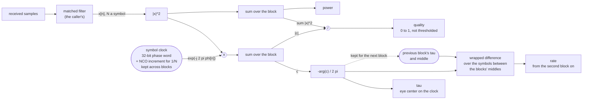

# The feedforward symbol-timing estimator

**Scope:** why `SymbolTimingEstimator` (`timing_est_core.h`) exists, what
it computes, what it does, and what is not known yet. It is the
acquisition half of symbol timing: the tracking half is a loop
([RateSync's timing](ratesync-timing.md)). §4 gives each prediction with
what the object's report measured beside it; the numbers and the rows
behind them are in
`src/doppler/track/tests/validation/timing_est/results.md`, and §6 lists
what that report settled and what it left.
What was predicted before the first run, and which of it was wrong, is
kept on [the measurement record](timing-estimator-measurements.md) under
the same section numbers.

______________________________________________________________________

## 1. The problem: a loop's pull-in is not bounded

A timing loop that starts at an arbitrary offset has to walk the error
out, and how long that takes depends on where it started. Half a symbol
off is the detector's unstable zero, where the restoring force is nothing
and the loop waits for noise to move it. Modeled on RateSync's two
detectors at Es/N0 4 dB and a loop bandwidth of 0.005 of the symbol rate,
the median pull-in from half a symbol is 148 to 282 symbols for Gardner
and 460 to 945 for the derivative detector, and on one grid the second
did not arrive in 4000
([the loop model](ratesync-timing.md#closed-and-on-inputs-with-no-whole-number-of-samples-per-symbol)).
A receiver that declares its symbols valid on a fixed schedule cannot
build on that.

A feedforward estimate takes a fixed number of symbols whatever the
starting offset, has no unstable point, and hands the loop a timing it
already tracks. Acquisition time is then a design constant.

It runs first. The carrier has not been recovered when timing is
acquired, so the estimate may not depend on the carrier's phase and has
to hold with a frequency offset present.

## 2. Who uses it

| consumer                                                                | what it hands the estimator                                   | what it does with the answer                           |
| ----------------------------------------------------------------------- | ------------------------------------------------------------- | ------------------------------------------------------ |
| `RateSync`                                                              | its matched bank's output at `K` timing hypotheses per symbol | seeds its loop's phase and rate state, then tracks     |
| a caller with a matched-filtered stream at 3 or more samples per symbol | the stream                                                    | resamples at the estimate, or seeds a loop of its own  |
| a burst demodulator                                                     | one burst's stream                                            | one timing for the whole burst, with no loop behind it |

The DSSS receivers' code loop already forms the same statistic from its
partial sums (the Dll's symbol aid picks the boundary hypothesis with the
most power). That is this estimator's peak-picking special case, and it is
left as it is here.

## 3. What it computes

The input is a stream of complex samples `x[n]` taken after a matched
filter, `N` samples per symbol, `N` any real number of 3 or more. The
power of such a stream is periodic at the symbol rate, with its maximum at
the eye center. Over a block of `L` symbols the estimator forms the
Fourier coefficient of the power at the symbol rate:

```text
c       = sum_n |x[n]|^2 exp(-j 2 pi n / N)
tau_hat = -(1 / 2 pi) arg c              symbols, in [-1/2, 1/2)
quality = |c| / sum_n |x[n]|^2           in [0, 1]
```

`tau_hat` is where the eye center sits relative to the block's first
sample. `n / N` is carried by a phase accumulator, the same 32-bit word
and conversion the NCO uses, so a non-integer `N` needs nothing special.
This is the estimator of Oerder and Meyr (1988).

Two consecutive blocks give the symbol rate's error from the motion of the
estimate:

```text
eps_hat = (tau_hat_2 - tau_hat_1, wrapped) / L       symbols per symbol
```

As blocks, with what is the caller's on the left and what the object
keeps across calls drawn round:



Nothing feeds back: the clock is never steered by the estimate, which is
what makes the time an estimate takes the block's own length.

It is by-value: a block in, one estimate out, and no state that outlives
a block except the accumulator's phase, which is what makes consecutive
estimates comparable.

**The general object.** It is a spectral-line estimator on a power
stream. The application's numbers (the pulse, `N`, `L`, how the stream is
formed) are arguments; nothing about a rectangle, a bank or a receiver is
in its shape. `RateSync` is one configuration: `N = K = 4` hypotheses per
symbol, formed by its bank.

## 4. What it is predicted to do

### 4.1 Noise

The estimate's variance has three parts, from the pulse's own data
pattern, from signal against noise, and from noise against noise, with
`gamma` the Es/N0:

```text
var(tau_hat) = (1 / L) * ( k_ss + k_sn / gamma + k_nn / gamma^2 )
```

The three constants depend on the pulse after the matched filter and on
`N`. They are computed, not fitted: the object's validator evaluates them
from the pulse (a lone symbol through the chain, and the matched filter's
impulse response), and the measurement is held to them.

Measured, with a carrier offset on every row: the variance is the
computed one within its standard error wherever the form's own
second-order term is under a quarter of the first, which is every row but
the short blocks at low Es/N0. For the rectangle at `N = 4`, averaged
over each sample's interval, `k_ss` is under 0.001, `k_sn` 0.095 and
`k_nn` 0.148: 0.019 to 0.026 symbols rms from 128 symbols at Es/N0 4 dB,
by where the samples fall in the symbol. The model of RateSync's bank
gave 0.020 to 0.027. The root-raised cosine of roll-off 0.35 has `k_sn`
and `k_nn` of 0.31 to 0.36 and needs about four times the symbols for the
same error, because its line is a third the size.

**The mean is not always the eye center.** For a rectangle at a whole
`N` the power's higher harmonics fold onto the line, and its phase then
depends on where the samples fall in the symbol: a bias of up to 0.011
symbols at `N = 4`, of period one sample. A band-limited pulse has none,
and an `N` that is not whole runs through every sampling phase inside the
block and averages it out.

### 4.2 Clock offset

If the symbols' true period is `N (1 + eps)` samples, the power line
rotates by `eps * L` cycles across the block. The coefficient then adds up
with a loss of `sinc(eps * L)` in amplitude, the estimate refers to the
middle of the block, and the rate estimate reads `eps` as long as
`|eps * L| < 1/2`. Past that the line has moved out of the estimator's one
bin.

So `L` is bounded above by the largest clock offset to be acquired, and
below by the noise.

Measured: the rate is read out to 0.4 of a cycle a block, which is
`0.4 / L`, or 3125 ppm at 128 symbols, 781 ppm at 512 and 195 ppm at
2048; at the half cycle the two signs cannot be told apart, and past it
the rate reads `(eps L - round(eps L)) / L`, with the wrong sign. The
`sinc` loss holds for the band-limited pulse. For the rectangle at a
whole `N` the line's size also depends on the sampling phase (0.117 to
0.159 of the power at `N = 4`), an offset sweeps that phase, and the loss
against the line at the block's own phase is anything from none to twice
the `sinc`'s. A set of rate hypotheses (the two-dimensional search the
polynomial-phase estimator runs for frequency) is needed only where a
block of thousands of symbols and an offset of hundreds of ppm are wanted
together.

### 4.3 Doppler

Doppler reaches this object two ways, and they are separate.

- **The carrier.** `|x|^2` does not see carrier phase, so a frequency
    offset costs only what it costs the matched filter ahead of the
    estimator: the symbol's amplitude falls as `sinc(f * T)`. The
    estimator's own statistic is unchanged.
- **The time base.** A range rate dilates the symbol clock by the same
    fraction as the carrier, so a Doppler of `f_d` on a carrier `f_c` is a
    clock offset of `eps = f_d / f_c`, and a Doppler rate is a clock
    offset that changes across the block. §4.2 covers the first. The
    second is a chirp of the power line: with `q` the change in clock
    offset across the block times `L`, the line's amplitude falls as
    `|integral over u from -1/2 to 1/2 of exp(j pi q u^2)|` and the
    timing moves by that integral's argument over `2 pi`. At `q = 2`
    that is 0.80 of the line's power and 0.082 symbols; at 0.01 it is
    nothing, and a physical Doppler rate is orders of magnitude under
    that.

Measured through `doppler_channel`, which applies both from one figure:
a carrier a tenth of the symbol rate off changes no statistic beyond what
the pulse through the matched filter gives at that carrier, and the
dilation reads as rate. On the rectangle at a whole `N` a drift much
smaller than a sample over the block is read through the slope of the
sampling-phase bias of §4.1, so 20 ppm over 512 symbols reads as 13 to
26 ppm; the root-raised cosine reads 20.

### 4.4 The quality figure

With no signal, `c` is circular Gaussian and `quality` narrows as
`1 / sqrt(N * L)`. Its terms are not independent: the matched filter
correlates them, and for the rectangle's filter at `N = 4` `E |c|^2` is
half what independent samples would give. The mean quality is the
Rayleigh mean computed from the filter's response, 0.0277 at 512 samples
there, and measured 0.02776.

A threshold on it at a stated false-alarm probability says "there is a
timing here". The Rayleigh threshold alone gives 1.03 to 1.22 of the
target. The threshold is derived one order past it: `c` and the block's
power are both quadratic forms in the filtered noise, so their joint
cumulants are traces of the noise's covariance and the clock's phasors,
and those give the second moment of `quality` and the excess of its
fourth, hence the tail `exp(-t) (1 + (excess / 2) (t^2 / 2 - t))`. For
independent samples that is the known exact result to this order. It
gives 0.98 to 1.12 of the target, furthest where its last term is
largest (the root-raised cosine from 128 symbols, and a target of
0.001). At it, for a false-alarm probability of 0.01, the rectangle is
detected 0.66 of the time from 128 symbols at Es/N0 0 dB, 0.93 at 4 dB
and over 0.99 from 8 dB, which is the normal form from §4.1's constants within its
interval; a stream with no transitions has no line and is refused.

## 5. What it composes

- the NCO's phase word and conversions, for `n / N`;
- nothing else. It allocates nothing after create and keeps no history.

It does not filter, resample, or decide symbols. Whoever calls it owns the
matched filter, which is why the pulse appears here only through the three
constants.

## 6. What the report settled, and what is open

Settled, each in the report's section 2:

- **`k_ss`, `k_sn`, `k_nn`** for the rectangle averaged over each
    sample's interval and for the root-raised cosine, at `N` of 3 to 8,
    whole and not.
- **How small `N` may be.** 3 holds for both pulses; the rectangle's
    line is as large there as at 4, and its bias larger (0.028 symbols).
- **The bias**: the sampling-phase bias of §4.1, and the leak of the
    power's mean into the bin when a block is not a whole number of
    symbols (0.006 to 0.009 symbols at `N = 3.2`, 128 symbols).
- **One rate bin or several**: one, out to `0.4 / L` (§4.2).
- **The cost of a Doppler rate** (§4.3).
- **No transitions**: `quality` reads the noise's, and a threshold
    refuses the block (§4.4).
- **The false-alarm threshold**: derived, to the size of its expansion's
    last term (§4.4).
- **The rectangle behind the converter's whole decimations** (to 4
    samples a symbol from 8, 16, 32 and 64): the constants are §4.1's to
    within a tenth, and the sampling-phase bias falls from 0.011 symbols
    to 0.002 to 0.003, because the stages ahead of the bank band-limit
    the rectangle.

Open, both in
[#3367](https://github.com/doppler-dsp/doppler/issues/3367):

- **Behind a decimation that is not whole** (17.333 input samples a
    symbol to 4) the estimate is measured and not predicted: the mean
    error runs -0.012 to +0.012 symbols across starting offsets, as
    large as with no cascade, and how much of that is the estimator's is
    not separated from the truth's.
- **Through `doppler_channel` the validator's prediction is good to 2%
    in line energy and 1% in rate** on the rectangle at a whole `N`, and
    why it is not better is not known.

## 7. What the characterization measures

Each is a measurement beside §4's prediction, with a tolerance from the
run's own standard error, on stimulus from the library's generator
(`wfm_synth`), noise from `awgn`, and Doppler from `doppler_channel`.

**A carrier offset is present on every row.** The estimator runs before
carrier recovery, so there is no measurement here with the carrier
removed: each run draws an offset and a starting phase, and the row
without one is the control, not the case.

| axis            | swept over                                                                                                                  | held against                                                                            |
| --------------- | --------------------------------------------------------------------------------------------------------------------------- | --------------------------------------------------------------------------------------- |
| noise           | Es/N0 0 to 14 dB; `L` 32 to 512; `N` 3 to 8, whole and not; rectangle and root-raised cosine                                | §4.1's variance; zero mean error                                                        |
| clock offset    | `eps * L` from 0 to past 1/2, both signs                                                                                    | the `sinc` loss; the rate estimate's mean and variance; where it stops working          |
| Doppler         | carrier offset to a tenth of the symbol rate; time-base dilation with it, as `doppler_channel` applies both; a Doppler rate | §4.3: no effect from the carrier beyond the matched filter's; the dilation read as rate |
| quality         | noise alone; signal at each Es/N0; a run with no transitions                                                                | the false-alarm and detection probabilities, with intervals                             |
| starting offset | 64 offsets across one symbol                                                                                                | the error does not depend on it                                                         |

The gate is the fast subset of this: one seeded row an axis, each with
its carrier offset, in the
validator's `--check`, each shown red on a named wrong case.

## 8. The phases this page starts

| #   | phase      | what it produces here                                                                          |
| --- | ---------- | ---------------------------------------------------------------------------------------------- |
| 1   | Why        | this page                                                                                      |
| 2   | Declare    | the manifest: a by-value estimator with a block method and a named result record               |
| 3   | Implement  | the header, with its claims, and the C core                                                    |
| 4   | Pin        | the C tests, each with its failing case                                                        |
| 5   | Bind       | the Python class and record, from the manifest                                                 |
| 6   | Instrument | the phase word in the state blob; no telemetry of its own (one estimate a block is its output) |
| 7   | Explore    | the validator of §7, C first                                                                   |
| 8   | Certify    | the report, its limits from §7's rows                                                          |
| 9   | User story | a guide section, a C and a Python example, a gallery decision, both benchmarks                 |
| 10  | Land       | the changelog fragment; an issue for anything left                                             |

See also: [RateSync's timing](ratesync-timing.md),
[the polynomial-phase estimator](ppe.md), which is the same idea for
frequency, [the NCO](nco.md).
