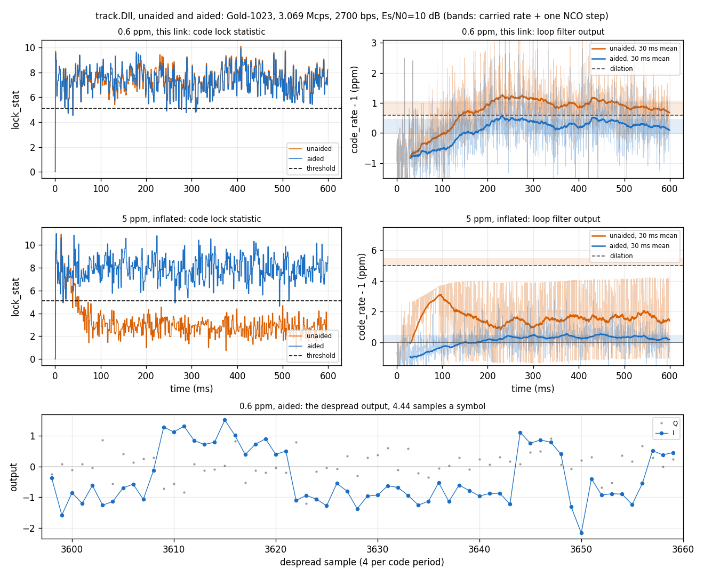

# Streaming Async Despreader



A [`track.Dll`](../api/python-track.md) with `segments > 1` is the despreader of
a DSSS link whose data clock is asynchronous to its code. It takes a
carrier-wiped stream, removes the spreading code, and emits `segments` despread
samples per code period. Those samples carry the symbol clock to the next stage,
a symbol-timing loop.

Two things make the asynchronous case different:

- **A data transition lands in most code periods.** Summed coherently across a
    transition, a period's correlation cancels. So the loop splits each period
    into partials and steers on the one-period window its look-back finds free
    of a transition.
- **The code clock is dilated by the same motion that shifts the carrier.** A
    carrier offset `f` on a carrier `fc` is a code-rate ratio `f/fc`. The
    carrier estimate that wipes the carrier, divided by `fc`, is also the
    code-rate aid, [`Dll.set_rate_aid`](../api/python-track.md). Aided, the loop
    carries only what the estimate missed, so it can stay narrow.

The setup is CCSDS Gold-1023 at 3.069 Mcps, asynchronous BPSK at 2700 bps, two
samples per chip, at 10 dB Es/N0. The page runs the link twice, unaided and
aided, at two Dopplers:

- **0.6 ppm, this link's Doppler**: a 1500 Hz carrier offset on a 2.5 GHz
    carrier, which dilates the code by 1.8 chips/s.
- **5 ppm, inflated** to about eight times this link's, 15 chips/s, to show what
    the aid is for.

## What the runs show

- **At this link's Doppler, both loops hold lock.** Unaided, the loop filter
    output settles at the dilation: the loop carries it. Aided, it settles at
    zero, because the aid carries it.
- **At the inflated Doppler, only the aided loop holds.** Unaided, the narrow
    loop must pull in the whole dilation, and the transient takes it off the code
    within tens of milliseconds. Its lock statistic falls to the noise and stays
    there. Aided, nothing changes from the 0.6 ppm run.
- **The filter output reads high by up to one NCO step.** The code NCO commands
    its rate in whole phase-increment steps of `SF·spc/2³²` chips per chip, 0.48
    ppm here, and truncates. A settled filter output therefore sits between the
    rate the loop carries and one step above it. At this link's Doppler one step
    is nearly the whole Doppler, so the code loop's rate is not how to measure the
    Doppler. The carrier estimate is.

The script prints this run's numbers: the settled filter outputs, and when the
unaided loop lost the inflated Doppler. The NCO-step bound and the output rate
hold on every draw. Which loops held lock is this run's outcome, and the script
asserts it for this run.

## How it works

The emitter is [`wfm.Synth`](../api/python-wfmgen.md) in continuous DSSS mode,
on nominal frequency, with its own PRBS payload.
[`impairment.DopplerChannel`](../api/python-impairment.md) applies the motion
from one parameter: it dilates every clock in the stream and shifts the carrier
to match. The noise is [`source.AWGN`](../api/python-nco.md) at the Es/N0.

```python
--8<-- "src/doppler/examples/async_despread_demo.py:signal"
```

The despreader is configured for the link. `bn` is narrow, for a quiet code
phase. The lock detector is sized the way `AsyncDsssReceiver` sizes its own:
given the symbol period, its looks are coherent over the transition-free part of
a symbol, `det_n_noncoh` gives the looks a decision needs for 0.99 detection at
the C/N0, and `det_verify_count` gives the drop count. At its defaults the
detector reads unlocked, now and then, on a loop that holds the code.

One carrier estimate wipes the carrier and, divided by the carrier frequency, is
the rate aid. The loop starts at the code phase acquisition reports, to one
sample. The channel delays the stream by 10.5 samples, which is 5.25 chips at two
samples per chip. The code phase runs opposite to the delay, so the loop starts
at `SF − 5` and pulls in the last quarter chip. That pull-in is the first couple
of hundred milliseconds in the filter-output panels.

```python
--8<-- "src/doppler/examples/async_despread_demo.py:track"
```

The checks run on one row per code period:

```python
--8<-- "src/doppler/examples/async_despread_demo.py:validate"
```

## Reading it when it does not behave

Read `locked` first: the code loop's lock flag. Then read `lock_stat`, the
statistic the flag thresholds, and then `code_rate − 1`, the loop filter output.
A filter output that walks away while `lock_stat` falls is a loop asked to carry
more rate than its bandwidth allows: aid it, or widen `bn`. A `lock_stat` that
grazes the threshold on a loop whose filter output is steady is a detector sized
for a higher C/N0 than the link has.

## What you're seeing

1. **Code lock statistic** (left). Unaided in orange, aided in blue, against the
    lock threshold. At 0.6 ppm the two traces lie on top of each other. At 5 ppm
    the unaided statistic falls to the noise early in the run, and the aided one
    stays where it was at 0.6 ppm.
1. **Loop filter output** (right), `code_rate − 1` in ppm, per code period and as
    a 30 ms mean. The dashed line is the dilation. Each shaded band is where a
    loop reads when it carries its rate: from that rate to one NCO step above it,
    orange from the dilation and blue from zero. At 5 ppm the unaided output climbs
    toward the dilation, loses the code before it gets there, and wanders.

## Reproduce

```sh
python -m doppler.examples.async_despread_demo out.png
```

The C twin is
[`async_despread_demo.c`](https://github.com/doppler-dsp/doppler/blob/main/native/examples/async_despread_demo.c).
It runs the same link at the same two Dopplers and checks the same physics. It is
a different noise draw, so its numbers differ from this page's. It also shows
what the binding hides: the loop's damping and tap spacing, and the buffers the
caller owns.

The design is in [the async DSSS receiver design](../design/async-dsss-receiver.md),
section 3. The [lock-detection guide](../guide/lock-detection.md) covers how the
`Dll`'s lock detector fits alongside every other loop's.

Source: [`async_despread_demo.py`](https://github.com/doppler-dsp/doppler/blob/main/src/doppler/examples/async_despread_demo.py).
