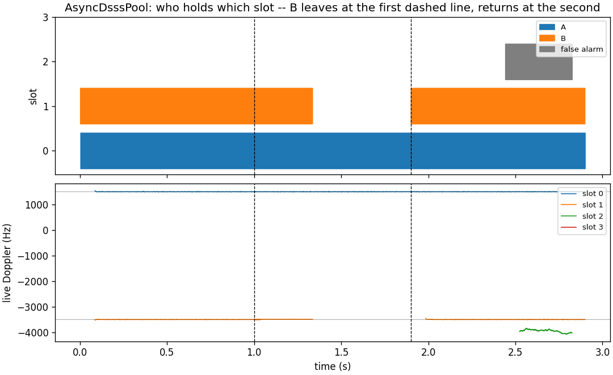

# AsyncDsssPool: emitters that come and go



One [`dsss.AsyncDsssPool`](../api/python-dsss.md) runs three receivers on one
stream. Four emitters on one Gold code reach it at different times, code phases
and carriers. A, B and C arrive one after another, B leaves, and D arrives after
it.

Every receiver searches the whole carrier range for itself. The pool's
controller only keeps them apart: it gives each searching receiver the code
phases the others hold, so a search never takes a signal already held, and a
rank, so two receivers that decide in the same dwell take different signals.
When a receiver's emitter leaves, its release rule fires, the controller resets
it, and it searches again.

## What the run shows

- **One receiver per emitter.** While A, B and C are on the air, each is held by
    exactly one receiver, and no two receivers hold one signal.
- **A departure frees a receiver.** After B leaves, its receiver is released
    once both of its lock detectors have stayed down for `lost_confirm_s`, and it
    searches again.
- **The freed receiver takes the newcomer.** D is taken by the receiver B freed,
    without disturbing the two that track A and C.

## How it is built

Each emitter is [`wfm.Synth`](../api/python-wfmgen.md) in continuous DSSS mode,
placed on the stream at its own sample offset and carrier, with
[`source.AWGN`](../api/python-nco.md) at the Es/N0 every emitter shares.

```python
--8<-- "src/doppler/examples/async_dsss_pool_demo.py:signal"
```

The pool is built like one receiver, plus `n_receivers`. `lost_confirm_s` arms
each receiver's release rule. The pool is fed one code epoch per push, and the
script reads every receiver's `status()` after each one.

```python
--8<-- "src/doppler/examples/async_dsss_pool_demo.py:pool"
```

The checks identify the emitter each receiver holds by its code phase, and
assert the claims above from the pool's own reports.

```python
--8<-- "src/doppler/examples/async_dsss_pool_demo.py:validate"
```

## What you're seeing

1. **What each receiver holds** (top): the emitters on the air, then one row
    per receiver, coloured by the emitter it holds. Grey is refining after a
    hand-off. The hatched span is receiver 1 still holding B after B left,
    until its release fires.
1. **Receiver 1 over time** (middle): B's symbols, then the noise it emits
    after B leaves, while its symbol lock is down and before the release, then
    nothing while it searches, then D's symbols. The symbol lock,
    `status().locked`, says when the symbols are a signal's.
1. **Each receiver's last 600 symbols** (bottom): A, D and C, one BPSK
    constellation each.

## Reproduce

```sh
python -m doppler.examples.async_dsss_pool_demo out.png
```

The design is in
[the async DSSS design](../design/async-dsss-receiver.md), §5-§9.

Source: [`async_dsss_pool_demo.py`](https://github.com/doppler-dsp/doppler/blob/main/src/doppler/examples/async_dsss_pool_demo.py).
