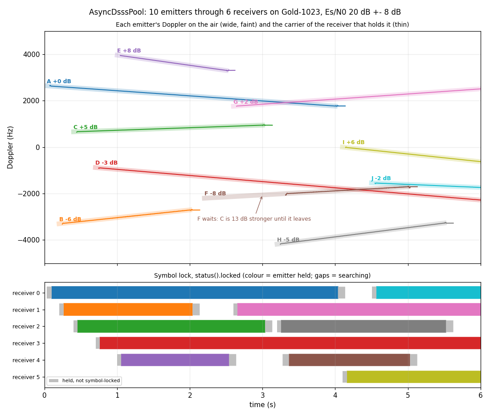

# AsyncDsssPool: ten emitters through six receivers



One [`dsss.AsyncDsssPool`](../api/python-dsss.md) runs six receivers on one
stream. Ten emitters on one Gold code come and go over six seconds, at most six
on the air at once. Each has its own code phase, its own level (within ±8 dB of
the others) and its own Doppler: a start and a rate, as from its own motion. The
Doppler stretches the chip clock as well as the carrier.

Every receiver searches the whole carrier range for itself. The pool's
controller only keeps them apart: it gives each searching receiver the code
phases the others hold, and a rank, so two receivers never take one signal. It
also frees a receiver whose emitter has left.

## What the run shows

- **Each emitter is held by one receiver, from soon after it arrives to when it
    leaves.** Nine of the ten are held within 50 ms of arriving. The receiver's
    carrier follows the emitter's Doppler ramp the whole time, and its symbol
    lock stays up.
- **A departure frees a receiver, and a newcomer takes it.** Ten emitters pass
    through six receivers. Receiver 0 holds A, then J. Receiver 2 holds C, then
    H.
- **A weak emitter waits for the strong one that masks it.** A search that skips
    the signals already held can't tell a second signal far below a stronger one
    from that stronger one's own sidelobes. On a one-epoch search the limit is
    about 10 dB
    ([the parallel design, §3](../design/async-dsss-parallel.md#3-the-receiver)).
    F arrives 13 dB below C and is taken once C leaves.

## How it is built

Each emitter is [`wfm.Synth`](../api/python-wfmgen.md) in continuous DSSS mode,
run through its own [`impairment.DopplerChannel`](../api/python-impairment.md)
on a 2.2 GHz carrier, scaled to its level and placed on the stream. The noise is
[`source.AWGN`](../api/python-nco.md). The truth the checks use, each emitter's
carrier and code phase over time, comes from the same channel: its Doppler law
and its group delay, `delay_samples`.

```python
--8<-- "src/doppler/examples/async_dsss_pool_scene.py:signal"
```

The pool is built like one receiver, plus `n_receivers`. `carrier_freq_hz` lets
each receiver's code loop follow the clock stretch its carrier implies.
`cn0_dbhz` is the design point, the weakest emitter's C/N0. `lost_confirm_s`
arms the release that frees a receiver. The pool is fed one code epoch per push,
and the script reads every receiver's `status()` after each one.

```python
--8<-- "src/doppler/examples/async_dsss_pool_scene.py:pool"
```

The checks find the emitter each receiver holds from its carrier and code phase,
and assert the claims above from the pool's own reports.

```python
--8<-- "src/doppler/examples/async_dsss_pool_scene.py:validate"
```

## What you're seeing

1. **Doppler against time** (top): each emitter's Doppler while it is on the
    air, wide and faint. Over it is the carrier of the receiver that holds it,
    thin, in the same colour. A thin line that runs a little past its band is a
    receiver still holding an emitter that has just left, until its release
    fires. F's band runs alone from 2.2 s until C has left.
1. **Symbol lock** (bottom): one row per receiver, coloured by the emitter it
    holds where `status().locked` is up. Grey is a receiver holding a signal
    without symbol lock: coming up after a hand-off, or going down after its
    emitter left. A gap is a receiver searching.

## Reproduce

```sh
python -m doppler.examples.async_dsss_pool_scene out.png
```

The design, including the controller and the near-far limit, is in
[the parallel async DSSS design](../design/async-dsss-parallel.md).

Source: [`async_dsss_pool_scene.py`](https://github.com/doppler-dsp/doppler/blob/main/src/doppler/examples/async_dsss_pool_scene.py).
