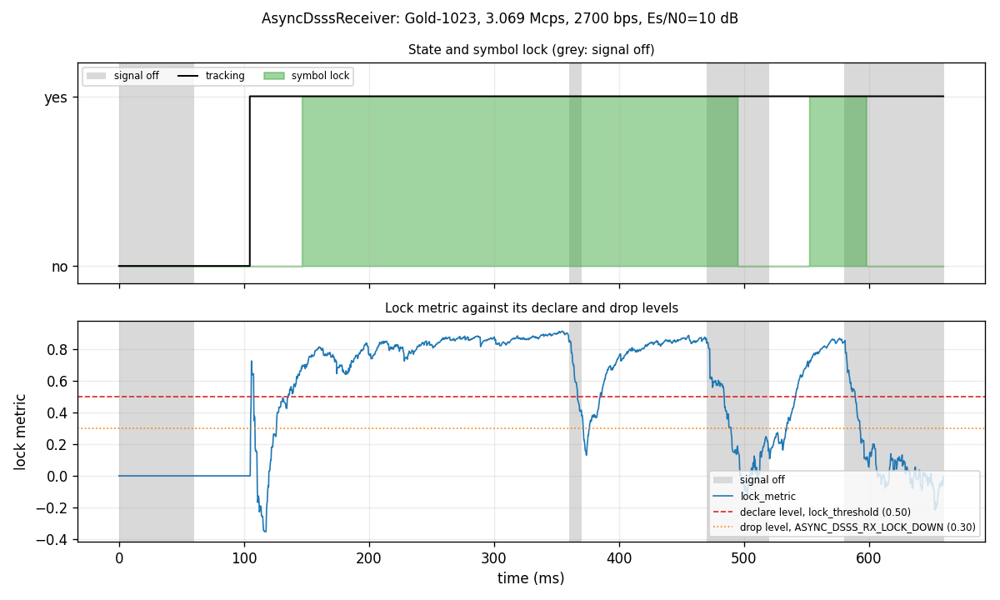

# AsyncDsssReceiver: a signal's lifecycle



One [`dsss.AsyncDsssReceiver`](../api/python-dsss.md) follows one emitter
through the life of its signal. The emitter is CCSDS Gold-1023 at 3.069 Mcps,
asynchronous BPSK at 2700 bps, carried 1500 Hz off nominal, at 10 dB Es/N0.
The receiver is fed one code epoch (2,046 samples, 333 µs) per push, and after
every push the page reads its
[`status()`](../api/python-dsss.md): the state, the symbol-lock flag and the
lock metric. Every statement below is a reading of the receiver, not of the
test signal.

The timeline has five parts:

1. **Noise alone.** The receiver searches. It emits no symbols.
1. **Arrival.** The signal comes on. The receiver acquires, refines the carrier
    estimate and begins tracking. Symbols begin only then.
1. **A 10 ms dropout.** The signal is cut and the noise runs on. The symbol
    lock was already up, and in this run it holds.
1. **A 50 ms dropout.** The lock falls partway through the gap. The receiver
    stays in the tracking state. The lock returns after the signal does.
1. **Departure.** The emitter leaves for good. The lock falls. Tracking holds.

## What the receiver does at each stage

Four things a caller needs to know, each visible in the figure:

- **Searching emits nothing.** The receiver emits no symbols while it searches
    or refines. The first symbols come once it is tracking.
- **Tracking is entered and held.** Once the carrier loop is live, the state
    stays `TRACKING` while the receiver is fed, through dropouts and through a
    departure.
- **Symbol lock is a health flag, separate from presence.** `locked` is a
    hysteretic detector on `lock_metric`. A brief loss of signal does not
    clear it. A longer loss does, and the lock returns only after the signal
    does.
- **The release rule is off by default.** `lost_confirm_s` defaults to `0`,
    which never enters the `LOST` state. A caller who wants the receiver to
    give up on a departed emitter sets it to a positive interval. This page
    leaves the default, so the departure shows as a lock change alone.

The lock-up time, the interval between tracking and the lock first going up,
depends on the noise draw. This page does not claim a number for it. It waits
for the lock to be up before the first dropout and measures only what happens
after.

## How it works

The emitter is synthesised by [`wfm.Synth`](../api/python-wfmgen.md) in
continuous DSSS mode. A dropout cuts the signal after synthesis and leaves the
noise alone, so the noise floor is the same throughout. The noise is the
library's own unit-noise `Synth`, scaled by
[`wfm_awgn_amplitude`](../api/python-wfmgen.md).

The emitter's data is never gated off: the payload rides on the code
throughout, so the signal is not a code-only run at any point.

```python
--8<-- "src/doppler/examples/async_dsss_receiver_lifecycle.py:signal"
```

The receiver is built with its defaults, apart from the code, the rates, the
Es/N0 and the one-epoch Doppler uncertainty. It is then fed one epoch per push.
The status is read after each push, and the symbols that push emitted are
counted.

```python
--8<-- "src/doppler/examples/async_dsss_receiver_lifecycle.py:receiver"
```

The checks run on those rows. The bounds are generous windows around one
measured run. They hold the order of the events and whether the lock held or
fell. They are not a spread measured across noise draws.

```python
--8<-- "src/doppler/examples/async_dsss_receiver_lifecycle.py:validate"
```

## What you're seeing

1. **State and symbol lock** (top). The black line is the tracking state, and
    the green fill is the symbol lock. The grey spans mark the signal-off
    intervals. In this run the lock holds through the short dropout. It falls
    partway through the long one, and it returns after the signal does. How
    often the short dropout holds across noise draws is a probability. This
    page does not claim it until that probability is measured.
1. **The lock metric** (bottom). The metric is the SNR-weighted running mean
    of cos(2φ) over the symbols. It climbs above the declare level,
    `lock_threshold`, once the constellation converges. The lock drops when it
    falls below the drop level, `ASYNC_DSSS_RX_LOCK_DOWN`, which the page draws
    from the header's value.

## Reproduce

```sh
python -m doppler.examples.async_dsss_receiver_lifecycle out.png
```

The C twin, which shows the buffers and the lifecycle the binding hides, is
[`async_dsss_receiver_lifecycle.c`](https://github.com/doppler-dsp/doppler/blob/main/native/examples/async_dsss_receiver_lifecycle.c).

The design, including the state machine and the release rule, is in
[the async DSSS receiver design](../design/async-dsss-receiver.md).

Source: [`async_dsss_receiver_lifecycle.py`](https://github.com/doppler-dsp/doppler/blob/main/src/doppler/examples/async_dsss_receiver_lifecycle.py).
