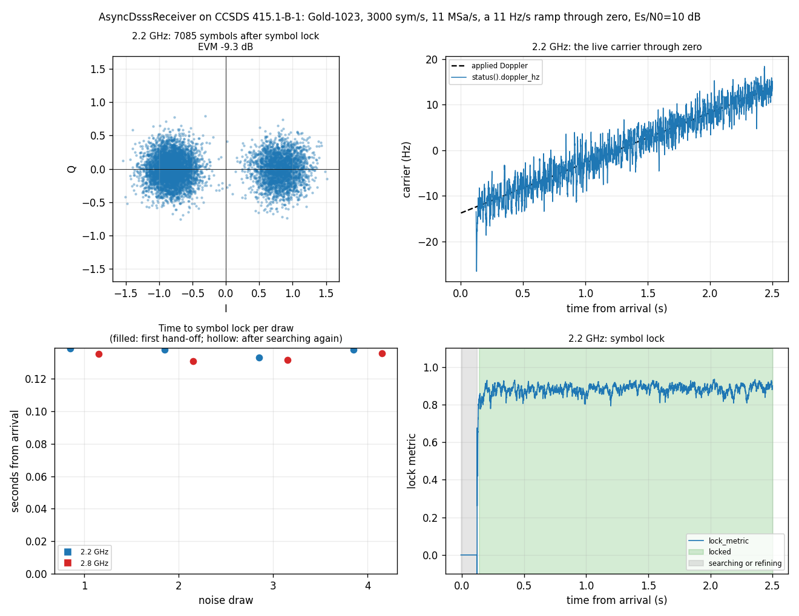

# AsyncDsssReceiver: the specification link



One [`dsss.AsyncDsssReceiver`][doppler.dsss.AsyncDsssReceiver] demodulates the
CCSDS 415.1-B-1 forward link: BPSK at 3,000 symbols a second, spread by a
1,023-chip Gold code whose chip rate is the carrier times 31/21216, the data
asynchronous to the code. It takes 11 MSa/s and searches a Doppler within
±1,500 Hz that moves at up to 11 Hz/s, the residual the link's ephemeris
pre-compensation leaves ([the design page's §1.8](../design/async-dsss-receiver.md)).
On a moving platform the Doppler
shifts the carrier and stretches the chip clock by the same factor, v/c. Told
the RF carrier (`carrier_freq_hz`), the receiver feeds the carrier offset it
tracks to its code loop as the matching code-rate offset, so the code loop
follows the stretched clock.

The receiver searches, refines the estimate, then tracks and emits symbols.
Each frame of 1,000 symbols opens with 275 data-free symbols, and the search
integrates across that window (`code_only_s`). Its symbol lock, `locked`,
says when the symbols are the signal's. With `reacquire` armed, a hand-off
whose carrier never comes up to symbol lock is released once `lost_confirm_s`
has passed, and the receiver searches again by itself.

The receiver forms its carrier error over the code-period window: one
coherent sum over the code period the code loop's look-back picks. It holds
because a symbol, 333 µs, is at least a code period, 250 to 318 µs across
the band, so some window of one period is free of data transitions. The
design is in [the async DSSS receiver design](../design/async-dsss-receiver.md).

## What the demo runs

Two carriers, the band's ends: 2.2 GHz (3.215 Mcps) and 2.8 GHz (4.091 Mcps).
At each, four noise draws of a 2.5 s capture whose Doppler ramps at
11 Hz/s from −13.75 Hz through zero to +13.75 Hz. The emitter is
[`wfm.Synth`][doppler.wfm.Synth] in continuous DSSS mode at two samples a chip,
[`resample.RateConverter`][doppler.resample.RateConverter] takes it to
11 MSa/s, and [`impairment.DopplerChannel`](doppler-channel.md) applies the
Doppler: it resamples the signal to stretch the chip clock and rotates the
carrier, both from one ppm figure. The noise is added after the channel.

The demo runs at 10 dB Es/N0, 6 dB above the link's 4 dB floor, so the
despread symbols show as two clusters. It demonstrates the receiver; it does
not certify it. Performance at the floor is measured by the receiver's
validators and recorded in
[the measurement record](../design/async-dsss-receiver-measurements.md).

The script checks, per carrier, that the receiver acquired, locked and
decoded:

- At least three draws in four reach a sustained symbol lock.
- Every hand-off that locked pulled in within `lost_confirm_s`, so the release
    rule cut no good hand-off short.
- Every draw locked before the Doppler's zero crossing, so the receiver holds
    the lock through it.
- The pooled BER over the settled windows is at most `MAX_BER`.

It also reads the decode out three ways, on the window from where the
hand-off has settled to the end of the capture:

- **BER** against the known payload, with [`ber.BerMeter`][doppler.ber.BerMeter].
    The meter detects where the symbol stream sits against the payload by
    correlating a marker; it does not search for the alignment with the fewest
    errors. The marker is taken from data, never from a data-free window,
    which is all one symbol and marks nothing.
- **EVM**, [`ber.ber_evm_db`][doppler.ber.ber_evm_db]: each symbol against its own
    hard decision. It normalizes by the measured total power, so a perfect
    receiver reads 10·log10(N/(S+N)), a little below −Es/N0.
- **M2M4**, [`snr.snr_m2m4_db`][doppler.snr.snr_m2m4_db]: a blind SNR estimate from
    the symbol moments. It assumes circular noise, and the demodulated stream's
    noise is not circular, so it reads below the input Es/N0: a sign of a locked
    stream, not a measurement of the link.

The script prints, per carrier, the lock count, how many locked on the first
hand-off, the slowest pull-in and the slowest lock, the pooled BER with its
error count, and the mean EVM and M2M4.

## How it works

The payload is doppler's [`wfm.PN`][doppler.wfm.PN], one bit per symbol, with
each frame's first 275 symbols zero, so the truth the BER is scored against is
exactly what was sent. The capture is streamed a push at a time: the emitter,
the rate converter and the channel run a chunk at a time, and nothing holds the
whole capture. The noise is [`source.AWGN`][doppler.source.AWGN], with the
per-component sigma that [`wfm_awgn_amplitude`][doppler.wfm.wfm_awgn_amplitude]
gives for the Es/N0 over one symbol's samples.

```python
--8<-- "src/doppler/examples/async_dsss_receiver_spec_demo.py:signal"
```

The receiver takes the link's rates and C/N0, the one-sided Doppler
uncertainty, the RF carrier, the data-free window and the Doppler rate, the
release rule with `reacquire`. Everything
else is its default. After each push the script reads `status()` and
`lifecycle`.

```python
--8<-- "src/doppler/examples/async_dsss_receiver_spec_demo.py:receiver"
```

The checks run on those rows and symbols. The symbol lock comes up while the
demodulator's timing is still pulling in, so the window starts where the
hand-off has settled: the receiver's own `settle_time` into the track (779
symbols, from its demodulator's two loop bandwidths), or where
the symbol lock is sustained, by
[`ber.ber_lock_symbol`][doppler.ber.ber_lock_symbol] over each symbol's lock
flag, if that is later. BER, EVM and M2M4 are scored on the same window.

```python
--8<-- "src/doppler/examples/async_dsss_receiver_spec_demo.py:validate"
```

## Reading it when it does not behave

Read `lifecycle` first (searching, refining, tracking), then `locked`, then
`lock_metric`, the value the lock flag thresholds, then `status().doppler_hz`
against the Doppler you expect. Searching that never ends means no detection
at this uncertainty. Tracking with `locked` low and the live carrier wandering
away from the Doppler means the hand-off missed the carrier; with `reacquire`
armed it is released after `lost_confirm_s` and searched again.

## What you're seeing

1. **The constellation** (top left): one 2.2 GHz draw's symbols from the
    settled point on, with that window's EVM.
1. **The live carrier** (top right): `status().doppler_hz` while tracking,
    against the Doppler the channel applied, through the zero crossing.
1. **The time to symbol lock** (bottom left), for every draw at both carriers,
    from the signal's arrival. Filled markers locked on the first hand-off;
    hollow ones locked after the receiver searched again.
1. **Symbol lock** (bottom right), for the same draw as the top row: the lock
    metric, the lock flag, and the span where the receiver was searching or
    refining.

## Reproduce

```sh
pip install "doppler-dsp[examples]"   # matplotlib + scipy, once
python -m doppler.examples.async_dsss_receiver_spec_demo out.png
```

The C twin is
[`async_dsss_receiver_spec_demo.c`](https://github.com/doppler-dsp/doppler/blob/v0.87.0/native/examples/async_dsss_receiver_spec_demo.c).
It runs the same captures with the same seeds through the same receiver and
makes the same checks, through the C API, and it prints the same lines: a pair
test runs both twins from one build and compares them. It shows what the
binding hides: the capture streamed through the rate converter and the Doppler
channel one push at a time, the buffers the caller owns, and the per-push
record kept from `status()`.

Source: [`async_dsss_receiver_spec_demo.py`](https://github.com/doppler-dsp/doppler/blob/v0.87.0/src/doppler/examples/async_dsss_receiver_spec_demo.py).
