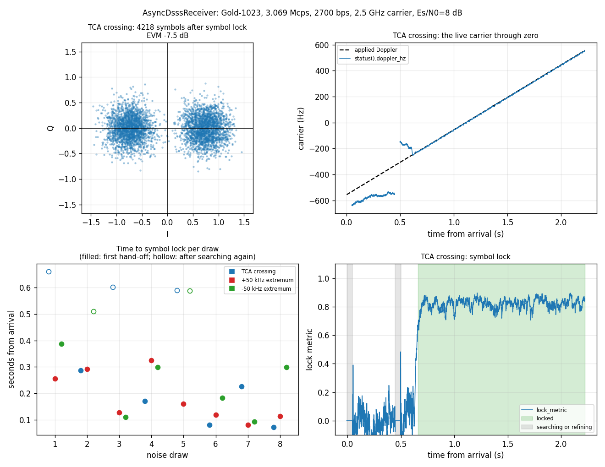

# AsyncDsssReceiver: the SPEC link



One [`dsss.AsyncDsssReceiver`](../api/python-dsss.md) demodulates continuous DSSS
whose data symbols are asynchronous to the code epoch, on a link whose Doppler
moves the chip clock as well as the carrier. On a moving platform both shift by
the same factor, v/c. Told the RF carrier (`carrier_freq_hz`), the receiver feeds
the carrier offset it tracks to its code loop as the matching code-rate offset,
so the code loop follows a stretched clock that its own discriminator could not
pull in.

The receiver searches its carrier uncertainty, refines the estimate, then tracks
and emits symbols. Its symbol lock, `locked`, says when those symbols are the
signal's. With `reacquire` armed, a hand-off whose carrier never comes up to
symbol lock is released once `lost_confirm_s` has passed, and the receiver
searches again by itself. A missed hand-off costs a retry, not the link.

The setup is the link from
[the async DSSS receiver design](../design/async-dsss-receiver.md#1-the-specification):
a CCSDS Gold-1023 code at 3.069 Mcps carrying asynchronous BPSK at 2700 bps on a
2.5 GHz carrier, with up to ±50 kHz of Doppler changing by up to 500 Hz/s. The
caller's carrier uncertainty is the receiver's one-sided `doppler_uncertainty`,
50 kHz: the search covers that half-range in either direction.

## Two regimes that never coincide

A pass stresses the receiver in two ways, and never both at once:

- **The TCA crossing.** Near closest approach the Doppler ramps through zero at
    its fastest rate, 500 Hz/s. This stresses the carrier dynamics. The capture
    starts below zero so the ramp crosses zero halfway through.
- **The offset extremum.** At the ends of the pass the Doppler sits at ±50 kHz and
    barely moves. This stresses the search and the coupled code-rate offset. The
    script runs both signs.

Each regime runs over eight noise draws. The Doppler comes from
[`impairment.DopplerChannel`](doppler-channel.md), which resamples the signal to
stretch the chip clock and rotates the carrier, both from one ppm figure. The
noise is added after the channel.

## What the run shows

The page runs at 8 dB Es/N0. SPEC's floor is 5 dB; 8 dB is where the current
receiver demodulates reliably, with every check below holding on every regime.
At this Es/N0 not every hand-off lands inside the carrier loop's reach. The ones
that miss are released and searched again, and the script prints how many draws
locked on the first hand-off. The figure marks them.

The decode is checked three ways, on the window from the sustained symbol lock to
the end of the capture:

- **BER** against the known payload, with [`ber.BerMeter`](../api/python-ber.md).
    The meter detects where the symbol stream sits against the payload by
    correlating a marker; it does not search for the alignment with the fewest
    errors. The pooled rate is quoted as an implementation loss: how many dB more
    Es/N0 coherent BPSK would need to make the same errors. The check holds it
    inside the loss budget, `MAX_LOSS_DB`, and no better than coherent BPSK,
    which no receiver can beat.
- **EVM**, [`ber.ber_evm_db`](../api/python-ber.md): each symbol against its own
    hard decision. It normalizes by the measured total power, so a perfect
    receiver reads 10·log10(N/(S+N)), a little below −Es/N0; the check holds
    every locked draw within `EVM_TOL_DB` of that.
- **M2M4**, [`snr.snr_m2m4_db`](../api/python-snr.md): a blind SNR estimate from
    the symbol moments. It assumes circular noise, and the demodulated stream's
    noise is not circular, so it reads above the input Es/N0. Here it is a lock
    check: every locked draw clears the input Es/N0 less the loss budget.

Two more checks hold the timing. The slowest pull-in, from a hand-off to its
first symbol lock, must stay under `lost_confirm_s`, so the release rule cuts no
good hand-off short. On the TCA crossing every draw must be locked before the
Doppler's zero crossing, computed from the regime's start and rate, so the
receiver holds the lock through it.

The script prints, per regime, the lock count, how many locked on the first
hand-off, the slowest pull-in and the slowest lock, the pooled BER with its error
count and loss, and the mean EVM and M2M4. Those are this run's numbers, and the
script asserts each claim on this page, so a change that breaks one fails the
example rather than the prose.

## How it works

The payload is doppler's [`wfm.PN`](../api/python-wfmgen.md), one bit per
symbol, so the truth the BER is scored against is exactly what was sent. The
emitter is [`wfm.Synth`](../api/python-wfmgen.md) in continuous DSSS mode. The
noise is [`source.AWGN`](../api/python-nco.md), with the per-component sigma
that [`wfm_awgn_amplitude`](../api/python-wfmgen.md) gives for the Es/N0 over
one symbol's samples.

```python
--8<-- "src/doppler/examples/async_dsss_receiver_spec_demo.py:signal"
```

The receiver takes the caller's rates and C/N0, the one-sided carrier
uncertainty, the RF carrier, and the release rule with `reacquire`. Everything
else is its default. It is fed one code epoch per push, and after each push the
script reads `status()` and `lifecycle`.

```python
--8<-- "src/doppler/examples/async_dsss_receiver_spec_demo.py:receiver"
```

The checks run on those rows and symbols. The window starts where the symbol lock
is sustained, by [`ber.ber_lock_symbol`](../api/python-ber.md) over each symbol's
lock flag, and BER and EVM are scored on the same window.

```python
--8<-- "src/doppler/examples/async_dsss_receiver_spec_demo.py:validate"
```

## Reading it when it does not behave

Read `lifecycle` first (searching, refining, tracking), then `locked`, then
`lock_metric`, the value the lock flag thresholds, then `status().doppler_hz`
against the Doppler you expect. Searching that never ends means no detection at
this uncertainty. Tracking with `locked` low and the live carrier wandering away
from the Doppler means the hand-off missed the carrier; with `reacquire` armed it
is released after `lost_confirm_s` and searched again. Repeated releases mean the
refined estimate keeps landing outside the carrier loop's reach, which is a
question of Es/N0, not of the confirm time.

## What you're seeing

1. **The constellation** (top left): one TCA-crossing draw's symbols from the
    sustained symbol lock on, with that window's EVM.
1. **The live carrier** (top right): `status().doppler_hz` while tracking, against
    the Doppler the channel applied, through the zero crossing. When the draw
    has a hand-off that missed, it shows as a track off the ramp that ends when
    the receiver releases it.
1. **The time to symbol lock** (bottom left), for every draw of every regime,
    from the signal's arrival. Filled markers locked on the first hand-off;
    hollow ones locked after the receiver searched again.
1. **Symbol lock** (bottom right), for the same draw as the top row: the lock
    metric, the lock flag, and the spans where the receiver was searching or
    refining.

## Reproduce

```sh
python -m doppler.examples.async_dsss_receiver_spec_demo out.png
```

The C twin is
[`async_dsss_receiver_spec_demo.c`](https://github.com/doppler-dsp/doppler/blob/main/native/examples/async_dsss_receiver_spec_demo.c).
It runs the same captures with the same seeds through the same receiver and
asserts the same checks, through the C API, and it prints the same lines: a pair
test runs both twins from one build and compares them. It shows what the binding hides: the
capture streamed through the Doppler channel one push at a time, the buffers the
caller owns, and the per-push record kept from `status()`.

The design, including the state machine and the release rule, is in
[the async DSSS receiver design](../design/async-dsss-receiver.md).

Source: [`async_dsss_receiver_spec_demo.py`](https://github.com/doppler-dsp/doppler/blob/main/src/doppler/examples/async_dsss_receiver_spec_demo.py).
