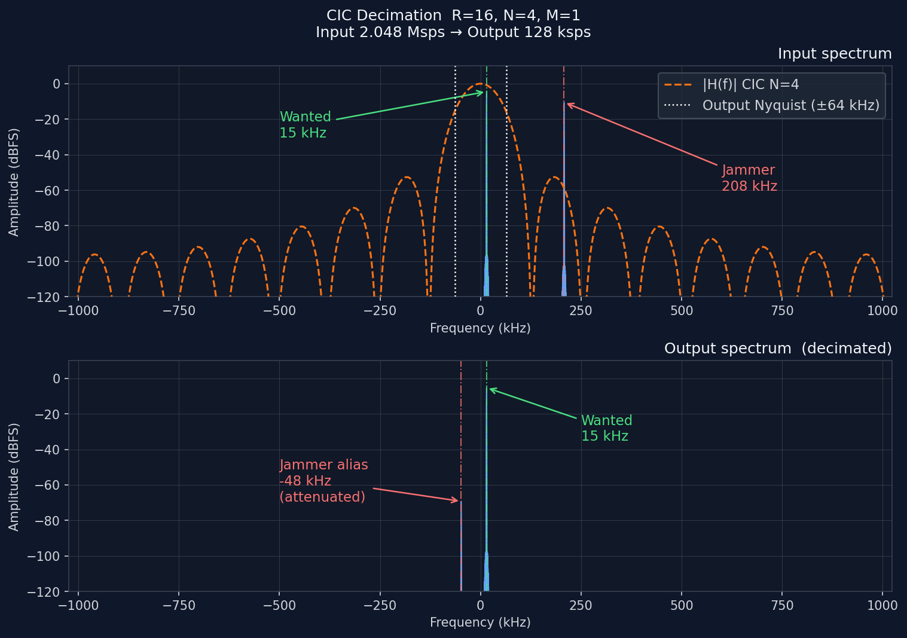

# CIC Decimation Filter



## What you're seeing

Both panels share the same x-axis (±1024 kHz = ±fs_in/2) so the
signal positions line up vertically across the cascade.

**Top panel — wideband input.** Two complex tones:
a wanted signal at 15 kHz and a jammer at 208 kHz.
The orange dashed curve is the CIC magnitude response `|H(f)|`.
The white dotted lines mark the output Nyquist boundaries at ±64 kHz;
anything outside will fold back into the passband.

**Bottom panel — decimated output.** After R=16 decimation, the wanted
tone at 15 kHz survives near full amplitude. The jammer at 208 kHz
falls in the alias zone and folds to −48 kHz in the output, attenuated
by the CIC filter. The demo's measured alias rejection is 101.5 dB at R=8,
N=4, against a theoretical 102.4 dB; this panel's R=16 run is not
separately measured.

## How it works

The CIC transfer function is:

```
|H(f)| = |sin(π f M R / fs) / (R · sin(π f M / fs))|^N
```

N=4 integrator/comb pairs give 4th-order roll-off with no multiplications.
Internally each CF32 sample becomes an integer word as wide as the 64-bit
registers allow after the pipeline's gain (`CIC.bits`, 52 bits at R=8),
held in unsigned registers, so intermediate overflow wraps and cancels
exactly across the N stages. The word's top is headroom: full scale is
`CIC.full_scale`, 4.0 as built ([the budget](../design/cic.md)).

```python
--8<-- "src/doppler/examples/cic_demo.py:sdr_pipeline"
```

Transient settling takes approximately `CIC_N*(R-1)/R` output samples;
drop those before measuring power.

```bash
pip install "doppler-dsp[examples]"   # matplotlib + scipy, once
python -m doppler.examples.cic_demo   # → cic_demo_spectrum.png
```

See [`doppler.resample.CIC`][doppler.resample.CIC]
for the full API reference.
