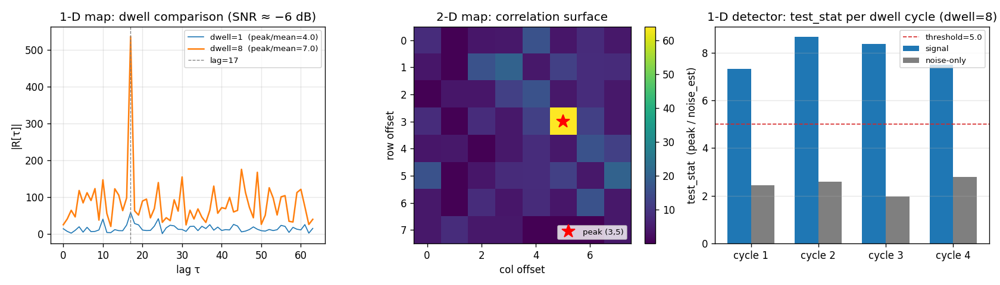

<!-- domain: correlation; summary: coherent integration, 2-D template matching, streaming CFAR, with `Correlator`. -->

# Correlation and Detection



## What you're seeing

Every panel is one class, `doppler.correlation.Correlator`, built as a
different flavor (the [Correlator guide](../guide/correlator.md) says which
knobs pick which), and each panel's title names its flavor.

**Left — the 1-D map, coherent integration.** BPSK PN reference, lag=17,
SNR ≈ −6 dB. With a single frame the peak/mean ratio is ~4.0 —
barely distinguishable from noise. After 8 coherent dwells
(`dwell=8`) it rises to ~7.0, pulling the lag-17 peak cleanly above
the noise floor. Coherent integration improves SNR by `10 log₁₀(M)`
dB.

**Centre — the 2-D map, template match.** An 8×8 complex template
shifted by (row=3, col=5) is recovered in a single FFT2 call. The
surface peak lands exactly on the injected shift.

**Right — the 1-D detector's `push()` stream.** Four signal dwells fire above
`threshold=5`; noise-only dwells stay below it. Each dot is one
dwell's test statistic: peak magnitude divided by local noise
estimate.

## How it works

`execute()` accumulates frames and returns output only on the
`dwell`-th call; all other calls return `None`.

```python
--8<-- "src/doppler/examples/corr_demo.py:setup"

--8<-- "src/doppler/examples/corr_demo.py:integrate"
```

The detector flavor (`detect=1`) wraps this loop and applies a CFAR
threshold, so `det.push(block)` hands you one record per detection without
your managing the dwell counter.

The 2-D map accumulates the `dwell` integration in the **frequency domain** — it
sums the per-frame cross-spectra and inverts once on the dump rather than once
per frame. The result is identical by linearity of the inverse FFT, but the
single inverse amortizes over the dwell (~1.7× cheaper per frame at `dwell=8`,
`bench_correlator.py`). This holds only for *coherent* (complex-sum) integration;
see the [2-D Acquisition gallery](detection2d.md) for the details.

### The detector — streaming CFAR

`push(block)` returns a structured array, one record per dwell that fires
above the threshold: `col` is the lag, then `peak_mag`, `noise_est` and
`test_stat`. The noise estimate is taken from lags `[noise_lo, noise_hi]`. A
block may be any length, since a partial frame waits for the next push, and
the record array is sized for the whole block, so a push never drops a
detection.

```python
# One coherent-dwell block of the same shifted-PN + noise frames.
block = np.concatenate([noisy_frame() for _ in range(DWELL)])

det = Correlator(ref1d, detect=1, dwell=DWELL, noise_lo=LAG + 4,
                 noise_hi=N - 1, threshold=THRESHOLD)
for hit in det.push(block):
    print(f"detection  lag={hit['col']}  stat={hit['test_stat']:.2f}")
# detection  lag=17  stat=7.34   (stat varies with noise; lag is
#                                 deterministic)
```

### The 2-D map — standalone match

```python
--8<-- "src/doppler/examples/corr_demo.py:match2d"
```

The 2-D detector (a 2-D `ref` with `detect=1`) wraps the 2-D map with the
same CFAR gating for a full 2-D acquisition search — see the
[2-D Acquisition gallery](detection2d.md).

```bash
pip install "doppler-dsp[examples]"   # matplotlib + scipy, once
python -m doppler.examples.corr_demo   # → corr_demo.png
```
