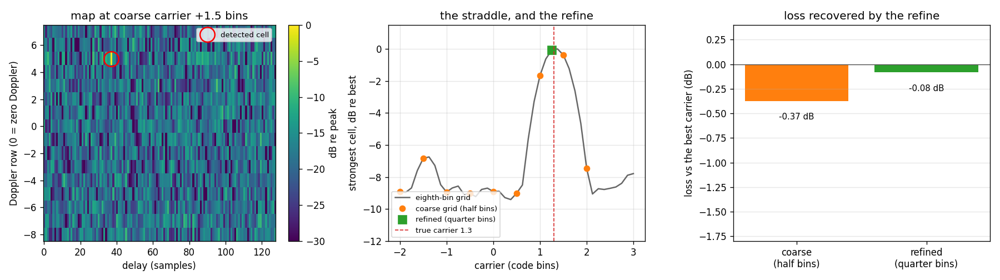
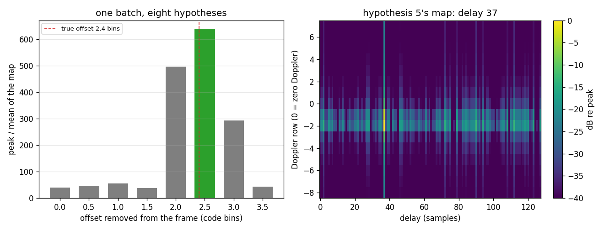

<!-- domain: spectral; summary: a delay-Doppler map, a coarse carrier bank and the refine that recovers its straddle loss, plus a batch of hypotheses in one call. -->

# Delay-Doppler Search



## What you're seeing

A code delayed by 37 samples arrives on a carrier 1.3 code bins off
nominal, 15 dB under the noise in every sample. `DelayDoppler` correlates
each of 16 code periods against the code and runs a slow-time FFT down every
delay column, which gives a map of Doppler rows by delay columns.
`bank_detect` searches the carrier too.

**Left: the map at the best coarse carrier.** The ringed cell is the
detection: delay column 37, a Doppler row off zero. Everything else is the
map's noise floor, 15 to 25 dB down.

**Centre: the straddle, and the refine.** The grey curve is the strongest
cell's power under each carrier of an eighth-bin grid; its peak is the best
the search can do. The orange dots are the coarse grid's half-bin steps: the
true carrier (the red line, 1.3 bins) falls between two of them, so the best
coarse carrier sits below the curve's peak. The green square is the
refine: a quarter-bin step at the candidate's own cell, back on top.

**Right: what the straddle costs.** The coarse grid sits a few tenths of a dB
below the best carrier, and the refine closes most of that (the script
prints the numbers and asserts the ordering). The refine is `2 * ny * nx`
multiply-adds per carrier, with no FFT.

## How it works

A delay-Doppler map corrects no carrier **within** a code period, so a
carrier `d` code bins off costs the Dirichlet factor of `d` (about 0.9 dB at
a quarter bin, 3.9 dB at half a bin, 19 dB at 0.9 bin, and a null at a whole
bin): an unknown offset is searched. A bank corrects each frame to the
nearest carrier of its grid, so what it loses is the factor of the residual
to that carrier. The
**bank** makes one map per carrier on a coarse grid, and every carrier
shares the frame's row transforms, so a half-bin grid costs half what a
quarter-bin grid does. Each candidate is then refined at its own cell:

```python
--8<-- "src/doppler/examples/delay_doppler_bank_demo.py:setup"
```

The thresholds come from noise-only frames, as a detector's must: the
strongest coarse cell in 50 noise frames sets the candidate threshold, and
the confirm threshold sits a little above it.

```python
--8<-- "src/doppler/examples/delay_doppler_bank_demo.py:search"
```

One record comes back, at the code's delay, on the quarter-bin carrier
nearest 1.3 bins, and stronger than the coarse grid saw it. The curve in the
centre panel is one single-carrier bank per step of an eighth-bin grid:

```python
--8<-- "src/doppler/examples/delay_doppler_bank_demo.py:curve"
```

## Trying many hypotheses in one batch



A bank is what a batch of corrected frame copies computes, without the
copies. When the hypotheses are *frames* of your own (a different carrier
removed from each copy, say), hand them over as one batch:

```python
--8<-- "src/doppler/examples/delay_doppler_batch_demo.py:setup"
```

**Left:** each hypothesis's own peak-to-mean. The one that left the signal
most compact (green) is the one nearest the true 2.4 bins. **Right:** that
hypothesis's map, with the delay found at column 37.

```python
--8<-- "src/doppler/examples/delay_doppler_batch_demo.py:search"
```

`execute_peaks` ranks the hypotheses by each map's own statistics;
`execute_power_max` keeps, cell by cell, the strongest map and which one it
was. Neither touches the object's dwell.

These commands run from a clone of the repository at the release you
installed; the `make` targets and the `./build/` binaries are not in the wheel.
Skip this if you already have one:

<!-- docs-snippet: no-exec=clones the repository -->

<!-- doc-version:start -->

```sh
git clone --branch v0.79.0 https://github.com/doppler-dsp/doppler && cd doppler
```

<!-- doc-version:end -->

## Run it

```sh
pip install "doppler-dsp[examples]"   # matplotlib + scipy, once
python -m doppler.examples.delay_doppler_bank_demo
python -m doppler.examples.delay_doppler_batch_demo
./build/native/examples/delay_doppler_bank_demo      # the C twins
./build/native/examples/delay_doppler_batch_demo
```

See the [Delay-Doppler Search guide](../guide/delay-doppler.md) for the map,
the batch calls and the bank in words, and the
[Spectral API](../api/python-spectral.md) for every method.
