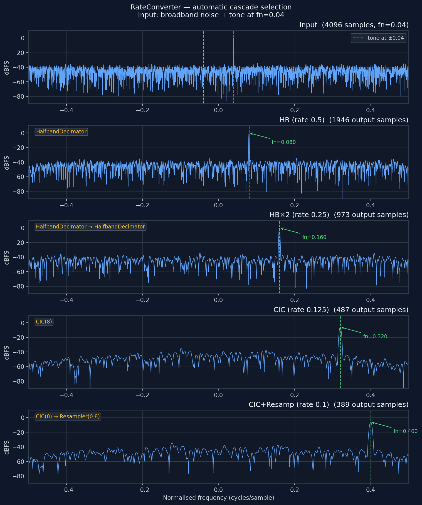

# RateConverter — Automatic Cascade Selection



## What you're seeing

Five panels share the same x-axis — normalised frequency in cycles/sample
(−0.5 to +0.5 = one full output Nyquist interval).

**Top panel — input.** 4096 samples of broadband complex noise with a single
complex tone injected at fn = 0.04 (4 % of the input sample rate). This is
the identical signal fed to all four converters below.

**Lower four panels — decimated output**, one per cascade topology. Each
x-axis is normalised to the converter's output sample rate, so the same
physical tone moves to a higher normalised frequency as the rate ratio
decreases. The yellow label in the top-left corner of each panel names the
exact stages RateConverter selected automatically for that rate.

| Panel      | rate  | D = 1/rate | Cascade selected                      | Tone at fn_out |
| ---------- | ----- | ---------- | ------------------------------------- | -------------- |
| HB         | 0.5   | 2          | HalfbandDecimator                     | 0.08           |
| HB×2       | 0.25  | 4          | HalfbandDecimator → HalfbandDecimator | 0.16           |
| CIC        | 0.125 | 8          | CIC(8)                                | 0.32           |
| CIC+Resamp | 0.1   | 10         | CIC(8) → Resampler(0.8)               | 0.40           |

Every panel annotates the predicted tone position (fn_out = fn_in / rate) with
a green marker. Tone recovery is accurate to well under one FFT bin.

## How it works

The selection rule is pure arithmetic on D = 1/rate:

```
rate >= 1.0 or D < 2        →  Resampler(rate)
D ≈ 2^1                     →  HalfbandDecimator
D ≈ 2^2                     →  HalfbandDecimator → HalfbandDecimator
D = 2^n, n>=3, D<=2048      →  CIC(D)
D = 2^n, D>2048             →  CIC(2048) → Resampler(2048/D)
D >= 8, non-power-of-2      →  CIC(R*) → Resampler(R*/D)
otherwise (2 ≤ D < 8)       →  Resampler(rate)
```

where R\* = nearest power-of-two to D, capped at 2048 (`CIC_R_MAX`).
Halfband stages are the cheapest (one multiply per two input samples); CIC
has no multiplies at all. The polyphase Resampler handles any rate but is the
most compute-intensive, so it is used only when a pure-power-of-two topology
cannot be applied.

```python
--8<-- "src/doppler/examples/rate_converter_demo.py:cascade"
```

The execute buffer is grown lazily on the first call and invalidated on every
rate change, so callers pay no per-call allocation overhead in steady state.

## Streaming — phase-continuous across blocks

`execute()` carries filter state across calls, so a stream split at any block
boundary is **byte-identical** to one large call.

!!! note "Each result is yours to keep"

    `execute()` returns a fresh NumPy array that owns its memory and shares
    nothing with the converter or with the next call's result, so a block can
    be held across later `execute()`, `reset()` or `.rate` changes without a
    copy. Pass `out=` (sized by `execute_max_out()`) to place the samples in a
    buffer of your own instead.

```python
import numpy as np
from doppler.resample import RateConverter

x = np.random.randn(2048).astype(np.complex64)
y_full = RateConverter(0.5).execute(x)

rc = RateConverter(0.5)
y_split = np.concatenate([
    rc.execute(x[:1024]),          # each result owns its memory: no copy
    rc.execute(x[1024:]),
])
assert np.array_equal(y_full, y_split)   # byte-identical ✓
```

## CIC droop compensation

`compensate=1` appends a passband-droop compensating FIR (`ciccompmf(N=4, R=R, M=7)`) after any CIC stage, correcting the `|sin(x)/x|⁴` roll-off at
negligible cost (7 taps at the decimated rate):

```python
print(RateConverter(0.125).stages)                 # ['CIC(8)']
print(RateConverter(0.125, compensate=1).stages)   # ['CIC(8)+FIR']
```

## Functional interface

`rate_convert()` wraps construction so state can persist across calls: it
creates a `RateConverter` on the first call and returns it to reuse:

```python
from doppler.resample import rate_convert

y1, rc = rate_convert(x, 0.5)          # creates RateConverter(0.5)
y2, rc = rate_convert(x, 0.5, rc=rc)   # reuses it — state preserved
```

```bash
python src/doppler/examples/rate_converter_demo.py
```

See
[`doppler.resample.RateConverter`](../api/python-resample.md#rateconverter-automatic-cascade)
for the full API reference, and the
[Resampler design notes](../design/RESAMPLER.md) for the polyphase
interpolator/decimator architecture underneath it.
