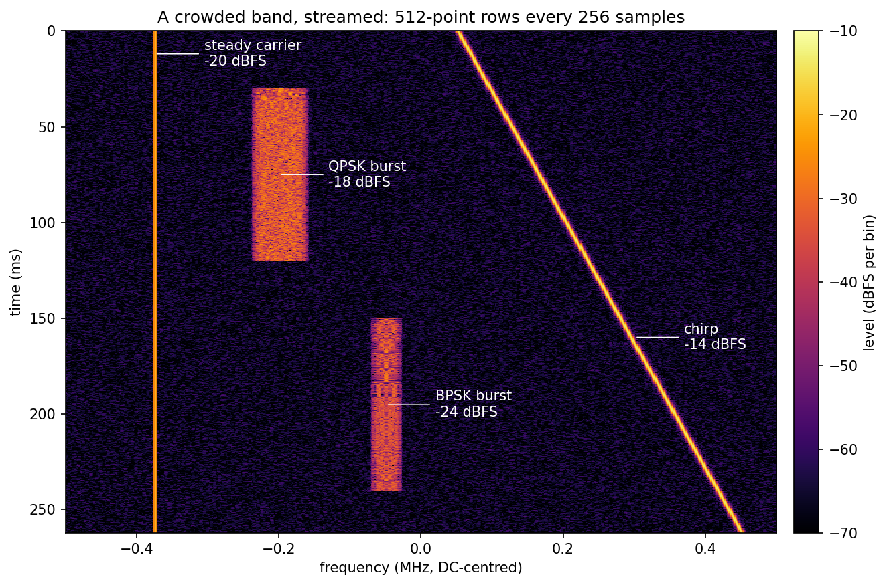
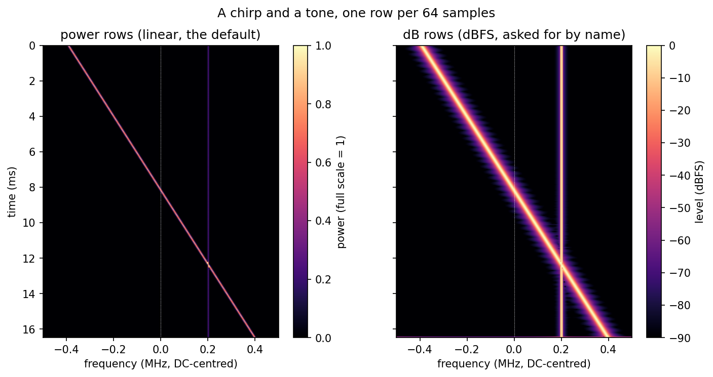

# A Streaming Spectrogram



## A crowded band

One capture, 262 ms at 1 MHz, streamed into 512-point rows every 256 samples
and drawn in dBFS, time running down the page. Four signals share it: a steady
carrier at −375 kHz, a chirp sweeping from +50 to +450 kHz, a QPSK burst that
is on from 30 to 120 ms, and a BPSK burst from 150 to 240 ms. Under them is a
noise floor of −40 dBFS in all, about −65 dBFS in each bin. The scene is
built with the library's own waveform generator. Each burst is a segment of
its own, silent outside its window and added to the steady part, so a burst
starts and stops without disturbing anything around it:

```python
--8<-- "src/doppler/examples/spectrogram_demo.py:scene"
```

The levels on the figure are measured, not just drawn. The script reads each
level against the carrier. On its own bin the carrier reads −20 dB, and
summed over its bins it is 10^(−20/10) times the window's noise bandwidth, so
dividing a burst's summed bins by the carrier's cancels the window. Each burst
then reads its own level inside its window and nothing outside it, the empty
band reads the floor spread over 512 bins, and the strongest bin in the upper
half follows the chirp's sweep to within one bin:

```python
--8<-- "src/doppler/examples/spectrogram_demo.py:scene_figure"
```

## Power rows and dB rows



Both panels show the same capture: a complex chirp sweeping from −0.4 fs to
+0.4 fs, and a tone at +0.2 fs at half amplitude. Each horizontal line is one
row of the spectrogram: the power spectrum of one 256-sample frame, a new frame
every 64 samples. Time runs down the page. The bottom row is the partial frame
flushed at the end, zero-padded to a full frame, so its levels are lower and a
little smeared.

**The horizontal axis is DC-centred.** Zero hertz is in the middle, and the
edges are ±fs/2 = ±0.5 MHz. A frequency reads straight off the axis, with no
shifting to do.

**The left panel is power.** A unit-amplitude tone reads 1.0 at its bin. The
chirp is a bright diagonal line, because at any instant it sits on one bin at
full scale. The tone is a dimmer vertical line: half the amplitude is a
quarter of the power. Where the chirp crosses the tone, the two add coherently
in that bin, so power there can read above 1.0, past the top of the colour bar.

**The right panel is the same data in dBFS.** Full scale is 0 dB, and the
tone reads −6.02 dB, which is what the amplitude says it should. Each dB row is
10·log10 of the matching power row. Use dB when the levels span a wide range,
and power when you want to add rows together: averaging dB rows gives a
different answer from converting the average.

Power rows are the default. A dB spectrogram is asked for by name.

## How it works

Samples arrive in pieces of any size, as they would from a radio, and the
object turns them into rows as the frames complete. The example pushes the
stream in random chunks, and the script checks that the rows match a single
push of the whole capture. The chunk sizes do not change the rows. At the end
the stream is flushed, which writes the zero-padded partial frame if one is
owed:

```python
--8<-- "src/doppler/examples/spectrogram_demo.py:stream"
```

The figure is drawn from the rows the same stream produces. The checks in that
function fail the run, not just the picture. They confirm that the chirp's
peak stays within one bin of its sweep on every row, including the flushed
partial row. They confirm the tone reads a quarter of full scale and −6.02 dB
on every row the chirp is clear of, and that each dB row is 10·log10 of its
power row. They also confirm the axis edges sit at ±0.5 MHz:

```python
--8<-- "src/doppler/examples/spectrogram_demo.py:figure"
```

## Running it

```bash
python src/doppler/examples/spectrogram_demo.py
```

The script writes `spectrogram_scene.png` and `spectrogram_demo.png` in the
working directory, and exits
0 only when its checks hold.
