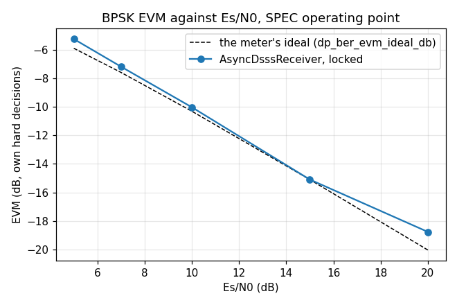

# AsyncDsssReceiver — validation report

Generated by `validate.py` in this folder. Every number is measured from the C implementation through its own binding; nothing is modelled. Re-run to regenerate.

## Executive summary

- **Status.** **CERTIFIED** — all 18 limits hold.
- **Findings.** 4 recorded, 3 still open: F1, F2, F3.

**What a caller most needs to know**

- **Design to the meter's ideal EVM from 5 to 15 dB.** Over the full sweep a locked receiver's BPSK EVM is -0.07 to +0.65 dB over `dp_ber_evm_ideal_db()` there; at 20 dB +1.19 to +1.36 dB, an implementation floor (section 2.5).
- **Lock is quick at 10 dB:** tracked 45 ms after a signal arrives (worst 47 ms over 20 draws), symbol lock 86 ms (worst 698 ms) (2.5).
- **Below 10 dB, turn `reacquire` on.** A first hand-off can miss the carrier and, without it, never recover (F3, #2409).
- **The lock flag means something:** 10 receivers on noise declared it 0 times, and a signal that leaves drops it within 34 ms (2.5).
- **Size `out` with care above one symbol a code period:** `steps_max_out()` is not yet a bound (F1, #2469). At SPEC it never binds.

# AsyncDsssReceiver — validation report

## 1. The object — one continuous asynchronous DSSS receiver

The design is [`docs/design/async-dsss-receiver.md`](../../../../../../docs/design/async-dsss-receiver.md); the contract is the header, `native/inc/doppler/async_dsss_receiver/async_dsss_receiver_core.h`. The parallel design it serves is [`docs/design/async-dsss-parallel.md`](../../../../../../docs/design/async-dsss-parallel.md).

**Operating point (SPEC).** A 1,023-chip Gold code (CCSDS #365) at 3.069 Mcps, two samples a chip (6.138 MSa/s), asynchronous BPSK data at 2,700 sym/s. The searching flavor, at the binding's defaults except two: its design C/N0 is the true one, and its search covers +/-1/T_E (+/-3 kHz). **BPSK only**: m = 4 and 8 are accepted by the object and not certified here (the owner's scope, 2026-10-19).

The header's lock and lifecycle claims, each pinned in `native/tests/test_async_dsss_receiver_core.c` and each seen to fail under a sabotage of the code it guards, the order `docs/dev/contributing/validation.md` requires:

| claim (header) | C test |
|---|---|
| symbol lock: an EMA of cos 2phi over 30 symbols; 30 above 0.5 declare, 15 below 0.3 drop | `_test_symbol_lock_detector_symbol_by_symbol` |
| both flags down for longer than `lost_confirm_s` -> lost; not a sample early, not a call late | `_test_lost_after_switch_off` |
| the plain clock restarts when a flag comes back | `_test_plain_clock_restarts_on_a_flag` |
| one flag down is a degrade, not a release | `_test_one_flag_down_is_a_degrade` |
| a hand-off that never locks is released, on time | `_test_a_handoff_that_never_locks_is_released` |
| `reacquire` releases on symbol lock alone, back to searching | `_test_reacquire_is_symbol_lock_alone`, `_test_reacquire_after_switch_off` |
| a refined Doppler at or past fs/2 is refused at the hand-over, and not left readable | `_test_handover_holds_the_refined_doppler_to_the_domain` |
| steps() never writes past `max_out`; the excess is dropped, not deferred | `_test_output_capacity` |
| decodes at the Es/N0 floor | `_test_awgn_esn0_floor`, `_test_spec_combined_scenario_at_spec_floor` |
| `differential` acts in a demap this object does not offer: steps()' symbols are the same either way (`@param differential`, #2471) | `_test_differential_does_not_change_the_symbols` |

## 2. Characterisation

Sections 2.1 to 2.4 are the `--check` run the limits read; 2.5 is the committed full sweep.

### 2.1 Arrival: from a signal's first sample to symbol lock

Each draw: the carrier uniform over +/-1/T_E, the arrival at a uniform point of up to 20 ms of noise, mid-data. Times are from the arrival, to one 2,046-sample block (0.33 ms).

| Es/N0 | carrier | tracking | seed error | symbol lock | locked at 2 s |
|---|---|---|---|---|---|
| 10 dB | +2395 Hz | 43.5 ms | -26 Hz | 62.2 ms | yes |
| 10 dB | +1345 Hz | 44.4 ms | -248 Hz | 698.0 ms | yes |
| 10 dB | +1118 Hz | 43.9 ms | +60 Hz | 66.9 ms | yes |

### 2.2 Quality: EVM and lock, BPSK, against Es/N0

Each draw: the signal from sample 0, fed until symbol lock first comes up, 0.2 s more, then **every** symbol steps() returns over 1 s (2,700 symbols), never gated on the flag. EVM is over that whole window, against the stream's own hard decisions (`dp_test_evm_db_hard_range`, m = 2). The meter scales the window to unit total power, so its reading on an ideal stream is not -Es/N0 but `dp_ber_evm_ideal_db()`; the **loss** is the EVM over that.

| Es/N0 | symbol lock after | symbols | EVM | meter's ideal | loss | window in lock |
|---|---|---|---|---|---|---|
| 20 dB | 58 ms | 2700 | -18.76 dB | -20.03 dB | +1.27 dB | 100.0% |
| 15 dB | 55 ms | 2700 | -15.10 dB | -15.10 dB | +0.01 dB | 100.0% |
| 10 dB | 64 ms | 2700 | -10.03 dB | -10.31 dB | +0.28 dB | 100.0% |
| 7 dB | 147 ms | 2700 | -7.19 dB | -7.60 dB | +0.41 dB | 100.0% |
| 5 dB | 1461 ms | 2699 | -5.26 dB | -5.91 dB | +0.65 dB | 98.2% |

### 2.3 Dropout: symbol lock when the signal goes

A draw settled in tracking with symbol lock held, then cut at a random sample, mid-data; the noise runs on. `held` is the longest dropout lock rode out; the re-lock times are from the signal's return.

| Es/N0 | lock falls, gone for good | longest dropout held | back after 50 ms out | back after 200 ms out |
|---|---|---|---|---|
| 10 dB | 20.1 ms | 14.7 ms | 19.4 ms | 30.1 ms |

### 2.4 False lock: a receiver seeded onto noise

A receiver handed a false alarm -- seeded onto noise alone, sized for the Es/N0 it expected -- and never released, so its loops run on noise for the whole 2 s.

| design Es/N0 | symbol lock up | declared | code lock up |
|---|---|---|---|
| 10 dB | 0 of 6000 blocks | 0 times | 0.00% of blocks |
| 5 dB | 0 of 6000 blocks | 0 times | 0.00% of blocks |

### 2.5 The full sweep (`data/sweep.txt`)

The same measurements over more draws, committed and rendered, never re-run on a push: five quality draws at each Es/N0, twenty arrival draws and up to forty dropout draws at 10 and 5 dB, five false-lock draws at each.

| Es/N0 | locked within 4 s | loss | least window in lock |
|---|---|---|---|
| 20 dB | 5 of 5 | +1.19 to +1.36 dB | 100.0% |
| 15 dB | 5 of 5 | -0.07 to +0.13 dB | 100.0% |
| 10 dB | 5 of 5 | +0.01 to +0.28 dB | 100.0% |
| 7 dB | 4 of 5 | +0.25 to +0.55 dB | 100.0% |
| 5 dB | 3 of 5 | +0.44 to +0.65 dB | 98.2% |

| Es/N0 | arrivals locked at 2 s | tracking, median / worst | symbol lock, median / worst | dropout draws not settled in 4 s |
|---|---|---|---|---|
| 10 dB | 20 of 20 | 45 / 47 ms | 86 / 698 ms | 1 of 21 |
| 5 dB | 15 of 20 | 86 / 101 ms | 380 / 1768 ms | 8 of 28 |

False lock over the sweep: 0 of 60000 blocks with symbol lock up, 0 declarations, in 10 receivers on noise.

## 3. Review — findings, with verdicts

- **F1 · GAP** — `steps_max_out()` returns 0, which is not a bound: a call that completes a carried code period emits that whole period's symbols, so at more than one symbol per period an `out` sized to the call's `x_len` drops symbols silently. At SPEC (0.9 symbols a period) it never binds. Tracked as #2469.

- **F2 · GAP** — `differential` is inert here: it reaches MpskReceiver's `bits()` demap, and this object returns soft symbols only (`_test_differential_does_not_change_the_symbols`). Remove it or add `bits()`: #2471.

- **F3 · CONFIRMED** — Below 10 dB a first hand-off can land off the carrier and never pull in. With `reacquire` off (the binding's default, and this harness's), the full sweep has 3 of its 10 quality draws under 10 dB with no symbol lock within 4 s, 5 of 20 arrivals at 5 dB unlocked at 2 s, and dropout draws that never settled in 8 of 28 at 5 dB and 1 of 21 at 10 dB (section 2.5). `reacquire` recovers a missed hand-off by searching again; the SPEC example locks every draw that way. The hand-off accuracy is #2409.

- **F4 · C-ONLY** — The lock detector's hysteresis, the release clock's edges and the hand-over domain are certified symbol by symbol and sample by sample in the C tests of section 1; the binding exposes only the flags, which section 2 reads.

## 4. Limits — claims a caller may rely on

The EVM bound is one-sided, a loss over the meter's ideal: an EVM better than ideal is not credited. 2.0 dB sits over the full sweep's worst loss at 10 dB and above, +1.36 dB (at 20 dB, the implementation floor), with room for another toolchain.

| verdict | claim |
|---|---|
| PASS | [10 dB, carrier +2395 Hz] a signal is tracked within 100 ms of arriving |
| PASS | [10 dB, carrier +2395 Hz] it holds symbol lock 2 s after arriving |
| PASS | [10 dB, carrier +1345 Hz] a signal is tracked within 100 ms of arriving |
| PASS | [10 dB, carrier +1345 Hz] it holds symbol lock 2 s after arriving |
| PASS | [10 dB, carrier +1118 Hz] a signal is tracked within 100 ms of arriving |
| PASS | [10 dB, carrier +1118 Hz] it holds symbol lock 2 s after arriving |
| PASS | [20 dB] the receiver reaches symbol lock |
| PASS | [20 dB] a locked receiver's BPSK EVM is at most 2.0 dB over the meter's ideal |
| PASS | [20 dB] symbol lock holds through 1 s of locked operation |
| PASS | [15 dB] the receiver reaches symbol lock |
| PASS | [15 dB] a locked receiver's BPSK EVM is at most 2.0 dB over the meter's ideal |
| PASS | [15 dB] symbol lock holds through 1 s of locked operation |
| PASS | [10 dB] the receiver reaches symbol lock |
| PASS | [10 dB] a locked receiver's BPSK EVM is at most 2.0 dB over the meter's ideal |
| PASS | [10 dB] symbol lock holds through 1 s of locked operation |
| PASS | [10 dB] a signal gone for good drops symbol lock within 80 ms |
| PASS | [10 dB design] a receiver on noise never declares symbol lock in 2 s |
| PASS | [5 dB design] a receiver on noise never declares symbol lock in 2 s |

## 5. Summary

- **4 findings**, 3 of them gaps or confirmed defects: F1, F2, F3
- **18/18 limits** hold
- Raw run: `data/arrival.csv`, `data/quality.csv`, `data/dropout.csv`, `data/falselock.csv` -- the harness's `--check --emit` blocks; `data/sweep.txt` -- its full sweep
