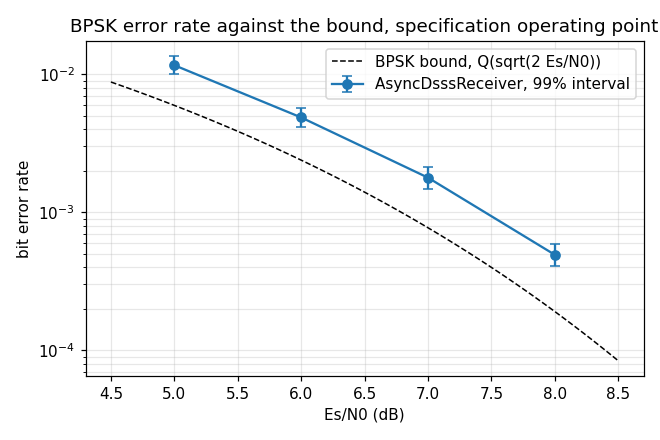

# AsyncDsssReceiver — validation report

Generated by `validate.py` in this folder. Every number is measured from the C implementation through its own binding; nothing is modelled. Re-run to regenerate.

## Executive summary

- **Status.** **CERTIFIED** — all 4 limits hold.
- **Findings.** 6 recorded, 4 still open: F1, F2, F3, F4.

**What a caller most needs to know**

- **The error rate sits 0.72 to 1.13 dB from the BPSK bound at 415.1-B-1, once settled** (4 to 7 dB, both carriers, 26 of 26 bursts settled; 2.6). 0.39 dB of it is the Dll replica's correlation loss, derived (#3134); the allowed loss is doppler#3157's. Every burst settled.
- **Turn `reacquire` on.** A first hand-off can miss the carrier and, without it, never recover (F3, #2409, #3092).
- **A signal that leaves drops symbol lock in 23 ms** at the 415.1-B-1 point (median of 80 settled draws, worst 45 ms; 2.5). Printed, not asserted: the requirement is not set (doppler#3157).
- **Size `out` with care above one symbol a code period:** `steps_max_out()` is not yet a bound (F1, #2469). At the specification's operating point it never binds.

# AsyncDsssReceiver — validation report

## 1. The object — one continuous asynchronous DSSS receiver

The design is [`docs/design/async-dsss-receiver.md`](../../../../../../docs/design/async-dsss-receiver.md); the contract is the header, `native/inc/doppler/async_dsss_receiver/async_dsss_receiver_core.h`. The parallel design it serves is [`docs/design/async-dsss-receiver.md`](../../../../../../docs/design/async-dsss-receiver.md).

**Operating point: the 415.1-B-1 point** (`native/tests/dp_s415_test.h`, the design page's specification): a 1,023-chip Gold code at F_fwd x 31/(221 x 96) chips a second over 2.2 to 2.8 GHz, 3,000 sym/s with a 275-symbol code-only window opening every 1,000-symbol frame, 11 MSa/s, +/-1,500 Hz, a 4 dB Es/N0 floor; the receiver as built, its design C/N0 the true one. The dropout (section 2.3) and the error rate (section 2.6) run there. The loss harness (section 2.7) still runs at the retired 3.069 Mcps point, two samples a chip and 2,700 sym/s, until it moves. **BPSK only**: m = 4 and 8 are accepted by the object and not certified here (the owner's scope, 2026-10-19).

The header's lock and lifecycle claims, each pinned in `native/tests/async_dsss_receiver/test_async_dsss_receiver_core.c` and each seen to fail under a sabotage of the code it guards, the order `docs/dev/contributing/validation.md` requires:

| claim (header) | C test |
|---|---|
| symbol lock: an EMA of cos 2phi over 30 symbols; 30 above 0.5 declare, 15 below 0.3 drop | `_test_symbol_lock_detector_symbol_by_symbol` |
| both flags down for longer than `lost_confirm_s` -> lost; not a sample early, not a call late | `_test_lost_after_switch_off` |
| the plain clock restarts when a flag comes back | `_test_plain_clock_restarts_on_a_flag` |
| one flag down is a degrade, not a release | `_test_one_flag_down_is_a_degrade` |
| a hand-off that never locks is released, on time | `_test_a_handoff_that_never_locks_is_released` |
| `reacquire` releases on symbol lock alone, back to searching | `_test_reacquire_is_symbol_lock_alone`, `_test_reacquire_after_switch_off` |
| a refined Doppler at or past fs/2 is refused at the hand-over, and not left readable | `_test_handover_holds_the_refined_doppler_to_the_domain` |
| steps() never writes past `max_out`; the excess is dropped, not deferred | `_test_output_capacity` |
| decodes at the Es/N0 floor (the 3.069 Mcps point's claim; `_test_awgn_esn0_floor` is red under true noise, the design page's open findings) | `_test_awgn_esn0_floor`, `_test_spec_combined_scenario_at_spec_floor` |
| `differential` acts in a demap this object does not offer: steps()' symbols are the same either way (`@param differential`, #2471) | `_test_differential_does_not_change_the_symbols` |

## 2. Characterisation

Section 2.3 is the `--check` run; 2.5 to 2.7 are the committed full sweeps. 2.1, 2.2 and 2.4 say where the 3.069 Mcps rows went.

### 2.1 Arrival: measured at the use case's cells

How soon a new signal is acquired is measured where the use case is: the pull-in validator's cells (`native/validation/async_dsss_receiver_pullin.c`), at the 415.1-B-1 point with the ruled dynamics. 415.1-B-1 section 7.4.1's acquisition requirement -- PN lock, the receiver's code lock, at probability 0.9 within 20 s -- is asserted there in every cell of the receiver as built. This harness's 3.069 Mcps arrival rows retired with that point. How soon the receiver must be DECODING after arrival is a requirement nobody has set (doppler#3157).

### 2.2 Quality: retired with the 3.069 Mcps point

The EVM rows, and the band they were held to, retired with the 3.069 Mcps point: the band was two lines fitted to the full sweep's own draws, a threshold derived from the run it gated. Its successor, an error rate within an allowed loss of the BPSK bound at the floor, waits on that loss (doppler#3157); the error rate itself is section 2.6.

### 2.3 Dropout: symbol lock when the signal goes (415.1-B-1)

A draw settled in tracking with symbol lock held at the 415.1-B-1 point, then cut at a random sample, mid-data (the symbols either side are data, none in a frame's code-only window); the noise runs on. `held` is the longest dropout lock rode out; the re-lock times are from the signal's return. **Printed, not asserted**: how soon a receiver must drop symbol lock once its signal is gone has no specification row, and waits on the owner (doppler#3157).

| carrier | Es/N0 | lock falls, gone for good | longest dropout held | back after 50 ms out | back after 200 ms out |
|---|---|---|---|---|---|
| 2.8 GHz | 10 dB | 44.5 ms | 43.0 ms | 64.1 ms | 13.2 ms |

### 2.4 False lock: waits on the lock budget

The 3.069 Mcps false-lock rows retired with that point. Their successor -- on noise alone, no lock flag declares within the receiver's lock budget -- needs the budget, which waits on the owner (doppler#3143, doppler#3157).

### 2.5 The full sweep (`data/sweep.txt`)

The dropout over more draws, committed and rendered, never re-run on a push: up to twenty settled draws a carrier and Es/N0, at 10 and 4 dB, from at most forty tried. Printed, not asserted (doppler#3157).

| carrier | Es/N0 | draws settled | lock falls after a loss, median / worst | held through the watch |
|---|---|---|---|---|
| 2.2 GHz | 10 dB | 20 of 20 | 27.8 / 44.9 ms | 0 |
| 2.2 GHz | 4 dB | 20 of 20 | 18.0 / 31.7 ms | 0 |
| 2.8 GHz | 10 dB | 20 of 20 | 25.1 / 35.3 ms | 0 |
| 2.8 GHz | 4 dB | 20 of 20 | 19.7 / 32.5 ms | 0 |

### 2.6 Error rate against the BPSK bound (`data/ber_sweep.txt`)

`native/validation/async_dsss_receiver_ber.c`, at 415.1-B-1: the point's receiver on the 415.1 scene, one emitter at 2.2 or 2.8 GHz, bursts of 6 s from the signal's first sample, the carrier offset uniform over +/-1,500 Hz, the harness's own i.i.d. bits in the 1,000-symbol frame with its code-only window. Every symbol the receiver emits is kept. The measurement is `native/tests/dp_ber_test.h`'s. The window starts at the later of the analytic budget for the demodulator's two loops, read from the receiver, and its symbol lock sustained. The lag and the BPSK phase are detected against a marker of truth past that, and a second detection at the burst's end must agree (a burst that slipped is counted, never folded in). Bursts run until 200 errors (inverse binomial sampling), so the 99% interval is exact. The **loss** is the Es/N0 the bound needs for the measured rate, subtracted from the Es/N0 applied, **over the bursts that settled**: a burst with no settled window is not scored, and is counted on its own (below). A burst whose end alignment differs from its start's SLIPPED: it is counted, and kept out of the rate, so **every BER below is over the bursts that did not slip**, and the slip rate it excludes sits beside it with its interval. A link works only with no slip and its end in sync (the owner's rule), so a cell that slipped is a gap, not a verdict, whatever its rate reads. The bound is asserted: no rate's interval lies wholly below it. The loss is printed: the allowed loss is the owner's to set (doppler#3157). Of it, the Dll replica's correlation loss rho^2/kappa is derived from the code's transitions (the design page, section 3.6; #3134); the remainder is unattributed until the stage split runs at this point (doppler#3156).

| carrier | Es/N0 | slipped (interval) | BER, unslipped bursts | 99% interval | bound | loss (99% interval) | of which derived | bursts settled | symbols | EVM loss | M2M4 |
|---|---|---|---|---|---|---|---|---|---|---|---|
| 2.2 GHz | 4 dB | 0 of 1 (0.00 to 0.79) | 1.98e-02 | 1.69e-02 to 2.32e-02 | 1.25e-02 | 0.74 dB (0.47 to 1.02) | 0.39 dB (replica), remainder unattributed | 1 of 1 | 13,366 | +0.65 dB | 3.49 dB |
| 2.2 GHz | 5 dB | 0 of 2 (0.00 to 0.66) | 1.03e-02 | 8.82e-03 to 1.20e-02 | 5.95e-03 | 0.72 dB (0.50 to 0.94) | 0.39 dB (replica), remainder unattributed | 2 of 2 | 27,077 | +0.78 dB | 4.45 dB |
| 2.2 GHz | 6 dB | 0 of 3 (0.00 to 0.56) | 5.14e-03 | 4.30e-03 to 6.11e-03 | 2.39e-03 | 0.82 dB (0.62 to 1.03) | 0.39 dB (replica), remainder unattributed | 3 of 3 | 41,467 | +0.87 dB | 5.37 dB |
| 2.2 GHz | 7 dB | 0 of 7 (0.00 to 0.35) | 2.09e-03 | 1.74e-03 to 2.49e-03 | 7.73e-04 | 0.87 dB (0.70 to 1.04) | 0.39 dB (replica), remainder unattributed | 7 of 7 | 97,275 | +0.91 dB | 6.36 dB |
| 2.8 GHz | 4 dB | 0 of 1 (0.00 to 0.79) | 2.45e-02 | 2.13e-02 to 2.83e-02 | 1.25e-02 | 1.13 dB (0.87 to 1.40) | 0.39 dB (replica), remainder unattributed | 1 of 1 | 13,365 | +0.93 dB | 3.29 dB |
| 2.8 GHz | 5 dB | 0 of 2 (0.00 to 0.66) | 1.20e-02 | 1.04e-02 to 1.38e-02 | 5.95e-03 | 0.94 dB (0.73 to 1.15) | 0.39 dB (replica), remainder unattributed | 2 of 2 | 26,991 | +0.94 dB | 4.41 dB |
| 2.8 GHz | 6 dB | 0 of 3 (0.00 to 0.56) | 5.82e-03 | 4.92e-03 to 6.86e-03 | 2.39e-03 | 0.97 dB (0.77 to 1.18) | 0.39 dB (replica), remainder unattributed | 3 of 3 | 41,383 | +0.98 dB | 5.37 dB |
| 2.8 GHz | 7 dB | 0 of 7 (0.00 to 0.35) | 2.16e-03 | 1.81e-03 to 2.58e-03 | 7.73e-04 | 0.90 dB (0.73 to 1.08) | 0.39 dB (replica), remainder unattributed | 7 of 7 | 97,933 | +1.02 dB | 6.37 dB |

The loss is over 26 of the 26 bursts: the ones that settled. None slipped. 0 had no settled window and are not scored: symbol lock was not sustained, or came too late in the burst to leave one (F3). The 3.069 Mcps point's ratchet on that count retired with it; a 415.1 one is set from a committed sweep, never from the run it would gate, so the count is printed. The EVM is `dp_ber_report()`'s cross-check over the same windows, and its loss is over that meter's ideal (`dp_ber_evm_ideal_db()`). The blind M2M4 reads -0.71 to -0.51 dB from the applied Es/N0 (F6).

### 2.7 Where the loss goes (`data/loss_sweep.txt`)

`native/validation/async_dsss_receiver_loss.c`, on the stimulus above at known truth (the synth's carrier, its chips from sample 0, its symbol edges): more and more of the shipped chain, each stage scored as a BER-equivalent loss, the Es/N0 the bound needs for the stage's rate subtracted from the Es/N0 applied. Every stage but S4 is scored on the same symbols and noise, so a step between stages carries less counting noise than either loss. S4 is the whole receiver on the same bursts, scored over its own settled window, like section 2.6.

| stage | loss at 5 dB | step | loss at 8 dB | step |
|---|---|---|---|---|
| S0: the ideal despread: exact carrier, code and symbol edges | 0.02 dB (1,549 errors) |  | -0.11 dB (41 errors) |  |
| S1: ideal sums over the receiver's K partials a code period | 0.43 dB (2,135 errors) | +0.41 dB | 0.52 dB (104 errors) | +0.63 dB |
| S1d: the shipped Dll at K, held at truth | 0.43 dB (2,123 errors) | -0.01 dB | 0.54 dB (107 errors) | +0.02 dB |
| S2: + the shipped RateConverter, at oracle timing | 0.43 dB (2,137 errors) | +0.01 dB | 0.53 dB (106 errors) | -0.01 dB |
| S3: + the shipped MpskReceiver, the receiver's parameters | 0.66 dB (2,003 errors) | +0.22 dB | 0.68 dB (103 errors) | +0.15 dB |
| S4: the whole receiver: its search, refine and hand-over | 0.76 dB (2,127 errors) | +0.11 dB | 0.72 dB (109 errors) | +0.05 dB |

The cut alone, against K: ideal sums at known timing, the same bursts. A partial that straddles a symbol edge carries both symbols, and the receiver runs at K = 4.

| K a code period | S1 loss at 5 dB | S1 loss at 8 dB |
|---|---|---|
| 1 | 3.79 dB | 5.45 dB |
| 2 | 1.17 dB | 1.62 dB |
| 4 (the receiver) | 0.43 dB | 0.52 dB |
| 8 | 0.18 dB | 0.19 dB |
| 16 | 0.09 dB | -0.01 dB |
| 32 | 0.07 dB | -0.05 dB |

### 2.8 Errors while the timing pulls in (`data/pullin_windows.txt`)

`native/validation/async_dsss_receiver_pullin.c --windows 25` at 10 dB, static, 16 draws of 3 s a carrier: the demodulator's symbol errors in each window of 25 symbols from the hand-over, summed over the draws that aligned. Sections 2.5 and 2.6 score from the settled point, hundreds of symbols later, so these errors are in neither. The two banks are the matched rectangle arms weighted by the share of each input interval inside the symbol (doppler#3362, the bank as built) and the arms before it, sampled, run from the same harness with that one line changed (doppler#3364).

| bank | carrier | draws | errors a 25-symbol window, summed | errors | last error by symbol |
|---|---|---|---|---|---|
| coverage | 2.2 GHz | 16 | 52 23 16 12 13 10 10 13 13 14 18 19 11 6 0 2 0 | 232 | 400 |
| coverage | 2.8 GHz | 16 | 34 14 14 14 17 11 16 30 24 13 16 15 9 7 5 7 2 5 2 16 | 271 | 500 |
| sampled | 2.2 GHz | 16 | 46 12 8 8 1 6 2 4 4 6 3 3 6 6 3 2 0 1 0 | 121 | 450 |
| sampled | 2.8 GHz | 15 | 21 9 11 6 6 9 5 10 7 11 8 9 8 4 8 6 5 1 2 3 | 149 | 500 |

The demodulator pulls its timing in after every hand-over on both banks, over a few hundred symbols, and the errors it makes doing so are not in the pooled rate. The span is about the same on both; the corrected bank makes 1.9 and 1.8 times as many errors in it, at 2.2 and 2.8 GHz. Why is measured by `native/validation/ratesync_partial_scurve.c` (`data/partial_scurve.txt`), the open-loop S-curve on this stream: the corrected bank's slope over 1/32 of a symbol about the stable zero is 0.78 and 0.89 of the gain `bn` is designed for (the partials' composite is not the ideal triangle `ted_scale` assumes), while the sampled arms' staircase gives 1.54 and 1.77 times it over 1/32 and 4.8 and 5.5 over 0.01, so the old loop snapped in over the last stretch. A feedforward timing estimate at the hand-over is the design meant to remove the transient (`docs/design/ratesync-timing.md` section 9.3).

## 3. Review — findings, with verdicts

- **F1 · GAP** — `steps_max_out()` returns 0, which is not a bound: a call that completes a carried code period emits that whole period's symbols, so at more than one symbol per period an `out` sized to the call's `x_len` drops symbols silently. At the specification's operating point (0.9 symbols a period) it never binds. Tracked as #2469.

- **F2 · GAP** — `differential` is inert here: it reaches MpskReceiver's `bits()` demap, and this object returns soft symbols only (`_test_differential_does_not_change_the_symbols`). Remove it or add `bits()`: #2471.

- **F3 · CONFIRMED** — A first hand-off can land off the carrier and never pull in. With `reacquire` off (the binding's default, and the error-rate harness's), 0 of the 26 bursts of the 415.1 error-rate sweep never settled (section 2.6): the refine handed over outside the carrier loops' pull-in, code lock came up and symbol lock never did. `reacquire` recovers a missed hand-off by searching again. The hand-off accuracy is #2409; `reacquire` as the default is #3092.

- **F4 · GAP** — The pre-despread carrier loop's lock flag (`car.locked`) uses the Costas default rule, which is sized against noise only: its thresholds were never sized for a miss rate under signal. At 415.1-B-1, 2.8 GHz and 4 dB, the signal's own metric sits on the declare threshold and the flag toggles in the data with the loop on frequency, which breaks the owner's rule that a working link shows no lock toggle in the data. The receiver never calls `dp_costas_configure_lock()`. #3176 carries the measurement and the closed-form statistic its sizing needs.

- **F5 · C-ONLY** — The lock detector's hysteresis, the release clock's edges and the hand-over domain are certified symbol by symbol and sample by sample in the C tests of section 1; the binding exposes only the flags, which section 2 reads.

- **F6 · FIXED** — Over the 26 of 26 bursts that settled, the error rate sits 0.72 to 1.13 dB from the BPSK bound (section 2.6), and the EVM over the same windows reads +0.65 to +1.02 dB over its ideal. Until #2495 the two disagreed: the Dll divided each code period's partials by that period's own signal-plus-noise magnitude, which compressed the in-phase error, so the EVM read near its ideal and the blind M2M4 2.4 to 2.8 dB above the applied Es/N0 while the error rate sat 0.9 dB from the bound. The Dll divides by a slowly tracked level now, its error circular, and the blind M2M4 reads -0.71 to -0.51 dB from the applied Es/N0, inside `dp_ber_report()`'s 3.0 dB (`DP_BER_M2M4_AGREE_DB`) at every point. Where the loss goes, stage by stage, is section 2.7: the cut into four partials a code period, the demodulator's loops and the front end's tracking.

## 4. Limits — claims a caller may rely on

The 3.069 Mcps point's arrival, EVM, dropout and false-lock limits retired with it (the owner's ruling). Their successors: acquisition is asserted on the pull-in validator's cells (415.1-B-1 section 7.4.1); the dropout time, the allowed loss and the decoding time wait on the owner, and their rows are printed (doppler#3157); false lock waits on the lock budget (doppler#3143). The error rate below is at 415.1-B-1, held to the BPSK bound; its allowed loss is doppler#3157's, so section 2.6 prints it.

| verdict | claim |
|---|---|
| PASS | [2.8 GHz 7 dB] the error rate is a result: settled, aligned, 210 errors, and its EVM, M2M4 and theory cross-checks agree |
| PASS | [2.8 GHz 7 dB] the error rate is not below the BPSK bound (its interval's upper limit, 1.93e-03, reaches 7.73e-04) |
| PASS | [2.8 GHz 7 dB] no burst slipped: each ends aligned as it started (a link works only with no slip and its end in sync, the owner's rule) |
| PASS | [2.8 GHz 7 dB] no burst handed over inside the carrier loop's reliable pull-in, 30 Hz, fails to settle |

## 5. Summary

- **6 findings**, 4 of them gaps or confirmed defects: F1, F2, F3, F4
- **4/4 limits** hold
- Raw run: `data/dropout.csv`, `data/ramp.csv`, `data/code_lock.csv` and `data/code_lock_terms.csv` (the lock harness; the last two are the code lock's statistic against the detection model and its signal and noise terms, #3134), `data/ber.csv`, `data/burst.csv` and `data/spec.csv` (the error-rate harness) -- the two harnesses' `--check --emit` blocks; `data/sweep.txt`, `data/ber_sweep.txt` and `data/loss_sweep.txt` -- the three harnesses' full sweeps; `data/window_comparison.txt` -- the error-rate harness's `--window-comparison`, both carrier windows paired at the 4 dB floor, the measurement the owner's ruling on the code-period window rests on; `data/pullin_windows.txt` -- the pull-in harness's `--windows 25`, on the corrected rectangle bank and on the sampled arms before it; `data/partial_scurve.txt` -- `validate_ratesync_partial_scurve`, the open-loop S-curve the demodulator's timing loop sees on the partials, both banks
