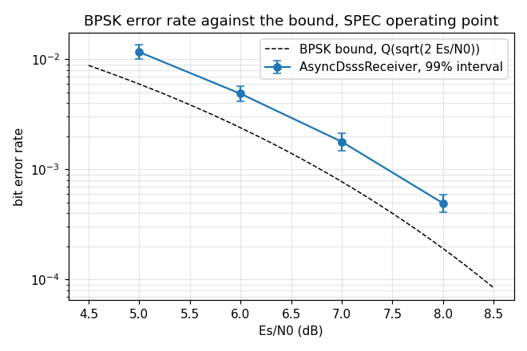

# AsyncDsssReceiver — validation report

Generated by `validate.py` in this folder. Every number is measured from the C implementation through its own binding; nothing is modelled. Re-run to regenerate.

## Executive summary

- **Status.** **CERTIFIED** — all 23 limits hold.
- **Findings.** 5 recorded, 3 still open: F1, F2, F3.

**What a caller most needs to know**

- **Budget about 1 dB for the error rate, once settled.** From 5 to 8 dB the BER of the bursts that settled (48 of 48) sits 0.65 to 0.89 dB from the BPSK bound; where it goes is section 2.7 (2.6). Every burst settled.
- **Budget about 1 dB of EVM over the meter's ideal from 5 to 15 dB.** Over the full sweep a locked receiver's BPSK EVM is +0.81 to +1.18 dB over `dp_ber_evm_ideal_db()` there, the same implementation loss the error rate shows; at 20 dB +2.16 to +2.35 dB, where an implementation floor joins it (section 2.5).
- **Lock is quick at 10 dB:** tracked 45 ms after a signal arrives (worst 47 ms over 20 draws), symbol lock 77 ms (worst 219 ms) (2.5).
- **Turn `reacquire` on.** A first hand-off can miss the carrier and, without it, never recover: 1 of the 10 quality draws under 10 dB never locked, and 0 of 20 dropout draws at 10 dB and 0 of 20 at 5 dB never settled (F3, #2409).
- **The lock flag means something:** 10 receivers on noise declared it 0 times, and a signal that leaves drops it within 42 ms (2.5).
- **Size `out` with care above one symbol a code period:** `steps_max_out()` is not yet a bound (F1, #2469). At the specification's operating point it never binds.

# AsyncDsssReceiver — validation report

## 1. The object — one continuous asynchronous DSSS receiver

The design is [`docs/design/async-dsss-receiver.md`](../../../../../../docs/design/async-dsss-receiver.md); the contract is the header, `native/inc/doppler/async_dsss_receiver/async_dsss_receiver_core.h`. The parallel design it serves is [`docs/design/async-dsss-receiver.md`](../../../../../../docs/design/async-dsss-receiver.md).

**Operating point (the specification).** A 1,023-chip Gold code (CCSDS #365) at 3.069 Mcps, two samples a chip (6.138 MSa/s), asynchronous BPSK data at 2,700 sym/s. The searching flavor, at the binding's defaults except two: its design C/N0 is the true one, and its search covers +/-1/T_E (+/-3 kHz). **BPSK only**: m = 4 and 8 are accepted by the object and not certified here (the owner's scope, 2026-10-19).

The header's lock and lifecycle claims, each pinned in `native/tests/async_dsss_receiver/test_async_dsss_receiver_core.c` and each seen to fail under a sabotage of the code it guards, the order `docs/dev/contributing/validation.md` requires:

| claim (header) | C test |
|---|---|
| symbol lock: an EMA of cos 2phi over 30 symbols; 30 above 0.5 declare, 15 below 0.3 drop | `_test_symbol_lock_detector_symbol_by_symbol` |
| both flags down for longer than `lost_confirm_s` -> lost; not a sample early, not a call late | `_test_lost_after_switch_off` |
| the plain clock restarts when a flag comes back | `_test_plain_clock_restarts_on_a_flag` |
| one flag down is a degrade, not a release | `_test_one_flag_down_is_a_degrade` |
| a hand-off that never locks is released, on time | `_test_a_handoff_that_never_locks_is_released` |
| `reacquire` releases on symbol lock alone, back to searching | `_test_reacquire_is_symbol_lock_alone`, `_test_reacquire_after_switch_off` |
| a refined Doppler at or past fs/2 is refused at the hand-over, and not left readable | `_test_handover_holds_the_refined_doppler_to_the_domain` |
| steps() never writes past `max_out`; the excess is dropped, not deferred | `_test_output_capacity` |
| decodes at the Es/N0 floor | `_test_awgn_esn0_floor`, `_test_spec_combined_scenario_at_spec_floor` |
| `differential` acts in a demap this object does not offer: steps()' symbols are the same either way (`@param differential`, #2471) | `_test_differential_does_not_change_the_symbols` |

## 2. Characterisation

Sections 2.1 to 2.4 are the `--check` run the limits read; 2.5 and 2.6 are the committed full sweeps.

### 2.1 Arrival: from a signal's first sample to symbol lock

Each draw: the carrier uniform over +/-1/T_E, the arrival at a uniform point of up to 20 ms of noise, mid-data. Times are from the arrival, to one 2,046-sample block (0.33 ms).

| Es/N0 | carrier | tracking | seed error | symbol lock | locked at 2 s |
|---|---|---|---|---|---|
| 10 dB | +2395 Hz | 43.5 ms | +64 Hz | 110.5 ms | yes |
| 10 dB | +1345 Hz | 44.4 ms | -117 Hz | 169.0 ms | yes |
| 10 dB | +1118 Hz | 43.9 ms | +15 Hz | 58.9 ms | yes |

### 2.2 Quality: EVM and lock, BPSK, against Es/N0

Each draw: the signal from sample 0, fed until symbol lock first comes up, 0.2 s more, then **every** symbol steps() returns over 1 s (2,700 symbols), never gated on the flag. EVM is over that whole window, against the stream's own hard decisions (`dp_test_evm_db_hard_range`, m = 2). The meter scales the window to unit total power, so its reading on an ideal stream is not -Es/N0 but `dp_ber_evm_ideal_db()`; the **loss** is the EVM over that.

| Es/N0 | symbol lock after | symbols | EVM | meter's ideal | loss | window in lock |
|---|---|---|---|---|---|---|
| 20 dB | 57 ms | 2700 | -17.72 dB | -20.03 dB | +2.31 dB | 100.0% |
| 15 dB | 56 ms | 2700 | -13.92 dB | -15.10 dB | +1.18 dB | 100.0% |
| 10 dB | 57 ms | 2700 | -9.29 dB | -10.31 dB | +1.02 dB | 100.0% |
| 7 dB | 81 ms | 2700 | -6.57 dB | -7.60 dB | +1.02 dB | 100.0% |
| 5 dB | 107 ms | 2700 | -4.80 dB | -5.91 dB | +1.11 dB | 100.0% |

### 2.3 Dropout: symbol lock when the signal goes

A draw settled in tracking with symbol lock held, then cut at a random sample, mid-data; the noise runs on. `held` is the longest dropout lock rode out; the re-lock times are from the signal's return.

| Es/N0 | lock falls, gone for good | longest dropout held | back after 50 ms out | back after 200 ms out |
|---|---|---|---|---|
| 10 dB | 33.4 ms | 19.3 ms | 35.1 ms | 58.4 ms |

### 2.4 False lock: a receiver seeded onto noise

A receiver handed a false alarm -- seeded onto noise alone, sized for the Es/N0 it expected -- and never released, so its loops run on noise for the whole 2 s.

| design Es/N0 | symbol lock up | declared | code lock up |
|---|---|---|---|
| 10 dB | 0 of 6000 blocks | 0 times | 0.00% of blocks |
| 5 dB | 0 of 6000 blocks | 0 times | 0.00% of blocks |

### 2.5 The full sweep (`data/sweep.txt`)

The same measurements over more draws, committed and rendered, never re-run on a push: five quality draws at each Es/N0, twenty arrival draws and up to forty dropout draws at 10 and 5 dB, five false-lock draws at each.

| Es/N0 | locked within 4 s | loss | least window in lock |
|---|---|---|---|
| 20 dB | 5 of 5 | +2.16 to +2.35 dB | 100.0% |
| 15 dB | 5 of 5 | +0.99 to +1.18 dB | 100.0% |
| 10 dB | 5 of 5 | +0.85 to +1.02 dB | 100.0% |
| 7 dB | 5 of 5 | +0.82 to +1.02 dB | 100.0% |
| 5 dB | 4 of 5 | +0.81 to +1.11 dB | 100.0% |

| Es/N0 | arrivals locked at 2 s | tracking, median / worst | symbol lock, median / worst | dropout draws not settled in 4 s |
|---|---|---|---|---|
| 10 dB | 20 of 20 | 45 / 47 ms | 77 / 219 ms | 0 of 20 |
| 5 dB | 20 of 20 | 86 / 101 ms | 289 / 1640 ms | 0 of 20 |

False lock over the sweep: 0 of 60000 blocks with symbol lock up, 0 declarations, in 10 receivers on noise.

### 2.6 Error rate against the BPSK bound (`data/ber_sweep.txt`)

`native/validation/async_dsss_receiver_ber.c`, on the stimulus above: bursts of 6 s from the signal's first sample, the carrier uniform over +/-1/T_E, the harness's own i.i.d. bits. Every symbol the receiver emits is kept. The measurement is `native/tests/dp_ber_test.h`'s. The window starts at the later of the analytic budget for the demodulator's two loops, read from the receiver, and its symbol lock sustained. The lag and the BPSK phase are detected against a marker of truth past that, and a second detection at the burst's end must agree (a burst that slipped is counted, never folded in). Bursts run until 200 errors (inverse binomial sampling), so the 99% interval is exact. The **loss** is the Es/N0 the bound needs for the measured rate, subtracted from the Es/N0 applied, **over the bursts that settled**: a burst with no settled window is not scored, and is held to a rule of its own (below).

| Es/N0 | BER | 99% interval | bound | loss (99% interval) | bursts settled | symbols | EVM loss | M2M4 |
|---|---|---|---|---|---|---|---|---|
| 5 dB | 1.16e-02 | 9.99e-03 to 1.35e-02 | 5.95e-03 | 0.89 dB (0.68 to 1.12) | 2 of 2 | 25,010 | +0.88 dB | 4.43 dB |
| 6 dB | 4.87e-03 | 4.12e-03 to 5.73e-03 | 2.39e-03 | 0.76 dB (0.57 to 0.95) | 4 of 4 | 50,321 | +0.88 dB | 5.43 dB |
| 7 dB | 1.78e-03 | 1.48e-03 to 2.13e-03 | 7.73e-04 | 0.72 dB (0.55 to 0.89) | 9 of 9 | 112,730 | +0.89 dB | 6.38 dB |
| 8 dB | 4.92e-04 | 4.10e-04 to 5.89e-04 | 1.91e-04 | 0.65 dB (0.52 to 0.79) | 33 of 33 | 408,236 | +0.88 dB | 7.37 dB |

The loss is over 48 of the 48 bursts: the ones that settled. None slipped. 0 had no settled window and are not scored: symbol lock was not sustained, or came too late in the burst to leave one. That is F3, a known defect, so their count is a ratchet: the committed count at the sweep's seeds plus one for another toolchain's draws, which may only shrink (0 of at most 1 at 5 dB, 0 of at most 1 at 6 dB, 0 of at most 1 at 7 dB, 0 of at most 1 at 8 dB). The EVM is `dp_ber_report()`'s cross-check over the same windows, and its loss is over that meter's ideal (`dp_ber_evm_ideal_db()`), as in 2.2. The blind M2M4 reads -0.63 to -0.57 dB from the applied Es/N0 (F5).

### 2.7 Where the loss goes (`data/loss_sweep.txt`)

`native/validation/async_dsss_receiver_loss.c`, on the stimulus above at known truth (the synth's carrier, its chips from sample 0, its symbol edges): more and more of the shipped chain, each stage scored as a BER-equivalent loss, the Es/N0 the bound needs for the stage's rate subtracted from the Es/N0 applied. Every stage but S4 is scored on the same symbols and noise, so a step between stages carries less counting noise than either loss. S4 is the whole receiver on the same bursts, scored over its own settled window, like section 2.6.

| stage | loss at 5 dB | step | loss at 8 dB | step |
|---|---|---|---|---|
| S0: the ideal despread: exact carrier, code and symbol edges | 0.02 dB (1,549 errors) |  | -0.11 dB (41 errors) |  |
| S1: ideal sums over the receiver's K partials a code period | 0.43 dB (2,135 errors) | +0.41 dB | 0.52 dB (104 errors) | +0.63 dB |
| S1d: the shipped Dll at K, held at truth | 0.43 dB (2,123 errors) | -0.01 dB | 0.54 dB (107 errors) | +0.02 dB |
| S2: + the shipped RateConverter, at oracle timing | 0.43 dB (2,137 errors) | +0.01 dB | 0.53 dB (106 errors) | -0.01 dB |
| S3: + the shipped MpskReceiver, the receiver's parameters | 0.66 dB (2,007 errors) | +0.23 dB | 0.67 dB (102 errors) | +0.14 dB |
| S4: the whole receiver: its search, refine and hand-over | 0.86 dB (2,124 errors), 1 burst(s) not settled | +0.20 dB | 0.65 dB (99 errors) | -0.02 dB |

The cut alone, against K: ideal sums at known timing, the same bursts. A partial that straddles a symbol edge carries both symbols, and the receiver runs at K = 4.

| K a code period | S1 loss at 5 dB | S1 loss at 8 dB |
|---|---|---|
| 1 | 3.79 dB | 5.45 dB |
| 2 | 1.17 dB | 1.62 dB |
| 4 (the receiver) | 0.43 dB | 0.52 dB |
| 8 | 0.18 dB | 0.19 dB |
| 16 | 0.09 dB | -0.01 dB |
| 32 | 0.07 dB | -0.05 dB |

## 3. Review — findings, with verdicts

- **F1 · GAP** — `steps_max_out()` returns 0, which is not a bound: a call that completes a carried code period emits that whole period's symbols, so at more than one symbol per period an `out` sized to the call's `x_len` drops symbols silently. At the specification's operating point (0.9 symbols a period) it never binds. Tracked as #2469.

- **F2 · GAP** — `differential` is inert here: it reaches MpskReceiver's `bits()` demap, and this object returns soft symbols only (`_test_differential_does_not_change_the_symbols`). Remove it or add `bits()`: #2471.

- **F3 · CONFIRMED** — A first hand-off can land off the carrier and never pull in. With `reacquire` off (the binding's default, and this harness's), the full sweep has 1 of its 10 quality draws under 10 dB with no symbol lock within 4 s, 0 of 20 arrivals at 5 dB unlocked at 2 s, and dropout draws that never settled in 0 of 20 at 5 dB and 0 of 20 at 10 dB (section 2.5). None missed at the 10 dB design point in this sweep; #2409 holds one that did, replayed from an earlier sweep: the refine handed over outside the carrier loops' pull-in, code lock came up and symbol lock never did. `reacquire` recovers a missed hand-off by searching again; the specification example locks every draw that way. The hand-off accuracy is #2409.

- **F4 · C-ONLY** — The lock detector's hysteresis, the release clock's edges and the hand-over domain are certified symbol by symbol and sample by sample in the C tests of section 1; the binding exposes only the flags, which section 2 reads.

- **F5 · FIXED** — Over the 48 of 48 bursts that settled, the error rate sits 0.65 to 0.89 dB from the BPSK bound (section 2.6), and the EVM over the same windows reads +0.88 to +0.89 dB over its ideal. Until #2495 the two disagreed: the Dll divided each code period's partials by that period's own signal-plus-noise magnitude, which compressed the in-phase error, so the EVM read near its ideal and the blind M2M4 2.4 to 2.8 dB above the applied Es/N0 while the error rate sat 0.9 dB from the bound. The Dll divides by a slowly tracked level now, its error circular, and the blind M2M4 reads -0.63 to -0.57 dB from the applied Es/N0, inside `dp_ber_report()`'s 3.0 dB (`DP_BER_M2M4_AGREE_DB`) at every point. Where the loss goes, stage by stage, is section 2.7: the cut into four partials a code period, the demodulator's loops and the front end's tracking.

## 4. Limits — claims a caller may rely on

The EVM bound is two-sided and set per Es/N0, as a loss over the meter's ideal. A locked receiver's error is the ideal's scaled by its implementation loss, plus a floor: EVM² = k·ideal + floor in linear power, so its loss is 10·log10(k + floor/ideal). The band lies between two such lines fitted to the full sweep's draws at 10, 15 and 20 dB: the upper (k 0.83 dB, floor -23.0 dB) through its worst, the lower (k 0.78 dB, floor -27.3 dB) under its least, each widened by 0.30 dB, the EVM estimator's own counting noise over 2700 symbols (3.6 sigma of 0.08 dB): +1.11 to +2.65 dB at 20 dB, +0.69 to +1.68 dB at 15 dB, +0.55 to +1.32 dB at 10 dB. An EVM under the band reads better than the receiver's implementation loss allows: a meter that flatters it, as the Dll's per-period output normalization did until #2495, and the lower line is what sees that. Below 10 dB a draw need not lock, and no EVM limit is claimed.

| verdict | claim |
|---|---|
| PASS | [10 dB, carrier +2395 Hz] a signal is tracked within 100 ms of arriving |
| PASS | [10 dB, carrier +2395 Hz] it holds symbol lock 2 s after arriving |
| PASS | [10 dB, carrier +1345 Hz] a signal is tracked within 100 ms of arriving |
| PASS | [10 dB, carrier +1345 Hz] it holds symbol lock 2 s after arriving |
| PASS | [10 dB, carrier +1118 Hz] a signal is tracked within 100 ms of arriving |
| PASS | [10 dB, carrier +1118 Hz] it holds symbol lock 2 s after arriving |
| PASS | [20 dB] the receiver reaches symbol lock |
| PASS | [20 dB] a locked receiver's BPSK EVM is within +1.11 to +2.65 dB of the meter's ideal |
| PASS | [20 dB] symbol lock holds through 1 s of locked operation |
| PASS | [15 dB] the receiver reaches symbol lock |
| PASS | [15 dB] a locked receiver's BPSK EVM is within +0.69 to +1.68 dB of the meter's ideal |
| PASS | [15 dB] symbol lock holds through 1 s of locked operation |
| PASS | [10 dB] the receiver reaches symbol lock |
| PASS | [10 dB] a locked receiver's BPSK EVM is within +0.55 to +1.32 dB of the meter's ideal |
| PASS | [10 dB] symbol lock holds through 1 s of locked operation |
| PASS | [10 dB] a signal gone for good drops symbol lock within 80 ms |
| PASS | [10 dB design] a receiver on noise never declares symbol lock in 2 s |
| PASS | [5 dB design] a receiver on noise never declares symbol lock in 2 s |
| PASS | [7 dB] the error rate is a result: settled, aligned, 202 errors, and its EVM, M2M4 and theory cross-checks agree |
| PASS | [7 dB] no burst's alignment moved between its start and its end |
| PASS | [7 dB] over the bursts that settle (9 of 9 here), the error rate is within 1.1 dB of the BPSK bound (the loss at the 99% interval's lower limit) |
| PASS | [7 dB] at most 1 of the bursts fail to settle (0 here; F3, a ratchet that may only shrink) |
| PASS | [7 dB] no burst handed over inside the carrier loop's reliable pull-in, 120 Hz, fails to settle |

## 5. Summary

- **5 findings**, 3 of them gaps or confirmed defects: F1, F2, F3
- **23/23 limits** hold
- Raw run: `data/arrival.csv`, `data/quality.csv`, `data/dropout.csv`, `data/falselock.csv`, `data/ber.csv`, `data/burst.csv`, `data/evm_model.csv` (the EVM band's two lines) -- the two harnesses' `--check --emit` blocks; `data/sweep.txt`, `data/ber_sweep.txt` and `data/loss_sweep.txt` -- the three harnesses' full sweeps
