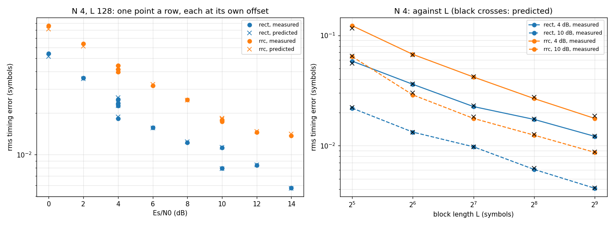
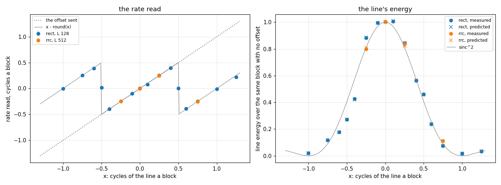
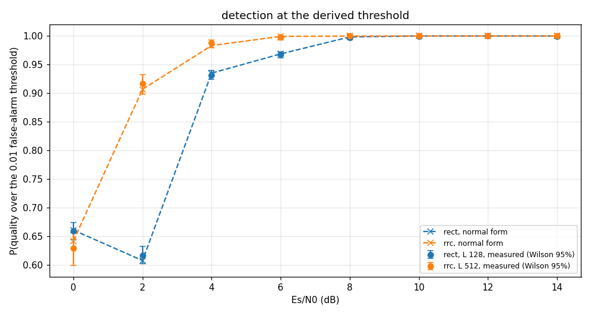
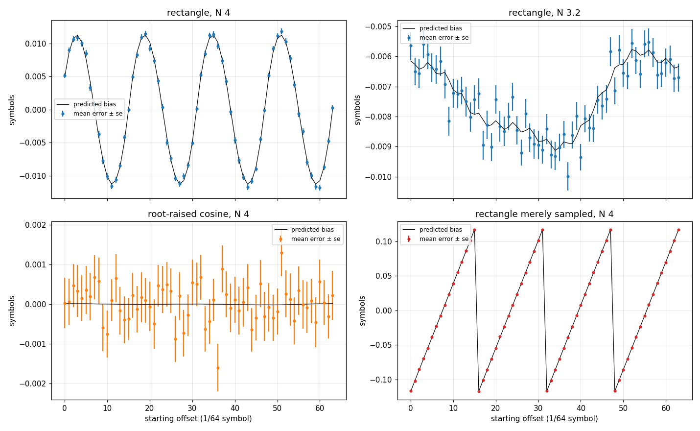

# SymbolTimingEstimator — validation report

Generated by `validate.py` in this folder. Every number is the C harness's, `native/validation/timing_est_noise.c`: the gated ones from its `--check --emit` run (the regression subset `ctest` also makes), which this file runs and renders, and the ones marked as the record from its full sweep (`--csv`), refreshed on purpose and not part of the gate. Nothing is modelled. Re-run to regenerate.

## Executive summary

- **Status.** **CERTIFIED** — all 23 limits hold.
- **Findings.** 6 recorded, 2 still open: F5, F6.

**What a caller most needs to know**

- **The error is the one the pulse predicts, at any starting offset, with a carrier offset on every row.** Rectangle, 4 samples a symbol, 128 symbols, Es/N0 4 dB: 0.023 symbols rms against 0.023 computed; the three constants for each pulse and rate are in §2.1.
- **One rate bin is enough for blocks of hundreds of symbols.** The rate is read out to about 0.4 cycles of the line a block, 3125 ppm at 128 symbols and 781 ppm at 512; past half a cycle it aliases with the wrong sign (F1, §2.2).
- **On a rectangle at a whole number of samples a symbol the timing carries a sampling-phase bias** of up to 0.011 symbols at 4, and a slow drift is read with a gain of 0.66 to 1.33. A rate that is not whole, or a band-limited pulse, does not have it, and behind the converter's cascades it falls to 0.003 (F2, §2.7, §2.8).
- **Doppler costs nothing it should not.** A carrier a tenth of the symbol rate off changes no statistic beyond the matched filter's, the dilation reads as rate, and a physical Doppler rate is far under what costs the line anything (§2.3, §2.4).
- **A threshold on `quality` works as a presence test, and it is derived.** The derived threshold gives 0.98 to 1.12 of the false-alarm target. At it, for 0.01, the rectangle is detected 0.66 of the time at 0 dB from 128 symbols and over 0.99 at 10 dB, and a stream with no transitions is refused (§2.5, §2.6).
- **The root-raised cosine needs about four times the symbols** for the same error: its line is a third the rectangle's (F3, §2.1).

# SymbolTimingEstimator — validation report

## 1. The object — design and expectations

A feedforward estimate of symbol timing: a block of matched-filtered samples in, the eye center, the clock's rate error and a quality figure out, with no loop and no pull-in. The design, the three-term variance it predicts, the bounds a clock offset and a Doppler put on the block, and the unknowns this report was asked to settle are [`docs/design/timing-estimator.md`](../../../../../../../docs/design/timing-estimator.md); the contract is `native/inc/doppler/timing_est/timing_est_core.h`.

The header's claims, the section of `native/tests/timing_est/test_timing_est_core.c` that pins each, and where this report measures it over the envelope:

| header claim | C test | here |
|---|---|---|
| create refuses a rate the line cannot carry (2 or less, not finite) | §1 | — |
| `tau` is the eye center on the symbol clock and `quality` the line's share of the power, at whole and fractional samples a symbol | §2 | §2.1, §2.5, §2.7 |
| the carrier does not enter | §3 | every row carries one; §2.3 |
| one clock across calls, and the rate from two blocks while the timing moves under half a symbol between them | §4 | §2.2, §2.3, §2.4 |
| estimate is accumulate then finish; a block with no power is not kept | §5 | — |
| reset returns the object to its post-create state | §6 | — |
| the state resumes bit for bit and a forged blob is refused | §7 | — |
| `tau` on a pulse that is not band limited, read at a whole number of samples a symbol, is off the eye center by where the samples fall in the symbol | §8 | §2.7 |
| nothing is decided: `quality` is reported and the caller judges it | §2 | §2.5, §2.6 (what a threshold on it delivers) |

Every number below comes from the C harness, on one chain: the library's generator (`wfm_synth`, symbols from its 31-bit PRBS), `doppler_channel` where the time base is dilated, the samples the estimator's rate keeps, noise from `awgn`, the shipped matched filter (`RateConverter`, matched, rate 1), then the estimator. The rectangle reaches the matched filter as the mean over each kept sample's own interval, which is the design condition `RateSync`'s bank was given; the root-raised cosine (roll-off 0.35) is sampled. **A carrier offset is on every row**, drawn between 0.01 and 0.05 of the symbol rate unless the row sets it, with a starting phase drawn each trial.

The truth and the prediction both come from one measurement that does not involve the estimator: a lone symbol through the same chain, read on the generator's grid. Its energy centroid is the eye center. Its shape, the matched filter's impulse response and the block's geometry give the mean, the variance and the line's size by the formulas in the harness's header comment. N is samples a symbol, L symbols a block, and a timing is in symbols.

## 2. Characterisation — what the object delivers

Each part opens with the rows the gate runs (the harness's `--check`, seeded, held within four standard errors of their own trials) and then shows the record: the same harness's full sweep, kept as `data/*.csv` and refreshed on purpose. `±` is one standard error.

### 2.1 Noise: the mean and the variance against the pulse's

The variance is `(k_ss + k_sn / g + k_nn / g^2) / L` to first order, `g` the Es/N0, with the three constants computed from the pulse; the prediction held here carries it one order further. The mean error is against the eye center, and its prediction is the bias the pulse and the sampling give (§2.7).

| pulse | N | L | Es/N0 dB | carrier | mean error | predicted | rms | predicted | line energy / predicted |
|---|---|---|---|---|---|---|---|---|---|
| rect | 4 | 128 | 4 | +0.034 | -0.01134 ± 0.00051 | -0.01067 | 0.0227 ± 0.0004 | 0.0226 | 0.992 |
| rect | 3.2 | 128 | 4 | +0.037 | -0.00813 ± 0.00056 | -0.00807 | 0.0249 ± 0.0004 | 0.0254 | 1.018 |
| rrc | 4 | 512 | 10 | +0.045 | -0.00050 ± 0.00020 | +0.00000 | 0.0089 ± 0.0001 | 0.0090 | 0.995 |

The record (`data/noise.csv`, 63 rows: Es/N0 0 to 14 dB, L 32 to 512, N 3 to 8 whole and not, both pulses). On the 37 rows where the expansion is a prediction (its second-order term under a quarter of the first) the measured variance is 0.91 to 1.02 of the predicted one. On the other 26, all short blocks or low Es/N0, it is 0.88 to 1.12: the estimate is past its threshold there and the form no longer predicts it.

The constants, at L 128 and the carrier and starting offset each row drew (`data/constants.csv`). `line` is the quality the pulse gives at Es/N0 4 dB, and `bias` the mean error it predicts:

| pulse | N | k_ss | k_sn | k_nn | line | bias |
|---|---|---|---|---|---|---|
| rect | 3.000 | 0.0005 | 0.094 | 0.168 | 0.100 | -0.0277 |
| rect | 3.200 | 0.0008 | 0.122 | 0.181 | 0.085 | -0.0081 |
| rect | 3.556 | 0.0009 | 0.119 | 0.166 | 0.084 | -0.0003 |
| rect | 4.000 | 0.0004 | 0.095 | 0.148 | 0.097 | -0.0107 |
| rect | 4.571 | 0.0000 | 0.106 | 0.150 | 0.088 | +0.0005 |
| rect | 5.000 | 0.0003 | 0.107 | 0.159 | 0.091 | +0.0044 |
| rect | 5.333 | 0.0000 | 0.101 | 0.143 | 0.090 | -0.0010 |
| rect | 6.000 | 0.0006 | 0.106 | 0.156 | 0.090 | +0.0000 |
| rect | 6.400 | 0.0000 | 0.096 | 0.137 | 0.091 | -0.0003 |
| rect | 7.000 | 0.0002 | 0.097 | 0.143 | 0.093 | -0.0015 |
| rect | 7.500 | 0.0000 | 0.097 | 0.137 | 0.092 | -0.0002 |
| rect | 8.000 | 0.0000 | 0.094 | 0.138 | 0.093 | -0.0008 |
| rrc | 3.000 | 0.0114 | 0.318 | 0.312 | 0.033 | +0.0005 |
| rrc | 3.200 | 0.0103 | 0.321 | 0.315 | 0.032 | -0.0030 |
| rrc | 3.556 | 0.0020 | 0.333 | 0.322 | 0.032 | -0.0005 |
| rrc | 4.000 | 0.0120 | 0.337 | 0.331 | 0.032 | -0.0004 |
| rrc | 4.571 | 0.0051 | 0.319 | 0.316 | 0.032 | +0.0015 |
| rrc | 5.000 | 0.0020 | 0.329 | 0.316 | 0.033 | -0.0000 |
| rrc | 5.333 | 0.0028 | 0.309 | 0.305 | 0.033 | +0.0026 |
| rrc | 6.000 | 0.0020 | 0.361 | 0.349 | 0.031 | +0.0002 |
| rrc | 6.400 | 0.0103 | 0.328 | 0.323 | 0.032 | -0.0010 |
| rrc | 7.000 | 0.0107 | 0.318 | 0.313 | 0.033 | +0.0003 |
| rrc | 7.500 | 0.0071 | 0.356 | 0.352 | 0.031 | -0.0004 |
| rrc | 8.000 | 0.0025 | 0.331 | 0.326 | 0.032 | -0.0001 |

### 2.2 Clock offset: the rate, and where the one bin ends

`doppler_channel` dilates the time base with no carrier of its own; `x` is how many cycles the power's line turns in one block, so the bin's edge is `x = 1/2`. Two blocks a trial give the rate. The line's energy is shown over the same block with no offset, beside the prediction and the design page's `sinc(x)^2`.

| pulse | N | L | x | rate | predicted | sent | line energy | predicted | sinc^2 |
|---|---|---|---|---|---|---|---|---|---|
| rect | 4 | 128 | +0.25 | +1953.1 ± 4.4 ppm | +1955.2 | +1953.1 | 0.839 | 0.844 | 0.811 |
| rect | 4 | 128 | +0.75 | -1949.5 ± 17.9 ppm | -1960.0 | +5859.4 | 0.076 | 0.076 | 0.090 |
| rrc | 4 | 512 | +0.25 | +488.4 ± 1.5 ppm | +488.2 | +488.3 | 0.827 | 0.823 | 0.811 |

The record (`data/clock.csv`): `x` from 0 to 1.25, both signs. Inside the bin the rate is the offset sent to within 0.022 cycles a block on the rectangle at N 4 (the sampling-phase bias of §2.7 is what is left), and on the root-raised cosine to within its standard error. At `x = 1/2` the two signs are indistinguishable and the mean reads 0. Past it the rate reads `(x - round(x)) / L`: the wrong sign at 0.6 and 0.75, nothing at 1.

### 2.3 Doppler: the carrier and the time base together

`doppler_channel` applies both from one figure: a carrier 5000 symbol rates up, so 20 ppm is a tenth of the symbol rate off and a dilation of 20 ppm. `carrier` is the same offset from the generator with no dilation; `clock` (record only) is the dilation with no carrier, the control. N 4, L 512, Es/N0 10 dB.

| pulse | kind | ppm | carrier | rate ppm | predicted | sent | rms | predicted |
|---|---|---|---|---|---|---|---|---|
| rect | both | +20 | +0.100 | -12.89 ± 0.55 | -13.18 | -20 | 0.00408 ± 0.00014 | 0.00411 |
| rect | carrier | +20 | +0.100 | -0.34 ± 0.62 | +0.00 | +0 | 0.00455 ± 0.00016 | 0.00461 |

The record (`data/doppler.csv`):

| pulse | kind | ppm | carrier | rate ppm | predicted | sent | rms | predicted |
|---|---|---|---|---|---|---|---|---|
| rect | both | +20 | +0.100 | -13.14 ± 0.36 | -13.18 | -20 | 0.00416 ± 0.00009 | 0.00411 |
| rect | carrier | +20 | +0.100 | -0.11 ± 0.40 | +0.00 | +0 | 0.00452 ± 0.00011 | 0.00461 |
| rect | both | -20 | -0.100 | +24.51 ± 0.51 | +25.17 | +20 | 0.00574 ± 0.00013 | 0.00583 |
| rect | both | -10 | -0.050 | +7.64 ± 0.39 | +7.98 | +10 | 0.00454 ± 0.00010 | 0.00432 |
| rect | both | -5 | -0.025 | +6.64 ± 0.46 | +6.21 | +5 | 0.00538 ± 0.00012 | 0.00547 |
| rect | both | +5 | +0.025 | -4.92 ± 0.39 | -4.81 | -5 | 0.00478 ± 0.00011 | 0.00475 |
| rect | both | +10 | +0.050 | -8.19 ± 0.38 | -7.98 | -10 | 0.00441 ± 0.00010 | 0.00432 |
| rect | carrier | -20 | -0.100 | -0.23 ± 0.50 | +0.00 | +0 | 0.00573 ± 0.00012 | 0.00570 |
| rect | carrier | -10 | -0.050 | -0.39 ± 0.49 | -0.00 | +0 | 0.00531 ± 0.00012 | 0.00558 |
| rect | carrier | -5 | -0.025 | -1.12 ± 0.46 | +0.00 | +0 | 0.00539 ± 0.00012 | 0.00538 |
| rect | carrier | +5 | +0.025 | +0.38 ± 0.43 | -0.00 | +0 | 0.00478 ± 0.00010 | 0.00493 |
| rect | carrier | +10 | +0.050 | -0.35 ± 0.36 | +0.00 | +0 | 0.00412 ± 0.00010 | 0.00413 |
| rect | clock | -20 | +0.000 | +22.68 ± 0.47 | +22.72 | +20 | 0.00504 ± 0.00012 | 0.00512 |
| rect | clock | -10 | +0.000 | +6.79 ± 0.34 | +6.45 | +10 | 0.00389 ± 0.00009 | 0.00387 |
| rect | clock | -5 | +0.000 | +4.58 ± 0.36 | +3.84 | +5 | 0.00409 ± 0.00010 | 0.00418 |
| rect | clock | +5 | +0.000 | -6.13 ± 0.44 | -5.45 | -5 | 0.00513 ± 0.00011 | 0.00504 |
| rect | clock | +10 | +0.000 | -12.87 ± 0.49 | -12.03 | -10 | 0.00570 ± 0.00013 | 0.00542 |
| rect | clock | +20 | +0.000 | -18.27 ± 0.40 | -17.98 | -20 | 0.00462 ± 0.00011 | 0.00465 |
| rrc | both | +20 | +0.100 | -19.77 ± 1.55 | -20.00 | -20 | 0.01168 ± 0.00042 | 0.01172 |
| rrc | carrier | +20 | +0.100 | +1.43 ± 1.51 | -0.00 | +0 | 0.01156 ± 0.00038 | 0.01166 |
| rrc | clock | +20 | +0.000 | -18.85 ± 0.98 | -20.00 | -20 | 0.00802 ± 0.00025 | 0.00817 |

The carrier alone reads no rate (at most 2.4 standard errors from 0 over 7 rows, to a tenth of the symbol rate), and the variance is the pulse's at that carrier. With the dilation, the root-raised cosine reads 0.94 to 0.99 of the rate sent. The rectangle at N 4 reads 0.66 to 1.33 of it: a drift of a hundredth of a symbol over the block is read through the slope of the sampling-phase bias (§2.7), and the prediction, which carries that bias, is what the rows are held to.

### 2.4 A Doppler rate: the line chirps across the block

`q` is the change in clock offset across a block times L, with the offset zero at the block's middle. The design page left its cost underived. For a line whose size does not depend on the sampling phase it is the integral of `exp(j pi q u^2)` over the block: the line's energy falls as its squared magnitude and the timing moves by its argument over `2 pi` (`page` below).

| pulse | L | q | line energy | predicted | page | mean error | predicted | page |
|---|---|---|---|---|---|---|---|---|
| rect | 256 | +2.00 | 0.980 ± 0.008 | 0.985 | 0.802 | -0.0837 ± 0.0004 | -0.0829 | -0.0914 |

The record (`data/doppler_rate.csv`):

| pulse | L | q | line energy | predicted | page | mean error | predicted | page |
|---|---|---|---|---|---|---|---|---|
| rect | 256 | +2.00 | 0.985 ± 0.005 | 0.985 | 0.802 | -0.0830 ± 0.0003 | -0.0829 | -0.0914 |
| rect | 256 | +0.01 | 0.999 ± 0.005 | 0.999 | 1.000 | +0.0063 ± 0.0002 | +0.0060 | +0.0061 |
| rect | 256 | +0.50 | 0.898 ± 0.004 | 0.892 | 0.986 | -0.0166 ± 0.0002 | -0.0162 | -0.0230 |
| rect | 256 | -0.50 | 0.865 ± 0.004 | 0.862 | 0.986 | +0.0098 ± 0.0002 | +0.0095 | +0.0106 |
| rect | 256 | +1.00 | 1.160 ± 0.006 | 1.163 | 0.947 | -0.0527 ± 0.0002 | -0.0523 | -0.0444 |
| rect | 256 | -1.00 | 1.168 ± 0.006 | 1.172 | 0.947 | +0.0477 ± 0.0002 | +0.0477 | +0.0526 |
| rect | 256 | -2.00 | 0.738 ± 0.004 | 0.740 | 0.802 | +0.0746 ± 0.0003 | +0.0753 | +0.0899 |
| rect | 256 | +4.00 | 0.318 ± 0.002 | 0.314 | 0.399 | -0.1361 ± 0.0005 | -0.1371 | -0.1533 |
| rrc | 512 | +2.00 | 0.806 ± 0.009 | 0.804 | 0.804 | -0.0827 ± 0.0006 | -0.0815 | -0.0815 |
| rrc | 512 | -1.00 | 0.936 ± 0.010 | 0.947 | 0.947 | +0.0416 ± 0.0004 | +0.0415 | +0.0414 |

The integral holds on the root-raised cosine. On the rectangle at N 4 the prediction on the block's own geometry holds and the integral alone does not, for the reason of §2.7. At `q = 0.01` nothing is lost: a physical Doppler rate is orders of magnitude under that.

### 2.5 The quality figure with noise alone

With no signal `c` is circular Gaussian, and the mean quality is the Rayleigh mean of `|c|` over the mean power. A threshold for a false-alarm probability is bracketed by two computed ones: the Rayleigh threshold, which leaves out the spread of the block's power, and the one that averages the tail over that spread as if it were independent of `|c|`. Each probability carries its Wilson 95% interval. `independent` is the threshold samples taken as independent would call for.

| pulse | N | L | target | with spread | P | Rayleigh | P | independent | P | mean quality | predicted |
|---|---|---|---|---|---|---|---|---|---|---|---|
| rect | 4 | 128 | 0.01 | 0.0687 | 0.00835 [0.00718, 0.00971] | 0.0672 | 0.01045 [0.00913, 0.01196] | 0.0948 | 0.00005 | 0.02786 ± 0.00010 | 0.02775 |

The record (`data/quality_h0.csv`, 200000 trials a row):

| pulse | N | L | target | with spread | P | Rayleigh | P | independent | P | mean quality | predicted |
|---|---|---|---|---|---|---|---|---|---|---|---|
| rect | 4 | 128 | 0.01 | 0.0687 | 0.00839 [0.00800, 0.00880] | 0.0672 | 0.01015 [0.00972, 0.01060] | 0.0948 | 0.00014 | 0.02777 ± 0.00003 | 0.02775 |
| rect | 4 | 512 | 0.01 | 0.0337 | 0.00979 [0.00936, 0.01023] | 0.0335 | 0.01025 [0.00982, 0.01070] | 0.0474 | 0.00013 | 0.01385 ± 0.00002 | 0.01385 |
| rect | 3.2 | 128 | 0.01 | 0.0677 | 0.00895 [0.00855, 0.00937] | 0.0661 | 0.01103 [0.01059, 0.01150] | 0.1060 | 0.00002 | 0.02739 ± 0.00003 | 0.02731 |
| rect | 8 | 128 | 0.01 | 0.0635 | 0.00845 [0.00806, 0.00886] | 0.0621 | 0.01048 [0.01004, 0.01094] | 0.0671 | 0.00485 | 0.02574 ± 0.00003 | 0.02564 |
| rrc | 4 | 128 | 0.01 | 0.0413 | 0.00948 [0.00907, 0.00991] | 0.0401 | 0.01220 [0.01173, 0.01269] | 0.0948 | 0.00000 | 0.01656 ± 0.00002 | 0.01655 |
| rrc | 4 | 512 | 0.01 | 0.0200 | 0.01006 [0.00963, 0.01051] | 0.0199 | 0.01068 [0.01024, 0.01114] | 0.0474 | 0.00000 | 0.00820 ± 0.00001 | 0.00821 |
| rect | 4 | 128 | 0.001 | 0.0853 | 0.00069 [0.00059, 0.00082] | 0.0823 | 0.00124 [0.00110, 0.00140] | 0.1162 | 0.00000 | 0.02780 ± 0.00003 | 0.02775 |

The threshold with the spread gives 0.69 to 1.01 of the target and the Rayleigh one 1.01 to 1.24: `|c|` and the block's power rise and fall together, so the first over-corrects.

**The derived threshold.** `c` and the block's power are both quadratic forms in the filtered noise, so their joint cumulants are traces of the noise's covariance and the clock's phasors (the harness's `h0_exact`). Carried to second order in the power's spread they give the second moment of `quality` and the excess of its fourth over a circular Gaussian's, and the tail is the exponential with its first correction, `exp(-t) (1 + (excess / 2) (t^2 / 2 - t))`. For independent samples this is the known exact result to that order. `last term` is that correction's share of the tail, which is how far the expansion is trusted:

| pulse | N | L | target | threshold | P | P / target | last term | E q^2 x 1e4 | derived | excess | derived |
|---|---|---|---|---|---|---|---|---|---|---|---|
| rect | 4 | 128 | 0.01 | 0.0675 | 0.00990 [0.00862, 0.01137] | 0.99 | 0.022 | 9.906 ± 0.070 | 9.837 | +0.003 ± 0.016 | +0.007 |

The record (`data/quality_h0_derived.csv`):

| pulse | N | L | target | threshold | P | P / target | last term | E q^2 x 1e4 | derived | excess | derived |
|---|---|---|---|---|---|---|---|---|---|---|---|
| rect | 4 | 128 | 0.01 | 0.0675 | 0.00985 [0.00943, 0.01029] | 0.98 | 0.022 | 9.830 ± 0.022 | 9.837 | +0.005 ± 0.005 | +0.007 |
| rect | 4 | 512 | 0.01 | 0.0336 | 0.01016 [0.00972, 0.01060] | 1.02 | 0.005 | 2.445 ± 0.006 | 2.446 | +0.006 ± 0.005 | +0.002 |
| rect | 3.2 | 128 | 0.01 | 0.0664 | 0.01061 [0.01017, 0.01107] | 1.06 | 0.024 | 9.572 ± 0.022 | 9.522 | +0.011 ± 0.005 | +0.008 |
| rect | 8 | 128 | 0.01 | 0.0623 | 0.01005 [0.00963, 0.01050] | 1.01 | 0.021 | 8.441 ± 0.019 | 8.394 | +0.000 ± 0.005 | +0.007 |
| rrc | 4 | 128 | 0.01 | 0.0406 | 0.01097 [0.01052, 0.01143] | 1.10 | 0.095 | 3.517 ± 0.008 | 3.509 | +0.028 ± 0.005 | +0.030 |
| rrc | 4 | 512 | 0.01 | 0.0199 | 0.01036 [0.00993, 0.01081] | 1.04 | 0.023 | 0.859 ± 0.002 | 0.860 | +0.009 ± 0.005 | +0.008 |
| rect | 4 | 128 | 0.001 | 0.0828 | 0.00112 [0.00098, 0.00128] | 1.12 | 0.062 | 9.856 ± 0.022 | 9.837 | +0.008 ± 0.005 | +0.007 |

The derived second and fourth moments are the measured ones on every row, and the derived threshold gives 0.98 to 1.12 of the target. It is furthest where the last term is largest: the root-raised cosine from 128 symbols, whose filter leaves few independent samples, and the 0.001 target, far into the tail.

### 2.6 The quality figure with signal, and with no transitions

At the derived threshold for a false-alarm probability of 0.01: the probability the quality exceeds it, with its Wilson 95% interval, beside the normal form computed from the pulse. `constant` is the same stream with every symbol the same, which has no transitions and so no line.

| pulse | L | Es/N0 dB | symbols | P(over threshold) | predicted | mean quality |
|---|---|---|---|---|---|---|
| rect | 128 | 0 | data | 0.6550 [0.6339, 0.6755] | 0.6610 | 0.0765 |
| rect | 128 | 10 | data | 1.0000 [0.9962, 1.0000] | 1.0000 | 0.1504 |
| rect | 128 | 10 | constant | 0.0000 [0.0000, 0.0019] | — | 0.0031 |

The record (`data/quality_h1.csv`): the rectangle from 128 symbols and the root-raised cosine from 512, Es/N0 0 to 14 dB. The normal form is inside the interval or within 0.000 of it on every row. A stream with no transitions crossed the threshold 0 times in 9000 blocks.

### 2.7 Starting offset, and the sampling-phase bias

64 starting offsets across one symbol, at one carrier. `z` is the mean error less its prediction over its standard error, at each offset; the test is the largest `z` and their mean square, whose bound is `1 + 4 sqrt(2 / 64)`. `fixed eye` is the same statistic with the eye center taken as offset 0's at every offset, which is the control.

| pulse | N | L | trials an offset | largest z | mean z^2 | bound | fixed eye | predicted bias | predicted line |
|---|---|---|---|---|---|---|---|---|---|
| rect | 4 | 128 | 100 | 3.88 | 1.225 | 1.707 | 94871 | -0.0113 to +0.0113 | 0.117 to 0.159 |

The record (`data/offset_summary.csv`, every offset in `data/offset.csv`; its bound is for five standard errors):

| pulse | N | L | trials an offset | largest z | mean z^2 | bound | fixed eye | predicted bias | predicted line |
|---|---|---|---|---|---|---|---|---|---|
| rect | 4 | 128 | 500 | 2.68 | 0.921 | 1.884 | 460127 | -0.0113 to +0.0113 | 0.117 to 0.159 |
| rect | 3.2 | 128 | 500 | 2.83 | 1.079 | 1.884 | 382093 | -0.0091 to -0.0058 | 0.118 to 0.122 |
| rrc | 4 | 512 | 200 | 2.67 | 0.662 | 1.884 | 249039 | -0.0000 to +0.0000 | 0.042 to 0.042 |
| rect_point | 4 | 128 | 500 | 3.11 | 0.933 | 1.884 | 774087 | -0.1172 to +0.1172 | 0.158 to 0.158 |

The mean error is the predicted bias at every offset, so the estimate does not depend on where the block starts beyond what the pulse and the sampling put there. What they put there is not zero. For the rectangle at a whole N the power's third harmonic folds onto the line, and the line's phase and size then depend on where the samples fall in the symbol: at N 4 the bias runs -0.0113 to +0.0113 symbols and the line's share of the power 0.117 to 0.159. At N 3.2 the sampling phase runs through every value inside the block and the bias is -0.0091 to -0.0058, nearly all of it the leak of a block that is not a whole number of symbols (410 samples). The root-raised cosine is band limited: 0.00001 at most. The rectangle merely sampled, `rect_point`, passes the same test with a bias that steps through -0.117 to +0.117: half a sample, because 16 generator offsets give it the same samples.

### 2.8 Behind the matched converter's decimating cascade

How `RateSync` will hand the estimator its stream: the matched converter decimating to 4 samples a symbol through its planned cascade (halfbands from 8 and 16 input samples a symbol, a CIC from 32 and 64), with the noise added at the converter's input and the level a tenth of full scale, inside the CIC's input bound. The pulse and the noise's autocorrelation are measured through the built converter, its impulse response taken at the input rate against its own output for silence (a CIC plan's first outputs are not zero with no input, [#3365](https://github.com/doppler-dsp/doppler/issues/3365)). The rows and their columns are §2.1's and §2.7's.

| input samples a symbol | pulse | L | Es/N0 dB | mean error | predicted | rms | predicted | line energy / predicted |
|---|---|---|---|---|---|---|---|---|
| 32 | rect | 128 | 4 | +0.00294 ± 0.00049 | +0.00288 | 0.0217 ± 0.0004 | 0.0216 | 1.008 |

| input samples a symbol | trials an offset | largest z | mean z^2 | bound | fixed eye | predicted bias | predicted line |
|---|---|---|---|---|---|---|---|
| 32 | 100 | 3.30 | 1.224 | 1.707 | 101705 | -0.0030 to +0.0030 | 0.135 to 0.140 |

The record (`data/cascade.csv`, `data/cascade_offset_summary.csv` with every offset in `data/cascade_offset.csv`):

| input samples a symbol | pulse | L | Es/N0 dB | mean error | predicted | rms | predicted | line energy / predicted |
|---|---|---|---|---|---|---|---|---|
| 32 | rect | 128 | 4 | +0.00293 ± 0.00034 | +0.00288 | 0.0215 ± 0.0002 | 0.0216 | 1.006 |
| 8 | rect | 128 | 4 | -0.00022 ± 0.00034 | -0.00006 | 0.0213 ± 0.0002 | 0.0216 | 1.004 |
| 8 | rect | 128 | 10 | -0.00018 ± 0.00015 | -0.00007 | 0.0093 ± 0.0001 | 0.0090 | 1.008 |
| 8 | rrc | 512 | 10 | -0.00072 ± 0.00028 | -0.00002 | 0.0089 ± 0.0002 | 0.0087 | 1.004 |
| 16 | rect | 128 | 4 | +0.00046 ± 0.00034 | -0.00000 | 0.0216 ± 0.0002 | 0.0220 | 0.998 |
| 16 | rect | 128 | 10 | +0.00155 ± 0.00014 | +0.00150 | 0.0091 ± 0.0001 | 0.0091 | 0.999 |
| 16 | rrc | 512 | 10 | +0.00008 ± 0.00026 | -0.00001 | 0.0082 ± 0.0002 | 0.0086 | 0.993 |
| 32 | rect | 128 | 10 | -0.00265 ± 0.00015 | -0.00289 | 0.0093 ± 0.0001 | 0.0092 | 0.998 |
| 32 | rrc | 512 | 10 | -0.00052 ± 0.00026 | -0.00006 | 0.0083 ± 0.0002 | 0.0085 | 0.992 |
| 64 | rect | 128 | 4 | -0.00048 ± 0.00033 | -0.00053 | 0.0209 ± 0.0002 | 0.0211 | 1.009 |
| 64 | rect | 128 | 10 | -0.00174 ± 0.00015 | -0.00169 | 0.0095 ± 0.0001 | 0.0097 | 0.999 |
| 64 | rrc | 512 | 10 | +0.00021 ± 0.00028 | -0.00007 | 0.0089 ± 0.0002 | 0.0086 | 1.003 |

| input samples a symbol | trials an offset | largest z | mean z^2 | bound | fixed eye | predicted bias | predicted line |
|---|---|---|---|---|---|---|---|
| 32 | 500 | 3.05 | 1.004 | 1.884 | 502447 | -0.0030 to +0.0030 | 0.135 to 0.140 |
| 8 | 500 | 2.71 | 1.067 | 1.884 | 495352 | -0.0027 to +0.0027 | 0.135 to 0.146 |
| 16 | 500 | 2.15 | 0.815 | 1.884 | 503936 | -0.0018 to +0.0018 | 0.138 to 0.143 |
| 64 | 500 | 4.25 | 1.485 | 1.884 | 500357 | -0.0030 to +0.0030 | 0.135 to 0.140 |

The constants behind each cascade (`data/cascade_constants.csv`):

| input samples a symbol | pulse | k_ss | k_sn | k_nn | line |
|---|---|---|---|---|---|
| 8 | rect | 0.0000 | 0.088 | 0.136 | 0.101 |
| 16 | rect | 0.0000 | 0.094 | 0.137 | 0.100 |
| 32 | rect | 0.0000 | 0.092 | 0.130 | 0.100 |
| 64 | rect | 0.0003 | 0.086 | 0.125 | 0.101 |
| 8 | rrc | 0.0029 | 0.311 | 0.310 | 0.042 |
| 16 | rrc | 0.0031 | 0.299 | 0.297 | 0.043 |
| 32 | rrc | 0.0020 | 0.305 | 0.304 | 0.042 |
| 64 | rrc | 0.0021 | 0.311 | 0.311 | 0.042 |

The variance is 0.93 to 1.06 of the predicted one behind every cascade, and the constants are the ones of §2.1 to within a tenth: the cascade costs the estimator nothing. It helps the bias. The stages ahead of the bank band-limit the rectangle, and the sampling-phase bias falls from 0.0113 symbols to 0.0018 to 0.0030.

A decimation that is not whole is measured only (`data/cascade_measured.csv`). From 17.333 input samples a symbol the converter is not one filter a whole output apart, so the prediction's machinery does not apply. Over 52 starting offsets the mean error against the lone symbol's centroid runs -0.0122 to +0.0118 symbols (standard error 0.0005) and the error is 0.0097 symbols rms at Es/N0 10 dB from 128 symbols, against 0.009 for the whole decimations.

## 3. Review — findings, with verdicts

- **F1 · BY DESIGN** — **One rate bin, and it ends where the page said: half a cycle of the line a block.** Inside it the rate is read; at 0.4 of a cycle the rectangle's line still carries 0.43 to 0.56 of its energy and the rate is right (§2.2). Past it the rate is aliased with the wrong sign. The usable clock offset is therefore about `0.4 / L`: 3125 ppm at 128 symbols, 781 ppm at 512 and 195 ppm at 2048. The noise asks for 128 to 512 symbols to reach 0.01 to 0.02 symbols rms (§2.1), and at those lengths one bin holds any offset under 781 ppm. A set of rate hypotheses is needed only by a caller who wants a block of thousands of symbols and an offset of hundreds of ppm together.

- **F2 · BY DESIGN** — **On the rectangle at a whole number of samples a symbol the estimate depends on where the samples fall in the symbol.** The bias is up to 0.011 symbols at N 4 and its slope reads a slow drift with a gain of 0.66 to 1.33 (§2.3, §2.7). It is the pulse's, not the estimator's arithmetic: the prediction from the pulse gives every one of those rows. A caller who needs better than a hundredth of a symbol from a rectangle picks an N that is not whole, where the bias averages out inside the block, or reads the rate over a drift of a sample or more, where it averages out between blocks (§2.2).

- **F3 · BY DESIGN** — **The root-raised cosine's line is weak.** At roll-off 0.35 the quality is 0.025 to 0.045 over the record against 0.060 to 0.159 for the rectangle, so the same error takes about four times the symbols: at Es/N0 4 dB, 0.018 rms from 512 against 0.018 to 0.025 from 128 for the rectangle. From 128 symbols at 4 dB the expansion's second-order term is already 0.43 of the first and the estimate is nearing its threshold (§2.1). The line grows with the roll-off; that is the pulse's excess bandwidth and no setting of this object.

- **F4 · BY DESIGN** — **A rectangle merely sampled carries no timing finer than a sample.** At a whole N every starting offset inside one sample interval gives the same samples, so the estimate is the same and its error steps through ±0.117 symbols at N 4 (§2.7). The estimator reports what the samples hold. The front end that averages over each sample's interval is what gives the stream a timing between samples.

- **F5 · GAP** — **Behind a decimation that is not whole the estimate is measured, not predicted.** From 17.333 input samples a symbol the mean error runs -0.0122 to +0.0118 symbols across starting offsets (§2.8), four times the whole cascades' bias and as large as the rectangle's with no cascade. The converter is not one filter a whole output apart there, so neither the pulse nor the eye center this report uses is defined the same way, and how much of that range is the estimator's and how much the truth's is not separated: [#3367](https://github.com/doppler-dsp/doppler/issues/3367).

- **F6 · GAP** — **Through `doppler_channel` the prediction is good to 2% in line energy and 1% in rate, and why it is not better is not known.** On the rectangle at N 4 the measured line energy sits up to 1.9% from the predicted one and the rate up to 0.8%, and both stay there at four times the trials. The eye center and the pulse, probed a second time one symbol later, change the prediction by a tenth of that. Those rows are held within 3% and 1% (§2.2, §2.3, §2.4), a stated accuracy and not a derived one: [#3367](https://github.com/doppler-dsp/doppler/issues/3367).

## 4. Limits — the certified envelope

Claims a caller may rely on. A failure here is a regression, not a new finding. Every one is asserted by `src/doppler/track/tests/test_validation_limits.py`, on the rows of §2 that the harness's `--check` run produced.

The last three columns are the evidence that a claim can fail. *Checked by* names the block of the harness's `--check` run (`native/validation/timing_est_noise.c`, the run `ctest` also makes). *Control* is the named wrong case the harness evaluates the same assertion on and requires to fail. *Sabotage* is a one-line break of `native/src/timing_est/timing_est_core.c` (or the header's inline accumulate), built and run against that `--check`, and what went red; every row that names one was observed red, and each break was reverted. They are recorded by hand: whether a record like this is generated is [#847](https://github.com/doppler-dsp/doppler/issues/847).

The limits marked *pin* are numbers set from a measurement, not claims the page makes, so a change that moves one is for a person to judge, not necessarily a defect.

| verdict | claim | checked by | control (must fail) | break that turns it red |
|---|---|---|---|---|
| PASS | under noise the mean timing error is the bias the pulse and the sampling predict, within four standard errors, on the rectangle at N 4 and N 3.2 (Es/N0 4 dB, 128 symbols) and the root-raised cosine (10 dB, 512 symbols) | harness `noise` block | the eye center one generator sample, 1/64 symbol, away | `tau`'s sign flipped → all three rows |
| PASS | its variance is the one computed from the pulse (`k_ss`, `k_sn`, `k_nn`), within four standard errors, on those rows | harness `noise` block | the same rows predicted at 1 dB more Es/N0 than was sent | `\|x\|` accumulated in place of `\|x\|^2` → all three rows |
| PASS | the line's energy `E\|c\|^2` and the mean power are the pulse's on those rows | harness `noise` block | the line a clock offset of a quarter cycle a block would leave; the power at 1 dB more Es/N0 | `quality` × 0.9 → the line's energy; `power` / 1.05 → both |
| PASS | *pin*: the rectangle at N 4, 128 symbols, Es/N0 4 dB: 0.0227 symbols rms, under 0.025 | harness `noise` block, first row |  |  |
| PASS | inside half a cycle of the line a block the rate from two blocks is the predicted one (a quarter cycle: rectangle from 128 symbols, root-raised cosine from 512), and at three quarters it is not the offset sent | harness `clock` block | the row at three quarters of a cycle, held to the offset sent | the rate's divisor × 1.5 → both rows inside the bin |
| PASS | under that offset the line's energy (within the 3% the prediction is good to through the channel) and the mean error at the block's middle are the predicted ones | harness `clock` block | for the root-raised cosine, a line the offset costs nothing; the eye center one generator sample away | the clock's step off by half a cycle a block → the line's energy on both rows and the mean on the rectangle's |
| PASS | on the band-limited pulse the line's energy under a clock offset is the design page's `sinc(x)^2` of the line with no offset | harness `clock` block, root-raised cosine row | a line the offset costs nothing | `quality` × 0.9 → this row |
| PASS | the rate's variance is the two blocks' timing variances over `L^2`, within four standard errors and the `4 / L` allowed for the symbols the blocks share | harness `clock` block | a quarter of that variance (blocks twice as long) | the rate's divisor × 1.5 → both rows |
| PASS | with carrier and time base dilated together by `doppler_channel` (20 ppm, the carrier a tenth of the symbol rate off) the rate is the predicted one, and the carrier alone reads none | harness `doppler` block | the carrier alone, held to the rate the dilation gives | `tau`'s sign flipped → the row with both |
| PASS | a carrier a tenth of the symbol rate off, from the channel or from the generator, leaves the mean, the variance and the line's energy at what the pulse gives at that carrier | harness `doppler` block | the eye center one generator sample away; half the variance | a constant added to the correlation kernel → every column of both rows |
| PASS | under a Doppler rate (`q` = 2) the line's energy and the timing's shift, over 0.05 symbols, are the predicted ones | harness `doppler_rate` block | for the shift, a block the Doppler rate does not touch | the clock's step off by half a cycle a block → both columns |
| PASS | noise alone: the threshold that allows for the power's spread gives the false-alarm target or less and the Rayleigh threshold the target or more (Wilson 95%), at a target of 0.01 from 512 samples | harness `quality_h0` block | the threshold for ten times the target; the threshold samples taken as independent call for | a constant added to the correlation kernel → the first; `quality` × 0.9 → the second |
| PASS | noise alone: the derived threshold gives the false-alarm target within its expansion's last term (Wilson 95%) | harness `quality_h0_derived` block | the threshold samples taken as independent call for | `quality` × 0.9 → this row |
| PASS | noise alone: the second moment of `quality` is the derived one | harness `quality_h0_derived` block | the second moment independent samples would give | `quality` × 0.9 → this row |
| PASS | noise alone: the mean quality is the Rayleigh mean computed from the matched filter's response | harness `quality_h0` block | the mean samples taken as independent would give | `quality` × 0.9 → this row |
| PASS | the detection probability at the derived threshold is the normal form's within 0.03 beyond its interval (rectangle, 128 symbols, Es/N0 0 dB) | harness `quality_h1` block | noise alone at the same threshold | the clock's step off by half a cycle a block → this row |
| PASS | *pin*: the rectangle from 128 symbols is detected 0.66 of the time at Es/N0 0 dB (interval above 0.55) and 1.000 at 10 dB (above 0.99), at the derived threshold | harness `quality_h1` block |  |  |
| PASS | a stream with no transitions crosses the threshold no more often than the false-alarm target, where the same stream with its transitions is detected | harness `quality_h1` block | the same stream with its transitions | a constant added to the correlation kernel → this row |
| PASS | over 64 starting offsets across a symbol the mean error is the predicted bias at each one (largest normalized error under 4, their mean square under its bound) | harness `offset_summary` block | the eye center taken as offset 0's at every offset | `tau`'s sign flipped → this row |
| PASS | *pin*: the rectangle's sampling-phase bias at N 4 is under 0.012 symbols at every starting offset | harness `offset_summary` block |  |  |
| PASS | behind the converter's CIC cascade (32 input samples a symbol to 4, noise at the input, Es/N0 4 dB, 128 symbols) the mean, the variance, the line's energy and the power are the ones computed from the pulse and the noise measured through the converter | harness `cascade` block | the eye center one generator sample away; 1 dB more Es/N0; the line a quarter-cycle clock offset would leave | `tau`'s sign flipped → the mean; `\|x\|` for `\|x\|^2` → the variance and the power; `quality` × 0.9 → the line's energy |
| PASS | behind that cascade the mean error is the predicted bias at each of 64 starting offsets | harness `cascade_offset_summary` block | the eye center taken as offset 0's at every offset | `tau`'s sign flipped → this row |
| PASS | *pin*: behind that cascade the rectangle's sampling-phase bias is under 0.004 symbols at every starting offset | harness `cascade_offset_summary` block |  |  |

## 5. Summary

- **6 findings**, 2 of them gaps or confirmed defects: F5, F6
- **23/23 limits** hold
- Raw sweeps (written by `native/validation/timing_est_noise.c --csv`): `data/noise.csv`, `data/constants.csv`, `data/clock.csv`, `data/doppler.csv`, `data/doppler_rate.csv`, `data/quality_h0.csv`, `data/quality_h0_derived.csv`, `data/quality_h1.csv`, `data/offset.csv`, `data/offset_summary.csv`, `data/cascade.csv`, `data/cascade_constants.csv`, `data/cascade_offset.csv`, `data/cascade_offset_summary.csv`, `data/cascade_measured.csv`
