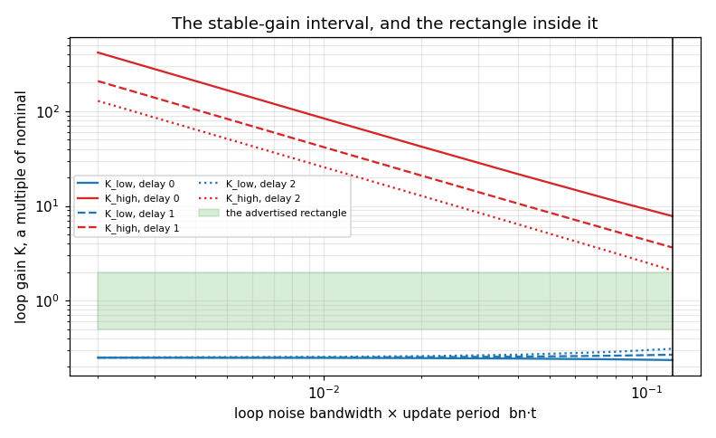
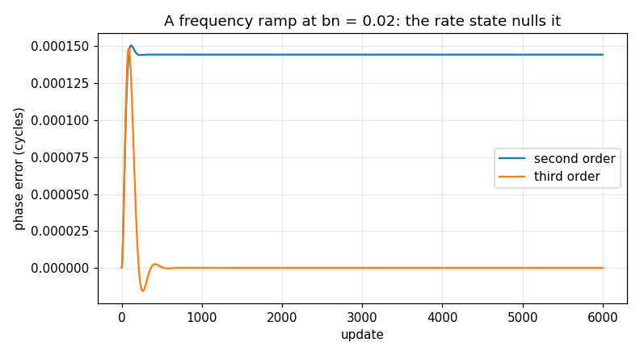

# StateFilter — validation report

Generated by `validate.py` in this folder. Every number is measured from the C implementation through its own binding; nothing is modelled. Re-run to regenerate.

## Executive summary

- **Status.** **CERTIFIED** — all 19 limits hold.
- **Findings.** 6 recorded, 1 still open: F6.

**What a caller most needs to know**

- **The bandwidth asked for is the one delivered**, with no excess to correct for, because the gains are solved from the exact discrete expression (F1, §2.1).
- **A third-order loop nulls a frequency ramp** at the same noise bandwidth where the second-order loop settles to `r/ki` (§2.4).
- **It pays in the step response**: it settles to a frequency step several times slower than the second-order loop at the same `bn` (F4, §2.5).
- **It is conditionally stable in the loop gain**: a discriminator slope under about a quarter of nominal breaks it, and the object cannot see the slope (F3, §2.3).
- **A detector delay widens the loop, and the embedder budgets it**: `bandwidth(delay, gain)` is the exact expression (F2, §2.2).

# StateFilter — validation report

## 1. The object — design and expectations

A filter over an explicit state vector, the frequency estimate and its rate: the fixed-gain third-order tracking loop, the sibling of the second-order `LoopFilter`. The design rationale — the shape of the loop, the exact discrete-time bandwidth the gains are solved from, the stability bound and the gain range it tolerates — is [`docs/design/loop-filter.md`](../../../../../../docs/design/loop-filter.md) Part II; the contract is `native/inc/doppler/state_filter/state_filter_core.h`. Neither is restated here.

Three bodies of evidence stand behind this report:

| evidence | answers |
|---|---|
| `native/tests/state_filter/test_state_filter_core.c` | does each claim in the header still hold, per update, with every pin proven by sabotage |
| `native/validation/state_filter_loop.c` | what the loop delivers over the whole envelope: bandwidth by impulse, by the exact function and by white noise; the stable-gain map; transients |
| this report | does the binding deliver the same object, and what may a caller design to |

The header's claims, and where each is certified:

| claim | certified by |
|---|---|
| the three-line recurrence, `steps` equal `step` | C §2, §5 |
| the gains deliver the bandwidth asked for at zero delay | C §3, §3b; §2.1 |
| the domain, and a bound on `bn*t` | C §1, §7; §2.3 |
| conditionally stable in the loop gain; the lower edge | C §7; §2.3 |
| one exact function, both orders | C §6; §2.2 |
| steady errors by order | C §8; §2.4 |
| the state blob and its flavor key | C §9; §2.6 |
| the restore check: the gains must be the ones `bn` and `t` give, to 1e-9, and the pad word must be 0 | C §9 (forged payloads, the tolerance held a decade either side), §3b (the gains against a long double solve) |
| the interpolated fractional delay is a defined model | C §6 (simulation at 0.5 and 1.25) |
| the exact test is right off the design manifold (a Kalman filter's gains while its covariance converges) | C §10 |
| the decision rule, at loops built at a known radius either side of 1 | C §11 |

## 2. Characterisation

Measured behaviour. No verdicts — those are §3. Section numbers of the C test are named where they correspond.

### 2.1 The bandwidth asked for is the one delivered (C §3)

Parseval on the impulse response of the real filter through the binding, at a detector delay of zero. The second-order filter's delivered bandwidth is wide by a fractional excess that grows with `bn*t`; here there is none, because the gains are solved from the exact expression.

| `bn*t` | Bn (Parseval) | Bn / (bn*t) − 1 |
|---|---|---|
| 0.002 | 0.002 | -2.1e-14 |
| 0.01 | 0.01 | -8.5e-15 |
| 0.02 | 0.02 | -1.6e-15 |
| 0.04 | 0.04 | -2.2e-16 |
| 0.08 | 0.08 | -1.9e-15 |
| 0.12 | 0.12 | +4.4e-16 |

### 2.2 What a detector delay and a loop gain do (C §6)

The exact function `bandwidth(delay, gain)` against a simulation of the real filter, at `bn*t = 0.03`. At an integer delay the model is a real transport delay and the answer is exact.

| delay | gain | exact | simulated | difference |
|---|---|---|---|---|
| 0 | 1 | 0.03 | 0.03 | +4.4e-16 |
| 0 | 0.7 | 0.02621591 | 0.02621591 | -4.1e-15 |
| 1 | 1 | 0.0326457 | 0.0326457 | -3.4e-15 |
| 1 | 0.7 | 0.02813127 | 0.02813127 | -2.0e-15 |
| 2 | 1 | 0.03567489 | 0.03567489 | -3.6e-15 |
| 2 | 0.7 | 0.03029896 | 0.03029896 | -3.1e-15 |

The delivered bandwidth over `bn*t` at a delay of one and two updates (zero delay is 1 exactly):

| `bn*t` | delay 1 | delay 2 |
|---|---|---|
| 0.002 | 1.0056 | 1.0113 |
| 0.01 | 1.0284 | 1.0581 |
| 0.02 | 1.0578 | 1.1209 |
| 0.04 | 1.1197 | 1.2638 |
| 0.08 | 1.2584 | 1.6526 |
| 0.12 | 1.4234 | 2.3089 |

### 2.3 The stable-gain map and the bound (C §7)

The stable interval of the loop gain `K` (the discriminator slope times the oscillator gain, as a multiple of nominal) at each `bn*t` and detector delay, by bisection on the exact test. The lower edge is set by the shape, near `1/(a*b) = 0.25`; the upper edge falls with `bn*t` and with delay.

| `bn*t` | delay | K_low | K_high | changes along K |
|---|---|---|---|---|
| 0.002 | 0 | 0.2497 | 417.50 | 1 |
| 0.002 | 1 | 0.2503 | 208.50 | 1 |
| 0.002 | 2 | 0.2509 | 128.72 | 1 |
| 0.01 | 0 | 0.2485 | 84.17 | 2 |
| 0.01 | 1 | 0.2515 | 41.83 | 2 |
| 0.01 | 2 | 0.2545 | 25.72 | 2 |
| 0.02 | 0 | 0.2471 | 42.51 | 2 |
| 0.02 | 1 | 0.2530 | 21.00 | 2 |
| 0.02 | 2 | 0.2591 | 12.84 | 2 |
| 0.04 | 0 | 0.2445 | 21.68 | 2 |
| 0.04 | 1 | 0.2560 | 10.59 | 2 |
| 0.04 | 2 | 0.2685 | 6.40 | 2 |
| 0.08 | 0 | 0.2398 | 11.27 | 2 |
| 0.08 | 1 | 0.2622 | 5.38 | 2 |
| 0.08 | 2 | 0.2883 | 3.17 | 2 |
| 0.12 | 0 | 0.2358 | 7.81 | 2 |
| 0.12 | 1 | 0.2684 | 3.64 | 2 |
| 0.12 | 2 | 0.3101 | 2.08 | 2 |

At the bound (`bn*t = 0.12`): 0 unstable points on a grid of 41 delays × 15 gains over the advertised rectangle (0.5 to 2.0 of nominal gain, delay 0 to 2); the worst lower edge over those delays is 0.310, a margin of 4.1 dB under `K_MIN = 0.5`; the upper edge at delay 2 is 2.084, within 5% of `K_MAX = 2.0`: True.

### 2.4 The frequency ramp the second order cannot null (C §8)

A ramp of 2e-07 cycles per update per update into both loops at `bn = 0.02`, an ideal detector, after 40000 updates:

| loop | steady phase error (cycles) | predicted |
|---|---|---|
| second order | +1.444e-04 | `r/ki` = +1.444e-04 |
| third order | +0.000e+00 | 0 |

### 2.5 The price: a slower, larger transient to a frequency step

The phase error to a frequency step of one cycle per update, next to the second-order loop at the same `bn` (zeta 0.707): the peak error, and the updates until it stays within 5% of that peak.

| `bn*t` | peak (3rd) | settle (3rd) | peak (2nd) | settle (2nd) | ratio |
|---|---|---|---|---|---|
| 0.01 | 26.73 | 703 | 24.51 | 215 | 3.27 |
| 0.02 | 13.61 | 355 | 12.42 | 108 | 3.29 |
| 0.04 | 7.05 | 180 | 6.38 | 54 | 3.33 |
| 0.08 | 3.78 | 91 | 3.37 | 27 | 3.37 |

### 2.6 The domain and the state (C §1, §9)

`StateFilter(...)` refuses a negative `bn`, `t = 0`, a NaN, an infinite `t`, a `bn*t` past the bound and a `bn*t` below the floor (`ValueError`): 6 of 6 refused. A mid-stream split resumes bit for bit: True. A blob whose flavor word is not 0 is refused: True.

### 2.7 Which phase the bandwidth is of

`bandwidth()` is the bandwidth of the oscillator phase at the detector instant, `phi[n]`, the phase the error is formed from. An embedder that applies the proportional term as an immediate phase step and reads the phase just after it (Costas does) is the same loop, but that tap's sum of squares is a different, smaller number: a jitter measured there is held to that sum, not to `2*Bn`. The ratio `(2*Bn)/(sum post^2)` for both orders, by the impulse response of the real filters through the binding (raw rows in `data/phase_taps.csv`):

| bn*t | order 2: 2*Bn | ratio | order 3: 2*Bn | ratio |
|---|---|---|---|---|
| 0.005 | 0.010045 | 1.0089 | 0.010000 | 1.0096 |
| 0.01 | 0.020178 | 1.0179 | 0.020000 | 1.0191 |
| 0.02 | 0.040716 | 1.0362 | 0.040000 | 1.0382 |
| 0.04 | 0.082883 | 1.0737 | 0.080000 | 1.0759 |

## 3. Review — findings, with verdicts

- **F1 · BY DESIGN** — **The delivered bandwidth is `bn*t` exactly at a detector delay of zero**, to 2e-14 relative across `bn*t` from 0.002 to 0.12. The second-order filter is wide by an excess that grows with `bn*t`; the gains here are solved from the exact discrete expression, so there is nothing to correct for (§2.1).

- **F2 · BY DESIGN** — **A detector delay widens the loop, and the object does not know it.** At `bn*t = 0.04` one update of delay delivers 1.120× the bandwidth asked for and two deliver 1.264×; at the bound, 1.42× and 2.31×. The delay is the embedder's to budget, and `bandwidth(delay, gain)` is the exact expression to size it from (§2.2).

- **F3 · BY DESIGN** — **The loop is conditionally stable in the loop gain**: it needs a discriminator slope above a lower edge near `1/(a*b) = 0.25` of nominal and has an upper edge that falls with `bn*t` and delay. At the bound the worst lower edge over delays 0 to 2 is 0.310, 4.1 dB under `K_MIN = 0.5`. A second-order loop has no lower edge; an embedder whose discriminator slope compresses at low signal-to-noise ratio must check it against this one (§2.3).

- **F4 · BY DESIGN** — **Nulling the ramp costs the step response.** At the same `bn` the third-order loop settles to a frequency step in 3.3× the updates of the second-order loop at `bn*t = 0.01` (3.3× at 0.04) and its peak error is larger. That is the price of the rate state; a caller whose carrier does not ramp should keep the second-order loop (§2.5).

- **F5 · C-ONLY** — **The exact function's accuracy against the closed form down to `bn*t = 1e-6`, and the noise-variance route to the bandwidth** are certified in C (`test_state_filter_core.c` §3b, `state_filter_loop.c`): the binding reaches the function at the cells of §2.2 only.

- **F6 · GAP** — **The filter is certified as an object, not in a closed loop with a discriminator.** Pull-in from a frequency offset, cycle slips under noise and a slope that compresses at low signal-to-noise ratio belong to the composition that adopts it, and a gallery figure of the ramp traces is not drawn. Tracked in [#3123](https://github.com/doppler-dsp/doppler/issues/3123).

## 4. Limits — the certified envelope

Claims a caller may rely on. A failure here is a regression, not a new finding. Every one is asserted by `src/doppler/track/tests/test_validation_limits.py`.

*Checked by* names the check; *control* is the same assertion evaluated on a named wrong case, which this report requires to FAIL (a refusal's control is its minimal pair: the same call with the offending argument made good must succeed). *Break* is a one-line break of the source run against the claim: not run for this report yet, so the column says so. The numeric tolerances are derived where a derivation exists (rounding of a sum of `n` terms, `4 * eps * sqrt(n)`, or of the ramp's phase accumulator) and the rest say they are a pin.

| verdict | claim | checked by | control (must fail) | break that turns it red |
|---|---|---|---|---|
| PASS | the delivered bandwidth at zero delay is `bn*t` to 2.1e-14 across bn*t 0.002 to 0.12, inside the rounding bound 6.4e-13 of a sum of up to 520000 terms | validator §2.1, Parseval through the binding; C §3 | the same check at a detector delay of one update (5.8e-02, far over the bound) | not run |
| PASS | the exact `bandwidth(delay, gain)` agrees with simulation at integer delays 0 to 2 and gains 1.0 and 0.7 to 4.1e-15, inside the rounding bound 2.2e-13 of a sum of 60000 terms | validator §2.2; C §6 | the exact function at delay 1 against the simulation at delay 0 (8.1e-02) | not run |
| PASS | a longer detector delay delivers a wider bandwidth, at every bn*t measured | validator §2.2 | the same comparison with the delays reversed is false | not run |
| PASS | at the bound bn*t = 0.12 the loop is stable over the advertised rectangle (gain 0.5 to 2.0, delay 0 to 2): 0 unstable grid points | validator §2.3 (41 delays by 15 gains); C §7 | the same grid at gains 5 to 10 times nominal has 15 unstable points | not run |
| PASS | the stable gains at every measured (bn*t, delay) form one interval (at most 2 changes of stability along K) | validator §2.3, a log sweep of K | none: the set is an interval at every point measured, so no wrong case is available in this family | not run |
| PASS | the lower gain edge at the bound is 0.310, under K_MIN = 0.5 (4.1 dB of margin) | validator §2.3; C §7 asserts it at every delay to 2 | the same assertion with the floor at 0.25 (the shape's own lower edge) is false | not run |
| PASS | pin: the bound is tight: the upper edge at the worst delay is 2.084, within 5% of K_MAX = 2.0 (the exact bound is 0.1248 and the constant 0.12; 5% is a pin set above the measured 4.2%) | validator §2.3; C §7 derives the bound by bisection | at bn*t 0.06 the upper edge is 4.25, not within 5% | not run |
| PASS | the second-order ramp error is r/ki to 2.3e-11, inside the rounding 9.8e-10 of the ramp's phase accumulator | validator §2.4; C §8 | r/ki of a loop at twice the bandwidth is 2.9e+00 off | not run |
| PASS | the third-order loop nulls the ramp: 0.0e+00 against 1.4e-04 for the second order, inside the accumulator's rounding | validator §2.4; C §8 | the second-order loop's error on the same ramp is not null | not run |
| PASS | create refuses a negative bn, t = 0, a NaN, an infinite t, a bn*t past the bound and one below the floor | validator §2.6; C §1 | the minimal pair: `StateFilter(bn=0.02, t=1.0)` is built | not run |
| PASS | a mid-stream split resumes bit for bit | validator §2.6; C §9 | resuming from a state whose frequency estimate was moved is not the uninterrupted run | not run |
| PASS | steps() equals repeated step() | validator §2.6; C §5 | a one-sample-shifted input is not what steps() computed | not run |
| PASS | configure retunes the gains and keeps both estimates | validator §2.6; C §4 | after reset() the estimates no longer equal the held ones | not run |
| PASS | reset zeroes both estimates | validator §2.6; C §4 | before reset() the estimates are not zero | not run |
| PASS | the writable integ and rate seed the loop | validator §2.6 | seeding zeros does not move the loop | not run |
| PASS | the third-order step response is slower than the second-order's at the same bn, at every bn*t measured (the price of the rate state) | validator §2.5 | the reverse comparison is false at every bn*t | not run |
| PASS | a blob with a flavor word other than 0 is refused | validator §2.6; C §9 | the minimal pair: the unmodified blob is accepted | not run |
| PASS | the sum of squares of the phase at the detector instant is `2*Bn` to 1.9e-14 for the third-order loop, inside the rounding bound 2.2e-13 of a sum of 60000 terms | validator §2.7 | the phase just after the proportional step is 8.9e-03 off `2*Bn` | not run |
| PASS | pin: the phase just after the proportional step has a sum of squares below `2*Bn` by a factor between 1.009 and 1.076 at bn*t 0.005 to 0.04, both orders (1.15 allowed: a pin set from the measurement) | validator §2.7 | the detector-instant ratio (1.000) is not in the open interval above 1 | not run |

## 5. Summary

- **6 findings**, 1 of them gaps or confirmed defects: F6
- **19/19 limits** hold
- Raw sweeps: `data/bandwidth.csv`, `data/stability_map.csv`, `data/transients.csv`, `data/phase_taps.csv`
